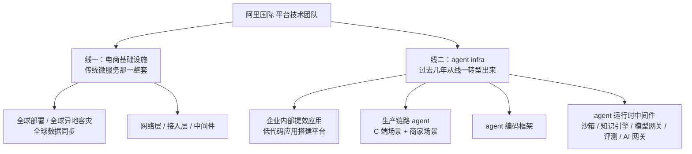

# 阿里国际（AIDC）

> **注意**：阿里系在本库里是分开建页的——[[阿里云]]（消息中间件）、[[淘天]]（AI Agent 应用层）、[[蚂蚁]]（后端分布式）、本页（阿里国际 Agent Infra 平台）。**四家考法完全不同，别混着复习。**

## 概览
- 方向：阿里国际（AIDC）电商集团下的**平台型部门**，做整个 agent infra
- 招聘项目：**阿里星 / Bravo Star 顶尖人才计划**（官方口径是「继承阿里星使命与愿景」的旗舰项目，聚焦 AI / 算法 / 产品）
- 难度：中高 —— **零八股、算法只有一道简单题**，但会用连环追问把你的 agent 项目从「单机 demo」一路逼到「多租户平台」
- 一句话画像：**这是本库唯一一场「agent 平台化」考法**。前 30 分钟看起来在深挖项目，实际上第 20 分钟起连着 7 问全是同一件事——**运行时形态 → 集群部署 → SLA → session 隔离 → 持久化 → 工作区隔离 → 中间产物共享**。项目细节答得再好，这条链路断了就是断了
- **三轮考法完全不同，要分开准备**：一面是技术深挖（61 分钟、连环追问逼到答不出、有算法题）；二面是匹配度面（40 分钟、每题只追一层，重点看知识引擎与意愿）；三面是技术负责人 + HR 混合终面性质（55 分钟，前 40 分钟继续深挖 Google Memory、AI Coding、知识工程与多 Agent，后 15 分钟核验稳定性和团队匹配）

## 部门在做什么（反问环节挖到的，投这个方向必读）

1. **agent 怎么构建**——① 低码 `app builder`（类 Dify 拖拉拽）② 高码 `AgentScope` 框架 ③ vibe coding（类扣子编程范式，**给一线非技术业务同学生成 agent**）
2. **agent 协同**——各业务团队都在造自己的 agent，企业内怎么串通：A2A 协议、权限授权、数据与记忆打通
3. **企业记忆中心 / 知识中心**——重点在做

> 面试官原话定位：「更多偏向平台的基建……要达到规模化复用、能力复用、共同标准在企业内部落地，肯定是在 infra 团队去建设的。」

### 二面补充：团队其实是两条线，agent infra 是从电商基建转型出来的

- **业务盘子**：跨境（中国货卖全球）+ 本对本（东南亚等地建本地站，形态类似亚马逊区域站），覆盖 **250 多个国家**，**复杂性来自每个国家的政策与合规差异**，不来自体量
- ⚠️ **「模型网关」和「AI 网关」在面试官口中是分开列的两个东西**，区别没问到——**下一轮必问的钩子**

### 🔑 面试官亲口说的「哪块 infra 对 agent 提升最大」（二面反问，含金量最高）

**第一块：知识引擎 + 企业内部 context 工程**——「**你怎么把整个团队的知识库整理清楚，这是非常基础且重要的工作，我们在这方面投入会比较大**」。难点三层递进：① 代码 ② 存量团队积累十几年的大量文档 ③ **🔑 最复杂的是知识存在人脑子里**——「以客服为例，**大量知识存储在个人的运营经验里面**，怎么从人的经验做输入反馈的链路、把知识沉淀清楚」

**第二块：agent 自我进化 → skill**——「从整个**反馈链路**，再到整个 **bad case 归因**」

> **投这个方向的复习优先级直接由此确定：知识引擎 / context 工程 > memory 与 skill 自进化 > 运行时扩展 > 其它。**

### 三面补充：技术负责人亲口给出的招聘标准与团队边界

**硬能力只有两条：**

1. **AI Coding 的使用深度**——能否通过有效引导，让 coding agent 用更少轮次达到目标代码质量；追问 Google 项目「代码怎么生成、具体挑战在哪」就是在验证这一条。
2. **Agent infra 的判断力**——什么时候拆主 Agent / 子 Agent，各管什么；什么时候做 Agent、什么时候沉淀 skill；评测标准是什么。

**软能力：** 聪明、开放、务实；愿意做 dirty work，并能从真实工程问题里沉淀出可复用能力。

**与阿里云的边界：** 阿里云提供底层沙箱、云电脑；AIDC 在其上负责更贴业务场景的 Agent 生成（vibe coding / workflow）、评测与线上运行监控。**所以这里的 Agent infra 不是从零造底层云基础设施，而是生产和运行 Agent 的平台层。**

<!-- 来源: 三面技术负责人现场自述 ・ 2026-08-20 -->

### 🔑 面试官亲口说的「对校招生的期待」（二面反问）

- **实战经验是唯一分层标准**：「理论知识方面，**多多少少大家都能回答出来**，但很多同学缺少实战经验」；**没实习、只有学校 demo 的占六七成**，有多段实习的不多
- **最具体的一条**：「给他一个**探索性**的任务……比如**有些开源项目能够引进来，快速在企业内部落地，结合业务场景去实施**，他上手速度会比较快。**我看重的是快速把这些东西落地的学习能力跟经验**」
- 👉 **这段描述的就是字节答疑 Bot 的形状**（开源框架二次开发 → 接内部中间件 → 结合国际电商业务 → 56% 到 87% 上线）。**听到这段必须当场把自己贴上去。**

## 面经文件
- [[公司/阿里国际/Agent Infra/阿里星三面_2026-08-20]] —— 三面（**未知**）·**技术负责人 + 两位 HR 混合面**（55 分钟、无算法）·✅ Google Memory 的实验污染与代码事实源讲清 + 职业方向对齐 Agent infra · 🔴 Memory 与知识工程的边界答错 · 🔴 审核 Agent 保留原长上下文却声称长上下文问题已解决，被连续追问 · 🔴 HR 段负面评价 Google 业务和字节同事 · SkillOpt / SkillOpt-Sleep 名称与消融结论需订正
- [[公司/阿里国际/Agent Infra/阿里星二面_2026-08-18]] —— 二面（**未知**）·**匹配度面，不是技术深挖面**（40 分钟、无算法）·✅ 一面最大失分点「infra vs 垂类」这场答对了 + 「训练不了权重但能训练 context」是全场最佳单句 + 完整讲了三个失败方案的演化史 · 🔴 **知识层三连问连着三次说「不是我做的」**，而对方正是投入最大的知识引擎 · 🔴 通用 memory 组件怎么评判写入好坏——一面刚答过的高光题，二面答成了垂类做法
- [[公司/阿里国际/Agent Infra/阿里星一面_2026-08-06]] —— 一面（**过**）·**运行时与水平扩展连环 7 问**（沙箱 / 单实例单进程 / SLA / thread_id 隔离 / SQLite 持久化 / 工作区隔离 / 🔴 多实例产物共享答不出）+ 决策树门禁的 middleware 实现 + RAG vs LLM Wiki 三连 + 上下文控制三层 + skill 加载机制 + 模型网关与 prompt cache 断点 + 评测流水线 + 谷歌自进化 memory + **业界 memory 三家对比（全场最高光）** + OpenClaw 三阶段门禁 + 🔴 infra vs 垂类答反 + 算法：无重复字符最长子串

## 考察重点（按出现次数排序）

> **三轮重点继续变化**：下面 1–8 是一面的（运行时技术深挖），9–13 是二面新增的（知识层 + 匹配度），14–18 是三面新增的（当前产出边界 + AI Coding + 概念判断 + 稳定性）。

1. **🔴 agent 服务的水平扩展（一面 7 题，最重）** —— 部署形态、集群、SLA、session 隔离、持久化、工作区隔离、**中间产物多实例共享**。这一串是标准的「有状态服务怎么变无状态」在 agent 场景下的复现，**面试官会一路往下追到你断为止**
2. **agent 记忆机制的横向调研（3 题）** —— Claude Code / Codex / Mem0 各自怎么做、共同缺什么（**答案是"没有评测基线"**）、通用 agent 没有 golden data 时怎么设计 memory（**答案是"换代理指标"**）
3. **知识检索范式选型（3 题）** —— RAG vs LLM Wiki 的区别、LLM Wiki 的生成与读取原理、什么场景用哪个
4. **上下文工程** —— 大工具返回 offload、决策树的摆放位置与 prompt cache 的关系、多级压缩策略
5. **模型网关与 prompt cache** —— 多模型接入的**真实驱动力是可用性不是效果**、cache 断点协议、cache 原理（前缀匹配 / KV cache）
6. **评测体系** —— rubric 踩点判分、LLM as judge、多轮取均分压方差
7. **职业意愿** —— **「你想做 infra 还是垂类业务？」这题必考且必须提前备好**，答案写在部门定位里
8. **算法（一面 1 题，简单；二面无）** —— 无重复字符的最长子串，口述逻辑即可，不用跑测试
9. **🔴 知识生产链路（二面 3 题连问，本场真正的考核点）** —— **非技术角色（运营 / 产品）的知识从哪来** → **知识清洗有产品支撑还是人工** → **召回链路是自研还是中间件**。**三问都不是在查项目边界，是在查你对企业知识引擎有没有自己的主张**，因为这正是他们投入最大的一块
10. **通用 memory 组件的评判问题（二面，且一面考过同一题）** —— 「作为 memory 组件本身，**不管业务逻辑**，怎么评判别人写进来的好坏」。**面试官会在问题里主动排除垂类做法**，答「我们有评测集所以能跑门禁」直接答偏
11. **评测的组织形态（二面 2 题）** —— 打分用脚本还是 LLM judge、**评测系统在公司内是不是统一的 / 为什么统一不了**（本质在问平台化程度）
12. **反馈飞轮（二面）** —— 用户反馈怎么闭环到优化方向；**「用户追问 = 隐式失败信号」是个好答案**
13. **意愿与可用性（两轮都考，二面尤其密集）** —— infra 还是垂类（**必考**）、毕业时间、会不会回国、纯工程还是算法、对团队感不感兴趣
14. **Google Memory 当前产出边界（三面连环追问）** —— 当前落地的是本地隔离与批量测量；生成 prompt、召回 query、Memory 结构优化仍是后续。**三句固定口径：当前做了什么 → 为什么它是自进化前提 → 下一步才是什么**
15. **AI Coding 是否形成硬闭环（三面 5 题）** —— 大代码仓库怎么找 hook、上下文怎么跨会话交接、单元 / 集成 / smoke test 各验证什么。目标不能说成「减少人介入」，要说成「把人的判断编码成可运行检查」
16. **Memory 与知识工程的边界（三面）** —— 不能按「人写 / Agent 写」区分；知识工程维护组织级事实和规则，Memory 保存用户 / 项目 / Agent 的运行状态与经验，前者重来源和治理，后者重写入、召回、作用域、冲突与淘汰
17. **多 Agent 是否真的解决长上下文（三面连追 4 题）** —— 审核 Agent 必须拿干净上下文 + 决策树 + 答案草稿并能独立读代码；如果打回后仍让原主 Agent 带旧长上下文重答，只能说 bad case 改善，不能说根因已解
18. **稳定性与组织评价（三面 HR）** —— 为什么 gap、九个月为什么三段、如何评价字节、拿 offer 是否回、为什么不留 Google。**所有理由只讲自己的选择标准，不评价当前业务边缘、同事不分享或公司发展空间**

## 真题摘录（值得背的）

> 🔴 **【本场分水岭】你的 agent 是单实例单进程，那 bash 生成的中间产物怎么做到多实例共享？** 出处 [[公司/阿里国际/Agent Infra/阿里星一面_2026-08-06]]
> **答"没思考过"就断了。正确答法第一步是拆状态**——① 会话历史 → 换外部数据库（SQLite → PostgresSaver，任何实例按 thread_id 都能接）② **只读物料（代码仓库副本、skill 目录）→ 根本不需要共享，每个实例各带一份**（这条最容易漏，说出来最能证明分得清）③ 会话产物 → 才是真问题。
> 产物三条路按改动成本排：**会话亲和**（网关按 session_id 一致性哈希路由，产物留本地，代价是机器挂了就没了）→ **共享文件系统**（ReadWriteMany PVC / NAS，路径不变改动最小，代价是大量小文件的元数据操作慢一个量级）→ **对象存储 + 会话工作区**（最能扛，代价是 POSIX 语义给不了，bash 工具要改）。
> **工业界真正的做法是把工作区从进程里拆出去做成沙箱服务**：每 session 一个远端沙箱，bash 走 RPC 打进去，agent 进程彻底无状态，**顺带把"隔离"和"产物可迁移"一起解决**。收口一句：**「无状态」不是把状态删掉，是把状态挪出进程，然后按性质分别选存储。**

> 🔴 **【必考且能 100% 提前备好】你未来想做 infra 层，还是一个垂直的业务场景？** 出处 [[公司/阿里国际/Agent Infra/阿里星一面_2026-08-06]]
> **这题答反过一次，代价很大——对面就是 infra 团队。** 先对齐口径：**infra 是横向**（一套能力服务所有业务线，同时碰到构建/协同/记忆/网关/沙箱每一块）；**垂类是纵向**（一个场景做到底，只碰一条线）。**「我想看到 agent 的全景、每个模块怎么做」描述的就是 infra，不是垂类。**
> 选边理由要落到经验形状上：「我在字节真正花时间的是 middleware 门禁、决策树的可校验结构、网关收敛协议差异、评测流水线——**这几件事换个业务全都能复用，它们本来就是 infra**」。收口：**agent 三个月换一茬，而评测、门禁、隔离、网关这几层每一代都要重做一遍——横向能力是唯一能跨过换代活下来的东西。**

> **RAG 和 LLM Wiki 有什么区别？什么场景用哪个？** 出处 [[公司/阿里国际/Agent Infra/阿里星一面_2026-08-06]]
> RAG 切片返回片段，**没有知识链路**，探索只能靠 query 改写；LLM Wiki 有层级结构和链接引导，agent 能自主导航。**分界线是「导航层还能不能装进上下文预算」**——wiki 的命门是那张必须常驻的导航页，文档涨它就涨。所以真正的判据是**知识有没有天然的树状结构**：有结构，导航页能靠层级压缩；没结构（工单、日志、聊天记录）只能线性增长，必须上 RAG。
> **而且这两个通常不是二选一是叠加的**：wiki 当地图做粗定位，RAG 当索引在子集里精排，最后 grep 精确收敛——三层漏斗，每层召回集小一个量级。

> **业界几家 agent memory（Claude Code / Codex / Mem0）跟你们的区别是什么？** 出处 [[公司/阿里国际/Agent Infra/阿里星一面_2026-08-06]]
> **收口判断是「它们都没有评测基线」**——改完之后效果怎么样谁都不知道。面试官当场补话「没有对比基线」，这是全场共鸣最强的一刻。
> ⚠️ 但四处口径要订正：**SkillOpt 是 Microsoft Research 的（arXiv 2605.23904），不是谷歌，也不叫 Skill Up**；它的消融结论是**文本学习率和验证门禁都关键**（有界更新优于无界重写，去掉 rejected-edit buffer 掉最多 4.6 分），不是「只有门禁关键」；**Claude Code 是写完就是终点，没有后台整理、没有防腐化机制**；**Codex 的触发是会话闲置满 6 小时**，不是每天定时。详见 [[Agent记忆四家实现对比]]。

> **通用办公型 agent 没有可校验的样本，memory 该怎么设？** 出处 [[公司/阿里国际/Agent Infra/阿里星一面_2026-08-06]]
> **verify 没有消失，是换了代理指标。** 有 golden data 就看「改完验证集分数涨没涨」；没有就退到「这条记忆被真的用上过几次、被多少个**不同的**查询用上过」。OpenClaw 的三重门是这个思路的极致：`minScore ≥ 0.8` + `minRecallCount ≥ 3` + `minUniqueQueries ≥ 3`，**第三条最关键——它是唯一能区分「可复用经验」和「某个特定问题的附属答案」的**。
> 核心是「用进废退」：**OpenClaw 是三家里唯一把「被使用过」设成入库前置条件的**，另外两家的使用统计都是入库之后的排序依据。

> 🔑 **【二面本场最重要的一题】作为一个 memory 组件本身，不管业务逻辑，你怎么评判别人写进来的好坏？** 出处 [[公司/阿里国际/Agent Infra/阿里星二面_2026-08-18]]
> **面试官在问题里就把垂类做法排除了**（原话：「从他单垂直去考虑是可以做到的」），答「我们有评测集所以能跑门禁回滚」= 答偏。**三层答法：**
> ① **有可验证数据集**（垂类的奢侈品）→ 留出验证集门禁，分数没提升就回滚；
> ② **平台组件拿不到业务语境** → **verify 没有消失，是换了代理指标**：检索相关性分数 < 被召回次数 < **被多少个不同的查询召回过**。**第三档最关键**，它是唯一能区分「可复用经验」和「某个特定问题的附属答案」的（口径见 [[Agent记忆四家实现对比]]）；
> ③ **平台方的终局不是自己评判，是把评判协议标准化**——对外暴露回填接口「这条记忆参与了这次任务，成功 / 失败」，**什么叫成功由垂类定义**，平台只负责把回填信号变成排序权重和淘汰依据。**代理指标是垂类接进来之前的兜底，回填协议才是终局——平台自己去猜业务好坏这件事本身不成立。**

> 🔑 **【二面 3 连问】运营和产品这类非技术角色的知识从哪来？清洗有产品支撑还是人工？召回链路是你做的还是中间件？** 出处 [[公司/阿里国际/Agent Infra/阿里星二面_2026-08-18]]
> **这三问连着答「不是我做的 / 我只是 call 一个 API」是最贵的错误**——面试官紧接着在反问里说知识引擎是他们投入最大的一块。
> **固定三段式：现状 → 我作为消费方对它提了什么要求 / 我的诊断 → 如果让我改我会怎么改。第三段才是他要听的。**
> 内容上要答出：**有文本载体的知识**（PRD / design doc / 代码 / 业务名词表）**和没有文本载体的知识**（运营经验只在人脑子里）要分开讲；后者的做法是**让知识从问答里长出来**——反馈入口就是机器人本身，专家改的不是这一次的答案而是背后那份文档。**现在的瓶颈是「人的订正回到知识库」中间还有一次人工搬运，这一跳才是真门槛。**

> **【必考】你倾向做 infra 还是业务 agent 开发？（一面答反，二面答对了方向但理由薄）** 出处 [[公司/阿里国际/Agent Infra/阿里星二面_2026-08-18]]
> 第一句必须是「**做 infra**」，然后两条理由：**① 经验形状**——「我在字节真正花时间的四件事：middleware 门禁、决策树的可校验结构、网关收敛协议差异、评测流水线，**换个业务全都能复用，它们本来就是 infra**」；**② 判断**——「**agent 三个月换一茬，但评测、门禁、隔离、网关每一代都要重做一遍，横向能力是唯一能跨过换代活下来的东西**」。收口指向具体的深度：知识与记忆这一层。
> ⚠️ **禁用「它可能更加有意思」这种理由**——那是感受不是论证。

## 复习清单（双链）
- [[字节答疑Bot]] —— **两轮的主战场**：一面深挖 30 分钟（新增「运行时与平台化」追问轴），二面深挖 17 分钟（**知识生产链路**这条轴是二面新增的）
- [[谷歌Memory]] —— 一面后半段 13 分钟，二面前段 6 分钟（**通用 memory 组件的评判问题两轮都考**）
- [[西门子RAG]] —— 二面只过了 1 分钟，但它是「自己搭过完整 RAG 链路」这张牌的出处，**答「召回链路是平台做的」时必须拿它做对比**
- [[Agent记忆四家实现对比]] —— §15 / §16 两题的标准答案全在这里
- [[Agent上下文压缩链路]]
- [[LLM多协议网关适配]]
- [[LangGraph工程实践]]
- [[RAG优化全链路]]
- [[Agent设计模式与MCP]]
- [[幻觉与事实性评测]]
