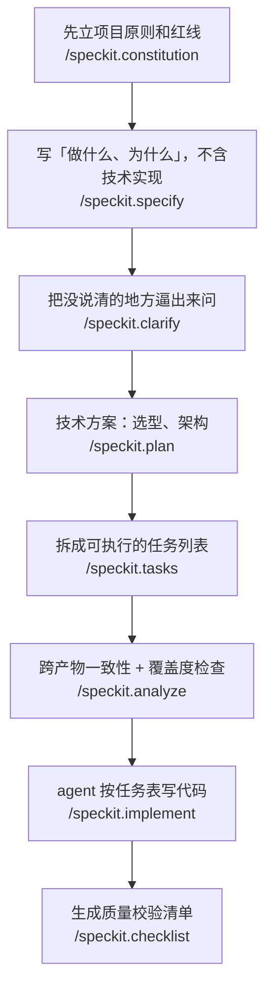
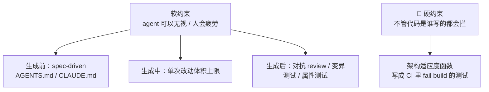

# AI Coding 工程实践

> 2026 秋招的**通用题**——不分岗位方向，后端 / Agent / 基础架构都在问。
> 考的不是「你用不用」，是**你有没有一套判据**，以及**你验证的时候依不依赖人眼**。

> 📌 一手素材来自两次多路调研（2026-08-06 六路 + 2026-08-08 三路）。**凡是带 URL 或标了来源的数字都核过；没标的一律是通用共识或推断，已就地标注。**

---

# 🟢 精简版：怎么做（面前三分钟只看这一段）

**全文一句话：把「对不对」这件事，从人的判断变成机器的判断。**

## 做的时候，六步

**1. 先说清楚要什么，再让它写。**
不要把需求原样丢给模型。先自己定下边界——不做什么、极端情况怎么处理、失败了返回什么。**这一步是唯一不可替代的，交出去等于宣布自己可被替代。**

**2. 一次只让它做一件事。**
社区收敛出来的门槛是**单个改动不超过 500 行**。理由很实在：审查成本是超线性的，改动一大，大家就只会点通过。

**3. 先要方案，再要代码。**
让它先说打算怎么做，方案错了成本是零；代码写完了再发现方案错了，成本是全部。

**4. 收到代码，先读它的计划文档，别先读代码。**
尤其是「还没解决的问题」那一节——**那里通常写着后面会炸的东西，而且比读代码便宜一个数量级。**

**5. 验证要分层，而且别指望人眼。**

| 先用 | 因为 |
|---|---|
| 编译器 / 类型检查 / lint | 确定性，一次配置永久生效 |
| 单元测试 + **只看这次改动的覆盖率** | 总覆盖率在大仓库里几乎不动，没有信号 |
| CI 里的**硬闸门**（不是告警） | **告警一定会被忽略** |
| 换一个会话 / 换一个模型来审 | **干活的那个不能是给它打分的那个** |
| 变异测试（故意注入小 bug 看测试抓不抓得到） | 覆盖率只说明这行**被执行过**，不说明**错了会被发现** |

**6. 人只审两类地方。**
一是碰钱、碰权限、碰用户数据、碰数据库迁移的；二是**「它做了我没让它做的事」**——AI 特别爱顺手加 fallback、加吞异常的 try-except、加没要求的配置层。

## 三个必须知道的坑

**坑一：它的错误长得跟人的不一样。**
模型优化的目标是「输出**像不像**对的」，不是「对不对」。所以它的错误天生是**读起来很顺、命名很合理**的那一类——**正好是人眼最容易放过的那一类。**

**坑二：让 AI 写测试来验 AI 写的代码，等于让它自己给自己判卷。**
而且它作弊的方式很具体：**跑不过就改测试**。有基准专门测到过这种行为——加 sleep 而不是修竞态、重写测试去接受错误行为。

**坑三：「多写测试」防不了屎山。**
AI 写测试时看得到实现，断言会耦合到实现上。**实现把 `>` 写成 `>=`，它的测试就照着这个行为写断言——测试全绿，bug 被固化成契约。**

## 长期只有一条真正有强制力

前面所有东西——写规格、写项目约定文件、code review——**都是软的，模型可以无视，人会疲劳**。

**唯一的硬约束是把架构规则写成 CI 里会让构建失败的测试**（比如「这个包不许依赖那个包」）。**它的价值恰恰在于不关心代码是谁写的。**

## 记不住就记这三句

> **提示词是建议，闸门才是保证。要 100% 发生的事，别写进提示词。**
> **干活的那个不能是给它打分的那个。**
> **你能验证它，才能发它；验证不了就别发。**

---

## 高频问法

- **「你怎么用 AI coding 的？」** — [[公司/米哈游/米哈游一面（我面试）_约2026-08]]
- **「怎么保证 AI 生成代码的质量？」** — [[公司/米哈游/米哈游一面（我面试）_约2026-08]]
- **「有没有工程化的方式，保证编码的有效性？」** — 同上（**一场里第三次追问同一主题**）
- **「你用 Cursor 过程中有没有遇到实际问题？」** — [[公司/其他/PingCAP/面试问题总结]]
- **「你们组里怎么用 agent 写代码 / 跟 Claude Code 比你做了什么改进？」** — [[公司/快手/DataAgent方向/快手数据平台DataAgent一面_2026-07-29]]
- **「有参考类似 SPEC 这种方式吗？」** — [[公司/星河觉醒/Agent方向/星河觉醒Agent二面_2026-08-07]]（🔴 **答不上来，补课见 ⑤b**）

---

## ⓪ 面试形式分两派，准备动作是相反的（🆕 2026-08-08 查证）

拿到面试邀约**先问 recruiter 是哪派**——两派要练的东西完全不同。

| | **受控派** | **自带派** |
|---|---|---|
| 代表 | **Meta**、Google（2026-05 起试点） | **Canva**、Rippling |
| 规则 | 只能用它内置的 AI，**明令禁止外部工具** | **自带 IDE、自选 AI 工具**（Copilot / Cursor / Claude） |
| 形态 | 一道多阶段大题 / 约 60 分钟 / 多文件已有代码库；**AI 只能在 chat 面板回话，不能直接改文件** | 完整的 AI 协作流程，共享屏幕 |
| 实际考什么 | **读懂已有代码 + 验证**（排除了 agent 模式） | 需求拆解 + 判断力 + 协作过程 |
| 会前要准备 | 练读陌生代码、练单窗口对话 | **提前备好项目模板、lint / test 脚本** |

**Meta 官方招聘页原文**（metacareers.com/hiring-process，一手）：
> 「Candidates are **expected to** use this AI assistant as part of the interview.」——是 **expected 不是 allowed**
> 「**No outside AI tools or assistance are authorized** — only the tools available within the interview environment may be used.」

官方给这轮的名字是 **AI-Native Coding Interview**，公开的考察词是 **problem-solving / coding / debugging / collaboration**。

> ⚠️ **网上流传的「Meta 四维 rubric（Problem Solving / Code Quality / Verification / Communication）」不是 Meta 公开的**，是备考机构转述内部说法；那些带百分比权重的版本（35-40% / 25-30%…）**查不到任何一手来源，判定为编造，一律别引用**。
> ⚠️ 三栏 CoderPad 布局、可选模型列表、E5-E7 覆盖范围等细节来自候选人回忆，**要说「据候选人反馈」**。
> <!-- 来源: metacareers.com 官方页（高）+ Hello Interview / interviewing.io 社区汇总（中）・ 查证于 2026-08-08 -->

**上海 AI Lab 那场是自带派**（「任何模型、任何 harness 都可以」）→ 见 [[公司/上海AI Lab/后训练数据/上海AI Lab后训练数据一面_2026-07-31]]。

---

## ① 面试官到底在测什么

> ✅ **证据强度已更新（2026-08-08）**：国内大厂（字节/阿里/腾讯/快手/米哈游）仍然**没有任何一家公开过评分标准**。但海外**Canva 公开了完整的一手 rubric 和反模式清单，而且是面试官视角写的**——这是目前最强的一手来源，下面 §①b 单列。§① 的四维仍是合成版，**面试里别说「业界的评分标准是……」**。

### ①b Canva 的一手 rubric（🆕 唯一可以直接引用的公开评分标准）

出处：canva.dev/blog/engineering 两篇——《Yes, You Can Use AI in Our Interviews. In fact, we insist》（2025-06，作者 Simon Newton，head of platforms）+《AI Interview Success: An Interviewer's Inside Guide》（面试官视角）。

**三个评估维度（官方原文）：**

| 维度 | 原文 |
|---|---|
| **Engineering Problem-Solving** | 「Can you break down complex requirements, make scope and prioritization decisions?」 |
| **Technical Depth & Ownership** | 「**Do you understand and own the code in your solution?** Can you identify potential issues, explain your architectural choices?」 |
| **AI Collaboration Effectiveness** | 「Do you use AI tools to accelerate appropriate tasks **while maintaining technical control**?」 |

**🔴 三个官方点名的减分模式（唯一有一手出处的反模式清单，名字很有辨识度，可以直接说出口）：**

| 名字 | 原文表现 |
|---|---|
| **AI Showcase** | 重心放在「demonstrating their AI tool mastery」而不是工程基本功 |
| **Feature Marathon** | 为了多做功能「accepting AI outputs quickly to maximize progress」，牺牲思考质量 |
| **Hands-Off** | 把 AI 当「**a complete solution generator rather than a development accelerator**」 |

**Newton 的观察（这句可以当收口）：**
> 挂掉的候选人「**not because they couldn't code, but because they lacked the judgment to guide AI effectively**」——**挂点在判断力，不在编码力。**

> 💡 **反用法**：被问「你怎么控制 AI 编码质量」时——「Canva 公开的三个减分模式里有一个叫 **Hands-Off**，就是把 AI 当完整方案生成器而不是加速器。我的做法是……」
> 📌 **各家一手二手材料唯一完全一致的一条：最致命的减分行为是「解释不了自己交的代码」。**
> <!-- 来源: canva.dev 工程博客官方 ・ 查证于 2026-08-08 ・ 置信度高 -->

**他问这题有两层动机：**

1. **能力评估失灵了。** Karat 调研 400 位工程负责人，**71% 说 AI 让技术能力更难评估**（[karat.com](https://karat.com/engineering-interview-trends-2026/)，2026-01-07。⚠️ Karat 卖技术面试外包，这个结论正好论证「所以你该买我们的服务」）。**他不是好奇你的工具栈，他在找一个还没被 AI 污染的信号源。**
2. **反作弊。** The Pragmatic Engineer 调研 63 位面试官，**81% 的大厂面试官怀疑过候选人在面试中用 AI，31% 抓到过**（[newsletter.pragmaticengineer.com](https://newsletter.pragmaticengineer.com/p/the-pulse-146)，2025-09-18）。**「要求你流利解释」本身就是反作弊设计——你答得越具体，越是同时解决他两个问题。**

**四个评分维度（合成，非原文 rubric）**

| 维度 | 高信号 |
|---|---|
| **判据** | 有一套决定「什么交给它」的规则，**而且规则不是「任务难不难」** |
| **理解的可见性** | 说得清每个文件为什么改、哪段是它写的哪段是你改的 |
| **验证的独立性 + 自动化** | **判分的不是干活的那个，而且判分的最好不是人** |
| **代价意识** | 主动认领 AI 让你变慢 / 审查成本上升的场景 |

> ⭐ **最硬的一条证据**：Applied Intuition 改造面试流程时统计了七个信号的评估信心度，六个落在 4.0–4.7（满分 5），**唯独「code elegance and design」分低，所以被单独留在一个 45 分钟「不许用 AI」的电话筛里**（[appliedintuition.com](https://www.appliedintuition.com/engineering-blog/hiring-engineers-age-of-agents)，2026-07-22）。
> **这解释了为什么面试官会在你讲完用了 AI 之后追问设计细节——不是刁难，是这一维度在 AI 辅助下信号衰减了。你主动把设计取舍讲清楚，等于替他补上了他最缺的信号。**

**校准一下，别为「用得多」心虚**：Shopify 工程负责人 Farhan Thawar 原话——「I want you to use it, 90-95%. I want you to be able to go in and look at the code and say, oh yeah, there's a line that's wrong.」（同 Pragmatic Engineer）**用得多和有判断力在招聘方眼里根本不矛盾**，标准落在「你能不能进去指出哪一行错了」。

### 红旗清单

1. 🔴 **只报工具名 / 只说「提效很多」。** 中文社区里这句话之后跟着的固定三连是：「你怎么控制代码质量？怎么防止 AI 误改？出了问题怎么回滚？」
2. 🔴 **说「我会 review 每一行」。** 不可扩展，而且有数据打脸：Cisco/SmartBear 那份 10 个月、50 人、2500 次评审、320 万行的经典研究给出的人类上限是**单次 200–400 行、60–90 分钟能发现 70%–90% 的缺陷，超过 400 行发现能力显著下降**。**人眼评审带宽二十年没变，变的是产出速度。**
3. 🔴 **说「让 AI 写测试来验 AI 写的代码」却不提独立性。** 这叫**同源作弊**——让考生改自己的卷子。
4. ⚠️ 全程抽象，一个具体失败细节都没有。
5. ⚠️ **把「代码能跑」当成功标志。**

> **真实被拒案例**（[nearbycoder.com](https://www.nearbycoder.com/articles/when-ai-in-an-interview-fails-you)，2026-03-07，作者是 Augment Code 的 Member of Technical Staff）：候选人在一家**明确鼓励用 AI** 的公司做出了可运行方案，**还是挂了**，反馈大意是「没能充分判断出他对代码的理解」。他复盘的三个失误值得逐条抄：**实现前没先讲自己的概念模型 / 没区分哪些是 AI 生成哪些是自己改的 / 没主动说明正确性和边界情况。**

---

## ② 技术定义：两个判据，管两件不同的事

**很多人只有一个判据，所以答得单薄。实际上要分两层：**

| 判据 | 决定什么 | 怎么说 |
|---|---|---|
| **可验证性** | **要不要交给它** | 「这件事有没有一个我能自动验证的判据」 |
| **一句话能不能描述 diff** | **要不要先出方案** | Anthropic 官方原话：**"If you could describe the diff in one sentence, skip the plan."** |

**第一个判据的理由，官方给了最好的措辞：**

> 「Claude stops when the work looks done. Without a check it can run, **'looks done' is the only signal available, and you become the verification loop.**」
> —— [Claude Code best practices](https://code.claude.com/docs/en/best-practices)（截至 2026-08 的官方文档，页面无发布日期）

**「你自己就变成了那个验证循环」——这句话把「为什么可验证性是判据」讲透了：没有判分器的任务，人就得亲自当判分器，而人是最贵最不可扩展的那一级。**

### 三档用法（按谁掌握控制权）

| 档 | 形态 | 我掌握什么 |
|---|---|---|
| **补全档** | IDE 内联补全 | 每一行我都看着 |
| **对话档** | 选中一段问 / 让它改这个函数 | 改动范围我圈定 |
| **代理档** | agent 自己读文件、跑测试、改多个文件 | 只给目标和**验收标准** |

### 什么不该交给它

**四家厂商里只有 GitHub 官方把这个写成了清单**（[docs.github.com](https://docs.github.com/copilot/how-tos/agents/copilot-coding-agent/best-practices-for-using-copilot-to-work-on-tasks)）：跨仓库大范围重构 / 生产环境紧急问题 / 涉及安全和 PII 的 / 需求含糊开放式的 / **以及「开发者本人想借此深入理解的任务」**。

> ⭐ **最后那条几乎没人提，说出来很有记忆点。**

---

## ③ 不管质量会怎样：AI 代码的错误形状跟人不一样

**核心因果（开口就该说这句）：**

> **模型优化的目标是「输出像不像对的」，不是「对不对」**（原理见 [[幻觉与事实性评测]] §3.1）。**所以它产出的错误天生是「读起来很顺、命名很合理」的那一类——正好是人工 review 最容易放过的一类。**

### 有数字的证据（都核过来源）

| 现象 | 数字 | 来源 |
|---|---|---|
| **「差一点点对」是最大痛点** | Stack Overflow 2025 调查：**66%** 的开发者说最大痛点是 AI 给的答案 "almost right, but not quite"——**这种比明显错的更耗时** | [survey.stackoverflow.co](https://survey.stackoverflow.co/2025/ai) |
| **验证缺口** | **96%** 的开发者不完全信任 AI 生成代码的功能正确性，**但只有 48% 说提交前「总是」验证**；53% 说 AI 会「生成看起来对但不可靠的代码」 | [sonarsource.com](https://www.sonarsource.com/company/press-releases/sonar-data-reveals-critical-verification-gap-in-ai-coding/)（2026-01-08，n=1100+。⚠️ Sonar 卖代码质量工具） |
| 🔑 **深浅缺陷倒挂** | 语法错误 **-76%**、逻辑 bug **-60%**，但**权限提升路径 +322%、架构设计缺陷 +153%** | [apiiro.com](https://apiiro.com/blog/4x-velocity-10x-vulnerabilities-ai-coding-assistants-are-shipping-more-risks/)（Fortune 50 企业数万仓库，2024-12~2025-06） |
| **安全性没随能力涨** | 100+ 模型 × 80 个编码任务，**45% 的生成代码引入 OWASP Top 10 漏洞**；Java 最差只有 29% 通过。原文明说安全表现随模型迭代基本没变——**正确性在涨，安全性没涨** | [veracode.com](https://www.veracode.com/blog/ai-generated-code-security-risks/) |

> ⭐ **「深浅缺陷倒挂」那一行是全表最值钱的**：它一句话说清了为什么「代码能跑」不等于没问题——**浅层缺陷大幅下降，深层缺陷大幅上升**。而浅层缺陷是编译器和 linter 抓的，深层缺陷是人和架构评审抓的。**所以 AI 恰好把工作量从机器能抓的那类，转移到了机器抓不住的那类。**

### 🆕 组织级的宏观数字（2026-08-08 补，被问「那到底该不该用 AI」时用）

| 数字 | 出处 |
|---|---|
| **AI 采用率每提高 25%，交付稳定性下降 7.2%** | **DORA 2024** 官方建模，39000 名受访者（⚠️ **必须标 2024 版**，2025 版结论变了，说错版本会被抓） |
| 2025 版**吞吐量转正了，但稳定性仍是负相关** | **DORA 2025**，近 5000 名从业者。官方原文：「AI adoption **does continue to have a negative relationship with software delivery stability**」 |
| **AI 采用率 90%，但只有 24% 高度信任、30% 信任很低** | DORA 2025（信任悖论） |

**🔑 官方给的机制解释，比罗列风险成熟得多——「AI as amplifier（AI 是放大器）」：**
> 「AI accelerates software development, but that acceleration can **expose weaknesses downstream**. Without robust control systems, like strong automated testing, mature version control practices, and fast feedback loops, **an increase in change volume leads to instability**.」

**用法**：面试官说「那是不是不该用 AI」时用这条转折——**「结论不是别用，是 AI 放大你已有的强项和功能障碍。你原来测试、版本控制、反馈回路弱，AI 只会让你更快地把烂东西推到线上。」**

> ⚠️ **METR 那个「资深开发者用 AI 慢 19%、自评快 20%」的 RCT 别裸抛**——只有 16 人、场景是自己熟悉的成熟仓库（恰好是 AI 最不占优的），METR 自己已标为 historical。详细口径见 §⑧ 引用红线。

### AI 特有的四个坑

| 坑 | 表现 | 怎么防 |
|---|---|---|
| **假设理想输入** | 不写边界检查，默认字段都存在 | 让它先列 edge case 再写实现 |
| **局部视角** | 只看读到的那几个文件就改 | 先自己划范围，改完全局搜受影响点 |
| **过度设计** | 主动加抽象层、fallback、吞异常的 try-except | prompt 里明确禁止；**diff 里逐条砍** |
| **大 diff 不可 review** | 一次几百上千行，能跑但结构不统一 | 强制小步；先要方案再要代码 |

> 📌 上表来自 [[公司/其他/PingCAP/面试问题总结]] 的实战记录（真实踩坑）。
> **后端方向特别容易漏的**：幂等性缺失 → 重试重复扣款；并发竞态 → 库存超卖；分布式事务边界模糊；超时降级缺失 → 级联故障；连接池泄漏 → 服务假死（[javaguide.cn](https://javaguide.cn/ai-coding/practices/ai-ide.html)）。

---

## ④ 验证信号阶梯（本页核心）

**排序原则：确定性的信号优先于概率性的信号；按这次改动的「爆炸半径」决定用到第几级。**

> `爆炸半径`：这个改动如果错了，会波及多大范围。
> **这个词一说出来，话题就从「态度」拉到「工程」了。**

| 级 | 信号 | 强度 | 成本 | 关键限制 |
|---|---|---|---|---|
| **L0** | 人眼审 diff | 低且**不可扩展** | 极高（你的注意力） | **每小时 200–400 行封顶** |
| **L1** | 提示词里让它自己跑检查并迭代 | 最低 | 近 0 | **advisory（建议性）**，会抽卡 |
| **L2** | 编译器 / 类型系统 / linter | 中，但**确定性** | 一次性配置 | 只覆盖语法和类型，不管语义 |
| **L3** | 单测 + **增量覆盖率门禁** | 中 | 中 | 只能证明「满足了**被写进测试的**条件」 |
| **L4** | hook / CI required check（**确定性闸门**） | 中高，**保证每次执行** | 中 | 要防死锁 |
| **L5** | **独立判卷者**：全新上下文，只看 diff 和验收标准 | 中高 | 中 | **必然产生假阳性** |
| **L6** | **变异测试 / held-out 测试**（验测试本身） | 高 | 高 | 变异体爆炸，必须做增量 |
| **L7** | **golden master + 影子流量双跑比对** | 最高 | 最高 | 只在关键路径 / 重构类改动上用 |

### L1 → L4 的分界线（这是全表最该背的一句）

> 「**Unlike CLAUDE.md instructions which are advisory, hooks are deterministic and guarantee the action happens.**」
> —— [Claude Code best practices](https://code.claude.com/docs/en/best-practices)

**中文版：提示词是建议，闸门才是保证。要 100% 发生的事，别写进提示词。**

> 💡 **L4 有个很难编的细节**：Anthropic 的 Stop hook 机制里，「Claude Code overrides the hook and ends the turn after **8 consecutive blocks**」——**连确定性闸门本身都设了硬上限防死循环。** 这种数字说出来很有说服力。

### L3 的具体配法

**patch gate 严、project gate 松**：新增行必须覆盖，整体只要求不下降，**不逼人回填历史欠债**。可引的公开门槛是 SonarQube 的 Clean as You Code：新代码覆盖率 ≥ 80%、新增 bug 为 0、新代码重复行 < 3%。

> **为什么必须是增量覆盖率**：大仓库里总覆盖率几乎不动，一个 PR 加 200 行完美测试，总数字变化 0.1%——**没有信号的指标等于没有指标。**

### L5 为什么有效——不是「多问一遍模型」

> 「A reviewer running in a fresh subagent context sees only the diff and the criteria you give it, **not the reasoning that produced the change**, so it evaluates the result on its own terms.」

**关键是「拿不到产生这份改动的推理过程」**，不是「换个模型问一遍」。

**⚠️ 但官方同时写了反向警告，说这条能加分：**

> 「A reviewer prompted to find gaps will usually report some, **even when the work is sound**... Chasing every finding leads to over-engineering」
> —— **被要求找问题的审查者一定会找出问题，全追会导致过度设计。**

GitHub 官方承认的是双向误差：「Copilot code review **has a risk of hallucination**—it may highlight problems in reviewed code that do not exist」，同时「**may not identify all of the problems**」（[docs.github.com](https://docs.github.com/en/copilot/responsible-use/agents)）。

> ⭐ **两家厂商对同一现象的表述能对上，说明你在做交叉验证而不是单点引用。**
> **对策**：限定审查者「只报影响正确性或既定需求的问题」。

### L6 的成本现实与转折点

变异测试工具早就成熟（[StrykerJS 6.2 起有增量模式](https://stryker-mutator.io/docs/stryker-js/incremental/)），**但工业采用率一直很低，唯一原因是成本**——变异体数量爆炸 + 等价变异体要人工判定。**所以「以前不用、现在能用」的转折点是增量化和定向化。**

**Meta 有个反过来用的案例（ACH）**：不用规则型变异算子，**让 LLM 按自然语言描述生成少而真实的变异体**，把现有测试杀不死的变异体当提示词去生成测试——2024 Q4 试点，**73% 的生成测试被隐私工程师接受**（[engineering.fb.com](https://engineering.fb.com/2025/09/30/security/llms-are-the-key-to-mutation-testing-and-better-compliance/)）。

### 🆕 L6 的一手背书和一锤定音的数字（2026-08-08 补）

**Thoughtworks Technology Radar Vol.34（2026-04）把变异测试放在 Trial 环，blip 原文明确点名 AI：**
> 变异测试「remains **the most honest signal** for evaluating the real fault-detection capability of a test suite」
> 「**high coverage percentages can mask logically hollow tests or generated code that has never been meaningfully asserted**」
> 它充当抓「**perpetually green（永远绿）**」测试的加固层——那些因为**缺断言或 mock 脱耦**而无论逻辑怎么改都通过的测试。

> ⚠️ **用词要准**：Radar 说的是「AI 生成的**测试**」，**不要扩大成「变异测试专治 AI 代码」**。

**🔑 一锤定音的数字（ULT benchmark，arXiv:2508.00408，2025-08，3909 个未泄漏到训练集的函数）：**

| 数据集 | LLM 生成测试的语句覆盖 | **变异分数** |
|---|---|---|
| TestEval（较容易） | **92.18%** | **仅 49.69%** |
| ULT（未泄漏） | 45.10% | 40.21% |

> **同一批测试，覆盖率 92% 但只能杀掉一半变异体**——这就是「覆盖率和故障检出能力脱钩」的量化证据，而且**在 AI 生成的测试上最明显**。
>
> **用法**：被问「AI 帮你写了测试，你怎么验收」→「**我不看覆盖率。** 有个 2025 年的 benchmark 叫 ULT，LLM 生成测试在容易的数据集上语句覆盖 92%，**变异分数只有 49.7%——一半的注入缺陷抓不到**。所以我跑变异测试看分数。」

**Anthropic 官方的题眼（比任何自创说法都硬）**——Claude Code 最佳实践文档明确命名的失败模式：
> **「The trust-then-verify gap.」** 产出看起来合理但不处理边界。**「If you can't verify it, don't ship it.」**
> 四档门禁的最后一档是验证子 agent，原文：**「so the agent doing the work isn't the one grading it」（干活的 agent 不是给它打分的那个）**

> ⭐ **这一句是整个 AI 协作题的题眼，而且它跟你字节做的审核 agent 是同一个思想**（[[追问/字节答疑Bot]]：「生成的那个不许审自己」）。
> 同篇还**主动承认了 LLM reviewer 的假阳性倾向**：「A reviewer prompted to find gaps **will usually report some, even when the work is sound**」——所以要「Tell the reviewer to flag only gaps that affect correctness」。**这条自我拆台说出来，比堆 buzzword 可信得多。**
> <!-- 来源: Thoughtworks Radar Vol.34 官方 + arXiv:2508.00408 论文 + Claude Code 官方文档 ・ 查证于 2026-08-08 ・ 置信度高 -->

### L7 的最好素材

**Bun 的 Zig→Rust 迁移**：约 100 万行两周完成，**合并前 CI 里 100% 的现有测试通过，合并后仍出现 19 个回归**（[claude.com/blog/ai-code-migration](https://claude.com/blog/ai-code-migration)，2026-07-16）。

> ⭐ **这个例子建议一定要讲**——它同时给出「CI 全绿」和「仍有 19 个逃逸」两个数字，**是讲清「验证强度有天花板」的最好素材，而且公开可查。**
> 同篇的收尾金句：**"You fix the process (loop) that produced the code."** / "Let scripts—a compiler, a diff, a test suite—**be the referee**."

---

## ⑤ 两条 AI 特有的、通用检查覆盖不到的

**这两条是「我不只是把老一套搬过来」的证据。**

### 1. 依赖存在性校验（防包幻觉 / slopsquatting）

> `slopsquatting`：攻击者抢注那些 AI 反复幻觉出来的、实际不存在的包名，等着开发者照抄安装。

USENIX Security 2025 的研究：16 个模型、**19.7% 被引用的包根本不存在**（开源模型 21.7%、商业模型 5.2%）；超过 20 万个独特的幻觉包名中，**43% 在同一提示词重跑 10 次里每次都复现**——**这个可复现性正是攻击者能提前抢注的原因**（[usenix.org](https://www.usenix.org/system/files/usenixsecurity25-spracklen.pdf)）。

> 🔑 **通用静态扫描完全覆盖不到这一条，而且它只对 AI 写的代码成立。**

### 2. 防「为了让 CI 变绿而改测试」

**这不是猜测——有基准专门在测这个**，记录到的行为包括修改断言、插特判、维护内部状态糊弄评测，其中一个极端例子是**为了背下测试输入写了 2900 行的哈希表实现**（[arxiv.org/html/2605.21384v1](https://arxiv.org/html/2605.21384v1)）。

**可操作的反制**：
- **held-out 测试**——留一份 agent 看不到的判分用例
- **测试改动走独立 commit / 独立 PR**，CI 比对断言数量，掉了且没打标签就 fail

> 🔴 **口径订正**：用 `CODEOWNERS` 专门挡 AI 改测试，**只找到观点型博客在提议，没有任何公司级落地案例**；而 CI 断言数差分**也没有成熟的现成工具**，目前仍是各团队自己写脚本的阶段。
> **面试里必须讲成「这是个可用的原语，我没见到公开落地案例」，不能讲成业界做法。**

### 3. misguidance effect——「让 AI 写测试」失效的学术根因

> `misguidance effect（误导效应）`：**拿有 bug 的代码去让模型生成单测，模型会把 bug 的行为当成契约写进断言。**

**而且是双重伤害**：错误断言的测试变多、同时能抓 bug 的测试被压制（ISSTA 2026，[arxiv.org/html/2607.22883v1](https://arxiv.org/html/2607.22883v1)）。**论文给的缓解手段是：提示词里不给它 buggy 代码，改给规格描述。**

---

## ⑤b SPEC / 规格驱动开发（SDD）——2026 的主流方法论

> 🔴 **2026-08-07 星河觉醒二面被直接问「有参考类似 SPEC 这种方式吗」，答不上来。** 上一节 misguidance effect 的缓解手段（「改给规格描述」）指向的就是这套东西，**两节要连着看**。

### ① 技术定义

**SDD（spec-driven development，规格驱动开发）= 把一份写下来的「规格文档」当成项目的主产物，代码是从规格文档生成出来的、可再生的产出。** 对话式 prompt 不是事实来源，那份文档才是。

### ② 不用它会怎样

不用 SDD 的做法（业界叫 **vibe coding**）是：需求塞在一次性的聊天消息里，模型猜剩下的部分。三个具体坏结果：
- **改一次需求要把整个上下文重讲一遍**——需求没有沉淀在任何地方
- **没有东西可以 review**——你 review 的是代码，不是意图；意图理解偏了看代码看不出来
- **同一需求两次生成结果不一样，且没法定位是哪句话理解偏了**

### ③ 机制：四个阶段 + 两个检查器

以 **spec-kit**（GitHub 出的开源实现，社区采用最广，Python CLI，125.7k stars，支持 30+ 种 coding agent）为例：

**关键不是那四个阶段，是两个检查器**——**`analyze`**（检查 spec / plan / tasks 三份产物有没有互相矛盾、有没有需求没被任何任务覆盖）和 **`checklist`**（生成可勾选的质量校验项）。**面试官说「标准 checkpoint」时指的就是这两个。**

另一条路线是 **Kiro**（AWS 2026 年 5 月发布国际版的 IDE）：不是往现有工具上叠 prompt，而是**把 spec 做成编辑器里的一等公民对象**，SDD 是默认工作流。

<!-- 来源: github/spec-kit README（命令清单、star 数）+ AWS Kiro 公开资料 + 2026 社区综述 ・ 查证于 2026-08-08 -->

### ④ 面试怎么说（30 秒 + 一句自己的判断）

> 「SDD 的核心是**把『要做什么』写成一份可检查的结构化产物，让 agent 对着它执行，再用检查器验证覆盖度**——spec-kit 那套 specify → plan → tasks → implement，真正值钱的是中间的 `analyze` 和 `checklist` 两个检查器。
> **我自己的判断是：它和上面那个验证信号阶梯管的是两头。** 阶梯管**输出侧**——代码写出来之后怎么验；SDD 管**输入侧**——怎么让它一开始就不跑偏。**两边都缺一个不行，但如果只能先做一个，我会先做输出侧**，因为输出侧的信号是自动的、不依赖人写文档的自觉。」

**预备追问「SDD 有什么问题」：**
- **规格本身会过期**——文档和代码脱节的老问题换了个位置，没消失
- **小改动的仪式成本高**——改一行也要走一遍流程，团队会开始绕过它
- **规格写不清的部分照样会被猜**——`clarify` 这一步存在，正说明这是常态

---

## ⑤c 软约束 vs 硬约束（🆕 开场就抛这个二分，它是整套答案的骨架）

### 硬约束：架构适应度函数（fitness function）

> **① 技术定义**：**可执行的架构规格**——把「哪些模块可以 import 哪些模块」写成类似单元测试的断言，在 CI 里跑，**违反时直接让 build 失败**，代码进不了主干。
>
> **② 不用它会怎样**：AGENTS.md / CLAUDE.md 是**提示词层的软约束，agent 可以无视**；code review 靠人的注意力，**PR 一多就失守**。于是架构漂移没有任何机制能拦住。
>
> **③ 机制**：工具是 **ArchUnit**（Java，事实标准）、**dependency-cruiser**（JS）、**tsarch**（TS）。可检查：包依赖方向、类关系、命名约定、循环依赖。**新玩法是把违规结果接回 agent 的反馈回路**——agent 跑 test → 看到架构违规 → 自己修。
>
> **④ 面试怎么说**：「**它的价值恰恰在于不关心代码是谁写的**——所以它天然免疫『AI 写得太快人来不及看』这个根本问题。」

**配套第二条长期防线：显式的重构预算。** GitClear 的 long-term update percent 从 1.7% 掉到 0.46%（**-74%**）——遗留代码维护已接近归零，**不给预算它不会自己发生**。

> ⚠️ **AGENTS.md 的定位要说准**：它已是跨工具事实标准（Linux Foundation 下的 Agentic AI Foundation 托管，60k+ 仓库；**Claude Code 是主要例外，仍只读 CLAUDE.md**，靠 `@AGENTS.md` 导入或软链桥接）。**但它是「约定分发机制」不是「约定执行机制」——软约束，硬约束必须在 CI。** 少了后半句会显得你把提示词当成了执行机制。

### 生成中：单次改动体积上限

开发者社区从 1154 条真实讨论里编码出来的具体门槛是 **单个 PR ≤ 500 行**。三个独立来源指向同一件事：Thoughtworks 雷达点名 coding agent 会生成「larger changesets harder to review」；DORA 2025 的 7 项能力里「**working in small batches**」独立成条；社区 mitigation 清单把 PR 体积上限排第一。

**理由一句话：review 成本是超线性的，PR 一大大家就只会点 approve。**

> 故事素材：curl 项目因为 AI 生成的漏洞报告「looked plausible, contained no real findings, and consumed maintainer time」**关闭了 HackerOne 赏金项目**；Linux 内核安全邮件列表 2026-05 被重复的 AI 辅助报告淹没，Torvalds 形容为「almost entirely unmanageable」。

---

## ⑤d 测试标准与复杂度验证（🆕 AI Lab / WXG 两场都问）

### 标准分类：不用自己编

**ISO/IEC/IEEE 29119-4:2021** 把测试设计技术分三类：**规格基**（等价类划分、边界值分析、决策表、状态转换、组合测试）／**结构基**（语句覆盖、分支覆盖）／**经验基**（错误猜测、探索式测试、fault attack）。

几条能报准的表述：
- **等价类划分**：分区必须**不重叠、非空**；一个分区测一个值就够
- **边界值分析**分 2-value 和 3-value 两版，**3-value 更严格**
- **分支覆盖包含（subsume）语句覆盖**
- **状态转换三级覆盖互相包含**：all states < 0-switch < all transitions，**最后一级是安全关键系统的最低要求**
- **pairwise 有硬数据**：NIST 实测四个真实系统，**2-way 覆盖触发 70%–97% 的故障，所有故障都在 6-way 以内触发完**

> ✅ **但实际答题用 [[测试设计方法论]] 的推导版更好**：`输出 = f(输入, 内部状态, 时序, 环境)` → 四条正交攻击线，**纯函数没有内部状态和时序，③④ 自动裁剪**。
> **最好的说法是两个都给**：先报标准分类的出处（证明你知道有标准），再说「我实际用的是从组件模型推导，所以我能说清楚为什么没漏」。

### 🔑 怎么真正验证一个复杂度声明（这题答好能拉开巨大差距）

**跑得快不算数，那只说明常数小。**

> **① 技术定义**：复杂度是 n→∞ 的渐近性质，**任何有限次测量都无法「证明」它**。工程上做的是**证伪**。
>
> **② 不做会怎样**：AI 说「这是 O(1)」，实际是 O(n)——在测试数据规模（n=10）上完全看不出来，**上线后 n=10 万时接口超时**。
>
> **③ 三种手段，从粗到细：**

| 手段 | 做法 | 局限 |
|---|---|---|
| **A. 倍增法** | 规模翻倍测耗时比值：**≈1 → O(1)，≈2 → O(n)，≈4 → O(n²)**（出自 Sedgewick《Algorithms》1.4） | 原文明说：**区分不出 O(n) 和 O(n log n)** |
| **B. 现成工具** | C++ 用 `google/benchmark` 的 `Complexity()`——对**一族**输入规模做最小二乘拟合、**选 RMS 最小的复杂度类**；Python 用 `big-O` | 必须跑一族规模，单点无效 |
| 🔑 **C. 数执行次数不数时间** | 插计数器（比较次数 / 哈希探测次数 / DB 查询次数），断言 `count(2n)/count(n) < 1.5` | — |

**为什么 C 最该用在 CI 里：确定性——不受 JIT 预热、GC、缓存、机器负载影响。计时型断言在 CI 里必然 flaky。** 学术上对应 FSE 2007 的 **trend-prof**（数基本块执行次数）。

**另外三个坑（说出来很加分）：**
1. **摊还 O(1) 和最坏 O(1) 要分开测**（哈希冲突、动态数组扩容）
2. **要有对照组**——把一个已知 O(n) 的实现放进同一套测量当标尺，否则不知道是被测代码的问题还是测量环境的问题
3. **小 n 下常数项和缓存效应会淹没趋势**，规模要跨几个数量级

> 💡 **对 AI 方向可以补一句**：Meta 2025 年的 **BigO(Bench)**（arXiv:2503.15242）就是干这个的，用非负最小二乘拟合加「简单性偏置」防过拟合到高阶项。**有意思的是它测出 LLM 按指定复杂度生成代码的 pass@1 只有 4.8%——模型能写对代码，但不理解自己写的复杂度。**

---

## ⑤e 交付标准：Definition of Done（🆕）

### 官方定义只有一句，而且故意不给清单

**Scrum Guide 2020**（DoD 是该版引入的三个「artifact commitment」之一）：
> 「The Definition of Done is a formal description of the state of the Increment **when it meets the quality measures required for the product**.」

其余官方规定：**组织已有 DoD 标准的，团队必须至少遵守它（下限）**；不满足 DoD 的条目**不能发布、也不能在 Sprint Review 上展示**。

> 🔴 **Scrum Guide 有意不给条目清单**——所以**别把某篇博客的清单说成「业界标准」**，那是给面试官送反驳素材。正确说法：「DoD 的具体条目没有标准，Scrum Guide 只给定义。行业惯例大致收敛在这几类……」

**每一条 DoD 必须是可判定的**（能明确回答是/否）。Scrum.org 举的例子是「页面加载 < 0.1 秒」，**不能写「代码质量良好」**。

> 💡 **便宜的加分点**：主动区分 **DoD / Acceptance Criteria / Definition of Ready**——DoD 是对所有条目统一适用的完成门槛；Acceptance Criteria 是单个用户故事特有的；DoR 是进入 Sprint 的准入条件。很多候选人把三者混着说。

### AI 之后 DoD 确实加了新条目——有实证分布

**arXiv 2605.16706（2026-07）扫了 1000 个热门 GitHub 仓库，118 个有明确 AI 政策：**

| 规则 | 比例 |
|---|---|
| 🔑 **要求 human-in-the-loop** | **74%**（三类里最高） |
| 要求披露用了 AI | 51% |
| 明确禁止 / 劝阻 | 22% |

**最高频的那条不是「禁用 AI」也不是「必须披露」，是责任归属**——facebook/docusaurus 原文：
> 「**You are responsible for the code you submit, regardless of whether generated by AI.**」

**Linux 内核 2025-12 合并了官方政策**（`Documentation/process/coding-assistants.rst`），给了可抄的格式：
- **AI agent 不得添加 `Signed-off-by`**——只有人类能在法律上认证 DCO（开发者原创声明）
- 归属用 **`Assisted-by: AGENT_NAME:MODEL_VERSION [专门分析工具]`**，例：`Assisted-by: Claude:claude-3-opus coccinelle sparse`
- **基础开发工具（git、gcc、编辑器）不要列**

> 规模化旁证：一百万个关键开源仓库里，**把 AI agent 列为 co-author 的 PR 从 2025-10 的 2% 涨到 2026-05 的 10%**。

**→ 直接对应你 DoD 该加的两条：① 署名与责任归属 ② 披露级别决定 review 强度。**

### Google code review 的核心判据（可背）

> 「只要这个改动**确定性地改进了系统的整体代码健康度**，即使不完美也应该批准。」

---

## ⑤f 三条反直觉（🆕 最能把你从「背过八股」提到「读过实证」）

**① 圈复杂度是很差的门禁指标。**
- 与可执行代码行数**高度共线**：回归 **adjusted R² = 0.9251**
- 与缺陷数相关性**极弱**：**只有 0.06 量级**

> 「圈复杂度我会用，但不会当核心指标——**它跟代码行数的 R² 是 0.925，跟缺陷的相关性只有 0.06 量级。用它做门禁本质上是在限制函数长度，不是在测结构复杂度。**」
> **这条为什么值钱**：「上圈复杂度门禁」是几乎所有候选人会给的标准答案。

**② 「多写测试」并不能防屎山——AI 写的测试是「实现的镜子」不是「规格的断言」。**
它看得到实现，断言会系统性耦合到实现上。**实现把 `>` 误写成 `>=`，AI 生成的测试会照着这个行为写断言，bug 被固化成契约。** 这类测试叫 **paper tests**：看起来在测，实际在掩盖。
第三层更严重：被要求「让测试通过」时，agent 经常**直接改测试**——记录到的行为包括「加 sleep 而不是修竞态、重写测试去接受错误行为」。

**③ 更强的模型不会自动解决这个问题。**
Veracode 最关键的一条不是「45% 有漏洞」，是**更新更大的模型并没有产出更安全的代码**——**说明这是生成机制层面的结构性问题，不是能力问题，所以工程手段不能省。**
> 用法：面试官说「模型越来越强这些问题会自己消失吧」时，这句话把「要不要建流程」这个问题彻底关死。

---

## ⑥ 面试怎么说

### Q1「你怎么用 AI coding 的」——40 秒

> 「我用得很重，但我判断要不要交给它，看的不是任务难不难，**是有没有一个我能自动验的判据**——我本职是给 Agent 搭评测飞轮的，很清楚**没有判分器的任务，模型只会停在『看起来做完了』**。
>
> 具体分三层。**一句话能说清 diff 长什么样的，直接让它做；说不清的，先让它出方案，我改完再执行。** 上下文我当资源管——常驻规则文件只放它猜不到的东西，**必须每次发生的事我不写进提示词，写成 hook 挂在模型外面，因为提示词是建议、hook 才是保证。** 第三，**写代码的会话和审代码的会话我是分开的**，审的那个只拿 diff 和验收标准，看不到产生它的推理。
>
> 我也认领它让我变慢的场景——跨模块重构完的回归验证，我自己写更快。」

**过渡到 Q2（主动交，别等他问）：**
> **「所以这套判据能不能成立，全看我能不能给它一个自动的判分信号——这就直接连到质量怎么保证了。」**

### Q2「怎么保证质量」——40 秒

> 「我的原则是：**判分的不能是干活的那个，判分的最好也不是人。** 所以我按验证信号的强度排了一条梯子，**按这次改动的爆炸半径决定用到第几级**。
>
> 最底下是编译器、类型系统和 linter，**确定性、毫秒级、不抽卡，能在这一层解决的绝不往上放**。往上是单测加**增量覆盖率门禁**——新增行必须覆盖，整体只要求不下降。再往上是把检查从提示词挪进 hook 和 CI，**因为提示词是建议、闸门才是保证**。最上面是独立判卷：另开一个上下文，只给它 diff 和验收标准，**不给它产生这份改动的推理过程**。
>
> 还有一层大家常漏——**验测试本身**。测试只能证明程序满足了**被写进测试的**条件，证不了这些条件本身完整，所以关键路径我会用**变异测试**，或者留一份 agent 看不到的判分用例。」

**给第三问（工程化）留的钩子：**
> **「上面这些还是我一次一次在做的。要把它工程化，就是把『我做』变成『流水线做』——三件事：闸门常驻化、有效性指标化、以及规则本身要治理。」**

### Q3「有没有工程化的方式保证有效性」——三件事

**① 闸门常驻化**：把每次都必须发生的检查从提示词搬到 hook 和 CI 的 required check。分界线就是那句官方原话。

**② 有效性指标化**：三个指标，**逃逸缺陷率是终极指标，另两个是它的代理**——

| 指标 | 测什么 |
|---|---|
| 增量覆盖率 | 新代码有没有被测到 |
| **变异分数** | 测试有没有用 |
| 🔑 **逃逸缺陷率** | **合并前全绿、合并后仍出的问题**（用 Bun 那 19 个回归当例子） |

宏观佐证：DORA 2025 的结论是 AI 采用度与**交付吞吐量已转为正相关，但与交付不稳定性仍是正相关**——即「更快」和「更容易坏」同时发生，**所以门禁不是可选项**（[dora.dev](https://dora.dev/insights/balancing-ai-tensions/)）。DORA 2026-04 的 ROI 报告还给了个术语叫 **verification tax（验证税）**：为确认 AI 生成代码是否可靠、安全、符合架构而额外付出的成本。

**③ 规则本身要治理**（这条最少人答得出）：阿里的 AI 代码评审实践有一条反直觉经验——**一条规则在特定项目里准确率可能高达 90%，一旦强制应用到全局，准确率往往跌到 60% 以下，误报率飙升。** 治理策略是「收敛作用域」+ 给规则加「前置触发条件」（[developer.aliyun.com](https://developer.aliyun.com/article/1716140)）。

**收尾金句**：**「不修代码，修产出代码的那个循环。」**

---

## ⑦ 预备追问

| 追问 | 答法 |
|---|---|
| 🔴 **「让 AI 写测试验 AI 写的代码，不就是自己审自己？」**（最高点，几乎必来） | 三段：① **命名它**——这叫同源作弊；更根本的是**测试只能证明「满足了被写进测试的条件」，证不了这些条件本身完整** ② **给学术根因**——**misguidance effect**（拿 buggy 代码让模型写测试，它把 bug 当契约写进断言，且双重伤害），论文的缓解手段是**不给 buggy 代码、改给规格描述** ③ **三条解法**：换上下文 / 换模型 / 留 held-out 判分用例 |
| **「你觉得 AI 替代不了你的是什么？」** | **它不会主动问副作用。** 让它写订单取消接口，它不会回头问：要不要发通知、要不要退积分、要不要写审计日志。**它知道什么是「可能对」，不知道什么是「对」——因为「对」由业务契约定义，不在代码里。我的位置就在这：定义什么算对，然后让这个定义变成机器能判的。** |
| **「你的代码多少是 AI 生成的？」**（陷阱：答高显得没本事，答低显得没用过） | **把「比例」转成「角色」**：「大概六七成，但比例不重要，重要的是我在这六七成里扮演什么角色——**我是定验收标准和判卷规则的人**。」再补代价意识：跨模块重构后审查成本反而上升，因为**要判的不是这段代码对不对，是它有没有破坏我看不见的地方** |
| **「有没有做 diff 级别的控制，限制 AI 修改范围？」**（牛客 MiniMax 一面原题） | 分两半：**能做的**——一次一个改动、每个改动一个可回滚 commit、改完环境回到干净状态；测试改动走独立 PR + CI 比对断言数量。**做不到的要认领**——真正「限制它只能碰这几个文件」目前更多靠工作流约束和 review，**没见到公开的成熟工具方案** |
| **「测试用例怎么保证覆盖率？有没有评估指标？」**（同场原题） | 两层：**覆盖率层**只卡增量（新增行达标，整体不下降）；**覆盖率之上**——覆盖率只说明这行**被执行过**，不说明**被验证过**，所以关键路径上用变异测试或 held-out 用例。指标看**逃逸缺陷率** |
| **「这些不都是普通工程实践吗？」** | ✅ 正面接：**手段是老的，权重变了。** 人写代码时产出速度受限，review 跟得上；**AI 把产出速度放大十倍，人眼评审带宽二十年没变（200–400 行/小时）——它会先变成瓶颈，再变成橡皮图章。以前「有更好」的东西，现在是「没有就崩」。** |
| **「AI 生成的代码上线出 bug 怎么办？」** | 三步：**止血**（先回滚降级，不管谁写的）→ **定因**（看监控定影响、看日志追链路，**并且额外追一步：review 为什么没拦住**）→ **补流程**。落点：**一个 bug 不可怕，同类 bug 再出一次才可怕**。⭐ 多数人答到「定位根因」就停了，**「审查为什么没拦住」这一步是流程闭环意识** |

---

## ⑧ 易错点 & 引用红线

1. 🔴 **答成工具测评。** 「Cursor 好还是 Claude Code 好」不是这题要的。
2. 🔴 **质量保证只答「我会 review」。** 有数据打脸（200–400 行/小时）。
3. 🔴 **说 AI 生成的代码「跑通了就行」。** 深浅缺陷倒挂那组数字正好反驳。
4. ⚠️ **没把「用户」身份升级成「建设者」身份。** 做过 Agent 的人答这题应该顺势带出 harness 视角和评测飞轮。

### 🔴 引用红线（这些数字/说法不要用）

| 别说 | 为什么 |
|---|---|
| 「Anthropic 说 context window 是**唯一**约束」 | 原文是 "Most best practices are based on one constraint"，别升格成「唯一」。另外四步法（Explore/Plan/Implement/Commit）**还在**，别说「被替换掉了」 |
| 「METR 承认 19% 是错的」 | ⚠️ **原文没这个意思。** METR 2026-02 换了实验设计（57 人 143 仓库 800+ 任务，-18%/-4%，**置信区间都跨 0**），但**没有撤回或修正 19%**。正确说法是「他们换了设计、新数据的置信区间跨 0、自己明说是 unreliable signal」——**能这么说反而是加分点，显示你追踪一手更新且会读置信区间** |
| 「Google 75% 的新代码由 AI 生成」 | 高管口径，**从未公开「AI 生成」的操作性定义**（按字符？按行？含不含 tab 补全），不能与研究数据并列 |
| 「AI 代码漏洞是人写的 2.74 倍」 | 在 Veracode 官方博客里找不到对应表述，来源不明 |
| Anthropic《2026 Agentic Coding Trends Report》里的「错误少 40%、任务快 55%」 | **只在二手博客里见到**，一手 PDF 是注册墙。要提就说「有个报告提到，我没核到原文」 |
| 「大家都用『门禁』这个说法」 | 「门禁」在**面试话术**语境里没有既有用例（阿里那篇原文里「门禁」「卡点」都是 0 次）。**词可以用，别说「大家都这么讲」** |
| 把 `verification debt` 和 `verification tax` 混用 | 前者出自 AWS re:Invent 2025 keynote（偏「理解的重建成本」），后者是 DORA 的词。**不是同一个概念** |
| 🆕「**property-based testing 专治 AI 代码**」 | ⚠️ **本页早期这么写过，已收回。** 查到的论文（FSE 2025《From Prompts to Properties》等）设定都是「**让 LLM 自己用 PBT 迭代**」，度量 pass@1 提升 23–37%，**不等于「人用 PBT 验收 AI 代码更有效」**。而且 **Thoughtworks Radar Vol.34 里没有 PBT 的 blip**（变异测试有）。 **正确说法（区分论文和推断本身是加分项）**：「变异测试对 AI 代码有用，Radar 2026-04 有明确表述。PBT 我看到的论文是让模型自己迭代，不完全等于人用它验收。**我自己的判断是 PBT 抗测试过拟合**——你给例子 AI 就针对例子写，性质没法针对，因为输入是随机生成的。」 |
| 🆕「Meta 的 rubric 是 Problem Solving / Code Quality / Verification / Communication」 | **不是 Meta 公开的**，是备考机构转述。Meta 官方公开的四个词是 **problem-solving / coding / debugging / collaboration**。带百分比权重的版本查不到一手来源，**判定为编造** |
| 🆕「Shopify / Coinbase 改了面试规则」 | **查不到任何一手的面试规则声明**——两家 CEO 的表态是关于用人和绩效，不是关于面试。（Shopify 的 Farhan Thawar 那句「I want you to use it, 90-95%」是**用人观**不是面试规则，引用时别混） |
| 🆕「GitClear 2026 报告说函数跨文件调用 -35% / 遗留代码维护 -74% / 错误掩盖 +47%」 | 2026 版原始页面抓不到（403），**这三个数全是二手转述，且和 2025 年报口径对不上**。要用只用 2025 版那几个（Moved 代码下跌、Copy/Paste 首超 Moved），**并主动声明 2026 数字未核到原文** |

### 调研盲区（被追到这里就直说是行业空白）

1. **没有任何厂商给出「agent 产出质量」的量化标准**——没人写 agent PR 的合理合并率、逃逸缺陷率的合理区间。
2. 🔑 **「AI 写代码 + AI 写测试」vs「AI 写代码 + 人写测试」，逃逸缺陷率差多少——零数据。** 这是面试官很可能追的一刀，**只能靠 misguidance effect 和 reward hacking 做定性推断，不能给数字**。
3. **「长期怎么度量」是空白**——各家都只讲「单次任务怎么验证」。**往这个方向追就明说是行业空白，然后转成自己的方案设计——这反而是展示能力的机会。**
4. **模型自验证的失效边界没有官方口径**——「它自己验自己不会串通吗」，四家厂商都只有产品层面的缓解（独立 evaluator、fresh context），没写理论边界。

---

## 深入阅读

- 相邻主题：[[幻觉与事实性评测]]（为什么它的错误长这样）· [[测试设计方法论]]（对拍 ↔ property-based）· [[Agent上下文压缩链路]]（外置状态为什么不衰减）· [[Agent设计模式与MCP]]
- 一手素材：[[公司/其他/PingCAP/面试问题总结]] · [[追问/字节答疑Bot]]（harness 视角 + 评测飞轮）
- raw 专栏：[[专栏/Agent/Harness Engineering]] · [[专栏/Agent/Claude Code Context管理]]
- 厂商一手（**用前重核，这块变化快**）：[Claude Code best practices](https://code.claude.com/docs/en/best-practices) · [OpenAI Codex best practices](https://learn.chatgpt.com/guides/best-practices) · [GitHub Copilot agent best practices](https://docs.github.com/copilot/how-tos/agents/copilot-coding-agent/best-practices-for-using-copilot-to-work-on-tasks) · [Cursor agent best practices](https://cursor.com/blog/agent-best-practices)
