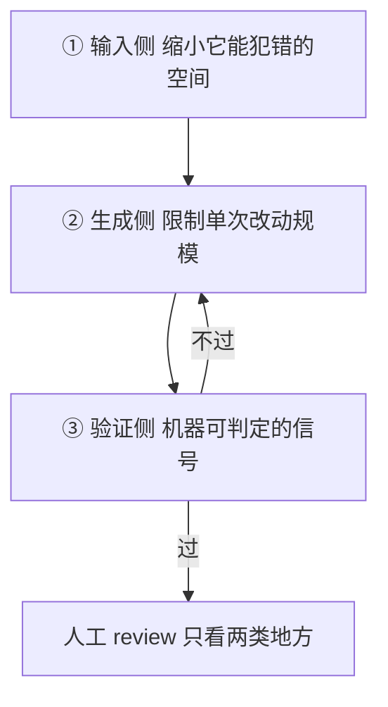

# AI Coding 工程实践

> 2026 秋招的**通用题**——不分岗位方向，后端 / Agent / 基础架构都在问。
> 考的不是「你用不用」，是**你有没有一套判据**：什么时候该用、怎么让它别写出「看起来对」的代码。

## 高频问法

- **「你怎么用 AI coding 的？」** — [[公司/米哈游/米哈游一面（我面试）_约2026-08]]
- **「怎么保证 AI 生成代码的质量？」** — [[公司/米哈游/米哈游一面（我面试）_约2026-08]]
- **「有没有工程化的方式，保证编码的有效性？」** — [[公司/米哈游/米哈游一面（我面试）_约2026-08]]（**同一场里第三次追问同一主题**，见 §3.4）
- **「你用 Cursor 过程中有没有遇到实际问题？」** — [[公司/其他/PingCAP/面试问题总结]]（有完整的问题表，最好的一手素材）
- **「你们组里怎么用 agent 写代码 / 跟 Claude Code 比你做了什么改进？」** — [[公司/快手/DataAgent方向/快手数据平台DataAgent一面_2026-07-29]]
- **「新范式（Claude Code / Codex）和旧范式（LangGraph 写死流程）区别是什么？」** — [[公司/上海AI Lab/后训练数据/上海AI Lab后训练数据一面_2026-07-31]]

---

## ① 技术定义：三档用法，按「谁掌握控制权」分

| 档 | 形态 | 我掌握什么 | 适合什么 |
|---|---|---|---|
| **补全档** | IDE 内联补全 | 每一行我都看着 | 熟悉的代码、样板 |
| **对话档** | 选中一段问 / 让它改这个函数 | 改动范围我圈定 | 局部重构、看不懂的代码 |
| **代理档** | agent 自己读文件、跑测试、改多个文件 | 只给目标和验收标准 | 我不熟的模块、跨文件的机械改动 |

**判据只有一句话：给它上下文的成本，会不会超过我自己写的成本。**

一个我脑子里已经很清楚的 20 行函数，描述清楚要三分钟、自己写要两分钟——**不该用**。一个跨 8 个文件的重命名，我讲清楚只要一句话——**该用**。

> ⚠️ **别把这题答成工具测评**（「Cursor 补全好、Claude Code 长任务强」）。面试官要的是判据，不是选型意见。

---

## ② 不管质量会怎样：AI 代码的错误形状跟人不一样

**核心因果（开口就该说这句）：**

> **模型优化的目标是「输出像不像对的」，不是「对不对」**（原理见 [[幻觉与事实性评测]] §3.1）。
> **所以它产出的错误天生是「读起来很顺、命名很合理、结构很像那么回事」的那一类——正好是人工 review 最容易放过的一类。**

**推论：质量保证不能建立在人眼上，得建立在机器能自动判定的信号上。**

### AI 特有的四个坑（真用过才说得出来）

| 坑 | 表现 | 根因 | 怎么防 |
|---|---|---|---|
| **假设理想输入** | 不写边界检查，默认所有字段都存在 | 训练语料里的示例代码大多是 happy path | 让它先列 edge case 再写实现 |
| **局部视角** | 只看它读到的那几个文件就改，忽略其他模块和配置 | 它没有「整仓库全盘加载后再推理」的能力 | 先自己划范围；改完全局搜一遍受影响点 |
| **过度设计** | 主动加抽象层、fallback、配置项、吞异常的 try-except | 训练语料里「更完整」的写法被奖励 | prompt 里明确禁止；**diff 里逐条砍** |
| **大 diff 不可 review** | 一次几百上千行，能跑但结构和命名不统一 | 没人限制它的产出规模 | 强制小步；先要方案再要代码 |

> 📌 上表前三行和最后一行的具体表现，来自 [[公司/其他/PingCAP/面试问题总结]] 里的实战记录（真实踩坑，不是推断）。

---

## ③ 机制：三层质量保证，按能不能自动化排序

### 3.1 输入侧——缩小它能犯错的空间

- **先写测试再让它实现。** 测试就是规格，而且是**机器可执行的规格**——这是把「我要什么」从自然语言变成可判定的东西。见 [[测试设计方法论]]。
- **把项目约定写成文件，不要每次重复说。** `CLAUDE.md` / `AGENTS.md` 放仓库里，每轮自动进上下文。
  > 🔑 **这跟上下文压缩是同一个原理**：外置到文件系统的状态**每轮重读原件，不走摘要器，所以不会被压缩衰减**。见 [[Agent上下文压缩链路]] §④ 的第三道防线。
- **一次只让它做一件事。** 大 diff 不可 review 是人的带宽问题，不是 AI 的问题。
- **不给它开无边界探索**：先自己 grep 定位到大致范围。**上下文越长它越容易以偏概全**——这条在 [[追问/字节答疑Bot]] 里被反复验证过。

### 3.2 生成侧——限制单次改动规模

- 先出方案再动手：**方案错了成本是零，代码错了成本是一次 review**
- 拒绝一次性大产出
- 让它写完之后补一份架构说明——**说不清楚的地方通常就是它自己也没想清楚的地方**

### 3.3 验证侧——唯一可信的是不依赖人眼的信号

| 信号 | 可信度 | 说明 |
|---|---|---|
| **类型检查** | 高 | 最便宜的一层，先跑 |
| **测试** | 高 | **「新增代码有没有对应测试」是质量指标，覆盖率数字不是** |
| **lint / 格式** | 高 | 机械但零成本 |
| **CI 门禁** | 高 | 把上面三条变成不可绕过的 |
| **人工 review** | 低（对 AI 代码） | **只保留给两类地方**（见下） |

**人工 review 只看两类地方：**
1. **安全、权限、钱相关的路径**——这些错了不可逆
2. **「它做了我没让它做的事」**——AI 特别爱顺手加东西，这一类靠读 diff 才发现

**收口金句：**
> **把「对不对」这件事，从人的判断变成机器的判断。**

### 3.4 被追问「有没有工程化的方式保证有效性」——三层里再深一层

> ⚠️ **先听懂他加的两个词。**
> **「工程化」= 不依赖人的自觉**：能进流水线、每次自动跑、结果可复现、失败能阻断。答「我会认真 review」「我会写测试」是**习惯不是工程**。
> **「有效性」比「质量」窄**：只问**代码是不是真的做对了它该做的事**，不含可读性可维护性。

**题眼是一个 AI coding 独有的死循环：**

> 🔴 **让 AI 写代码，再让 AI 写测试，等于让它自己给自己判卷。**
> 而且它作弊的方式很具体——**跑不过就改测试**。

**这个循环怎么破，就是这题的全部答案。四个手段：**

#### 手段一：把「规格」的所有权从模型手里拿走

- 测试由人定义（或从需求 / 契约生成），模型只写实现
- 🔑 **最工程化的一个动作：禁止模型改测试文件。**
  - 用 `CODEOWNERS`（仓库里的一个文件，规定哪些路径的改动必须由指定的人批准）把测试目录锁给人
  - CI 加一条规则：**同一个 PR 里实现和测试同时被改 → 强制人工确认**
  - **这条是机制不是自觉，所以它才叫工程化**

#### 手段二：验证「测试本身有没有用」——变异测试

> `变异测试（mutation testing）`：**故意往代码里注入小 bug**——把 `>` 改成 `>=`、`+` 改成 `-`、返回值改成 null——然后跑你现有的测试。**如果测试还是全绿，说明这个 bug 你根本测不出来。**
> `变异分数（mutation score）` = 被测试杀掉的变异体数 / 注入的变异体总数。

**为什么它是这题的核心答案：**
覆盖率只能告诉你「这行代码**被执行过**」，**不能告诉你「这行代码错了会被发现」**。而 **AI 特别容易写出「覆盖率很高但断言很弱」的测试**（典型：只 assert 不抛异常）。**变异测试是唯一能直接度量「测试有没有用」的手段**，所以它正好治那个死循环。

#### 手段三：不变量由人定、用例由机器生成——基于属性的测试

> `基于属性的测试（property-based testing）`：不写具体用例，写**不变量**——「不管输入是什么，这条永远成立」。比如排序后长度不变、序列化再反序列化等于原值、转账前后总额不变。框架自动生成成百上千个输入去打，**失败时还会自动把反例缩到最小**。

**为什么它特别适合验 AI 代码**：**AI 最擅长的就是通过你想到的那几个用例。** 而不变量它绕不过去——你说的是「对所有输入」。

> 🔑 **这就是 [[测试设计方法论]] §7「随机序列对拍」的无参考实现版本。**
> 对拍 = 拿一个显然正确的实现当**影子模型**，随机序列打，每步查不变量；
> property-based = **没有参考实现**，直接断言不变量。
> **同一个思想的两种形态，你已经会一半了。**

#### 手段四：重构场景的护栏——影子对比 / golden master

> 改之前把真实输入和输出录一批下来，改之后重放，**逐条比对输出是否一致**。

**为什么它对 AI 重构特别有效**：**它不需要你理解那段代码**——而这恰恰是让 AI 重构遗留代码的典型场景（**你就是因为不懂它才让 AI 改的**）。**这是「对拍」的生产版本：参考实现 = 旧代码。**

#### 固化进流水线（把上面四条变成阻断式门禁）

| 门禁 | 要点 |
|---|---|
| **必须是阻断不是告警** | 告警一定会被忽略，这是经验规律 |
| **增量覆盖率** | 只看这个 PR **新增/修改的那些行**的覆盖率。总覆盖率在大仓库里几乎不动，**没有信号** |
| **测试文件保护** | 见手段一 |
| **diff 规模上限** | 超了强制拆 PR |

#### 最后：度量「有效性」本身

工程化的东西必须可度量，否则没法说它有没有用。三个指标，**注意它们的层级关系**：

| 指标 | 测什么 |
|---|---|
| 增量覆盖率 | 新代码**有没有被测到** |
| **变异分数** | 测试**有没有用** |
| 🔑 **逃逸缺陷率**（escaped defects） | **CI 全绿但线上出问题的比例** |

> **逃逸缺陷率是唯一的终极指标，前两个都是它的代理指标。** 如果变异分数上去了但逃逸缺陷没降，说明**你测的方向不对**——那比测得不够更值得警惕。

---

## ④ 面试怎么说（两题连起来 60 秒）

> 「**我怎么用**：按控制权分三档——内联补全、选一段对话改、和放开让 agent 自己跑。判据就一句话：**给它上下文的成本会不会超过我自己写的成本**。我脑子里已经很清楚的短函数不该用；跨八个文件的机械改动一句话就说清了，该用。
> 具体做法上，我会**把项目约定写成 `CLAUDE.md` 这类文件**而不是每次重复说——这跟上下文管理是一个原理，外置到文件系统的状态每轮重读，不会被压缩衰减。重复流程固化成 skill。而且我**不给它开无边界探索**，先自己 grep 划范围。
>
> **怎么保证质量**：先说清一个前提——**模型优化的是「像不像对的」不是「对不对」，所以它的错误天生长成『读起来很顺』那一类，正好是人眼最容易放过的。** 所以质量保证不能建在 review 上。
> 我分三层：**输入侧**先写测试再让它实现，测试就是机器可执行的规格；**生成侧**限制单次 diff 规模，先要方案再要代码；**验证侧**靠类型检查、测试、lint、CI 这些不依赖人眼的信号，**人工 review 只保留给安全权限相关的路径，和『它做了我没让它做的事』**。
> AI 特有的坑我踩过几个：假设理想输入不写边界检查、只看局部文件就改、主动加没要求的抽象和 fallback。
>
> 最后补一句——**我不只是使用者，我在字节做的就是这类系统本身**：多 Agent 编排、上下文管理、trace 和评测。所以我看这些工具的时候看的是它的 harness 怎么设计的。」

**预备追问**

| 追问 | 答法 |
|---|---|
| **有没有工程化的方式保证有效性？** | 见 §3.4。**核心是破「AI 写代码 + AI 写测试 = 自己给自己判卷」这个死循环**：规格所有权归人（禁改测试文件）+ 变异测试验测试有没有用 + property-based 让不变量归人用例归机器 + 影子对比保重构 |
| **AI 写的测试你信吗？** | 不能直接信。**覆盖率只说明这行被执行过，不说明错了会被发现。** 所以要用**变异测试**度量测试本身的有效性——这是唯一直接测「测试有没有用」的手段 |
| **AI 写的代码你敢上线吗？** | 敢不敢取决于**有没有门禁**，跟谁写的无关。人写的没测试我也不敢上。**把标准统一到信号上，这题就不是二选一了** |
| **它会不会让你能力退化？** | 会——如果你只验收结果不看过程。我的做法是**不熟的领域反而更要读它的 diff**，因为那正是学得最快的时候；熟的领域才敢只看信号 |
| **团队怎么统一？** | 约定文件进仓库（`CLAUDE.md` / `AGENTS.md`）+ CI 门禁是硬的。**别指望靠规范文档，靠机器** |
| **长任务它跑偏了怎么办？** | 这是 **steer** 的问题——见 [[公司/米哈游/米哈游一面（我面试）_约2026-08]] Q14：输入聚合 / 工具边界插入 / 硬打断三层 |
| **你觉得它现在的上限在哪？** | 两条：① **它拿不到你脑子里的隐含约束**，所以规格写不清的活它做不好 ② **跨模块的全局一致性**——它没法真正整仓库加载后再推理 |

---

## 易错点

1. 🔴 **答成工具测评。** 「Cursor 好还是 Claude Code 好」不是这题要的，判据才是。
2. 🔴 **质量保证只答「我会 review」。** 最低档，而且逻辑上站不住——AI 代码的错误形状就是骗过人眼的那种。
3. ⚠️ **说不出 AI 特有的坑。** 只说「可能有 bug」等于没用过。要能报出「假设理想输入」「局部视角」「过度设计」这类具体形状。
4. ⚠️ **没有把「用户」身份升级成「建设者」身份。** 做过 Agent 的人答这题应该顺势带出 harness 视角，这是白送的差异化。

---

## 深入阅读

- 相邻主题：[[幻觉与事实性评测]]（为什么它的错误长这样）· [[Agent上下文压缩链路]]（外置状态为什么不衰减）· [[测试设计方法论]]（测试即规格）· [[Agent设计模式与MCP]]（旧范式 vs 新范式）
- 一手素材：[[公司/其他/PingCAP/面试问题总结]]（Cursor 实际问题表）· [[追问/字节答疑Bot]]（harness 视角）
- raw 专栏：[[专栏/Agent/Harness Engineering]] · [[专栏/Agent/Claude Code Context管理]]
