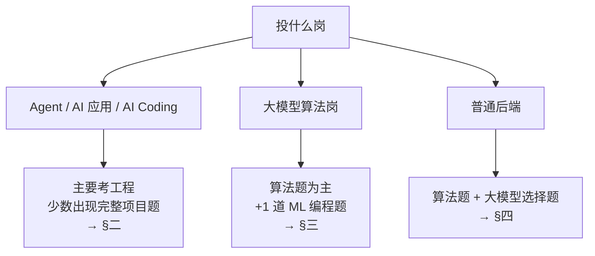

# AI 岗笔试题型（OA）

> **一句话：笔试没有被 AI 取代，是把 AI 当成了新考点。传统算法题仍占 70–80% 的分，AI 内容是增量。别本末倒置。**

> 📌 全篇查证于 2026-08-14。主力来源是牛客真题帖和社区汇编，**不是官方口径**——公司随时会改，投递前重核。

## 先定位：你投哪条线，决定要不要看后面

---

## 一、总体形态：各家差异极大，没有统一范式

| 公司 | 形态 | AI 内容 |
|---|---|---|
| **阿里**（AI 研发岗 / AI 算法岗） | 3 道纯编程题 | **完全不考 AI** |
| **华为 AI 岗** | 20 选择 + 2 编程（2025-09 改制） | **最重**，编程题全是手撕 ML/大模型算子 |
| **美团** 技术岗 | 10–20 选择 + 2–4 编程 / 90–120 分钟 | 选择题含大模型模块（2026 届起） |
| **百度** 后端 | 15 单选 + 5 多选 + 1 算法 + **1 Prompt 设计 + 1 AI Coding** | 两种新题型 |
| **蚂蚁** AI Coding 岗 | **限时做完一个完整项目**（约 120 分钟） | 不刷题 |
| **DeepSeek** Agent 岗 | 3 小时 3 题，纯工程算法 | **完全不考模型知识** |

> 🔑 **结论：形态没有收敛，投递前一定要去牛客搜「公司名 + 岗位名 + 笔试」看最近一场。**

---

## 二、Agent / AI 应用方向（👈 你的主线）

### 已知的三个样本

**① 蚂蚁 AI Coding 岗（2026-03-29）—— 限时做完整项目**

题目是多端 TUI 早餐店系统：叫号牌端 / 顾客端 / 店主端三个终端跑在不同端口，实现下单到支付全流程。加分项是数据持久化、权限控制、交互设计。

**官方建议的时间分配（这个比题目本身更值得记）：**

| 阶段 | 分钟 |
|---|---|
| 架构设计 | 10 |
| 核心实现 | 30 |
| 前端 | 25 |
| **测试** | **25** |
| **文档** | **30** |

> 🔑 **测试 + 文档 = 55 分钟，比核心实现还多。** 这跟 [[AI-Coding面试题]] 里的交付清单完全对得上——**判分逻辑是「粗糙但完整 > 精致但残缺」**。
> 考察维度：系统设计（三端通信）+ 工程实现（状态机与 API）+ **指挥 AI 在有限时间内交付完整项目的效率**。

**② 百度后端（2026-07-30）—— 两种新题型**

- **Prompt 设计题**：写提示词让模型从自然语言识别洗车场景并计费。硬性要求包括**严格的计算顺序**（基础价 → 类型加价 → 会员折扣 → 附加费 → 节假日加成 → 停车费）、**指定的取整方向**（类型加价向上、会员折扣向下、加成向上）、**固定的 JSON 输出字段**。
  > **判分点是「约束能不能被严格执行」**——练写带精确计算顺序、取整规则、输出 schema 的提示词，**不是练写漂亮的 persona**。
- **AI Coding 题**：分期借贷还款引擎，支持等额本息/等额本金/先息后本三种方式，加提前还款、逾期罚息、风险冻结、展期减免。**判分强调幂等性、原子性、状态机正确性。**
  > **本质是业务状态机题，跟传统后端设计题同源——这是你的主场。**

同场选择题的大模型部分考：**RAG 幻觉控制、Function Calling 边界、精确率召回率**。

**③ DeepSeek Agent 开发 / 全栈岗（2026-07-12）—— 3 小时 3 题，纯工程算法**

文本格式化模拟、流式 tokenizer（贪心最长匹配 + 哈希表）、方格覆盖计分。**不考模型知识。**

### ⚠️ 两路调研在这里有冲突

另一路的结论是「**Agent 工程岗笔试基本就是通用研发笔试，AI 内容全压到面试环节**」。

**我的判断：主流确实还是算法题，上面三个是新出现的例外，还没成气候。** 但既然出现了就要有准备——而且**它们对后端底子是加分而不是减分**。

### 该练什么

1. **限时把一个完整能跑的东西交付出来**——先跑通最小闭环，再加功能，**留出时间写测试和文档**
2. **状态机设计 + 幂等性 + API 分层**——百度那道还款引擎、蚂蚁那道三端系统都是这个
3. **写带硬约束的提示词**——精确计算顺序、取整方向、输出 schema

---

## 三、大模型算法岗

### 美团 / 携程 / 蚂蚁：固定 1 道 ML 编程题

2027 届暑期实习起确认：**美团 4 题中 1 题、携程 4 题中 1 题、蚂蚁 3 题中 1 题**。研究型岗位不受影响。

**逐场实例**：美团 One-Class SVM / IRLS 逻辑回归 / 高斯过程回归 / Decision Stump；携程 NumPy 归一化梯度下降 / KNN 元学习 / sklearn GridSearchCV；蚂蚁 HMM Viterbi；哔哩哔哩 感知机批量梯度下降；拼多多 CLIP 对比学习损失（仅 NumPy，输出保留 6 位小数）。

> 🔑 **这类题的关键特征：参数全部锁死。**
> 美团 5.9 那道原题要求：逐列均值方差标准化 + Adam（β₁=0.9、β₂=0.999）+ 前 5 epoch 线性预热、第 6 epoch 起固定 + 验证损失连续 10 epoch 无改进早停。
> **考的不是你会不会调模型，是你能不能严格照着题面复现。**

**58 道真实 ML 笔试题的分布**：分类 21%、聚类 16%、深度学习基础 12%、特征工程 9%。

**怎么准备**：考场上现查库函数来不及。提前练熟 **NumPy**（矩阵运算、距离计算、Sigmoid/Softmax）、**scikit-learn**（fit / StandardScaler / PCA / RandomForest）、**Pandas**。优先级 **分类 > 聚类 > DL 基础**。

### 华为 AI 岗：唯一为 AI 单独出题的大厂

**2025-09 改制**：3 道算法题 → **20 道选择（150 分）+ 2 道编程（150 + 300 分）**，总分 600。ACM 模式，IOI 赛制**按通过测试点比例给分**，每题无限次提交取最高。

> 💡 **策略含义**：因为按测试点比例给分，**写一个能过一半样例的暴力解也拿分**——所以「两道题都写暴力」经常比「死磕一题写最优解」分高。
> **备考建议是先写编程题、最后留 30 分钟写选择题**，因为编程题占 75% 的分。

**编程题高频板子（按 18 场出现次数排）：**

| 板子 | 出现次数 |
|---|---|
| K-Means | 4 |
| 逻辑回归 / 线性回归的批量梯度下降 | 4 |
| MoE Top-K 路由 | 3 |
| 决策树（ID3 / 随机森林） | 2 |
| KV Cache 相关 | 2 |
| AdamW 优化器 / MLP 反向传播 / RoPE / MHA 掩码 / BPE 分词 / LSTM 前向 | 各 1 |

**用纯 NumPy 各手写一遍，每个控制在 30 行内、能背出来。**

**选择题考点范围**（已覆盖 AI Infra 全栈）：
- 数学：线代、概率统计、信息论、张量收缩
- ML：K-Means、PCA、LDA、NMF、MLE、决策树、对比学习
- DL：激活函数、Dead ReLU、梯度消失、CNN/RNN/LSTM、Adam 显存占用、梯度累积、EM
- **大模型**：Transformer、MHA 参数量、GQA/MQA、RoPE、KV Cache、PagedAttention、**PD 分离**、Flash Decoding、Beam Search、MoE、混合精度
- **量化**：PTQ/QAT、SmoothQuant、FP8
- **训练 Infra**：ZeRO、张量并行、流水线并行、3D 混合并行
- 对齐：RLHF、PPO、DPO、Prompt Tuning
- Agent/RAG：RAG、向量检索、ReAct、Agent 记忆、Agent 安全
- 多模态：BLIP-2、CLIP

> 🔴 **你的缺口在 Infra 侧**（仓库里搜不到，属 C 档要从定义补）：**ZeRO 三个 stage 的区别 / TP-PP-DP 三种并行怎么切 / PagedAttention 解决什么 / PD 分离为什么要拆 / SmoothQuant 和 FP8 各自动了什么**。
> Agent 记忆、RAG、prompt cache 你已有专题 → [[Agent记忆系统]] · [[RAG优化全链路]] · [[Agent设计模式与MCP]]

**分数线**：两个来源冲突——一说硬性通过线 **200 分**（总分 600），一说 **180 分**。都不是官方口径。**按 200 准备更安全，不到线简历再好也直接淘汰。**

---

## 四、普通后端岗：也躲不掉了

**美团 2026 届起，技术岗选择题新增大模型模块，覆盖后端和前端。** 考点：Transformer 结构、自注意力、位置编码、**KV Cache**、量化、Agent 基本概念。传统的操作系统/网络/数据库仍保留。

> ✅ **好消息**：复盘文章明确说「**考的是概念理解而非实现细节，考察重点不是让你手写 Transformer**」。
> **每个概念准备到「四选一能选对」的颗粒度就够。**

复盘的原话口径：「**AI 知识已经从加分项，变成了基础能力的一部分。**」

---

## 五、手撕题：笔试和面试要分开准备

> 🔑 **「手撕完整 Transformer / 实现 RAG / 写 tokenizer」是面试环节的题，不是笔试题。**

- **笔试**只出**被切碎的单点算子**：MHA 掩码计算、RoPE 位置编码模拟、BPE 分词模拟、流式 tokenizer
- **面试**才出完整实现：**手撕 Multi-Head Attention 是 LLM 岗手撕的绝对第一高频题**
- 而且**字节大模型算法岗的手撕，70% 以上是纯 LeetCode**（最长上升子序列、最长公共子序列、接雨水、分割等和子集、股票含冷冻期）

**别把面试的手撕清单当笔试清单刷。**

---

## 六、关于「允许用 AI 的笔试」

**国内的标准化在线笔试目前没有这个东西。牛客和赛码在做的是反方向——AI 监考、切屏检测、防作弊。**

允许用 AI 的环节落在**面试和实操**上（蚂蚁 AI Coding 岗、[[公司/上海AI Lab/后训练数据/上海AI Lab后训练数据一面_2026-07-31]]、[[公司/腾讯/微信事业群/腾讯微信支付一面_2026-07-20]]、[[公司/快手/DataAgent方向/快手数据平台DataAgent二面_2026-08-10]]），不在标准化笔试里。

**所以要分清：笔试基本还是关起门来自己写；用 AI 是面试环节的事。** 面试那套见 [[AI-Coding面试题]]。

> ⚠️ 防作弊那部分数字（双摄监考、20 余类异常行为检测、Copilot 在检测范围内）来自在线考试平台厂商和 AI 面试辅助类博客，**双方都有商业动机，不要当准确统计**。实操上就一条：**按不能用 AI 准备。**

---

## 七、通用的坑

1. **ACM 模式还是核心代码模式，提前确认。** 多数公司走 ACM 模式，要自己处理标准输入输出——不练的话考场上会浪费十几分钟。
2. **时间分配失控是最常见的死法**，不是题太难——是前面卡太久，最后一题零分。
3. **Python 选手在支持 PyPy 的平台上用 PyPy 提交。**
4. **除华为外基本没有公开分数线**，按「4 题做对 3 题 / 3 题做对 2 题」的经验值定目标。

---

## 时长题量速查

| 公司 | 题量 | 时长 |
|---|---|---|
| 华为 研发岗 | 3 编程 | 120 分钟 |
| 华为 AI 岗 | 20 选择 + 2 编程 | 未查到 |
| 美团 技术岗 | 10–20 选择 + 2–4 编程 | 90–120 分钟 |
| 百度 | 选择 + 2–3 编程 | 100 分钟（ACM 模式） |
| 阿里 / 蚂蚁 | 3 编程 | — |
| 拼多多 | 4 编程 | — |
| DeepSeek Agent 岗 | 3 题 | 180 分钟 |

---

## 深入阅读

- 姊妹篇：[[AI-Coding面试题]]（现场怎么走）· [[AI-Coding工程实践]]（日常怎么干）
- 缺口补课：[[Agent记忆系统]] · [[RAG优化全链路]] · [[Agent设计模式与MCP]] · [[测试设计方法论]]
- 算法题不在本仓库（在另一个仓库）
