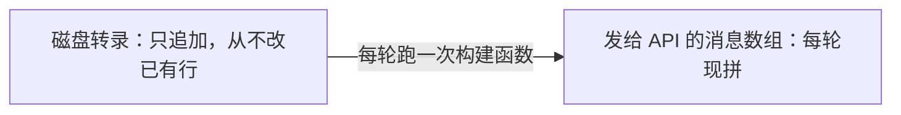
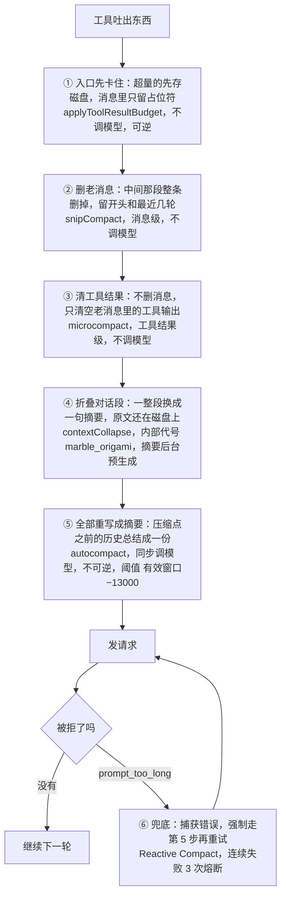
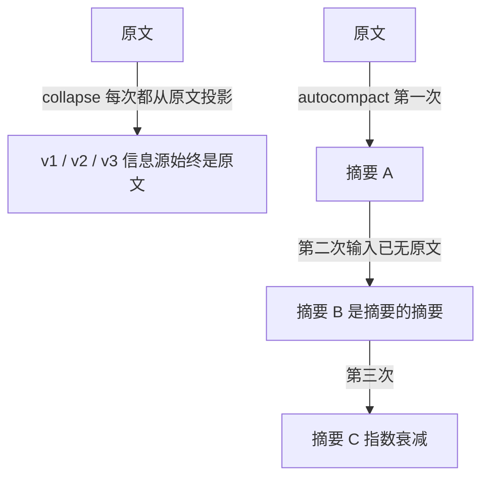
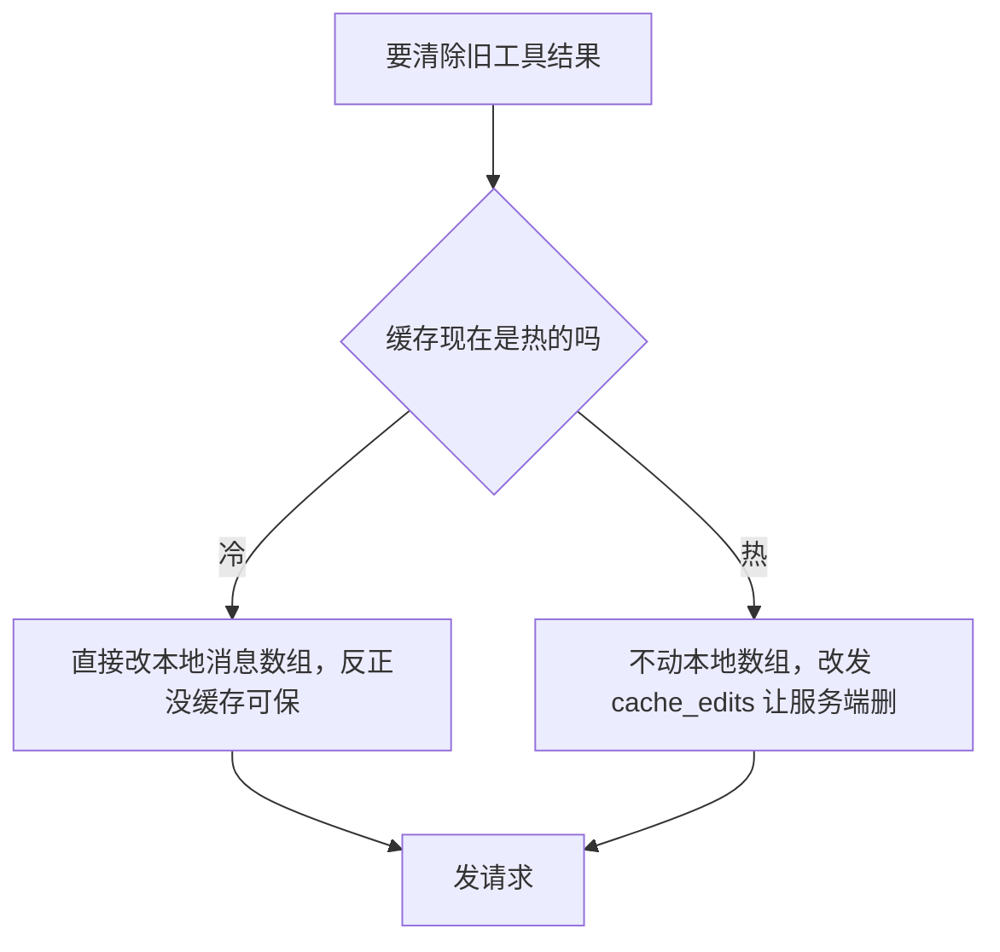

# Agent 上下文压缩链路

> 压缩 = **在有限窗口里用最便宜的手段腾出最多空间，同时保住最不可再生的信息**。面试考的是**分级的排序原则**和**压缩摘要的结构**，不是背机制名。

> ⚠️ 本文只讲**本轮会话内**的上下文管理。跨会话的持久记忆见 [[Agent记忆系统]]（七个设计维度）和 [[Agent记忆三家实现对比]]（三家实现）。**面试里把 context 和 memory 混着说是高频减分点**——前者是本轮内的事，后者是跨会话的事。

## 高频问法

- **「上下文膨胀怎么办？token 超限了怎么处理？」** — [[公司/快手/DataAgent方向/快手数据平台DataAgent一面_2026-07-29]]、[[公司/淘天/AI Agent/淘天AI-Agent一面_2026-07-30]]、[[公司/蔚来/蔚来CICD组AI agent实习生一面面经-详细版]]
- **「压缩怎么保证不丢原意 / 压得准？」** — [[公司/快手/DataAgent方向/快手数据平台DataAgent一面_2026-07-29]]、[[公司/微软/Bing图像视频业务实习一面面经]]
- **「长期记忆、短期记忆、大文档处理、token 超限这些异常场景怎么处理？」** — [[公司/蔚来/蔚来CICD组AI agent实习生一面面经-详细版]]

---

## ① 架构先行：这套东西是怎么运转的

> **这一节刻意不出现函数名**，术语只在末尾映射表里首次出现。**看不懂后面的细节表，多半是因为跳过了这一节。**

### 1.1 先搞清楚：压缩到底在压什么

一次请求发给模型的东西里，**绝大部分不是你打的字，是工具吐出来的东西**——你让它读文件，文件全文进去了；你让它跑测试，测试日志全进去了；你让它搜代码，五百条命中全进去了。

这些东西有个共同特点：**丢了还能再拿回来**。文件在磁盘上，命令能再跑一遍，搜索能再搜一次。

而**丢了就永远没了的，是你说过的话**——你的目标、你定的约束、你否决过的方案。

> **「可再生 vs 不可再生」这条判据是整套机制的地基。后面五级的排序、摘要模板的设计，全都是这一条的推论：优先牺牲可再生的，死保不可再生的。**

### 1.2 压缩改的不是磁盘，是每轮重新拼的那个数组

- **磁盘**上那份完整对话只追加、从不改，用来崩溃恢复和回放
- **发给模型的消息数组**每一轮临时拼一次，发完就扔

**第二个不是第一个的副本，是每轮现算出来的结果。所有压缩机制改的都不是磁盘，是「构建函数怎么算出这个数组」。** 这一句是理解第 4 级和第 5 级区别的地基（见 §3.2）。

### 1.3 五级是怎么运转的（大白话版）

每次发请求前，按压力从小到大**依次**尝试：

三个要点先记住，细节在 ②：

- **前三级完全不调模型**，纯规则操作，几乎不花钱
- **第 4 级调模型但不占用等待时间**——摘要是后台提前生成好存着的
- **只有第 5 级是同步调模型 + 不可逆**，所以前四级存在的唯一目的就是**推迟它**

---

## ② 具体细节

### 2.1 逐级参数表

| 级 | 粒度 | 调 LLM | 可逆 | 关键行为 |
|---|---|---|---|---|
| **① Budget** | 单条消息内的工具结果集合 | ❌ | ✅ | **两层联动**：完整内容先**落盘持久化**，消息里换成 `[Old tool result content cleared]`。**模型能用 Read 把磁盘版本读回来** |
| **② Snip** | **整条消息** | ❌ | ❌ | 砍中段，保头（系统提示 + 工具定义）保尾（最近交互）。返回 `tokensFreed` 传给下游免得重算 |
| **③ Micro** | **工具结果的内容** | ❌ | ❌ | 针对文件读取、shell 命令这类高产出源；**cache 冷热双路径**（见 §3.3） |
| **④ Collapse** | **对话段（span）** | ✅ **异步预生成** | ✅ 可反折叠 | 见 §3.2 |
| **⑤ Auto** | **全历史** | ✅ 同步 | ❌ | 见 §2.2 |
| **⑥ Reactive** | 全历史 | ✅ 同步 | ❌ | 错误触发，**连续失败 3 次熔断** |

**关键数字**：`autoCompactThreshold = 有效窗口 − 13,000`，200K 模型 ≈ **167,000（83.5%）**；给摘要输出预留 **20,000**；剩 **3,000** 硬阻断。

> `span`：消息数组上的一个连续区间，如第 12~25 条。
> `DCE`（dead code elimination）：打包时把编译期确定走不到的分支整段删掉，产物里连代码都不存在。
>
> ⚠️ `snipCompact` 由 `feature('HISTORY_SNIP')` 编译期开关门控——一份资料说仅 Anthropic 内部构建可用（外部构建靠 DCE 移除），另一份说 SDK / headless 模式 only。**两说法都指向：日常交互式使用里这一级很可能没跑。**
> <!-- 来源: 社区逆向（CSDN 源码分析 + Haseeb Qureshi gist + arXiv 2604.14228）・ 查证于 2026-08-04 ・ 函数名来自对压缩产物的逆向，非官方公开 -->

### 2.2 AutoCompact 的 9 段式摘要模板

| # | 段 | 要点 |
|---|---|---|
| 1 | Primary request and intent | 用户最初要什么 |
| 2 | Key technical concepts | 涉及的技术名词 |
| 3 | Files and code sections | **带实际代码片段**，不是只列文件名 |
| 4 | Errors and fixes | 踩过的坑 + 怎么解的 |
| 5 | Problem solving | 推理路径 |
| 6 | **All user messages** ⭐ | **逐字保留，不许总结** |
| 7 | Pending tasks | 待办 |
| 8 | Current work | 接续点 |
| 9 | Optional next step | **要求配原文引用** |

另有一个 `<analysis>` 草稿块：模型先在里面推理哪些该留哪些能扔，**输出正式摘要后草稿被剥掉不进上下文**——拿推理质量，但不为草稿付 token。

> ⚠️ [[专栏/Agent/记忆压缩]] 里那张 `goal / latest_instruction / constraints / …` 九字段表**不是** Claude Code 的官方模板，来源不明。上表才是。
> <!-- 来源: openedclaude.github.io 第 11 章 + harness-engineering ch.9（两处独立确认）・ 查证于 2026-08-04 -->

---

## ③ 为什么这样设计

### 3.1 排序原则：成本递增、损失递增、可逆性递减

**永远用够用的最便宜那级。** 三条推论：

1. **Budget 排第一，因为它是唯一的「预防型」**，其他五个都是「治疗型」。它省下的是**从来没花过的 token**，性价比高一个量级。具体规则：Read 默认 2000 行上限、Bash 输出超长截断、grep 结果有条数上限——**全是确定性规则，零模型参与**。
2. **前三级不调模型**，所以可以每次请求都跑，不心疼。
3. **Auto 排最后，因为它同时踩三个雷**：贵（一次完整模型调用，输入是整个历史）、有损、**不可逆**。

### 3.2 为什么第 4 级能反复用，第 5 级只能是最后手段

回到 §1.2 那句「压缩改的是构建函数」——**两者改的是构建函数的不同部分**。

具体例子（数字为示意，机制查证过）：会话到第 40 轮，第 12~25 行是一段已用完的弯路，共 30,000 token。

| | **Collapse（第 4 级）** | **AutoCompact（第 5 级）** |
|---|---|---|
| 磁盘 | **追加**第 41 行折叠记录，记 `span:[12,25]` + 摘要。**1~40 行一字节没改** | 追加压缩边界 + 摘要。1~40 行也还在 |
| 下一轮构建 | **仍从第 1 行完整遍历**，路过 [12,25] 时替换成摘要再跳到 26 | **不再从第 1 行遍历**，直接从边界开始 |
| 撤销 | 把第 41 行标记失效 → 下轮遍历查不到规则 → **原文自动回来** | 起点已前移，正常路径回不去 |
| 改的是 | **一条替换规则** | **遍历的起点** |

**所以衰减行为完全不同：**

保留率 40% 压 n 次剩 `0.4^n`，**压三次剩 6.4%——指数衰减，不是线性**。

> `read-time projection`（读时投影）：**不修改已存储的数据，只在读取那一刻按规则生成一个视图**。数据库里的 `CREATE VIEW` 是同一个思路——底表一行没动，SELECT 时现算。
>
> Collapse 的摘要由**后台 fork 的小 agent 提前生成好存着**，到阈值才替换上去，**主链路上没有同步 LLM 等待**。源码里有条保护：collapse agent 自己不能被压缩。**触发阈值怎么算、span 怎么划、risk 怎么算——源码看不到，不猜。**
> <!-- 来源: Haseeb Qureshi gist 确认 marble_origami / ContextCollapseCommitEntry；arXiv 2604.14228 确认 read-time projection ・ 查证于 2026-08-04 ・ 第 41 行示例的字段布局是推断 -->

### 3.3 排序不只看省多少 token，还看毁多少 prompt cache

**prompt cache 是前缀匹配**——从消息数组开头逐字节比对，**一旦某位置变了，从那往后的缓存全部作废**。而 Snip 砍的恰恰是中段，那是缓存命中率最高的部分。

**microcompact 的冷热双路径**：

> `cache_edits`：请求里的一种块，让服务端对已缓存的前缀做一次编辑，而不是重发改过的数组。**本地字节不变 → 前缀哈希不变 → 缓存照样命中**，同时服务端那份也瘦了。

| 机制 | 对 cache 的影响 | 补偿 |
|---|---|---|
| **microcompact** | **热时走 `cache_edits` 保住命中** | 唯一做了 cache-aware 优化的一级 |
| **contextCollapse** | 缓存失效，但**完全不发 API 调用**（摘要是预生成的） | 用「省一次 LLM 调用」抵「丢一次缓存」 |
| **autocompact** | **整个缓存全废** | 压缩后重注入 **top 5** 最近读过的文件 + skills |

另有 `__SYSTEM_PROMPT_DYNAMIC_BOUNDARY__` 把系统提示切两半：**上半跨会话静态（缓存价值最高，绝不动）**，下半每会话变。

> **这条也解释了为什么 Snip 被 feature flag 关着**：它砍中段消息，对缓存破坏最大，收益只是省 token——**有 cache 的场景下性价比是负的。**（推断）

### 3.4 摘要模板为什么长这样

三条，全是 §1.1 那条判据的推论：

1. **结构化槽位，不是自由文本概括。** 每次压缩覆盖同一批格子，漂移比「概括概括再概括」小一个量级。
2. **第 6 段逐字保留是题眼。** 其他八段都是总结，只有它原样搬运——**用户原话是唯一不可再生的资产**。这同时防目标漂移：初衷写在用户消息里，用户消息不衰减，目标就不会漂。
3. **压缩后重新注入可再生内容。** Claude Code 补最近读过的 top 5 文件 + skills；Codex 补最近编辑的 5 个文件（5 万 token 预算）。**两家不约而同都是 top 5。**

---

## ④ 横向对比：三家怎么压

| | 分级 | 摘要形态 | 与记忆的关系 |
|---|---|---|---|
| **Claude Code** | **五级 + 兜底**（业界最细） | **人类可读**的 9 段式 | **不耦合**——压缩就是压缩，记忆写入靠模型自主判断 |
| **Codex** | pre-turn / mid-turn + `compact_remote` 远程压缩 | **AES 加密 blob**，不可读，可能含结构化元数据和推理轨迹 | 不耦合；压缩后自动重读最近编辑的 5 个文件 |
| **OpenClaw** | 分级少 | 人类可读 | **耦合**——压缩阈值前跑一个 Memory Flush 无声轮次提醒先落盘 |

**分级数 ≈ 你有多怕反复压缩带来的衰减。** Claude Code 面对的是几百轮、几百万 token 的长任务，所以必须在全量压缩前塞三层更便宜的机制去推迟它。

**摘要可不可读是个真取舍**：Claude Code 选可审计，Codex 选信息密度（加密 blob 能装比纯文本摘要更多的结构化状态）。

**耦不耦合记忆写入**：OpenClaw 的 Flush 保证「重要信息在被摧毁前有最后一次落盘机会」，代价是每次压缩都触发写入、容易记噪音。**判断标准是任务可不可重放**——code agent 的状态大部分在文件系统里、可重新读取，不耦合没问题；操作外部系统且结果读完就没的场景，倾向耦合。

---

## ⑤ 常见问题

**Q：反复压缩信息会不会衰减？** 会，指数衰减（见 §3.2）。三道防线：① 前四级都是为了推迟全量压缩（**降低 n**）② 结构化槽位提高单次保留率 ③ **把状态外置到文件系统**——`CLAUDE.md`、memory 文件、todo 列表不走 summarizer，每轮重读原件，**把 n 归零**。**第三条才是根本解：压缩摧毁的是消息历史，磁盘上的原始副本压多少次都不衰减。**

**Q：Snip / Collapse 会不会切掉还需要的东西？** 会，**但代价是一次重读，不是永久丢失**。这正是它们排在全量压缩前的原因——**错了能补救的机制，应该优先于错了没法补救的**。

**Q：阈值 83.5% 怎么定的？** 留的余量是给**客户端 token 估算误差**的：分词器在客户端只能近似、多模态难算准、服务端还会加工具定义的序列化开销，而且模型这轮要**输出**多少也未知。定太高频繁触发兜底浪费往返，定太低过早压缩、无谓衰减。

**Q：怎么评估压缩效果？** **不看压缩率，看任务成功率 + 「压缩后有没有重复劳动 / 违反早期约束」的发生率。** 压缩率高但衰减了是负分。

**Q：为什么不直接用超长上下文模型？** ① 成本线性涨，每轮重发 ② 长上下文本身导致幻觉 ③ 窗口再大 attention 也会稀释——**压缩不只省钱，是提准确率的手段**。

---

## ⑥ 面试怎么说（40 秒口语稿）

> 「先说判据：**agent 上下文里绝大部分 token 是工具输出——文件内容、命令日志，这些丢了还能重新拿到；真正不可再生的是用户说过的话。整套机制就是围绕这一条排的：优先牺牲可再生的。**
>
> 具体是一条按成本排序的链路。**入口先卡住**——工具输出超量先落盘再换占位符，模型需要时能读回来，这是唯一的预防型机制。**然后按压力升级**：删整条老消息、清工具结果内容、做段级折叠。**段级折叠最有意思——它是读时投影，原文还在磁盘上没删，只是发给模型时用后台预生成的摘要替代，所以能反折叠回去。**
>
> **超阈值才全量总结**，大概是有效窗口减 13K。摘要是九段式结构化模板，**第六段『全部用户消息』要逐字保留不许总结**，就是上面那条判据的落地。压完还会把最近读过的五个文件重新注入。
>
> **兜底是错误触发的强制压缩**，客户端 token 是估算的，估漏了就捕获重试，连续失败三次熔断。
>
> **最后一层考虑是 prompt cache**——缓存是前缀匹配的，改中段就把后面全废了。所以清工具结果那一级做了冷热双路径：缓存热的时候不动本地数组，改发 cache_edits 让服务端在缓存侧删。**排序不只看省多少 token，还看毁多少缓存。**」

---

## 易错点

1. 🔴 **把 ContextCollapse 说成失败模式。** 它是真机制（`marble_origami`），段级折叠 + 后台预生成摘要 + 读时投影。「反复压缩导致指数衰减」那个失败模式确实存在，但**不叫这个名**。
2. 🔴 **把 Snip 和 Micro 的职责说反。** Snip 是**消息级**（删整条），Micro 是**工具结果级**（清内容）。顺序也是 Snip 在 Micro 前面。
3. 🔴 **把 ToolResultBudget 说成「直接丢弃」。** 实际是**先落盘再换占位符**，可逆。
4. ⚠️ **只答「用 LLM 总结一下」。** 面试官想听的是**分级**和**摘要结构**，只答全量压缩等于只答了五分之一。
5. ⚠️ **忽略 prompt cache。** 被追问「改历史消息不会让缓存失效吗」答不上来，说明只看了架构图没想过成本。
6. ⚠️ **把 context 压缩和 memory 混着说。** 前者本轮内、后者跨会话，机制和评价标准都不同。

---

## 深入阅读

- 相邻主题：[[Agent记忆三家实现对比]]（跨会话持久层）· [[Agent记忆系统]]（七个设计维度）· [[Agent设计模式与MCP]]
- raw 专栏：[[专栏/Agent/Claude Code Context管理]]（只有 11 行，本文是它的展开）· [[专栏/Agent/记忆压缩]]（那张九字段表来源存疑，见 §2.2）· [[专栏/Agent/Harness Engineering]]
- 项目追问库：[[追问/谷歌Memory]]
