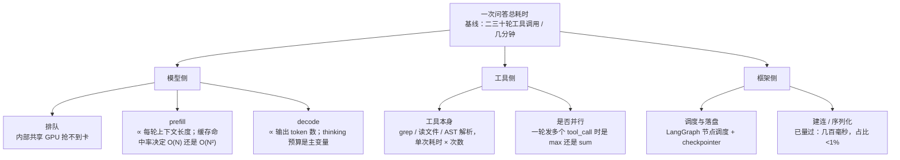
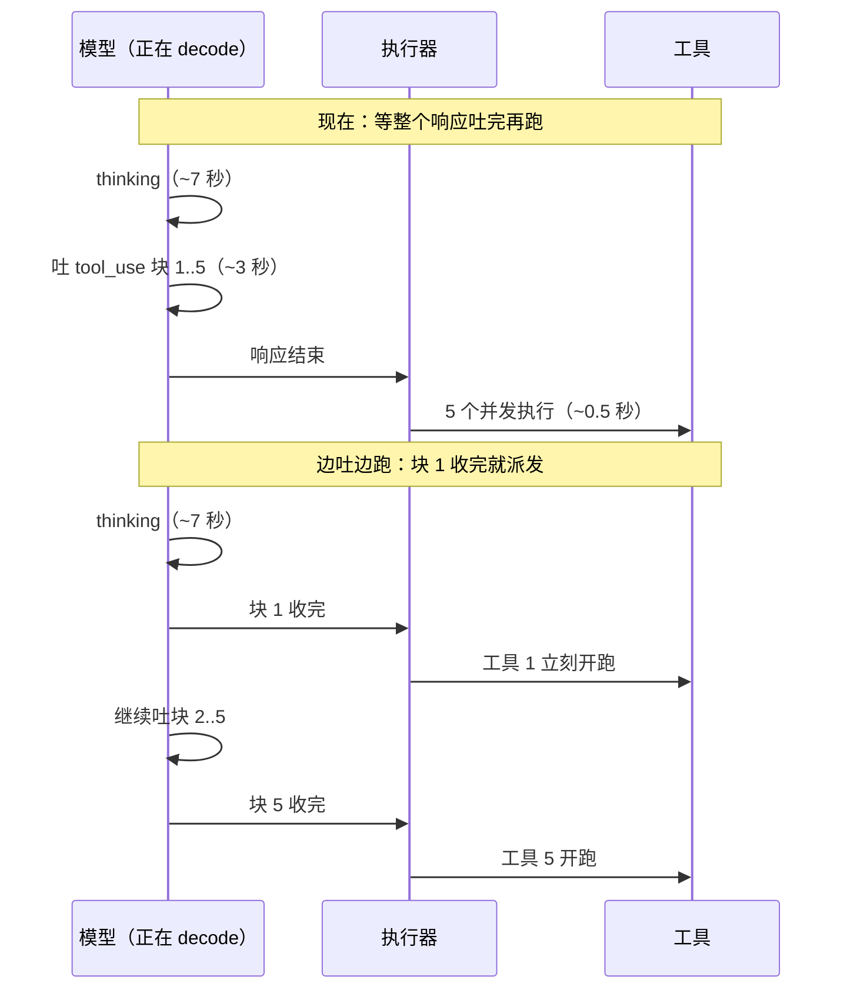

# Agent 延迟优化（回答慢 / step 太多）

> **这题的陷阱是「减步数」——而你自己测出来的规律不允许你这么答**（工具调用轮数与正确率正相关）。正确姿势是：**先把几分钟拆成可归因的几项，再分四个方向优化，其中只有一个跟步数有关，而且减的是「无效步」不是「探索深度」。**

> ⚠️ **边界**：本文只讲**一次 agent 回答从发起到完成的墙钟时间**。上下文放不下怎么办见 [[Agent上下文压缩链路]]；跨会话记忆见 [[Agent记忆系统]]；多实例扩容见 [[Agent服务扩容与多租户]]。**压缩和本文有一处直接冲突（压缩会废掉 prompt cache），在 §3.1 展开。**

## 高频问法

- **「你们这个 agent 回答一次要几分钟，太慢了怎么处理？」** — [[公司/快手/DataAgent方向/快手数据平台DataAgent二面_2026-08-10]]（Q6，全场机制最扎实的题之一）
- **「重排一次要 6 秒，为什么这么慢？」** — [[公司/字节/中国商业化/字节商业化AgentInfra三面_2026-08-14]]（🔴 当场全靠「我理解是」推测，被扣「推测代替定位」）
- **「prompt cache 为什么能降本增效？底层原理是什么？」** — [[公司/字节/中国商业化/字节商业化AgentInfra二面_2026-08-06]]、[[公司/阿里国际/Agent Infra/阿里星一面_2026-08-06]]
- **「多 agent / subagent 的代价是什么？」（延迟叠加是标准答案之一）** — [[公司/淘天/AI Agent/淘天AI-Agent一面_2026-07-30]]、[[公司/懂车帝/AIGC创作方向/懂车帝AIGC创作一面_2026-08-10]]
- **「C 端场景延迟约束更严，『多探索几轮质量更好』和『用户等不了』怎么取舍？」** — [[公司/懂车帝/AIGC创作方向/懂车帝AIGC创作一面_2026-08-10]]（反问环节自己抛出去的问题）

---

## ① 先拆延迟构成，别猜

**这不是套路，是三面那道题的正解。** reranker 6 秒答成「我理解是 Ollama 走 llama.cpp 所以慢」，扣的就是**用推测代替定位**。同一个方法论在这题上完全适用。

### 1.1 一次 agent 回答的时间由什么组成

一个 ReAct agent 跑 N 轮，总时间是：

```
T_total = Σ(i=1..N) [ T_prefill(i) + T_decode(i) + T_tool(i) + T_框架(i) ]
```

> 💡 **术语（C 档）**
> - **prefill（预填充）**——模型吐出第一个新 token 之前，把**已有的整段上下文**过一遍，给每个 token 算出注意力里的 key / value 向量。**耗时正比于上下文 token 数。**
> - **decode（解码）**——一个一个往外吐 token。**耗时正比于输出长度**（含 thinking token）。
> - **TTFT**（time to first token）——发请求到收到第一个 token，≈ 排队 + prefill。
> - **TPOT**（time per output token）——decode 阶段平均每吐一个 token 多久。`T_decode ≈ 输出token数 × TPOT`。

### 1.2 为什么「step 多」比想象中更致命

**ReAct agent 的上下文是单调增长的**——每轮把工具返回 append 进历史，第 20 轮要 prefill 的东西比第 1 轮多 20 倍。

**没有前缀缓存时，N 轮的 prefill 总量是 O(N²)，不是 O(N)。** 步数翻倍，光 prefill 就翻四倍。

### 1.3 要埋哪些点



**每轮记五个数**：上下文 token 数、缓存命中 token 数、输出 token 数（含 thinking）、TTFT、工具执行墙钟时间。跑一遍评测集画直方图，大头立刻现形。

### 1.4 已知场景的估算（字节答疑 Bot）

前提：**工具调用已经是并行的**（同一轮多个 tool_call 并发执行）。3 分钟 / 20 轮 ≈ **每轮 9 秒**：

| 组成 | 估计 | 依据 |
|---|---|---|
| 工具执行 | 0.1 ~ 1 秒 | 已并行，是 max 不是 sum；grep / 读文件本来就快 |
| prefill | 几百毫秒 | 缓存命中时只 prefill 新增的工具返回；而且 prefill 是并行矩阵乘 |
| **decode** | **剩下的 7~8 秒** | 开了最高思考强度，一轮 thinking 几百到上千 token，几十 tok/s |

> ⚠️ **这是估算不是结论，真实占比必须埋点量。** 但它把可动的地方收窄成三条：减 thinking token、减轮数（被自己的数据堵死）、**让 decode 期间别闲着**。

---

## ② prompt cache 原理（「让每步更便宜」的地基）

### 2.1 被缓存的到底是什么

一个 token 进到某一层，当前表示是向量 `x`，这一层有三组训练好的**权重矩阵**，做三次矩阵乘法：

```
q = x · W_Q      k = x · W_K      v = x · W_V
```

| 向量 | 角色 |
|---|---|
| **q（query）** | 我这个位置**要去查什么**——发起方 |
| **k（key）** | 我这个位置**能被什么样的查询匹配上**——被查方的索引 |
| **v（value）** | 我这个位置**一旦被匹配上要交出去的内容**——被查方的内容 |

第 i 个位置的输出：`attn_i = softmax(q_i · Kᵀ / √d) · V`，其中 `K = [k₁..k_i]`、`V = [v₁..v_i]`（因果注意力，只到 i 为止）。

> 💡 **术语（C 档）**
> - **因果注意力（causal attention）**——第 i 个 token 只能看到 1..i，看不到 i 之后。所以位置 i 的 K/V 只由它前面那段序列决定。
> - **softmax**——把一组任意实数压成一组和为 1 的正数，这里把「q 跟各个 k 的匹配分数」变成权重。

### 2.2 为什么只缓存 K/V，不缓存 Q

把注意力画成矩阵：**行 = 谁在查（用它的 q），列 = 被查的是谁（用它的 k、v）**。因果注意力让它是下三角：

| | k₁v₁ | k₂v₂ | k₃v₃ | k₄v₄ | k₅v₅ |
|---|:---:|:---:|:---:|:---:|:---:|
| **q₁** | ✔ | | | | |
| **q₂** | ✔ | ✔ | | | |
| **q₃** | ✔ | ✔ | ✔ | | |
| **q₄** | ✔ | ✔ | ✔ | ✔ | |
| **q₅** | ✔ | ✔ | ✔ | ✔ | ✔ |

- **横着读（q 的命运）**：`q₃` 只出现在第 3 行，**一行、一次**。算完这一行它就没有读者了——后面的 token 不会回头重算位置 3 的输出。
- **竖着读（k/v 的命运）**：`k₁v₁` 出现在**每一行**里，而且表还在往下长，**读者数量随上下文长度无限增长**。

> **缓存的意义是「算一次、复用多次」。q 天生只用一次，存下来没有下一个读者。这就是它叫 KV cache 而不是 QKV cache 的原因。**

decode 时看得最清楚：生成第 n 个 token，只需要**新 token 这一个 q**（现算，一次向量乘矩阵，极便宜）+ **整段历史的 K/V**（重算就要把整个前缀过一遍模型）。

**这条也直接推出「前缀必须严格相同」**：改了第 i 个 token，第 i 个位置的 K/V 变了；i+1 能看到 i，所以 i+1 也变了；往后连锁失效。**不是实现偷懒，是注意力机制本身决定的。**

### 2.3 顺带解释「为什么 decode 慢、prefill 快」

decode 一次只算矩阵的**最后一行**（一个 q），但为了算这一行，必须把**整列 K/V 从显存搬到计算单元**。

粗算 KV cache 大小（64 层 / 每层 8 个 KV 头 / 每头 128 维 / fp16）：

```
每 token 每层：2(K和V) × 8 × 128 × 2字节 = 4 KB
每 token 全部 64 层：256 KB
2 万 token 上下文：≈ 5 GB
```

**搬 5 GB 数据，只为做一行的计算量——瓶颈在搬运不在算数。**

| | 算几行 | K/V 搬运摊薄给几行 | 结果 |
|---|---|---|---|
| **prefill** | 一次算 n 行 | n 行共用一次搬运 | GPU 吃得饱，**快** |
| **decode** | 一次算 1 行 | 只服务 1 行 | 大部分时间在等数据，**慢** |

> 这跟三面复盘里那句「**GPU 算一条和算一摞耗时差不多，瓶颈在把模型权重从显存搬到计算单元**」是同一个原理，只是那里搬的是权重，这里搬的是 KV cache。
> 📌 KV cache 大小公式是标准推导（确定）；**「TTL 存在是因为它占真金白银的内存」是推断**，各家 prompt cache 存在显存还是落盘未公开。

### 2.4 工程参数（Anthropic 官方口径）

| 项 | 值 |
|---|---|
| 渲染顺序 | `tools` → `system` → `messages`，**工具定义在最前** |
| 断点 | `cache_control: {type:"ephemeral"}`，**每请求最多 4 个**；打在哪个 block 就缓存「从头到该 block」的整段前缀 |
| 最小可缓存长度 | **模型相关，512 ~ 4096 token**；不够长**静默不缓存**，不报错，`cache_creation_input_tokens` 为 0 |
| TTL | 默认 5 分钟，可选 1 小时 |
| 计费 | 写：5m **1.25×** / 1h **2×**；读 **0.1×** |
| 回本点 | 5m TTL **两次请求回本**（1.25+0.1=1.35 < 2.0）；1h 要三次 |
| 校验 | `usage.cache_read_input_tokens` ——二面说的「校验是否真的 cache 到了」就是看这个字段 |

**失效是分层的，不是全有全无：**

| 改了什么 | tools | system | messages |
|---|:---:|:---:|:---:|
| 工具定义（增/删/换序）、换模型 | ❌ | ❌ | ❌ |
| system prompt 内容 | ✅ | ❌ | ❌ |
| `tool_choice`、开关 thinking、加图片 | ✅ | ✅ | ❌ |
| 正常 append 消息 | ✅ | ✅ | ❌ |

> **推论**：每轮 append 只废最后一层，tools + system 一直活着——这是 agent loop 能持续命中的原因。**但运行时动态增删工具会从第 0 个 token 全废，在 agent 里是昂贵操作。**

📌 **出处：Anthropic 官方文档 ・ 2026-08-16 查证。⚠️ 我们接的是 GLM 的 Anthropic 兼容协议——打点形状一样，但最小长度 / TTL / 计费倍率 / 回溯窗口是各家自己实现的，未逐项核过。** 面试里要主动说明这个边界。相关协议差异见 [[LLM多协议网关适配]]。

### 2.5 两个 agent loop 专属的坑

| 坑 | 机制 | 对我们的影响 |
|---|---|---|
| **20 个 content block 回溯窗口** | 每个断点向前**最多回溯 20 个 block** 找已有缓存条目，超了**静默 miss** | agent loop 里 `tool_use`/`tool_result` 成对出现，**一轮并行 10 个工具 = 20 个 block，正好卡在临界点**。修法：长轮次每 ~15 个 block 补一个中间断点 |
| **并发请求抢不到彼此的缓存** | 缓存条目要等**第一个响应开始流式返回**后才可读 | **直接打 fan-out 方案**：并发验 10 个节点、前缀相同，一起发出去就是 10 份全价写入。正确姿势：**先发 1 个，等到第一个 token，再发剩下 9 个** |

---

## ③ 四个优化方向

| 方向 | 打公式里哪一项 | 对正确率的风险 | 落地判断 |
|---|---|---|---|
| **3.1 每步更便宜** | `T_prefill` | 无 | ✅ prompt cache 已做一半 |
| **3.2 减无效步** | `N` 里的水分 | 无（减的不是探索深度） | ✅ 决策树本来就在做这件事 |
| **3.3 串行改并行 / 重叠** | 把 Σ 变成 max | 低 | ⚠️ 收益要算，见下 |
| **3.4 分段交付 + 异步** | 不降延迟，降**感知**延迟 | 无 | ✅✅ 飞书 bot 天然异步，性价比最高 |

### 3.1 每步更便宜——把 O(N²) 打回 O(N)

前缀命中后，第 i 轮只 prefill 新增的那一小段（上一轮的工具返回），**总 prefill 从 O(N²) 掉回 O(N)**。二三十轮的场景，这是数量级差距。

**配套三条：**
- **稳定的放前面，变动的放后面**——system prompt、工具定义、skill 定义放最前，一轮都不许动
- **大工具返回 offload 落盘，只给模型路径**——上下文长得慢，每轮 prefill 就便宜
- **thinking 预算分级**——「读文件后决定下一个读哪」给低预算，「建决策树 / 最终收口」给高预算。⚠️ **必须 A/B**，这条直接踩「不许模型偷懒」的选型底线

> 🔴 **压缩和缓存是打架的**：压缩 = 改写历史前缀 = 从改写点往后 KV cache 全废，下一轮从头 prefill。**所以压缩不能想压就压，要攒到一个「反正 cache 也要失效」的点上做一次**（工具定义变了、或窗口逼近上限不得不压），压完让前缀重新稳定至少 K 轮摊薄成本。详见 [[Agent上下文压缩链路]]。

### 3.2 减无效步：工具粒度上收

**定义：一次工具调用返回多少「有效信息」。粒度上收 = 提高单次调用的信息密度，让模型用更少的调用次数拿到同样多的东西。**

粒度太细的样子——每轮只推进一小步，模型靠多轮拼图，**轮数多正是因为单轮拿到的少**：

```
轮1: grep "审核"         → 50 个文件名，45 个无关
轮2: read fileA.go       → 800 行进上下文，真正相关的是第 200-220 行
轮3: grep "reviewStatus" → 又一批文件名
轮4: read fileB.go       → 又是 800 行
```

上收之后，一次 `resolve_branch(enum_value)` 就返回：这个枚举值在哪些函数的哪些 `if` 里被判断、每个判断的完整条件、每个分支走向哪、文件和行号——**顶上面四轮**。

| 方式 | 做法 | 在我们场景里 |
|---|---|---|
| **语义上收** | 把「模型总是连着做的 3-4 步」固化成一个工具 | 建决策树每个节点都在做同一套动作（找枚举 → 找判断它的 if → 取分支），这套应该是**一个**工具 |
| **结构上收** | 关键词匹配 → 语法树 / 调用图导航 | 一面已答过。grep 返回「哪些行有这串字符」，AST 返回「哪个函数的哪个判断条件」，**信息密度差一个量级** |
| **返回值上收** | 同一个工具返回更精炼的东西 | 读文件返回「命中位置 ±20 行 + 所在函数签名」，**同时省 decode 和 prefill** |

> ⚠️ **别无脑上收**：粒度太粗 → 工具变黑盒 → 模型没法组合 → 遇到工具没覆盖的情况彻底卡住。判据：**上收到「模型不需要为同一个目的连续调三次同族工具」为止，再往上就过了。**

**另外，决策树本身就是减无效步的机制**——它把「漫无目的探索」变成「按结构枚举」，探索路径从随机游走变成有向遍历。这个论点面试里没用过，但它把已经做完的东西重新解释成了第二个维度的收益。

### 3.3 串行改并行 / 重叠

**（a）验证阶段 fan-out。** 二面说过「subagent 拆不开」——**那个结论是对的，别推翻**：拆不开的是「query 刚进来时该怎么分探索路径」，因为那时**还不知道结构**。但**决策树建完之后结构已知**，验证每个节点是「去代码里找证据」，**彼此无依赖、只读、幂等**，是教科书级的可并行任务。用 LangGraph 的 `Send` 动态 fan-out（见 [[LangGraph工程实践]]）。⚠️ 记得 §2.5 的并发缓存坑。

**（b）阶段间流水线。** 二面说「审核是**流水线的下一站**，不是分出去的一条支线」——这句话是对的，**而且流水线这个词比当时意识到的更准：流水线的本质恰恰是下一站不必等上一站全部做完。** 生成 agent 每建完一棵子树就推给审核，审核验子树 A 的同时生成还在建子树 B。

> **补的那句话**：「审核在时序上必须排在生成之后——但『之后』是**按子树算的，不是按整棵树算的**，所以它能重叠。」

**（c）流式工具执行重叠（模仿 Claude Code）。**



CC 的做法（`StreamingToolExecutor`）：tool_use 块**逐个到达就立刻尝试调度**，不等响应结束；工具用 `isConcurrencySafe(input)` **按输入而不是按工具**声明安全性（Bash 对 `ls` 返回 true、对 `rm` 返回 false）；读写锁调度；**结果双通道**——进度消息实时冒出来，最终结果 buffer 后按加入顺序吐，保证顺序确定。

📌 **出处：社区逆向（claude-harness.dev）・ 2026-08-16 查证。Claude Code 不开源，那份「源码」是从打包产物逆向重构的 TypeScript——机制方向可信，类名/路径不能当官方源码引用。**
📌 API 层支撑是官方口径：tool 定义可设 **`eager_input_streaming: true`**，默认 API 会先收完并校验 tool 输入 JSON 再给你，开了之后边生成边流出（`input_json_delta`）。**不是 beta**，普通 `messages.stream()` 即可。**GLM 兼容协议支不支持要单独验。**

**🔴 但收益必须算，别高兴太早：**

**省下来的 = min(单个工具耗时, 后面那些 block 的生成时间)**

| 变量 | 我们的值 | 结果 |
|---|---|---|
| 一个 grep 调用的 JSON 参数 | 30~80 token | 按 50 tok/s ≈ 0.6~1.6 秒/块 |
| k=5 并行 | 后面 4 块 | ≈ 3~6 秒可供重叠 |
| **工具本身多快** | **grep / 读文件，亚秒级** | **只能省 0.2 秒左右**——工具早跑完了，反过来在等模型 |

**每轮省零点几秒 × 二三十轮 ≈ 几秒，相对几分钟不到 5%。**

> **这跟二面连接池那个取舍是同一个形状**（「几百毫秒 vs 几分钟，不值得」）。**面试里把这个账算出来，比说「我们做了流式工具执行」强得多——它证明你会判断一个优化值不值得做。**
> **依赖顺序**：先做 3.2 的结构上收（工具从 0.2 秒 grep 变成 2 秒 AST 解析），流式重叠才从省 0.2 秒变成省 2 秒/轮，那时才值得做。

**（d）用决策树当预取信号（比通用推测执行更硬）。** (c) 只能重叠尾部 block 的 3~6 秒，但真正想重叠的是前面十几秒的 thinking。通用做法是**推测执行**（C 档：模型还在吐时预测它要调什么工具、提前跑，猜对白赚、猜错扔掉，前提是工具只读且幂等）。**但我们有更硬的先验：决策树建好后，接下来要验哪些节点是已知的**——不需要猜，可以在审核 agent 还在 thinking 时就把待验节点的代码证据预取好。**这不是从论文里背的，是从自己的设计里长出来的。**

📌 **出处：arXiv 2026 若干篇（PASTE / SPAgent 一线，报 23.8% 推理时间 + 29.4% 未重叠动作时间）・ 学术结果，未见生产验证公开报告 ・ 2026-08-16 查证。**

### 3.4 分段交付 + 异步（性价比最高，而且答案已经给过一次）

> **快手二面 Q6 的原话（评为全场机制最扎实的题之一）**：「解决方案是**先把生成的回答先生成出来，然后我们再进行审核，出了问题我们再拼用户，弹出用户说这个回答出错了**，通过这样的方式来给到一个后续的更新推送给用户消息。既保证准确率，也保证一个实时度，不然的话把整套生成加审核走完，时间是要翻倍的。」

**这是本主题最重要的一条，而且已经有过一次满分表述——问题是别的场次取不出来。** 展开成四层：

1. **立刻回执**——「收到，我去读代码了，预计 2~3 分钟」，用户去干别的
2. **中途推进度**——正在读哪个文件、决策树建到第几层、已确认几个分支（LangGraph 七种 `stream_mode`，见 [[LangGraph工程实践]]）
3. **分段交付**——**决策树先给**（它本身就是有价值的中间产物），最终答案后给；审核走异步，有问题再推更新
4. **提前中断 / 人在环**——树建歪了立刻打断

> **第 4 条是唯一能把延迟降到接近 0 的手段**——它砍掉的不是「某一步的耗时」，是**后面整段完全无效的执行**。一个走偏的 query 跑满 30 轮再给错答案，用户实际成本是「3 分钟 + 重问一次的 3 分钟」。
> **这一层能成立是因为飞书 bot 是异步消息不是同步 HTTP**——阿里星那场讲可用性时用过同一个前提（[[公司/阿里国际/Agent Infra/阿里星一面_2026-08-06]]）。**同一个事实支撑两道题，别只在一道题里用。**

### 3.5 明确不该做的

| 别做 | 为什么 |
|---|---|
| 直接砍 `max_step_num` / 加全局超时 | **自己的消融数据就是反例**：GPT 只跑十轮，结果明显差。砍轮数 = 直接掉分 |
| 换更快的小模型做主 agent | 同理，小模型更容易「找到一个像答案的东西就收工」——这正是当初排除 GPT 的理由 |
| 一律砍 thinking 预算 | 同上，要分级 + A/B，不能一刀切 |

**但可以做模型路由 / 级联**（C 档：同一系统里不同子任务走不同档位模型）：主 loop 的探索决策必须用强模型；「把工具返回格式化成结构化数据」「判断这个文件跟 query 相不相关」这类确定性子任务用小模型，快一个量级。

---

## ④ 面试 30 秒口语稿

> 「这个问题我们确实遇到了——**一次问答是二三十轮工具调用、耗时几分钟**。
>
> 但先说一个不能做的事：**直接砍步数不行。** 我们做模型选型时量过一条规律——**工具调用轮数跟正确率正相关**，GPT 只跑十轮就收工，结果明显比跑二三十轮的 GLM 差。所以要优化的是**每一轮的成本和并行度，不是探索深度**。
>
> 分三层看：
> **① 每步更便宜。** ReAct agent 的上下文单调增长，**前缀缓存不命中的话，N 轮的 prefill 总量是 O(N²)**。我们接 GLM 时做了 prompt cache 的显式打点并验证命中，把它压回接近 O(N)。这里有个取舍：**上下文压缩会改写前缀让缓存全废，所以压缩不能频繁做。**
> **② 减无效步，不减探索深度。** 关键是把工具粒度上收——现在读代码还是关键词匹配，一次调用只推进一小步；换成基于语法树的结构化检索，一次调用顶四轮，**省的是整整几轮的模型往返**。
> **③ 把串行改并行。** 我们试过用 subagent 拆探索路径，失败了——**query 进来时还不知道结构，拆不好子 agent 会重复劳动**。但**决策树建完之后结构已知**，验证每个分支是只读、幂等、无依赖的，这段天然可以 fan-out；生成和审核还能做成流水线，**每建完一棵子树就交给审核，不必等整棵树**。
>
> 最后一层是产品层：**我们是飞书 bot，本来就是异步场景。** 与其让用户等三分钟，不如**先把生成结果返回、审核走异步，有问题再推一条更新**——既保准确率也保实时度。而且中途把决策树的构建进度推给他，**他能提前发现走偏、打断纠偏，省下的是后面整段的时间。**」

---

## 易错点 & 追问

- **「上下文长了所以慢」→ 说一半。** 慢分 prefill 和 decode 两块，**上下文长只影响 prefill**；thinking 长影响 decode。**在缓存命中的场景下大头往往是 decode**，这时候优化上下文长度是打错靶子。
- **「prompt cache 是为了省钱」→ 说一半。** 在 agent loop 里它**首先是省时间**——把 prefill 从 O(N²) 压回 O(N)。省钱是副产品。
- **「多缓存一点总没坏处」→ 错。** 断点打错位置**不报错**，写入按 1.25 倍计费却一次不命中，**比不用缓存还贵 25%**（见 [[LLM多协议网关适配]]）。必须验 `cache_read_input_tokens`。
- **「fan-out 越多越快」→ 错。** 前缀相同的并发请求**抢不到彼此的缓存**，全部付全价写入。要先发一个、等到第一个 token 再发其余。
- **「流式工具执行能省一半时间」→ 场景依赖。** 省的是 `min(工具耗时, 尾部 block 生成时间)`；工具是亚秒级 grep 时收益接近 0。
- **可拆分 ≠ 可并行。** **可拆分说的是职责，可并行说的是时序。** 审核职责上完全独立，时序上必须排在生成之后——但「之后」按子树算，所以能流水线重叠。
- **追问「那 prefill 阶段 q 算不算？」** → 算，而且所有位置的 q 一次性并行算出来，但同样用完就丢、不进缓存。**prefill 和 decode 的区别是「一次算 n 个位置」vs「一次算 1 个位置」，不是「算不算 q」。**
- **追问「缓存命中时那段前缀的 q 还算吗？」** → **不算。** 命中意味着那段前缀的输出不需要重新产生，只需要它们的 K/V 供新 token 查询——这正是省下来的算力。

---

## 深入阅读

- 相邻主题：[[Agent上下文压缩链路]]（压缩与本文的张力）、[[LLM多协议网关适配]]（缓存断点与失效级联）、[[LangGraph工程实践]]（`Send` fan-out、七种 `stream_mode`）、[[Agent服务扩容与多租户]]、[[Agent设计模式与MCP]]、[[RAG优化全链路]]（reranker 延迟选型）
- 项目 ground truth：[[字节答疑Bot]]、[[字节实习]]
- raw 面经：[[公司/字节/中国商业化/字节商业化AgentInfra二面_2026-08-06]]、[[公司/字节/中国商业化/字节商业化AgentInfra三面_2026-08-14]]、[[公司/快手/DataAgent方向/快手数据平台DataAgent二面_2026-08-10]]、[[公司/懂车帝/AIGC创作方向/懂车帝AIGC创作一面_2026-08-10]]、[[公司/阿里国际/Agent Infra/阿里星一面_2026-08-06]]
