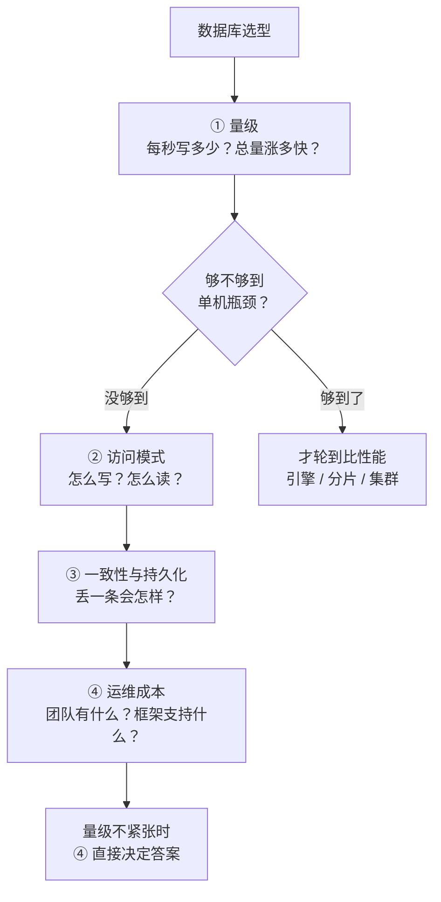
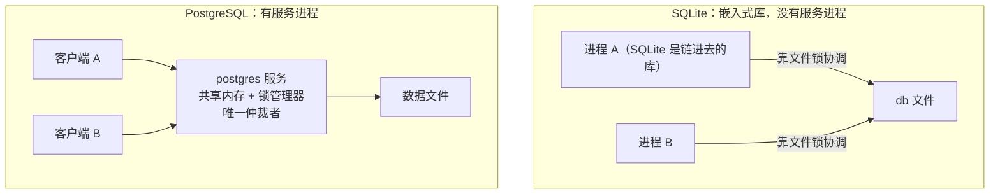

# Agent 状态持久化与数据库选型

> **一句话总纲：agent 的存储选型是一道「容量与运维」题，不是「吞吐」题。** 并发会话只有几十个，绝对写入速率低到任何关系型数据库都随手接住；真正会炸的是**状态体积随轮数单调增长**。**先算量级，算完你会发现瓶颈不在 QPS 而在存储——这个反转就是这道题的满分点。**

> ⚠️ 本文只管**会话状态（checkpoint）**。**长期记忆是另一套机制**，见 [[Agent记忆四家实现对比]]（DeerFlow 的 memory 走 per-user JSON 文件，**不走这里说的数据库**）。运行时与水平扩展的完整七问见 [[字节答疑Bot]] Q9 系列。

## 高频问法

- **「会话历史要放外置数据库，你打算用哪个？」** — [[公司/字节/中国商业化/字节商业化AgentInfra二面_2026-08-06]] §19.3（🔴 **答成「这个确实没有考虑过」，本场第二个断点**）
- **「为什么写多读少？什么时候写、什么时候读？」** — 同上 §19.4（✅ 答对了）
- **「实例挂了，内存里的东西就丢了吗？」** — 同上 §19.5
- **「历史会话怎么持久化？存储结构是什么？」** — [[公司/阿里国际/Agent Infra/阿里星一面_2026-08-06]] §8.5
- **「scale 到 1-2 万人，整体架构怎么改？」** — [[公司/字节/中国商业化/字节商业化AgentInfra二面_2026-08-06]] §19.1

---

# ① 选型的四个输入，顺序不能换



> 🔴 **字节二面就是跳过 ① 直接从 ② 起步，然后 ② 也只说了一半，推出了错误方向。** 缺了 ① 就没有资格谈「哪个写性能好」——**因为你不知道自己离瓶颈有多远。**

## 1.1 「写多读少」这个词本身是陷阱

**断裂一：它是比例，不是量级。**
100:1 的读写比，可以是每秒 100 次写，也可以是每秒 100 万次写。**数据库扛不扛得住看的是绝对写入速率，跟读写比例毫无关系。** 报个比例就去挑引擎，等于没报。

**断裂二：「NoSQL 写得快」是假等式。**
决定写吞吐的是**存储引擎的写入路径**，不是 SQL / NoSQL 这个分类：

| | 写入路径 | 代表 |
|---|---|---|
| **B+ 树** | 找到那一页 → 原地改 → 整页写回。改 100 字节也要写一整页（InnoDB 16KB），这叫**写放大** | MySQL、PostgreSQL、**MongoDB（WiredTiger）** |
| **LSM-tree** | 只往内存表追加 → 攒满整块顺序刷盘 → 后台 compaction 合并 | RocksDB、Cassandra、HBase |

**注意 MongoDB 在第一行——它是 NoSQL，引擎却是 B+ 树变体。所以「NoSQL → 写得快」根本不成立。**

> 💡 **面试里主动点破自己上一版的说法反而加分**：「写多读少是比例不是量级」——它证明你会审自己的推理。

## 1.2 LSM 的代价（为什么小体量用它是净亏）

**compaction（压实 / 合并）**：LSM 写入只追加、从不原地改，所以同一个 key 改 5 次就散在 5 个文件里、4 个是过期版本。compaction 是**后台把多个文件读出来按 key 归并、丢掉旧版本和墓碑、写成一个新的大文件**。

不做的后果：① 读一个 key 要从新到旧翻遍所有文件，文件越堆越多读延迟线性恶化 ② **删除是写墓碑不是真删，只有 compaction 才释放磁盘**。

| 代价 | 说明 |
|---|---|
| **写放大反而高** | 每下沉一层重写一次，典型 **10-30 倍**。「LSM 写放大低」只对写入那一瞬间成立 |
| **compaction 抢 IO** | 跟前台写入抢磁盘带宽，**表现是延迟毛刺**——平时 1ms，合并一起来就 50ms |
| **读放大** | 查一个 key 可能翻好几层 |
| **运维复杂** | 层数、放大系数、触发策略都是要调的参数 |

> **LSM 是拿「读变慢 + 后台持续吃 IO + 运维变复杂」换「写入那一刻的顺序追加」。只有写入速率高到 B+ 树撑不住时才划算。**

---

# ② 把量级真的算一遍

## 2.1 写入速率

> **写入次数/秒 = 并发会话数 × 每次会话的超步数 ÷ 会话时长**

（超步 = 一次调度批次，LangGraph 每个超步结束落一次 checkpoint）

代入 [[字节答疑Bot]] 的场景（面试官给的规模是 1-2 万人）：

| 变量 | 取值 | 依据 |
|---|---|---|
| 并发会话 | **50** | 内部工具 + 飞书**异步消息**（发完就去干别的）+ 峰值在上班时间 |
| 每次超步数 | **30** | 一次问答 20-30 轮工具调用 |
| 会话时长 | **120 秒** | 一次跑几分钟 |

> 50 × 30 ÷ 120 ≈ **12.5 次写/秒**。给 10 倍余量 = **125 次写/秒**。
> **单机 PostgreSQL 在普通 SSD 上跑小事务，几千 TPS 是常规水平——用掉不到 5%。**

**✅ 结论一句话：这个量级下不是性能问题，是省事问题。说出这句，这题答对一半。**

## 2.2 访问模式（把「写多读少」换成精确描述）

| | 精确说法 |
|---|---|
| **写** | **顺序追加**——每个超步结束追加一条，不改历史、不删 |
| **读** | **按主键点查**——只在会话恢复时按 `thread_id` 取最后一个 checkpoint |
| **没有的** | 范围扫描、跨表 join、聚合、跨行事务 |

> **含义是：这个负载对数据库几乎没有能力要求，所以选型自由度极大——那就该选运维成本最低的那个。**

## 2.3 🌟 真正的瓶颈是存储膨胀，不是 QPS

LangGraph 的 Postgres checkpointer 把状态存在 `checkpoint_blobs`，**主键是 `(thread_id, checkpoint_ns, channel, version)`**：

- ✅ **没变的 channel 不重复存**——官方做的优化
- 🔴 **但变了的 channel 是整值重存，不是存 diff**

而 `messages` 用的是追加型 reducer（`Annotated[list, operator.add]`），**每一步都在变**：

> 第 1 步存 1 条、第 2 步存 2 条、…第 N 步存 N 条 → **一次会话的存储是 O(N²)**

代入：30 个超步，工具返回（grep 结果、文件内容）平均每条 20KB：

> 20KB × (1+2+…+30) = 20KB × 465 ≈ **9MB / 次问答**
> 2 万人 × 每天 2 次 = 4 万次/天 → **约 360GB/天**

**而这个问题在单实例时代完全看不出来**——本地 SQLite 文件谁也不盯。

**三条解法，按性价比：**

1. **别把大内容塞进 state**——工具返回的正文另存，state 里只放 `doc_id` / 引用。**能把 O(N²) 的系数砍一个量级**
2. **TTL + 只保留最近 N 个 checkpoint**——历史 checkpoint 的唯一用途是断点续跑和 time travel，会话结束后就是死数据
3. **降低落盘频率**——不是每个超步都落，改成按边界落（每个工具调用批次结束落一次）。**先降写放大，再考虑换存储引擎**

> ⚠️ **「分 channel 存」这个优化救得了不常变的大字段，救不了 `messages` 这种每次都变的增长字段。** 这句是本节的收口。

---

# ③ LangGraph 到底往数据库里存什么

## 3.1 官方 Postgres 建表语句（源码原文）

```sql
CREATE TABLE checkpoints (
    thread_id TEXT NOT NULL,
    checkpoint_ns TEXT NOT NULL DEFAULT '',
    checkpoint_id TEXT NOT NULL,
    parent_checkpoint_id TEXT,
    type TEXT,
    checkpoint JSONB NOT NULL,
    metadata JSONB NOT NULL DEFAULT '{}',
    PRIMARY KEY (thread_id, checkpoint_ns, checkpoint_id)
);
CREATE TABLE checkpoint_blobs (
    thread_id TEXT NOT NULL,
    checkpoint_ns TEXT NOT NULL DEFAULT '',
    channel TEXT NOT NULL,
    version TEXT NOT NULL,
    type TEXT NOT NULL,
    blob BYTEA,
    PRIMARY KEY (thread_id, checkpoint_ns, channel, version)
);
CREATE TABLE checkpoint_writes (
    thread_id TEXT NOT NULL,
    checkpoint_ns TEXT NOT NULL DEFAULT '',
    checkpoint_id TEXT NOT NULL,
    task_id TEXT NOT NULL,
    idx INTEGER NOT NULL,
    channel TEXT NOT NULL,
    type TEXT,
    blob BYTEA NOT NULL,
    PRIMARY KEY (thread_id, checkpoint_ns, checkpoint_id, task_id, idx)
);
CREATE TABLE checkpoint_migrations (v INTEGER PRIMARY KEY);
CREATE INDEX checkpoints_thread_id_idx ON checkpoints(thread_id);
```

| 表 | 存什么 | 一句话 |
|---|---|---|
| `checkpoints` | 每个超步一行：**元数据 + 版本组合**（这个超步用的是哪些 channel 的哪个版本）、`parent_checkpoint_id`（**这就是 time travel 能分叉的原因**） | **索引层，不存内容** |
| `checkpoint_blobs` | 按 `(channel, version)` 存的**实际内容**，`BYTEA` 二进制 | **内容层，O(N²) 出在这** |
| `checkpoint_writes` | **已跑完但还没合并的写**（`pending_writes`） | **「续跑不重复执行」靠它**——同一超步 A 跑完 B 崩了，恢复时不重跑 A |
| `checkpoint_migrations` | schema 版本号 | 框架自己管，跟你无关 |

> 💡 **`checkpoint_ns`（namespace）是 subagent 用的**——主图和子图各自一个命名空间，所以子 agent 的状态不会跟主 agent 撞。被追问「subagent 的状态怎么隔离」时这是现成答案。

## 3.2 一个具体例子（拿 [[字节答疑Bot]] 讲）

```
thread_id      = "lark_thread_88231"          ← 一个飞书话题
checkpoint_id  = "1ef8c3...-0003"             ← 第 3 个超步
parent         = "1ef8c3...-0002"             ← 上一个超步，可回溯可分叉
next           = ["call_model"]               ← 下一步该跑哪个节点

channel = "messages"        version = 3
  值 = [ {role:"user",      content:"达人A在巴西站佣金为什么是0"},
         {role:"assistant", tool_calls:[{name:"grep", args:{q:"commission_rate"}}]},
         {role:"tool",      content:"结算模块 line 412: if region in BLOCKED..."} ]

channel = "decision_tree"   version = 3
  值 = { root:"佣金=0", children:[ {cond:"region 在黑名单", status:"命中"},
                                   {cond:"达人等级<L3",    status:"未验证"} ] }

pending_writes = []                            ← 已跑完但未合并的写
```

**两个 channel 是因为 State 声明了两个字段**，不是「设计成两个」：

```python
class State(TypedDict):
    messages: Annotated[list, operator.add]   # ← channel "messages"，每步都变
    decision_tree: dict                        # ← channel "decision_tree"，偶尔变
```

| 超步 | `messages` | `decision_tree` | 实际写入 |
|---|---|---|---|
| 3 | 变了 → v3 | 没变 → 仍 v3 | **只写 messages v3** |
| 4 | 变了 → v4 | 变了 → v4 | 两个都写 |
| 5 | 变了 → v5 | 没变 → 仍 v4 | **只写 messages v5** |

## 3.3 ⚠️ Checkpointer / Store / 应用表：一个 backend 装三样

**DeerFlow 的 `database.backend` 同时驱动三份东西，性质完全不同：**

| 归谁管 | 表 | 存什么 | 能恢复执行吗 |
|---|---|---|---|
| **LangGraph checkpointer** | `checkpoints` / `checkpoint_blobs` / `checkpoint_writes` / `checkpoint_migrations` | 每个超步的执行快照 | ✅ **可执行状态** |
| **LangGraph Store** | `store` / `store_migrations` | 跨会话的长期 KV（namespace + key） | ❌ 只是数据 |
| **DeerFlow 应用表**（alembic 管） | `runs` / `run_events` / `threads_meta` / `feedback` / `users` / `agents` / `channel_*` / `scheduled_tasks*` | 运行记录、事件流、会话元数据、用户反馈、IM 渠道凭据、定时任务 | ❌ 业务日志与配置 |

> 🔴 **只答「存 input / output / 思考 / 工具调用 / 工具返回」= 只答了第一行。** 三份一起讲才证明你读过框架。
> 🔴 **而且 DeerFlow 的 memory 不在这三行里**——DeerMem 是独立机制、走 per-user JSON 文件，见 [[Agent记忆四家实现对比]] §2.4。**「memory 存在 Store 里」是错的。**
> 💡 顺带：官方注释提醒 **checkpointer 的表名会随 LangGraph 版本变**，迁移时要用 `information_schema` 现查。**这说明表结构是框架的内部实现，不是你的 schema——这正是「选 Postgres 是省事选型」的具体含义：你不用设计表。**

---

# ④ 候选逐个说

## 4.1 SQLite —— 现在用它是对的，但它是扩展的硬卡点

**为什么现在够用**：零运维（不用起数据库进程）、单文件、**WAL 模式**（Write-Ahead Logging，预写日志：改动先追加到旁路的 `-wal` 文件，不直接改主库文件）让**读不被写阻塞**。

**为什么撑不到多实例——两条，第二条更少人知道：**

1. **单文件跟进程绑在一台机器上**
2. ⭐ **SQLite 同一时刻只允许一个写事务，全库串行**。WAL 只解决了「读不被写挡住」，**没解决「写和写并发」**；多进程写同一文件靠文件锁协调，**NFS / 网络盘上锁语义不可靠**

> **第 2 条比第 1 条值钱**——第 1 条是常识，第 2 条说明你知道 WAL 解决了什么、没解决什么。

### ⚠️ 「SQLite 没有 MVCC」是错的

| | SQLite（WAL） | PostgreSQL |
|---|---|---|
| 读被写挡住吗 | ❌ 不会（**有快照隔离**） | ❌ 不会 |
| 写被读挡住吗 | ❌ 不会 | ❌ 不会 |
| **写和写能并发吗** | 🔴 **不能，只有一个写者** | ✅ 能（不同行互不干涉） |

**准确说法：SQLite 有快照隔离，但没有多写并发。** 说「SQLite 没有 MVCC」会被懂的人纠正。

## 4.2 PostgreSQL —— 答案

- **DeerFlow 官方支持**：`backend: postgres` + `postgres_url: $DATABASE_URL`，注释定性 **production multi-node**
- **LangGraph 官方支持**：`langgraph-checkpoint-postgres`
- **JSONB** 适配半结构化 checkpoint（二进制 JSON，可建 GIN 索引、按路径查）
- 量级富余（12 次/秒 vs 几千 TPS）

## 4.3 Redis —— ⭐ 它在 DeerFlow 里的角色是协调，不是存储

LangGraph 官方**有** Redis checkpointer，但 **DeerFlow 的 `database.backend` 根本没有 redis 这个选项**（只有 memory / sqlite / postgres）。

**Redis 在 DeerFlow 源码里出现在两个完全不同的地方**：

```yaml
# ownership:
#   type: redis                       # 跨实例 sandbox 容器归属
# DEER_FLOW_STREAM_BRIDGE_REDIS_URL   # 多实例流式消息桥接
```

官方注释解释得很清楚：多个 gateway 实例共享 sandbox 容器时，**没有共享归属状态的话，一个实例启动时的对账会把另一个实例正在用的容器认领走、当成空闲销毁掉，工具调用就 502 了。**

> 🌟 **收口一句（很值钱）：在这个架构里 Redis 的角色是「跨实例协调」，不是「状态真相源」。** 真相源是 Postgres，Redis 管的是容器归属和流式桥接这类**必须快、可以丢**的东西。
> **这句直接反驳了「写多读少 → 写性能好一致性弱的数据库」——Redis 恰恰是那类，而它在这个系统里被放在了完全不同的位置上。**

**为什么不能当真相源**：Redis 的持久化只有两种，**都会丢**——

| | **RDB**（快照） | **AOF**（追加日志） |
|---|---|---|
| 做什么 | 定期把整个内存数据集 dump 成二进制文件 | 每条写命令追加到日志 |
| 恢复 | 加载快照，快 | 重放所有命令，慢 |
| 丢多少 | **两次快照之间的全部写入** | 看 `fsync` 策略：`always` 不丢但每写等磁盘／`everysec`（默认）**最多丢 1 秒**／`no` 交给 OS |

> **`always` 不丢，但你为了不丢已经把 Redis 的速度优势付掉了——而速度是选它的唯一理由。**
> **agent 一次失败要赔掉几十轮工具调用（几毛到几块钱），丢 1 秒不能接受。**

## 4.4 MongoDB / MySQL / LSM 类 / 对象存储

| 候选 | 判断 |
|---|---|
| **MongoDB** | LangGraph 官方有 checkpointer，**DeerFlow 没有这个 backend**。引擎（WiredTiger）也是 B+ 树变体，**没有写入优势**。团队没有 Mongo 运维经验就没理由选 |
| **MySQL** | **LangGraph 官方没有 MySQL checkpointer，DeerFlow 也没有这个选项**。选它 = 自己实现 checkpointer 接口 + 自己保证恢复语义。**直接出局** |
| **Cassandra / HBase（LSM）** | 为百万级写入设计，你是 12 次/秒。**杀鸡用牛刀，且运维重** |
| **对象存储 S3/OSS** | 没有按 `thread_id` 点查的索引能力，没有事务 |

---

# ⑤ 两个必然被追问的对比

## 5.1 PostgreSQL vs MySQL（只挑跟这题相关的四条）

| # | 维度 | 差异 |
|---|---|---|
| ① | **JSON 能力** | Postgres 的 **JSONB** 可直接建 GIN 索引、按路径查；MySQL 的 JSON 要靠**生成列**（由表达式算出的虚拟列）绕，且只能对预先想好的字段建 |
| ② | **MVCC 实现** | **InnoDB**：旧版本进 **undo log**，主表只留最新版本，表不膨胀（长事务会撑大 undo）／**Postgres**：**旧版本留在表里**，UPDATE = 写新行版本 + 老的标死行，**靠 autovacuum 清，表会膨胀** |
| ③ | **扩展生态** | Postgres 有 **pgvector**——**RAG 向量、checkpoint、应用数据可以同一个库**，少运维一套。MySQL 无对等物 |
| ④ | **框架支持** | **LangGraph 官方只有 Postgres saver，没有 MySQL。决定性。** |

> ⭐ **第 ② 条对你是好消息，必须主动说**：Postgres 的膨胀是它被吐槽最多的短板，**但 checkpoint 是只 INSERT、不 UPDATE、不 DELETE 的——没有 UPDATE 就不产生死行，这个短板在这个场景根本不发作。**
> **「知道选什么」和「知道为什么这个短板不影响我」，差的就是这一句。**
>
> 📌 面试顺序：**先说第 ④ 条（MySQL 直接出局），剩下三条留着被追问时再上。**

## 5.2 为什么 Postgres 能多写并发、SQLite 不能

**最根本的一层是架构，不是锁粒度：**



**SQLite 没有仲裁者**——它就是链进你进程的一个函数库，两个进程协调只能靠**文件系统的锁**。**这就是它在 NFS 上会坏的根因：它把协调外包给了文件系统。**

**在这之上还有两层：**

- **锁粒度**：SQLite 写时锁**整个数据库**；Postgres **只锁被改的行**。你的负载是不同会话写不同行——**Postgres 下零争用，SQLite 下全排队**
- **行级 MVCC**：Postgres 每行带 `xmin`（创建它的事务号）/ `xmax`（删除它的事务号），快照按事务号逐行判可见性，**读完全不加锁**

| 时刻 | 表里的物理行 |
|---|---|
| 事务 100 插入 | `(id=1, v='A', xmin=100, xmax=0)` |
| 事务 105 改成 'B' | `(id=1, v='A', xmin=100, xmax=105)` ← 死行<br/>`(id=1, v='B', xmin=105, xmax=0)` ← 新版本 |

可见性规则：`xmin ≤ 我的快照` 且 `(xmax = 0 或 xmax > 我的快照)`。**事务 103 看到 'A'，事务 110 看到 'B'，谁都不用等。**

**为什么粒度不同就导致能不能多写**：

> **SQLite 的写是「往 WAL 尾巴追加」——尾巴只有一条，两个人同时追加帧编号会打架，只能串行。**
> **Postgres 的写是「在表里写一个新行版本」——不同事务写不同的行就是写不同位置，天然不冲突。只有改同一行才要行锁。**

> 💡 补充：**SQLite 的单写者是实现选择不是理论限制**——Turso（SQLite 的 Rust 重写版）用 `BEGIN CONCURRENT` + 行级 MVCC 做到了多写。**别主动扯，被问「SQLite 单写是不是没救」时再上。**

---

# ⑥ 面试怎么说（70 秒定稿）

> 「**先说现状**：DeerFlow 的 `database.backend` 是个配置项，有 memory、sqlite、postgres 三档，我们配的是 sqlite。**这一档官方定性就是 single-node deployment，我们的部署形态确实是单实例，所以当时这个选择是对的。**
>
> **但它是水平扩展的第一个硬卡点，有两层原因**：单文件跟进程绑在一台机器上；而且 SQLite 就算开了 WAL，也只是让读不被写阻塞，**写和写之间仍然是全库串行的**。
>
> **要多实例我会切到 postgres——而且这不是改代码，是改 `database.backend` 这一项。** 官方注释里 postgres 那档写的就是 production multi-node。
>
> **为什么是 Postgres 不是别的**：先算量级——并发几十个会话、一次问答二三十个超步、耗时几分钟，**平均每秒十几次写，给十倍余量也就一百多**。这个量级任何关系型数据库都随手接住，**所以这不是性能选型，是省事选型**。Postgres 是 LangGraph 和 DeerFlow 双方官方都支持的那一档，checkpoint 半结构化用 JSONB 正合适，而且 Postgres 那个「表膨胀要 vacuum」的老短板在这儿不发作——**checkpoint 只追加不更新，不产生死行**。
>
> **Redis 我不会拿来当真相源**，虽然 LangGraph 官方有 Redis checkpointer。**在 DeerFlow 里 Redis 的位置是跨实例协调**——sandbox 容器归属、流式消息桥接，那些是必须快、可以丢的东西。**状态真相源和协调状态应该分开。**
>
> **另外补一句这个库到底装了什么**：一个 backend 同时驱动三份东西——LangGraph 的 checkpointer 表、LangGraph 的 Store、还有 DeerFlow 自己的应用表 runs / run_events / threads_meta。**这三份性质完全不同：checkpointer 是可执行状态能断点续跑，Store 是跨会话的长期数据，应用表是给排障和产品用的日志。** 迁移的时候三份要一起走。
>
> **最后有件事我算量级的时候才发现：真正的瓶颈不是 QPS，是存储增长。** checkpoint 按 channel 存，没变的不重存，**但变了的是整值重写**；`messages` 每步都变，所以第 N 步要存前 N 条的完整序列化——**单次会话是 O(N²)**。工具返回如果是 grep 结果这种大文本，一次问答几 MB，乘日活是几百 GB 一天。**解法优先级：先别把大内容塞进 state，正文外存只放引用；再给 checkpoint 加 TTL；最后才是降落盘频率。**」

## 预备追问

| 他问 | 你答 |
|---|---|
| **Redis 行不行？** | 官方有，但它是内存数据库而 checkpoint 要长期留存且体积大。**我会把 Redis 放前面当热会话缓存、Postgres 当真相源**，不是二选一 |
| **为什么不用 MongoDB？文档型不是更搭？** | 数据模型确实搭，**但引擎也是 B+ 树变体，没有写入优势**；官方 checkpointer 两边都有。**没有性能差时，选团队已经在运维的那个** |
| **量级涨到每秒一万次写呢？** | 那才轮到换引擎。**但第一步仍不是换数据库，是减少写入次数**——按边界落盘而非每个超步。**先降写放大，不够再考虑 LSM 类或按 `thread_id` 分片** |
| **丢一条 checkpoint 会怎样？** | 丢最后一条 = **从上一个超步重跑，代价是重复一次工具调用，不是数据错误**。所以不需要强一致，**但需要持久化**——这就是为什么不能只放内存 |
| **实例挂了内存里的东西丢吗？** | 会，**而且我很清楚最不能丢的是决策树**（几十轮工具调用换来的）。**但这不用我自己写落盘逻辑**——checkpointer 本来每个超步落一次；**问题是决策树没被放进 state schema，我们当成了运行时中间变量。改法是纳入 schema 跟着 checkpointer 一起落。** |

---

# 易错点

1. 🔴 **「写多读少 → 写性能好、一致性弱的数据库」。** 跳过量级估算的八股推理，而且 NoSQL≠写得快（MongoDB 也是 B+ 树）。
2. 🔴 **说「我们用 SQLite，要扩展得换 Postgres」**，像是不知道框架已经支持。**正确说法是「`database.backend` 是配置项，三档，我们配的 sqlite」。**
3. 🔴 **说「SQLite 没有 MVCC」。** 它有快照隔离，缺的是多写并发。
4. 🔴 **说「DeerFlow 的 memory 存在 Store 里」。** DeerMem 走 per-user JSON 文件，跟 `database` 那一层无关。
5. ⚠️ **只答 checkpointer 一份，漏掉 Store 和应用表。**
6. ⚠️ **在这个量级上主动加 Redis 缓存层。** 并发几十个会话的热状态几百 MB，**Postgres 自己的页缓存就装下了**——不说这句听起来像为炫技加组件。
7. ⚠️ **忘了 checkpoint 要有生命周期。** 只增不减，单实例时代看不出来，上了外置存储只有账单会涨。

---

# 深入阅读

- 框架侧：[[LangGraph工程实践]] §二 Checkpointer vs Store vs 自建表
- 记忆侧（**是另一套机制**）：[[Agent记忆四家实现对比]] §2.4 DeerMem
- 完整的运行时七问：[[字节答疑Bot]] Q9 系列
- 真题：[[公司/字节/中国商业化/字节商业化AgentInfra二面_2026-08-06]] · [[公司/阿里国际/Agent Infra/阿里星一面_2026-08-06]]

**来源与置信度**

- LangGraph Postgres 建表语句：**源码原文，高置信** — [langgraph/checkpoint/postgres/base.py](https://github.com/langchain-ai/langgraph/blob/main/libs/checkpoint-postgres/langgraph/checkpoint/postgres/base.py)
- DeerFlow `database` 三档 / 默认 sqlite / WAL / Redis 用于 ownership 与 stream bridge / 应用表清单：**源码原文，高置信** — [deer-flow config.example.yaml](https://github.com/bytedance/deer-flow/blob/main/config.example.yaml)
- SQLite 有快照隔离但单写者：**官方，高置信** — [SQLite Locking](https://sqlite.org/lockingv3.html) · [SQLite Forum: Multiple Writers](https://sqlite.org/forum/info/b4e8b29ae409cd198652c6b7e70b53b702f269e67e1d2573d627feeba37bbf85)
- Postgres xmin/xmax / 死行 / vacuum：**高置信** — [MVCC in PostgreSQL — Snapshots](https://postgrespro.com/blog/pgsql/5967899)
- Turso 的 `BEGIN CONCURRENT` + MVCC：**高置信** — [Turso blog](https://turso.tech/blog/beyond-the-single-writer-limitation-with-tursos-concurrent-writes)
- 🔶 **O(N²) 这条是推断**（从「变了的 channel 整值重存 + `messages` 每步都变」推的），**没有实测**。逻辑站得住，但被问「你实测过吗」要如实说是从存储结构推的。
- 🔶 **量级数字（50 并发 / 30 超步 / 20KB）全是现场估算**，说的时候带一句「我拍一个数」——**面试官要看的就是敢不敢拍量级。**
