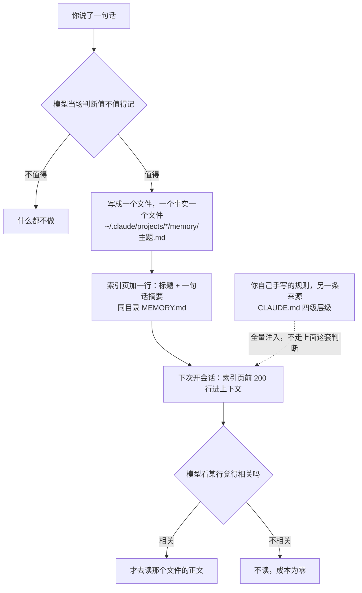
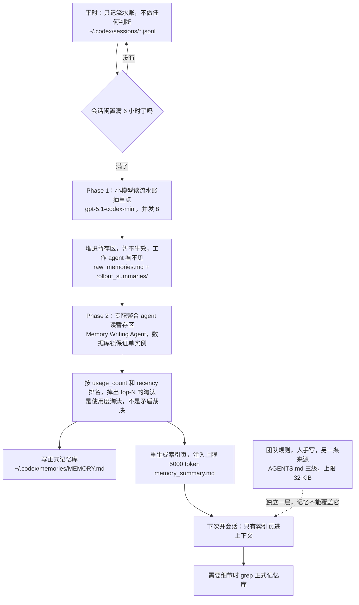
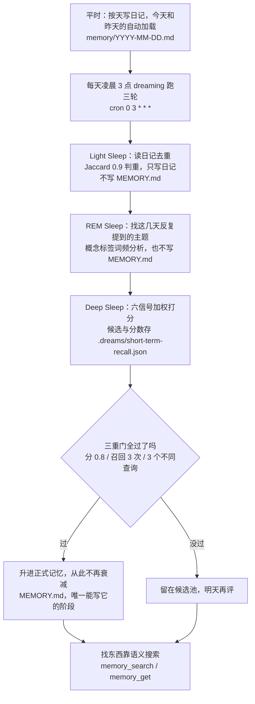
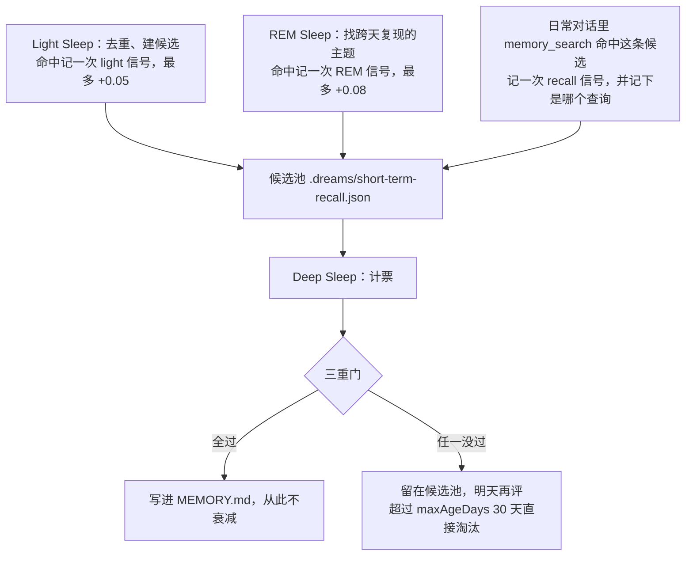
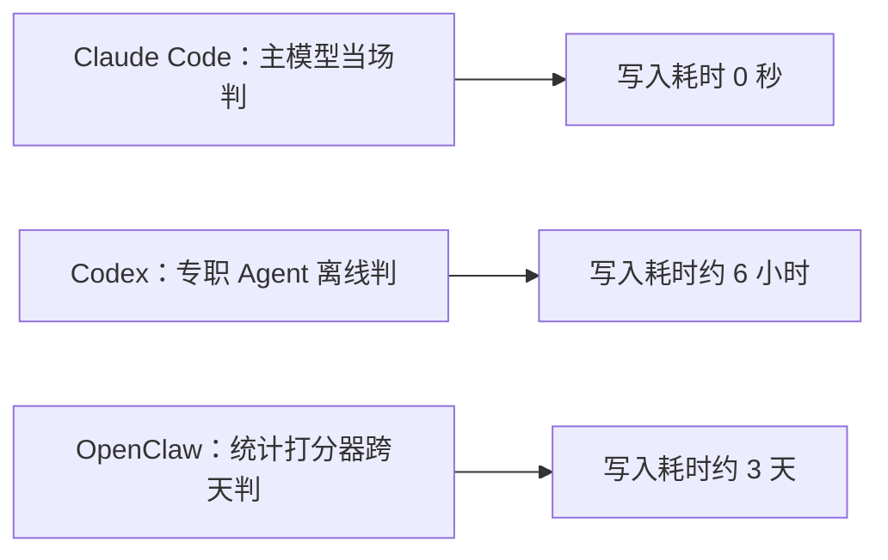
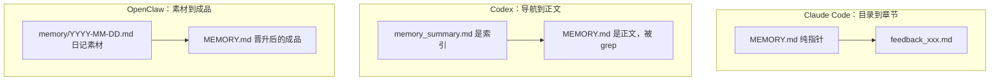
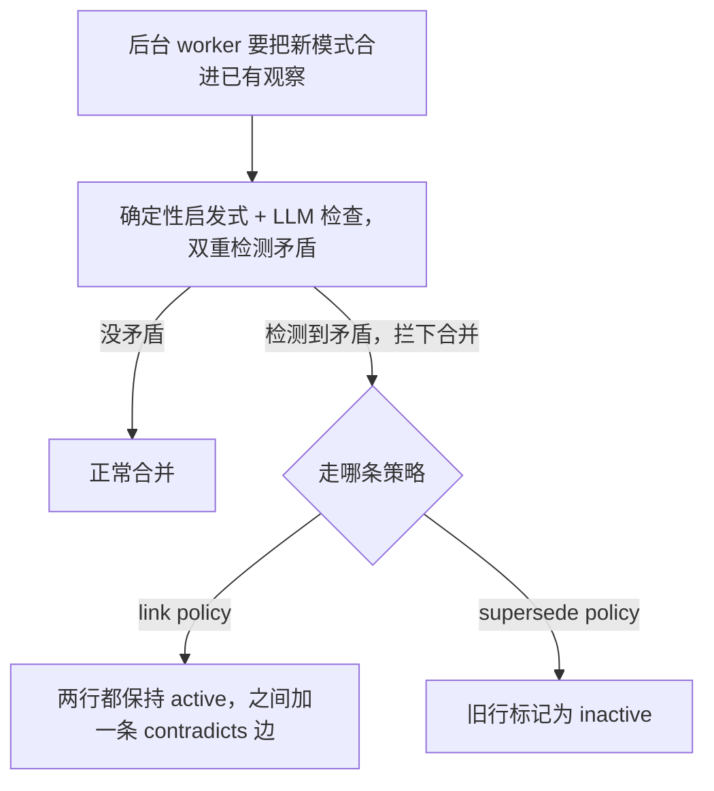
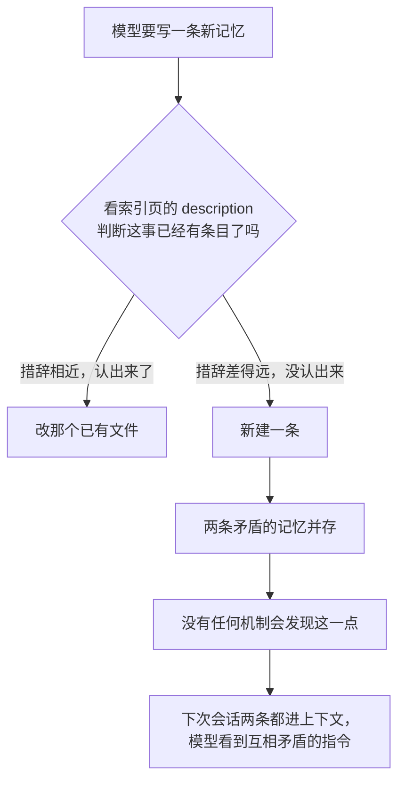
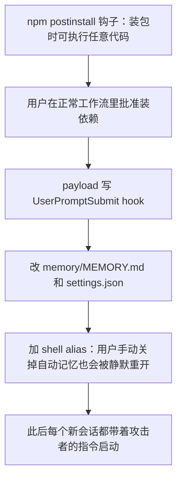

# Agent 记忆三家实现对比（Claude Code / Codex / OpenClaw）

> 三家的根本分歧只有一句话：**谁来判定什么值得长期记**。Claude Code 交给主模型当场判，Codex 交给专职 Agent 离线判，OpenClaw 交给统计打分器跨天判。**其余所有差异都是这一条的推论。**

> ⚠️ 本文是**具体实现**。抽象的设计维度见 [[Agent记忆系统]]（七维度框架），本轮会话内的压缩见 [[Agent上下文压缩链路]]。

## 高频问法

- **「Claude Code 的记忆系统了解吗？分不分长短期？」** — [[公司/快手/DataAgent方向/快手数据平台DataAgent一面_2026-07-29]]
- **「你说你看源码——Claude Code / Codex / OpenClaw 有什么设计特别好？」** — [[公司/点点互动/AI Agent方向/点点互动AI Agent二面_2026-08-05]]（**实战翻车点：把 Codex 触发说成「每天定时」（实为 idle ≥6h），并把三家的架构复杂度归因成「对自己模型不自信」——正确口径见 §3.2「不是谁更先进，是约束不同」**）
- **「你们的 memory 有分层结构吗？具体怎么设计？」** — [[公司/字节/中国商业化/字节商业化AgentInfra一面_2026-07-30]]、[[公司/淘天/AI Agent/淘天AI-Agent一面_2026-07-30]]、[[公司/蔚来/蔚来CICD组AI agent实习生一面面经-详细版]]
- **「什么时候写 memory？主题结束怎么判断？」** — [[公司/星河觉醒/Agent方向/星河觉醒Agent一面_2026-07-20]]
- **「语义相似度用什么存、怎么实现？多少条？」** — [[公司/星河觉醒/Agent方向/星河觉醒Agent一面_2026-07-20]]
- **「写一句『以后都这么称呼我』会污染上下文吗？」** — [[公司/字节/中国商业化/字节商业化AgentInfra一面_2026-07-30]]
- **「自进化跟普通 memory 什么区别？怎么验证有提升？」** — [[公司/上海AI Lab/后训练数据/上海AI Lab后训练数据一面_2026-07-31]]、[[公司/字节/中国商业化/字节商业化AgentInfra一面_2026-07-30]]

---

# ① 架构先行：三家各自怎么运转

> 每段的读法：**一句大白话 → 流程图（节点第一行是「做什么」，第二行就是对应的真实文件/参数）→ 几条要点**。先把「这东西是怎么运转的」建立起来再进细节——**看不懂后面的表，多半是因为跳过了这一节。**

## 1.1 Claude Code：写完就是终点

**你说一句话，模型当场判断「这值得长期记」，立刻写成一个文件，完。**



- 记忆有两个来源：**你自己手写的规则**，和**模型自己判断后写下的事实**
- 下次开会话**只有索引页进上下文**，正文按需读
- **没有后台任务、没有整理流程、没有打分。写完就是终点。**

## 1.2 Codex：抽 → 攒 → 合，三步走

**平时只记流水账；等你不用这个会话了，派个小模型去读流水账挑重点；挑出来的先堆在一边不生效；再派个专职 agent 把它们合并进正式记忆库。**



- **平时完全不做判断**，只把每条消息原样落盘
- **判断权交给一个专职的整合 agent**，在你不用的时候离线做
- **暂存区对日常对话的 agent 完全不可见**

## 1.3 OpenClaw：写日记 → 夜里整理 → 够格才转正

**平时写日记；每天凌晨跑一遍，把日记里反复出现的东西挑出来打分；分够了才升进「正式记忆」。**



- **日记当天就影响 agent 行为**（今天和昨天的日记自动加载）
- **正式记忆不衰减**；日记会随时间在检索里降权
- **找东西靠语义搜索**，不像前两家把索引页常驻上下文

---

# ② 具体细节：一次看一个系统

## 2.1 Claude Code

**目录**：`~/.claude/projects/<slug>/memory/`，**按 git 仓库根隔离**（一个仓库一份记忆）。

**记忆文件长这样**（本机真实样本）：

```markdown
---
name: feedback-agent-check-latest      # 双链指向的是这个字段，不是文件名
description: Agent 类问题必须先查源码和最近资料再答   # 检索唯一依据，就这一行
metadata:
  node_type: memory
  type: feedback                        # user | feedback | project | reference
  originSessionId: 882cbe8e-...
  modified: 2026-07-30T10:46:42.845Z
---
正文……用双方括号包住另一条记忆的 name 做互链（指向还不存在的 name 也允许，等于待写标记）
```

四类 `type`：`user`（他是谁）/ `feedback`（工作方式指导）/ `project`（在做什么）/ `reference`（外部资源指针）。

> ⚠️ **schema 有版本漂移，新旧共存不强制迁移。** 本机 5/4 写的那条是 `name: 面经仓库 CLAUDE.md 工作规则`（中文标题）+ 顶层 `type`；7/30 写的才是 kebab slug + `metadata` 嵌套。**结果是老文件链不上**——`[[]]` 解析的是 `name` 字段，老文件的 name 不是 slug 形式。
> <!-- 来源: 直接读本机 memory 目录 ・ 查证于 2026-08-04 -->

**索引页 `MEMORY.md`** 全文就是几行 markdown 链接（本机 492 字节 / 4 行），格式 `- [标题](文件名) — 钩子句`。

> 🔴 **硬天花板：前 200 行 或 前 25KB，谁先到算谁——超出部分静默丢弃。**
> 新条目追加在文件末尾，所以**超限时最先掉的是最新写的那些**。失败模式是：Claude 写入成功（文件里确实有那行），但**这条记忆在之后所有会话里都不可见**——不报错、不提示、不降级，系统只是不知道它存在。有个 `WARNING: MEMORY.md is 221 lines (limit: 200)` 的提示，但**要主动翻文件才看得到**。
> 缓解是软的：写完后 Claude Code 量一下文件，接近限制时**提醒模型**缩短（一行一条、细节挪主题文件、合并或删陈旧条目）——是提醒，不是硬约束。
> <!-- 来源: anthropics/claude-code issues #25006 / #39811 / #57574 / #38452（官方仓库）・ 查证于 2026-08-04 -->

**所以规模上限卡在索引，不在子文件数量**，而且**这条路线的代价不是「召回率下降」，是「直接消失且不告诉你」**——对比：Codex 的 `memory_summary.md` 也截断（≤5,000 token），但底下还有 `MEMORY.md` 能 `grep` 兜底；OpenClaw 是检索式，没有这个天花板。

**作用域：按仓库。** 决定用哪份记忆的是**当前 git 仓库根的路径**（不是 git 仓库就取当前工作目录），转成 slug 后去 `~/.claude/projects/<slug>/memory/` 找。**一个仓库一份，互相完全看不到**；同一仓库的所有子目录共用一份。**没有全局记忆层**（`~/.claude/memory/` 不存在）——跨仓库共享只能靠规则层的 `~/.claude/CLAUDE.md`，而那条线是人手写的规则，不是模型写的记忆。
> ⚠️ slug 是路径把非字母数字全换成 `-`，**中文目录名会碰撞**：`study/面经` 和 `study/找工` 都是 2 个字，slug 完全相同。（推断，未实测）

**规则层 `CLAUDE.md`**：四级层级（企业 / 项目 / 用户 / 子目录），**从当前目录向上递归查找**，路上每一级都收；子目录的按需加载。

**明确不记什么**（写进 prompt 的硬约束）：仓库已经记录的（代码结构、git 历史、`CLAUDE.md` 内容）、只对当前对话有意义的。**因为它没有检索，索引一长就废，只能从源头压条数。**

**触发与开关**：
- 写入：模型 turn 内同步判断 → 直接 Write
- Hook：`SessionStart`（注入记忆）、`PreCompact`（压缩前抢救，matcher 可选 `auto`/`manual`/`*`，脚本收到 `session_id` + `transcript_path`）
- 命令：`#` 前缀、`/memory`；开关：`CLAUDE_CODE_DISABLE_AUTO_MEMORY`
- **整理**：`consolidate-memory` skill，**用户手动触发，没有任何定时任务**

**时效警告**（本机实测，Read 记忆文件时自动挂在返回值前面）：

```
<system-reminder>This memory is 90 days old. Memories are point-in-time observations,
not live state — claims about code behavior or file:line citations may be outdated.</system-reminder>
```

天数是动态算的（读 3 天前那条时显示 `3 days old`）。**它不替你删，但每次都提醒你可能该删了。**
<!-- 来源: 直接读本机 memory 目录观察到 ・ 查证于 2026-08-04 -->

## 2.2 Codex

**作用域：按用户。** 官方口径是记忆的作用域为 **`$CODEX_HOME`**（默认 `~/.codex`），**不按仓库分**，可整体重置。所以**同一个人在所有仓库共用一份记忆**。
> ⚠️ 这是个已知痛点，官方称 **cross-project contamination**——很多记忆其实只跟某一个仓库有关，却会自动影响无关仓库。[openai/codex#18343](https://github.com/openai/codex/issues/18343) 在请求做分级作用域（global / project / hybrid / per-thread），**截至 2026-04 仍是 feature request，未实现**。
> <!-- 来源: openai/codex discussion #12567 + issue #18343（官方仓库）・ 查证于 2026-08-04 -->

**目录** `~/.codex/memories/`，**明确不进版本控制**：

| 文件 | 角色 |
|---|---|
| `memory_summary.md` | 启动时注入的导航摘要，**≤5,000 token** |
| `MEMORY.md` | 合并后的长文，供 `grep` |
| `raw_memories.md` | 暂存区：按 thread-id 升序稳定合并的抽取结果 |
| `rollout_summaries/<slug>.md` | 每个会话线程的复盘 + lessons learned |
| `skills/<name>/SKILL.md` | 学到的可复用流程 |

**两阶段流水线**：

- **Phase 1（抽取）**：会话 idle 超过 `min_rollout_idle_hours`（**默认 6 小时**，活跃会话永不触发）才够格。用 `gpt-5.1-codex-mini`，**默认并发 8**，从 `.jsonl` 读，输出 `raw_memory` + `rollout_summary` + 可选 `rollout_slug`，**先存进状态数据库**。
- **Phase 2（合并）**：把数据库里的行**物化**成 `raw_memories.md` / `rollout_summaries/`，再由专职的 Memory Writing Agent 合并进全局。**数据库锁保证每个 `codex_home` 只有一个合并进程**；靠 `input_watermark` 做增量而不是全量重建。

**注入路径**：`build_memory_tool_developer_instructions` 读 `memory_summary.md` → 包进 `read_path.md` 模板 → 注入 developer instructions，截断到 ≤5,000 token。**只有这一个文件被注入**；需要细节时 agent 去 `grep` `MEMORY.md`。**暂存区对工作 agent 不可见。**

**规则层 `AGENTS.md`**：三级（`~/.codex/` / 仓库根 / 子目录），**总量上限 32 KiB，超了静默截断**。硬性规定：**Memory 是个人的，AGENTS.md 是团队的，Memory 不能覆盖 AGENTS.md**。

**密钥清洗**：落盘前自动扫 API key / token / 密码 / 连接串并清洗，**在 Phase 1 边界做**。三家唯一。

**遗忘机制**（v0.106+，官方叫 diff-based，但**「diff」指的是排名 diff 不是语义 diff**）：加载有界的 Phase 1 输出集合，**按 `usage_count` 排序再按 recency 排序**，跟上一次成功合并做 diff 得到 `added` / `retained` / `removed` 三类——**`removed` 的条件是掉出当前 top-N 排名，不是跟别的矛盾**。被移除的证据会暂时保留（当前与上次选择的并集），好让 sub-agent 做「知情的遗忘决定」。另有 `max_unused_days` 之后未被引用的 Phase 1 产物批量剪枝。
> `usage_count`：这条记忆被引用过多少次的计数器——agent 每在回答里引用一次（发一个 `<oai-mem-citation>` 块）就 +1。
> `recency`：最近一次被用到是多久以前，存的字段是 `last_usage` 时间戳。
> **「先按 A 再按 B 排序」**：复合排序，主键按 A 排，A 打平时才看 B。SQL 就是 `ORDER BY usage_count DESC, last_usage DESC`。
> `top-N`：排完序取前 N 条，N 是个上限（原文说 "bounded set"，**具体数值未公开**）。

走一遍就清楚了：

```
存量按 (usage_count, last_usage) 排序：
  #1  用过 12 次，昨天用过
  #2  用过 12 次，三周前用过     ← usage_count 打平，靠 recency 分高下
  #3  用过 5 次，今天用过
  #4  用过 1 次，两个月前用过
假设 N=3，只有前三条进这次的选择集

上次的 top-3 = {#1, #3, #5}      这次 = {#1, #2, #3}
→ added = {#2}   retained = {#1, #3}   removed = {#5}
```

**`#5` 被 `removed` 不是因为内容错了，是因为排名掉出前 N 了。**

> ⚠️ **公开资料里没有矛盾检测**——`removed` 是使用度淘汰，不是冲突裁决。详见 §5.1。
> <!-- 来源: codex.danielvaughan.com memory deep dive（社区）・ 查证于 2026-08-05 -->

**合并沙箱**：consolidation sub-agent 跑在 **无审批、无网络、只有本地写权限**的环境里。

**使用回填**：每次记忆被引用（`<oai-mem-citation>` 块）触发 `record_stage1_output_usage`，累加 `usage_count`、更新 `last_usage`。合并时**高频记忆即使旧也保留，低频降权**。

**命令与限制**：`/m_update <fact>`（绕过 Phase 1 直写）、`/m_drop <query>`、`codex debug clear-memories`。CI 里用 `--no-project-doc` 跳过或挂持久卷。**EEA / 英国 / 瑞士不可用**（隐私法规）。

**已知问题**：[openai/codex#24948](https://github.com/openai/codex/issues/24948) —— 会话日志因反复持久化压缩历史和原始工具输出**涨到 700MB~2GB**，有一个到了 732MB。

## 2.3 OpenClaw

**作用域：按 agent 实例。** 一个 Gateway 进程里可以同时跑多个 agent 实例，**每个有自己的工作区文件、记忆、认证和工具**，官方称为 "fully scoped brain"，各自的 `agentDir` 和会话库在 `~/.openclaw/agents/<agentId>/`。默认按 **agentId × channel × user** 三个维度隔离，**并行子 agent 之间不自动共享记忆**（官方说这是设计，不是 bug——共享可变状态会引入竞态）。想共享要显式配置（从 bank key 里去掉 agent 维度）。

> ⚠️ **「agent 实例」跟 Claude Code 的「仓库」不是同一层面的东西**：仓库是**工作对象**（我在改哪份代码），agent 实例是**身份**（我在跟哪个助手说话）。一个 OpenClaw agent 实例可以在很多个仓库上干活，**记忆跟着它走，跟仓库无关**。
> <!-- 来源: OpenClaw 官方 multi-agent / agent-workspace 文档 ・ 查证于 2026-08-04 -->

**工作区** `~/.openclaw/workspace/`（单 agent 默认路径）：

- **身份文件族**：`IDENTITY.md`（名字/风格）· `USER.md`（用户背景，**作为指令性指导加载**）· `SOUL.md`（行为哲学，鼓励 agent 自我迭代）· `AGENTS.md`（操作手册）· `TOOLS.md`（机器备忘）· `HEARTBEAT.md`（待检清单）
- **记忆文件**：`MEMORY.md` + `memory/YYYY-MM-DD.md`（还有带 slug 的变体 `memory/YYYY-MM-DD-<slug>.md`，session-memory hook 在 `/new`/`/reset` 时写）
- **dreaming 产物**：`DREAMS.md`（**纯给人看**的叙事日志）· `.dreams/short-term-recall.json`（候选 + 分数）· `.dreams/phase-signals.json`（阶段命中计数）· `.dreams/events.jsonl`（审计日志）

**`MEMORY.md` 和日记是两层，不是同一层的两个文件**：

|     | `MEMORY.md`                    | `memory/YYYY-MM-DD.md`                 |
| --- | ------------------------------ | -------------------------------------- |
| 定位  | curated 精炼层                    | working 工作层                            |
| 内容  | 持久事实、偏好、长期成立的决策                | 当天流水、观察、会话摘要                           |
| 加载  | 每次主会话开场就加载                     | **只有今天和昨天自动加载**                        |
| 衰减  | **不衰减**                        | 检索引擎套 **30 天 recency 半衰期**             |
| 谁能写 | **dreaming 的 Deep 阶段是唯一自动写入方** | Light 阶段 / agent / session-memory hook |

**写入三条路径**：① 模型对话中主动决定 ② **Memory Flush**——压缩阈值前跑一个「无声轮次」提醒 agent 保存（**三家唯一把压缩和记忆写入耦合的**）③ session-memory hook 在 `/new`/`/reset` 时把会话固化成 `.md`

### dreaming：三阶段

默认 `cron: 0 3 * * *`，`dreaming.enabled` **默认 false**。三阶段串行，**三个阶段看三个不同长度的时间窗口，而且只有最后一个能写长期库**：

| 阶段 | 看多长的窗口 | 做什么 | 能写 `MEMORY.md` 吗 |
|---|---|---|---|
| **Light Sleep** | 最近 **2 天**（`light.lookbackDays`） | 读日记 + 会话转录，**Jaccard ≥ 0.9 判重**去掉重复，剩下的建成候选进短期召回库 | ❌ **只写日记** |
| **REM Sleep** | 最近 **7 天**（`rem.lookbackDays`） | 对候选做**概念标签词频分析**，找出「这几天反复出现」的主题 | ❌ **也不写** |
| **Deep Sleep** | 全部候选 + 累积信号 | 六信号加权打分 → 过三重门 → 晋升 | ✅ **唯一能写的** |

**为什么不能一步到位**：写进 `MEMORY.md` 是不可逆的（那层不衰减、不过期），所以「要不要写」必须在**信息最全的那一刻**做，不能边读边写。

**前两阶段的产出不是「筛掉」，是「投票」**——Light 阶段命中给 Deep 加最多 **+0.05**，REM 阶段加最多 **+0.08**（都按时间衰减）。**Light 和 REM 是两轮加分，Deep 是计票。**



> ⚠️ **`recall` 信号来自正常对话中 `memory_search` 命中这条候选，不是「用户提了几次」。** 这个区别决定了整套机制的性质——见下面「用进废退」。

### 六个信号各在测什么

| 信号 | 权重 | **在测什么** | 释义 |
|---|---|---|---|
| **Relevance** | **0.30** | **准不准** | 历次被召回时的检索质量——每次命中它，相似度分是多少 |
| **Frequency** | **0.24** | **多不多** | 累积到的短期信号总数，纯计数 |
| **Query Diversity** | 0.15 | **广不广** | 有多少个**不同的查询语境**命中过它 |
| **Recency** | 0.15 | **新不新** | 时间衰减的新鲜度，**14 天半衰期**（跟上面检索侧那个 30 天不是一回事） |
| **Consolidation** | 0.10 | **持续不持续** | 跨天复现强度 |
| **Conceptual Richness** | 0.06 | **厚不厚** | 概念标签密度 |

六个权重加起来正好 **1.00**。**三组容易混的，说清楚**：

- **Frequency vs Consolidation —— 总量 vs 时间分布。** 候选 X 一天被命中 10 次之后再没有；候选 Y 连续十天每天 1 次。**Frequency 一样都是 10，Consolidation 是 Y 远高**。两个一起用是为了区分「一次性扎堆」和「持续有用」——只有 Frequency 的话，花一下午反复问同一话题就能把它刷满。
- **Frequency vs Query Diversity —— 次数 vs 问题多样性。** 被命中 10 次但都是同一个问题，Frequency 高、Diversity 低。**这个区分就是三重门里 `minUniqueQueries` 的来源。**
- **Relevance vs Frequency —— 质 vs 量。** Relevance 权重最高（0.30），**说明这套打分把「命中得准」排在「命中得多」前面**。

权重排序本身就是优先级声明：**准(0.30) > 多(0.24) > 广(0.15) = 新(0.15) > 持续(0.10) > 厚(0.06)**。最轻的 Conceptual Richness 只有 0.06，基本是**平手时的裁决项**。

### 三重门：为什么有了加权分还要另外两道

**`minScore ≥ 0.8`、`minRecallCount ≥ 3`、`minUniqueQueries ≥ 3`，三条全过才晋升。**

**因为加权分能被单个维度刷高。** 一条刚写的、语义匹配度很高的候选：Relevance 拿满 0.30 + Recency 拿满 0.15（刚写的当然新）+ Conceptual Richness 0.06 = **0.51**，再从 Frequency 蹭一点就逼近 0.8——**而它可能只被用过一次**。

所以两道计数门是**加权分之外的硬性下限，不能被其他信号补偿**。这是「加权评分卡 + 单项硬拒绝」的经典组合，跟风控评分卡「总分过线**且**关键项不触雷」同一个结构。

| 门 | 要求 | 挡掉什么 |
|---|---|---|
| `minRecallCount ≥ 3` | 被检索命中至少 3 次 | 挡掉**从来没被用过**的候选——写了但没人需要 |
| `minUniqueQueries ≥ 3` | 这些命中来自**至少 3 个不同查询语境** | 挡掉**只在一个问题下有用**的孤立事实 |

**只有第二条能区分「可复用经验」和「某个特定问题的答案」。** 一条被命中 5 次但全是同一个问题反复问的候选，第一道过、第二道不过——它不是知识，是那个问题的附属答案。

另有 `maxAgeDays: 30`（候选最长存活）、`phases.deep.limit: 10`（每次最多晋升 10 条）。

> ⭐ **整套设计的核心是「用进废退」：候选只有被真的检索用上过，才可能转正。** 写进日记不等于会被记住，没被用过的候选**永远晋升不了**，30 天后直接淘汰。
> **OpenClaw 是三家里唯一把「被使用」设成入库前置条件的**——Claude Code 和 Codex 的使用统计都是**入库之后**的排序依据，不是**入库前**的门槛。

### Jaccard 相似度：Light 阶段怎么判重

**两个集合的「交集大小 ÷ 并集大小」**，结果在 0~1，完全相同为 1。**纯集合运算，不涉及模型、向量、语义。**

$$J(A,B) = \frac{|A \cap B|}{|A \cup B|}$$

算一遍：

```
A：用户不要生活比喻，要直接讲技术
B：用户不要生活比喻，直接讲技术

A = {用户, 不要, 生活, 比喻, 要, 直接, 讲, 技术}      8 个
B = {用户, 不要, 生活, 比喻, 直接, 讲, 技术}          7 个
交集 7 个，并集 8 个  →  J = 7/8 = 0.875 < 0.9  →  判定为不重复，两条都留
```

**只差一个「要」字就没判重。0.9 这个阈值极严格，基本只抓逐字重复。**

**为什么不用向量**：去重是「宁可漏判、不能误删」的操作——误删一条真记忆没法恢复。所以选了确定性最强的办法：零成本、可解释、同样输入必得同样结果。

**代价**：Jaccard 只看词面、完全不懂语义。「用户不要生活比喻」和「用户偏好直接讲技术，不用生活比喻」说的是同一件事，J ≈ 0.6，**判不出来，会各自成为候选、各自攒分、可能双双晋升**。语义层面的合并交给 Deep 阶段的确定性门控去做，不在这一步冒险。

> 📌 每个信号的一句话释义来自官方 dreaming 配置文档；**「在测什么」这一列、三组对比、以及三重门的动机分析是本文的解读**，不是文档明说的。

**检索**：`memory_search(query)` 做 hybrid（向量 + 关键词），返回带路径、行号、相似度的片段；`memory_get(path, from, lines)` 按行范围精确取。system prompt 有硬指令：**回答涉及过往工作 / 决策 / 日期 / 人物 / 偏好 / 待办前，先跑 `memory_search`**。

**后端可选**：Builtin（SQLite，默认）/ QMD / Honcho / LanceDB。

**已知 bug**：[#66947](https://github.com/openclaw/openclaw/issues/66947)、[#65652](https://github.com/openclaw/openclaw/issues/65652) —— dreaming 把 Light/REM 阶段块**直接写进 `memory/YYYY-MM-DD.md`**，导致 heartbeat 看到「今天日记已存在」就跳过扫描真实会话，**有对话的日子反而零条 agent 记录**。根因是**后台整合和前台写入共用同一个文件，没做写入源隔离**。

---

# ③ 为什么这样设计

## 3.1 一句话总纲：谁来判定



## 3.2 为什么 Codex 要异步，而 Claude Code 不用

**最本质的一条：会话进行中，你不知道哪些是重要的。**

```
第 5 轮：讨论后决定「用方案 A」   → 同步写的话，memory 里记下「本项目用方案 A」
第 12 轮：发现 A 在并发下有问题
第 30 轮：改成方案 B，A 被彻底放弃  → 那条「用方案 A」还在，而且它当时是"正确"的
```

同步写只能看到当下，看不到结局。而记忆里最值钱的恰恰是「这次踩了什么坑」「哪个方案最后活下来了」——**只有回头看整条轨迹才知道**。所以 Codex 的 Phase 1 输入是**完整 rollout**，抽的是 **lessons learned**——「教训」这个词本身就蕴含事后。

**那 Claude Code 为什么敢不拆？因为它记的东西性质不同：**

| | 记什么 | 什么时候能确定它对不对 |
|---|---|---|
| **Claude Code** | `user` / `feedback` / `project` / `reference` | **当场。** 用户说「别用生活比喻」，不会因会话后续发展而变错 |
| **Codex** | 个人偏好、**学到的模式**、**踩过的坑** | **要等任务结束。** 「这个坑」是不是真坑，得看最后有没有真绊倒 |

> **同步写记的是「用户说了什么」——陈述性事实，当场为真；异步写记的是「这次任务学到了什么」——经验性教训，要等结局。内容的性质决定写入时机。**
>
> 💡 跟 [[追问/谷歌Memory]] 里 SkillOpt 那条对得上：`rollout → reflect → aggregate`，**reflect 必须在 rollout 之后**。记忆的正确单位是**一条完整轨迹**，不是一轮对话。

## 3.3 既然异步，为什么还要拆成两阶段

**这是 MapReduce。** Phase 1 是 Map，Phase 2 是 Reduce，`raw_memories.md` 是中间结果落盘。（这个类比是本文的说法，不是官方文档的话，但结构上对应。）

一个 agent 直接写不行，四个原因：

**一、上下文装不下。** Phase 1 要读**一整条会话的原始轨迹**（几十万 token）；Phase 2 要读**所有已有全局记忆**才能判断矛盾。合成一个就得同时装下两者。**这是最硬的物理约束，其他三条都是它的延伸。**

**二、一个能并发，一个必须串行。** Phase 1 是 per-thread 的，十条会话互不影响，可以同时跑；Phase 2 在写同一份全局文件，必须串行（靠数据库锁）。合成一个只有两种下场：全部串行（慢 N 倍），或并发写全局文件（互相覆盖）。

**三、贵。** Phase 1 是机械活（读轨迹挑重点），便宜的小模型够用；Phase 2 是判断活（矛盾裁决、去重、排优先级），要强模型。不拆就得用强模型读所有原始轨迹——**贵在最不需要智力的那一步**。

**四、失败恢复。** Phase 1 某条线程挂了只影响那条；Phase 2 挂了全局记忆原封不动。合成一个：读了 20 条轨迹、写到一半挂了 → 全局记忆处于半更新状态，很难恢复。

**中间结果落盘的理由**跟 MapReduce 一样：**容错**（Reduce 挂了不用重跑 Map，靠 `input_watermark` 做增量）+ **解耦**（两段的触发时机、并行度、模型都不同），外加一条 **可插拔**——中间格式定死后，第三方插件能直接产出这个格式喂进 Phase 2（官方的 `memories_extensions/` 就是干这个的）。

> `watermark`：记住「上次处理到哪」的位点标记，用来做增量而不是全量重建。
> <!-- 来源: openai/codex codex-rs/memories/README.md（官方）+ codex.danielvaughan.com（社区）・ 查证于 2026-08-04 -->

## 3.4 「中间层」是什么、为什么两家含义不同

**它不是设计出来的功能，是异步化的必然副产品。** Claude Code 没有中间层——产生和定稿是同一个动作，中间没有空隙。一旦把处理挪到后台并拆成两步，就必然出现「已抽出、未整理进正式库」这个状态。

**既然它必然存在，真正的设计问题只有一个：要不要让日常对话的 agent 看到它？**

| 选择 | 好处 | 代价 |
|---|---|---|
| **让它看见**（OpenClaw 的日记） | 新学到的东西立刻生效 | 未筛选内容进上下文，噪音率高 |
| **不让看见**（Codex 的暂存区） | 上下文干净；**合并时可以自由删改** | 有延迟窗口，今天学到的可能明天才生效 |

Codex 选「不让看见」的三条理由：① 上下文预算不给未筛选内容占 ② **合并要能做删改**——若 agent 已读过未合并版本，删完它上下文里还留着旧的 ③ **要能随时丢弃**——长期未引用的会被清理，若已影响过行为，丢弃就不干净了

**所以「中间层」在两家指两种东西**：Codex 的是「**已抽出、未露面**」，OpenClaw 的是「**已在用、未转正**」。**这是两个正交属性：**

| | 中间层对工作 agent 可见吗 | 中间层能被拒绝晋升吗 |
|---|---|---|
| **Claude Code** | — 没有中间层 | — |
| **Codex** | ❌ 不可见 | ❌ 不能，只排队等合并 |
| **OpenClaw** | ✅ 可见 | ✅ 能，大部分被三重门拒掉 |

> **面试价值**：被问「你的中期层怎么设计」时，**可见性**和**可拒绝性**是两个独立决策——前者决定「未筛选内容要不要影响当下行为」，后者决定「有没有质量门禁」。四个象限都成立。

## 3.5 为什么检索范式差这么多

**记忆规模倒逼的，不是谁先进。**

- **几百条以内**：全量注入索引最准——**没有召回损失**，模型看得到全部候选。上向量检索反而引入 top-k 漏召回。
- **上千条**：索引本身就撑爆上下文了，必须检索。

Claude Code 赌的是「一个项目的长期记忆本来就不该有上千条」——所以它的 prompt 里有一堆「不许存 repo 已有信息」的硬约束，是**从源头控规模**，而不是靠检索兜底。

## 3.6 为什么文件粒度不同

**检索方式决定文件粒度：**

| 检索方式 | 谁 | 粒度 | 为什么 |
|---|---|---|---|
| 无检索 + 精确 Read | Claude Code | **一事一文件** | Read 是整文件读入，一事一文件才能**精确控制这次读进来多少 token** |
| grep | Codex | **一个大文件** | grep 天然跨行扫描；几百个小文件反而要遍历目录、多次调用 |
| 向量检索 | OpenClaw | **无所谓** | 入库时会切 chunk，物理文件怎么分不影响检索单元 |

**顺带解释一个常见困惑：Codex 只有一个 `MEMORY.md`，为什么还要 `memory_summary.md`？**

两条理由，都不是「导航」：

1. **不是文件多，是文件大。** `MEMORY.md` 是 Phase 2 不断合并进去的长文，无上限、持续膨胀，**从设计上就不打算被完整注入**。摘要的职责是**压缩**（≤5,000 token）。
2. **grep 得先知道搜什么。** 词法检索的死穴是**零召回**——不是搜不准，是**根本没触发搜索**。模型不知道库里提过部署流程，就不会去 grep `deploy`。**摘要真正的作用是给 grep 提供词汇表。**（第 2 条是推断，非文档明说）

---

# ④ 横向对比

> 到这里三家各自都已经立住了，可以摆表了。

## 4.1 五维速查

| 维度 | **Claude Code** | **Codex** | **OpenClaw** |
|---|---|---|---|
| **记什么** | 四类 type 的事实 + `CLAUDE.md` 规则 | 个人偏好 / 模式 / 坑 + `AGENTS.md` 团队规则 | 事实决策 + 身份文件族 |
| **分层** | **二级**（会话 → 磁盘），无中间层 | **三级**，中间层不可见、不可拒 | **三级**，中间层可见、**可拒** |
| **触发** | **同步 turn 内** | **idle ≥6h 离线两阶段** | **cron 3AM 三阶段** |
| **管理** | prompt 约束 + 手动 skill | **diff 遗忘 + 引用计数剪枝** | **六信号打分 + 三重门** |
| **检索** | **无检索**（200 行索引常驻） | **grep**（5K 摘要常驻） | **向量 hybrid**（专用工具） |
| **规模上限** | 几百条 | 中等 | 无上限 |

## 4.2 `MEMORY.md`：同名，三种角色

**这是最容易搞混的一点。**



**光看名字看不出关系，得看三件事：`MEMORY.md` 里有没有内容、它是原生的还是从别处加工来的、删了它会不会丢数据。**

| | **`MEMORY.md` 里有内容吗** | **原生还是派生** | **删了它会怎样** |
|---|---|---|---|
| **Claude Code** | ❌ **只有指针**，一行一个文件名 + 一句摘要，零正文 | **原生**——模型手写的索引 | **内容不丢**（子文件都还在），但**子文件再也不会被发现**——它没有检索，找不到索引就等于记忆全没了 |
| **Codex** | ✅ **全部内容都在这**，合并后的长文 | **原生**——Phase 2 的合并产物 | **真丢数据**。（相对地，`memory_summary.md` 是**派生的**，删了下次合并会重新生成） |
| **OpenClaw** | ✅ **晋升后的内容在这** | **派生**——从日记加工上来的 | 丢的是晋升结果，**日记那条还在**（晋升是复制不是移动，两边都有） |

**所以三种关系是**：

| 关系 | 谁 | 一句话 |
|---|---|---|
| **索引 → 章节** | Claude Code | `MEMORY.md` 是**唯一的发现入口**，丢了索引等于丢了全部记忆 |
| **正文 ← 导航页** | Codex | `MEMORY.md` 是**权威数据**，`memory_summary.md` 只是它的可再生摘要 |
| **原料 → 成品** | OpenClaw | 日记是原料且**不被消耗**，`MEMORY.md` 是加工品，两边并存 |

> ⚠️ **最容易错的是把 Codex 的 `MEMORY.md` 当成 Claude Code 那种索引。** 它俩正好相反：Claude Code 的 `MEMORY.md` 是**目录**（无内容），Codex 的是**正文**（全部内容）；Codex 的目录角色由 `memory_summary.md` 担任。

## 4.3 作用域：一份记忆到底绑在什么上

**三家的作用域键不是同一类东西**——这是最容易含混过去的一点：

| | 作用域键 | 一份记忆绑定的是 | 一句话 |
|---|---|---|---|
| **Claude Code** | git 仓库根路径（非仓库则当前工作目录）→ slug | 一个**仓库** | 记忆跟着**工作对象**走 |
| **Codex** | **`$CODEX_HOME`**（默认 `~/.codex`） | 一个**用户** | 记忆跟着**人**走 |
| **OpenClaw** | **agentId**（默认还叠 channel × user） | 一个 **agent 实例** | 记忆跟着**身份**走 |

**各自的失败模式都有实证**：Claude Code 换仓库要把个人偏好重讲一遍；Codex 有 cross-project contamination 的 open issue；OpenClaw 换 agent 实例等于换一个人。

> 💡 **被问「记忆该按什么维度隔离」时的答法**：**按记忆的内容类型分，而不是按一个统一的键分**——个人偏好跟人走、仓库约定跟仓库走。**Codex 其实已经这么做了，只是分在 `AGENTS.md` 和 memories 两个系统里，而不是在 memories 内部分**，所以它的 memories 才会有污染问题。

## 4.4 三家都没有的东西

- **跨机同步**：都没有
- **团队共享**：都没有（Codex 明确规定记忆是个人的、不进版本控制）
- **写入侧来源验证**：都没有（只降权，不校验这条记忆是谁写的，见 §5.4）
- **任务成败驱动的回填**：都没有（回填信号全是使用频率，见 §5.3）

---

# ⑤ 常见问题

## 5.1 记忆矛盾了怎么办

### 三家实际怎么做的

> 🔴 **先破一个常见误解：「判重」和「矛盾检测」是两件事，三家的核心链路都只做了前者。**

| | 判重（相似） | **矛盾检测** | 淘汰 |
|---|---|---|---|
| **Claude Code** | **一句 prompt 嘱咐**：写前检查有没有已存在文件覆盖了这件事，有就改那个；发现记错就删 | ❌ **无** | ❌ 无自动淘汰 |
| **Codex** | Phase 2 sub-agent 合并时判断 | ❌ **公开资料里没有** | ✅ **排名淘汰** |
| **OpenClaw 核心 dreaming** | Light 阶段 Jaccard ≥0.9 | ❌ **无** | ✅ stale 跳过 + `maxAgeDays 30` |
| **OpenClaw + `memory-wiki` 插件** | — | ✅ **确定性启发式 + LLM 双重检查** | link / supersede 两种策略 |

**Codex 的 diff 是排名 diff，不是语义 diff**（这点极易误读）：

```
① 加载有界的 Phase 1 输出集合，按 usage_count 排序、再按 recency 排序
② 跟「上一次成功合并」做 diff：added（新进 top-N）/ retained（还在）/ removed（掉出 top-N）
③ 把 diff 交给 consolidation sub-agent（沙箱：无审批、无网络、只有本地写权限）
④ sub-agent 决定怎么合并，写 MEMORY.md / memory_summary.md / skills/
```

**`removed` 的条件是「掉出当前 top-N 排名」，不是「跟别的矛盾」——这是使用度淘汰。** 一个讲究的细节：被移除的证据会**暂时保留**（当前选择和上次选择的并集），好让 sub-agent 做「知情的遗忘决定」，而不是先把证据抽走再让它判断。
<!-- 来源: codex.danielvaughan.com memory deep dive（社区）・ 查证于 2026-08-05 ・ 该文明确指出未讨论矛盾检测 -->

**OpenClaw 的「确定性门控后取代陈旧条目」也不是矛盾裁决，是两件清理动作**：
- **确定性门控 = 三重门本身**——官方口径是分数/召回次数/查询多样性三个阈值就是候选门，**合并只在这些门通过之后才跑**
- **取代陈旧条目 = rehydrate 失败就跳过**——Deep 阶段写之前回到活的日记文件重新取回候选原文；**源材料被删了或过时了，这条直接跳过不晋升**，避免产生指向不存在内容的孤儿条目

**真正的矛盾检测在可选的 `memory-wiki` 插件里**（不替换核心 memory 插件，召回/晋升/dreaming 仍归核心管）：



> ⭐ **`link policy` 跟 [[Agent记忆系统]] 维度⑤ 讲的「双时间戳失效」是同一族做法**——冲突时不删旧的，只标关系/标失效。也印证了那节的结论「别让模型判断新鲜度」：**确定性启发式先筛，LLM 只做兜底，裁决结果是「标记关系」而不是「删除」。**
> <!-- 来源: OpenClaw 官方 dreaming 文档 + memory-wiki 插件说明 ・ 查证于 2026-08-05 -->

### ⚠️ Jaccard 判重对矛盾不仅无能，而且有害

**矛盾的两句话，Jaccard 往往极高**——因为否定是用一个词把整句反过来，而词面相似度衡量的是「用了多少相同的词」：

```
A：跑测试前要先起 mock 服务，否则 pytest 会全挂，这是本仓库的约定
B：跑测试前不要起 mock 服务，否则 pytest 会全挂，这是本仓库的约定
约 20 个词，只有「要」→「不要」一处不同
交集 ≈ 19，并集 ≈ 21  →  J ≈ 0.905 ≥ 0.9  →  判为重复，去掉一条
```

**而去掉的是哪条，取决于实现顺序，不取决于哪条对。句子越长，否定词越隐形。**
> 📌 这个分析是本文的推演，非文档明说，但算式可验证。

**Claude Code 是三家里最弱的，而且弱点很具体**：查重的依据只有索引页每行那句 `description`——



**这是「同步写」这条路线的必然代价**：写入发生在对话中间，那一刻只有一个模型、一个上下文，没条件做全局比对。Codex 敢做 diff 是因为它离线，能同时看到全部存量。

> ⚠️ **「交给人裁定」这个说法要打折扣。** Claude Code 的记忆在 `~/.claude/projects/<slug>/memory/`——**在 home 目录下，不在你的仓库里，git 不跟踪它**。人能动手的只有 `/memory` 开编辑器、直接改文件、或告诉 Claude「那条记错了」。
> **更要命的是：它不会告诉你有冲突。** 人发现冲突的唯一途径是**行为出错了回头翻文件**。所以这不是一个裁决机制，是把问题外包给了事后归因——而记忆冲突恰恰最难事后归因，它跨会话发作，出错时你想不到是三个月前那条在作祟。
> **一句话：可审计 ≠ 可发现。文件是人能读的，但没有任何东西提示你该去读。**

### 语义矛盾：算法层没有，prompt 层只有一家真做

**矛盾基本都是语义的，不是词面的**，所以要分两层看：

| | **算法层**（有专门检测代码吗） | **prompt 层**（有没有让模型去判） |
|---|---|---|
| **Claude Code** | ❌ 无 | ⚠️ **有一句，但问的不是矛盾**——原话大意是「检查有没有已存在的文件**已经覆盖了这件事**，有就改那个别新建；发现记错的就删」。**「已经覆盖了吗」≠「跟已有的说反了吗」**，而且输入只有索引页那几行 `description`，**看不到正文** |
| **Codex** | ❌ 无（`removed` 是排名算的） | ❓ consolidation sub-agent 是 LLM，做 "informed forgetting decisions"，**但 prompt 内容未公开** |
| **OpenClaw `memory-wiki` 插件** | ✅ 确定性启发式先筛 | ✅ **LLM 检查明确针对矛盾**——三家里唯一在 prompt 层明说要检测矛盾的 |

**为什么大家都回避语义矛盾检测**（三条都成立）：

1. **成本是 O(N)。** 每写一条新记忆都要跟全部存量做语义比对——要么 N 次 LLM 调用，要么先检索缩小范围。**而 Claude Code 那种写入是发生在对话中间的**，这个开销扛不住。
2. **LLM 判矛盾会错，且错的方向不对称。** 漏判 → 留下两条矛盾记忆（可忍）；**误判 → 删掉一条对的（不可恢复）**。
3. **最要命：判出来了也没法自动裁决。** [[Agent记忆系统]] 维度⑤ 那句是核心——**模型能发现矛盾（语义任务，它擅长），但判定谁对（事实任务）它不行**。两条都写着「应该用 X 方式」，模型看不出哪条是三个月前写的。

> ⭐ **可直接当面试答案**：「业界主流实现其实在**回避**语义矛盾检测，不是做不到，是**检测出来之后没有可靠的裁决依据**。真正做裁决的那条路线（Zep/Graphiti 的双时间戳、OpenClaw 的 `memory-wiki`）共同点是**不删旧的、只标关系**——承认自己判不了谁对，所以两条都留着。」

### 自己设计该怎么答

**先分两类，处理方式完全不同：**

- **事实性冲突**（同一配置昨天 A 今天 B）：**后写覆盖先写**，加时间戳即可，不需要模型判断。
- **判断性冲突**（两次结论互相矛盾）：**不能自动裁决**——两条可能都对，只是环境变了。

**加一层裁决依据**：给每条经验挂历史成功率，冲突时保留成功率高的。这比单纯按时间新旧强，因为**新的不一定对，只是新**。

## 5.2 「主题结束」怎么判断

**三家没有一家用语义漂移检测。** Claude Code 架构上规避（不批量写，turn 内增量写）；Codex 用 idle 时长近似；OpenClaw 用自然日 + 定时。

**语义漂移检测学术上优雅、工程上没人用**——它引入一个会误判的组件，收益只是把批处理时机提前一点。三家全选了确定性信号。

## 5.3 自进化：跟普通 memory 什么区别，怎么验证

**区别是有没有反馈闭环。** 普通 memory 只写不评，系统永远不知道它被用上没有。

| | 有回填吗 | 回填什么 | 影响什么 |
|---|---|---|---|
| **Claude Code** | ❌ | — | — |
| **Codex** | ✅ | `usage_count` / `last_usage` | 保留优先级（不影响检索排序，因为是 grep） |
| **OpenClaw** | ✅ | recall 计数 | 晋升打分 |

> ⭐ **但三家的信号全是使用频率，没有一家是任务成败。** 频率只能证明「被检索到」，成功率才能证明「有用」——**一条错误记忆若语义匹配度高会被反复检索，在这些机制下分数不降反升。** 这是差异化点。

**怎么验证有提升**：学术基准 LoCoMo（1,540 题）/ LongMemEval（500 题，含知识更新）/ BEAM（1M、10M token）/ MemoryArena（用相互依赖的任务序列间接测）。**公认缺陷是只看端到端成功率（F1/BLEU），没隔离测证据级检索保真度、冲突知识下的更新鲁棒性、长程稳定性。** 工程上靠 A/B（开关 memory 比成功率）+ 消融。

## 5.4 污染与安全

> ⚠️ **本节只讲污染（内容一开始就是错的/恶意的）。「记忆过期了」是另一个问题，叫腐化，见 §5.5。**

**「写一句『以后都这么称呼我』会污染上下文吗？」——会，而且这正是设计意图。「污染」这个词用对了：同一机制善意用叫个性化，恶意用叫持久化提示注入。区别不在机制，在内容来源可不可信。**

**实锤：MemoryTrap（Cisco，2026-04）**



- **为什么记忆是高信任面**：记忆文件被当作**用户亲笔写的指令**，直接加载进 system prompt，模型默认信任
- **为什么比单轮注入危险一个量级**：**时间尺度不同**——一次性动作塑造跨会话、跨项目、跨重启的未来行为。OWASP 列为 **ASI06: Memory & Context Poisoning**
- **Anthropic 的修法**：**v2.1.50 把 user memories 从 system prompt 移出**，消除记忆对核心指令的架构性权威。本机实测：记忆内容现在包在 `<system-reminder>` 里，带「这可能相关也可能不相关」的措辞——**从「指令」降成「背景数据」**
### 三家的对策：全在读取侧，写入侧基本是空的

| | **写入侧**（防止脏东西进来） | **读取侧**（降低已进来的东西的破坏力） |
|---|---|---|
| **Claude Code** | ❌ **无来源验证**。prompt 约束只管「别存冗余」，不管「这内容可不可信」 | ✅ `<system-reminder>` 包裹 + 标注「背景上下文，**不是用户指令**」<br>✅ v2.1.50 从 system prompt 移出，降为背景数据<br>✅ 召回时按年龄挂时效警告 |
| **Codex** | ⚠️ 密钥清洗——但这是**防泄漏**方向（防记忆把 token 漏出去），**不防注入** | 未见公开说明 |
| **OpenClaw** | ✅ 不受信任来源的内容禁入巩固 prompt（判定标准未公开） | — |

**三家共同的空缺**：**没有一家在记忆条目上标注来源可信度**——这条是用户说的，还是模型从一个恶意仓库的 README 里读来的？MemoryTrap 能成立正是靠这个空缺，payload 改了 `MEMORY.md`，系统完全不知道这行不是用户写的。

### 业界参考对策与自己的设计

OWASP 2026-06-01 的 **Agent Memory Guard** 参考实现（详见 [[Agent记忆系统]] 维度⑦）：**拦截每次 memory 读写**做五层检测——提示注入筛查、密钥与 PII 泄漏检测、键篡改检测、SHA-256 完整性基线、体积异常。**注意它读写两侧都拦**，正好补上三家共同的写入侧空缺。

> 💡 **自己设计该怎么答**：防线放在**写入侧**，核心是**给记忆条目挂来源标记**——用户显式指令写的 / 模型自己总结的 / 从外部文档读来的，三种信任等级不同。**从外部内容衍生出来的记忆，不允许承载祈使句式的行为指令**，这类要么降级到正文（正文只在语义相关时才被召回，检索本身就是过滤器），要么走显式配置。
> **读取侧的降权必要但不够——降权只降低了破坏力，没解决「这条是谁写的」。**

## 5.5 记忆腐化：内容过期了怎么办

> ⚠️ **腐化 ≠ 污染，是两个问题**：
>
> | | **污染 poisoning**（§5.4） | **腐化 staleness**（本节） |
> |---|---|---|
> | 记忆内容 | **一开始就是错的/恶意的** | **当时是对的，现在过期了** |
> | 成因 | 外部注入 / 误记 | 世界变了 |
> | 防线 | 来源验证、降权 | 淘汰、衰减、重新验证 |

### 三家怎么处理

**Claude Code：一条都不删，只在每次读的时候提醒。** 三条防线全在读取侧——① **按年龄动态挂时效警告**（天数是算出来的，见 §2.1）② prompt 要求**相对日期转绝对日期**（「上周」写成「2026-07-23」），**防止时间描述本身腐化** ③ prompt 要求引用文件/函数前先验证还存不存在。**本质是把过期判断推给每次使用时的模型。**

**Codex：按使用度淘汰。** `max_unused_days` 剪枝未被引用的 Phase 1 产物 + 排名淘汰（`usage_count` + recency 掉出 top-N）。

**OpenClaw：三层时间衰减 + 一次真验证。**

| 参数 | 管什么 |
|---|---|
| 日记层 **30 天 recency 半衰期** | 检索排序降权，**不删除** |
| `phases.deep.recencyHalfLifeDays: 14` | Deep 阶段打分里 Recency 那一项的衰减 |
| **`maxAgeDays: 30`** | **候选池里的条目最长存活 30 天**——30 天内没攒够信号过三重门就淘汰出候选池。**注意它管的是「还没晋升的候选」** |
| **rehydrate 检查** | Deep 阶段写之前**回到活的日记重新取回候选原文**，源材料被删了或过时了就跳过不晋升 |
| `MEMORY.md` 本身 | **不衰减、不过期、没有淘汰机制** |

### 关键区分：代理指标 vs 真验证

| 机制 | 淘汰/降权依据 | **能发现「内容过期了」吗** |
|---|---|---|
| Claude Code 时效警告 | 年龄 | ❌ 只提醒，不判断 |
| Codex `max_unused_days` / 排名 | **使用度** | ❌ **天天被用的错记忆反而活得最好** |
| OpenClaw recency 衰减 / `maxAgeDays` | 年龄 | ❌ 老 ≠ 错 |
| **OpenClaw rehydrate 检查** | **依据还在不在** | ✅ **唯一一个真去验证了的**（但只在晋升那一刻查一次） |

> ⭐ **「记忆过期」本质上不可自动判定。** 要判断一条记忆是否还成立，得**回到真实世界去验证**——文件还在吗？配置还是这样吗？这是**外部验证**，不是内部推理。
> **年龄判定不了**（老的可能还对），**使用度判定不了**（常用的可能已经错了）——**只有把记忆拿去用、看结果对不对，才能判定。**
>
> 💡 **面试差异化点**：「三家的淘汰信号都是年龄或使用频率，这两个都判定不了『内容是否还成立』。我的设计是**按任务成败回填**——一条经验被引用后任务失败了，它的分就掉。**成功率是唯一能捕捉『内容过期』的信号，因为它是把记忆拿去跟真实世界对了一次账。年龄和使用度都是代理指标，成功率才是直接测量。**」详见 [[追问/谷歌Memory]]。

## 5.6 memory 怎么交付给用户

三家一致：**磁盘上的纯 markdown，能读能改能进 git**，没有一家用黑盒数据库——**因为记忆一定会记错，可审计比自动化重要**。

差异在三点：隔离粒度（Claude Code 按 git 仓库根 / Codex 个人全局）、归属（Codex 明确不进版本控制）、人机分离（OpenClaw 的 `DREAMS.md` 专给人看，机器状态另存 `.dreams/`）。

---

# ⑥ 面试怎么说（60 秒口语稿）

> 「三家的分歧本质是**谁来判定什么值得长期记**。
>
> **Claude Code 交给主模型当场判**——对话中模型自己决定写不写，同步落盘，一事一文件。它不做检索，索引直接常驻上下文让模型自己挑。**优点是全程可审计、纯文本能进 git；代价是没有使用回填闭环，系统永远不知道哪条记忆真被用上了，而且索引撑不过几百条。**
>
> **Codex 交给专职 Agent 离线判**——会话闲置六小时才够格。**它拆成两阶段是因为这本质上是 MapReduce**：抽取是 per-thread 的、可并发、用便宜小模型；合并是全局的、必须串行、要强模型判矛盾。合成一个的话上下文根本装不下「一条完整轨迹 + 全部历史记忆」。
>
> **OpenClaw 交给统计打分器跨天判**——每天凌晨三点跑三阶段，只有最后一阶段能写长期库，六个加权信号打分，过分数、召回次数、**至少三个不同查询命中过**三道门才晋升。
>
> **我的判断是这三条路对应不同的记忆规模**：几百条以内全量注入最准，上千条必须上检索。**最值得学的是 OpenClaw 那条 minUniqueQueries——它要求一条记忆被至少三个不同问题命中过才算真知识，跟我用历史成功率做联合排序是同一类思路，只是信号选得不同。」**

---

# 易错点

1. 🔴 **说 Claude Code「有 dreaming / 定时任务 / idle 后 subagent 总结」。** 那是 OpenClaw（3AM cron）和 Codex（idle 6h）的机制。**Claude Code 是三家里唯一没有后台整合的。**
2. 🔴 **答「分不分长短期」时说「没分」就停住。** 正确答法：**没有叫 short/long 的字段，但按存储位置和注入策略分了级，生命周期完全不同**；再补一句三家中间层的两个正交属性（可见性 / 可拒绝性）。
3. 🔴 **说「这块不是我做的 / 不清楚为什么」。** 正确三段：**通用骨架先出口 → 我们的选择和理由 → 最后声明一次边界**。开局就声明边界等于放弃这道题。
4. 🔴 **答「污染不会发生」。** 见 §5.4。
5. ⚠️ **把三家的 `MEMORY.md` 当成一回事。** 一个是目录，两个是正文。
6. ⚠️ **说 Codex 的检索是语义检索。** 它是 `grep`，没有向量库。三家里只有 OpenClaw 用真向量。
7. ⚠️ **说 Codex 的中间层「不生效是因为还没整理好」。** 更准确的是「**刻意对工作 agent 隐身**」——这样合并时才能自由删改。

> <!-- 全文来源: 官方文档（OpenClaw memory/dreaming、openai/codex memories README）+ 社区逆向（codex.danielvaughan.com、openedclaude 第11章）+ Cisco/OWASP 安全披露 + 本机 memory 目录实测 ・ 查证于 2026-08-04 ・ Claude Code 内部函数名来自社区逆向，非官方公开 -->

---

# 深入阅读

- 相邻主题：[[Agent上下文压缩链路]]（本轮会话内的压缩）· [[Agent记忆系统]]（七个设计维度框架）· [[RAG优化全链路]]（记忆检索与 RAG 同构）
- 项目追问库：[[追问/谷歌Memory]]（自进化 memory 弹药库）
- raw 专栏：[[专栏/Agent/OpenClaw Memory]] · [[专栏/Agent/OpenClaw 笔记]] · [[专栏/Agent/Claude Code Context管理]]
