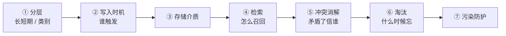
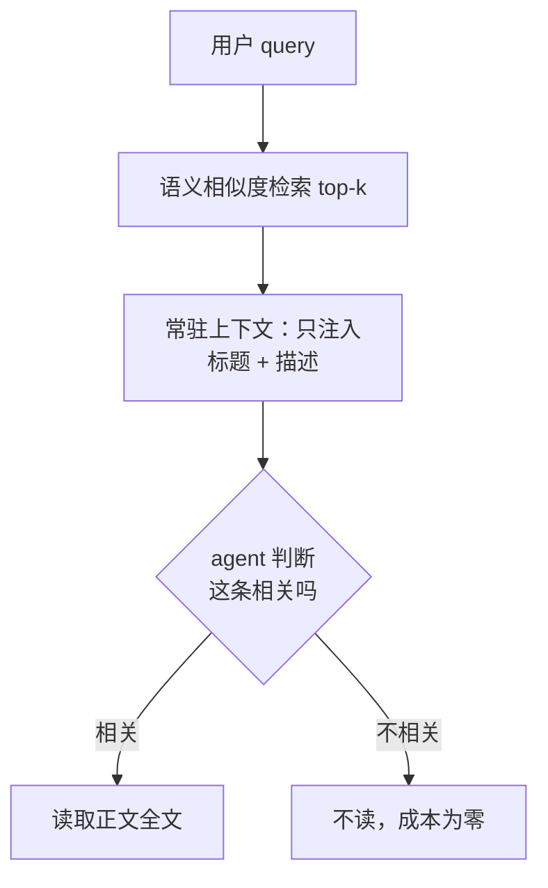

# Agent记忆系统

> 记忆 = **把会话结束就会消失的东西，变成下次还能用的东西**。面试考的从来不是「你用没用 memory」，是**七个设计维度上你各选了什么、为什么**。

## 高频问法

- **「你们的 memory 有分层结构吗？长期短期？分类别吗？」** — [[资料/面经/字节/中国商业化/字节商业化AgentInfra一面_2026-07-30]]、[[资料/面经/快手/DataAgent方向/快手数据平台DataAgent一面_2026-07-29]]、[[资料/面经/淘天/AI Agent/淘天AI-Agent一面_2026-07-30]]
- **「memory 什么时候写？时机是什么？」** — [[资料/面经/字节/中国商业化/字节商业化AgentInfra一面_2026-07-30]]、[[资料/面经/星河觉醒/Agent方向/星河觉醒Agent一面_2026-07-20]]
- **「昨天的记忆和今天的记忆矛盾了怎么办？」** — [[资料/面经/字节/中国商业化/字节商业化AgentInfra一面_2026-07-30]]、[[资料/面经/星河觉醒/Agent方向/星河觉醒Agent一面_2026-07-20]]
- **「用户往里写脏东西，会污染上下文吗？」** — [[资料/面经/字节/中国商业化/字节商业化AgentInfra一面_2026-07-30]]
- **「自进化 memory 跟普通 memory 什么区别？」** — [[资料/面经/字节/中国商业化/字节商业化AgentInfra一面_2026-07-30]]、[[资料/面经/星河觉醒/Agent方向/星河觉醒Agent一面_2026-07-20]]
- **「Claude Code 的记忆系统了解吗？分不分长短期？」** — [[资料/面经/快手/DataAgent方向/快手数据平台DataAgent一面_2026-07-29]]
- **「长期记忆、短期记忆、大文档处理、token 超限，这些异常场景怎么处理？」** — [[资料/面经/蔚来/蔚来CICD组AI agent实习生一面面经-详细版]]

---

## ① 技术定义：memory 到底是什么

**一句话：memory 是 agent 在「本轮上下文窗口之外」持久保存、并在需要时检索回上下文的那部分信息。**

关键在于跟三个相邻概念划清界限——**面试里混用这三个词是最常见的减分点**：

| 概念               | 生命周期      | 谁决定内容                      |
| ---------------- | --------- | -------------------------- |
| **上下文（context）** | 本轮请求      | 每次现拼装                      |
| **会话历史**         | 本次会话      | 追加，会话结束就没                  |
| **记忆（memory）**   | **跨会话持久** | **要主动决定「记什么、什么时候记、什么时候忘」** |

> **所以 memory 的难点不在「存」，在「选」**——选什么值得记、选什么时候召回、选矛盾时信谁。存一份 markdown 谁都会写。

---

## ② 不做会怎样：三个具体的坏结果

不是抽象的「体验不好」，是三种能说出名字的失败：

1. **重复踩同一个坑。** agent 上周花二十轮工具调用才搞明白「这个测试环境要先起 mock 服务」，这周从零再来一遍——**token 成本和时延都是线性重复的**。
2. **偏好指令要重复下达。** 用户每次都得说一遍「用 pytest 不要用 unittest」，说到第三次就不用这个工具了。
3. **跨会话的任务接不上。** 「继续昨天那个重构」——没有 memory 时这句话等于一句废话，agent 只能反问。

---

## ③ 机制：七个设计维度（面试官就按这个顺序扫）

> **来源**：[[资料/面经/字节/中国商业化/字节商业化AgentInfra一面_2026-07-30]] 一面九连问，几乎逐项走了一遍。**把这张图背下来，被问到任何一项都能定位自己在答哪一格。**

### 维度①：分层

**两个正交的分法，被问「有没有分层」要先问清是哪一种**（这个澄清动作本身是加分的）：

**A. 按时间**：短期（会话内工作记忆）/ 长期（落盘持久）。
**B. 按内容类型**（认知心理学那套词，2026 年主流综述通用分法）：

| 类型 | 记的是 | 典型实现 |
|---|---|---|
| **工作记忆** working memory | 当前这一轮在干什么 | 就是上下文窗口本身 |
| **情景记忆** episodic | **「什么时候发生过什么」**，带时间和环境 | 时间戳索引的历史片段 |
| **语义记忆** semantic | **「什么是什么」**，脱离时间的事实 | 知识图谱 / 结构化库 |
| **程序记忆** procedural | **「怎么做一件事」**，可复用步骤 | **skill 文档 / 工作流模板** |

> 💡 **这张表最实用的用法是给自己的系统定位。** 比如「我们只做了程序记忆（skill 文档），没做情景记忆」——**这是一句取舍，不是一句空缺**。对通用 coding 助手够用；对测试、运维这类场景不够，因为价值恰恰在「这个坑我上次在什么环境下踩过」。
> <!-- 来源: 社区综述交叉验证（多篇 2026 Agent Memory 调研）・ 查证于 2026-07-31 -->

### 维度②：写入时机——按「谁触发」分两类

- **在线（会话驱动）**：① 一轮任务闭环时 agent 自主写入 ② 用户显式调管理指令（如进新仓库让它探索完写项目文档）③ 用户指出某条记忆有误，触发定向改写
- **离线（定时任务驱动）**：④ 每天固定时间的批量重组——把全天记忆做 merge / 删除 / 改写

> **分工一句话：在线写的是「这次学到了什么」，离线做的是「这些天学到的该怎么合并去重」——前者管召回，后者管精度。**
> ⚠️ **离线批处理最容易被漏答**，但它是唯一一个「批量、agent 无感知」的写入路径，分类维度上跟前三个完全不同。

### 维度③：存储介质

markdown 文件 / 向量库 / 关系库 / 知识图谱。**面试要点不是选哪个，是说清代价**：
- **markdown 文件**：**人可读可改可 diff**——出问题时能直接看到是哪一条，这是它被 coding agent 大量采用的真正原因，不是因为简单
- **向量库**：召回强，但**不可读**，投毒和腐化很难排查
- **知识图谱**：能表达关系和时间，构建和维护成本最高

### 维度④：检索——两级召回是主流形态

**为什么要两级**：记忆条数会无限增长，全量注入必然爆上下文。**只让「标题 + 描述」常驻，正文按需读**——用一次 agent 判断换掉大部分 token。
⚠️ **但这个设计带来一个直接后果，见维度⑦**：描述层是常驻的，所以**描述层的污染 = 全局污染**。

### 维度⑤：冲突消解——2026 年的共识是「别让模型判断新鲜度」

三条路线：

| 路线 | 做法 | 代价 |
|---|---|---|
| **覆盖式**（Mem0） | 写入时 LLM 查重查矛盾，**最新的赢**，旧的改写或删掉 | **证据链断了**，「上季度的偏好是什么」永远答不了 |
| **双时间戳失效**（Zep / Graphiti，机制最强） | 每条事实带 `valid_at`（何时成立）/ `expired_at`（何时被取代）/ `invalid_at`（何时被明确否定），**冲突不删旧的，只标失效** | 实现复杂，一次只能处理一条边 |
| **确定性优先级** | 不问模型，用**写入时间 + 来源可信度 + 作用域**这些系统直接可读的字段排序裁决 | 规则要人定 |

> **最该说的一句话：模型只负责「发现这两条矛盾」（语义任务，它擅长），不负责「判定谁赢」（事实任务，它不擅长）。**
> 两条记忆都写着「应该用 X 方式」，模型看不出哪条是三个月前写的。
> <!-- 来源: 社区技术博客 + arXiv 2606.01435《Don't Ask the LLM to Track Freshness》・ 查证于 2026-07-31 ・ Mem0/Zep 机制为二手来源，未读源码 -->

### 维度⑥：淘汰

按**引用次数 + 最近使用时间 + 成功率**打分排序淘汰；单条设 token 上限防单条膨胀；常驻的描述层设总预算防慢性膨胀。

### 维度⑦：污染防护——正式名字是 memory poisoning

**① 技术定义**：往 agent 的持久记忆层写入误导性内容，使它在**之后每一次**交互里都行为错误。
**② 为什么它比提示注入严重**：**时间尺度不同**——prompt injection 只影响当前会话，关掉就没了；**memory poisoning 是持久的，而且攻击和发作在时间上解耦**，今天写进去可能三个月后才发作，出问题时极难归因。
**③ 分两层看影响面**（对应维度④的两级检索）：
- **正文层污染**：只在语义相关的 query 上被召回，**检索本身就是过滤器**，影响有限
- **描述层污染**：描述常驻上下文 = **每轮都注入，检索这道过滤器完全失效**。而「以后每次都要……」这类无条件生效的用户偏好，**一定落在描述层**
**④ 防线放在写入侧，不在检索侧**：描述字段按注入风险审——不允许在描述里写祈使句式的行为指令，这类要么降级到正文、要么走显式配置。

> 📌 OWASP 在 2026 年把它列为 Agentic AI Top 10 的 **ASI06「Memory and Context Poisoning」**，并于 2026-06-01 发布 Agent Memory Guard 参考实现——拦截每次 memory 读写，做五层检测：提示注入筛查、密钥与 PII 泄漏检测、键篡改检测、SHA-256 完整性基线、体积异常。
> <!-- 来源: OWASP 官网 + Help Net Security 报道 ・ 查证于 2026-07-31 -->

---

## 进阶：自进化 memory（self-evolve）

**普通 memory 只有写入；自进化 memory 有写入 + 打分 + 回滚。**

三句话讲清区别：
1. **单位**：普通 memory 的单位是一轮对话；自进化的单位是**一条完整轨迹**（agent 从接任务到交付的整个多步过程）
2. **信号**：普通 memory 没有反馈信号，agent 觉得该存就存；自进化有**客观 reward**
3. **裁决者**：普通 memory 的裁决者是模型自己；自进化的裁决者是**留出验证集**（held-out——训练时不参与、专门留出来验收的那份数据）

**业界对标：微软 `microsoft/SkillOpt`**——把 skill 文档当成**可训练参数**，模型冻结不动，训练的是那份自然语言文档。
- 循环：**rollout → reflect → aggregate → select → update → evaluate**（rollout = 带着当前 skill 跑一次完整任务并给轨迹打分）
- 更新：优化器模型把打过分的成功/失败批次变成**有界的 add / delete / replace 编辑**
- **门禁（最该讲的一点）**：一次候选编辑**只有严格提升 held-out 验证分才被接受，否则回滚**
- 数字：GPT-5.5 上直接对话 +23.5 / Codex 循环内 +24.8 / **Claude Code 内 +19.1**；6 benchmark × 7 模型 × 3 harness = 52 格全部最优或并列最优
- **SkillOpt-Sleep**（2026-06-15 preview）：给本地 coding agent 的**夜间离线自进化伴侣**——回看历史会话、重放重复任务、把过了留出门禁的 skill 固化下来。**这是「离线定时重组」这条路线的现成对标物。**

> <!-- 来源: GitHub microsoft/SkillOpt README + Microsoft Research blog ・ 查证于 2026-07-31 ・ v0.2.0 发布 2026-07-02 -->

---

## ④ 面试怎么说（30 秒口语稿）

> 「记忆系统我会按七个维度讲：**分层、写入时机、存储、检索、冲突、淘汰、污染防护**。
> 我做过的这套里，最值得说的是三点。
> **第一，检索是两级的**——常驻上下文只放标题和描述，正文按需读。这解决了条数增长必然爆上下文的问题，**但也带来一个后果：描述层的污染就是全局污染**，所以防护要放在写入侧而不是检索侧。
> **第二，冲突消解不该交给模型判断新鲜度。** 模型看不出两条记忆哪条是三个月前写的。正确做法是**合并不删除、只标失效**，裁决用写入时间和来源可信度这些系统字段——**模型只负责发现矛盾，不负责判定谁赢。**
> **第三，如果要做自进化**，关键是让反馈变成一道**门禁**而不是一句建议：修改产生候选版本，跑留出验证集，分数严格变高才接受，否则回滚。**这样『自进化』才是一个可观测、可回滚的状态转移。**」

**预备追问：**
- **「你们分长短期了吗？」** → 先问清是按时间还是按类别；然后**把「没分」讲成取舍**（收益要到「短期条目多到需要筛选」才出现，现在用离线批处理绕过了）
- **「怎么判断一轮任务结束、该写记忆了？」** → 三类信号：显式结束 / 空闲超时 / 上下文切换检测（新 query 与当前主题 embedding 距离超阈值）。实际系统组合使用：显式优先、超时兜底、语义漂移补充。详见 [[项目追问/谷歌Memory]] Q1
- **「为什么不直接 RAG 检索历史轨迹，还要提炼成记忆？」** → 轨迹是原始数据，长且噪声大；记忆是**蒸馏后的教训**——检索单位从几千 token 的轨迹变成一条 200 token 的经验，命中率和上下文成本都优一个量级

---

## 易错点

1. 🔴 **把「有没有分层」答成「没有」就停住。** 这题在多场面试里都出现过，**「没有」必须讲成「取舍」**，并接到「我要做的东西恰恰需要打破它」。
2. 🔴 **说「这块不是我做的 / 我不清楚他们为什么这么设计」。** 面试官问机制不是在考背文档，是在给你机会展示设计能力。**正确三段：现状 → 我的诊断 → 如果让我改我会怎么改。**
3. ⚠️ **把 memory 和 context 混着说。** 上下文管理（压缩、offload、裁剪）是**本轮内**的事，memory 是**跨会话**的事，两者机制和评价标准都不同。
4. ⚠️ **答「污染不会发生」。** 正确答案是**分两种**，而面试官举的用户偏好例子通常正好落在会污染的那一档。
5. ⚠️ **「memory 就是存个 markdown」。** 存储介质是七个维度里最不重要的一个，只答这个等于没答。

---

## 深入阅读

- raw 专栏：[[资料/学习材料/Agent/OpenClaw Memory]] · [[资料/学习材料/Agent/记忆压缩]] · [[资料/学习材料/Agent/Claude Code Context管理]]
- 项目追问库：[[项目追问/谷歌Memory]]（自进化 memory 的完整弹药库 + 设计维度九问）
- **具体实现**：[[Agent记忆四家实现对比]]（Claude Code / Codex / OpenClaw 逐维度落地，本文七维度的实证版）· [[Agent上下文压缩链路]]（本轮会话内的压缩，跟 memory 是两件事）
- 相邻主题：[[Agent设计模式与MCP]] · [[LangGraph工程实践]]（Checkpointer 短期 vs Store 长期）· [[RAG优化全链路]]（记忆检索与 RAG 同构）
