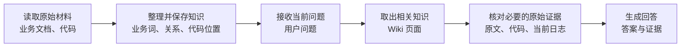

# LLM Wiki与RAG的区别及适用场景

> 核验日期：2026-10-21。本文区分公开资料、自己的项目记录和机制推断。
> 口径修正：最新简历写了 Google 领域 Wiki 实验提升 12 个百分点，不能继续概括为“Google 没用”。

## 一、技术定义：Wiki组织知识，RAG按问题取知识

LLM（Large Language Model，大语言模型）Wiki，是由模型生成、维护并长期保存的一组互相链接的知识页。
页面可以整理业务词的含义、模块职责、文档之间的关系，以及对应的原文或代码位置。
它改变的是知识的组织形式，不会直接改变模型参数。

这里讨论的是一种知识组织模式，具体实现可以不同。Karpathy 的同名设计采用原始资料、模型维护的 Markdown 知识页和维护规则三层。
他的文章是概念设计，不能当作已经验证优于其他方法的实验结论。[作者设计，2026-04-04](https://gist.github.com/karpathy/442a6bf555914893e9891c11519de94f)
<!-- 来源: 作者设计文档 ・ 置信度: 高（设计内容），未证明效果 ・ 查证于 2026-10-21 -->

RAG（Retrieval-Augmented Generation，检索增强生成）是在回答时取出相关外部材料，再让模型结合材料回答的流程。
外部材料可以是原始文档片段、代码，也可以是 Wiki 页面。[Anthropic，2024-09-19](https://www.anthropic.com/research/contextual-retrieval)
<!-- 来源: 官方工程博客 ・ 置信度: 高 ・ 查证于 2026-10-21 -->

因此，Wiki 和 RAG 可以组合。本文说 Wiki 的潜在优势时，对比对象限定为“每次直接检索原始文档片段”，不能扩大成所有 RAG。

如果 Wiki 只依据同一批原始资料生成，收益主要来自整理、关联和定位方式的变化。
如果人补入了原始资料没有的业务说明，收益还包含新增信息的贡献，不能全部归给 Wiki 的组织方式。
原始资料和人工说明都没有的业务规定，模型不能可靠补出来。
<!-- 来源: 对照条件与机制分析 ・ 置信度: 中 ・ 查证于 2026-10-21 -->

这是一种可选流程，具体系统也可以直接检索原文。它不是两家实习项目都已采用的统一实现。
<!-- 来源: 机制归纳与建议 ・ 置信度: 中 ・ 查证于 2026-10-21 -->

哪个术语是你之前没学过的？

## 二、解决什么问题：任务缺什么知识，Wiki就应补什么

### 1. 业务含义缺失

代码能展示实现，但未必完整解释内部业务词、历史决策或职责边界。
模型如果不知道用户用词和代码用词的对应关系，可能检索错模块，随后基于错误代码给出答案。
Wiki 可以预先记录“业务词的含义，以及它对应的代码符号和仓库”。代码符号指类名、函数名、字段名等标识。
<!-- 来源: 项目记录与机制推断 ・ 置信度: 中 ・ 查证于 2026-10-21 -->

### 2. 所需知识分散在多份材料中

一次回答可能需要同时知道业务定义、模块职责和几个模块的关系。
若每次都从少量相似片段重新拼接，容易漏掉没有被取出的关联材料。
Wiki 可以提前把这些关系组织到主题页中，后续问题复用同一份整理结果。
这种收益依赖问题确实需要这些关系，单条事实查询未必受益。
<!-- 来源: 作者设计与 Microsoft 研究的机制归纳 ・ 置信度: 中 ・ 查证于 2026-10-21 -->

### 3. 搜索入口不明确

业务问题往往不直接包含准确的文件名或函数名。
如果 Wiki 给出了可靠的代码位置，Agent 可以缩小后续代码搜索范围。
是否真的减少模型调用、读取量和耗时，必须测量；多读一层 Wiki 也可能增加开销。
<!-- 来源: 项目记录与机制推断 ・ 置信度: 中 ・ 查证于 2026-10-21 -->

哪个术语是你之前没学过的？

## 三、机制、适用条件与局限

### 1. 相比直接检索原文片段，差别在哪里

| 比较点 | 直接检索原文片段 | 先整理Wiki，再按需取用 |
|---|---|---|
| 业务定义与别名 | 回答时从取出的材料判断 | 可以提前形成统一解释 |
| 跨文档关系 | 当前问题下重新寻找、组合 | 已整理的关系可以复用 |
| 证据完整性 | 保留所取原文的具体表述 | 整理时可能遗漏条件或细节 |
| 新材料更新 | 更新原文及其检索索引 | 还要更新受影响的知识页 |
| 运行开销 | 取决于搜索、阅读和推理步骤 | 可能缩小搜索，也可能多一层阅读 |

这些是流程差异和可能结果，不是“Wiki 必然更准、更快”的实验结论。
检索索引是帮助系统快速找到相关材料的数据；Wiki 页面也可以建立检索索引。
<!-- 来源: 流程比较与机制推断 ・ 置信度: 中 ・ 查证于 2026-10-21 -->

### 2. 哪些条件下更可能有用

- **补到缺失知识：**任务需要内部业务定义、职责边界或设计原因，已有输入没有提供。
- **关系能够复用：**很多问题反复涉及同一批业务概念和模块关系，整理成本能被后续查询分摊。
- **能指向原始证据：**业务页给出相关文档、代码位置，模型可以继续核对具体条件。
- **维护得住：**代码或业务规则变化后，相关页面能及时更新；错误内容有人工校准或评测反馈。

这些是工程判断条件，不是某家企业公布的通用阈值。
<!-- 来源: 企业公开方案与机制推断 ・ 置信度: 中 ・ 查证于 2026-10-21 -->

### 3. 哪些条件下收益小，甚至有害

- **输入已经充分：**日志、分类标准、任务规则已经覆盖判断所需信息，Wiki 主要重复现有内容。
- **缺的是当前状态：**本次报错、最新运行日志、当前数据库状态没有取得，静态知识页不能替代这些证据。
- **缺的是执行能力：**模型不知道如何调用工具或执行步骤，单纯增加业务说明不一定解决问题。
- **知识页错漏或过时：**错误归纳、遗漏限定条件、旧代码位置可能让模型更确信错误答案。
- **成本超过收益：**构建、更新和阅读 Wiki 都需要资源，小规模、低频任务可能不值得增加这一层。

“没取到所需页面”和“取到的页面本身有错”是两类问题，应分别检查搜索过程和内容质量。
<!-- 来源: 企业公开方案与机制推断 ・ 置信度: 中 ・ 查证于 2026-10-21 -->

### 4. 企业有没有讨论过

**Google Code Wiki：说明代码理解确实可以采用预生成知识页。**
Google 2025-11-13 的发布博客介绍：为代码仓库生成持续更新的结构化 Wiki，页面和回答关联具体代码位置，聊天功能使用 Wiki 作为知识来源。
这说明“先整理代码知识，再帮助回答”有企业产品实践；发布博客没有证明其对任意任务都优于直接检索代码。
[Google 官方博客](https://developers.googleblog.com/en/introducing-code-wiki-accelerating-your-code-understanding/)
<!-- 来源: 官方产品博客 ・ 置信度: 高（公开功能），未证明通用效果 ・ 查证于 2026-10-21 -->

**Cognition DeepWiki：Wiki与代码搜索一起使用。**
官方文档明确说明，DeepWiki 生成代码总结、架构图和源码链接；Ask Devin 结合 Wiki 信息与代码搜索寻找相关上下文。
文档也允许配置需要覆盖的页面，以应对自动生成遗漏重要部分的情况。
[DeepWiki 官方文档](https://docs.devin.ai/work-with-devin/deepwiki)
<!-- 来源: 官方实现文档 ・ 置信度: 高 ・ 查证于 2026-10-21 -->

Cognition 2026-02-27 的内部实践还展示：理解代码之外，调查运行故障时需要继续查日志、数据库状态和代码变更。
这支持“知识页不能替代当前运行证据”的边界，不能据此推断其 Wiki 的单独收益。
[Cognition 官方博客](https://cognition.com/blog/how-cognition-uses-devin-to-build-devin)
<!-- 来源: 官方实践博客 ・ 置信度: 高（流程），未报告Wiki单独收益 ・ 查证于 2026-10-21 -->

**Anthropic Contextual Retrieval：有效的是补对上下文，普通摘要未必有效。**
Contextual Retrieval 意为给待检索片段补上与该片段有关的原文背景，再建立索引。
博客说明，原文切片可能丢失公司、时间等背景；其方案用模型为片段补背景。作者同时报告，通用文档摘要带来的收益有限，另一种摘要索引方案表现较低。
这说明“做了总结”不能直接推出“检索和回答都会更好”。
[Anthropic 官方工程博客，2024-09-19](https://www.anthropic.com/research/contextual-retrieval)
<!-- 来源: 官方工程实验 ・ 置信度: 高（该实验范围） ・ 查证于 2026-10-21 -->

**Microsoft GraphRAG：跨全库问题需要更充分的知识组织。**
知识图是把业务对象等实体及它们的关系保存为节点和连接；GraphRAG 用模型提取这些信息，再为联系密切的实体分组生成摘要。
Microsoft 研究将其用于需要理解整个数据集的问题，并指出需要权衡前期构建成本。GraphRAG 是具体的图结构检索方案，不能直接等同于 Wiki。
[Microsoft 官方研究博客，2024-07-02](https://www.microsoft.com/en-us/research/blog/graphrag-new-tool-for-complex-data-discovery-now-on-github/)
<!-- 来源: 官方研究博客 ・ 置信度: 高 ・ 查证于 2026-10-21 -->

### 5. 回到两段实习：先核对结果，再解释可能机制

**Google 最新事实：有 Wiki 正向结果，不能说没有用。**
2026-10-21 用户提供的[最新简历](/Users/ha/Downloads/简历.pdf)写明：领域 Wiki 实验较基线提升 **12 个百分点**；无门禁的无监督 Memory 累积下降 **2.0 个百分点**。
门禁指保存或采用新内容前，先按明确的评测要求检查是否通过。这两个数字属于不同实验条件，不能拼成一个实验的前后变化。
<!-- 来源: 用户最新简历 ・ 置信度: 高（简历记载），具体实验条件待补齐 ・ 核对于 2026-10-21 -->

本人在本次讨论中确认：**提升 12 个百分点的实验只在 Dreaming（整理记忆）阶段提供 Wiki**。
因此 Wiki 直接改变的是生成记忆时可用的资料；后续任务的收益要通过生成的 Memory 传递，不能说任务执行时直接读取了这份 Wiki。
Wiki 可能帮助解释轨迹、约束经验的适用范围，但这只是机制假设，尚未证明 12 个百分点具体来自哪一类记忆变化。
<!-- 来源: 用户本次明确确认（接入位置，高置信度）与机制推断（中置信度） ・ 核对于 2026-10-21 -->

旧的 10 月 12 日面试第 10 题描述：每天 Dreaming 时注入 Wiki 使用说明，再沉淀新记忆。
Dreaming 在这份记录中指每日整理会话并更新记忆的过程；它与任务执行时直接读 Wiki 不是同一个接入位置。
第 11、19 题曾说 Google 的 Wiki 帮助不大，这是当时的口头表述，不能覆盖最新简历中的正向实验结果。
出处：[[资料/面经/阿里云/Agent Infra/阿里云Agent Infra二面_2026-10-12]]。
<!-- 来源: 旧面试记录 ・ 置信度: 高（当时表述），当前适用性待确认 ・ 核对于 2026-10-21 -->

**字节已有记录：Wiki提供业务含义与代码位置。**
同一场第 19、21 题描述：另一组同事结合需求文档、设计文档和代码整理业务名词、名词关系及代码路径，并引导 Agent 使用。
这条路径可以概括为先理解业务词与代码符号、仓库的映射，再读取相关代码；不能把 partner、agency、MCN 不加区分地说成同义词。
第 18 题的 **56→87** 涉及业务知识注入和决策树加审核 Agent 等改动，不能全部归因于 Wiki。
<!-- 来源: 旧面试记录 ・ 置信度: 高（记录内容），单项贡献未确认 ・ 核对于 2026-10-21 -->

**已确认的差异是接入位置不同，具体收益原因仍需验证。**
字节记录中的 Wiki 在当前问答时提供业务含义与代码位置；Google 最新实验只在 Dreaming 时提供 Wiki。
前者直接辅助当前任务的理解和定位，后者辅助生成 Memory，再由 Memory 影响后续任务。
可以提出“补充信息与影响环节不同”的机制解释，但不能据此断言最新 Google 实验全部 12 个百分点来自某一种记忆改善。
<!-- 来源: 项目记录与用户确认（接入位置，高置信度）；具体收益归因属推断（中置信度） ・ 查证于 2026-10-21 -->

仍需本人确认：Google 最新 Wiki 内容是什么、基线包含什么、对照组有无评测门禁、是否只改变 Wiki 一个因素，以及采用哪批评测数据。
确认前保留这些空缺，不编造“Google信息已经足够，所以Wiki没有收益”的因果结论。

哪个术语是你之前没学过的？

## 四、面试怎么说

### 30秒口语稿

> 我把 LLM Wiki 理解为由模型维护的持久知识页，把业务定义、模块关系和代码位置提前组织好。它和 RAG 可以结合，RAG 也能检索 Wiki。字节是在当前问答时使用，帮助理解业务词、定位代码；Google 是只在 Dreaming 整理记忆时提供，辅助生成 Memory，再影响后续任务。Google 对应实验也提升了 12 个百分点，所以区别在作用环节，不能概括为一家有用、另一家没用。

这段只使用已有事实。涉及 Google 实验具体设计的追问，补齐实验条件后再定稿。

### 预备追问

**“为什么不直接用 RAG？”**
可以用。Wiki 是预先整理的知识层，RAG 是查询时取材料的流程。应比较直接检索原文与检索 Wiki、必要时再核对原文的效果和成本。

**“Wiki怎么证明有用？”**
建议固定模型、工具和评测集，比较有无 Wiki，再按业务定义、代码定位、当前状态等问题类别看结果；同时统计错误类型、耗时和读取量。这是验证建议，不是已完成实验。

**“Wiki错了怎么办？”**
字节旧记录提到收集负反馈、由专家校准；但本人当时明确没有单独评估校准效果。可以建议保留来源、检查受影响问题，不能说这些都已实现并验证有效。

**“Google到底为什么提升12个百分点？”**
目前能确认结果记载及只在 Dreaming 提供 Wiki，不能确认唯一原因。还需要讲清 Wiki 内容、基线和其他改动，才能讨论归因。

哪个术语是你之前没学过的？
