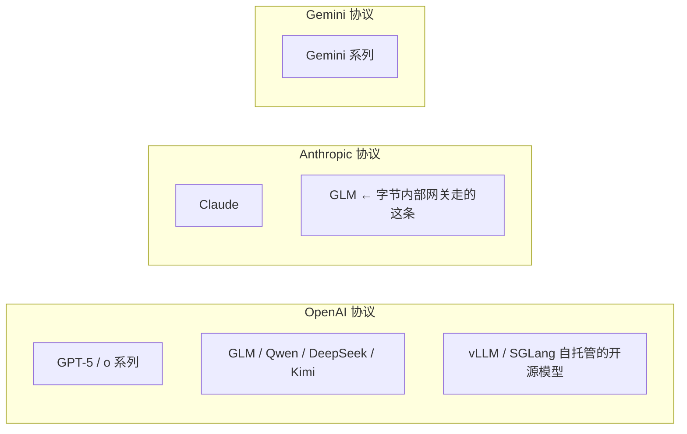

# LLM 多协议网关适配

> 协议差异不只在传输层，它**贯穿整个调用生命周期**——消息结构、工具协议、思考回传、流式解析、计量缓存，六层每层都不一样。
> **最容易踩的认知误区：把协议当成模型。** 同一套协议壳子下面挂着不同厂商的模型，参数支持度和校验规则完全不同。

> 📌 **本页所有 API 行为均为 2026-07-30 查证**（Anthropic / Google 官方文档 + GitHub issue 现场）。**这块变化极快，用之前先核一遍最新文档**——见仓库根目录 `CLAUDE.md` 的「Agent 类问题必须先查最新源」。

## 高频问法

- 「网关适配 Gemini/Anthropic/OpenAI 多协议，**为什么不能只替换请求地址**？」—— 出处 [[公司/点点互动/AI Agent方向/点点互动AI Agent一面_2026-07-27]]
- 「**token 在不同协议中有哪些差异**？」—— 同上（⚠️ 当场答崩，说「没细究」）
- 「**流式输出和普通响应都适配了吗**？多做哪些处理？」—— 同上
- 「**prompt cache 为什么能生效**？一般缓存哪些内容？」—— 同上
- 「MCP 协议是什么？它的传输协议有哪些？」—— 出处 [[公司/蔚来/面试问题参考答案]]

---

## ① 技术定义：厂商 / 协议 / 模型是三件事

| 层 | 是什么 | 例子 |
|---|---|---|
| **厂商** | 公司 | OpenAI、Anthropic、Google |
| **协议** | 请求/响应的 JSON 形状 + 端点 | OpenAI Chat Completions / Responses、Anthropic Messages、Gemini generateContent |
| **模型** | 真正干活的那个 | GPT-5、Claude Opus 5、Gemini 3、GLM、Qwen |



> ⚠️ 更绕的：**Vertex AI 上跑 Claude 用的是 Anthropic 协议**，不是 Gemini 协议。Google 的平台 + Anthropic 的协议 + Anthropic 的模型。

**约束有三个来源，必须分开归类：**

| 来源 | 谁强制 | 例子 | 换模型还在吗 |
|---|---|---|---|
| **协议层** | JSON 结构本身 | Anthropic 协议 `max_tokens` 必填 | **在**（只要还走这协议） |
| **服务端层** | 那家厂商的 API 网关校验 | Anthropic 服务端拒绝 Claude 5 带 `temperature` | **不一定**（换厂商就没了） |
| **模型层** | 模型自身能力 | 某模型不支持并行工具调用 | 跟着模型走 |

> ⭐ **实测佐证**：GLM 走 Anthropic 协议时传 `temperature` **不报错**——因为那是服务端层约束，GLM 的服务端不跑 Anthropic 那套校验。
> **结论：网关能力表要按「模型 × 能力」维护，不能按协议维护。**

## ② 不适配会怎样

**大部分失败是静默的**，这才是真正的风险：

| 漏掉的适配 | 后果 |
|---|---|
| system prompt 位置错 | **不报错**，它变成一条普通 user 消息，角色设定失效 |
| 思考参数没传对 | **不报错**，模型根本没思考——内部实测 **10~15% 能力损耗** |
| thinking 块没回传 | Gemini 3 **硬失败 400**；Anthropic/OpenAI 推理链断，效果掉 |
| 切模型没剥 thinking | **不报错**，新模型无视这些块，但**照样为这些 token 付费** |
| 缓存断点打错位置 | **不报错**，写入 1.25× 却一次不命中，**比不用缓存还贵 25%** |

---

## ③ 六层差异（机制）

### 层 1：消息结构

| | system prompt 放哪 | 角色名 |
|---|---|---|
| OpenAI | `messages` 里一条 `role: "system"` | system / user / assistant / tool |
| **Anthropic** | **顶层独立参数 `system`** | **只有 user / assistant** |
| **Gemini** | **顶层 `systemInstruction`** | user / **`model`**（不叫 assistant） |

> **Anthropic 的 `max_tokens` 必填**（= 本次响应最多生成多少 token 就停），另两家选填。

### 层 2：工具协议（三个不兼容点）

**声明格式嵌套层数都不同**：OpenAI `tools[].function.{name,description,parameters}` / Anthropic `tools[].{name,description,input_schema}` / Gemini `tools[].functionDeclarations[]`。

| 坑 | 内容 |
|---|---|
| **参数类型不同** | OpenAI 的 `arguments` 是 **JSON 字符串**（要 `json.loads`）；Anthropic `input` 和 Gemini `args` 都是**对象** |
| **结果回传位置不同** | OpenAI 是**独立消息** `{role:"tool", tool_call_id}`；Anthropic 和 Gemini 都**塞进 user 轮**（`tool_result` / `functionResponse`） |
| **Gemini 顺序敏感** | Gemini 3 每个 `functionCall` 都返回唯一 `id`，回传要带同一个 id；**但 `functionResponse` 必须按原调用顺序回传，不能重排**——因为 thoughtSignature 只挂在第一个 part 上，重排会破坏推理链 |

> 🔴 **并发执行工具的坑**：用 `asyncio.gather` 并发跑工具，谁先返回就先塞进结果数组 → **顺序乱了**。必须按原调用顺序重排再回传。

**停止原因字段名和取值全不同**：OpenAI `finish_reason`(stop/length/tool_calls) / Anthropic `stop_reason`(end_turn/max_tokens/tool_use/pause_turn/refusal) / Gemini `finishReason`(STOP/MAX_TOKENS/SAFETY/RECITATION)。上层要判断「是否继续调工具」就必须先映射成一套。

### 层 3：思考上下文回传（最脏的一层）

**技术定义**：开了思考模式的模型每轮产出一段内部推理。**多轮工具调用时这段推理必须原样带回去**——API 无状态，不带回去模型就「记得调了工具，但不记得为什么调」，推理链断。

| | 载体 | 回传规则 | 不传的后果 |
|---|---|---|---|
| **Gemini 3** | `thoughtSignature`（加密串，看不到内容） | **每一步的第一个 `functionCall` part 必须带**；并行只第一个带，串行每步都要 | 🔴 **400**：`missing a thought_signature` |
| Gemini 2.5 | 同上 | 可选 | 推理质量下降 |
| **Anthropic** | `thinking` 块 + `signature`（**明文可见**） | 上一轮 assistant 的 thinking 块**一字不改**带回 | 校验失败 |
| **OpenAI Responses** | `reasoning` item + `encrypted_content` | `store:false` 时加 `include:["reasoning.encrypted_content"]`，把上条 user 消息之后的所有 reasoning/function call/output 全回传 | 推理链断 |

**具体长这样（Anthropic）：**
```json
{"role": "assistant", "content": [
  {"type": "thinking", "thinking": "用户要比对两张表…",
   "signature": "ErUBCkYIAxgCIkA..."},   ← 原样抄回，一个字符都不能改
  {"type": "tool_use", "id": "toolu_01A", "name": "query", "input": {...}}
]}
```

> ⚠️ **一个看代码找不出来的坑**：thinking 文本含**未配对 Unicode 代理项**（surrogate——UTF-16 里一个字符要两个 16 位码元表示，只出现一半）时，某些 JSON 库序列化会悄悄剥掉它 → 文本变了 → 签名失效 → 400。
>
> ⚠️ **对上下文压缩是硬约束**：Gemini 和 OpenAI 给的是**加密块，不能读、不能改、不能 summary 掉**，一压就废。压缩策略必须绕开它们。

### 层 4：流式（三套状态机，没法共用解析器）

| | 事件形态 | token 统计在哪 |
|---|---|---|
| **OpenAI** | delta 增量，**流式结构 ≠ 非流式结构**；工具参数**按字符串分片流出** | 只在最后一个 chunk |
| **Anthropic** | 明确事件类型：`message_start` / `content_block_start` / `content_block_delta` / `content_block_stop` / `message_delta` / `message_stop` | **input 在 `message_start`，output 在 `message_delta`——分两处要合并** |
| **Gemini** | 换端点 `streamGenerateContent` + URL 加 `alt=sse`；**每个 chunk 是完整结构** | `usageMetadata` |

**OpenAI 的坑**：`arguments` 是被切开的 JSON 字符串，chunk 2 拿到 `{"tab` 就 `json.loads` **必炸**，要按 `index` 攒到 `finish_reason` 出现才能 parse。

**判断「参数收齐了」的信号三家不同**：OpenAI 等 `finish_reason` / Anthropic 收 `content_block_stop` / Gemini 直接就是完整对象。**这是三套状态机，不是改个字段名的事。**

### 层 5：计量

| | 输入 / 输出 | 思考 token |
|---|---|---|
| OpenAI | `prompt_tokens` / `completion_tokens` | `completion_tokens_details.reasoning_tokens` ✅ 独立字段 |
| Anthropic | `input_tokens` / `output_tokens` + `cache_creation_input_tokens` / `cache_read_input_tokens` | `usage.output_tokens_details.thinking_tokens`（流式时只在最后的 `message_delta`） |
| Gemini | `promptTokenCount` / `candidatesTokenCount` | `thoughtsTokenCount` ✅ |

**分词器也不同**——同一段文本三家 token 数不一样，成本估算不能跨模型套同一系数。

### 层 6：prompt cache

**生效原理**：**前缀匹配**。transformer 线性生成，要生成 C 必须先算 A、B；前缀完全一致就能复用已保存的计算结果。

| | 机制 | 门槛 | 成本 |
|---|---|---|---|
| **OpenAI** | 全自动，零代码 | 1024 token | 无写入附加费 |
| **Anthropic** | **显式打断点** `cache_control:{type:"ephemeral"}`，最多 4 个；也有自动模式（顶层放一个 `cache_control`，系统自动打在最后一个可缓存块上，**会占掉一个名额**） | **按模型分档 512~4096**（Opus 5/Fable 5/Mythos 5=512；Sonnet 5/Opus 4.8/Sonnet 4.6=1024；Opus 4.7=2048；**Haiku 4.5=4096**） | 写入 5min TTL **1.25×** / 1h **2×**；读 **0.1×** |
| **Gemini** | 隐式（超 1024 token 自动）+ 显式缓存对象 | 显式门槛高得多 | 🔴 **显式缓存按存储时长另收费**（三家唯一） |

**Anthropic 失效是级联的**：`tools` → `system` → `messages`。改工具定义会把 system 和整段历史一起冲掉；改 `tool_choice` 冲 messages；消息里出现图片冲 messages。

🔴 **思考配置改变 = 换前缀**。`adaptive`↔`enabled`↔`disabled` 互切、改 `budget_tokens`、改 `effort` 档位，**都会让 message 层断点必然 miss**（因为配置被渲染进 prompt 正文）。
→ **推论：不能按问题难度动态调思考档位。省下的思考 token 赔不起缓存重写的钱。**

**thinking 块与缓存的真实关系**（容易搞反）：
- ❌ 「thinking 块不能被缓存」——错
- ✅ 官方原文：**"Thinking blocks are cached with tool results."** 工具循环里 thinking 连同历史一起进缓存，**自动的，不用打任何 `cache_control`**，从缓存读时按普通 input token 计费
- ✅ 官方还说 preserved thinking blocks **enable cache hits**，是**帮**缓存的
- 唯一的限制是：**不能把 `cache_control` 断点打在 thinking 块上**——但它作为前缀的一部分照样被缓存

**最新模型（Opus 5 / Sonnet 5 / Fable 5 / Mythos 5）全是「保留所有历史 thinking」档**，只有四条规则：全程留在上下文 → 跟前缀一起进缓存 → 按 input 计费 → 你原样全传回去，API 自己挑要用的、只对用上的计费。老模型（早期 Opus/Sonnet、所有 Haiku 到 4.5）才有「发一条非 tool_result 的 user 消息就剥离全部旧 thinking」的行为。

> 💡 **思考重的任务用 1 小时 TTL**——官方明说默认 5 分钟常常不够跑完一轮 thinking-heavy 的多步工作流。几十轮工具调用 + 最高思考强度，5 分钟很可能在循环中途过期，**后半程全 miss 且静默**。

### 层 6+：参数与 Schema 的零碎坑

- **OpenAI o 系列 / GPT-5 只接受 `temperature` 默认值 1**，传别的返回 400 `unsupported_value`；`top_p`/`frequency_penalty`/`logit_bias`/`n`/`logprobs` 同样拒绝。改用 `reasoning:{effort:...}`
- **Claude 手动 extended thinking 下**：`temperature`/`top_p`/`top_k` 不可改、**不能强制工具调用**（只能 `auto`/`none`）、**不能预填充回复**（prefill：在 messages 末尾塞一条 assistant 消息开头让模型接着写）
  - 🔴 **这导致「思考模式」和「结构化输出」天然打架**——结构化输出通常靠强制调 schema 工具实现。绕法是先 `auto` 试一次，没调工具再关思考重试，**延迟翻倍**。**adaptive thinking 支持强制工具调用**，新模型上这坑没了
- 🔴 **extended thinking 本身已废弃**：Claude 4.6 弃用（仍可跑），**4.7 及以后 `type:"enabled"` 直接 400**。改用 `thinking:{type:"adaptive"}` + `output_config:{effort:...}`。**网关写死 `budget_tokens` 的话，升模型就崩**
- **Gemini 的 JSON Schema 要求数组 `items` 必须有显式 `type`**，空 `items:{}` 被拒
- **三家都不接受顶层 `$ref`**（JSON Schema 的引用语法，配合 `$defs` 复用子结构），必须先展开
- **thinking 块绑定生成它的模型**——做模型降级/故障切换时必须先剥掉历史 thinking，否则**新模型静默无视但你照样付费**

---

## ④ 面试怎么说（2 分钟）

> 「协议差异不只在传输层，它贯穿整个调用生命周期，我按六层说：
> **① 消息结构**——三家 system prompt 根本不在同一位置，Anthropic 是顶层参数、Gemini 是 `systemInstruction`。这层错了**不报错**，system prompt 变成普通用户消息，角色设定静默失效。
> **② 工具协议**——声明嵌套层数不同；**OpenAI 返回的调用参数是 JSON 字符串要自己 parse，另两家是对象**；结果回传位置也不同。Gemini 还要求 functionResponse 按原调用顺序回传，并发执行工具时很容易搞乱。
> **③ 思考上下文回传——这层是真正的脏活。** 模型每轮的内部推理必须原样带回，否则推理链断。**Gemini 3 最硬，漏了直接 400**；Anthropic 要求 thinking 块一字不改；OpenAI 要显式声明才拿得到加密块。**而且 Gemini 和 OpenAI 给的是加密块，不能读不能压缩——这直接约束了上下文压缩策略。**
> **④ 流式**——三家 SSE 形状完全不同，判断『参数收齐了』的信号都不一样，是三套状态机不是改字段名。
> **⑤⑥ 计量与缓存**——usage 字段名各不相同；缓存上 OpenAI 全自动、Anthropic 要显式打断点且**写入加价**，打错位置比不打更贵。
>
> **但最大的认知误区是把协议当成模型。** 我们网关里 GLM 走的是 Anthropic 协议，但它不是 Claude——**协议形状一样，服务端校验规则完全不同**。所以我们的能力表按『模型 × 能力』维护，不按协议维护。**这个区分现在更重要了：Anthropic 已经废弃了 extended thinking，4.7 以后的模型直接 400 拒绝 budget_tokens。能力表按协议写死的话，升个模型版本网关就崩。**」

---

## 易错点 & 追问

**Q：怎么保证网关自己没适配错？这些差异大多静默失败。**
> **看计费口径，计费骗不了人。** 每家一个探针：OpenAI 断言 `reasoning_tokens > 0`；Gemini 断言 `thoughtsTokenCount > 0`；Anthropic 断言响应里存在 thinking 块。**跑在 CI 里，换模型、升版本都跑一遍。**

**Q：为什么不用 LiteLLM / OneAPI 这类现成网关？**
> 通用网关做的是**最大公约数**——能统一消息结构和工具协议，但**思考上下文回传这层往往做不全**，因为它跟具体的多轮编排耦合。几十轮工具调用的 ReAct 场景下 signature 一断整条推理链就废。而且内部网关还要接公司鉴权、配额、审计。

**Q：新增一家模型的成本？**
> 结构层（①②）快，主要是字段映射。**大头在③和④**——思考回传要跟着它的多轮语义走，流式要重写解析和拼接。做法是**先接非流式跑通语义，再接流式**。

**Q：断点一般打在哪？每轮都打吗？**
> **打在「跨请求内容完全不变」的最后一个块上**——因为断点含义是「从开头到这里请存下来」。典型四个位置：tools 末尾 / system 末尾 / 长文档末尾 / 最后一个稳定的对话块。多轮时最后那个**会往后滚**（这轮的末尾是下轮的前缀），自动模式就是替你滚这个。**别放分钟级时间戳**——放年月日没事，放时分整个前缀就匹配不上了。

---

## 深入阅读

- [[追问/字节答疑Bot]] Q7 —— 统一思考模式的工程量、我的项目里具体怎么做的
- [[Agent设计模式与MCP]] —— MCP 传输协议（蔚来考过）
- [[Agent记忆系统]] · [[LangGraph工程实践]]
- 官方文档（**用前先核最新版**）：Anthropic [Thinking](https://platform.claude.com/docs/en/build-with-claude/thinking) / [Prompt caching](https://platform.claude.com/docs/en/build-with-claude/prompt-caching)；Google [Thought signatures](https://ai.google.dev/gemini-api/docs/generate-content/thought-signatures)；OpenAI [Reasoning items](https://developers.openai.com/cookbook/examples/responses_api/reasoning_items)
