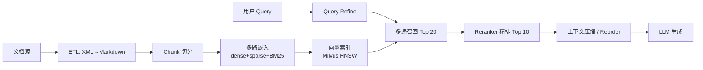

# RAG 优化全链路（概念骨架）

> 链路：文档 → 切片 → 多路嵌入 → 向量索引 → 多路召回 → Reranker → 上下文压缩 → LLM 生成。每环节都有可优化点。

> ⚠ **本文只放骨架 + 对比表 + 易错点**。具体问答 / 项目实操（76% → 92% 怎么做）请去 [[Agent问题答案/RAG]] + [[追问/西门子RAG]]。

## 端到端链路图



## 关键对比表

### Chunk 切分策略

| 策略 | 优 | 劣 |
|---|---|---|
| 固定长度 | 简单 | 断语义 |
| **语义分块** | 边界自然 | 实现复杂 |
| **滑动窗口**（重叠 10-20%）| 防边界丢失 | 冗余 |
| **层次化** | 多粒度可选 | 索引膨胀 |
| 标记符（# / ```）| 简单可控 | 限定文档类型 |

实战推荐：**层次化 + 语义 + 滑动窗口** 三者组合（500-1000 token 是常见折中）。

### Embedding 模型

| 模型 | 维度 | 模式 |
|---|---|---|
| **BGE-M3** | 1024 | dense + sparse + multi-vector，关键词强 |
| **千问3** | 4096 | 仅 dense，语义强，霸 HF 榜 |

→ 实战组合：千问3 dense + BGE-M3 sparse + BM25 三路召回。

### 向量索引：FLAT vs HNSW

| | FLAT | HNSW |
|---|---|---|
| 类型 | 暴力 | 近似 ANN |
| 复杂度 | O(N·d) | O(logN) |
| 关键参数 | — | M=16-32, efConstruction=200, ef_search=100-200 |
| 召回率 | 100% | 95%+ |
| 延迟 | 慢 | ms 级 |

> 概念区分：**KNN 是目标**（找最近 k 个），**FLAT / HNSW 是实现**。

### 向量库：Elasticsearch vs Milvus

🔴 **这张表 2026-08-06 订正过，旧口径（「ES 最大 1024 维」「ES 不支持 sparse」）被面试官戳过，别再照旧版本说。**

| | ES | Milvus |
|---|---|---|
| 最大向量维度 | **8.11 起 `dense_vector` 上限 4096**（更早的版本索引化上限是 1024） | 任意（千问3 4096 OK） |
| 稀疏向量 | **支持**——有 `sparse_vector` 字段类型（ELSER 用的就是它，8.8 起） | ✅ 原生倒排，且对 BGE-M3 这类同时出 dense+sparse 的模型有现成适配 |
| BM25 | 主业，成熟 | **2.5 起内置 BM25 Function**（集成 Tantivy 全文检索库）：**文本直接进，Milvus 自己分词、自己算 TF-IDF、输出稀疏向量，不需要调模型** |
| 多路融合 | **8.9 起支持 RRF**，把 BM25 和向量结果融合 | 原生 hybrid search |
| 主业 | 全文搜索 | 向量检索 |

<!-- 来源: Elastic 官方 dense-vector 文档 + 8.8/8.9 发布博客；Milvus 官方 BM25 Function / Full Text Search 文档 ・ 查证于 2026-08-06 -->

> ⚠️ **两条稀疏路线要分清，面试被追过**：① **Milvus 内置 BM25 Function**——统计算法，Milvus 自己分词打分 ② **learned sparse**（BGE-M3 / SPLADE）——模型对每个 token 学出来的权重，**还会做 term expansion**（给没在原文出现的相关词也赋非零权重）。**两条都产出稀疏向量，但一个不用模型、一个必须调模型。**

→ **项目里换 ES → Milvus 的正确讲法**（旧讲法依赖的两条事实已过期）：
> **直接触发点是维度**——「**我们当时那个版本的 ES**，索引化的 dense_vector 上限是 1024，而千问 3 是 4096 维，装不下」（**必须带上"当时那个版本"**，否则对方知道 8.11 之后是 4096，这条理由当场作废）。
> **真正留在 Milvus 的理由是稀疏那一路**：要做 dense + BM25 + learned sparse 三路召回加融合，Milvus 对稀疏是原生倒排、对 BGE-M3 有现成适配，一套 API 完成。
> **反过来也要承认 ES 合理**：如果栈里本来就有 ES 做日志和全文，8.9 之后 BM25 + 向量 + RRF 一套够用，**少维护一个组件的价值往往大于向量库那点性能优势。**

### ⭐ Embedding 模型 vs Reranker：Bi-Encoder vs Cross-Encoder

> 🔴 **本仓库唯一一道「同一题在两家都答崩」的题**：[[公司/其他/贝壳/贝壳找房一面面经]]（2026-03）和 [[公司/字节/中国商业化/字节商业化AgentInfra三面_2026-08-14]]（2026-08）都考了，都没答清楚。**字节画像第一段就点名它爱考。**
> ❌ **别说成「一个训练时做词语接龙、一个做词语填空」**——那是 GPT vs BERT 的说法，跟这题无关。

**区别在输入方式和输出类型，不在预训练目标：**

| | **embedding = Bi-Encoder（双塔）** | **reranker = Cross-Encoder（交叉编码）** |
|---|---|---|
| 怎么喂 | query 和文档**分开各编一次**，两次前向互不相干 | query 和文档**拼成一条**一起编，attention 让两边 token 直接交互 |
| 吐什么 | **一个向量** | **一个标量分数**（顶上一层打分头把整条输入压成一个数，sigmoid 到 0~1） |
| 能离线预算吗 | ✅ 文档向量提前全算好存库 | ❌ 分数依赖 query，**只能在线现算** |
| 一次查询几次前向 | **1 次**（只编 query），检索交给向量库做近邻搜索 | **N 次**（每个候选一次） |
| 精度 | 全篇压成定长向量，**细节必丢** | token 不压缩地交互，**所以更准** |

- **两者不是替代关系，是流水线的两站**：Bi-Encoder 从百万级粗筛（快但糙）→ Cross-Encoder 对几十条精排（准但贵）。
- **分数是模型自带的，不是从 embedding 算出来的**：那层打分头用 (query, 相关文档) / (query, 不相关文档) 训出来，**给的是训出来的偏序，不是几何相似度**——这就是它比余弦相似度准的原因。
- **堵「是不是 BERT vs GPT」这个追问的证据**：**BGE 家的 embedding 和 reranker 同底座（XLM-RoBERTa，填空式）；千问3 家的也同底座（Qwen3，自回归）。同一家两个模型底座相同**，说明预训练目标根本不是区分点。
  <!-- 来源: Qwen3 Embedding 技术报告 arXiv:2506.05176 · BAAI/bge-reranker-v2-m3 模型卡 ・ 查证于 2026-08-14 -->
- **多路召回时它还有一个作用**：BM25 / 稠密 / 稀疏三路分数**量纲不同、不能直接比大小**，reranker 把三路候选**拉到同一把尺子上重量一遍**——所以它放在三路合并之后，不是每路各自截断。

### Reranker 选型

| | LLM Reranker (BGE-M3 / 千问 reranker) | RRF |
|---|---|---|
| 准 | 高 | 中 |
| 延迟 | 30 文档 ~2s | 几十 ms |
| 何时用 | 业务能等 | 延迟敏感 |

> **重排慢是「N 次前向」慢，不是某一步慢**：30 篇 = 30 次独立前向。实测千问3 重排 30 篇 6 秒（0.2s/篇）、BGE-M3 重排 30 篇 2 秒（0.07s/篇）。**提速优先做 batch 化（白捡），换小模型是拿精度换速度**；定位只需看两个数——**GPU 利用率压没压满、实际 batch size 是不是 1**。

## 评估三维度（LangSmith）

| 维度 | 含义 | 防什么 |
|---|---|---|
| **Correctness** | 与标准答案一致 | 答错 |
| **Relevance** | 回答与问题相关 | 偏题 |
| **Groundedness** | 回答基于检索文档 | 幻觉 |

LLM judge（DeepSeek V3）打分前先与人工 AB，F1 ≥ 0.8 才采信。LangSmith trace 每个节点入参 / 出参 / 耗时，失败 case 反查链路。

## Query 优化技巧（按由轻到重）

1. **Query Refine** — 多语言 / 同义词扩写后并查
2. **Query Decomposition** — 复杂问题拆子问题分别检索
3. **HyDE** — 让 LLM 先生成假设答案，用答案做 embedding 检索

## 进阶方向（值得回答时一带）

- **GraphRAG** —— 实体 / 关系建图，多跳推理
- **Dynamic RAG** —— 高质量 QA 入库做长期记忆
- **CoT / ToT** —— 让 LLM 一步步思考多文档

## 易错点（高频追问）

- **FLAT 是 KNN 算法吗？** —— 不是，FLAT 是 KNN 的一种实现
- **ANN 就是 HNSW 吗？** —— ANN 是目标，HNSW 是其中一种实现
- **混合检索结果直接合并？** —— 不，必须 Reranker，否则三路得分无法 normalize
- **只看 LLM judge 行吗？** —— 不行，必须有人工 ground truth 校准 judge
- **大窗口模型不就行了吗？** —— 成本贵 / 效率低 / 注意力分散 / 不可扩展，RAG 仍是必需
- 🔴 **BM25 靠什么发现稀有词？** —— 靠 **IDF**（inverse document frequency，逆文档频率），**统计范围是整个语料库**：包含这个词的文档越少，权重越高。**跟它在当前这篇里出现几次无关**（那是 TF）。三块拆开：**IDF 决定词值不值钱 / TF 决定这篇提了几次（有饱和）/ 长度归一化防止长文档靠篇幅堆词频**。⚠️ **常见说反：以为「在长文档里只出现一两次所以分高」——长度那一项的方向是反的，文档越长同样词频得分越低。** 出处 [[公司/字节/中国商业化/字节商业化AgentInfra二面_2026-08-06]]
- **为什么关键词非要单开一路，dense 不够吗？** —— 一个 500 token 的 chunk 压成**一个**向量，里面两三个关键 token（型号、错误码、参数名）的语义会被整段主体**稀释**掉，语义检索召不回来；而这类词恰好 IDF 极高，**BM25 一击即中。两条路补的是不同的洞。**
- **BGE-M3 的 sparse 和 BM25 重复吗？** —— **高度重合**（都是词面匹配，前者多了 term expansion）。西门子项目实测：**BM25 已经在的情况下，再加 learned sparse 那一路跑分没有可见增量。** 教训是**召回路数不是越多越好**——每多一路，query 侧就多一次编码、多一次检索、多一份要融合的分数，**收益取决于这一路补的洞跟已有的路重不重合**

## 深入阅读

- 答题分册：[[Agent问题答案/RAG]]（10 道 RAG Q）
- 项目实操：[[追问/西门子RAG]]（16 道项目追问）
- raw 专栏：[[专栏/后端/向量索引-HNSW和KNN-ANN区别]]
- 真题来源：[[蔚来/蔚来CICD组AI agent实习生一面面经-详细版]] · [[面试问题总结]] · [[虾皮/Shopee DB Infra 北京平台实习面试问题总结]] · [[小红书/小红书产品工程师一面面经]] · [[蔚来/蔚来一面RAG深挖]] · [[公司/字节/中国商业化/字节商业化AgentInfra二面_2026-08-06]]（**存储选型 → BM25 原理六连追问**）
