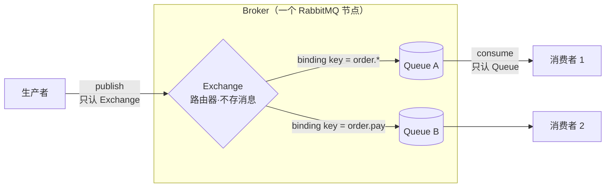
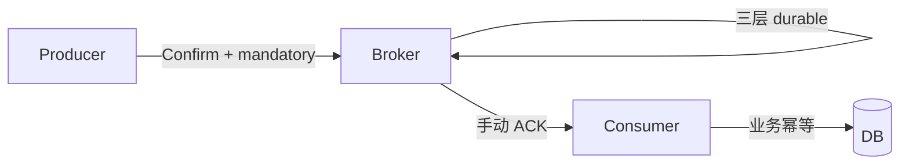
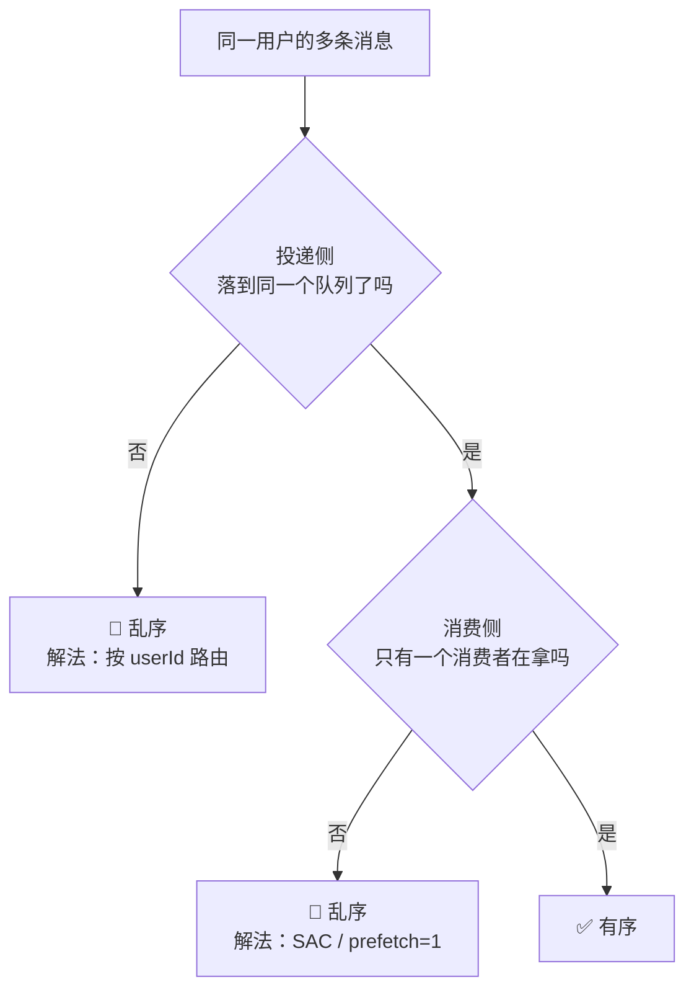

# 消息队列不丢不重

> 三段链路（生产者→Broker→消费者）每段都可能丢；at-least-once + 业务幂等 = effectively-once。死信队列做兜底。
> **本篇的标杆场次是 [[阿里云/阿里云消息团队一面面经]]**（阿里云消息商业化团队，RocketMQ 开源维护方）——那场把 MQ 从可靠性问到有序性问到扩容，是这个主题的天花板难度。

## 高频问法
- "RabbitMQ 怎么保证不丢、不重、消费成功" — [[阿里云/阿里云消息团队一面面经]]、[[字节/国际商业化/面经记录_国际商业化创业_3.9]]
- "扣库存成功但消息发送 / 消费失败怎么办" — [[阿里云/阿里云消息团队一面面经]]
- **"怎样保证相同用户顺序消费"** — [[阿里云/阿里云消息团队一面面经]]（CDC 场景）、[[公司/米哈游/米哈游提前批一面_约2026-08]]
- **"消息堆积怎么处理？如何排查？怎么止血"** — [[小鹅通/我的/小鹅通一面面经（带答案已OC）]]、[[公司/米哈游/米哈游提前批一面_约2026-08]]
- "死信队列原理 + 用法" — [[字节/国际商业化/面经记录_国际商业化创业_3.9]]
- "RabbitMQ vs RocketMQ vs Kafka 选型" — [[字节/财经/字节财经一面]]、[[阿里云/阿里云消息团队一面面经]]
- "怎么设计可靠的 MQ" — [[快手/支付方向/我的快手支付二面]]、[[腾讯/数据平台/我的腾讯一面]]

---

## 0. 地基：Broker / Exchange / Queue 是什么关系

> **这一节是后面所有题的地基。** 不清楚「Exchange 不存消息」，就理解不了 mandatory 为什么存在，也想不通 Consistent Hash Exchange 怎么做顺序。

### 三者的定义（各一句话）

| 概念 | 是什么 | 存不存消息 |
|---|---|---|
| **Broker** | 一个 RabbitMQ **服务节点**（进程）。集群 = 多个 Broker。Exchange 和 Queue 都住在 Broker 里 | 作为容器，间接存 |
| **Exchange**（交换机） | **路由器**。收到消息后按规则决定投给哪些 Queue | 🔴 **不存**。匹配不到队列，消息当场蒸发 |
| **Queue**（队列） | **唯一真正存消息的实体**，FIFO | ✅ 存 |
| **Binding**（绑定） | Exchange 和 Queue 之间的一条路由规则，带 binding key | — |

### 为什么要有 Exchange 这一层（**这才是考点**）

> **生产者只认 Exchange，消费者只认 Queue，两边互不知道对方存在。**
> 于是「一条消息要进几个队列、有几个消费者、要不要新加一路下游」这些事，**改绑定就行，生产者代码一行不用动**。
> **Exchange 的存在就是为了把「谁发」和「谁收」解耦。** 没有它，生产者就得硬编码目标队列列表。

### 四种 Exchange 类型

| 类型 | 路由规则 | 典型用途 |
|---|---|---|
| **direct** | routing key **完全相等** | 点对点 |
| **fanout** | **忽略 routing key**，广播给所有绑定的队列 | 广播 / 一份消息多路下游 |
| **topic** | routing key 按 `.` 分段通配（`*` 匹配一段，`#` 匹配多段） | 最常用 |
| **headers** | 按消息头匹配，不看 routing key | 少用 |
| **Consistent Hash**（插件） | 按 routing key 的**哈希值**分配到队列 | 🔑 **做顺序消费的关键，见 §7** |

---

## 1. 三段链路全景

- **生产者→Broker**：Confirm 机制 + mandatory（路由失败回退）+ 失败重试
- **Broker 自身**：Exchange / Queue / 消息三层 durable，宕机不丢
- **Broker→Consumer**：手动 ACK + 死信队列 + 业务幂等

## 2. 生产者侧

**要挡的是两道不同的门，所以要两个机制：**

| 门 | 会出什么事 | 挡它的机制 |
|---|---|---|
| **消息到没到 Broker** | 网络断 / Broker 挂 / 磁盘写失败 | **Confirm** |
| **到了 Broker，进没进 Queue** | routing key 配错、Exchange 上没绑任何队列 → **消息被默默丢弃** | **mandatory** |

- **Confirm 模式**：每条消息发出后 Broker 回 ACK，超时 / NACK 就重发
- **mandatory**：消息到了 Exchange 但路由不到 Queue → 退回（ReturnCallback）

> 🔴 **反直觉的关键点（拿来加分）：路由失败时 Broker 照样回 ACK。**
> Confirm 的语义是「**这条消息我 Broker 负责了**」——Exchange 检查完发现没有队列匹配、把消息丢掉，**在 Broker 看来这是一次正常处理完成**，所以照样发 `basic.ack`。
> **所以只开 Confirm 不开 mandatory，routing key 配错了你一无所知，日志上全是「发送成功」。**
> 官方规定了顺序：**开了 mandatory 时，`basic.return` 在 `basic.ack` 之前送达客户端。**
> **工程后果：回调里不能收到 ack 就直接标成功**，要先看这条有没有被 return 过——否则「退回」信号会被 ack 覆盖。
> <!-- 来源: RabbitMQ 官方文档 /docs/confirms ・ 查证于 2026-08-04 -->

- ⚠️ **事务机制（Tx）和 Confirm 互斥**，不能同时开（会报错）。Tx 是同步阻塞、吞吐差，高并发一律用 Confirm
- **本地消息表（Outbox）**：业务事务里把订单 + 待发消息一起写库；定时任务扫"待发送"重投。
  > 🔑 **它比 Confirm 强在哪：Confirm 和 mandatory 都要求 MQ 活着。本地消息表不要求**——MQ 整个挂了，订单也安全躺在自己的数据库里。**这就是 [[阿里云/阿里云消息团队一面面经]] 里「发送多次都失败怎么办」的标准答案。**

## 3. Broker 侧

- Exchange `durable=true`、Queue `durable=true`、消息 `deliveryMode=2`，**三层缺一不可**
- 高可靠选 **Quorum Queue**（多副本，Raft 协议选主）

> 🔴 **版本口径已变，你的 [[专栏/后端/RabbitMQ保证消息不重不丢]] 写的「镜像模式」已经过时：**
> **经典镜像队列（Classic Mirrored Queue）2021 年弃用，2024 年随 RabbitMQ 4.0 正式移除。** 现在做高可用复制队列**只有 Quorum Queue 一个选项**（另有 Streams 走别的场景）。
> **面试里还答「镜像模式」会显得停留在旧版本**——正确说法是「以前是镜像队列，4.0 已移除，现在统一用 Quorum Queue」。
> <!-- 来源: RabbitMQ 官方博客 + Quorum Queues 文档 ・ 查证于 2026-08-04 -->

## 4. 消费者侧

- `autoAck=false`，业务执行成功后再 `basicAck`
- 失败分两类：
  - **可恢复**（DB 临时连不上）→ `requeue=true` 重试几次
  - **不可恢复**（数据格式错）→ `requeue=false` 进死信，避免无限重试
- **业务幂等**：用业务唯一 ID（订单号）做去重

## 5. 死信队列（DLQ）

**先说清它在机制上是什么**：死信交换机 / 死信队列**就是普通的 Exchange / Queue**，没有任何特殊之处。原队列声明时配 `x-dead-letter-exchange` + `x-dead-letter-routing-key`，**「死信」本质只是消息的一次自动转发**——某条消息在原队列待不下去了，Broker 把它转投到另一个 Exchange。

### 三种触发不是随便列的三条，是「消息待不下去」的三种原因

| 触发 | 消息为什么待不下去 | 对应的真实场景 |
|---|---|---|
| **① `reject`/`nack` 且 `requeue=false`** | **处理不了**——消费者明确拒绝，且不许重投 | **失败隔离**：不可恢复的错（数据格式错）重试一万次也不会成功 |
| **② 消息 TTL 过期** | **等太久了**——超时没被消费 | 🔑 **延迟队列**（见下） |
| **③ 队列达到 `x-max-length`** | **队列满了**，最旧的被挤出去 | **过载保护**：保住新消息能进来，代价是丢最旧的 |

> 🔑 **关键区分：①③ 是「出事了」的兜底，② 是唯一一个被反过来当功能用的。**

### ② 的反向用法：TTL + DLX = 延迟队列

**RabbitMQ 没有原生延时消息，这是最经典的绕法——把「定时」变成「过期」。**

建一个**没有任何消费者**的队列，设 TTL，配 DLX 指向真正的业务队列。消息进去没人消费 → TTL 到期 → 自动死信到业务队列 → 业务消费者这时才拿到它。**订单超时关闭就是这么做的**（见 [[黑马点评秒杀]] Q4b）。

> 🔴 **必然的追问：不同订单要不同超时时间怎么办？——踩队头阻塞。**
> **RabbitMQ 只检查队头那条消息是否过期，消息也只能从队头被死信。** 所以用**消息级 TTL** 时，一条 30 分钟的挡在前面，后面那条 5 分钟的也得等满 30 分钟。
> **解法**：① **按延迟时长分几个固定队列**，同队列内 TTL 相同、天然不互相挡（**首选**）② `rabbitmq_delayed_message_exchange` 插件——消息在 Exchange 里等不进队列，无队头阻塞，但是插件且高可用性弱。
> <!-- 来源: RabbitMQ 官方 TTL 文档 ・ 查证于 2026-08-04 -->

### ① 的完整处理链路（[[阿里云/阿里云消息团队一面面经]] 原题）

消费失败 → 重试 N 次（如 3 次）→ 仍失败则进死信队列 → **死信队列配专门的兜底消费者**，做两件事：① 把失败消息**写进数据库的失败记录表**（持久化，防止死信队列本身也出问题）② 发告警。人工修复后从失败记录表重新触发。

**要区分「可重试」和「不可重试」的失败**：数据库临时连不上 → 重试几次可能就好；数据格式错误 → 重试一万次也不会成功，**直接进死信，不浪费重试次数**。

> **那场面试官的原话点评**：「死信队列确实是解决这种场景的标准做法——**方便监控问题，也能二次拉取消费**。」
> **这句话可以直接当答案的收尾**：死信队列的价值就是这两点——**让失败可观测**（有个地方能看到失败了多少、失败了什么），**让失败可重放**（修好之后能再消费一次）。
>
> ⚠️ **死信队列 ≠ 重试队列**，要专门配一个消费者处理它，否则失败消息只是换了个地方黑洞。

---

## 6. 怎样保证不重复消费

### 先说清为什么做不到「恰好一次」

**重复来自三个地方，但它们是同一个形状：**

| 出处 | 具体情形 |
|---|---|
| 生产端 | Broker 收到并持久化了，**ACK 回程网络断** → 生产者以为失败，重发 |
| 消费端 | 业务处理完了，**ACK 还没发出去消费者就挂了** → Broker 检测到连接断开，重投 |
| 重试 | `requeue=true` 的重试本身 |

> 🔑 **三种都是「动作成功了，但『我知道你成功了』这个回执丢了」。**
> **接收方永远无法区分「对方没做」和「对方做了但回执丢了」**——这是分布式系统的根本限制，不是 RabbitMQ 实现得不好。
> 所以只能选：**宁可重复（at-least-once）还是宁可丢（at-most-once）。** 业务几乎都选前者，再用幂等把重复的代价消掉。
> **这才是 `at-least-once + 幂等 = effectively-once` 真正的意思——不是 MQ 做到了恰好一次，是你在业务层把重复变得无害。**

### 幂等三种实现（按可靠性排）

| 做法 | 说明 | 局限 |
|---|---|---|
| **数据库唯一约束** | `INSERT ... ON CONFLICT DO NOTHING` | 最可靠，重复插入被数据库直接挡掉 |
| **状态机校验** | 已支付的订单不再扣款 | **业务语义天然幂等，最优雅** |
| **Redis 去重键** | `SETNX 业务ID` | 快，但 **TTL 过期后有重复窗口**，只能做前置过滤，不能当唯一防线 |

- **幂等键用业务唯一 ID（订单号），不要用消息 ID**——重发时消息 ID 可能变，业务 ID 不会
- 阿里云那场的实例：**十亿级迁移双写时用 `INSERT ... ON CONFLICT (unique_id) DO NOTHING`**，因为同一条数据可能被同步链路写一次、双写又写一次、消费者重启再写一次

> 🔴 **必然的追问陷阱：「Kafka 不是有 exactly-once 吗？」说死「做不到」会被打脸。**
> **正确口径**：Kafka 确实有 EOS——**幂等 producer**（broker 给每个 producer 发 ID + 序列号去重）+ **事务**（跨 partition 原子写），3.0 起 `acks=all` 和幂等 producer 已是默认。
> **但边界是「Kafka 到 Kafka」**：读 topic → 处理 → 写另一个 topic + 提交 offset，这一整串能包进一个事务。**一旦写外部系统（数据库、第三方接口）就出了这个边界**，那次写不受保护。**RabbitMQ 没有这套机制，只有 at-least-once。**
> **收口：Kafka 的 exactly-once 是「流处理闭环内」的，不是端到端的。** <!-- 来源: KIP-98 + Confluent 官方教程 ・ 查证于 2026-08-04 -->

---

## 7. 怎样保证相同用户顺序消费

> 📌 **标杆答案来自 [[阿里云/阿里云消息团队一面面经]] 的 CDC 场景**：积分/余额这类业务，同一用户「先扣 30 再加 50」反过来就错了。

### 先拆开：顺序会在两个地方被打破

**⚠️ 第二处最容易漏答：队列有序 ≠ 消费有序。** 同一队列挂多个消费者、或单消费者内部把消息丢给线程池，照样乱。

### 投递侧：让同一用户永远进同一个队列

- **Kafka**：用 **userId 做 partition key**，同一用户自动路由到同一 partition，**partition 内天然有序**
- **RabbitMQ**：没有 partition 概念，用 **Consistent Hash Exchange 插件**做等效——
  1. 建 N 个功能相同的队列（`queue_0` / `queue_1` / `queue_2`…）
  2. Exchange 按 **routing key（设成 userId）的哈希值**分配到对应队列
  3. 同一用户的消息**一定落在同一个队列**，被同一个消费者按 FIFO 处理
  4. **不同用户分散在不同队列并行消费，吞吐不受影响**

### 消费侧：保证一个队列同时只有一个消费者在处理

- **Single Active Consumer（SAC，单活跃消费者）** —— 队列上开这个特性后，**同一时刻只有一个消费者是活跃的，其余待命**；活跃的那个断开，Broker 自动激活另一个。
  > 🔑 **它比手工保证「一个队列只挂一个消费者」强在哪：顺序由 Broker 保证，不依赖运维纪律。** 手工做法一旦有人多起了一个实例，顺序就悄悄坏了，还没有任何报错。
  > RabbitMQ 4.0 起 SAC 和消费者优先级不再互斥——新消费者优先级更高时，quorum queue 会切过去。
  > <!-- 来源: RabbitMQ 官方 Quorum Queues 文档 ・ 查证于 2026-08-04 -->
- 配 **`prefetch=1`**：一次只预取一条，处理完 ACK 了才发下一条
- 消费端**不许把消息丢进线程池并发处理**

### 代价必须主动说

> **顺序和吞吐是对立的：顺序保证的粒度，直接决定并行度上限。**
> 「按用户分区」= 同用户串行、不同用户并行 —— **这是正确的粒度**。
> 如果要求全局有序，并行度就是 1，那 MQ 基本白用了。

### 预备追问：「消费失败了，后面的还能消费吗？」

**这是顺序消费最尖锐的问题，没有两全：**
- **阻塞重试**：保序，但会**卡住整条队列**，必须配超时 + 死信兜底
- **跳过进死信**：不卡队列，但**破坏了顺序**

**按业务选**：转账、积分这类必须阻塞（顺序错了就是数据错）；日志、通知这类可以跳过。

---

## 8. 消息堆积：排查 → 止血 → 治本

### 排查：先分清「生产快了」还是「消费慢了」

看三个数：**队列深度趋势 / 生产速率 / 消费速率**。

> 🔑 **RabbitMQ 有一个特有的排查抓手：把队列深度拆成两个指标看，能直接定位到病因。**

| 指标 | 含义 | 组合诊断 |
|---|---|---|
| `messages_ready` | **等着被投递**的消息数 | **ready 高、unacked 低** → 消费者数量不够，或者根本没在消费 → **加消费者有效** |
| `messages_unacknowledged` | **已投递给消费者、但还没 ACK** 的消息数 | **ready 低、unacked 高** → 消费者拿到了但处理不完（卡在下游 DB / 外部接口）→ 🔴 **加消费者没用，要去查下游** |

其余常见真凶：
- **毒消息在无限重试**（`requeue=true` 一直失败一直回队）
- 刚发版引入了慢逻辑
- 消费者实例挂了 / 连接断了但没告警

### 止血（按见效速度）

1. **扩消费者**——最快。⚠️ **边界必考**：RabbitMQ 单队列加消费者有效；**Kafka 加到 partition 数就到顶了**
2. **提高 `prefetch` / 改批量消费**，减少往返
3. **入口限流**，从源头削峰（令牌桶，见 [[限流熔断容错]]）
4. **降级**：低优先级消息直接丢弃或进延迟队列；用 TTL 让它们自动过期
5. **搬运**：堆积太严重时起一批临时消费者，**只做「把消息搬到另一个 topic/队列」不做业务处理**，先把主队列腾空，回头慢慢消化

> 🔴 **一个已过时的老答案别再说**：「堆积时把队列改成 lazy queue（惰性队列）让消息落盘」。
> **RabbitMQ 3.12 起 `x-queue-mode=lazy` 参数已被忽略**，所有 classic queue 默认就是类似惰性的行为——只在内存留少量消息，其余直接写盘。同样地，**3.12 起 quorum queue 的长堆积也不再显著影响发布延迟**。
> **说「开 lazy queue」会暴露你的知识停在 3.12 之前。**
> <!-- 来源: RabbitMQ 官方博客 3.12 性能改进 + lazy-queues 文档 ・ 查证于 2026-08-04 -->

### 治本

- **毒消息隔离**：失败 N 次直接进死信，别让一条烂消息拖垮整条队列
- **消费端要能水平扩**：无状态 + 幂等，才敢随便加实例
- **监控要两个指标**：**队列深度 + 最老未消费消息的年龄**。只看深度会漏掉「低流量但一直不消费」的情况
- **阿里云那场的做法**（[[阿里云/阿里云消息团队一面面经]] RAG ETL 流水线）：用 MQ 把「解析 / embedding / 落库」三阶段解耦成独立消费者组，**监控每个 Queue 的积压量，哪一段积压持续增长就加哪一段的 worker**——把「堆积」变成一个可定位到具体阶段的指标，而不是一个笼统的告警

---

## 9. 三大 MQ 选型

| | RabbitMQ | RocketMQ | Kafka |
|---|---|---|---|
| 吞吐 | 万级 | 十万级 | 百万级 |
| 延迟 | 微秒级 | 毫秒级 | 毫秒级 |
| 路由 | Exchange 4 种最灵活 | Topic + Tag | 仅 Topic |
| 事务消息 | 不原生 | 原生（半消息 + 回查） | 有事务，但闭环内（见 §6） |
| 消息回溯 | 不支持 | 支持 | 支持（重置 offset） |
| 延时消息 | 插件 / TTL+DLQ | 原生 | 不支持 |
| 顺序 | Consistent Hash Exchange + SAC | 顺序消息原生 | partition key |
| 生态 | 通用业务 | 电商 / 金融 | 大数据 / 日志 |

**RocketMQ 事务消息（半消息）**：① 发半消息，Broker 不投递 ② 执行本地事务 ③ 成功发 commit / 失败发 rollback ④ **Broker 长时间没收到就主动回查生产者状态**。

## 10. 业务案例：秒杀异步落库

Redis 扣库存（Lua 原子）+ 一人一单校验 → MQ 发订单消息异步落库 → 订单号做幂等 → 失败兜底走本地消息表 + 死信队列 + 人工介入。
详见 [[黑马点评秒杀]]（秒杀延迟 400ms → 100ms）。

---

## 易错点 & 追问

1. 🔴 **只开 Confirm 不开 mandatory**——路由失败照样回 ACK，你会以为发成功了（§2）
2. 🔴 **答「镜像队列」做高可用**——4.0 已移除，现在只有 Quorum Queue（§3）
3. 🔴 **答「堆积就开 lazy queue」**——3.12 起该参数被忽略（§8）
4. 🔴 **说死「MQ 做不到 exactly-once」**——Kafka 在闭环内做得到，要说清边界（§6）
5. ⚠️ **队列有序 ≠ 消费有序**——同队列多消费者、或消费者内部用线程池，照样乱（§7）
6. ⚠️ **加消费者不一定有用**——`unacked` 高说明卡在下游，加了只是让更多消费者一起卡住（§8）
7. ⚠️ 死信队列 ≠ 重试队列，要专门配消费者
8. ⚠️ **"消息丢失"和"消息重复"是两回事**，分别用 ACK 和幂等处理，别混着答
9. ⚠️ 事务机制（Tx）和 Confirm 互斥，不能同时开

## 深入阅读
- 原始专栏 [[专栏/后端/RabbitMQ保证消息不重不丢]]（⚠️ 镜像队列那段已过时，以本文 §3 为准）
- 相邻主题 [[限流熔断容错]]（MQ 削峰本质是漏桶）· [[数据迁移与一致性]]（CDC + 双写）
- 真题来源 [[阿里云/阿里云消息团队一面面经]]（标杆场次）、[[公司/米哈游/米哈游提前批一面_约2026-08]]、[[腾讯/数据平台/我的腾讯一面]]、[[快手/支付方向/我的快手支付二面]]、[[字节/财经/字节财经一面]]、[[字节/国际商业化/面经记录_国际商业化创业_3.9]]、[[小鹅通/我的/小鹅通一面面经（带答案已OC）]]
