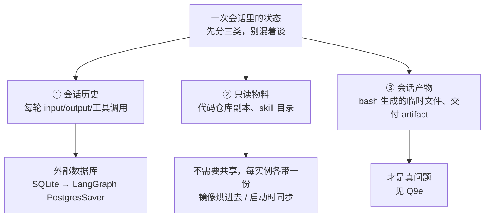

# 字节答疑 Bot（DeerFlow 多 Agent）

> Ground truth：[[字节实习]]。已被深挖：
> - [[公司/星河觉醒/Agent方向/星河觉醒Agent一面_2026-07-20]]（连环 8 问全扛住）
> - [[公司/快手/DataAgent方向/快手数据平台DataAgent一面_2026-07-29]]（追问式，被连否三次）
> - [[公司/字节/中国商业化/字节商业化AgentInfra一面_2026-07-30]]（**Q2d 口径修复生效 ✅**；新增 Q1d 三条构建约束；**但 Q1c / 数字口径两处回滚 🔴**）
> - [[公司/阿里国际/Agent Infra/阿里星一面_2026-08-06]]（**全新追问轴：运行时与平台化 7 连问 → 见 Q9 系列**；Q2「放 prompt 最后面」🔴 第三次复发；Q1c 的 AST 上界又没取出来）
> - [[公司/字节/中国商业化/字节商业化AgentInfra二面_2026-08-06]]（**Q9 轴再考一遍，前半程明显答出增量**——多实例、云端挂载按需下载、限流都自己说出来了；**🔴 断在 Q9g 数据库选型**；新增 Q9g / Q9h；Q6 连接池那题**只讲了止血没讲根治**）
>
> 本页是拷打后定稿的口语化回答——**所有数字和说法已统一口径，别再用别的版本**。

## 两分钟口语稿（分层，可按面试节奏截断）

**① 背景（20 秒）**
「TTO 广告平台的业务特别复杂——新旧玩法、各种状态叉乘在一起，运营、产品甚至研发自己都理不清一个用户状态能流转到哪。内部文档常年过期，**只有代码是真的**。所以我们做了一个『看代码回答业务问题』的答疑 Bot，服务 200+ 用户，让产品运营不用再抓研发 oncall。」

**② 核心难点（15 秒）**
「最大的坑是 LLM **以偏概全**：状态 A 明明能到 B 也能到 C，它读了个代码片段就只答 B。我们试过 Claude、Opus 4.8、GLM 5.1，全都这样——模型倾向不读全文件、看到一种情况就下结论。」

**③ 方案三板斧（60 秒）**
「第一板斧是**检索三层漏斗**：ByteRAG 检索业务文档做粗定位——文档旧了不能当答案，但可以当地图；CodeRAG 做语义代码检索，顺手解决中文业务词到英文代码符号的鸿沟，配一份业务语义词表兜底；最后 grep/glob 精确收敛。

第二板斧是**决策树**。业务分叉抽象下来就三类：枚举值 if-else、抽象方法多实现、同语义函数聚集。我做了个 AST 工具直接从语法树提取判断条件，不用读全文件；主 Agent 用工具调用显式把分支写进决策树，每轮**追加到消息列表末尾**——历史 append-only 保住 KV-cache 前缀，这跟 Manus 那篇 Context Engineering 博客的 recitation 模式是一个思路，我们等于做了它的领域化升级：todo.md 是线性清单，决策树带层级和完备性判据。**门禁**是：树上所有分支验证完，才允许进入总结。

第三板斧是**审核 Agent**：拿到决策树 + 答案草稿 + 独立的代码访问权。它有效的原因是两个——主 Agent 被几十轮工具调用稀释了注意力，审核 Agent 拿的是压缩后的结构化输入，做『对着清单核对』这种窄任务；而且它能自己重新读代码取证。发现漏分支就打回重答；发现是用户问题本身歧义（没约束到哪个分支），就**反问用户**框定范围。」

**④ 数据（15 秒）**
「评测集是 50+ 题、专家给标准答案和得分点，AI 按 rubric 判卷踩点。基线是裸 DeerFlow 纯看代码的 56%，上决策树 + 审核 Agent 后到 **87%**。另外我在网关层统一了三家模型的最高强度思考模式，评测上还有约 10 个点的提升。」

## 高频追问 Q&A（已实战验证的答法）

### Q1: 为什么不用 todo/表格，要用树？
- todo 线性、表格二维，都表达不了「玩法→打钱逻辑→币种/税务」的层级枚举；树既是检查清单又是答案骨架
- 演化路径真实：先试 todo 不行 → 表格不行 → 决策树（有取舍过程，面试官吃这个）

### Q1b: 决策树的节点 / 边 / 打分逻辑分别怎么做？（星河一面原题，⚠️ 答题顺序要改）

**铁律：先答「为什么」，最后答「没有的那个」，且「没有」必须讲成「取舍」。** 星河一面开口第一句是「打分我们没有」——弱开局，别再犯。

1. **为什么（先说）**：解决以偏概全。演化 todo → 表格 → 树。
2. **节点**：**一个待验证的分支状态**，带验证标记（未验证/已验证/已排除）。root 是用户问的业务实体（玩法 A），下层是打钱逻辑、再下层币种/税务。由主 Agent 工具调用显式生成，数据来自 AST 提取的判断条件。
3. **边**：**一个具体的分支判断条件**——代码里的一个枚举值、一条 if-else、或状态机的一次转移。所以这棵树是**代码控制流的业务语义投影**，不是凭空设计。（⚠️ 星河一面说的「边没有严格关系」是自我贬低，其实定义清清楚楚。）
4. **打分（刻意没做，讲成取舍）**：经典决策树打分是为**选最优分支/剪枝**；我们要的是**穷尽所有分支**。打分在这里有害——模型会倾向答高分分支、忽略低分的，那正是要治的病。用**验证状态**代替打分，门禁 = 全部已验证才许总结。
5. **（追问）什么时候才需要打分**：分支爆炸到跑不完时引入优先级——但语义是「先验证哪个」的调度顺序，不是「答哪个」的取舍。

### Q1d: 决策树具体怎么构建？（字节 Agent Infra 一面原题，✅ 本页新增素材）

- **root** = 用户 query 里已知的限定条件；之后让 agent 自己根据代码探索分叉
- **只加三条约束，且约束的全是形式、不是内容**——这正是它们能被门禁自动检查的原因：
  1. **每个节点必须是名词**（不能是动词 / 形容词）→ 名词化才可验证，动词短语没法对着代码核对
  2. **每一层必须是同一个种类**（不同类型的枚举值不能混在一层）→ 保证不漏平行分支
  3. **每个节点只能是一个值**（商家有三个子类就必须拆三个节点）→ 不许用模糊表述蒙混
- **节点必填字段**：节点名、分类指标、来源 source file 路径、为什么这样分类的代码依据 → 门禁校验这四项填全才允许输出

### Q1c: 分支特别多，树会爆炸吗？/ 一段代码 100 个分支，怎么保证全覆盖？（🔴 字节那场答成「这是我没做到的地方」）

**铁律：这题有正面答案，不许用「没做到」开局。**

1. **分母不是组合数，是代码里真实存在的分支。** 节点来自 **AST 从语法树提取的真实判断条件**，不是「国家 × 玩法 × 付款方式」的笛卡尔积——**代码里写了几条 if-else 就有几个节点，天然有界且界可计算。**
2. **所以完备性变成一个数字**：AST 提取 N 个条件、树上验证 M 个，覆盖率 = M/N。**这是这个设计最值钱的一点——把完备性从主观感觉变成可算的比例。**
3. **漏在哪要说清**：不漏在「树上有但没验」，漏在 **AST 提取不到的分支**——运行时配置、下游服务返回值决定的路径、反射调用。静态分析拿不到，**兜底是审核 agent 显式提示「这一支我没有代码依据」，把裁决权交给人**，而不是假装覆盖了。
4. 真爆炸才引入优先级调度（见 Q1b 第 5 点）；另有深度限制 + 按 query 剪掉无关子树。
5. **数字收口**：评测集 **87%**，剩下 13% = 问题歧义 + 静态分析盲区。**绝不说「90% 以上」。**

### Q1e: 业务涨十倍，这套还 run 得动吗？（字节原题，⚠️ 那场只答了检索层）

**分三层说它会先在哪里断：**
- **① 检索层——先断，也最好解。** 现在定位代码走关键词匹配（grep 那套），仓库一大召回质量掉得快。换成**基于语法树的结构化检索**：先解析调用图，agent 按调用关系导航而不是按字符串猜，上下文能精简一个量级。
- **② 决策树层——不会爆炸**（理由同 Q1c）。业务涨十倍，代码里的 if-else 不会涨十倍——很多新国家复用同一条逻辑、只是配置不同。
- **③ 评测层——反而最先撑不住，也最容易被忽略。** 50 题评测集按当时的业务写的，业务翻倍后覆盖率就掉了，**你会在分数没变的情况下悄悄退化**。所以测试集要从真实流量和代码结构里长出来，不能靠人想。

### Q2: 决策树和 prompt cache 不冲突吗？🔴 高危——**三场**面试都说过「放 prompt 最后面」，点点互动和阿里星两场都在同一场里讲了 prompt cache 前缀匹配，**面试官把两段一连就是当场打脸**

> 🔴 **2026-08-06 阿里星一面第三次复发，且是三次里最凶险的一次**：第 18 分钟说「决策树放 prompt 最后面，既保证 prompt cache 也做强提醒」，第 31 分钟又完整讲了「prompt cache 按前缀匹配复用已算好的结果」。**两段隔了 13 分钟，没被连上纯属运气。**
> **改口不是措辞问题，是自洽问题**——只要还说「放 prompt 最后面」，你自己讲的 cache 原理就在反驳你自己。

- **树不在 system prompt 里**（星河 + 点点互动 + 阿里星三次口误说成"prompt 最后面"，必须改口）：每轮**追加到消息列表末尾**，渲染顺序 tools→system→messages，**system 和历史不动 = 前缀稳定 = cache 照常命中**，新树在断点之后本就不参与缓存
- **旧树快照 append-only，实际不清理**（⚠️ 别说"compaction 顺带清"，那是建议不是事实）
- 追问「不清理 context 不会爆吗」→ 「会涨，两道防线：树本身有界（节点来自 AST 提取的**真实**分支，不是笛卡尔积穷举）；长任务触发 compaction 时旧快照会被压掉。目前问答长度还没到需要专门清理的程度，**要优化的话在 compaction 时机顺带清是零额外成本**——那时 cache 本来就要重建」
- 出处：Manus《Context Engineering for AI Agents》——append-only 保 KV-cache（实测 10 倍成本差）+ recitation 对抗 lost-in-the-middle

### Q2b: review agent 和主 agent 用相同 / 不同模型各有什么优势？🔴 点点互动答偏了

⚠️ **面试官问的是「相同 vs 不同」，我答成了「强 vs 弱」（成本、token 1:1 vs 2:1、user friendly）——换了维度等于没回答。**

**定稿（全部用自己的实证）：**
> **① 先掰开维度**：「这里有两个正交维度：**模型强弱**和**是否同源**。强弱影响成本和首答质量，同源与否影响的是**错误模式是否独立**——我先说后者，那是 review 机制成立的根本。」
>
> **② 换模型能不能解决问题——实测过**：比过 GPT / Gemini / GLM 做主 agent，也试过 Claude Code + Opus 4.8。**模型之间在探索充分度上确实有差异**（GPT 最容易早停，GLM 5.1 最倾向多调工具，所以主 agent 选 GLM），**但即使最强的模型也会偷懒、以偏概全**。→ **模型选型能改善，但解决不了；真正解决它的是结构约束（决策树强制列全）**。
> ⚠️ 别说成「和模型关系不大」——同场说过 GPT 最差、GLM 最好，会被抓自相矛盾。
>
> **③ 为什么 review 用同模型（关键论证）**：「取决于它抓哪类错误。我们 review 抓的是事实性错误——张冠李戴，把 A 链路的状态流转安到 B 上。**关键观察：这类错误只要被提醒，模型立刻就能改对。** 说明**不是模型不知道，是几十轮探索后没注意到**——**是注意力问题不是能力问题。病因是注意力，对症的是换 context 不是换模型**（新模型同样会失焦，还得重读代码，成本翻倍收益不明）。」
>
> **④ 什么时候我会换模型（显判断力）**：「如果 bad case 显示是**模型系统性偏差**——提醒了也改不过来那种。我们碰到过边缘案例：**玩法 A 没进业务文档，模型会一直挑一个 A 开头的变量当成它，用户怎么纠正都改不过来**。这种同源 review 兜不住，但根因是知识缺失不是模型差异，所以解法是补文档。」
>
> **⑤ 不同模型的理论优势（要知道但不是我们的选择）**：**相关性失败（correlated failure）**——同模型同训练数据同盲区，审自己的输出容易重复同一错误、且倾向认可相同的推理路径；换厂商模型错误模式独立。代价是 prompt 两套、协议适配两套、评测跑两遍、行为不一致难 debug。

### Q2c: review agent 有什么缺点？（点点互动只答了「时长翻倍」，防守不全）

**① 先讲双层响应机制**（这一层证明按错误严重性做了分级，也化解「review 误判」这一刀）：
> 「响应分两级：**事实性错误**（A 到 B 链路根本不存在）→ **直接打回重新生成**，硬错不能给用户；**完备性遗漏**（某分支没讲到）→ **不重生成，只反问用户**『是不是还要考虑某某情况』，**裁决权交给用户**。
> 好处是 **review 误判的代价被限制住**——把对的判成漏了，最坏只是用户被多问一句，不会出现『判错→打回→改坏答案』。」

**② 缺点一：时长翻倍**（同思考强度模型、两边都要读代码探索，用户要等审核完才能追问）

**③ 缺点二：假阳性——过度扩张选择范围（真正最大的问题）**
> 「表现是：某些前置条件下一部分分支已被剪掉、主 agent 是有意识排除的，但 review 会持续反问『还有这些情况没考虑』。
> **根因不在模型，在我传给它的信息不完整**——决策树节点**有验证状态，但没有『已排除』状态**，剪枝是 agent 在推理里自己判断的，**没落到树的数据结构上**。review 看到『树上有这支、答案里没有』，只能判成遗漏。
> **修法：给节点加状态**——未验证 / 已验证成立 / **已排除（必须附排除依据：是哪个条件把它剪掉的）**。这样 review 的职责收窄也更有价值：**从『你怎么没讲这一支』升级成『你凭什么排除这一支』**——后者才是真正容易错的地方。」

**④ 假阴性很少**（review 一般都能发现缺漏）；**准确率 87% 来自 50 题精标评测集，不是 review 通过率**，两者独立

**⑤ 谁 review the reviewer**：「没有，这是有意为之——**再加一层边际收益快速衰减、延迟线性增长**。最后一层兜底交给用户：答案按决策树分支结构输出，**少了哪一支用户看得出来**，追问即触发新一轮完整回答。」

### Q2d: review agent 到底读不读代码？（✅ 口径已修复并在字节那场实战验证）

- 星河说「自己重新读代码验证」，点点互动说「只提供单一的骨架」——**后者漏了半句**
- **统一说法**：「拿到的是**干净的初始上下文 + 决策树 + 答案草稿**，**但保留代码读取权限**——不继承主 agent 那几十轮探索的上下文，要验证哪段自己去读哪段。所以它有两种能力：**结构上**对树查完备性、**事实上**回代码验证链路。**关键不是能不能读代码，是带着干净上下文去读。**」
- 逻辑自洽性：**只给骨架不读代码，就不可能发现「A→B 链路不存在」这类事实错误**，那「事实错误打回重生成」的机制会被当场戳穿

### Q3: 为什么不无限跑？/「运行越久越准」怎么解释？
- 跑得久是相关性不是因果。核心是**把停止条件显式化**：普通 agent 停止条件 =「模型觉得答完了」；我们的门禁 =「所有分支验证完才允许总结」
- 步数预算全花在未验证分支上，「跑得久」转化为「覆盖得全」，树穷尽自然停；harness 加最大步数上限 + 审核兜底

### Q4: 剩下 13% 错在哪？怎么兜底？
- 两类：①漏答（A 条件下 BCD，漏了不成立的 CD 没说明）②问题本身歧义导致理解跑偏
- 歧义类 → 审核 Agent 反问用户框定范围（设计动机就来自这类 bad case）
- 漏答类 → 不自动重试：答案按树分支结构输出，**用户可感知**少了哪支，追问即触发新一轮完整回答——最后一层兜底留给人

### Q5: AI 判卷不可靠怎么办？
- rubric 锚定：得分点是专家定的，AI 只做踩点匹配、不做主观评价，比自由式 LLM-as-judge 可靠
- 飞轮里还有人工环节：每次问答沉淀专家评价 + 每周评审周报过 bad case

### Q6: httpx Event-loop-closed 生产 bug ⭐ 两场都被问，定稿版

> ⚠️ **口径变更**：早期笔记写的修复是「per-loop client」，**已作废**。你的场景连接池是全局唯一的，per-loop 分池不适用（还会有旧 client 泄漏）。**定稿方案是 ①关闭连接复用（止血）+ ⑥日志独立 loop（根治）。**
> 点点互动当场答的「不让它关掉事件循环」方向对但太虚，接不住「具体怎么不让它关」。
> 机制/方案全表见 [[Python并发与GIL]] §10。

**【30 秒版】**（大部分场合够用）
> 「线上偶发 `RuntimeError: Event loop is closed`，重启后好一阵，难稳定复现。
> 根因是**两个框架对事件循环的所有权认知不一致**：LangGraph 复用一个全局连接池，而我们二次开发引入的字节内部日志 SDK，每次日志处理结束会把事件循环关掉。**连接池对此毫无感知**——下个请求进来，从池里捞出的连接绑定的是已关闭的 loop，一操作就炸。
> 修复两件事：**止血**是关掉连接复用，池里不留连接就不会捞到废连接；**根治**是给日志 SDK 一个独立的常驻 loop，让它碰不到主 loop。」

**【2 分钟版】五段**

**① 现象（15s）**——偶发、重启后好一阵、稳定复现不了。
> **「这个特征本身就是线索：说明不是每条路径都错，而是某种被复用的东西坏了。」**

**② 定位三步（30s，最能体现工程能力）**
> 「**看堆栈**——炸点不在业务代码，在 httpx 连接池取连接那层 → 说明出事的是**被复用的连接对象**，不是当次请求。
> **打 loop id**——在建连接处和报错处分别打 `id(asyncio.get_running_loop())`，发现不是同一个，且建连接那个已关闭。
> **最小复现**——全局 `AsyncClient` + 连续两次 `asyncio.run()`，**第二次必炸**。到这根因就锁定了。」
> 🔧 补刀工具：patch `asyncio.BaseEventLoop.close` 打调用栈，一次就知道是谁在哪行关的。

**③ 机制（30s，深度全在这段）**
> 「**OS 层面连接就是个 fd，属于进程不属于任何 loop——绑定是 asyncio 造出来的。** 你拿到的不是裸 fd 是 **transport**：它**持有创建它的那个 loop 的引用**，fd 注册在**那个 loop 的 epoll** 上。之后每次读写都在调那个 loop 的 `create_future`/`add_reader`——**loop 一关，第一行就抛 Event loop is closed。**
> 而 **httpx 连接池并不知道每条连接是哪个 loop 建的**，它就是个容器。
> **所以一句话：连接池的生命周期比 event loop 长，但池里的连接绑死在 loop 上。**
> 这也解释了**为什么偶发**（池空时新建的连接没事，捞到旧连接才炸）和**为什么难查**（雷是关 loop 时埋的，炸是下次复用时炸的，位置隔很远）。」

**④ 方案空间 + 选择（40s）**
> 「解法可以在四个层面拦：**连接池层**（按 loop 分池 / 借出前校验 loop 存活，就是数据库连接池的 test-on-borrow）、**事件循环层**（保护主 loop 不被关 / 收敛成单一常驻 loop）、**依赖层**（改日志 SDK 的错误行为）、**最简单那层——干脆不复用连接**。
> **我们选的是「关掉连接复用」止血 +「给日志独立 loop」根治。**
> **关连接复用之前我算过账**：我们调的是**内网网关**不是公网 API，一次 TCP+TLS 握手大概 **2~5 毫秒**；一次 LLM 调用是**秒级**的还开了最高思考强度——**握手占整体延迟不到千分之一**。端口方面调用是串行的、QPS 只有几十，稳态 TIME_WAIT 占几百个端口，离两万八的上限差一个数量级。
> **相比之下其他方案的复杂度都是为了保住一个不到 0.1% 的收益**：按 loop 分池要维护弱引用字典还会 client 泄漏；连接级校验要子类化 httpcore 内部 API，版本一升就崩；patch `loop.close` 是改标准库行为。**不划算。**
> **所以我的判断是：这里正确的做法不是把连接池做得更聪明，而是意识到我们根本不需要连接池。」**

**⑤ 为什么还要根治那一半（15s）**
> 「关连接复用只是**止血**——**日志框架关闭一个它不拥有的 loop，这个缺陷还在**，以后会以别的形式咬我们，比如别的用了 asyncio 资源的库。所以同时做了隔离：**给日志一个跑在守护线程里的专属常驻 loop**，异步调用用 `run_coroutine_threadsafe` 提交过去。它关不关都碰不到主 loop，**顺带把日志变成非阻塞的**。」

**⑥ 教训收尾（15s）**
> 「两条：**异步系统里『谁拥有 event loop』必须明确——谁创建谁关闭，使用者只能用不能关**；`asyncio.get_event_loop()` 拿到的永远不要 close，它很可能不是你的。**二是报错位置往往不是埋雷位置**，debug 要追对象生命周期。
> 后来补了条回归测试：**连续两次 `asyncio.run()` 共用同一个 client 入口，修复前必炸**。这类 bug 只有『用完关掉再起一个』这种**状态序列**才测得出来。」

**方案对比（被问「还有别的方案吗」时展开，全表见 [[Python并发与GIL]] §10.4）**

| # | 方案 | 代价 | 结论 |
|---|---|---|---|
| **①** | 关闭连接复用 `max_keepalive_connections=0` | 内网握手 2~5ms | ✅ 选了，零侵入 |
| **⑥** | 日志独立常驻 loop + `run_coroutine_threadsafe` | 改日志调用方式 | ✅ 也做了，根治 |
| ② | per-loop client（弱引用字典分池） | 复用率降 + **旧 client socket 泄漏** | 池唯一，不适用 |
| ③ | 连接级 test-on-borrow（子类化 httpcore） | 碰内部 API，版本脆弱 | 复杂度不匹配收益 |
| ④ | 池级 loop 守卫（transport 层整池重建） | 误伤好连接 | 备选 |
| ⑤ | patch `loop.close` | 改标准库行为 | 只能临时止血 |

**预备追问**
- **「不复用连接端口不会耗尽？」**→ 稳态占用 ≈ **QPS × 60 秒**，本地端口约 28000 个；串行调用 QPS 几十 → 占几百个，差一个数量级。**「如果哪天变成高并发批量推理，这个决定要重新评估」**（← 这句必须说，证明是有前提的取舍不是拍脑袋省事）
- **「为什么不干脆每次新建 client？」**→ 也行，只多几毫秒对象创建。**如果关 keep-alive 后还偶发报错**（说明池对象本身也持有 loop 状态），就退到每请求新建 client。
- **「连接为什么不能迁移到新 loop？」**→ fd 理论上能重注册，但 transport 里挂着**未完成 Future / TLS 握手状态 / 读写缓冲**，都跟旧 loop 调度绑死，httpx/anyio 也没暴露迁移接口。**工程结论：连接池不能跨 loop 共享。**

> 💡 **这题的加分点不在「我修好了」，在「我算过账所以选了最笨的方案」——知道什么时候不该优化，比会优化更难。但必须先给出数字，否则听起来就是偷懒。**

### Q7: 统一思考模式的工程量在哪？

> 📖 **协议差异的完整六层已独立成篇 → [[LLM多协议网关适配]]**（消息结构 / 工具协议 / 思考回传 / 流式 / 计量 / 缓存，含各家字段名与踩坑点，2026-07-30 查证）。**本条只留项目视角的部分。**
>
> ⭐ **补一条从自己实测里长出来的判断（面试里比背参数值有价值）**：
> **协议形状 ≠ 后端约束。** 我们网关里 GLM 走的是 Anthropic 协议但它不是 Claude——Claude 在 extended thinking 下不接受 `temperature`/`top_p`/`top_k` 修改、也不允许强制工具调用，**同样走 Anthropic 协议的 GLM 完全不管这套**。
> 约束要按来源分三类：**协议层**（JSON 结构、必填字段，谁走这协议都得守）/ **服务端层**（厂商网关的校验规则）/ **模型层**（模型自身能力）。
> **→ 能力表按「模型 × 能力」维护，不按协议维护。** 这条现在更重要：**Anthropic 已废弃 extended thinking，4.7 以后的模型直接 400 拒绝 `budget_tokens`**，能力表按协议写死的话升个模型网关就崩。
- 三家参数抽象不同只是表面；真正的脏活是**思考上下文在多轮工具调用中的回传**：
  - Gemini：thought signature（加密表示），无状态模式必须原样回传所有思考块，否则推理链断
  - Anthropic：thinking 块带 signature，同模型续轮必须完整回传，篡改直接 400
  - OpenAI：reasoning items（`encrypted_content` 供无状态回放），官方强烈建议函数调用续轮回传
- 统一抽象：三家本质要求一样——思考上下文必须保留并回传，载体不同；网关给每家实现正确回传语义，业务方只看到一个开关
- 「是否真在思考」探针分家：OpenAI 断言 `usage.output_tokens_details.reasoning_tokens > 0`、Gemini 断言思考 token 计数 > 0（计费口径骗不了）；**Anthropic 没有独立计数器**，断言响应存在 thinking 块（注意新模型默认 display omitted，块在文本空）

### Q8b: 「只有代码是真相」，可你定位代码靠的是人工维护的知识库文档——这套系统的正确性上限是不是被一份文档卡住了？

⚠️ **点点互动答的是「文档只是提示、只做引路」——框架对，但低估了路由错误的后果，接不住下面这一刀：**
> 「引路引错了，答案就一定错——而且**错得很自信**。玩法 A 没进文档 → agent 挑一个 A 开头的变量 → 基于**错误的代码**生成一个『有代码依据』的答案。这不比『找不到』更危险吗？」

**定稿框架（背这句）：代码决定精度，文档决定召回。**
> 「文档不参与生成答案，答案完全来自代码——这点没变。**但文档决定了 agent 去读哪段代码**。所以准确说法是：**代码是唯一事实来源，文档是检索入口**；入口错了，事实来源就取错了，agent 依然会给出『有代码依据』的答案，**只是依据了错的那段代码**。
> 两者**失败模式不同**：代码过期给出过期的事实（**可检测**）；**文档缺失导致静默的路由错误（不可检测）**——后者更危险。」

**三条防线（我们做到了第一条）：**
1. **把路由假设显式化**（最重要）——答案必须写明「我理解玩法 A 对应变量 X / 模块 Y，依据是 Z」。**假设写出来，用户一眼能看出路由错了并纠正**；现在 agent 把假设藏在推理里，用户只看到结论，所以纠正不动
2. **找不到就拒答，不许猜**——宁可回「业务词表里没有玩法 A，请补充它对应的代码标识」，也不给自信的错答案
3. **词表覆盖率反哺**——统计用户问题中出现、词表里没有的业务名词，**这个列表就是文档维护的优先级队列**，让文档被真实流量驱动而不是靠同事想起来

**收尾金句（把两个设计统一到一个原则）：**
> 「这个问题和决策树解决的是**同一件事：模型把关键假设藏在推理里没说出来。** 决策树解决『它假设某些分支不用考虑但没说』，路由问题是『它假设玩法 A 就是变量 X 也没说』——**两个都是同一个修法：把隐含假设变成显式的、可检查的输出。**」

### Q8c: 还没被问但迟早会问的三枪（预习）
1. **代码快照时效性**——「只有代码是真相」，那 agent 读的是**哪个版本**的代码？40 个仓库怎么同步？读到三天前的 checkout 怎么办？**这一枪直接打在核心主张上**
2. **「20 个问题触发 1 次」的分母**——是评测集的 20 题还是线上真实 20 个问题？**评测集是被优化过的数据，触发率会失真**
3. **决策树「强制调用」的实现**——`tool_choice` 强制？还是生成后检查未调用则打回？**如果只是 prompt 里写「你必须先调用」，那不叫门禁叫祈祷**

### Q8: 实时标签/配置怎么办？
- 权限分工：美国组的 agent 有权限查用户标签/config，先查到具体状态再调用我们（tool 形式，传用户 ID+状态+问题）；我们只负责从代码找原因

---

## Q9 系列：运行时与平台化（🆕 2026-08-06 阿里星一面开辟的全新追问轴）

> 🔴 **投 infra / 平台 / 中台岗必背。** 这一轴之前四场面试一次都没出现过，阿里星那场**连着问了 7 题、占了半小时**，链路走到第 7 题断了。
> **触发信号**：面试官问「你这个是微服务还是沙箱」「支持集群部署吗」——**从这一秒起，他问的已经不是你的项目，是「你的单机 demo 能不能变成多租户平台」。**

### Q9 总纲：先拆状态，再谈扩展（所有子题的公共前置）

**混在一起谈就必然卡住。一次会话里的状态分三类，解法完全不同：**

> 💡 **②「只读物料不需要共享」这条最容易漏，但说出来最能证明你分得清。** 很多人会连代码仓库一起塞共享存储——那是白付一份 NAS 元数据开销。

### Q9a: 你这个 agent 的运行时是什么架构？微服务还是沙箱里跑？

🔴 **阿里星那场答的「我们做了沙箱，工具调用时把抽象路径前缀匹配替换成真实路径」——那不是沙箱，是路径改写。** agent 手上有 bash，一个绝对路径就绕过去了。**在做 agent infra 的面试官面前，这个词用错代价很大。**

**定稿（把隔离强度分档，并给出选最弱那档的理由）：**

| 档 | 手段 | 挡得住什么 |
|---|---|---|
| 0 | 工具层路径改写（**我们现在这档**） | 只挡"看到"，挡不住"访问" |
| 1 | `chroot` / Linux namespace（内核提供的资源视图隔离，让进程只看得见指定的文件系统和进程列表） | 文件系统越界 |
| 2 | 容器 + seccomp（限制进程能调哪些系统调用的内核机制） | 绝大多数越权，但共享内核 |
| 3 | **gVisor**（用户态重实现一层内核接口，系统调用打到它这不打宿主内核）/ **microVM**（每沙箱一个独立内核的轻量虚拟机，代表 Firecracker） | 内核逃逸 |

> 「**我们选第 0 档是有理由的，不是没想过**：内部工具、用户是本公司产品运营和研发、代码仓库对他们本来就有权限、agent 只读不写。这个前提下隔离的目标不是防恶意，是防误伤——防它 grep 范围扩到整台机把负载打满。
> **但要做成对外平台，这一档立刻不够**，因为前提全变了：用户不可信、agent 可能被提示注入诱导。那时必须直接上第 3 档——每 session 一个独立沙箱，bash 走 RPC 打进去，agent 进程不碰宿主文件系统。」

### Q9b: 支持集群部署吗？

🔴 **阿里星那场用「我们是内部的，没有特别考虑可用性」开局——「没有」必须讲成「取舍」，这是本页 Q1b 就写死的铁律。**

> 「现在是单实例单进程，**这是明确的取舍**。200+ 内部用户、飞书异步消息、峰值是上班时间零星并发——单进程吞吐远远够用；而多实例立刻带来三个真问题：会话状态往哪放、工作区往哪放、长任务在滚动发布时怎么办。**在用户量涨十倍之前，解决成本高于收益。**
> 但架构上留了口子：**它前面本来就有一层网关**——这套框架不只对接飞书也能对接 Slack，消息接入天然是独立 adapter。**那一层就是扩展点。**」

### Q9c: 那 SLA 怎么保障？重启过程中服务不掉？

⚠️ **这题问的是「在途任务会不会断」，不是「能不能扩容」——阿里星那场答成了后者。**

**agent 服务的重启比普通服务难，难在长任务上（一次问答几十轮工具调用、几分钟）。三层：**

1. **优雅停机**——收到 `SIGTERM`（操作系统发的"请你自己退出"信号，可捕获、可善后，区别于 `SIGKILL`）后先摘流量、不接新会话，等在途任务跑完再退。K8s 上是 `terminationGracePeriodSeconds`
2. **超过宽限期靠断点续跑**——LangGraph 的 checkpointer 每个节点执行完落库，新实例按 `thread_id` 从最后一个 checkpoint 继续。**前提是 checkpoint 在外部数据库，不是本地文件**
3. **⭐ 用户侧感知，这层是最大优势**——飞书 bot 是**异步消息**不是同步 HTTP，用户发完就去干别的了。**所以可用性目标可以定成「消息不丢」而不是「请求不失败」**，比同步接口宽松一个量级：网关收到消息先落队列再 ack，实例挂了消息还在队列里

> **收口一句：同步接口的可用性靠冗余实例，异步 bot 的可用性靠消息队列加断点续跑。我们选后者，因为交互形态本来就允许。**

### Q9d: 多用户 session 怎么隔离？工作区按用户还是按 session 隔离？

**第一问答对了**：LangGraph 自带的 `thread_id`，一个飞书话题对应一个 id。

🔴 **第二问答崩了，而且是答得很自信的那种崩——比答不出来更危险。** 阿里星那场答「按 session 隔离，没做 user level，你只要在那个话题里聊天机器人都能拿到所有上下文」。**面试官问的是多租户，答的是会话作用域。**

**必须拆成两层：**

| 层 | 问题 | 我们的现状 |
|---|---|---|
| **数据可见性** | 谁能看到这次对话的内容 | ✅ 按 session 就够——飞书话题本身就是天然可见范围，agent 的回答跟别人发的消息同一等级，**没有额外放大** |
| **执行权限** | agent 代表**谁**去读代码 | ❌ **有缺口**——用的是自己的服务账号，不是提问人的身份 |

> 「第二层展开说：**任何能进话题的人，都能通过提问间接读到服务账号能读的全部代码，而系统没检查提问人自己有没有那个仓库的权限。** 这类问题有正式名字叫 **confused deputy（混淆代理人）**——一个高权限程序被低权限的人诱导着做了它有权、但请求者无权的事。
> 内部工具、只读、仓库对研发本来就开放，所以现在风险可控。**但这个设计撑不到平台化**——跨团队用的话，A 团队的人就能问出 B 团队的代码。
> **正确做法是把发起人身份透传到工具层做鉴权**：网关带上发起人 uid，agent 调 grep / 读文件时用**发起人的权限**而不是服务账号的权限，**查不到要明确告诉模型「这一支你无权访问」，不能静默跳过**——静默跳过会导致决策树漏分支，而且答案看不出来是漏的。做对了隔离粒度自然变成 session × user 两维。」

### Q9e: 🔴 多实例下，bash 生成的中间产物 / 交付 artifact 怎么共享？（**阿里星那场的分水岭，答的是「确实没有思考过」**）

**先做 Q9 总纲那个三分类，然后只谈第 ③ 类。三条路按改动成本排：**

| 方案 | 怎么做 | 代价 |
|---|---|---|
| **会话亲和（sticky session）** | 网关按 `session_id` 一致性哈希，同会话永远路由到同一实例，产物留本地盘 | 那台机挂了产物就没了；扩缩容哈希环变动会重新分片。**适合产物是纯中间态、丢了能重跑的场景** |
| **共享文件系统** | NAS 挂到所有实例同一路径；K8s 上是 `ReadWriteMany` 的 PVC（PVC = 持久卷声明；ReadWriteMany = 允许多个 Pod 同时读写同一份卷） | **改动最小，agent 看到的路径完全不变。** 但 NAS 的元数据操作（大量小文件 open/stat）比本地盘慢一个量级，**而 agent 干的恰好是大量小文件读写** |
| **对象存储 + 会话工作区** | 产物落 OSS/S3，key 用 `session_id/文件名` | 最干净最能扛。但 **POSIX 语义（`seek` 定位、追加写、`rename` 原子改名）对象存储给不了**，bash 工具层要封装成"下载→改→上传" |

**⭐ 真正的工业界做法：把工作区从进程里拆出去做成沙箱服务。**

> 「上面三条都是在『agent 进程持有工作区』这个前提下打补丁，**这个前提本身可以拆掉。** 每个 session 分配一个远端沙箱，bash 走 RPC 打进去跑——**agent 进程彻底无状态**，任何实例接任何会话都行，产物跟着沙箱走。
> **而且它顺带解决了 Q9a 那个『我们那个不是真沙箱』的问题**——隔离和产物可迁移本来就是同一件事的两面。
> 现成的：阿里云 ACS 的 Agent Sandbox 是 MicroVM 级隔离，支持**内存级休眠唤醒**和 checkpoint 克隆（会话闲置时把沙箱冻住不占算力，用户回来再唤醒——**这个特性对 agent 特别关键，因为 agent 会话的空闲时间远长于活跃时间**），兼容 E2B SDK；E2B 自己是 Firecracker microVM。」

<!-- 来源: 阿里云 ACS Agent Sandbox 官方文档 + E2B 公开文档 ・ 查证于 2026-08-06 ・ ⚠️ 沙箱服务这段是业界通行做法，不是我们项目里已有的东西，讲的时候必须区分清楚 -->

**收口（这一整轴的定稿句）：**

> **「无状态」不是把状态删掉，是把状态从进程内存挪到进程外部，然后按状态的性质分别选存储：历史进数据库，产物进沙箱或对象存储，只读物料每实例自带一份。**

顺带一个必然遇到的坑：**产物要有生命周期**——会话结束或超时后沙箱销毁、对象存储 key 设过期，否则这部分存储只增不减。**单实例时代完全看不出来**（本地盘满了有人喊），上了对象存储之后没人喊，只有账单会涨。

### Q9f: 会话历史怎么持久化？（🔴 这题答完要主动点破它就是扩展瓶颈）

**现状答对了**：SQLite，每 turn 一条，存 input / output / 思考 / 工具调用 / 工具返回，按 `thread_id` 恢复。

🔴 **但阿里星那场没意识到：SQLite 是本地单文件数据库，跟进程绑死在一台机器上——它就是 Q9b「能不能集群部署」的第一个硬卡点，而且是自己亲手交出来的答案。主动点破比被追问出来强得多。**

> 「**我主动说一句：SQLite 跟进程绑死在一台机器上，这是我们水平扩展的第一个卡点，而且是我有意接受的。** 单实例下它有实打实的好处：零运维、事务完整、本地读没有网络往返。
> **要多实例第一件事就是换掉它。** LangGraph 官方有 `PostgresSaver`，多个 worker 读写同一份 checkpoint 表，任何实例都能接任何 thread——**换完之后 agent 进程对『会话历史』就彻底无状态了。**
> 但换完只解决了历史，**还有两样没跟着走：会话产生的文件，和长任务的执行位置。那两个才是真麻烦。**」

<!-- 来源: LangGraph 官方 persistence 文档 ・ 查证于 2026-08-06 -->

### Q9g: 那你要放到外置数据库，打算用哪个？（🔴 字节二面断在这里，答成「这个确实没有考虑过」）

🔴 **他当场的推理是「写多读少 + 事务要求不高 → 写性能好、一致性弱的数据库」——这是八股式推理，跳过了唯一重要的一步：算数量级。**

**定稿三段：先算量级 → 给答案 → 说什么时候才需要换**

> 「**先算一下，因为这决定了要不要认真选型。**
> 写入量 = 并发会话数 × 每轮节点数。1-2 万人的内部工具，**同时在跑的会话撑死几十个**；一次问答二三十轮工具调用、耗时几分钟，**平均每秒也就几十次写**。**这个量级任何关系型数据库都随手接住，所以这里不该做性能选型，该做省事选型。**
>
> **所以选 PostgreSQL**——**LangGraph 官方就有 `PostgresSaver`，换掉 SQLite 只是换一个连接串**，我不用自己设计表结构和恢复逻辑；checkpoint 是半结构化的状态快照，**用 JSONB 正合适**。
>
> **访问模式确实写多读少，但更准确的说法是：顺序追加写 + 按主键点查。** 每个节点执行完追加一条，读只在会话恢复时按 `thread_id` 取最后一个 checkpoint——**没有范围扫描、没有复杂 join、没有跨行事务。正因为模式这么简单，选型自由度很大，那就该选运维成本最低的那个。**
>
> **什么时候才需要换**：写入真成瓶颈时，第一步不是换数据库，是**减少写入次数**——不是每个节点都落盘，改成按边界落（比如每个工具调用批次结束落一次）。**先降写放大，再考虑换存储引擎。**」

### Q9h: 实例挂了，内存里的东西就丢了吗？（✅ 字节二面自我诊断很准，但解法说偏了）

**✅ 自己点出了最关键的那一个**：「**我场景里最大的问题是决策树存在内存里**，它只在最终阶段才落盘。」——**这个诊断很准**，决策树是几十轮工具调用换来的产物，丢了整次问答重来，代价远高于会话历史。

⚠️ **但解法说成「分批写磁盘、每过多少轮做一次 checkpoint」——这件事框架已经替你做了。**

> 「**这不需要我自己写落盘逻辑。** LangGraph 的 checkpointer 本来就是**每个节点执行完落一次**，能从任意 checkpoint 恢复继续跑。**所以问题不是『没有持久化机制』，是决策树没有被放进 checkpoint 覆盖的那份 state 里**——我们把它当成了运行时的中间变量。
> **改法是把决策树纳入 state schema，跟着 checkpointer 一起落**，恢复时按 `thread_id` 拿回来。**这样重启的语义就从『这次问答作废』变成『从上一个节点接着跑』**——对我们这种一次跑几分钟的长任务，这个差别是决定性的。」

---

## 数字口径表（面试只用这些）

> 🔴 **字节 Agent Infra 那场同一场里说了两个打架的数字**（Q17 说「90% 以上场景能覆盖」、Q19 说「70 多分 → 80 多分」），且「90%」是本表明令弃用的。**报数字前先默念这张表。**

**消融三档（被问「加了 review agent 效果如何」时按这个说）：**

| 配置 | 分数 | 它解决的病 |
|---|---|---|
| 裸 DeerFlow，纯看代码 | **56%** | — |
| + 决策树门禁 | **70% 出头** | **列不全**（以偏概全） |
| + 审核 Agent | **87%** | **总结时说错**（张冠李戴 / 遗漏） |

> **两个是不同的病、收益不重叠——这就是两个都保留的原因。** 这句话必须跟着数字一起说，否则听起来像堆方案。

| 数字 | 口径 |
|---|---|
| 56% → 87% | 50+ 题专家 rubric 评测集，AI 判卷踩点；基线=裸 DeerFlow 纯看代码 |
| +10% | 统一开启最高强度思考模式后的评测提升（⚠️ 面前翻记录钉死实验设计；被追问只有确认过才说「同版本开关对照」） |
| 200+ | 服务用户数 |
| 50+ | 可复用回归评测集条数 |
| ~~90%~~ | ❌ 弃用，别再说「解决90%以上问题」，统一用 87% |

## 双链
- [[字节实习]] ← ground truth
- 实战出处：[[公司/星河觉醒/Agent方向/星河觉醒Agent一面_2026-07-20]] · [[公司/快手/DataAgent方向/快手数据平台DataAgent一面_2026-07-29]] · [[公司/字节/中国商业化/字节商业化AgentInfra一面_2026-07-30]] · [[公司/阿里国际/Agent Infra/阿里星一面_2026-08-06]]（Q9 系列出处）· [[公司/字节/中国商业化/字节商业化AgentInfra二面_2026-08-06]]（Q9g / Q9h 出处）
- [[Agent设计模式与MCP]] · [[LangGraph工程实践]] · [[追问/谷歌Memory]]（Agent 主线下一段）
