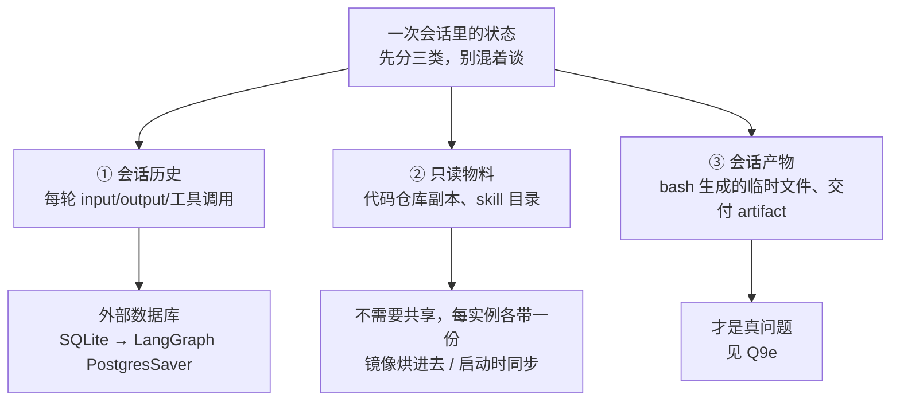
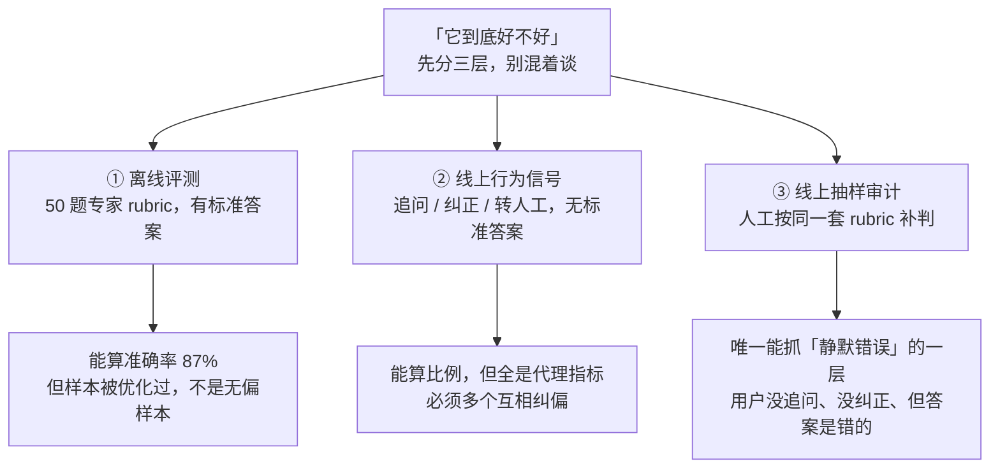

# 字节答疑 Bot（DeerFlow 多 Agent）

> Ground truth：[[字节实习]]。已被深挖：
> - [[公司/星河觉醒/Agent方向/星河觉醒Agent一面_2026-07-20]]（连环 8 问全扛住）
> - [[公司/快手/DataAgent方向/快手数据平台DataAgent一面_2026-07-29]]（追问式，被连否三次）
> - [[公司/字节/中国商业化/字节商业化AgentInfra一面_2026-07-30]]（**Q2d 口径修复生效 ✅**；新增 Q1d 三条构建约束；**但 Q1c / 数字口径两处回滚 🔴**）
> - [[公司/阿里国际/Agent Infra/阿里星一面_2026-08-06]]（**全新追问轴：运行时与平台化 7 连问 → 见 Q9 系列**；Q2「放 prompt 最后面」🔴 第三次复发；Q1c 的 AST 上界又没取出来）
> - [[公司/字节/中国商业化/字节商业化AgentInfra二面_2026-08-06]]（**Q9 轴再考一遍，前半程明显答出增量**——多实例、云端挂载按需下载、限流都自己说出来了；**🔴 断在 Q9g 数据库选型**；新增 Q9g / Q9h；Q6 连接池那题**只讲了止血没讲根治**）
> - [[公司/星河觉醒/Agent方向/星河觉醒Agent二面_2026-08-07]]（**又一条全新追问轴：评测方法论 → 线上度量 7 连问 → 见 Q10 系列**；✅ Q8c 第 3 枪预习生效；新增 Q3b / Q3c / Q4b；**🔴 数字口径一场里说了四组**）
> - [[公司/懂车帝/AIGC创作方向/懂车帝AIGC创作一面_2026-08-10]]（**新增 Q11：agent 之间怎么通信**；✅ Q1f 退出逻辑三种情况一次讲完、Q2c 双层响应机制主动说出；**🔴 全场零数字——56/87/200+/50+ 一个没报，而且这场专门问了评测飞轮**）
>
> 本页是拷打后定稿的口语化回答——**所有数字和说法已统一口径，别再用别的版本**。

## 两分钟口语稿（分层，可按面试节奏截断）

**① 背景（20 秒）**
「TTO 广告平台的业务特别复杂——新旧玩法、各种状态叉乘在一起，运营、产品甚至研发自己都理不清一个用户状态能流转到哪。内部文档常年过期，**只有代码是真的**。所以我们做了一个『看代码回答业务问题』的答疑 Bot，服务 200+ 用户，让产品运营不用再抓研发 oncall。」

**② 核心难点（15 秒）**
「最大的坑是 LLM **以偏概全**：状态 A 明明能到 B 也能到 C，它读了个代码片段就只答 B。我们试过 Claude、Opus 4.8、GLM 5.1，全都这样——模型倾向不读全文件、看到一种情况就下结论。」

**③ 方案三板斧（60 秒）**
「第一板斧是**检索三层漏斗**：ByteRAG 检索业务文档做粗定位——文档旧了不能当答案，但可以当地图；CodeRAG 做语义代码检索，顺手解决中文业务词到英文代码符号的鸿沟，配一份业务语义词表兜底；最后 grep/glob 精确收敛。

第二板斧是**决策树**。业务分叉抽象下来就三类：枚举值 if-else、抽象方法多实现、同语义函数聚集。我做了个 AST 工具直接从语法树提取判断条件，不用读全文件；主 Agent 用工具调用显式把分支写进决策树，每轮**追加到消息列表末尾**——历史 append-only 保住 KV-cache 前缀，这跟 Manus 那篇 Context Engineering 博客的 recitation 模式是一个思路，我们等于做了它的领域化升级：todo.md 是线性清单，决策树带层级和完备性判据。**门禁**是：树上所有分支验证完，才允许进入总结。

第三板斧是**审核 Agent**：拿到决策树 + 答案草稿 + 独立的代码访问权。它有效的原因是两个——主 Agent 被几十轮工具调用稀释了注意力，审核 Agent 拿的是压缩后的结构化输入，做『对着清单核对』这种窄任务；而且它能自己重新读代码取证。发现漏分支就打回重答；发现是用户问题本身歧义（没约束到哪个分支），就**反问用户**框定范围。」

**④ 数据（15 秒）**
「评测集是 50+ 题、专家给标准答案和得分点，AI 按 rubric 判卷踩点。基线是裸 DeerFlow 纯看代码的 56%，上决策树 + 审核 Agent 后到 **87%**。另外我在网关层统一了三家模型的最高强度思考模式，评测上还有约 10 个点的提升。」

## 高频追问 Q&A（已实战验证的答法）

### Q1: 为什么不用 todo/表格，要用树？
- todo 线性、表格二维，都表达不了「玩法→打钱逻辑→币种/税务」的层级枚举；树既是检查清单又是答案骨架
- 演化路径真实：先试 todo 不行 → 表格不行 → 决策树（有取舍过程，面试官吃这个）

### Q1b: 决策树的节点 / 边 / 打分逻辑分别怎么做？（银河一面原题，⚠️ 答题顺序要改）

**铁律：先答「为什么」，最后答「没有的那个」，且「没有」必须讲成「取舍」。** 银河一面开口第一句是「打分我们没有」——弱开局，别再犯。

1. **为什么（先说）**：解决以偏概全。演化 todo → 表格 → 树。
2. **节点**：**一个待验证的分支状态**，带验证标记（未验证/已验证/已排除）。root 是用户问的业务实体（玩法 A），下层是打钱逻辑、再下层币种/税务。由主 Agent 工具调用显式生成，数据来自 AST 提取的判断条件。
3. **边**：**一个具体的分支判断条件**——代码里的一个枚举值、一条 if-else、或状态机的一次转移。所以这棵树是**代码控制流的业务语义投影**，不是凭空设计。（⚠️ 银河一面说的「边没有严格关系」是自我贬低，其实定义清清楚楚。）
4. **打分（刻意没做，讲成取舍）**：经典决策树打分是为**选最优分支/剪枝**；我们要的是**穷尽所有分支**。打分在这里有害——模型会倾向答高分分支、忽略低分的，那正是要治的病。用**验证状态**代替打分，门禁 = 全部已验证才许总结。
5. **（追问）什么时候才需要打分**：分支爆炸到跑不完时引入优先级——但语义是「先验证哪个」的调度顺序，不是「答哪个」的取舍。

### Q1d: 决策树具体怎么构建？（字节 Agent Infra 一面原题，✅ 本页新增素材）

- **root** = 用户 query 里已知的限定条件；之后让 agent 自己根据代码探索分叉
- **只加三条约束，且约束的全是形式、不是内容**——这正是它们能被门禁自动检查的原因：
  1. **每个节点必须是名词**（不能是动词 / 形容词）→ 名词化才可验证，动词短语没法对着代码核对
  2. **每一层必须是同一个种类**（不同类型的枚举值不能混在一层）→ 保证不漏平行分支
  3. **每个节点只能是一个值**（商家有三个子类就必须拆三个节点）→ 不许用模糊表述蒙混
- **节点必填字段**：节点名、分类指标、来源 source file 路径、为什么这样分类的代码依据 → 门禁校验这四项填全才允许输出

### Q1c: 分支特别多，树会爆炸吗？/ 一段代码 100 个分支，怎么保证全覆盖？（🔴 字节那场答成「这是我没做到的地方」）

**铁律：这题有正面答案，不许用「没做到」开局。**

> ⚠️ **2026-08-08 口径订正**：旧写法是「**不是**笛卡尔积」——**这个断言站不住**，面试官只要反问「那代码里写了三层嵌套 if 呢？那不还是组合爆炸？」就没词了，因为嵌套判断在语法树上确实会产生组合。
> **正确说法：笛卡尔积是理论上界，实际会被剪掉几个量级。** 承认上界（诚实，而且那正是面试官心里想的），再给剪枝机制（论证，不是断言）。

1. **笛卡尔积是理论上界，真实可达路径比上界小几个量级**，三条剪枝机制都能在代码里看到：
   - **① 大量组合在代码里根本没有对应路径**——某国家不支持某付款方式，代码里就没这一支，**上界里那个格子是空的**
   - **② 提前 return 把维度整段砍掉**——前置条件不满足直接返回，后面所有维度都不参与组合，**砍掉的是整个子树不是一个格子**
   - **③ 大量分支共用同一条逻辑**——很多国家走同一段代码，差别只在配置。**所以业务涨十倍，代码里的 if-else 不会涨十倍**（与 Q1e 第②点同一口径）
2. **AST 提取的就是剪完之后真实存在的判断条件**——不是去枚举状态空间，是去读代码里到底写了几条路。**所以它天然有界，而且界可计算。**
3. **完备性因此变成一个数字**：AST 提取 N 个条件、树上验证 M 个，覆盖率 = M/N。**这是这个设计最值钱的一点——把完备性从主观感觉变成可算的比例。**

> 🔴 **一个必须自己确认的事实（决定这张牌能不能打）：AST 分支提取在字节是真的实现了，还是只是设计？**
> **真做了** → M/N 是最硬的一张牌，可以反复打。
> **只是设计** → 讲的时候必须说「**我的方案是**」而不是「我们的做法是」，并准备好接「那你现在覆盖率是多少」→ 答「**现在没有这个数，这正是我认为它不够的原因**」。**说成已实现但报不出数，是当场翻车。**
3. **漏在哪要说清**：不漏在「树上有但没验」，漏在 **AST 提取不到的分支**——运行时配置、下游服务返回值决定的路径、反射调用。静态分析拿不到，**兜底是审核 agent 显式提示「这一支我没有代码依据」，把裁决权交给人**，而不是假装覆盖了。
4. 真爆炸才引入优先级调度（见 Q1b 第 5 点）；另有深度限制 + 按 query 剪掉无关子树。
5. **数字收口**：评测集 **87%**，剩下 13% = 问题歧义 + 静态分析盲区。**绝不说「90% 以上」。**

### Q1e: 业务涨十倍，这套还 run 得动吗？（字节原题，⚠️ 那场只答了检索层）

**分三层说它会先在哪里断：**
- **① 检索层——先断，也最好解。** 现在定位代码走关键词匹配（grep 那套），仓库一大召回质量掉得快。换成**基于语法树的结构化检索**：先解析调用图，agent 按调用关系导航而不是按字符串猜，上下文能精简一个量级。
- **② 决策树层——增速远低于业务增速，但不要说「不会爆炸」**（口径同 Q1c，2026-08-08 订正）。**笛卡尔积是理论上界，实际被剪掉几个量级**：没有对应代码路径的组合是空格子、提前 return 砍掉整个子树、大量国家共用同一段逻辑只是配置不同。**所以业务涨十倍，代码里的 if-else 不会涨十倍。** 真跑不完才上深度限制 + 按 query 剪无关子树 + 分支优先级调度（优先级的语义是「先验证哪一支」，不是「答哪一支」）。
- **③ 评测层——反而最先撑不住，也最容易被忽略。** 50 题评测集按当时的业务写的，业务翻倍后覆盖率就掉了，**你会在分数没变的情况下悄悄退化**。所以测试集要从真实流量和代码结构里长出来，不能靠人想。

### Q1f: 门禁在架构上具体怎么实现的？（🆕 银河二面原题，✅ 现场答得好，本页新增素材）

**这是那场最扎实的一段，照这个说法固定下来：**

> 「DeerFlow 本质是**单 agent 的 ReAct 循环**：模型 reasoning 输出 token → 检查是不是工具调用 → 是就调工具、把结果作为下一轮输入；**是纯文本就结束流程、输出最终答案**。
> 扩展点是 **middleware**——在**模型调用前后、工具调用前后**四个位置挂 hook 拦截。
> 我们的门禁挂在『模型生成之后』这个位置：**拦下来校验 LangGraph state 里的决策树在不在、完不完整**；不完整就**合成一条提醒消息塞回消息列表**（形式跟工具返回一样），让它下一轮继续补树。」

**加一句把机制拔到设计层（现场没说，必须补）：**
> **「这么做的本质是：把 agent 的停止条件从『模型觉得答完了』改成『决策树上所有分支都验证完了』。普通 ReAct 循环的退出条件握在模型手里，我们把它挪到了框架手里。」**

### Q1g: 这方案听起来比较 SOP，为什么不用 workflow 做？（🆕 银河二面原题，🔴 现场答案顺序反了）

🔴 **现场开局是「主要是架构的问题，我们拿到 DeerFlow 时它就已经是单 agent 了」——历史包袱开局，听起来像「没得选」而不是「选了」。真正的理由被放到了第二位。**

**定稿（理由前置）：**
> 「**关键是：分支的数量和顺序，在运行前不知道。**
> workflow 是一张**编译期就确定的静态图**——你得先知道有哪些节点、怎么连。但**决策树上有几个分支、长什么样，完全由用户问的问题牵扯到哪几段代码决定**，是运行时 AST 提取出来才知道的，没法提前画成图。
> **所以我选的是『动态循环 + 静态门禁』**：路径让模型自己走，但**退出条件写死在框架里**。**要的是 workflow 的确定性，但只把确定性加在退出条件上，不加在路径上。**
> **不过有一段确实是 workflow，而且我们本来就那么做的**：『主 agent 生成答案 → 审核 agent 复查 → 打回或放行』节点固定、流转确定。**所以准确说是混合的：探索阶段是 agent，交付阶段是 workflow。**」

### Q1h: 把这套流程做成一个 skill 给 Claude Code / Codex，它们能做吗？（🆕 银河二面原题，✅ Q8c 第 3 枪预习生效）

✅ **现场自己讲出了「单纯 prompt 的形式就还太软了」——这正是 Q8c 预警的「那不叫门禁叫祈祷」。保持。**

**定稿（把「能不能」拆成分档，比一句「不一定能」强得多）：**

| 层 | 能做到什么 | 结论 |
|---|---|---|
| **① prompt / skill 层** | 往上下文里塞一段说明 | ❌ **做不到**——实测**同一个 prompt，模型不是每轮都会调用决策树工具** |
| **② 工具调用约束层** | `tool_choice` 强制本轮调某工具；Claude Code 的 **PostToolUse hook**（工具调用完成后触发的拦截钩子，能检查结果并把信息回注给模型） | ⚠️ **部分**——能做到「调用了就检查」，做不到「不调用就不许往下走」 |
| **③ 循环控制层** | 在**模型每轮输出之后**拦截，检查 state 里决策树完不完整，不完整就合成消息塞回去 | ✅ **我们在这一层**，**等于改写了 agent 的停止条件** |

> **收口一句：skill 能给它知识，给不了它约束。**

<!-- 来源: Claude Code hooks 官方文档（PostToolUse 语义）・ 查证于 2026-08-08 ・ ③ 是我们项目的实现，①② 是通用能力分档 -->

### Q2: 决策树和 prompt cache 不冲突吗？🔴 高危——**三场**面试都说过「放 prompt 最后面」，点点互动和阿里星两场都在同一场里讲了 prompt cache 前缀匹配，**面试官把两段一连就是当场打脸**

> 🔴 **2026-08-06 阿里星一面第三次复发，且是三次里最凶险的一次**：第 18 分钟说「决策树放 prompt 最后面，既保证 prompt cache 也做强提醒」，第 31 分钟又完整讲了「prompt cache 按前缀匹配复用已算好的结果」。**两段隔了 13 分钟，没被连上纯属运气。**
> **改口不是措辞问题，是自洽问题**——只要还说「放 prompt 最后面」，你自己讲的 cache 原理就在反驳你自己。

- **树不在 system prompt 里**（银河 + 点点互动 + 阿里星三次口误说成"prompt 最后面"，必须改口）：每轮**追加到消息列表末尾**，渲染顺序 tools→system→messages，**system 和历史不动 = 前缀稳定 = cache 照常命中**，新树在断点之后本就不参与缓存
- **旧树快照 append-only，实际不清理**（⚠️ 别说"compaction 顺带清"，那是建议不是事实）
- 追问「不清理 context 不会爆吗」→ 「会涨，两道防线：树本身有界（节点来自 AST 提取的**真实**分支，不是笛卡尔积穷举）；长任务触发 compaction 时旧快照会被压掉。目前问答长度还没到需要专门清理的程度，**要优化的话在 compaction 时机顺带清是零额外成本**——那时 cache 本来就要重建」
- 出处：Manus《Context Engineering for AI Agents》——append-only 保 KV-cache（实测 10 倍成本差）+ recitation 对抗 lost-in-the-middle

**为什么必须 append-only（机制，被追问时展开）**

**KV-cache**（键值缓存）：注意力里每个 token 都要算一组 Key/Value 向量，算过就能存下复用——**前缀不变就不用重算**。而**因果注意力**（每个 token 只看得见它前面的）决定了**位置 i 的 KV 只依赖 0~i 这段前缀**。推论很硬：

> Manus 原文：**even a single-token difference can invalidate the cache from that token onward.**
> 成本差：Claude Sonnet 缓存 token $0.30/MTok vs 未缓存 $3/MTok，**10 倍**。

所以「树塞进 system」= 每轮改 system → **它后面整段 messages 全部失效** → 几乎全量重算。
「追加到 messages 末尾」= tools + system + 历史 messages **一个 token 没动** → 前缀全命中。

**而且追加到末尾是白赚两个收益，不是妥协**：① cache 全命中 ② **recitation**（Manus 起的名字——把全局计划反复重写到上下文末尾，**刻意的注意力操纵**，把它推进模型最近的注意力范围；他们用 `todo.md` 干这事）。
> ⭐ **「放 prompt 最后面 attention 比较好」这句直觉本来是对的，错在把 messages 末尾说成了 prompt 末尾，才和自己讲的 cache 原理打架。**

**压缩：Manus 2026 把它拆成了两件不同的事（比"压缩"这个词精确得多）**

| | **Compaction 可逆压缩** | **Summarization 不可逆摘要** |
|---|---|---|
| 做什么 | **去掉能从外部状态重建的字段**（写文件操作，文件已落盘 → 丢掉 `content` 只留 `path`，要看重新读） | 按 schema 生成结构化摘要 |
| 可恢复 | ✅ 完全可恢复，Manus 报 **100:1** 压缩比 | ❌ 丢了就是丢了 |
| 何时用 | **默认一直用** | **compaction 收益递减后才用** |

> **核心判据：压缩的第一问不是「压多少」，是「压完还能不能还原」。** 我们做的 offload 到磁盘就是 compaction。

**两条实操细节（别人想不到，值得说）**：① **最近几轮工具调用保留原始格式**——压成摘要模型连输出格式都会飘；② **错误堆栈绝对不压**——直觉上报错是垃圾该删，但它是模型唯一的负反馈来源，删了会一遍遍犯同一个错。
<!-- 来源: Manus 官方博客 + 2026 compaction/summarization 更新 ・ 查证于 2026-07-30 -->

**同题出处**：[[公司/阿里国际/Agent Infra/阿里星一面_2026-08-06]] §7（定稿版）· [[公司/快手/DataAgent方向/快手数据平台DataAgent一面_2026-07-29]] Q5（答得散的那版）

### Q2b: review agent 和主 agent 用相同 / 不同模型各有什么优势？🔴 点点互动答偏了

⚠️ **面试官问的是「相同 vs 不同」，我答成了「强 vs 弱」（成本、token 1:1 vs 2:1、user friendly）——换了维度等于没回答。**

**定稿（全部用自己的实证）：**
> **① 先掰开维度**：「这里有两个正交维度：**模型强弱**和**是否同源**。强弱影响成本和首答质量，同源与否影响的是**错误模式是否独立**——我先说后者，那是 review 机制成立的根本。」
>
> **② 换模型能不能解决问题——实测过**：比过 GPT / Gemini / GLM 做主 agent，也试过 Claude Code + Opus 4.8。**模型之间在探索充分度上确实有差异**（GPT 最容易早停，GLM 5.1 最倾向多调工具，所以主 agent 选 GLM），**但即使最强的模型也会偷懒、以偏概全**。→ **模型选型能改善，但解决不了；真正解决它的是结构约束（决策树强制列全）**。
> ⚠️ 别说成「和模型关系不大」——同场说过 GPT 最差、GLM 最好，会被抓自相矛盾。
>
> **③ 为什么 review 用同模型（关键论证）**：「取决于它抓哪类错误。我们 review 抓的是事实性错误——张冠李戴，把 A 链路的状态流转安到 B 上。**关键观察：这类错误只要被提醒，模型立刻就能改对。** 说明**不是模型不知道，是几十轮探索后没注意到**——**是注意力问题不是能力问题。病因是注意力，对症的是换 context 不是换模型**（新模型同样会失焦，还得重读代码，成本翻倍收益不明）。」
>
> **④ 什么时候我会换模型（显判断力）**：「如果 bad case 显示是**模型系统性偏差**——提醒了也改不过来那种。我们碰到过边缘案例：**玩法 A 没进业务文档，模型会一直挑一个 A 开头的变量当成它，用户怎么纠正都改不过来**。这种同源 review 兜不住，但根因是知识缺失不是模型差异，所以解法是补文档。」
>
> **⑤ 不同模型的理论优势（要知道但不是我们的选择）**：**相关性失败（correlated failure）**——同模型同训练数据同盲区，审自己的输出容易重复同一错误、且倾向认可相同的推理路径；换厂商模型错误模式独立。代价是 prompt 两套、协议适配两套、评测跑两遍、行为不一致难 debug。

### Q2c: review agent 有什么缺点？（点点互动只答了「时长翻倍」，防守不全）

**① 先讲双层响应机制**（这一层证明按错误严重性做了分级，也化解「review 误判」这一刀）：
> 「响应分两级：**事实性错误**（A 到 B 链路根本不存在）→ **直接打回重新生成**，硬错不能给用户；**完备性遗漏**（某分支没讲到）→ **不重生成，只反问用户**『是不是还要考虑某某情况』，**裁决权交给用户**。
> 好处是 **review 误判的代价被限制住**——把对的判成漏了，最坏只是用户被多问一句，不会出现『判错→打回→改坏答案』。」

**② 缺点一：时长翻倍**（同思考强度模型、两边都要读代码探索，用户要等审核完才能追问）

**③ 缺点二：假阳性——过度扩张选择范围（真正最大的问题）**
> 「表现是：某些前置条件下一部分分支已被剪掉、主 agent 是有意识排除的，但 review 会持续反问『还有这些情况没考虑』。
> **根因不在模型，在我传给它的信息不完整**——决策树节点**有验证状态，但没有『已排除』状态**，剪枝是 agent 在推理里自己判断的，**没落到树的数据结构上**。review 看到『树上有这支、答案里没有』，只能判成遗漏。
> **修法：给节点加状态**——未验证 / 已验证成立 / **已排除（必须附排除依据：是哪个条件把它剪掉的）**。这样 review 的职责收窄也更有价值：**从『你怎么没讲这一支』升级成『你凭什么排除这一支』**——后者才是真正容易错的地方。」

**④ 假阴性很少**（review 一般都能发现缺漏）；**准确率 87% 来自 50 题精标评测集，不是 review 通过率**，两者独立

**⑤ 谁 review the reviewer**：「没有，这是有意为之——**再加一层边际收益快速衰减、延迟线性增长**。最后一层兜底交给用户：答案按决策树分支结构输出，**少了哪一支用户看得出来**，追问即触发新一轮完整回答。」

### Q2d: review agent 到底读不读代码？（✅ 口径已修复并在字节那场实战验证）

- 银河说「自己重新读代码验证」，点点互动说「只提供单一的骨架」——**后者漏了半句**
- **统一说法**：「拿到的是**干净的初始上下文 + 决策树 + 答案草稿**，**但保留代码读取权限**——不继承主 agent 那几十轮探索的上下文，要验证哪段自己去读哪段。所以它有两种能力：**结构上**对树查完备性、**事实上**回代码验证链路。**关键不是能不能读代码，是带着干净上下文去读。**」
- 逻辑自洽性：**只给骨架不读代码，就不可能发现「A→B 链路不存在」这类事实错误**，那「事实错误打回重生成」的机制会被当场戳穿

### Q3: 为什么不无限跑？/「运行越久越准」怎么解释？
- 跑得久是相关性不是因果。核心是**把停止条件显式化**：普通 agent 停止条件 =「模型觉得答完了」；我们的门禁 =「所有分支验证完才允许总结」
- 步数预算全花在未验证分支上，「跑得久」转化为「覆盖得全」，树穷尽自然停；harness 加最大步数上限 + 审核兜底

### Q4: 剩下 13% 错在哪？怎么兜底？
- 两类：①漏答（A 条件下 BCD，漏了不成立的 CD 没说明）②问题本身歧义导致理解跑偏
- 歧义类 → 审核 Agent 反问用户框定范围（设计动机就来自这类 bad case）
- 漏答类 → 不自动重试：答案按树分支结构输出，**用户可感知**少了哪支，追问即触发新一轮完整回答——最后一层兜底留给人

### Q5: AI 判卷不可靠怎么办？
- rubric 锚定：得分点是专家定的，AI 只做踩点匹配、不做主观评价，比自由式 LLM-as-judge 可靠
- 飞轮里还有人工环节：每次问答沉淀专家评价 + 每周评审周报过 bad case

### Q6: httpx Event-loop-closed 生产 bug ⭐ 两场都被问，定稿版

> ⚠️ **口径变更**：早期笔记写的修复是「per-loop client」，**已作废**。你的场景连接池是全局唯一的，per-loop 分池不适用（还会有旧 client 泄漏）。**定稿方案是 ①关闭连接复用（止血）+ ⑥日志独立 loop（根治）。**
> 点点互动当场答的「不让它关掉事件循环」方向对但太虚，接不住「具体怎么不让它关」。
> 机制/方案全表见 [[Python并发与GIL]] §10。

**【30 秒版】**（大部分场合够用）
> 「线上偶发 `RuntimeError: Event loop is closed`，重启后好一阵，难稳定复现。
> 根因是**两个框架对事件循环的所有权认知不一致**：LangGraph 复用一个全局连接池，而我们二次开发引入的字节内部日志 SDK，每次日志处理结束会把事件循环关掉。**连接池对此毫无感知**——下个请求进来，从池里捞出的连接绑定的是已关闭的 loop，一操作就炸。
> 修复两件事：**止血**是关掉连接复用，池里不留连接就不会捞到废连接；**根治**是给日志 SDK 一个独立的常驻 loop，让它碰不到主 loop。」

**【2 分钟版】五段**

**① 现象（15s）**——偶发、重启后好一阵、稳定复现不了。
> **「这个特征本身就是线索：说明不是每条路径都错，而是某种被复用的东西坏了。」**

**② 定位三步（30s，最能体现工程能力）**
> 「**看堆栈**——炸点不在业务代码，在 httpx 连接池取连接那层 → 说明出事的是**被复用的连接对象**，不是当次请求。
> **打 loop id**——在建连接处和报错处分别打 `id(asyncio.get_running_loop())`，发现不是同一个，且建连接那个已关闭。
> **最小复现**——全局 `AsyncClient` + 连续两次 `asyncio.run()`，**第二次必炸**。到这根因就锁定了。」
> 🔧 补刀工具：patch `asyncio.BaseEventLoop.close` 打调用栈，一次就知道是谁在哪行关的。

**③ 机制（30s，深度全在这段）**
> 「**OS 层面连接就是个 fd，属于进程不属于任何 loop——绑定是 asyncio 造出来的。** 你拿到的不是裸 fd 是 **transport**：它**持有创建它的那个 loop 的引用**，fd 注册在**那个 loop 的 epoll** 上。之后每次读写都在调那个 loop 的 `create_future`/`add_reader`——**loop 一关，第一行就抛 Event loop is closed。**
> 而 **httpx 连接池并不知道每条连接是哪个 loop 建的**，它就是个容器。
> **所以一句话：连接池的生命周期比 event loop 长，但池里的连接绑死在 loop 上。**
> 这也解释了**为什么偶发**（池空时新建的连接没事，捞到旧连接才炸）和**为什么难查**（雷是关 loop 时埋的，炸是下次复用时炸的，位置隔很远）。」

**④ 方案空间 + 选择（40s）**
> 「解法可以在四个层面拦：**连接池层**（按 loop 分池 / 借出前校验 loop 存活，就是数据库连接池的 test-on-borrow）、**事件循环层**（保护主 loop 不被关 / 收敛成单一常驻 loop）、**依赖层**（改日志 SDK 的错误行为）、**最简单那层——干脆不复用连接**。
> **我们选的是「关掉连接复用」止血 +「给日志独立 loop」根治。**
> **关连接复用之前我算过账**：我们调的是**内网网关**不是公网 API，一次 TCP+TLS 握手大概 **2~5 毫秒**；一次 LLM 调用是**秒级**的还开了最高思考强度——**握手占整体延迟不到千分之一**。端口方面调用是串行的、QPS 只有几十，稳态 TIME_WAIT 占几百个端口，离两万八的上限差一个数量级。
> **相比之下其他方案的复杂度都是为了保住一个不到 0.1% 的收益**：按 loop 分池要维护弱引用字典还会 client 泄漏；连接级校验要子类化 httpcore 内部 API，版本一升就崩；patch `loop.close` 是改标准库行为。**不划算。**
> **所以我的判断是：这里正确的做法不是把连接池做得更聪明，而是意识到我们根本不需要连接池。」**

**⑤ 为什么还要根治那一半（15s）**
> 「关连接复用只是**止血**——**日志框架关闭一个它不拥有的 loop，这个缺陷还在**，以后会以别的形式咬我们，比如别的用了 asyncio 资源的库。所以同时做了隔离：**给日志一个跑在守护线程里的专属常驻 loop**，异步调用用 `run_coroutine_threadsafe` 提交过去。它关不关都碰不到主 loop，**顺带把日志变成非阻塞的**。」

**⑥ 教训收尾（15s）**
> 「两条：**异步系统里『谁拥有 event loop』必须明确——谁创建谁关闭，使用者只能用不能关**；`asyncio.get_event_loop()` 拿到的永远不要 close，它很可能不是你的。**二是报错位置往往不是埋雷位置**，debug 要追对象生命周期。
> 后来补了条回归测试：**连续两次 `asyncio.run()` 共用同一个 client 入口，修复前必炸**。这类 bug 只有『用完关掉再起一个』这种**状态序列**才测得出来。」

**方案对比（被问「还有别的方案吗」时展开，全表见 [[Python并发与GIL]] §10.4）**

| # | 方案 | 代价 | 结论 |
|---|---|---|---|
| **①** | 关闭连接复用 `max_keepalive_connections=0` | 内网握手 2~5ms | ✅ 选了，零侵入 |
| **⑥** | 日志独立常驻 loop + `run_coroutine_threadsafe` | 改日志调用方式 | ✅ 也做了，根治 |
| ② | per-loop client（弱引用字典分池） | 复用率降 + **旧 client socket 泄漏** | 池唯一，不适用 |
| ③ | 连接级 test-on-borrow（子类化 httpcore） | 碰内部 API，版本脆弱 | 复杂度不匹配收益 |
| ④ | 池级 loop 守卫（transport 层整池重建） | 误伤好连接 | 备选 |
| ⑤ | patch `loop.close` | 改标准库行为 | 只能临时止血 |

**预备追问**
- **「不复用连接端口不会耗尽？」**→ 稳态占用 ≈ **QPS × 60 秒**，本地端口约 28000 个；串行调用 QPS 几十 → 占几百个，差一个数量级。**「如果哪天变成高并发批量推理，这个决定要重新评估」**（← 这句必须说，证明是有前提的取舍不是拍脑袋省事）
- **「为什么不干脆每次新建 client？」**→ 也行，只多几毫秒对象创建。**如果关 keep-alive 后还偶发报错**（说明池对象本身也持有 loop 状态），就退到每请求新建 client。
- **「连接为什么不能迁移到新 loop？」**→ fd 理论上能重注册，但 transport 里挂着**未完成 Future / TLS 握手状态 / 读写缓冲**，都跟旧 loop 调度绑死，httpx/anyio 也没暴露迁移接口。**工程结论：连接池不能跨 loop 共享。**

> 💡 **这题的加分点不在「我修好了」，在「我算过账所以选了最笨的方案」——知道什么时候不该优化，比会优化更难。但必须先给出数字，否则听起来就是偷懒。**

### Q7: 统一思考模式的工程量在哪？

> 📖 **协议差异的完整六层已独立成篇 → [[LLM多协议网关适配]]**（消息结构 / 工具协议 / 思考回传 / 流式 / 计量 / 缓存，含各家字段名与踩坑点，2026-07-30 查证）。**本条只留项目视角的部分。**
>
> ⭐ **补一条从自己实测里长出来的判断（面试里比背参数值有价值）**：
> **协议形状 ≠ 后端约束。** 我们网关里 GLM 走的是 Anthropic 协议但它不是 Claude——Claude 在 extended thinking 下不接受 `temperature`/`top_p`/`top_k` 修改、也不允许强制工具调用，**同样走 Anthropic 协议的 GLM 完全不管这套**。
> 约束要按来源分三类：**协议层**（JSON 结构、必填字段，谁走这协议都得守）/ **服务端层**（厂商网关的校验规则）/ **模型层**（模型自身能力）。
> **→ 能力表按「模型 × 能力」维护，不按协议维护。** 这条现在更重要：**Anthropic 已废弃 extended thinking，4.7 以后的模型直接 400 拒绝 `budget_tokens`**，能力表按协议写死的话升个模型网关就崩。
- 三家参数抽象不同只是表面；真正的脏活是**思考上下文在多轮工具调用中的回传**：
  - Gemini：thought signature（加密表示），无状态模式必须原样回传所有思考块，否则推理链断
  - Anthropic：thinking 块带 signature，同模型续轮必须完整回传，篡改直接 400
  - OpenAI：reasoning items（`encrypted_content` 供无状态回放），官方强烈建议函数调用续轮回传
- 统一抽象：三家本质要求一样——思考上下文必须保留并回传，载体不同；网关给每家实现正确回传语义，业务方只看到一个开关
- 「是否真在思考」探针分家：OpenAI 断言 `usage.output_tokens_details.reasoning_tokens > 0`、Gemini 断言思考 token 计数 > 0（计费口径骗不了）；**Anthropic 没有独立计数器**，断言响应存在 thinking 块（注意新模型默认 display omitted，块在文本空）

### Q8b: 「只有代码是真相」，可你定位代码靠的是人工维护的知识库文档——这套系统的正确性上限是不是被一份文档卡住了？

⚠️ **点点互动答的是「文档只是提示、只做引路」——框架对，但低估了路由错误的后果，接不住下面这一刀：**
> 「引路引错了，答案就一定错——而且**错得很自信**。玩法 A 没进文档 → agent 挑一个 A 开头的变量 → 基于**错误的代码**生成一个『有代码依据』的答案。这不比『找不到』更危险吗？」

**定稿框架（背这句）：代码决定精度，文档决定召回。**
> 「文档不参与生成答案，答案完全来自代码——这点没变。**但文档决定了 agent 去读哪段代码**。所以准确说法是：**代码是唯一事实来源，文档是检索入口**；入口错了，事实来源就取错了，agent 依然会给出『有代码依据』的答案，**只是依据了错的那段代码**。
> 两者**失败模式不同**：代码过期给出过期的事实（**可检测**）；**文档缺失导致静默的路由错误（不可检测）**——后者更危险。」

**三条防线（我们做到了第一条）：**
1. **把路由假设显式化**（最重要）——答案必须写明「我理解玩法 A 对应变量 X / 模块 Y，依据是 Z」。**假设写出来，用户一眼能看出路由错了并纠正**；现在 agent 把假设藏在推理里，用户只看到结论，所以纠正不动
2. **找不到就拒答，不许猜**——宁可回「业务词表里没有玩法 A，请补充它对应的代码标识」，也不给自信的错答案
3. **词表覆盖率反哺**——统计用户问题中出现、词表里没有的业务名词，**这个列表就是文档维护的优先级队列**，让文档被真实流量驱动而不是靠同事想起来

**收尾金句（把两个设计统一到一个原则）：**
> 「这个问题和决策树解决的是**同一件事：模型把关键假设藏在推理里没说出来。** 决策树解决『它假设某些分支不用考虑但没说』，路由问题是『它假设玩法 A 就是变量 X 也没说』——**两个都是同一个修法：把隐含假设变成显式的、可检查的输出。**」

### Q8c: 还没被问但迟早会问的三枪（预习）
1. **代码快照时效性**——「只有代码是真相」，那 agent 读的是**哪个版本**的代码？40 个仓库怎么同步？读到三天前的 checkout 怎么办？**这一枪直接打在核心主张上**
2. **「20 个问题触发 1 次」的分母**——是评测集的 20 题还是线上真实 20 个问题？**评测集是被优化过的数据，触发率会失真**
3. **决策树「强制调用」的实现**——`tool_choice` 强制？还是生成后检查未调用则打回？**如果只是 prompt 里写「你必须先调用」，那不叫门禁叫祈祷**

### Q8: 实时标签/配置怎么办？
- 权限分工：美国组的 agent 有权限查用户标签/config，先查到具体状态再调用我们（tool 形式，传用户 ID+状态+问题）；我们只负责从代码找原因

---

## Q9 系列：运行时与平台化（🆕 2026-08-06 阿里星一面开辟的全新追问轴）

> 🔴 **投 infra / 平台 / 中台岗必背。** 这一轴之前四场面试一次都没出现过，阿里星那场**连着问了 7 题、占了半小时**，链路走到第 7 题断了。
> **触发信号**：面试官问「你这个是微服务还是沙箱」「支持集群部署吗」——**从这一秒起，他问的已经不是你的项目，是「你的单机 demo 能不能变成多租户平台」。**

### Q9 总纲：先拆状态，再谈扩展（所有子题的公共前置）

**混在一起谈就必然卡住。一次会话里的状态分三类，解法完全不同：**

> 💡 **②「只读物料不需要共享」这条最容易漏，但说出来最能证明你分得清。** 很多人会连代码仓库一起塞共享存储——那是白付一份 NAS 元数据开销。

### Q9a: 你这个 agent 的运行时是什么架构？微服务还是沙箱里跑？

🔴 **阿里星那场答的「我们做了沙箱，工具调用时把抽象路径前缀匹配替换成真实路径」——那不是沙箱，是路径改写。** agent 手上有 bash，一个绝对路径就绕过去了。**在做 agent infra 的面试官面前，这个词用错代价很大。**

**定稿（把隔离强度分档，并给出选最弱那档的理由）：**

| 档 | 手段 | 挡得住什么 |
|---|---|---|
| 0 | 工具层路径改写（**我们现在这档**） | 只挡"看到"，挡不住"访问" |
| 1 | `chroot` / Linux namespace（内核提供的资源视图隔离，让进程只看得见指定的文件系统和进程列表） | 文件系统越界 |
| 2 | 容器 + seccomp（限制进程能调哪些系统调用的内核机制） | 绝大多数越权，但共享内核 |
| 3 | **gVisor**（用户态重实现一层内核接口，系统调用打到它这不打宿主内核）/ **microVM**（每沙箱一个独立内核的轻量虚拟机，代表 Firecracker） | 内核逃逸 |

> 「**我们选第 0 档是有理由的，不是没想过**：内部工具、用户是本公司产品运营和研发、代码仓库对他们本来就有权限、agent 只读不写。这个前提下隔离的目标不是防恶意，是防误伤——防它 grep 范围扩到整台机把负载打满。
> **但要做成对外平台，这一档立刻不够**，因为前提全变了：用户不可信、agent 可能被提示注入诱导。那时必须直接上第 3 档——每 session 一个独立沙箱，bash 走 RPC 打进去，agent 进程不碰宿主文件系统。」

### Q9b: 支持集群部署吗？

🔴 **阿里星那场用「我们是内部的，没有特别考虑可用性」开局——「没有」必须讲成「取舍」，这是本页 Q1b 就写死的铁律。**

> 「现在是单实例单进程，**这是明确的取舍**。200+ 内部用户、飞书异步消息、峰值是上班时间零星并发——单进程吞吐远远够用；而多实例立刻带来三个真问题：会话状态往哪放、工作区往哪放、长任务在滚动发布时怎么办。**在用户量涨十倍之前，解决成本高于收益。**
> 但架构上留了口子：**它前面本来就有一层网关**——这套框架不只对接飞书也能对接 Slack，消息接入天然是独立 adapter。**那一层就是扩展点。**」

### Q9c: 那 SLA 怎么保障？重启过程中服务不掉？

⚠️ **这题问的是「在途任务会不会断」，不是「能不能扩容」——阿里星那场答成了后者。**

**agent 服务的重启比普通服务难，难在长任务上（一次问答几十轮工具调用、几分钟）。三层：**

1. **优雅停机**——收到 `SIGTERM`（操作系统发的"请你自己退出"信号，可捕获、可善后，区别于 `SIGKILL`）后先摘流量、不接新会话，等在途任务跑完再退。K8s 上是 `terminationGracePeriodSeconds`
2. **超过宽限期靠断点续跑**——LangGraph 的 checkpointer 每个节点执行完落库，新实例按 `thread_id` 从最后一个 checkpoint 继续。**前提是 checkpoint 在外部数据库，不是本地文件**
3. **⭐ 用户侧感知，这层是最大优势**——飞书 bot 是**异步消息**不是同步 HTTP，用户发完就去干别的了。**所以可用性目标可以定成「消息不丢」而不是「请求不失败」**，比同步接口宽松一个量级：网关收到消息先落队列再 ack，实例挂了消息还在队列里

> **收口一句：同步接口的可用性靠冗余实例，异步 bot 的可用性靠消息队列加断点续跑。我们选后者，因为交互形态本来就允许。**

### Q9d: 多用户 session 怎么隔离？工作区按用户还是按 session 隔离？

**第一问答对了**：LangGraph 自带的 `thread_id`，一个飞书话题对应一个 id。

🔴 **第二问答崩了，而且是答得很自信的那种崩——比答不出来更危险。** 阿里星那场答「按 session 隔离，没做 user level，你只要在那个话题里聊天机器人都能拿到所有上下文」。**面试官问的是多租户，答的是会话作用域。**

**必须拆成两层：**

| 层 | 问题 | 我们的现状 |
|---|---|---|
| **数据可见性** | 谁能看到这次对话的内容 | ✅ 按 session 就够——飞书话题本身就是天然可见范围，agent 的回答跟别人发的消息同一等级，**没有额外放大** |
| **执行权限** | agent 代表**谁**去读代码 | ❌ **有缺口**——用的是自己的服务账号，不是提问人的身份 |

> 「第二层展开说：**任何能进话题的人，都能通过提问间接读到服务账号能读的全部代码，而系统没检查提问人自己有没有那个仓库的权限。** 这类问题有正式名字叫 **confused deputy（混淆代理人）**——一个高权限程序被低权限的人诱导着做了它有权、但请求者无权的事。
> 内部工具、只读、仓库对研发本来就开放，所以现在风险可控。**但这个设计撑不到平台化**——跨团队用的话，A 团队的人就能问出 B 团队的代码。
> **正确做法是把发起人身份透传到工具层做鉴权**：网关带上发起人 uid，agent 调 grep / 读文件时用**发起人的权限**而不是服务账号的权限，**查不到要明确告诉模型「这一支你无权访问」，不能静默跳过**——静默跳过会导致决策树漏分支，而且答案看不出来是漏的。做对了隔离粒度自然变成 session × user 两维。」

### Q9e: 🔴 多实例下，bash 生成的中间产物 / 交付 artifact 怎么共享？（**阿里星那场的分水岭，答的是「确实没有思考过」**）

**先做 Q9 总纲那个三分类，然后只谈第 ③ 类。三条路按改动成本排：**

| 方案 | 怎么做 | 代价 |
|---|---|---|
| **会话亲和（sticky session）** | 网关按 `session_id` 一致性哈希，同会话永远路由到同一实例，产物留本地盘 | 那台机挂了产物就没了；扩缩容哈希环变动会重新分片。**适合产物是纯中间态、丢了能重跑的场景** |
| **共享文件系统** | NAS 挂到所有实例同一路径；K8s 上是 `ReadWriteMany` 的 PVC（PVC = 持久卷声明；ReadWriteMany = 允许多个 Pod 同时读写同一份卷） | **改动最小，agent 看到的路径完全不变。** 但 NAS 的元数据操作（大量小文件 open/stat）比本地盘慢一个量级，**而 agent 干的恰好是大量小文件读写** |
| **对象存储 + 会话工作区** | 产物落 OSS/S3，key 用 `session_id/文件名` | 最干净最能扛。但 **POSIX 语义（`seek` 定位、追加写、`rename` 原子改名）对象存储给不了**，bash 工具层要封装成"下载→改→上传" |

**⭐ 真正的工业界做法：把工作区从进程里拆出去做成沙箱服务。**

> 「上面三条都是在『agent 进程持有工作区』这个前提下打补丁，**这个前提本身可以拆掉。** 每个 session 分配一个远端沙箱，bash 走 RPC 打进去跑——**agent 进程彻底无状态**，任何实例接任何会话都行，产物跟着沙箱走。
> **而且它顺带解决了 Q9a 那个『我们那个不是真沙箱』的问题**——隔离和产物可迁移本来就是同一件事的两面。
> 现成的：阿里云 ACS 的 Agent Sandbox 是 MicroVM 级隔离，支持**内存级休眠唤醒**和 checkpoint 克隆（会话闲置时把沙箱冻住不占算力，用户回来再唤醒——**这个特性对 agent 特别关键，因为 agent 会话的空闲时间远长于活跃时间**），兼容 E2B SDK；E2B 自己是 Firecracker microVM。」

<!-- 来源: 阿里云 ACS Agent Sandbox 官方文档 + E2B 公开文档 ・ 查证于 2026-08-06 ・ ⚠️ 沙箱服务这段是业界通行做法，不是我们项目里已有的东西，讲的时候必须区分清楚 -->

**收口（这一整轴的定稿句）：**

> **「无状态」不是把状态删掉，是把状态从进程内存挪到进程外部，然后按状态的性质分别选存储：历史进数据库，产物进沙箱或对象存储，只读物料每实例自带一份。**

顺带一个必然遇到的坑：**产物要有生命周期**——会话结束或超时后沙箱销毁、对象存储 key 设过期，否则这部分存储只增不减。**单实例时代完全看不出来**（本地盘满了有人喊），上了对象存储之后没人喊，只有账单会涨。

### Q9f: 会话历史怎么持久化？（🔴 这题答完要主动点破它就是扩展瓶颈）

**现状答对了**：SQLite，每 turn 一条，存 input / output / 思考 / 工具调用 / 工具返回，按 `thread_id` 恢复。

🔴 **但阿里星那场没意识到：SQLite 是本地单文件数据库，跟进程绑死在一台机器上——它就是 Q9b「能不能集群部署」的第一个硬卡点，而且是自己亲手交出来的答案。主动点破比被追问出来强得多。**

> 「**我主动说一句：SQLite 跟进程绑死在一台机器上，这是我们水平扩展的第一个卡点，而且是我有意接受的。** 单实例下它有实打实的好处：零运维、事务完整、本地读没有网络往返。
> **要多实例第一件事就是换掉它。** LangGraph 官方有 `PostgresSaver`，多个 worker 读写同一份 checkpoint 表，任何实例都能接任何 thread——**换完之后 agent 进程对『会话历史』就彻底无状态了。**
> 但换完只解决了历史，**还有两样没跟着走：会话产生的文件，和长任务的执行位置。那两个才是真麻烦。**」

<!-- 来源: LangGraph 官方 persistence 文档 ・ 查证于 2026-08-06 -->

### Q9g: 那你要放到外置数据库，打算用哪个？（🔴 字节二面断在这里，答成「这个确实没有考虑过」）

🔴 **他当场的推理是「写多读少 + 事务要求不高 → 写性能好、一致性弱的数据库」——这是八股式推理，跳过了唯一重要的一步：算数量级。**

**定稿三段：先算量级 → 给答案 → 说什么时候才需要换**

> 「**先算一下，因为这决定了要不要认真选型。**
> 写入量 = 并发会话数 × 每轮节点数。1-2 万人的内部工具，**同时在跑的会话撑死几十个**；一次问答二三十轮工具调用、耗时几分钟，**平均每秒也就几十次写**。**这个量级任何关系型数据库都随手接住，所以这里不该做性能选型，该做省事选型。**
>
> **所以选 PostgreSQL**——**LangGraph 官方就有 `PostgresSaver`，换掉 SQLite 只是换一个连接串**，我不用自己设计表结构和恢复逻辑；checkpoint 是半结构化的状态快照，**用 JSONB 正合适**。
>
> **访问模式确实写多读少，但更准确的说法是：顺序追加写 + 按主键点查。** 每个节点执行完追加一条，读只在会话恢复时按 `thread_id` 取最后一个 checkpoint——**没有范围扫描、没有复杂 join、没有跨行事务。正因为模式这么简单，选型自由度很大，那就该选运维成本最低的那个。**
>
> **什么时候才需要换**：写入真成瓶颈时，第一步不是换数据库，是**减少写入次数**——不是每个节点都落盘，改成按边界落（比如每个工具调用批次结束落一次）。**先降写放大，再考虑换存储引擎。**」

### Q9h: 实例挂了，内存里的东西就丢了吗？（✅ 字节二面自我诊断很准，但解法说偏了）

**✅ 自己点出了最关键的那一个**：「**我场景里最大的问题是决策树存在内存里**，它只在最终阶段才落盘。」——**这个诊断很准**，决策树是几十轮工具调用换来的产物，丢了整次问答重来，代价远高于会话历史。

⚠️ **但解法说成「分批写磁盘、每过多少轮做一次 checkpoint」——这件事框架已经替你做了。**

> 「**这不需要我自己写落盘逻辑。** LangGraph 的 checkpointer 本来就是**每个节点执行完落一次**，能从任意 checkpoint 恢复继续跑。**所以问题不是『没有持久化机制』，是决策树没有被放进 checkpoint 覆盖的那份 state 里**——我们把它当成了运行时的中间变量。
> **改法是把决策树纳入 state schema，跟着 checkpointer 一起落**，恢复时按 `thread_id` 拿回来。**这样重启的语义就从『这次问答作废』变成『从上一个节点接着跑』**——对我们这种一次跑几分钟的长任务，这个差别是决定性的。」

---

## Q10 系列：评测方法论与线上度量（🆕 2026-08-07 银河二面开辟的全新追问轴）

> 🔴 **这一轴之前六场一次都没深问过，银河二面连问 7 题、占了 12 分钟。**
> **触发信号**：面试官问「样本量多少」——**从这一秒起他问的已经不是你的方案，是「你凭什么说它有用」。**
> **这一轴最要命的地方：Q10c 和 Q10f 是同一个洞的两次暴露——这个项目没有任何线上度量。两次都空手，必须提前背熟。**

### Q10 总纲：先分清三层，三层的判定条件完全不同

> 💡 **①②之间那条断层是这轴所有问题的根源：线上没有标准答案，所以线上不能算准确率。** 这句话必须自己先说出来，否则「线上解决率是多少」这题只能空手。

### Q10 口径统一：评测集的题从哪来（🔴 2026-08-08 定案，此前两处 wiki 打架）

**曾经的矛盾**：快手那场记录写「**前端组做的 ~50 道常见问题**」、改进稿写「**50 道人工出的题，我们以为用户会问什么**」；银河二面现场说「**从线上捞下来做人工标注的**」。**两个说法导向相反的短板，只要有面试官同时追问「题从哪来」和「你的短板是什么」，当场露馅。**

**✅ 定案（本人确认）：题是从线上真实 query 里捞出来、由人工归纳总结成 50 题的。** 以后统一用这个说法，它同时兼容上面两种记录。

> 🔑 **这个版本的关键句（整条评测轴都建在它上面）：**
> **题源真实 ≠ 分布真实。这 50 题是「线上问题的人工聚类中心」，不是「线上分布的随机抽样」。**
> **归纳这个动作本身就在丢长尾**——把相似的合并成一类，而「相似」和「常见」的标准是人定的。

**所以短板换成了这两条（都要主动认领，不等人问）：**
1. **窄，不是少** —— 人工归纳压掉了长尾，而长尾恰恰最容易错
2. **被优化过** —— 对着这 50 题迭代了很多轮，**87% 准确的说法是「在这 50 题上」，不能推广成「线上准确率 87%」**

### Q10 主动讲述版（约 90 秒，不等人问，评测被提到就上这段）

> 「评测这块我讲一下怎么建的，因为这决定了后面那些数字站不站得住。
>
> **题是从线上捞的**——把真实问过的问题拉出来，人工归纳成 50 道常见问题。**每题不是一个对错判定，是一张分点式 rubric**，像语文阅读理解，答到 A 点给一分、B 点给一分，另外设**致命点**——某个点答错直接零分。所以 50 题实际是一百多个判定点，**单题判别力比对错二分高不少**。
>
> **判卷用模型，但只让它做踩点匹配，不让它打印象分。** 跑法是**生成跑 3 轮，每轮再让判卷模型判 5 次取平均**——双层重复，前一层控生成随机性，后一层控判卷随机性。
>
> **结果分三档，而且不重叠**：裸框架纯看代码 56%，加决策树门禁 70% 出头，再加审核 agent 87%。**这两个模块治的是两种不同的病**——门禁治「列不全」，审核 agent 治「总结时说错」，**收益不重叠，这就是两个都保留的原因**。
>
> 不过我要主动说这套评测最大的问题。**题源是真实的，但分布不是。** 人工归纳这个动作本身就在丢长尾——把相似问题合并成一类，而「相似」「常见」是人的判断。**所以这 50 题更像线上问题的聚类中心，不是线上分布的随机抽样。**
>
> **而且它被优化过了**——我们对着这 50 题迭代了很多轮。**所以 87% 准确的说法是『在这 50 题上』，不能直接推广成『线上准确率 87%』。**」

> 💡 **设计意图**：前三段给事实和方法（证明会做），后两段**主动认领缺口**（证明知道自己有多少斤两）。**主动说出「不能推广成线上准确率」这一句，比任何数字都能证明你懂评测。**

### Q10a: 准确率 87%，样本量多少？（✅ 现场答得干净，保持）

> 「**50 道题**，每题一个**分点式 rubric**——像语文阅读理解，一道题多个得分点，踩到一个给一分；另外有**致命点**设置，某个点答错直接 0 分。
> **样本量确实不大，但评分标准足够细**，所以单题的判别力比一般的对错二分要高。」

**✅ 先认弱点再给理由，比硬撑可信。** 保持这个顺序。

### Q10b: 87 是跑多少轮得到的？上下波动多大？（🔴 波动那半题是本页最直接的数字翻车）

**前半题现场答对了**：**生成跑 3 轮 × 每轮 LLM judge 判 5 次取平均**，双层重复，既控生成随机性也控判卷随机性。

🔴 **后半题答成了「波动不大……这个倒是我没有测量」，然后给了 0.80~0.86——上界比 87% 还低。** 两个毛病叠在一句话里：**先给结论再承认没测**（等于承认前半句是编的）+ **区间和主数字对不上**（面试官只要问一句「那 87 是最好的那次吗」就崩）。

**定稿：**
> 「**这个我该算但没算，我说清楚现在能给到什么程度。**
> 跑的是 3 轮生成 × 每轮 5 次判卷，**所以方差是现成能算的，我当时只取了均值没保留分布，这是评测设计上的疏漏。**
> **凭观察，跨轮差异来自两处**：① 模型探索路径的随机性——同一个问题它可能先读 A 文件也可能先读 B，走到的分支不完全一样；② 判卷模型在边界得分点上的松紧。**第二处比第一处小，因为 rubric 是踩点式的，判断空间被压得很窄。**
> **如果重做，我会把单轮分数和标准差一起报，把『87%』写成『87% ± x』。50 题的样本量下，差一道题就是 2 个点——一个没有方差的准确率说服力不够。**」

> 💡 **这题真正在考「你知不知道 50 题意味着什么」。主动说出「差一题就是 2 个点」，比报任何数字都能证明你懂评测。**

### Q10c: 这算 benchmark，那到真实线上生产环境，大家的反馈 / 问题解决率怎么样？（🔴 现场答非所问，本页最该背的一题）

🔴 **现场答成了「评测集就是从线上捞下来做人工标注的，所以都是类似问题」——用「覆盖度」偷换了「效果」。** 评测集来自线上只能说明题目分布真实，**说明不了系统在线上真的帮到了人**。面试官紧接着就问了 Q10d（让你设计线上指标），就是因为这题没答到。

**定稿（承认没有，然后把「没有」讲成一个有诊断的空白）：**
> 「**先直接回答：线上没有量化的解决率，我们只有定性反馈。这是评测体系的真实缺口，我说一下我对它的判断。**
> **定性上有的**：200+ 产品运营和研发在用，最直接的信号是**他们不再来抓研发 oncall**；每周评审会过 bad case，坏例子是被主动报上来的。
> **为什么没有量化**：**线上没有标准答案。** 评测集能算分是因为有专家标注，线上一条问答没人告诉你对不对。**这不是懒得测，是线上和离线的判定条件本质不同。**
> **⚠️ 而且我主动说一个风险：评测集虽然是从线上捞的，但它被优化过了**——我们对着这 50 题迭代了很多轮，**它已经不是线上分布的无偏样本**。所以 87% 准确的说法是『在这 50 题上』，**不能直接推广成『线上准确率 87%』。**
> **如果继续做，我会这么补这个缺口——**（自然接 Q10d）」

### Q10d: 让你设计一个线上指标衡量这个 bot 好不好，怎么设计？（🔴 现场只给了一个指标，且方向可能是反的）

🔴 **现场答的是「用户追问了多少轮，平均数越高说明回答越差」。指标本身是行业常用的，但只有一个，而且方向可能反：**
- **用户放弃了也是轮次少**——答得太烂直接关掉，和答得完美一次解决，**在这个指标上长得一模一样**
- 追问多也可能是深入探讨
- 没有分母——轮次涨了，是回答变差，还是来了一批更难的问题？

**定稿（三层 + 一句判断）：**

> 「**前提：线上没有标准答案，所以所有线上指标都是代理指标。设计的关键是让几个代理指标互相纠偏，不能只用一个。**
>
> **① 结果层——它到底有没有替代人工（北极星，因为它就是立项理由）**
> **转人工率**：用户问完之后**还是去群里 @ 了研发**的比例。**这是最硬的指标，用户用脚投票**，而且采集点是现成的——oncall 群本来就在。配一个上线前后同口径的 oncall 提问量对比。
>
> **② 交互层——当场的行为信号**
> - **追问轮次**，**但必须和「会话结局」一起看**：把会话分成 **一次解决 / 追问后解决 / 放弃** 三类。
> **为什么必须拆**：**『一次解决』和『直接放弃』在平均轮次上是同一个数字，方向完全相反。只报均值会把最差的一批算成最好的。**
> - **用户纠正率**：回复里出现「不对 / 你说的是 X 吧 / 这是旧逻辑」的比例。**这是幻觉在线上最直接的信号**，而且这些 case 捞出来人工标，就是线上评测集的种子。
>
> **③ 质量层——每周随机抽 N 条线上问答，按评测集同一套 rubric 判分**
> **关键是随机抽不是抽 bad case**——抽 bad case 永远看不到系统整体漂到哪。
> 这一层还负责监控前两层看不见的东西：**静默的错误**——用户没追问、没纠正、看起来很满意，但答案是错的。**只有人工审计抓得到，而它恰恰最危险。**
>
> **如果只能留一个：留转人工率。因为它是唯一一个没法被系统自己刷高的指标——追问轮次可以被『答案又长又全但没解决问题』刷低，转人工率不行。**」

<!-- CSAT（customer satisfaction，用户满意度打分按钮）这类显式反馈刻意没列为主指标：内部工具、用户量小，点击率会低到没有统计意义。要提就作为辅助信号带一句。 -->

### Q10e: 提升的分数来自哪些维度？为什么是这些维度？（⚠️ 现场把最大一块归因给了别人组）

⚠️ **现场说「后来接入了另外一个组同事做的一个文档，从 0.78 提到 0.86」——听起来 8 个点里最大的一块不是你做的。归因慷慨在同事之间是美德，在面试里是减分**，而且不准确：**那份文档能生效，是因为你的决策树给了它一个消费入口。**

**定稿（先给消融表，再讲三类病）：**
> 「**拆成三个正交维度，因为它们治的是三种不同的病：**
> **① 列不全（以偏概全）→ 决策树门禁。56% → 70% 出头。** 病因是读了片段就下结论，药是强制列全分支、逐个验证完才许总结。
> **② 说错（张冠李戴 / 总结时漏）→ 审核 Agent。70% 出头 → 87%。** 病因是几十轮探索后注意力被稀释，药是换干净上下文重新核对。
> **这两个是不同的病、收益不重叠——这就是两个都保留的原因。**
> **③ 输入侧：业务术语表。** 把中文业务词映射到代码里的英文符号，**治的是第三类病：检索入口找错**。
> **我把它单独拿出来说，是因为它证明了一件事**——决策树能生效的前提是 agent 先找对了代码。**代码是唯一事实来源，文档是检索入口**；入口错了，agent 依然会给出『有代码依据』的答案，只是依据了错的那段代码。」

### Q10f: 想做到 95% 以上，应该怎么做？（✅ 诊断全场最佳，🔴 但只有愿望没有裁决者）

**✅ 现场诊断极准，两个例子照原样保留（这段是这个项目里最值钱的观察）：**
- **同一个答案分布在两个 domain，agent 没意识到两者语义相近，就没去检测另一个**
- 例一：广告主在代码里对应 **partner / MCN / agency**，三者功能有重叠有区别 —— **数据表里本该分开，代码逻辑里混在一起**
- 例二：**「拒绝订单」vs「订单被取消」vs「完成」**——业务语义完全不同（拒绝 = 商家和达人拒绝合作；取消 = 超时 / 审核问题 / 对接超时；完成 = 交易达成），**但对 agent 是相近语义，甚至找到一个就漏掉另外两个**

🔴 **然后两条改进全是愿望**：「术语表要指示得更清楚」「代码逻辑要统一」——**谁来发现该补哪个词？靠什么判断两个 domain 相近？什么时候算补完？没有裁决者，等于没有方案。** 而且末尾又冒出本表**明令弃用的「90%」**。

**定稿（诊断照原样，两条愿望换成三条能自动跑的机制 + 一句边界）：**
> 「**这个诊断指向一个具体结论：剩下的错误不在推理层，在检索入口层。所以该加的不是更强的模型，是三个能自动跑的东西。**
> **① 词表覆盖率反哺（解决「谁来发现该补哪个词」）**：统计**用户问题里出现过、词表里没有的业务名词**，按频次排序。**这个列表就是文档维护的优先级队列**——把「慢慢补」变成一件有终点、有进度的事。
> **② 同义 domain 显式声明 + 找不到就拒答（解决「靠什么判断两个 domain 相近」）**：不指望 agent 自己悟——词表里显式写『广告主 → partner | MCN | agency，区别是 X』，并规定**一个业务词命中多个代码符号时必须每个都查**。配套拒答规则：**宁可回『词表里没有玩法 A，请补充对应的代码标识』，也不许猜一个 A 开头的变量。**
> **③ 把路由假设写进答案（解决「什么时候算补完」）**：答案必须写明『我理解广告主对应 partner，依据是 X 文件』。**假设写出来，用户一眼看得出路由错了并当场纠正；藏在推理里，用户只看到结论，纠正不动。** 而这些纠正就是 ① 的输入——**三条接成闭环。**
> **最后给边界：术语层我认为能推到 92% 左右，剩下的必须动代码**——同一个业务语义在两个 domain 有两份实现，**这不是 agent 该扛的复杂度，是代码本身的债**，得推动业务侧收敛。」

> 💡 **收尾那句边界最值钱：它证明你知道哪些问题不该由你的系统解决。「我能到 92%，剩下 3% 不是我的问题」比「我觉得能到 95%」可信十倍。**

### Q10g: 幻觉率大概多少？（🔴 「没有」开局 + 分母不清，Q8c 第 2 枪自己踩了）

🔴 **现场开局「我没有做一个具体的统计，就是因为没有个很好的统计方式」，然后给了「20 题出现 1 题，5% 左右」——分母是评测集还是线上没说，Q8c 早就预警过这一枪。**

**定稿（先给口径，再给数，最后给不确定性）：**
> 「**分两个口径，因为分母不一样。**
> **评测集口径（有数）**：50 题上最终 **87%**，剩下 13% 拆开是**漏答**和**问题本身歧义**两类，**张冠李戴这类硬错误在评测集上是少数**——审核 Agent 主要就是治它的。
> **线上口径（只有观察，没有统计）**：日常使用里张冠李戴大概**十几二十题遇到一次**。**但我要说清这个数的性质——它是我人工看 case 的印象，不是统计出来的**，因为线上没有标准答案，没法自动判对错。
> **而『线上没法自动判对错』本身才是真问题**——**用户追问和用户纠正是天然的负样本信号**，把这些 case 捞出来人工标，就能长出一个持续更新的线上评测集。这是我离开时还没来得及做的。」

---

## Q11: 你这两个 agent 之间的通信是怎么做的？（🆕 2026-08-10 懂车帝一面原题，🔴 「我们没有做一个具体通信」开局）

🔴 **现场开局是「哦，我们没有做一个具体通信，因为它们更多的是串行逻辑，不需要一个通信」——然后在同一段话里自己找补出了两条真实的通信通路。「没有」开局的第 N 次复发，而且这次是被自己后半段推翻的那种。**

⚠️ 另一处口径问题：把「这些信息都记录在**日志**里，我们简单地用**代码读取日志**」当成机制说出来了——**真实情况是框架 state 落在数据库里，日志和状态是两个东西**，混着说会让人以为你拿运行日志当持久化。

**定稿（先给形态判断，再给两条通路，最后收口为什么这个场景该这么选）：**

> 「**是通信的，但载体是共享状态不是消息。**
> 两个 agent 串行、有明确先后依赖，所以不需要运行时的点对点消息。两条通路：
>
> **① 结构化状态（正向）**：决策树、答案草稿、用户原始问题都在框架的 state 里，跟 checkpoint 一起落库。审核 agent 启动时用代码把这几样组装成一条新的用户输入喂给它——**它拿到的是压缩后的结构化输入，不是主 agent 那几十轮探索的原始上下文，这正是它有效的原因。**
>
> **② 升级工具（反向）**：审核 agent 发现事实性错误就调升级工具，入参是它写的那段说明，这段说明被组装成一条新的用户消息回灌给生成 agent。
> **关键设计选择：从生成 agent 的视角看，审核意见跟用户追问长得一模一样。** 这是有意的——**它不需要为「审核」这个来源单独设计处理逻辑，复用「收到新输入就重新回答」这条已有路径就行。**」

**再补一句抬到通用层（这题面试官多半在测这个）：**

| 形态 | 载体 | 什么时候选 |
|---|---|---|
| **共享状态**（黑板模式：多个组件不互相调用，都读写同一份公共状态） | 一份公共 state / 数据库 | **串行、有明确先后依赖**——省一层协议，天然可回放。**我们是这种** |
| **消息传递** | 消息队列或直接调用，点对点 | **并行**、需要谁跟谁单独说话 |
| **把 agent 当工具** | 父 agent 用工具调用子 agent，**返回值就是通信内容** | **主从（subagent）**，子 agent 上下文对父不可见 |

> **收口：「我们是第一种，因为流程是串行的。要做并行探索才需要第二种，那时候真正麻烦的不是通信本身，是并行分支的结果怎么合并。」**

---

## 数字口径表（面试只用这些）

> 🔴 **字节 Agent Infra 那场同一场里说了两个打架的数字**（Q17 说「90% 以上场景能覆盖」、Q19 说「70 多分 → 80 多分」），且「90%」是本表明令弃用的。**报数字前先默念这张表。**
>
> 🔴 **2026-08-07 银河二面更严重：同一场里说了四组。** 「87」（面试官复述）/「0.80~0.86」（问波动时）/「0.78 → 0.86」（问提升维度时，归给术语文档）/「0.7、0.8 这样的阶段」，**末尾还是冒出了弃用的「90%」**。
> **根因不是记不住数，是没有在开口前把「这个数的分母是什么」想清楚。** 下表右列就是分母，**报数必须连分母一起报**。
>
> 🔴 **2026-08-10 懂车帝一面是相反方向的同一个病：全场零数字。** 项目介绍说了「减少研发回答问题的时间、提高效率」（定性），后面还专门问了**评测飞轮**——**两个触发点，56 / 87 / 200+ / 50+ 一个都没报。**
> **定一条硬规则**：一句话里出现「**效果 / 准确 / 评测 / 提升 / 用户**」任意一个词，**下一句必须带数字和分母**。
>
> ⚠️ **另外两次错失**：面试官主动问「Claude Code 做不到，验证过吗」时**没报 56% 基线**；全场没提**「200+ 用户」**和**「只有代码是真的」**。
>
> 🔴 **2026-08-14 字节三面：第四组打架数字，而且这次错得最有诊断价值。** 面试官直接问**消融**（「每个做法各自的准确率」），答的是「**大概提 10 个点，从 0.76 提到 0.86**，review 加决策树两个合在一起」。三处错：
> ① **起点被西门子顶替了**——**0.76 是西门子 RAG 的基线**，同一场面试里刚讲过，串台了；
> ② **提升幅度自砍三分之二**（真实 31 个点报成 10 个点）；
> ③ **最亏的是放弃了三档拆分**——**他问的就是消融，下面那张三档表就是满分答案**，却答成了一个合并数字。
> **根因**：脑子里只存了「一个起点涨到一个终点」的**形状**，没存三档，**起点位置一空就被邻近项目的数字填进去了**。
> **对策**：**三档一起背，别背两个端点。**「56（列不全）→ 70 出头（决策树治它）→ 87（审核 agent 治总结时说错）」——**两段病因跟着两段数字走，数字就掉不了。**

**消融三档（被问「加了 review agent 效果如何」时按这个说）：**

| 配置 | 分数 | 它解决的病 |
|---|---|---|
| 裸 DeerFlow，纯看代码 | **56%** | — |
| + 决策树门禁 | **70% 出头** | **列不全**（以偏概全） |
| + 审核 Agent | **87%** | **总结时说错**（张冠李戴 / 遗漏） |

> **两个是不同的病、收益不重叠——这就是两个都保留的原因。** 这句话必须跟着数字一起说，否则听起来像堆方案。

| 数字 | 口径 |
|---|---|
| 56% → 87% | 50+ 题专家 rubric 评测集，AI 判卷踩点；基线=裸 DeerFlow 纯看代码 |
| +10% | 统一开启最高强度思考模式后的评测提升（⚠️ 面前翻记录钉死实验设计；被追问只有确认过才说「同版本开关对照」） |
| 200+ | 服务用户数 |
| 50+ | 可复用回归评测集条数 |
| 3 轮 × 5 次 | 评测跑法：生成 3 轮，每轮 LLM judge 判 5 次取平均（🆕 银河二面素材） |
| ~~90%~~ | ❌ 弃用，别再说「解决90%以上问题」，统一用 87% |
| ~~0.78 → 0.86~~ | ❌ 弃用。术语文档的收益**没有单独消融过**，这组数挂不进上面的三档表。要讲术语文档就**只讲机制不报数**（见 Q10e） |
| ~~0.80 ~ 0.86~~ | ❌ 弃用。上界低于 87% 会直接戳穿主数字。方差没算过就说「没算」（见 Q10b），不要临场编区间 |
| ~~0.76 → 0.86~~ | ❌ 弃用（2026-08-14 字节三面）。**0.76 是西门子 RAG 的基线，串台了**；本项目起点永远是 **56%** |

## 双链
- [[字节实习]] ← ground truth
- 实战出处：[[公司/星河觉醒/Agent方向/星河觉醒Agent一面_2026-07-20]] · [[公司/快手/DataAgent方向/快手数据平台DataAgent一面_2026-07-29]] · [[公司/字节/中国商业化/字节商业化AgentInfra一面_2026-07-30]] · [[公司/阿里国际/Agent Infra/阿里星一面_2026-08-06]]（Q9 系列出处）· [[公司/字节/中国商业化/字节商业化AgentInfra二面_2026-08-06]]（Q9g / Q9h 出处）· [[公司/星河觉醒/Agent方向/星河觉醒Agent二面_2026-08-07]]（**Q10 系列 + Q1f/Q1g/Q1h 出处**）· [[公司/懂车帝/AIGC创作方向/懂车帝AIGC创作一面_2026-08-10]]（**Q11 出处**）· [[公司/字节/中国商业化/字节商业化AgentInfra三面_2026-08-14]]（**决策树 vs skill 的定稿论证 + 数字第四次串台**）
- [[Agent设计模式与MCP]] · [[LangGraph工程实践]] · [[幻觉与事实性评测]] · [[追问/谷歌Memory]]（Agent 主线下一段）
