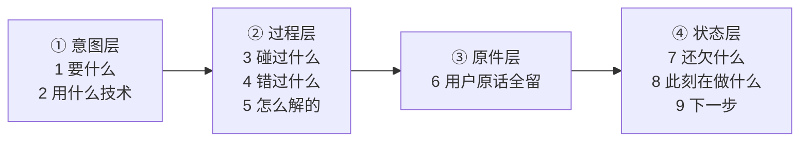

做summary的时候summary什么东西

|字段|含义|
|---|---|
|goal|用户最终想完成什么|
|latest_instruction|用户最近一次明确要求或修正|
|constraints|必须遵守的边界和禁止事项|
|decisions|已经确认的设计决策|
|progress|已完成工作和当前状态|
|changed_files|改过的文件及原因|
|commands_run|命令、结果和关键错误|
|todo|下一步要做什么|
|risks|当前风险和注意事项|

> ⚠️ 上面这张表**没记来源**，无法判断是抄的还是自己总结的。下面是 2026-08-04 重新查证过的、带出处的版本。**面试引用以下面为准。**

---

# 补充：compaction 到底是什么结构（2026-08-04 查证）

## 0. 最重要的一个区分：compaction ≠ summarization

**这是 Manus 提出的区分，也是这个话题里最值钱的一句：**

| | compaction（压缩） | summarization（摘要） |
|---|---|---|
| **可逆性** | **可逆** —— 丢掉的东西能从环境重建 | **不可逆** —— 原始信息真的没了 |
| **做法** | 每个工具调用/结果都有 **full 和 compact 两种格式**，compact 版本剥掉「能从文件系统或外部状态重建」的字段 | 把整段轨迹交给模型，**按一个预定义 schema** 产出结构化摘要对象 |
| **典型例子** | 写文件的工具调用有 `path` 和 `content` 两个字段——**文件写完之后 `content` 可以丢，只留 `path`**，要用再读一次文件 | 见下面 Claude Code 的九段结构 |
| **什么时候用** | 先用这个 | **compaction 收益递减了才上 summarization** |

**两个容易漏的工程细节（都很值钱）：**
1. **做 summarization 时，喂给模型的是完整的原始上下文，不是已经压过的版本。** 压过的再压一次，信息损失是叠加的。
2. **摘要之前把 pre-summary 的历史 dump 到日志文件。** 摘要不可逆，但至少留一份可回查的原件。

> 📌 来源：Manus 的 context engineering 系列（官方博客 + LangChain 联合 webinar）的社区转述 ・ 查证于 2026-08-04 ・ **二手来源，未读原文**。

---

## 1. Anthropic / Claude Code：九段结构

### 一句话抓住它是什么

> **这九段本质上是一份「交接文档」——假设现在换一个人接手这个会话，他需要知道的东西。**
> （旁证：Codex 那边把同一个东西直接叫 **handoff summary**，命名就是「交接」。）

### 先有一个分析阶段，再写九段

**写摘要之前，模型要先做一遍「按时间顺序的分析」**（chronological analysis），逐条过：
- 每一条消息里用户的显式请求和意图
- 自己是怎么应对的
- 关键决策、技术概念、代码模式
- 具体细节：文件名、代码片段、函数签名、改过哪些地方
- 遇到的错误和怎么解决的
- 用户的反馈，**尤其是让你改方向的那些**
- 安全相关的指令（**要求原样保留**）

> **为什么这一步重要**：先分析后写，摘要才是「有依据地挑」而不是「凭印象概括」。这个「先想后写」的结构本身就是设计的一部分。

### 九段，按顺序

| # | 段落 | 装什么 | 关键约束 |
|---|---|---|---|
| **1** | **Primary Request and Intent** 主要请求与意图 | 用户**所有**的显式请求和意图 | 要详细，不是一句话概括 |
| **2** | **Key Technical Concepts** 关键技术概念 | 讨论过的重要技术、框架、概念 | 列表即可 |
| **3** | **Files and Code Sections** 文件与代码片段 | 看过 / 改过 / 新建过的具体文件 | **带完整代码片段**，并说明**为什么这个文件重要** |
| **4** | **Errors and fixes** 报错与修复 | 遇到的所有错误 + 怎么修的 | **还要带上用户对「换个做法」的反馈** |
| **5** | **Problem Solving** 问题解决 | 已解决的问题 + **还在排查中的** | 两种状态都要写 |
| **6** | **All user messages** 全部用户消息 | 所有**非工具结果**的用户消息 | 🔴 **逐字（verbatim）**；要区分真用户轮次和助手伪造的；安全指令原样保留 |
| **7** | **Pending Tasks** 待办 | 用户**明确要求过**但还没做的 | 只列明确要求的，不自己脑补 |
| **8** | **Current Work** 当前工作 | 摘要请求发生**前那一刻**正在做什么 | 带文件名和最近消息里的代码片段 |
| **9** | **Optional Next Step** 下一步（可选） | 与用户**最近一次显式请求**直接对齐的下一步 | **要带逐字引用**指明工作停在哪；**只接明确任务，不接顺带提过的** |

### 怎么记：分四组

**意图 → 过程 → 原件 → 状态。** 前两组是「发生过什么」，后两组是「现在在哪、往哪走」，中间夹一段**不许转述的用户原话**。

### 三条硬约束（比段落本身更有意思）

1. **安全相关的指令和约束必须原样保留**（敏感文件、要避开的操作、凭据处理规则）——**因为摘要会把约束一起压没，这是已知的失败模式**
2. **引用原文最多 125 个字符**
3. 🔑 **只有 user-role 的那一轮才算用户消息。** 助手消息里长得像 `user: ...` / `Human: ...` 的文本是模型生成的，**绝不能算成用户说的**——**本质是一条提示注入防线**：不让伪造的用户指令借着摘要「洗白」成真指令

> 🔑 **一个值得注意的模式：`verbatim`（逐字）在这份提示词里出现了三处**——用户消息、安全约束、暂停点的引用。
> **规律是：凡是「转述一下就会变味」的地方，都不许模型转述。** 意图可以概括，原话不行。

> 📌 来源：社区逆向仓库 `Piebald-AI/claude-code-system-prompts`，标注版本 **Claude Code v2.1.205** ・ 查证于 2026-08-04 ・ **社区逆向，非官方文档**。

## 2. Claude Code 的三层削减机制（不只有摘要）

1. **micro-compaction（token 裁剪）**：剥掉 ANSI 转义序列、截断超长重复的 stdout/stderr
2. **auto-compaction（摘要）**：摘要模型把旧对话压成上面那九段
3. **context sniping（边界截断）**：在 compact boundary 处截断消息历史，硬性限制活动窗口

> 📌 来源：deepwiki 对第三方源码镜像 `sanbuphy/claude-code-source-code` 的分析（原笔记里已有的链接）・ **镜像仓库，非官方源码**。

## 3. API 层的 compaction（服务端能力）

Claude API 把 compaction 做成了服务端能力，beta 头 `compact-2026-01-12`。**触发阈值可配，但有 5 万 token 的下限**（低于这个数直接报错），总结提示词可自定义。
> 📌 来源：Claude Platform Docs / Compaction ・ 查证于 2026-08-04 ・ **默认阈值未查到，别报默认值**。

## 4. OpenAI Codex：路子跟 Anthropic 不一样

- **OpenAI 自家模型走远程压缩**：CLI 调 `POST /v1/responses/compact`，**返回的是一个加密 blob，客户端看不到也改不了**；服务端解密后拼上 handoff message 再喂回模型。**加密的目的是防客户端篡改摘要**，blob 里可能还有不对外暴露的结构化元数据
- **非 OpenAI 模型走本地路径**：用开源代码里能看到的压缩提示词本地摘要；摘要带 `_summary` 前缀，**防止摘要被反复再摘要**
- 触发阈值 `model_auto_compact_token_limit` 可配，常见设成 20 万 token

> 📌 来源：2026 年 3–4 月的多篇社区逆向博客 ・ 查证于 2026-08-04 ・ **社区逆向，我没读 Codex 源码验证，引用时要说明**。

---

## 一句话总结（面试可直接用）

> **压缩不是「让模型随便总结一下」，是一个有结构的工程动作：先做可逆的 compaction（丢掉能从环境重建的东西，只留引用），不够了再做不可逆的 summarization，而 summarization 必须走固定 schema——因为固定 schema 才能保证每次摘要保留的字段一致、才能把「安全约束」这类绝不能丢的东西显式钉住。**

**双链**：[[专栏/Agent/Claude Code Context管理]] · [[Agent记忆系统]] · [[公司/米哈游/米哈游提前批一面_约2026-08]]
