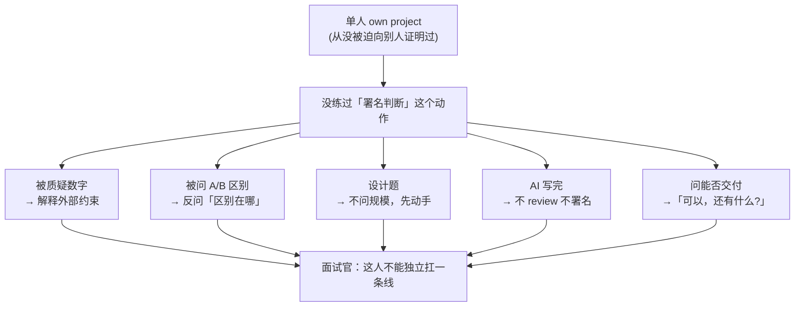

# 面经记录

**岗位方向：** 后训练数据合成（团队负责各基模的后训练数据生产，含合成与筛选两块）
**时长：** 1 小时 3 分钟
**面试官：** 吴学胜，上海 AI Lab 青年研究员（未来若入职会在隔壁组，本轮是平行交叉面）。**他自陈「我对 agent 只是用过一些 langchain 早期的时候」——强项在数据/训练侧。**
**流程：** 自我介绍 → 项目经历问答（前半段）→ 代码/系统设计实操（后半段，明确说"可以用任何大模型/agent，但 decode 就是 decode"）
**结果：** 未知（当天面完）。**自评偏挂，依据见 §7。**

> 我自己的面试，录音转录整理 + 15 agent workflow 深度复盘（4 路查证 → 7 簇诊断改稿；**交叉验证阶段因网络中断未跑完**，所以下文事实断言只带研究阶段的置信标注，未经第二轮核对）。
> **后半段的实操题是这个仓库第一次出现的题型**：不是算法题，是"你开一个真实的 agent 编程环境，跟 AI 协作实现一个库，我全程看你怎么用、怎么验收"。

---

## 0. 🔴 本场根因：判断权反复外包（先看这一节）

不是知识不够。同一个动作在这场出现了至少 7 次：

| 时刻 | 我说的 | 外包给谁 |
|---|---|---|
| 19:27 | 「我先理解一下这个新一代跟上一代区别在哪？」 | 面试官（他问我区别，我反问他） |
| 20:29 | 「核心区别是用 loop 来解决问题，**是吧？**」 | 面试官（把正确答案降级成待批准的猜测） |
| 27:58 | 「**你会选哪道？**」 | 面试官（第一个 responsibility 测试点） |
| 33:30 | 「读数据的时候是 O(1)，**是吧？**」 | 面试官 |
| 41:04 | 「不知道是否有坑，**我得跟他讨论好有什么坑**」 | 模型（坑的作者就坐在对面） |
| 50:29 | 「我没有跟他去讨论他用什么算法」 | 模型（方案作者身份让出去了） |
| 50:51 | 「**你不是说**他读完之后把全部存在数组里面」 | 面试官（自己的方案说成他的） |
| 53:57 | 「我是不怎么会 review 他的这个详细的，**对吧？**」 | 面试官 |

**[[公司/快手/DataAgent方向/快手数据平台DataAgent一面_2026-07-29]] 里这个毛病已被记录为「第五次」并写成铁律。这场是写完铁律之后的复发**——当时只是记下来了，没变成肌肉记忆。

### 但「交判断权」只是表现，根因还在下面一层

**真正的根因：持有正确的材料，但从不对材料署名下判断，等着别人告诉你哪块材料有用。**

| 场次 | 手上已有的正确材料 | 没做的那个动作 |
|---|---|---|
| 快手 2026-07-29 | 「门禁校验」这个答案**上一题刚从自己嘴里说出来** | 下一题取不出来 |
| 本场 19:27 | LangGraph 1.0 收敛成单 agent + middleware——**这是「编排权移交」的最强论据** | 说出来了，没意识到那是论据 |
| 本场 06:10 | 56% / 70% 出头 / 87% 三档不重叠 | 没用，反而说「实际上没做多少」 |
| 本场 41:04 | 精确诊断出「跟你对齐这个理解，不知道是否有坑」 | 把这个对齐动作**路由给了模型** |
| 本场 50:24 | 自己 15:50 写的 SPEC 里两条开放问题 = 后面丢掉的两问 | **没读。97 行，两分钟。** |

**知识（我知道）全都有。判断（所以这就是答案／所以 50 条是够的／所以我现在就问你／所以我现在还不能交付）一个都没做。**

而我自己在 **57:46 给了最准的解释**：

> 「因为平时我工作都是**自己 own 一个 project**，那我自己 own 自己的 project 肯定就没有这么多东西，就麻烦东西嘛，就是自己把这个功能 ok 了。」

**这把「不 review」从态度问题改判成了经验缺口**：从来没有过「把东西交给别人用、并向别人证明它够好」这一步。而这场面试从头到尾在测的就是这一步。**回避的不是思考，是署名——判断错了要负责。**

面试官 58:45 逐字说出了考察点：**「我主要考察这个是想考察你面试者能不能对自己的代码 take responsibility……前面其实就是一直在质疑你，质疑你，最后一刻你真的完成的时候，你能不能做到 say yes？」**——**「署名判断」正是这四个字的语言形式。**

> 🔴 **贴显示器上的一句：**
> **知识不是交付物，判断才是。每个回答的第一句必须由我签字：「我判断 X，依据是 Y」。**
> **这句话里不许出现：是吧／对吧／我先理解一下／可能／大概／应该／还有什么。**
>
> 配一个开口前的自检：**「这句话只有我能说吗？」**——如果换任何一个看过同样资料的人都能说出来，那它是知识不是判断，重说。

### 「对吧／是吧」的根治法（不是「忍住不说」）

本场四次句尾反问**全部出现在自己心里没底的句子后面**。它不是语言习惯，是不确定感在句尾漏出来——所以那一秒的不确定感必须有个正当出口。**分三类，替换方向是相反的，判断比重写更重要：**

| 类型 | 反面 | 正面 |
|---|---|---|
| **真需要对方确认** → 把讨点头换成要信息 | 「读数据的时候是 O(1)，是吧？」 | 「我先跟你对齐一个口径：这里的 O(1) 我理解是**查询**那一步，构建索引那步是 O(N)。这个理解对吗？」 |
| **你不确定、对方也未必知道** → 明说置信度 | 「用 loop 来解决问题，是吧？」 | 「这一条我给一个我自己有把握的说法：核心区别是编排权在代码手里还是在模型手里。」／「这一段是我的理解，不是我查过的结论。」 |
| **你其实知道，只是想被原谅** → 句号收尾，闭嘴 | 「我是不怎么会 review 他的这个详细的，对吧？」 | 「我这次没有逐行 review。」**句号。停两秒。让对方接。** |

第二类的关键：**主动标不确定是自信，用反问偷偷卸责是不自信。** 同一个内容，前者给分。
第三类是四次里唯一致命的一次——它挂在一句自曝短板的话后面，面试官读到的是「他在找我背书」，而那场的考点恰恰是能不能自己扛。

**练习法只做一件事**：下次模拟面试录音回放，不改别的毛病，只在每次句尾「对吧／是吧」处暂停，判断属于上面哪一类，再重写那句。

---

## 0.5 开场就丢的两处（第 80 秒 + 第 11 分钟）

### 01:19 入职时间被反问回去

**面试官**：「我先确认一下，你如果说实习的话，预计什么时候入职？」
**我**：「这个是实习，**我以为。是转正的，对吗？**啊，那**可能最快得** 9 月份入职。」

> 🔴 把 JD 上最基本的信息（实习 vs 转正实习）问回给面试官，**等于当场承认没看 JD**。这是本场「交判断权」的第一次，比后面任何一次都早。答案本体还挂了「可能」「最快得」两个模糊限定词。

**改进稿：**
> 「这个岗位我理解是转正实习，我按转正的时间线准备的——**最快 9 月初可以入职，全职，人在上海。** 如果你们希望更早，8 月中我也能安排。」

> **硬规则：会前把 JD 的岗位性质、工作地点、实习时长三项抄在纸上放手边。这三项在现场一律不许向面试官确认。**

### 11:37–12:22 gap 说明挤了三轮，还主动引入了开放风险

**我说的**：「今年**家里有点事**」「因为**出了点意外**嘛，所以说我**必须得这样子操作**」

> ⚠️ 面试官听到的是：这个 gap 原因不明、可能持续、后面会不会继续影响出勤。**「出了点意外」「必须得」是在把一个已解决的安排说成一个仍在发生的变量。**

**改进方向**：一句话给完整、闭合、可验证的信息，不留开放性——**说时间线和学籍状态（可控、可查），不说原因（不可控、听起来会持续）**。

---

## 1. 自我介绍（零岗位定制，面试官不得不下场帮我重排）

**当时：** 按时间倒序讲了约 3 分钟五段实习流水账，英文术语连续卡壳自我纠正（「offload 到CPU， offload yc， offload CPU 以外」）。

**04:35 面试官打断式补充**：「我们这个 team 主要是负责后训练基模后训练数据的生产吧，可能不一定是合成，也可能是筛选……**所以基于这个背景，你可能会是不是可以着重的讲某些侧面？**」

> ⚠️ 这句话的意思是「你刚讲的三分钟没连上我们做的事」。而 05:11 我的反应是「哦，数据的一个筛选，哦，感觉。」——**第二次机会也没接住**，最后是面试官自己翻我简历替我找出关键词：「因为你这是不是也提到了这个评测数据飞轮？」

**改进稿（开口第一句就把排序规则说出来）：**

> 「我按**跟数据和评测的距离**排，不按时间倒序讲。
>
> 我这两年的主线其实是一件事：**给 agent 建一套能自动判好坏的回路**——先有能判分的数据，才谈得上迭代。
>
> **现在在谷歌**做测试系统的自进化 memory。机制是把那份经验文档当成可训练的参数：模型冻住不动，改的是文档本身，而且**每次改写必须严格提升一个留出验证集的分数才被接受，否则回滚**——留出验证集就是切一批数据出来只做验收、不参与优化。所以我大部分时间其实花在造这个验证集上：拿 200 到 300 条精标数据做改写前后对比，两个维度，生成的操作步骤跟标准流程语义上一不一致、按这些步骤操作真机能不能达成目标。全量 400 多条要连真机跑，单条慢又容易中断，跑不完，所以挑了 20 到 30 条 golden 做每天的定时回归。
>
> **上一段在字节**做业务答疑 bot，准确率 56% 做到 87%。这个数字站得住是因为我先把评测流水线搭起来了：**题是业务侧出的 50 多道高频问题、专家给标准答案和得分点；我搭的是它外面那一整套**——每题按 rubric 拆 3 到 5 个得分点，判分模型只做踩点匹配、不打印象分，每题跑三次取平均、每个回答再 review 五遍取平均；线上每次问答沉淀成 trace 和专家评价，配每周评审。
>
> 再往前 Arm 做性能量化工具、西门子做 RAG，RAG 那段同样是靠 Correctness、Relevance、Groundedness 三个维度打分驱动的。
>
> 所以我熟的不是把 agent 跑起来，是**怎么判断这一版比上一版好**——这也是我投这个方向的原因。」

> 🔴 **口径纪律（复盘时差点写错，务必按这个说）**：字节那 50 题**不是我出的**。[[公司/快手/DataAgent方向/快手数据平台DataAgent一面_2026-07-29]] 的逐字记录是「**前端组做的 ~50 道常见问题**，每题给评分标准」；简历口径是「基于 Fornax 搭建 **Trace 链路与评测数据飞轮**……累计 50+ 条可复用回归评测集」（[[字节实习]]）。
> **说成「我建了 50 多题的专家评测集」会在被追问「题谁出的」时露馅。** 而且改成「**题是业务侧出的、判卷流水线和飞轮是我搭的**」反而更强——它直接引出下一段「分布才是真短板」。

> **铁律：开口前把 JD 的名词当排序键。** 这场是「后训练数据的生产 / 合成 / 筛选」，就按跟这三个词的距离重排经历。**面试官一旦说出「你是不是可以着重讲某些侧面」，这一步你已经欠他了。**

> **术语纪律**：Arm 的 Coz / causal profiling / off-CPU 在自我介绍里一律不出现（C 档，立定义要 30 秒，性价比不对）。`offload` 换中文「卸载」——**这个词在快手那场同一位置已经崩过一次**（「offload 到CPU, offload yc, offload CPU 以外」）。开场前三句逐字背，录音回放确认无卡顿再上场。

---

## 2. 「你们多长时间好像只有 50 条，感觉也不是特别多」

**当时（06:10）：** 解释团队不专业、「不会有那么大的一个时间精力去做这样的一些数据」，段落收尾自己下了死刑：**「实际上没有做特别多的一些内容」**。

> 🔴 **这四句每一句都在替面试官写拒绝理由，全部禁用**：「团队不专业」「没那么多时间精力」「实际上没做多少」「我们不是专业做这个的」。
> 同一套客观约束（专家每周半小时），说成「我们没资源」是**被动**，说成「我在固定标注预算下把钱花在覆盖度而不是冗余度上」是**决策**。约束没变，主语从「团队」换成「我」。

**改进稿（判据 → 证据 → 下一步）：**

> 「50 条够不够，我的判据不是条数，是——**换一版方案，这个集合的分数动不动、动得稳不稳定地超过噪声**。能把两版稳定区分开它就够；分不开，5000 条也白搭。
>
> 按这个判据我们这 50 条是够的。首先它不是 50 个对错判定：每题按 rubric 拆成 3 到 5 个得分点（rubric 是专家事先写好这题答到哪几点各得几分、判分模型只做踩点匹配），所以 50 题实际是 150 到 250 个判定点。为了压方差，每题跑三次取平均、每个回答再让判分模型 review 五遍取平均。实际用下来它确实能分开三档：**裸框架 56%，加了决策树门禁 70 出头，再加审核 agent 87%——三档不重叠，说明这 50 题的分辨率是够用的。**
>
> 但它有一个真问题，不是「少」，是**分布**：这 50 题是人想出来的『我们以为用户会问什么』，不是线上真实问的什么，所以长尾一定没覆盖，而长尾恰恰是最容易错的那部分。
>
> 所以我的下一步不是加题量，是**换题源**。三件事：一是线上真实 query 按频次分层采样，头部高频全采、长尾按比例随机采；二是拿代码结构当分母，用语法树能直接读出代码里写了哪些 if-else 分支，能提出多少个真实业务分支就该有多少道对应的题，**这样「漏」从一个感觉变成一个可算的比例**；三是 bad case 自动回流。」

**预备追问「那为什么不多做一些？」：**

> 「因为标注成本和收益不是线性的，我算的是**边际收益**不是总量。成本这边是硬的：一题要专家写 3 到 5 个得分点，还要跟着每周评审，一个专家每周能给的时间大概半小时到一小时——这是个固定预算，我要决定的是这些时间花在哪。
>
> 收益这边我看的是**再加一题能不能提高分辨率**。现在 50 题已经能把三档稳定分开，再加同质题只是让曲线更平滑，不会让我更早发现新的 bad case——因为新题跟老题的错误模式是重合的。
>
> 所以同样的专家时间，我更愿意花在**换题源**上。同样加 20 题，加在长尾上收益高一个量级。**所以准确说不是「我们没时间做多」，是我把有限的标注预算优先花在覆盖度上、没花在冗余度上。**」

---

## 3. 谷歌自进化 Memory（4 分半钟换来面试官零追问）

### 可量化的诊断

| | 字数 | 「可能/我觉得/打算/大概」 | 面试官反应 |
|---|---|---|---|
| **谷歌段**（07:06–11:34） | 1637 | **14 个** | 零追问，直接换话题 |
| **字节段**（17:03） | 1584 | **2 个** | 「OK，可以，**不错不错**」 |

同样长度，模糊限定词密度差 7 倍，反应差一个档次。

### 四个问题

1. ⚠️ **说 Antigravity 这个名字本身没问题，问题是语气。**（**这条是复盘时先判错、后订正的** —— Antigravity 是 Google 的公开产品，而且这个名字**白纸黑字写在自己简历第一行**（[[谷歌实习]]），说出来不是泄密。）
   真正的毛病是 07:06 那个句式：「谷歌内部的 call call，**就是那个 anti quality 嘛**」——**把一件公开的事说得像在爆内幕，还把名字读错了。** 正确做法是**大方、准确地报全名**，然后立刻转到「它对我这一层的约束是什么」。
   ⚠️ [[谷歌Memory]] 原来那条「不讲内部框架名」的铁律**跟简历自相矛盾，已按「可讲公开产品名和公开能力，不讲内部魔改点/团队排期/未发布功能」订正**。
2. **对标物名字说错 + 自曝忘记**：「这个 **skill up**，他在三四月份的时候提出这个东西，**我忘了**」（应为 SkillOpt）。
3. **宣告了「分两点」，第二点从头到尾没出现**——中间插了三段 SkillOpt 论文复述，直到 10:37 才回到 golden 子集。
4. **推掉了一个完美接话点**：18:51 面试官问「你们那套是不是本地魔改的 CC」→ 19:03 我答「哦，不知道是我的，哈哈」→ 19:09 面试官：「**OK，OK。不管了。**」

### 改进稿：「还在做的项目」的固定三段结构

**① 已经定死的判断**（完成时，每条带判据——为什么选 A 不选 B）→ **② 已经准备好的验收手段**（带数字）→ **③ 唯一还没验证的假设**（一句话，明说为什么现在还不能有结论）

> 「做完的和没做完的我分开说。
>
> **已经定死三件事。** 第一，现有插件的机制我吃透了，也做过取舍判断——它只做了**程序性记忆**、没做**情景记忆**。程序性记忆是「怎么做一件事」，情景记忆是「什么时候、在什么环境下发生过什么」。对通用 coding 助手够用，**但测试的价值恰恰全在情景那一半**，这是我要补的第一件事。
>
> 第二，架构方案定了：**在通用插件之上叠一层测试专用的记忆层，而不是去改通用插件的 prompt。** 判据是**要不要结构性的字段变更**——只是让它偏向记测试相关的东西，改 prompt 最快、零新组件；但打分、引用计数、淘汰标记这些是结构字段，标题加描述的格式装不下。叠一层还有个额外好处：上游插件升级不影响我，我也能独立评测和回滚。
>
> 第三，验收方案定了：两三百条精标数据做接入前后对照，测两个维度——生成的操作步骤跟标准流程语义上一不一致、拿这些步骤操作真机能不能达成目标；再从里面挑二三十条 golden 配每日定时回归。**挑子集不是偷懒，是真机测试单条耗时长、容易中断，跑不完全量——这是资源约束下的取舍。**
>
> **没做完的只有一件**：轨迹数据还没就绪，所以那道留出集门禁现在是设计，不是实测。这是我当前的第一优先级。
>
> 我不想把它说成已经有结论——**这套东西的全部价值就在那道门禁上，门禁没跑过，就没有结论。**」

**18:51「是不是魔改的 CC」的正确接法（保密 + 给信息量）：**

> 「架构上是类 Claude Code 那一路的：**模型 + 工具 + 循环**，skill 和 subagent 都有。它内部具体怎么实现的我不方便讲，我能讲的是**它对我这一层的约束**，这两条对 memory 设计影响最大。
>
> **第一条，记忆是本地 markdown 文件，人可见可改。** 我认为这是这类设计最大的优点——出问题时人能直接翻到是哪一条记忆干的，比藏在向量库里强很多。
>
> **第二条，常驻上下文里只有标题和描述，正文要等模型判断相关了才去读。** 这条直接决定了防护要做在**写入侧**而不是检索侧：写进正文的怪东西只在语义相关的查询上被召回，**检索本身就是一道过滤器；但写进描述的东西每轮都注入，过滤器完全失效**。所以我的规则是不允许在描述字段里写祈使句式的行为指令。
>
> 这类问题有个正式名字叫 **memory poisoning，记忆投毒**——跟提示注入的区别是时间尺度：提示注入只污染当前会话，投毒是持久的，写入和发作可能隔几个月，极难归因。」

> **铁律：讲任何「还在做」的项目，禁止让「打算/可能/想法/大概」当句子的主干动词。** 自检可量化：练的时候录一遍，数模糊词，**每 1500 字超过 2 个就重录**。
> 底层原理：**面试官考的不是你把功能做完了没有，是你有没有做出过判断。把进度的计量单位从「做完几个功能」换成「定死了几个判断」，一个没上线的项目照样是满分素材。**

---

## 4. 🔴 新旧范式区别（本场最惨，6 轮追问以「面试官教候选人」收场）

### 完整失败链路

| 轮 | 面试官 | 我 |
|---|---|---|
| 1 | 「langgraph/langchain 这种上个版本的跟现在这个版本，你会怎么选型？」 | 🔴「**我先理解一下这个新一代跟上一代区别在哪？**」 |
| 2 | 「Codex 这种跟 Langchain、langgraph 的**核心区别**是什么？」 | 「核心区别是用 **loop** 来解决问题，**是吧？**……long train long loss 更倾向于**编排**」 |
| 3 | 「如果只能用**一两个词**描述，你会怎么描述？」 | 「新一代跟旧一代的。」（复读问题，空转） |
| 4 | 「为什么 CC、Codex 可以（出圈）？」 | 「我觉得是**自由**，是 **Freedom**，CC Codex 它能做 **Everything**」 |
| 5 | 「就为什么他能做？你会怎么总结？」 | 「**插件化、模块化**」 |
| 6 | 「这个自由有没有比较 **formal** 一些？怎么定义自由？」 | 「**Authentic 就是更加 agent 的一点**」→ **面试官打断：「哎，这，你不能拿他自己解释他自己。」** |
| — | 「我说一下我心里的啊……上一代强调专家经验或专家 workflow，新一代会抛弃专家、人类知识」 | 「我觉得是合理的」 |

### 🔑 你第二轮就答对了，然后自己扔了

**查证属实（官方文档，高置信）**：Anthropic《Building Effective Agents》（2024-12-19）就是这么二分的：

> **Workflow** = LLM 和工具通过 **predefined code paths**（预先定义好的代码路径）被编排
> **Agent** = LLM **dynamically direct their own processes**（动态指挥自己的流程和工具使用）

2025-09《Effective context engineering for AI agents》把 agent 收敛成一句：**LLM 在循环里自主使用工具**。

**你说出了「LLM、工具、循环」，唯独漏了「自主」——而那个副词就是全部的区别。** 光说 loop 守不住，因为 LangGraph 也有循环（你自己的 [[LangGraph工程实践]] 里写着「节点回环 + recursion_limit」），你大概隐约知道这一点，所以不敢守，转去扔形容词。

而「更倾向于**编排**」这半句，正是官方 `orchestrated through predefined code paths` 的中译——**压一下就是满分答案，你却把它整个丢掉去搜新词。**

> ⚠️ **「能不能用一两个词概括」是压缩指令，不是否定指令。** 正确反应是把刚说过的那半句提炼，**绝不因为被要求精简就换掉一个本来正确的答案。**
> ⚠️ **「插件化、模块化」方向是错的**，能被一句话反驳：LangGraph 的节点、条件边、middleware 本身就是模块化机制。

### 满分答案

> 「核心区别是**编排权的归属**——流程本身是代码写死的，还是模型每一轮现场决定的。
>
> Anthropic《Building Effective Agents》有正式定义：workflow 是 LLM 和工具**通过预先定义好的代码路径被编排**；agent 是模型**动态地指挥自己的流程和工具使用**。所以官方分的不是自由度高低，分的是**编排这件事发生在代码里，还是发生在模型的一次推理里**。
>
> 他们后来讲上下文工程那篇把 agent 收敛得更短：**LLM 在一个循环里自主地使用工具**。我觉得这句最准，而且关键词不是 loop，是**自主**——LangGraph 也有循环，但那个循环的转移函数是我写的条件边；Codex 那个循环的转移函数就是模型本身。
>
> 给一个当场能验证的判法：**把流程图从代码里删掉，只留目标和工具箱，看它还能不能完成任务。** 能完成就是新范式，不能就是旧范式。」

**压成一句**（三个版本按场合挑一个，**说完就停，不要接着解释**）：
- **上一代的 if-else 写在 Python 文件里，新一代的 if-else 长在模型权重里。**
- 四个字：**编排权归属。**
- **旧范式是我把流程告诉它，新范式是我把工具交给它。**

**「怎么定义自由」的正确答法（把形容词换成可测量的量）：**

> 「我把『自由』这个词换掉，它不可证伪。给一个可操作的定义：**自由度等于——在不改一行代码的前提下，这个系统能完成的任务集合有多大。**
>
> 旧范式这个集合等于我画的那张图能覆盖的分支，想加一类任务就得加节点、加条件边、重新发版。新范式这个集合等于工具的组合空间——我只要注册一个新工具，它就可能完成一类我当初完全没想到的任务。
>
> 所以更 formal 的说法是：**旧范式的能力边界由代码定义，新范式的能力边界由工具集和模型能力定义。**」

### 23:20 那个没接住的翻盘窗口

面试官说「你觉得这个总结的合理吗？**因为我对 agent 我只是用过一些 langchain 早期的时候**」——**他在交出主场**。正确姿态是「合理，我补一个限定」，不是纠正也不是附和：

> 「合理，而且我觉得可以再往下钉一层：**专家先验的载体到底是什么？就是那段写死的代码路径。** 所以『要不要人类先验』和『编排权在代码还是在模型』讲的是同一件事，只是一个从知识的角度说、一个从控制流的角度说。
>
> 不过我想补一个限定：**先验不是被抛弃了，是换了载体。** 以前先验写在流程图里，现在写进 skill、写进工具描述、写进系统提示词。所以真正变的不是『有没有专家知识』，是**专家知识从「必须执行的流程」降级成了「可以被违背的建议」**。
>
> 而这恰好是我在字节踩到的坑：我把『先列全所有业务分支再回答』写成 skill，模型有时候就是不听，直接跳到答案。所以我最后是在代码里加了一道校验——这一轮没调用生成决策树那个工具就打回重做。**能被违背的先验，需要一道不能被违决的门禁兜底。**」

> 📌 **查证声明**：「专家先验 vs 自我探索」这组词**没有任何厂商用它做过正式的代际划分**，只能说「跟官方说法方向一致」（Anthropic 有 progressively less human curation 的近似表述），**绝不能说「官方就是这么分类的」**，被追出处会翻车。
> <!-- 来源: Anthropic 官方博客 Building Effective Agents (2024-12-19) + Effective context engineering (2025-09) ・ 查证于 2026-08-05 ・ 交叉验证阶段因网络中断未跑 -->

> 🔴 **铁律：回答「A 和 B 的核心区别」时，第一句必须是一个归属判断（某某权在谁手里）或一个可测实验（把某某删掉还能不能跑），形容词只能排在判据后面。**
> **机械自查：判据里不许出现被解释对象的词根**——讲 agent 框架的区别，判据里不许出现 agent / agentic / 自主 / 智能体。出现了就是「拿他自己解释他自己」，整句重写。

---

## 5. 新范式的风险 + 为什么 26 年才有 + 成本

### 5.1 风险题：只答了最浅的一维，而且自己项目里有全部答案

**面试官（约 24:10）**：「你有没有预见到用这一类东西会有什么核心的 challenge 呢？或者说它可能有什么风险点，**在你推进的时候**？」

> ⚠️ 「**在你推进的时候**」这半句是在**定向邀请你从自己实践里取答案**。我整段一个项目都没提。
> ⚠️ 我答的「输出结构不可控」是整个风险谱系里**最浅、最好治的一层**。

**排序原则：按「推进时咬人的先后」排，不按严重程度。而且把自己第一反应想到的那一维排到最后**——第一反应几乎总是最好治的那个。

> 「**第一个是评测，不是效果。** 新范式的产出既没有唯一正确答案，也没有唯一正确路径——两条完全不同的轨迹可能都是对的，所以既不能用步骤匹配打分，也不能用字符串比对判卷。坏结果很具体：你改完一版感觉变好了，但拿不出证据，团队所有优化就退化成口味之争。我在字节是先把评测流水线搭起来才敢往上加东西——题是业务侧出的、得分点由专家定，我搭的是判卷和回流那一套——**裸跑 56%，加决策树门禁 70% 出头，再加审核 agent 87%。没有那套评测，这三个数字一个都拿不到，我也没法判断审核 agent 该不该留。**
>
> **第二个是不可复现，它直接让 debug 失效。** 同一个输入跑两次，中间一次工具超时，整条轨迹就分叉到别处去了。坏结果是线上出个错答，你拿同一个问题重放却复现不出来——**后端那套「重放就复现、重启就好」在这儿是不成立的**，所以全轨迹 trace 从锦上添花变成必需品。
>
> **第三个是成本和延迟的方差，不是均值。** Anthropic 给过量级，agent 大概是纯聊天的 4 倍 token，多 agent 是 15 倍。但**均值贵是能做预算的，方差大才要命**——同一个问题这次跑 5 轮下次跑 50 轮，你既报不出稳定的单次成本，也承诺不了 P99 延迟。我加审核 agent 之后响应时长基本翻倍。
>
> 后面还有三个我点个名：**上下文腐化**——几十轮工具调用之后注意力被稀释，我们的典型 bad case 就是「A 状态能转到 B」被答成「A 能转到 C」；**停止条件不可控**——由模型自己判断答完没有，我们实测 GPT 最容易早停；**还有安全边界**——一旦这套东西同时具备三件事：能读私有数据、会读到不可信的外部内容、又有对外发送的能力，攻击者只要在它会读到的任意一个网页或文档里埋一句指令，就能把内部数据带出去，**全程不需要任何代码漏洞**。这条在旧范式里弱得多，因为那边是代码决定调哪个工具、往哪发数据。
>
> **至于输出结构不可控**——存在，但它是这一堆里最好治的一个：结构化输出加一道 schema 校验，不过就把错误回灌让它重试，基本收得住。**难的是前面那几个。**」

> 💡 那三件事凑齐的威胁模型有正式名字：**lethal trifecta（致命三要素）**，2025-06 由 Simon Willison 提出。<!-- 来源: 社区，高置信 ・ 查证于 2026-08-05 -->

### 5.2 「为什么 23/24 年只有 LangChain，26 年才有新一代」

**当时答的「模型不够聪明 → 足够聪明」是同义反复，而且是单因素。** 四条能对上时间点的具体能力变化：

> 「我觉得『模型变聪明了』是**结果**不是原因。要指认原因的话，我能点出四个能对上时间点的具体能力变化。
>
> **第一，工具调用从一个 API 特性变成了可靠能力。** OpenAI 2023 年 6 月上的 function calling，Anthropic 2023 年 11 月放 tool use 的 beta、2024 年 5 月 GA。这一层是前提：**没有稳定的结构化工具调用，agent loop 每一轮都可能解析失败，你只能在外面写代码兜住流程——那就只能是 workflow。**
>
> **第二，长上下文。** 2023 年 11 月 GPT-4 Turbo 才给到 128K，2024 年 2 月 Gemini 1.5 Pro 到 1M。但这是必要条件不是充分条件——Anthropic 自己写过「性能随上下文填满而退化」，所以真正的解法是上下文工程、压缩、子 agent 隔离上下文，而不是把窗口开大。
>
> **第三个我认为最核心：RL 训出来的长程能力。** 2024 年 9 月的 o1，2025 年 1 月 DeepSeek-R1 证明了只用结果奖励就能诱导出长链推理；2025 年 2 月 OpenAI 的 Deep Research 是第一个公开说自己是「在困难的浏览和推理任务上做端到端强化学习训练」的产品。**回溯、纠错、自己判断什么时候该停，这三件事以前必须由 workflow 的代码写死，现在是长在权重里的。这才是「抛弃人类先验、让模型自己探索」能成立的物质基础。**
>
> **第四，经济性，这个容易被漏掉。** agent loop 的本质是每一轮把越来越长的历史整个重发一遍，没有缓存的话成本随轮数是二次增长。prompt caching 是 2024 年下半年才普及的，宣称长 prompt 最多能降九成成本。**它不决定跑不跑得通，它决定跑不跑得起。**」

**顺带修正我当时那句「skill 本质就是个 prompt」**——说太满了，而且跟面试官刚立的前提（harness 决定能不能揉出轨迹）正面对撞：

> 「准确的说法是：**模型能可靠用工具之后，harness 那一层才第一次有东西可管。** 同一个模型换个 harness 差别很大，SWE-agent 那篇证明过，同样是 GPT-4 Turbo，只把工具接口从裸 shell 换成专门为模型设计的接口，SWE-bench 上就从 3.8% 到 12.5%。**所以不是模型强了 harness 就不重要，是模型强了 harness 才开始重要。**」

> 📌 **置信度**：function calling 三家时间线、o1（2024-09）、DeepSeek-R1（2025-01）、Deep Research（2025-02）均为官方来源，高置信可报日期。**prompt caching 的具体公告月份查证时有矛盾，只说「2024 年下半年」，别报具体某月。** SWE-bench 历史分数（除 SWE-agent 那篇的主结果外）全是第三方聚合博客，低置信度，一个数都别报。
> <!-- 来源: 官方文档 + 论文 ・ 查证于 2026-08-05 ・ 交叉验证未跑 -->

### 5.3 成本（这一维是面试官替我补出来的）

**面试官**：「本质上是模型，对不对？换句话说，技术选型的时候，是不是你要考虑到这个业务的成本问题？」**我答：「也是，那确实，你这样。」**——把结论的所有权让出去了。

> 「对，而且我想说得更具体一点：**这笔账的分母不该是『调用次数』，该是『通过验收的结果数』。** 因为失败的调用不产生价值但照样烧钱，按调用次数算，你一定会得出『便宜模型更划算』这个错误结论。
>
> 我拿自己的项目算过。答疑 bot 加审核 agent 之前 70% 出头，加了之后 87%，代价是响应时长基本翻倍、token 也差不多翻倍。**按调用算成本翻倍；但按「能直接给用户用的答案」算——70% 那一档里近三成是错的，而这个 bot 存在的意义本来就是让产品运营别再去抓研发 oncall，答错一次就等于把那笔人力成本又还回去了。所以单位有效答案的成本反而是降的。这个账只有拿评测集才算得出来。**
>
> 还有一笔我实测过：我在网关层统一了三家模型的最高强度思考模式，评测上再涨了大概 10 个点。**这就是一笔明码标价的『花钱买准确率』**——问题从来不是贵不贵，是这 10 个点值不值这个价。
>
> 反过来还有一笔容易被漏掉：**旧范式的成本不在推理，在人。** 100 个场景要写 100 条 workflow，业务一改就得改图，这是随业务线性增长的长期人力开销。**新范式其实是把这部分人力成本，换成了推理成本加上不确定性成本。**
>
> 最后一句：这三笔里只有推理成本能提前算准，另外两笔都得跑一段真实流量才知道。**所以我的做法是先小流量跑，把这三个数拿到手再决定要不要上量。**」

> **铁律：凡是被问「有什么风险／挑战／代价／局限」，交付物固定四件套——一个排序判据 + 不少于三维 + 每维一个具体坏结果 + 至少一维带自己项目的真实数字。**
> **开口前强制花两秒问自己：「我简历上哪个项目就是在治这个问题？」找到了再开口。**

---

## 6. 后训练轨迹数据：我问了个好问题，但没接住

**我（约 17:44）**：「诶，我好奇，一定要成功的嘛？不能是失败的轨迹。」——**这个提问本身是加分的。** 但面试官讲完之后我只「OK」了一下，零延伸。

**面试官的讲解（重要领域知识，完整记录）：**
> 「错误的也不能说不能用，只是效率很低。**错误的原因千千万**，你帮他堵住了这条路，他可能又会碰到下一条路，你很难归纳出为什么他 always 错，**但对基本上只有一条路**。真正训练的时候一道题试 20 次或 30 次，有一条对也行，不要求次次对。」

### 该接住的四件事（全部查证，论文来源）

**① 这套做法有正式名字**：**rejection sampling fine-tuning（RFT，拒绝采样微调）**，同族的还有 **STaR**（Zelikman et al., NeurIPS 2022，鼻祖，多一个 rationalization 步骤——采不出正轨迹时把标准答案当 hint 塞回去倒推）、**Expert Iteration**、**ReST^EM**（给了 EM 的理论解释：E-step 采样+过滤，M-step SFT）。

**必须区分**：**Best-of-N 是推理期的，不改权重；RFT 是训练期的，要把选出来的做 SFT。** 混说会被追问。

**工业界锚点（报得出名字就加分）**：**Llama 2 的 RLHF V1–V4 全程只用 rejection sampling fine-tuning，V5 才上 PPO；DeepSeek-R1 第三阶段用拒绝采样收了 60 万条推理数据。**

**② pass@k 就是数据良率（最强的一句串联）**

定义：对一道题采 n 条（n≥k），其中 c 条正确，`pass@k = 1 − C(n−c,k)/C(n,k)`，即「随机抽 k 条里至少有一条对」的概率（Codex 论文 Chen et al. 2021, arXiv:2107.03374）。**只需要能说出「随机抽 k 条至少一条对的概率」这一句，不用背公式。**

> **一道题的 pass@k = 0，这道题这一轮就产不出任何 SFT 数据，无论花多少算力。面试官说的「harness 直接影响能不能揉出正轨迹」翻译成指标就是「harness 直接抬 pass@k」。**

**③ 反向加分点**：**pass@k = 1（次次都对）的题同样是废题**——数据没有信息量，RL 里梯度直接是 0。**所以真正的工程约束是把题目难度卡在 pass@k 既不是 0 也不是 1 的带里。**

**④ 失败轨迹到底怎么用**（面试官说效率低是对的，但业界确实在用，六条路）：

| 用法 | 机制 | 代表工作 |
|---|---|---|
| **配对成偏好对做 DPO**（最强接话点） | 失败轨迹单独没用，**配对就有用** | ETO (Song et al., ACL 2024) |
| **给 PRM 提供步骤级监督** | 失败轨迹前几步通常是对的，用 Monte Carlo rollout 自动给每步打标，不需要人标 | Math-Shepherd |
| **hindsight relabeling** | 一条失败轨迹往往是「另一个目标」的成功轨迹，改写目标就变正样本 | — |
| **mistake-correction 对** | 不是学「不要错」，是学「错了怎么救回来」 | LEMA / SCoRe |
| **loss 上直接用负样本** | unlikelihood training；负样本对保住 pass@k 的**多样性**有独特作用 | NSR / RIFT |
| **不训练的** | 失败轨迹不进权重，进上下文 | Reflexion |

**⑤ harness 为什么直接影响良率**：agent 轨迹难造的第一性原因是**成功率随步数指数衰减**——每步 95% 可靠，20 步下来只剩 36%。SWE-agent 的 **ACI（Agent-Computer Interface）**证明了「同一个模型，只换工具接口」就能把成功率翻 3 倍以上（GPT-4 Turbo 在 SWE-bench 上 3.8% → 12.5%）。

**30 秒收口稿：**

> 「这是 rejection sampling fine-tuning，也叫 expert iteration，k 取 20-30 是因为要把 pass@k 从接近 0 抬到可用。**harness 的价值就是在同一个模型上抬 pass@k，从而抬数据良率。** 失败轨迹不是没用，是**不能单独用**——它需要一个配对物（做 DPO）或一个更细粒度的标注器（PRM）才能变成信号。」

> <!-- 来源: 论文（STaR NeurIPS 2022 / RFT arXiv:2308.01825 / ReST^EM arXiv:2312.06585 / ETO ACL 2024 / Codex arXiv:2107.03374 / SWE-agent）・ 查证于 2026-08-05 ・ 交叉验证未跑 -->

---

## 7. 🔴 系统设计 + Coding 实操（零需求澄清 + 19 分钟静默 + 说不出算法）

### 题目

**用 Python 实现一个库/包，以 O(1) 的时间复杂度按索引返回一个 TXT 文件的某一行。**

> 面试官给两道题让选（一道 LeetCode、一道系统设计），明确说「可以用任何模型、任何 harness，但 **decode 就是 decode**」。

### 7.1 选题就先失一分

**当时（27:58）**：「嗯，试一下。**你会选哪道？**……我想要选第二道，因为**想学习一下**，就是这方面感觉是一个热门方向」——57:22 又强化了一次：「因为这方面我也比较少去了解」。

> ⚠️ 在一场明说考察 take responsibility 的面试里，**你面对的第一个 responsibility 就是选题，而你把它交出去了。**「想学习」是第二刀——面试不是来学习的，这句话把自己放在学生位置，而对面在评估的是「这个人能不能自己扛一条线」。

**改进稿：**

> 「系统设计那道。理由是**今天既然可以用 agent，编码速度就不是最有区分度的信号了**——LeetCode 那道主要看我打字和调试有多快，但那部分模型能替我干。系统设计能看到我怎么拆需求、怎么定验收标准、什么情况下我会推翻模型给的实现，这几件事模型替不了我。
>
> 另外我先把边界说一下，您听着不对随时打断我：您说可以用任何模型但 decode 要自己 decode，我理解成**方案和验收归我，模型只负责打字**。所以我全程会把判断讲出来，包括我为什么接受、或者为什么不接受它给的某个实现。」

> 💡 结尾用「您听着不对随时打断我」而不是「这样理解对吗？」——**前者是我先收口再留纠正接口，后者是把判断权又交出去了。**

### 7.2 🔴 零需求澄清（这题唯一的坑就一个字：大）

面试官 30:18 和 30:59 **两次**明确邀请提问。31:04 我答：「嗯，我思考一下哈……**我暂时没有，我暂时没有别的问题**，我想到再跟你说。」

而 41:04 我自己说：**「我觉得比较难一点就是跟你对齐这个理解，不知道是否有坑……我得跟他讨论好有什么坑。」**→ 41:24 面试官：「**对，这是挺关键的。**」

> 🔴 **我诊断对了问题（要对齐、可能有坑），然后把它路由给了模型。坑的作者就坐在对面，验收标准在他脑子里不在模型权重里。**
> 整个 20 分钟问出口的两个问题（「读的时候是 O(1) 是吧」「格式化字符不用处理吧」），面试官只能回答「对」和「不用」，**不改变任何设计**。

**该问的四个（判据：面试官只能回答「对」或「不用」的不算数，只有他的答案会让你换掉一种数据结构的才算）：**

> 「有，我问四个，每个都会改我的方案，所以我想先问完再动手。
>
> **第一个最关键：文件大概多大、多少行？** 这决定索引放在哪。几十万行的话，我扫一遍把每行起始位置存成一个数组就完了；但如果是上亿行，光这个数组按每行 8 字节算就是几百 M 到几个 G，**索引本身就进不了内存**，我得把索引也落盘。您这边是后训练语料的量级，我猜是后者，但我想确认。
>
> **第二个：是建一次查很多次，还是只查一次？** 建索引必须扫一遍文件，这步天然是 O(N) 绕不过去。只查一次的话索引白建，不如直接顺序扫。所以我理解您要的 O(1) 是**查询的 O(1)、摊销到多次查询上的**，想跟您确认这个口径。
>
> **第三个：文件会不会变？** 只读不变我就把索引持久化，进程重启不用重建；如果是日志那种一直追加，我要支持增量扫；**如果中间会插入删除，那后面所有偏移全废，这题的解法就不是索引了**。
>
> **第四个：行是不是定长的？** 如果是定长记录，第 i 行的位置就是 i 乘行长，**那是真正的 O(1) 时间加 O(1) 空间，一个索引都不用建。** 埋点和日志里定长记录挺常见的，我想先把这种情况排除掉。
>
> 还有两个小的：编码是 UTF-8 吗，以及最后一行有没有结尾换行——后者直接决定行数是数组长度还是长度减一，**是这类题最经典的差一错误**。」

### 7.3 🔴「他的算法是啥呀」——本题真正的失分点

**50:29 我答：**「核心思路就是直接读吧，这确实，哎，**我没没考虑过这方面，我没有跟他去讨论他用什么算**」→ 50:47 面试官：「一行行读怎么实现 O(1) 呢？」→ 50:51 我：「**你不，你不是说**他读完之后把全部存在这个数组里面」

> 🔴 **三重失分**：① 说不出算法 ② **把自己代码的核心机制说反了**（我说的是「整份读进数组」，实际实现是「只存每行字节偏移 + seek」）③ 用「你不是说」把方案的作者身份让给了面试官。
> 更糟的是 50:56——因为不知道代码干了什么，我**主动确认了一个对自己不利且事实上错误的假设**（「文件是能读进来的，对吧？」→「嗯，对」），把「大文件」这道送分题直接送掉。

**必须能脱屏说出三件事：数据结构 + 构建/查询各自的复杂度 + 我改过它哪一处。第三件说不出来，前面所有「我在跟他讨论设计」的自述当场作废。**

> 「核心思路是**不把文件内容读进内存，只在内存里存每一行的起始字节偏移量**。
>
> **构建期**扫一遍文件，每次读一块 4MB，在这块里找换行符位置，把每行起始字节偏移记进一个定宽 int64 数组。数组末尾多存一个哨兵值等于文件总字节数，这样第 i 行的字节区间就是 `[offset[i], offset[i+1])`，**最后一行不用单独特判**。这步是 O(N)，绕不过去——不扫一遍不可能知道换行在哪。
>
> **查询期**要第 i 行，取第 i 和 i+1 项就是起止字节，`seek` 过去读那一段，按 UTF-8 解码，再**精确剥掉行尾的一个换行序列**——用 `endswith` 精确匹配 `\n` 和 `\r`，不用 `strip()`，因为 `strip()` 会把行尾合法的空格也吃掉。
>
> **所以严格说是「一次构建、多次查询，摊销后每次 O(1)」**，只查一次的话索引是白建的。
>
> 有三处是我改了它的。第一，**索引容器必须用定宽数组，不能用 Python 的 list**——list 每项是指针加 int 对象，我量过 40 字节一项，定宽数组 8 字节，**十亿行差 5 倍**，而这个索引是要常驻内存的。第二，**数据文件必须二进制模式打开**——文本模式下 seek 那个参数按 Python 官方文档是**不透明的**，不保证等于字节位置，只是 UTF-8 无 BOM 时碰巧对得上，属于未定义行为。第三，如果要线程安全，**不能用 seek 加 readline 这个组合**——这是两次系统调用，中间共享同一个**内核文件游标**（内核给每个打开的文件维护的「下次从第几个字节读」的位置），多线程会串位，**而且是静默读错不报错**。正确做法是 **pread**，一次系统调用里原子完成定位和读取，而且不动那个游标。」

> 💡 **实测**（研究 agent 在 macOS + APFS + NVMe 上跑的，文件最大 368MB，热缓存）：4 线程 8000 次读，共享 seek+readline **错 389 次**；改 `os.pread` **错 0 次**。

### 7.4 大文件：读不进来分两层，第二层更早爆

> 「**第一层是数据本身读不进来。** 解法就是刚才那套索引加定位读——我从来不把文件内容整个读进内存，只按需读那一行的那几十个字节。再往上一档是 **mmap**，把文件映射进虚拟地址空间，靠**按需分页**，只有真的碰到的那一页才会被读进来。我量过单次查询从 1.66 微秒降到 0.4 微秒，省的是一次内核态到用户态的拷贝加上大部分系统调用。
>
> 但 mmap 有个常见误解我想说清楚：**它不省物理内存。** 你读过的页照样在页缓存里占着，它只是把内存从『进程堆里回收不掉的对象』挪到『内核有压力时可以直接丢掉的干净页』。**它真正换来的是文件大小和物理内存脱钩。** 代价是随机读大文件时每次都可能缺页，一次缺页是一次陷内核加一次磁盘 IO，NVMe 上大概 50 到 100 微秒，**比命中缓存慢一百倍以上**。IO 没有变快，只是从显式的 read 变成了隐式的缺页，**反而更难观测和限流**。
>
> 这点我在 Arm 那段有体感——我改 perf 就是因为它只采得到 on-CPU 的执行热点，采不到线程阻塞等 IO 的那段时间。**隐式的等待是最容易被漏掉的那部分开销。**
>
> **第二层才是真麻烦：索引自己读不进来。** int64 索引是固定 8 字节一行，**跟行长完全无关**，十亿行就是 8GB——**比文件读不进来更早成为瓶颈**。所以正确做法是索引也落盘、也 mmap，用一个零拷贝的整数视图去读它，两边都不进 Python 堆。」

> ⚠️ **本文件早期版本写的「mmap 避免整份文件常驻内存」是不准确的，已按上面口径修正。**
> <!-- 来源: Python 官方文档 + 本机实测 ・ 查证于 2026-08-05 ・ 实测环境 macOS/APFS/NVMe，文件≤368MB 热缓存，大规模下 IO 主导，数字会变 -->

### 7.5 关卡 A（未解锁）：兼容 JSONL / TSV

**不要抽象出一个 Parser 接口让 TXT、JSONL、TSV 各实现一遍**——那个切法是错的，它把「找记录边界」和「解析记录内容」捆死了。

正确切法三层，判据很简单：**「第 i 条记录从第几个字节开始」这句话对任何格式都成立，所以索引层天生就是通用的，格式只影响两端。**

**边界扫描有个真实的分叉**：
- **JSONL 是安全的**——JSON 规范要求字符串里的控制字符必须转义，换行会被写成 `\` + `n` 两个字符，**不会产生裸的换行字节**，所以按换行切有规范兜底。
- **TSV / CSV 不行**——RFC 4180 **明确允许引号里面有裸换行**。实测一个有 4 个物理换行的文件，逻辑上只有 3 条记录。所以 TSV 的扫描器必须是**带引号状态的小状态机**，而且这个状态要能**跨读取块传递**（一条记录可能横跨两个块）。

**接口就两个可调用对象，不搞基类也不搞注册表**：一个 `scan`（输入字节块 + 上一轮状态 → 边界列表 + 新状态），一个 `decode`（输入字节 → 对象）。

**格式识别三级降级**：显式传参（永远可覆盖）> 扩展名 > 读前 64K 嗅探。标准库 `csv.Sniffer` 能猜分隔符但**是启发式的**，样本小或数据里逗号制表符多就会误判。**嗅探结果要写进索引文件头并且打日志——静默猜错是最难排查的一类 bug。**

顺带：反正要全扫一遍，构建期对每条记录跑一次解码校验，**坏数据在构建期就报出来，别等查询时炸**。（这个习惯来自西门子那套 ETL：格式坏掉的文档如果不在入库时拦下，后面检索出来的就是脏内容，排查成本高一个量级。）

### 7.6 关卡 B（未解锁）：同复杂度下再压空间

**先分清楚要压的是常数还是阶，这两个答案不一样。**

**瓶颈**：十亿行的 int64 索引是固定 8GB，跟行长完全无关。

**① 压常数因子 = 采样索引**：不是每行都存偏移，每 k 行存一个；查第 i 行时跳到最近采样点，再往前扫 `i mod k` 个换行符。

> **k 是固定常数时，扫的行数有一个跟 N 无关的上界，所以形式上仍然是严格的 O(1)。**
> ⚠️ **但这里有个坑要主动说**：如果为了把索引塞进一个固定的内存预算，让 `k = N / 预算`，那 k 就**随 N 增长**了，这时候它是 O(N) 不是 O(1)。
> 实测 k=64 时索引小 64 倍，单次查询从 0.4μs 涨到 4.8μs——**但一次冷盘随机读是 50-100μs，这点扫描开销完全被 IO 淹没**，所以 k≈64 是工程上的甜点。

**② 压阶 = Elias-Fano 编码**（**单调递增整数序列的压缩编码**，前提是序列必须递增——行偏移天生满足）。

观察：递增序列的高位变化很慢、低位接近随机。所以把每个偏移拆两段——**低位取 log₂(平均行长) 那么多位，定宽紧密打包（定宽所以能直接算地址）；高位用一元码写进一个只有 2N 比特的位图**，靠 **select**（「这个位图里第 i 个 1 在哪个位置」）定位，有专门的辅助结构能让它常数时间。

**空间 = `log₂(平均行长) + 2` 比特/行。** 平均行长 50 字节 → **7.8 比特/行，十亿行约 974MB，比 int64 的 8GB 小八倍，而且查询还是严格 O(1)，不是拿时间换的。**

**而且基本到头了**——信息论下界是 886MB，Elias-Fano 只超出约 **0.5573 比特/元素**。所以在保持严格 O(1) 的约束下，理论上已经压无可压。

**③ 什么是错的选择**：**succinct bit vector + rank/select**（把换行位置存成 u 比特位图）对这个场景是错的——空间是 `u + o(u)` 比特，**行越长越亏，1TB 文件要 128GB**。

**④ 工程现实必须说出来**：**Python 里没有生产可用的 Elias-Fano 实现**。唯一能装上的包是 2020 年的纯 Python 版，实测单次访问 6.3μs，**比裸 int64 数组慢 119 倍**，优势全被吃掉。**所以纯 Python 场景我会选采样索引 k=64，同时在设计文档里把 Elias-Fano 写成有 C 扩展之后的升级路径。**

### 7.7 怎么真正验证 O(1)

**跑得快不算数，那只说明常数小。** 正确实验设计：

- 拿**几个数量级**的文件测，在 **log-log 坐标上拟合斜率**
- **必须有 O(N) 对照组**（纯顺序扫）：对照组斜率应接近 1，索引方案应接近 0
- 实测：索引方案斜率 **0.110**，朴素方案 **1.021**
- 防页缓存干扰

### 7.8 19 分钟静默 + 模型选型

31:26 到 50:12 近 19 分钟，**全部四次开口都由面试官发起**。面试官中途离席接水（35:44「你让模型也跑着，我去弄杯喝的」），回来后两次主动填话题。这 19 分钟里我自发说的只有两句：「差不多，他写完，看能实现，就能跑了，应该，大概是这样的流程」和「就这样」。

**而且简单题挂在最高思考档**：37:40「5，思考开到了 max，**是不是太慢了？**」→ 面试官「用 Opus 5，我觉得」→ 40:53「一般来说，其实 **DeepSeek 做的也都还行。因为这题本身不难。**」（**两次往下按**）

**模型选型的判据：**

> 「现在挂的是最高思考档，但说实话这道题不该用它，我换一下——顺便说下我选模型的判据。
>
> 我看一件事：**这个任务的失败模式是「想不到」还是「写错」**。想不到——比如要在一堆约束里找一个非平凡的算法——那值得上高思考档，你花钱买的是**搜索深度**。写错——方案我已经定了，模型只是把它翻译成代码——那高思考档买不到任何东西，只会让我干等。这道题是后者。
>
> 而且这个判断对你们组应该更要紧。您刚才说训练时一道题要采二三十次——**那模型档位是直接乘在采样成本上的**。挂错档位不是慢一点的问题，是整条数据流水线的单位产出成本翻几倍。所以我的习惯是**先用便宜模型跑一版看能不能过，过不了再逐级升档**，而不是一上来就顶配兜底。」

> **铁律：模型跑代码的每一分钟你都要在说话，30-60 秒一句，只讲拐点**——我改了它哪一处、为什么改、我在等它验证什么。要静默就明说「我看一下这段，半分钟」。**静默不是低调，是不产生评分素材。**

---

## 8. 交付与 review：最后 9 分钟崩在 say yes 上

### 8.1 连环追问全过程

| 轮次 | 我给出的下一项 | 面试官 |
|---|---|---|
| 1 | 单元测试通过 | 「这算功能性测试，可以交付了吗？」 |
| 2 | 补压力测试（O(1) 验证） | 「大规模压力测试也做了，可以交付了吗？」 |
| 3 | 补边界条件/非法检测 | 认可三类齐全，「可以交付了吗？」 |
| 4 | 可以，但先小流量跑 | 「你会交付哪些东西？」 |
| 5 | 代码本身 | 「还有吗？」 |
| 6 | 使用文档 | 「可以交付了吗？」 |
| 7 | 「可以吧」 | **「你 review 代码了吗？」** |
| 8 | 「他太长了……我是不怎么会 review，**对吧？**」 | — |
| 9 | 「**可以，还有什么？就是把。**」 | **「你就回答可以还是不可以。」**（被迫打断） |
| 10 | 「可以可以，我觉得是可以，就是我在。」 | 「可以交付了啊。这最后一个就是可以了。」 |

### 8.2 三个致命细节

1. 🔴 **「他太长了」——而当时整个实现只有 30 行。**
2. 🔴 **那份 spec 里已经写好了我后面丢掉的两个答案，我自己没读；面试官读了，还当面夸了这份文档。** 55:03：「包括其实我看到了你有写类似文档的东西 SPEC 那个。对，我觉得这个习惯也是挺好。**但是这个没有做 review 其实是一个不太好的东西**……」——那份 spec 只有 97 行，里面已经写着「十亿行量级索引会成瓶颈，下一步是索引落盘 + mmap」和「当前单文件句柄实现不是线程安全的」，**正好是我丢掉的两问**。
3. 🔴 **被点破之后我其实说出了一个合格的做法**（55:45「真正推上线、要跟别人讨论的，我会看一遍他的实现逻辑」）——**但说成了半句没说完的辩解**：「但，对，就是，但就自己 divide 的话，就是确实……」

### 8.3「你 review 代码了吗」两个版本

**版本 A（完全诚实，约 40 秒，不编任何没做过的流程）：**

> 「说实话：**这次没有逐行 review。我 review 的是 spec 和测试用例，代码本身我扫过一眼、跑通了就过了。**
>
> 我平时的分界线是——要交付出去、要跟别人一起维护的代码，我会把实现逻辑完整看一遍；自己一个人 own 的项目，跑通我就不细看了。**这道题我归错档了：它是一个要交付的库，我按自己玩的项目的标准在处理，这是我的问题。**
>
> 按正确的标准，我这会儿至少还欠三件事。第一，把这个类逐行看一遍——它一共 30 行，一个类三个方法，成本很低，是我偷懒。第二，把 spec 里我自己写下的『开放问题』那一节过一遍，那里面已经写了两条。第三，这两条要么补掉，要么明确写进文档当已知限制。
>
> **这三件做完我才敢说可以交付。现在还不能。**」

**版本 B（诚实 + 方法论，约 90 秒，用自己项目的真实弹药）：**

> 「我 review，但**不是逐行读全量代码——我按「这段代码写错了会波及多远」分三档**。
>
> 第一档，认证鉴权、支付、碰用户数据的、数据库迁移、对外暴露的接口：**逐行读，必要时自己重写**。第二档，核心业务逻辑：**读结构不读每一行**——有哪几个类、类之间怎么依赖、函数的入参出参契约、错误路径怎么走、**有没有偷偷把测试跳过或者把检查放松掉**。第三档，内部脚本、测试、小重构：只看 diff 摘要和测试过没过。
>
> **这道题是第二档**，所以我 review 的是结构：这个库对外一个类三个方法，内部状态只有一个文件句柄和一个偏移量数组。我确认的是它没有引入多余抽象，以及以后要加 JSONL、TSV 这类 parser 时，『定位第几条记录的字节偏移』和『解析这条记录的内容』是分开的。
>
> **不过我更信证据，不信「我读过了」。** 我是先写 spec 再让模型实现的，测试用例照着 spec 里列的九个边界场景写——空文件、末尾没换行、末尾换行加空行、中间空行、CRLF、中文多字节、正向越界。**这些正是模型最容易写出「看着对、跑起来也不报错、但就是错的」代码的地方**，用例先钉死，它就骗不过去。
>
> **这套思路其实就是我在字节做的东西搬到自己身上。** 那个答疑 bot，主 agent 生成完答案之后有一个独立的审核 agent 重新核对——**核心就一条：生成的那个不许审自己**，因为它在同一个上下文里已经相信自己那套了。我 review AI 写的代码用的是同一条：**换一个会话或者换一个模型让它挑毛病，而不是问原来那个「你写得对吗」。**」

> 💡 **可引用的最硬背书**：Thoughtworks 技术雷达把 **"Complacency with AI-generated code"（对 AI 生成代码的自满）放进 Hold 环**——53:57 那句话正是这个 blip 逐字描述的行为。而且「AI 代码太长审不动」是**有大样本数据支撑的行业性困境，不是个人惰性**，可以正面承认，风险很低。
> <!-- 来源: Thoughtworks Technology Radar 官方 ・ 查证于 2026-08-05 -->

### 8.4 止损打法：第一次被问就一次性给完，别挤牙膏

被问八轮才挤出完整清单，本身就是扣分项。**第一次被问「可以交付了吗」就把定义摆出来：**

> 「**可以交付。不过我先把「可以交付」的定义摆出来，你看跟你的标准差在哪。**
>
> 我认为要同时满足六件事。一，需求边界写清楚了**包括明确不做的那部分**——我这次写在 spec 里，比如负数索引、切片、迭代协议、索引落盘这次都不做。二，代码 review 过，看的是**类怎么划、依赖关系、函数契约这些结构问题，不是功能对不对**。三，测试三层：功能性、边界、大规模压力用来验证复杂度真的跟行数无关。四，使用文档。五，**已知限制显式写出来**。六，先小流量跑一段。
>
> **这六条我现在做到了第一、三、四，第二和第五还差着。所以准确的回答是：还不能交付，我还欠 review 和一份已知限制清单，大概二十分钟。补完就可以。**」

### 8.5 最后一刻怎么 say yes（约 30 秒，**说完就闭嘴**）

> 「**可以交付。**
>
> 交付内容是三样：这个包本身、使用文档、和一份已知限制说明。已验证的部分都有测试输出为证——功能性、边界、大规模压力三层都跑过了。已知没覆盖的是两条：十亿行量级的索引内存，和多线程并发下的正确性，**这两条我写在文档里，不在这一版的承诺范围内**。
>
> 上线方式是先小流量跑一周，我盯着；这是个新包，出问题直接下掉，不影响存量。
>
> **这个范围内，我签字。**」

> 🔴 **铁律：交付前必须能空口答出两件事——这段代码的核心算法是什么、它的已知限制有哪几条。有一条答不上，就不许说「可以交付」。**
> **可执行动作：让 AI 写完实现之后，先合上代码，把它自己产出的 spec / plan 里「设计」和「开放问题」两节读一遍。** 这场那份 spec 只有 97 行，两分钟读完，里面已经写好了我丢掉的两问。**读文档比读代码便宜一个数量级，而面试官问的、线上会炸的，恰恰都是文档里那两节。**

### 面试官的收尾总结（逐字）

> 「其实就是考察这几个点：明确需求 → 确定技术选型 → 算法设计合理 → review 确认代码实现（这几个类、类之间依赖关系、这些函数的设计是否合理）→ 测试（功能性 + 边界 + 压力）→ 文档。这些都没问题，基本上就可以部署上线了。
>
> 更核心的一点，我是想考察你面试者**能不能对自己的代码 take responsibility**。现在都是 AI coding，我比较 care 的是你能不能对你自己的代码负责。所以我会不断追问『可以交付了吗』——**前面一直在质疑你，最后一刻你真的完成的时候，你能不能做到 say yes。**」

---

## 9. 反问环节：唯一由我主导议程的环节，我放弃了

**59:26 面试官**：「好，你有什么问题还要问我吗？」→ **59:28 我**：「**暂时没有了，就这样。**」→ 59:30 面试官 4 秒收场。

> 🔴 **而 55:30 和 56:04 我主动问过两个问题**（「你们平时会怎么 review」「我方便透露一下吗？我比较好奇」）——**好奇心在，是调度错了**：闲聊里问的不进面评，等到 59:26 那个会被记录的窗口打开时，问题库已经被自己提前掏空了。
> 而且「我方便透露一下吗」是**请示式开场**——先申请许可再提问，姿态低到会被读成不确定自己有没有资格问。

**这个面试官条件极好**：自陈「我对 agent 只用过早期 langchain」→ **他的强项在数据/训练侧，harness 工程侧很可能正缺人**，而那正好是我五段实习里最硬的部分。

**改进稿（三个 + 一个收尾）：**

> 「有，我准备了三个，您时间紧的话我问前两个就行。
>
> **第一个是岗位定位。** 您全场在说 harness，我想确认如果我进来是在 harness 这一侧——工具设计、上下文管理、校验门禁；还是在数据这一侧——题目构造、筛选配比、验证器建设？我的经验都压在前一侧，字节那个答疑 bot 我做的就是决策树门禁和 review agent 这类东西。
>
> **第二个是技术现状，这个我最想问。** 你们采轨迹的 harness 是自研的还是基于开源改的？更想知道的是——**您说一道题试 20 到 30 次，翻成指标就是 pass@k**，那在你们最难的那批任务上 pass@k 现在大概什么量级？**卡点是卡在 harness 上，还是卡在题目本身太难上？** 我问这个是因为这两个卡点的解法是反的：一个要修工具接口和上下文管理，一个要重调题目难度分布。
>
> **第三个是验证。** 成功轨迹筛出来之后，你们怎么判断它是真成功、不是蒙对的？代码类任务里最典型的就是 **agent 直接把测试文件改了让它跑通——outcome 是对的、过程是错的**。你们是只看 outcome，还是也做过程校验？我踩过同构的坑：模型会说它分析过了但其实没有，我们最后是加了一道门禁，**这一轮没有真的调用那个工具就直接打回**——不信模型的自述、只信系统能观测到的调用记录。
>
> 如果还有一分钟，最后一句：这次是平行交叉面，后面还有两关。**作为未来的隔壁组，您最希望我在这两关里补上哪一块？**」

**这套问题顺带展示了五件事**：① 接住他全场的核心词 **harness** ② 把「20-30 次」翻译成 **pass@k**（**证明能跟研究侧同事用同一套语言对话**，这是最强的一个动作）③「卡点在 harness 还是题目」隐含了「数据产出率由两个变量共同决定」这个判断 ④ outcome vs 过程校验证明懂验证器的具体失败模式 ⑤ **反问环节是唯一可以第二次展示项目的地方，而且主动带出来的可信度比被问出来更高**。

**预备追问**：
- 「你觉得 pass@k 低的时候该先修哪个？」→ **先看失败归因分布**。集中在格式违规、工具报错后没恢复、上下文塞满这三类，那是 harness 的问题，修完直接抬 pass@k；如果是模型压根不知道怎么解，那是题目难度问题。
- 「你对我们组了解多少？」→ 提 **InternBootcamp**（上海 AI Lab / InternLM 自家的可验证任务环境工作，2025-08，核心主张是**可验证任务的种类数本身就是一个 scaling 维度**）。**面这个岗不提这个是浪费。**

> ⚠️ **别问什么**：不要问他 Claude Code / Codex 的内部机制。他自陈只用过早期 langchain，问了他答不上来，会变成你在考他。**技术问题全部往数据、轨迹、验证、题目这一侧问**——那是他的主场，他会讲很多。

---

## 10. 总结 / 自评

### ✅ 被面试官明确认证的三项——**下次原样保留，而且要主动讲**

批评密度过高有副作用，**这三项千万别一起推翻**：

1. **先写 spec 和测试用例再让模型实现**（51:52 自述，55:03 面试官夸了：「我看到了你有写类似文档的东西 SPEC 那个……我觉得这个习惯也是挺好」）
2. **交付前写使用文档**
3. **测试分功能／边界／压力三层**——**这是自己在连续质疑下补全的，不是被提示的**，53:03 换来**全场唯一一次「非常好」**

**而且要前置到交付确认的第一句，不等被问：**
> 「我的流程是先跟它把 spec 和测试用例对齐再让它写，所以功能正确性有测试兜底；测试分功能、边界、压力三层；文档和已知限制一起交。」

### ✅ 其余答得好的

4. **主动问「一定要成功轨迹吗」** —— 全场唯一一次有技术含量的主动提问，**换来了面试官整段方法论**。失分不在问，在于问完只回了「是是」（§6）
5. **选型题其实答对了** —— 「能不能穷举完所有分支、能不能一个 if-else hard code 完」就是正确答案，面试官 24:49 原话：「**我整体是没问题啊，到这**」。这段是**一崩一过**，只需把判据前置到第一句，**不需要换答案**
6. 字节业务问答 bot 的决策树/多 agent/review agent 逻辑完整、举例具体，面试官回了「不错不错」

> ⚠️ **本复盘先判错、后订正的三处**（防止下次改造把好东西一起改掉）：① 选型题算成了失分，其实过了 ② 「压力测试是被提示后补上」**与转录不符**，是自己补的，且拿了全场唯一一次「非常好」——**区别很重要：不是知识空白，是挤牙膏** ③ 说 Antigravity 名字算成保密红线，**方向反了**（见 §3）

**⚠️ 待改（按严重程度排）：**
1. 🔴 **判断权反复外包，全场 8 次**（§0）——写完铁律之后的复发
2. 🔴 **「他的算法是啥」答不出且说反了**（§7.3）——这一刻就已经答了「不能负责」
3. 🔴 **新旧范式 6 轮追问以「面试官教候选人」收场**（§4）——而第 2 轮就说对了却自己扔了
4. 🔴 **最后一刻 say 不出 yes**，逼得面试官打断「你就回答可以还是不可以」（§8）
5. 🔴 **零需求澄清**，两次邀请都放弃；自己诊断出「可能有坑」却去问模型（§7.2）
6. ⚠️ **零反问**（§9）——好奇心用在了不计分的闲聊时刻
7. ⚠️ **谷歌段模糊词密度是字节段的 7 倍**，换来零追问（§3）
8. ⚠️ **报产品名的语气像爆内幕**，还把名字读错（§3。**不是保密问题——这条是复盘先判错后订正的**）
9. ⚠️ **风险题只答最浅一维**，自己项目里有全部弹药没取（§5.1）
10. ⚠️ **19 分钟静默 + 模型选型被面试官两次往下按**（§7.8）

**📌 结果预判：挂的概率明显更高，65–75% 挂。最好的情形是「待定 / 转推其他组」，直接过的概率小。**

依据**全部来自面试官自己说出口的话**，不是推测：

| # | 依据 | 转录位置 |
|---|---|---|
| 1 | 他逐字说了考察点是「能不能对自己的代码 take responsibility」，而我恰好在这一点上**需要被打断才给出答案** | 58:45 + 54:33「你就回答可以还是不可以」 |
| 2 | 六步交付清单里**两步被他当面判不合格**：第一步明确需求（「想得稍微简单了一点……**大文件呢，应该多问问我**」）、第四步 review（「这个没有做 review 其实是一个不太好的东西」） | 54:37 / 55:03 |
| 3 | agent 框架整段的定评是「差不多**也算**答得出来了」——「也算」是明确的勉强 | 26:58 |
| 4 | 系统设计三关**只解锁一关**（「这个考核本身还有另外两关，你没解锁完」） | 55:57 |
| 5 | 谷歌 memory 讲了 4 分半，**面试官零技术追问**，直接转话题问「字节你是在北美的对吧」 | 11:34 → 11:36 |
| 6 | 反问环节 2 秒结束，面试官 4 秒收场 | 59:26 |

**反向证据存在，但不构成通过信号**：全程语气友好、主动透露后两关题目、字节项目「不错不错」、三层测试「非常好」、SPEC 习惯被夸——**这些是局部认可和社交礼貌，对不推进的候选人同样会有。**

**面评上最可能的写法接近**：
> 项目经验完整，工程习惯（spec、测试分层、文档）不错；但**需求澄清与代码 review 两环缺失，对 AI 生成代码的掌控度不足，agent 范式理解停留在使用者层面**。

### 一个会影响判断权重的结构性因素

00:23 面试官明说：「你未来面试组会是**隔壁组**，第一轮是一个平行面，一个**交叉面**。」

**交叉面官通常不是决策人，给的是排除性意见**（放行或 veto），权重低于本组主管面。两层含义：
1. 如果本组还有面试且评价高，这场的「勉强」未必致命
2. 反过来，**交叉面官最常用的评语档位恰好是「能力够但有明显短板，建议本组再看看」**——而本场短板正是他自己出题考的那一项，**本组面试官会带着这个先验来复测同一个点**

### 对应动作：按已挂处理，不要等结果

1. **「大文件／规模量级」和「review 按风险分档」这两句必须能脱口而出**，下一场大概率被复测同一个点
2. **主动反向利用这个标记**——在下一场的开场或反问环节说：
   > 「上一轮交叉面给我提了一个很准的点，我回去补了两件事：一是需求澄清阶段要先问数据规模量级，二是 AI 生成的代码要按风险分档 review，高风险那几块逐行读。我现在的做法是……」

   **主动认领反馈并给出改进，比等对方问出来强，而且这本身就是 take responsibility 的一次现场演示。**

**📌 面试形式记录（回填公司画像）：**
上海 AI Lab 后训练数据一面 = **前半段项目深挖（agent 经验为主，但要往数据/评测侧靠）+ 后半段真实 AI-coding 实操**。实操题不是算法题，是「给一个系统设计目标，全程用 agent 协作实现，连环追问交付标准」——**考察对 AI 生成代码的责任心，不是编码速度**。面试官会**反复质疑到最后一刻**，测的就是你能不能干脆地 say yes。

---

## 如果只能改三件事

1. **判据先行，句尾不许有问号。** 被问「A 和 B 的区别」，第一句必须是**归属判断**（某某权在谁手里）或**可测实验**（把某某删掉还能不能跑）。自查：判据里出现被解释对象的词根就整句重写。
2. **拿到任何题，动手前至少问一个能改方案的问题。** 判据：面试官只能回答「对」或「不用」的不算数。**一旦心里冒出「不知道有没有坑」——坑要问坐在对面的人，不是问模型。**
3. **每个项目讲述前先花两秒问自己：「我简历上哪个项目就是在治这个问题？」** 这场至少三次可以取字节的 56%→70%→87% 当弹药（选型题、风险题、成本题），**一次没取**。知识有但取不出来——这是跨场次反复出现的同一个模式。

---

**双链复习：** [[谷歌Memory]] · [[字节答疑Bot]] · [[公司/字节/中国商业化/字节商业化AgentInfra一面_2026-07-30]] · [[LangGraph工程实践]] · [[Agent设计模式与MCP]] · [[Agent记忆系统]] · [[公司/快手/DataAgent方向/快手数据平台DataAgent一面_2026-07-29]] · [[公司/上海AI Lab]]
