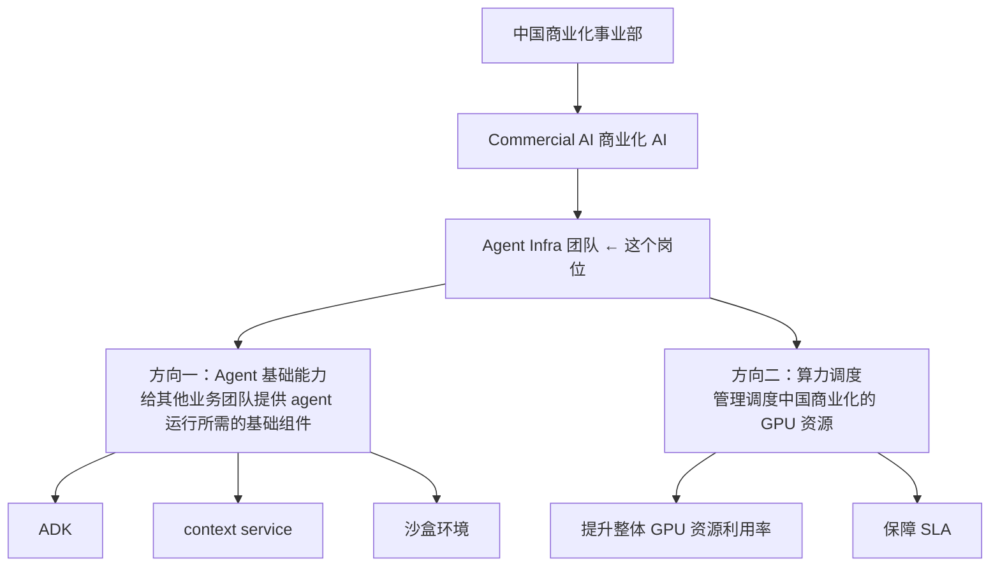
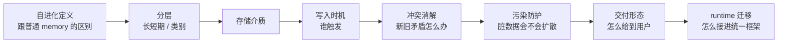

# 面经记录

**岗位方向：** Agent Infra · 中国商业化 Commercial AI · **提前批**
**时长：** 48 分 40 秒
**流程：** 自我介绍 → 谷歌 Memory 深挖（~13 min）→ 字节 DeerFlow 深挖（~13 min）→ 算法题一道（~16 min）→ AI coding 占比 → 反问（~3 min）
**结果：** 通过，进二面

> 我自己的面试，录音转录整理。**零八股、零数据库、零 Java**——跟 [[公司/快手/DataAgent方向/快手数据平台DataAgent一面_2026-07-29]]（隔一天）同类型，但**考法完全不同**：
> - 快手是**追问式**——连续否定你的方案，逼你往下一层走
> - 字节 Agent Infra 是**扫描式**——一题一问、点到即止，但**覆盖面极广**
>
> **关键洞察：面试官的九个 memory 问题，本身就是一份「memory 系统设计 checklist」**——自进化定义 / 分层 / 分类 / 存储介质 / 写入时机 / 冲突消解 / 污染防护 / 交付形态 / runtime 迁移。他问的顺序就是这份 checklist 的顺序，**每一项业界都有标准答案**。这份 checklist 值得单独背。
>
> **总评：谷歌项目的「机制层」讲得很清楚（证明吃透了系统），但「设计层」几乎全线失守——九题里有四题以「我们没做 / 我没做到 / 不是我做的」开局。算法题思路完全正确，却因为 heapq API 记不住，16 分钟没交出能跑的代码。**

---

## 1. 自我介绍

五段实习按时间倒序：谷歌（Pixel Agentic Test System 的 memory 系统）→ 字节（GMPT 团队，业务问答 bot，DeerFlow）→ Arm（复现 2015 系统顶会 best paper 的性能量化工具，从 on-CPU 扩展到 off-CPU）→ 西门子（CT 机操作问答 RAG，ETL 流水线 + 多路召回 + 重排序）→ 用友（人力资源系统数据迁移，不重不漏）。

⚠️ **转录里能听出的口头毛病**：「PISO testing testing 团队」重复卡壳（应为 Pixel）；「我主要是有五段的一个相关实习经历」之后立刻跳进第一段，**没有给一句总纲**。快手那场同样问题。
**自我介绍是唯一 100% 可预测的部分，第三次在这里卡壳。**

---

## 2. 谷歌 Memory 深挖（九连问）

> Ground truth：[[追问/谷歌Memory]] · [[谷歌实习]]

### Q1（03:06）：先讲一下你在谷歌的这个项目

**当时的回答：⚠️ 背景讲了 90 秒，才讲到「我做什么」**
- 6/29 到现在做了大概一个月；组里已有一个投入使用的 testing agent
- 两三个月前还在用 LangChain / LangGraph 这套 SDK 自己开发；后来内部政策改变，要求全面接入内部的 agent 框架，把原来的 agent 包成工具
- 由此产生取舍：内部框架自带一套 memory，testing 团队也有自己的 memory → 决定用内部框架的
- 但那套 memory 是**通用的**（服务全公司所有用户，不只 testing），测下来没有好的 memory structure
- 我的工作：① 先建评分——加 memory 对系统提升多少、不加是什么表现 ② 提优化方案，对标微软的 **SkillOpt**（转录里说成「Microsoft 出的一个 skill up」），在用户使用时不断提取行为轨迹，用轨迹持续优化 memory

**🔴 三个问题：**
1. **反复直呼内部框架名。** [[追问/谷歌Memory]] 的保密红线第一条就是「不讲内部框架名」，这场从头到尾在说。在职项目，这是**风险不是加分**——讲「谷歌内部的类 Claude Code agent 框架」信息量完全一样，风险为零。
2. **「做了大概一个月」是自曝短板的开局。** 项目时长不是面试官问的，主动说出来只会让他给你的深度打折。
3. **SkillOpt 名字没说准。** 这是你方案的理论依据，名字含糊 = 让面试官怀疑你只是听说过。

> 📌 **SkillOpt 事实核对**（这场说得含糊，必须钉死）：微软开源项目 `microsoft/SkillOpt`，把 **skill 文件当成可训练参数**——模型冻结不动，训练的是那份自然语言 skill 文档。
> 循环是 **rollout → reflect → aggregate → select → update → evaluate**：目标模型带着当前 skill 跑任务并记录**打过分的轨迹**（rollout = 一次完整的任务执行采样）→ 优化器模型分析成功/失败批次 → 产出有界的 add / delete / replace 编辑 → **只有当这次编辑严格提升 held-out 验证分（held-out = 训练时不参与、专门留出来验收的那一份数据）才被接受**。
> 报告数字：GPT-5.5 上直接对话 +23.5 分、Codex 循环内 +24.8、**Claude Code 内 +19.1**；6 个 benchmark × 7 个模型 × 3 个 harness = 52 格全部最优或并列最优。
> 另有 **SkillOpt-Sleep**（2026-06-15 preview）：**给本地 coding agent 的夜间离线自进化伴侣**——回看历史会话、重放重复任务、把验证通过的 skill 固化下来。**这正是你描述的 dreaming 定时任务的对标物，可以直接引用。**
> <!-- 来源: GitHub microsoft/SkillOpt README + Microsoft Research blog ・ 查证于 2026-07-31 ・ v0.2.0 发布于 2026-07-02 -->

**改进后的回答（30 秒讲清，把背景压到一句）：**
> 「我在 Pixel 的 Agentic Test System 上负责 memory 方向。组里正在从自研 agent 迁到公司统一的 agent 框架，代价是**要放弃 testing 团队自己那套 memory，改用框架自带的通用 memory**——它服务全公司，记的是用户偏好和泛泛的成功经验，**对测试场景不适配，这就是我的切入点**。
> 我在做的是 **self-evolve memory**：让 agent 从测试的成功/失败轨迹里自动沉淀教训，而不是靠人写知识库。方法论上对标微软的 SkillOpt——**把 memory 当成可训练参数，用打过分的轨迹去改它，改完必须过一个留出验证集才允许生效**。
> 进度上我很诚实：现在第一步是先把评测建起来——**没有基线就没法说 memory 有没有用**；轨迹数据还没就绪，我在推这一步。」

### Q2（05:44）：你提到 Memory 是自进化的，你怎么理解自进化？跟普通 Memory 什么区别？

**当时的回答：✅ 两点方向都对**
- **① 有 reward（反馈信号）**：普通 memory 就是「agent 觉得该存就存」，**没有一个强烈的反馈信号告诉它这样改是对还是错**。我打算通过插件接入内部数据集，在 agent 改写 memory 时对它的修改给出反馈，用反馈指引它该不该这么改
- **② 从轨迹学习**：我们的 agent 是多步的，不是简单问答，所以**行为轨迹**特别重要。普通 memory 不会对「一步步怎么推导到最终结果」这条轨迹做反思和沉淀

**⚠️ 缺了最硬的一环：「反馈」怎么变成「接受 / 拒绝这次修改」的判据。**
说了「给反馈」，但没说**谁裁决**。面试官听到的是一个愿望，不是一个机制。

**改进后的回答（在原来两点后面补第三点）：**
> 「……第三点，也是我认为最关键的：**反馈必须变成一道门禁，而不是一句建议。**
> SkillOpt 的做法是：这次对 memory 的修改产生一个候选版本，**拿候选版本去跑一个留出验证集，分数严格变高才接受，否则回滚**。这样『自进化』就从『模型自己觉得改好了』变成了**一个可观测、可回滚的状态转移**——跟我在字节做决策树门禁是同一个思想：**能用客观校验的地方，不要用模型的主观判断。**
> 所以三句话概括区别：**普通 memory 只有写入，自进化 memory 有写入 + 打分 + 回滚**；**普通 memory 的单位是一轮对话，自进化 memory 的单位是一条完整轨迹**；**普通 memory 的裁决者是模型自己，自进化 memory 的裁决者是验证集。**」

### Q3（07:19）：你们这个 Memory 有分层结构吗？具体怎么设计的？

**先反问澄清：「分层是长期短期？还是分不同类别？」→ 面试官：两个都问。**
✅ **这个澄清动作是对的**，问题本身有歧义，先框定比猜着答好。

**当时的回答：🔴 两问都以「没有」开局**
- **长短期：没做。** 它是 inline（内联，直接集成在主 agent 里、不是独立服务）的——agent 觉得有必要就在回答完用户问题后调 `Write` 工具，把记忆写进一个 markdown 文档，没有长期/短期之分。管理靠两条：① 每天一个定时任务 **dreaming 模块**，对记忆做重组（merge / 删除 / 改写）② **语义相似度检索**，保证数量再多也不打扰 agent
- **分类：也没做。** 就是两个 markdown 文档，靠标题组织——**本质是一个 skill 文档**（有 title、有 description），agent 读到相关文档就判断要不要用它。有**分组**功能（不同业务分不同组、按组检索），但要人为在配置文件里划分

⚠️ 转录里还提到一个「LMVicky 一样的 memory 索引形式」——**这个词转录存疑，无法确认指什么，不要在下一场复用**。

**🔴 问题：违反自己已经总结过的铁律。** [[追问/字节答疑Bot]] Q1b 写得清清楚楚：**「先答『为什么』，最后答『没有的那个』，且『没有』必须讲成『取舍』」**。这里连着两个「没做」开局，而且**手上明明有现成的取舍论证**。

> 💡 **术语补（C 档，仓库里搜不到，先立定义再用）**——业界讲 memory 分层用的是认知心理学那套词：
> - **工作记忆**（working memory）：当前这一轮对话的上下文，会话结束就没了
> - **情景记忆**（episodic memory）：「什么时候发生过什么事」，按时间戳索引的历史片段
> - **语义记忆**（semantic memory）：「什么是什么」，脱离时间的事实和概念
> - **程序记忆**（procedural memory）：「怎么做一件事」，可复用的操作步骤——**skill 文档就是程序记忆的一种实现**
>
> 这四类 + 短期/长期是 2026 年主流综述的通用分法。**你的系统其实是「只做了程序记忆、没做情景记忆」，这是一个可以讲的取舍，不是一个空缺。**
> <!-- 来源: 社区综述交叉验证（多篇 2026 年 Agent Memory 调研）・ 查证于 2026-07-31 -->

**改进后的回答（把「没有」翻译成「取舍」）：**
> 「先说结论：**这套系统只有一层，而且我认为在当前阶段这是对的取舍——但我要做的 self-evolve memory 恰恰需要打破它。**
>
> **① 长短期为什么没分。** 它的短期记忆就是会话上下文本身，长期记忆是落盘的 markdown，**分层的收益要在『短期条目多到需要筛选进长期』时才出现**。他们绕过这个问题的方式是**离线重组**——每天凌晨一个定时任务把全天记忆做 merge / 删除 / 改写，等于**用一次批处理代替了实时的分层管理**。在写入量不大的时候这是更省的方案。
>
> **② 类别为什么没分。** 现在所有记忆都是同一种形态：title + description 的 skill 文档，按业务分组做隔离。**按认知心理学那套分，它只覆盖了程序记忆——『怎么做一件事』**，没有情景记忆（哪次测试在什么环境下失败过）。对通用 coding 助手够用，**对 testing 场景不够**，因为测试的价值恰恰在「这个坑我上次踩过」这类带时间和环境的具体经历。
>
> **③ 所以我的设计要动这一层。** self-evolve 需要给每条经验挂**成功率、引用计数、淘汰标记**这些结构字段，title + description 装不下。这就是我主案选『在通用插件之上叠一层 testing memory』而不是『改通用插件的 prompt』的原因——**判断标准是要不要结构性的 schema 变更**（schema = 这条记忆有哪些固定字段）。要，就必须新起一层。」

### Q4（09:30）：记忆现在都是以 Markdown 形式存储的？→ 是的 ✅

### Q5（09:38）：什么时候去写这个 memory？时机是什么？

**当时的回答：⚠️ 说了三个，但数乱了（「第四，第三个就是」），而且漏了最重要的一个**
- ① **日常对话结束后自动写**——「怎么写 memory / 你需要写 memory」这件事已经注入 system prompt，它会自动写或改写，甚至会主动问人「我要把这个写进 memory 吗」
- ② **专门的管理 skill**——类似 `init`：进一个新仓库，让 agent 探索完把信息写进 `CLAUDE.md`
- ③ **主动 call skill**

**⚠️ 两个问题：**
1. **②③ 是同一件事**（都是调 skill），三个时机实际只有两个。
2. **漏了 dreaming——而它就在上一题（Q3）自己刚讲过。** 定时任务的离线重写是第四个、也是唯一一个「批量、离线、agent 无感知」的写入时机，**分类维度上跟前三个完全不同**。
> 🔴 **「上一题讲过的东西下一题取不出来」——这是快手那场（07-29）复盘的头号结论，隔一天原样复发。**

**改进后的回答（按触发源分两类，四个时机，一句话讲完）：**
> 「按**谁触发**分成两类：
> **在线（用户会话驱动，三个时机）**：① 一轮任务闭环时 agent 自主写入——写入规则本身注入在 system prompt 里，它也会主动问用户要不要记 ② 用户显式调管理 skill，比如进新仓库跑 `init` 让它探索完写文档 ③ 用户直接指出某条记忆有问题，触发定向改写。
> **离线（定时任务驱动，一个时机）**：④ 每天凌晨的 dreaming 任务，把全天对话汇总重组。
> **两类的分工是清晰的：在线写的是『这次学到了什么』，离线做的是『这些天学到的东西该怎么合并去重』——前者管召回，后者管精度。**」

### Q6（10:46）：假设昨天的 memory 跟今天的 memory 有逻辑冲突，怎么解决？

**当时的回答：**
- ① 有专门的 skill（转录作 `memory bad`，**名字存疑**），用户发现冲突就调它去解决
- ② 后台每天**凌晨 4 点**的定时任务，让 agent 检查这一天生成的 memory，判断是否跟旧 memory 冲突或需要合并

### Q7（11:31）：那冲突了具体怎么处理？

**当时的回答：🔴 本场最严重的一处**
> 「冲突就是 agent 自动合并，没有做什么特别额外处理，**它不会去问用户**。这是我看下来的——**因为这个东西也不是我来做的，是我们内部别的团队在负责的工作，所以我不太清楚他们为什么要这样子设计**，但他确实是没有一个所谓冲突之后很合理的管理机制，对，我看下来是没有的。」

**🔴 三层问题，一层比一层严重：**
1. **「不是我做的 / 不清楚为什么」**——[[追问/谷歌Memory]] Q1 白纸黑字记着星河觉醒那场的教训：**「连说三次『没研究过 / 不是我们做的 / 我刚加入』——一次是诚实，三次是防御。」** 这次又犯。
2. **你负责的方向就是 memory。** 说「memory 冲突处理不是我做的」，面试官听到的是**你在划自己的地盘边界**，而不是「这个模块归属别人」。
3. **最亏的一点：你已经判断出「它没有合理的管理机制」，却没说自己会怎么补。** 面试官问「怎么处理」不是在考你背文档，**是在给你机会展示设计能力**——你诊断完就停住了。

> 💡 **业界怎么做（C 档，仓库里没有，先立定义）**：memory 冲突消解有三条成熟路线，2026 年的共识是**别让模型自己判断哪条更新**：
> - **覆盖式**（Mem0 的做法）：新增记忆时 LLM 做一次冲突检查，**最新的赢，旧的直接改写或删掉**。代价是**证据链断了**——「上季度用户的偏好是什么」这类问题永远答不了
> - **双时间戳失效**（Zep / Graphiti 的做法，机制最强）：每条事实带三个时间字段——`valid_at`（何时开始成立）、`expired_at`（何时被更新的事实取代）、`invalid_at`（何时被明确否定）。**冲突不删旧的，只把旧的标记为失效**，历史仍可回溯
> - **确定性优先级**：不问模型「哪条新」，用**写入时间 + 来源可信度 + 作用域**这些系统能直接读到的字段排序裁决
>
> <!-- 来源: 社区技术博客 + arXiv 2606.01435《Don't Ask the LLM to Track Freshness》・ 查证于 2026-07-31 ・ Mem0/Zep 机制描述为二手来源，未读源码 -->

**改进后的回答（三段：现状 → 我的诊断 → 我会怎么改）：**
> 「**现状是**：靠 agent 在离线合并时自己判断，检测到矛盾就合并成一条，不问用户。
> **我的判断是这个设计有明确缺陷**——它把『哪条对』完全交给了模型的主观判断，而**模型判断新旧是不可靠的**：两条记忆都写着『应该用 X 方式』，模型看不出哪条是三个月前的。合并完之后原始的两条都没了，**错了也回溯不了**。
> **如果让我改，我会做两件事，都不需要模型判断**：
> **① 合并不删除，只标失效。** 每条记忆挂一个『何时成立 / 何时被取代』的时间区间，冲突时把旧的标记成 expired 而不是物理删掉。这样一是可回溯，二是**如果新记忆后来被证明是错的，能滚回去**。
> **② 裁决用系统字段，不用模型。** 写入时间、来源（用户显式指定的 > agent 自己总结的）、作用域（项目级 > 全局级），这些系统直接能读，排序规则是确定的。**模型只负责『发现这两条矛盾』，不负责『判定哪条赢』——发现矛盾是它擅长的语义任务，判定新旧是它不擅长的事实任务。**
> 这跟我在字节做的决策树门禁是同一个原则：**能用系统状态裁决的，就别问模型。**」

### Q8（12:06）：假设我往里写一些会污染 memory 的东西，比如让它以后每次都用一个额外的称呼叫我——这种会写进记忆吗？会不会污染整个上下文？

**当时的回答：⚠️ 机制讲对了，结论下反了**
- 能写进去，这没问题
- 但不会污染上下文：memory 检索走**向量相似度 / 语义匹配**，**检索回来不是把整个 memory 文档注入 agent，而是只注入 memory 的标题 + 描述**；agent 觉得有必要用的时候，才去读具体的 memory 文档
- **「如果你不是直接改描述、或者描述里面有这么简单直接的一个操作，我觉得它是不会污染的」**
- memory 是本地 markdown、对人暴露，人发现有问题可以自己改

**⚠️ 问题出在你自己那句「如果不是直接改描述」——它恰恰承认了反面：**
**描述层是常驻上下文，写进描述的东西就是全局污染。** 而「每次这样称呼我」这种用户级偏好，**恰恰最可能被写成一条描述里就说清楚的高优先级记忆**——正好落在会污染的那一档。所以正确答案不是「不会」，是**「分两种，而你举的例子正好是会的那种」**。

> 💡 **这题的正式名字（C 档）**：**memory poisoning（记忆投毒）**——往 agent 的持久化记忆层写入误导性内容，使它在**之后每一次**交互里都行为错误。
> **它和 prompt injection（提示注入）的关键区别是时间尺度**：prompt injection 只影响当前这一轮会话，**memory poisoning 是持久的，攻击和发作在时间上是解耦的**——今天写进去，三个月后才发作。
> OWASP 在 2026 年把它列为 Agentic AI Top 10 的 **ASI06「Memory and Context Poisoning」**，并在 2026-06-01 发布了 Agent Memory Guard 作为参考防御实现——**拦截每一次 memory 读写**，做提示注入筛查、密钥/PII 泄漏检测、键篡改检测、SHA-256 完整性基线、体积异常检测五层。
> <!-- 来源: OWASP 官网 + Help Net Security 报道 ・ 查证于 2026-07-31 -->

**改进后的回答（先分两种情况，再给防线，最后点出这题的正式名字）：**
> 「**得分两种情况，而您举的这个例子正好是会污染的那一种。**
>
> **① 正文层污染——影响有限。** 检索是两级的：常驻在上下文里的只有每条记忆的**标题 + 描述**，agent 判断相关了才去读正文。所以写进正文的怪东西，**只在语义相关的 query 上被召回**，影响面被检索本身框住了。
>
> **② 描述层污染——这才是真问题，而『每次这样称呼我』一定落在这里。** 因为它是一条**无条件生效的用户偏好**，一定会被写进描述、甚至被标成高优先级——**而描述是常驻的，等于每一轮都注入。** 检索这道过滤器在这里完全失效。
>
> **更麻烦的是它是持久的。** 普通的提示注入只污染当前会话，关掉就没了；**写进 memory 的东西是每一轮都复现的，而且写入时间和出问题的时间可能隔几个月**，出了问题极难归因——这在 OWASP 2026 年的 Agentic Top 10 里是单独一类，叫 memory and context poisoning。
>
> **要防的话，我会在写入侧而不是检索侧拦**：
> **写入侧**——描述字段是常驻上下文，应该按注入风险来审：不允许在描述里写祈使句式的行为指令（『以后每次都要……』），这类内容要么降级到正文、要么走显式的用户配置而不是 memory。
> **读取侧**——常驻的描述给一个总 token 预算，超了强制淘汰，**避免慢性膨胀**。
> **可观测**——memory 是本地 markdown、对人可见可改，这一点其实是这套设计最大的优点，**出事时人能直接看到是哪一条**。比藏在向量库里强很多。」

### Q9（13:37）：memory 以什么形式提供给用户？你们这个项目怎么交付？

**当时的回答：✅ 清楚**
一个插件。装完之后它会：
- 在对应的 root 路径写入 memory 操作的说明（markdown），**注入给模型，让模型意识到有 memory 这个东西存在**
- 装一批 skill，帮模型更好地管理记忆
- 注册好定时任务
- 有一个专门的后台层管理 memory 相关的 agent，**不影响主 agent 的流程**

### Q10（14:39）：你刚提到谷歌内部的 agent 都统一转到那个框架上，这个怎么理解？

**当时的回答：✅ 全场类比用得最好的一处**
- 拿字节举例：DeerFlow 是自己一套源码全部开发好，对外暴露成一个飞书 bot——这是原本的逻辑
- 现在要求所有自研 agent 都接进内部框架，**两种暴露方式**：
  - **① 暴露成 skill**：把 DeerFlow 的 system prompt 注入进去，让框架理解并模仿 DeerFlow 的行为，也能做到很相似的工作
  - **② 当 subagent 调**：像调工具一样把 agent 起起来，让它做完相关工作、把结果返回

> ✅ **在字节的面试里拿 DeerFlow 做类比，是安全且高效的**——面试官一定懂 DeerFlow，一句话省掉三句背景。**这个动作要保留：讲外部系统时，优先找对面熟悉的系统做锚点。**

### Q11（15:51）：所以现在线上跑的那些 agent 的 **agent runtime** 都被替换成那个框架了？→ 对，现在都是这样 ✅

> 💡 **术语（C 档，仓库里搜不到）**：**agent runtime**（agent 运行时）——承载 agent 实际执行的那一层：**循环调度**（决定下一步是推理还是调工具）、**工具注册与分发**、**上下文拼装**、**状态持久化**。它不是模型，也不是业务逻辑，是夹在中间那层。
> **这个词跟快手面试官全程用的 `harness` 是同一层东西的不同叫法**（harness 更偏「外层工程框架」，agent runtime 更偏「执行时环境」）。**两个词都是 agent infra 团队的核心词汇，必须能互换着用。**

---

## 3. 字节 DeerFlow 深挖

> Ground truth：[[追问/字节答疑Bot]] · [[字节实习]]

### Q12（16:05）：讲一下你在字节的实习工作

**当时的回答：✅ 结构完整，⚠️ 但全程没有一个数字**
- 业务需求：让产品运营不要那么频繁打扰研发问业务问题 → mentor 让我开发一个答疑 bot
- 最大困难：**业务背景复杂**。电商达人广告、国际化团队——不同国家不同政策，达人跟商家对接有不同玩法、不同付款模式，**很多状态逻辑叉乘在一起**，不同状态走到不一样的结果
- 用户很容易问一个 general 的问题：**「达人向商家提交视频之后，商家能否审核视频？」**——但「能否审核」本质要过很多逻辑：达人跟商家地区是否一致、之前有没有对接过……
- 两个失败模式：① **模型偷懒**——看到相关结果就返回，没看全貌，以偏概全 ② **就算看完了**，if-else 太多、枚举类太多、context 太长，summary 阶段会漏
- 三个解法：① 让模型尽可能长时间工作、不偷懒 ② **决策树 + AST 工具**提取所有 if-else 条件，逼它列全 ③ 加 **review agent**，单 agent → 多 agent，解决 summary 幻觉和遗漏；通过**反问用户**框定范围（用户问得 general，但真正想要的是 specific 答案）

**⚠️ 整段零数字。** [[追问/字节答疑Bot]] 有现成的数字口径表：**56% → 87%、200+ 用户、50+ 条回归评测集**。快手那场是主动给了数字的，这场一个都没给。
**一句话就能补上：「基线 56%，上决策树 + 审核 agent 之后到 87%，服务 200+ 用户。」** 数字是让「我做了个 bot」和「我做了个被 200 人用的 bot」区分开的唯一东西。

### Q13（19:47）：达人商家，这个 agent 要解决的是什么业务问题？

**当时的回答：✅ 有业务质感**
- 主要是让 agent **通过阅读代码**把所有业务问题回答出来
- **达人没那么复杂**——主要是分国家，有点区别
- **商家才是大问题**：会分 MCN、合作社、partner、代理，**彼此不是独立关系，是相互混合纠缠的**，属于历史遗留问题——业务名词不清晰、相互指代、相互混合，导致 agent 没办法处理这种「又混合、情况又多样」的逻辑

> 💡 **术语**：**MCN**（Multi-Channel Network，多频道网络——签约并批量运营达人 / 主播的机构，在平台侧是一类特殊的商家主体）。C 档，仓库里搜不到，讲的时候要带一句。

### Q14（20:55）：决策树你们是怎么弄出来的？

**当时的回答：✅ 有演化路径，面试官吃这个**
- 基于两个观察：① agent 很难把所有 if-else 情况列全，容易遗漏 ② 代码没读全
- **试过 WriteToDo，发现没太大用**——它只是在不断强化已有观念，该读的还是会读到，但**细致的情况还是难以靠一个简单的 todo 枚举全**
- 所以改用决策树：每个节点是**一个枚举值 / 一个抽象函数的实现 / 一组语义相似的函数名**；同一层是同一类型的枚举或实现
- 每个节点必须写「为什么列这个节点」+ **source file 路径**，证明自己看过、找到了证据
- **门禁**：输出前校验树建没建起来，没建就打回重建；再校验每个节点的信息是否填全（节点名、分类指标、来源代码路径、为什么这样分类的依据），**填全才允许输出给用户**

### Q15（23:07）：听上去相当于你要强迫它按你的方式把代码读全 → 对的 ✅

### Q16（23:14）：决策树具体怎么构建？

**当时的回答：✅ 这段是新素材，比 [[追问/字节答疑Bot]] 里记的更细**
- 形态：多维分叉——A → B、C；B → D、E；C → F、G
- 生成方式：**以用户 query 里已知的限定条件作为 root 节点**，之后让它自己根据代码探索。我只加三条约束：
  1. **每个节点必须是名词**——不能是动词或形容词
  2. **每一层必须是同一个种类**——不同类型的枚举值不能混在同一层
  3. **每个节点只能是一个值**——商家有三个子类，就必须拆成三个节点，不能塞进一个节点里

> ✅ **这三条约束值得单独记住**：它们不是在教模型「怎么想」，而是在**定义一个合法的输出格式**——名词化保证节点可验证（动词短语没法对着代码核对），同层同类保证不漏平行分支，一节点一值保证不能用模糊表述蒙混过关。**约束的都是形式，不是内容——这就是为什么它能被门禁自动检查。**

### Q17（24:38）：怎么保证它一定全？比如一段代码有 100 个分支，决策树怎么确保全都覆盖到？

**当时的回答：🔴 第三次「没有」开局，而且正面答案就在自己的追问库里**
- 「**这个就是一个我没有做到的地方**，我们后来这个分数没有跑到满分，主要还是这个地方没有跑全」
- 但跑全很困难：哪怕让人读、或者用 Claude Code / Codex 跑分，**分数也不如改进后的 DeerFlow**；我们比较资深的工程师也会遗漏
- 只能尽最大可能：review agent 会显式提示用户有什么遗漏，让用户判断是否真的遗漏
- 实际 90% 以上场景能覆盖所有场景；而且很多是重复啰嗦的旧代码逻辑，**用户真正关心的是最新的代码逻辑**

**🔴 三个问题：**
1. **正面答案在 [[追问/字节答疑Bot]] Q1c 里写着，一个字没用上**：**「AST 提取的是真实存在的分支，不是笛卡尔积穷举，天然有界。」** 这句话直接回答了「100 个分支怎么覆盖」——**分母不是 100 个组合，是代码里真实存在的那几条**。
2. **「90% 以上」是被自己明令弃用的数字。** 追问库数字口径表最后一行：**「~~90%~~ ❌ 弃用，别再说『解决 90% 以上问题』，统一用 87%」**。这场又说了，而且跟前面 Q19 说的「80 多分」自相矛盾——**同一场面试里两个打架的数字，面试官会记一笔**。
3. **「旧代码逻辑用户不需要」有风险。** 等于承认系统会把过期逻辑混进答案里，只是靠用户自己筛——**这正好把 Q8c 那枪（「代码快照时效性」）送到面试官手上**。

**改进后的回答（正面给出界，再给分层兜底）：**
> 「**先说为什么它是有界的，再说剩下的怎么兜。**
>
> **① 分母不是组合数，是代码里真实存在的分支。** 树的节点不是我们枚举出来的，是 **AST 工具从语法树里提取的真实判断条件**——所以它不是『国家 × 玩法 × 付款方式』的笛卡尔积，**是这段代码实际写了多少条 if-else 就有多少条**。您说的 100 个分支，如果代码里真有 100 条，树上就该有 100 个节点；**它天然有界，且这个界是可计算的。**
>
> **② 所以『全不全』从主观感觉变成了可算的比例**——AST 提取出 N 个判断条件，树上验证了 M 个，覆盖率就是 M/N。**这是这个设计我最看重的一点：它把完备性变成了一个数字。**
>
> **③ 剩下的漏在哪。** 漏不在『树上有但没验』，在『**AST 提取不到的分支**』——运行时配置、下游服务返回值决定的路径、反射调用。这类静态分析拿不到，**我们的兜底是审核 agent 显式提示用户『这一支我没有代码依据』，把裁决权交给人**，而不是假装覆盖了。
>
> **④ 数字上我说保守一点**：评测集上是 **87%**，剩下的 13% 主要是两类——问题本身歧义、以及刚说的静态分析盲区。」

### Q18（26:11）：review agent 看的是什么信息？

**当时的回答：✅ 口径统一到了正确的那一版**
- 主要起到**刷新上下文**的作用
- **输入三样**：用户的问题 + 决策树的结构 + 生成 agent 的回答
- **职责两块**：
  - **结构上**：看树建得对不对、有没有遗漏，**沿着树去代码里做验证**——包括 source file 可能是乱填的、引用是错的，这些也要验
  - **事实上**：解决 summary 阶段的以偏概全和幻觉，典型是**张冠李戴**——B 节点本来只能走到 D 和 E，它说 B 能走到 F。发现这种明显错误就把错误情况告诉生成 agent，让它重新生成

> ✅ **[[追问/字节答疑Bot]] Q2d 记着「两场说法不一致，必须统一口径」**（银河说「自己重新读代码验证」、点点互动说「只提供单一的骨架」）。**这场统一到了正确的那一版——明确说了「沿着树去代码里做验证」。口径修复生效了，保持。**

### Q19（27:33）：引入 review agent 之后的效果，做过评测吗？

**当时的回答：⚠️ 数字含糊**
> 「有的，做评测。不引入 review agent 大概是 0.7 分、70 多分出头，引入之后能跑到 80 多分——已经到了能上线的标准。」

**⚠️ 两个问题：**
1. **「0.7 分 / 70 多分出头 / 80 多分」三种说法混在一句里**，听起来像现场估的。
2. **没说清基线是什么。** 这里的 70+ 应该是「有决策树、无 review agent」，但没讲。**而简历口径 56% → 87% 里的 56% 是「裸 DeerFlow」**——两个基线不是一回事，混着说会被追问戳穿。

**改进后的回答（把消融实验讲清楚）：**
> 「有，我们有一个 50+ 题的评测集，专家给标准答案和得分点，AI 按 rubric（评分细则）踩点判卷。
> **三档对照**：裸 DeerFlow 纯看代码是 **56%**；加上决策树门禁到 **70% 出头**；再加审核 agent 到 **87%**。
> 所以**决策树解决的是『列不全』，审核 agent 解决的是『总结时说错』**——两个是不同的病，收益也不重叠，这也是我们两个都保留的原因。」

### Q20（28:04）：如果业务继续增长，达人和国家越来越多，这个方案还能继续 run 下去吗？

**当时的回答：⚠️ 答窄了——只答了检索工具，没答决策树本身**
- 「我觉得这是一个很重要的问题」——**得在工具上做优化**
- 现在读代码的工具还是很传统的**关键词匹配**（grep，Claude Code 那一套）
- 调研过市面上大的读代码工具，**它们会用语法树解析**，把整个调用图 / 流程图解析给 agent，**精简上下文**，在大代码仓库里优化检索路径、减少检索损耗

**⚠️ 问题：面试官问的是「方案的伸缩性」，你只答了「检索的伸缩性」。**
真正的瓶颈是**决策树本身会不会爆炸**——国家 × 玩法 × 付款方式，业务一涨节点数就涨。而 [[追问/字节答疑Bot]] Q1c 早就准备好了答案（真实分支天然有界 + 深度限制 + query 剪枝 + 优先级调度），**又没取出来。这是本场第三次「答案在库里，取不出来」。**

**改进后的回答（分三层伸缩性，各给瓶颈和解法）：**
> 「我会分三个层面看它会先在哪里断。
> **① 检索层——先断，也最好解。** 现在定位代码走的是关键词匹配（grep 那一套），仓库一大，召回质量掉得很快。解法是换成基于语法树的结构化检索——把调用图先解析出来，agent 按调用关系导航而不是按字符串猜，**上下文能精简一个量级**。这是我认为最先要做的。
> **② 决策树层——不会爆炸，因为节点来自 AST 提取的真实分支，不是笛卡尔积。** 业务涨十倍，代码里的 if-else 不会涨十倍——很多新国家是复用同一条逻辑、只是配置不同。真到了单棵树跑不完的时候，引入**深度限制 + 按 query 剪掉无关子树 + 分支优先级调度**——注意这里的优先级是『**先验证哪一支**』的调度顺序，**不是『答哪一支』的取舍**，否则就把要治的病治回来了。
> **③ 评测层——这层反而是最先撑不住的，也最容易被忽略。** 50 题的评测集是按当时的业务写的，业务翻倍之后它的覆盖率就掉了，**你会在分数没变的情况下悄悄退化**。所以要让测试集从真实流量和代码结构里长出来，而不是靠人想。」

---

## 4. 算法题：会议室 II（LeetCode 253）

> 按仓库规则，算法只在此如实记录，不建专题——算法在另一个仓库。

**题目**：给一组会议的开始 / 结束时间，求最少需要多少间会议室。
**边界（主动问清了 ✅）**：`0-10` 和 `10-20` 只占一个位置——即 `start >= end` 不算重叠。

**过程：🔴 从 29:35 到 45:45，约 16 分钟，最终没跑通，靠口头 dry run 收场**

| 时间 | 发生了什么 |
|---|---|
| 30:16 | ✅ 立刻想到排序：按开始时间排，开始时间相同按结束时间排 |
| 30:16–33:41 | 🔴 **方向走偏 3.5 分钟**——反复说「用一个栈来解决」「开会议室，入栈」 |
| 33:07 | ✅ 主动问清边界（重叠包不包括等于） |
| 33:41 | ✅ 自己纠正：「那 stack 其实最多也就只有两个数，**可以用小根堆来维护**」 |
| 34:11 | ✅ 思路定稿：「栈感觉也不算一个栈了，就算一个会议室吧，用小根堆来维护」 |
| 36:50 | 🔴 **「完了，忘记这个 API」** |
| 38:56 | ✅ 意识到要用 `while` 把所有已结束的会议室全弹出，不是 `if` |
| 41:38 | 🔴 「大概是这个逻辑，**但我忘记那个 API 了，我觉得是一件比较大的事情**」 |
| 42:20 | 跑出来报错 |
| 42:20–45:09 | ✅ **口头 dry run 全对**：入 30 → 堆顶 30 → 来 5，5 < 30 不弹，push 10 → 堆 = [10,30]，当前 2 → 来 15，**先判断堆非空**（「不然一直弹的话全部弹完会有 bug」✅ 边界意识对）→ 15 > 10 弹出，当前 1 → push 20 → 堆 = [20,30]，当前 2，res = 2 |
| 45:45 | 面试官：「感觉逻辑上应该没啥问题，那我们就先写到这」 |

**🔴 这是本场最大的硬伤：一道经典 Medium，思路完全正确，16 分钟没交出能跑的代码。**

**三个卡点，性质完全不同：**
1. **前 3.5 分钟方向错（可训练）**——一直往「栈」上想。栈是后进先出，**而会议室要的是「最早结束的先释放」= 取最小值 = 堆**。
   > **条件反射：题目里出现「当前最小 / 最早 / 最先结束的那个」→ 堆，不是栈。** 栈只在「最近的那个」（括号匹配、单调栈）场景下对。
2. **heapq API 记不住（纯记忆，零技术含量，但直接导致写不出来）**——这是最不该失分的一项。
   ```python
   import heapq
   heapq.heappush(h, x)   # 入堆
   heapq.heappop(h)       # 弹出并返回最小值
   h[0]                   # 看堆顶（最小值），不弹出
   heapq.heapify(lst)     # 原地建堆，O(n)
   # 最大堆：存 -x，取出时再取负
   ```
3. **没跑通就收尾（最伤）**——面试官说「逻辑上应该没啥问题」是善意收场，**但评分表上「写出能跑的代码」这一栏是空的**。思路分拿到了，编码分没拿到。

> ⚠️ **连续两场算法都在同一个位置失分**：快手那场（07-29）LC53 推 DP 定义花 9 分钟、LC78 两个 bug 靠提示才发现；这场思路 4 分钟就对了，**却栽在 API 上**。
> **两场加起来的结论：思路不是瓶颈，手速和 API 熟练度才是。** 需要的是限时手写训练，不是刷新题。

---

## 5. AI coding 占比（45:53）

**Q：你目前 AI coding 的占比大概是什么样？**

**当时的回答：⚠️ 全场最亏的一题**
> 「感觉绝大多数时间都是通过 AI 来帮助我 coding。」

**方向完全对**——后面反问环节面试官明说团队要求「积极拥抱 AI coding」「对 AI coding 这一块的使用比较有心得或比较有经验」。**但你只给了一句话。**

这是一道开放的展示题，**而你恰好有全场最硬的素材：你自己就是做 agent harness 的，你对 AI coding 的理解应该比 99% 的候选人更结构化。**

**改进后的回答（给占比 → 给分工 → 给一个只有内行说得出的细节）：**
> 「**九成以上的代码是 agent 写的，但我花的时间没少，只是花在了别的地方。**
> 具体分工是：**我定接口和验收标准，它写实现。** 我自己动手的部分基本只剩三类——**改 prompt、定校验规则、看 trace 定位它为什么走错**。
> 有一个我自己踩出来的心得：**agent 写代码最大的问题不是写错，是『它说它测过了』。** 所以我现在的习惯是**先让它把验收方式写下来（一条能跑的命令），再让它写实现**——顺序反过来，它就没法用『我看了一下应该没问题』糊弄过去。这跟我在字节做决策树门禁其实是同一件事：**把『它说它做了』变成『系统能看到它做了』。**
> 另外因为我本身在做 agent 的 harness 层，**我用 AI coding 的时候会顺手观察它的失败模式**——比如什么时候它会停止探索、什么样的任务描述会让它跳步。这些观察后来直接变成了我在字节加门禁的动机。」

---

## 6. 反问 + 部门情报

**我问的（只有两个）：** ① 你们这边主要业务是什么，我进来有机会参与什么 ② 对正式员工大概的要求是怎样的

### 团队位置



### 关键情报

| 情报 | 内容 |
|---|---|
| **团队定位** | Agent Infra——**给其他业务团队提供 agent 运行时的基础能力**，不是做某个具体的业务 agent |
| **具体组件** | ADK、context service、沙盒环境（面试官原话点名的三个） |
| **第二条线** | 中国商业化有很多 GPU 资源提供给业务团队做训练和推理，**需要通过管理与调度提升整体资源利用率和 SLA** |
| **用人要求 ①** | **对最新的 AI 进展比较了解 + 积极拥抱 AI coding**——「我们现在在做的很多也都是 AI coding 方向的探索项目」，包括**基于 AI coding 的模式做自动化的线上推理算子优化** |
| **用人要求 ②** | **对 agent 本身的基础能力比较了解** |

> 💡 **术语补（面试官用的词，全部 C 档——仓库里搜不到，二面前必须能张口就来）：**
> - **ADK**（Agent Development Kit，agent 开发套件）——把「跑一个 agent 需要什么」封装成一套标准 SDK：模型调用、工具注册、循环控制、状态管理。**目的是让每个业务团队不用各自造一遍轮子。**（谷歌有个同名的开源 ADK，字节内部这个是不是同一套，转录里没说，别乱认。）
> - **context service**（上下文服务）——把「这一轮该往模型里塞什么」抽成一个独立服务：历史压缩、记忆检索、工具结果裁剪都收在这一层。**面试官没展开，这是我按字面 + 常见架构的理解，属于推断。**
> - **沙盒环境**（sandbox）——隔离的代码执行环境，agent 生成的代码在里面跑，碰不到生产机器和真实数据
> - **SLA**（Service Level Agreement，服务等级协议）——这里指对 GPU 资源可用性 / 排队时长的承诺指标（转录里听成「SMA」）
> - **推理算子**（inference operator）——推理时实际执行的计算核，比如 attention、GEMM（通用矩阵乘）的具体 kernel 实现；**「算子优化」= 让这段 kernel 跑得更快**。他们在做的是**用 AI coding 自动生成 / 优化这些 kernel**——这跟你 [[Arm实习]] 的性能量化和 [[矩阵乘法项目]] 是同一条技术线，**二面这里有巨大的加分空间，务必准备。**

**⚠️ 反问质量明显不如快手那场：**
1. **只问了两个**，第二个「对正式员工的要求」是任何公司都能问的通用题
2. **拿到「ADK / context service / 沙盒」这条硬情报后没有追问一句**——这是全场最好的接话机会
3. **「基于 AI coding 做推理算子优化」这条信息价值极高，完全没接**——你有 Arm 性能量化和矩阵乘法优化的背景，这是唯一能把「Agent 经验」和「系统性能经验」串起来的接口

**下次该问的三个（按价值排）：**
> ① 「context service 目前主要在解决哪一类问题——是上下文压缩，还是记忆的存取？我在谷歌做的正好是记忆这块，想知道你们的边界是怎么切的。」
> ② 「『用 AI coding 做推理算子优化』这个方向很有意思——是让 agent 生成 kernel 然后跑 benchmark 择优吗？**验证环节是怎么保证生成的算子数值上是对的？**」（← 这一问直接展示你懂「agent 生成需要门禁校验」这件事）
> ③ 「Agent Infra 给业务团队提供能力，你们怎么衡量自己做得好不好——是看接入团队数，还是看接入之后业务 agent 的效果提升？」

---

## 7. 总结 / 自评

**✅ 答得好：**
1. **谷歌 memory 的机制层讲得很透**——两条写入路径、dreaming 定时重组、skill 形态（title + description）、语义相似度检索、分组隔离，**几乎把一个 memory 系统的运行机制完整复述了一遍**，证明确实吃透了系统
2. **memory 检索是两级的**（描述常驻 + 正文按需读）——这个机制说对了，是这题的技术核心
3. **拿 DeerFlow 类比谷歌内部框架**——在字节讲 DeerFlow，一句话省三句背景，锚点找得准
4. **决策树的三条构建约束**（节点必须是名词 / 同层必须同类 / 一节点一值）——比追问库里记的更细，是本场新素材
5. **review agent 口径统一到了正确版本**（明确说「沿着树去代码里验证」）——追问库里标注的「两场说法不一致」这个问题，这场修复了
6. **算法题主动问清边界 + 弹出时用 while 且判空**——边界意识是对的

**⚠️ 待改（按严重程度排）：**
1. 🔴 **「不是我做的 / 不清楚为什么这么设计」**（memory 冲突那题）——**[[追问/谷歌Memory]] 白纸黑字记着星河觉醒同款教训，隔十天原样复发。** 而且你负责的方向就是 memory，这句话听起来像在划地盘。**你已经诊断出「它没有合理机制」，却没接一句「如果让我改我会怎么改」——那才是这题真正在问的东西。**
2. 🔴 **算法题 16 分钟没跑通**——思路 4 分钟就对了，栽在 heapq API 上。**连续两场算法都在「手速 / API 熟练度」失分，不是思路问题。**
3. 🔴 **四次「没有 / 没做到」开局**（长短期分层、类别分层、覆盖不全、memory 冲突机制）——**[[追问/字节答疑Bot]] Q1b 的铁律「『没有』必须讲成『取舍』」，这场一次都没执行。**
4. 🔴 **反复直呼内部框架名**——在职项目，保密红线第一条，说了没有任何额外收益
5. ⚠️ **「上一题讲过的东西，下一题取不出来」——第三次**：Q5 写入时机漏了 Q3 刚讲的 dreaming；Q17 覆盖度没用 Q14 刚讲的 AST；Q20 伸缩性没用追问库里现成的答案。**跟快手那场（门禁校验答案在上一题说过却没迁移）是同一个模式。**
6. ⚠️ **DeerFlow 整段零数字**——56% / 87% / 200+ / 50+ 一个都没说；而后面 Q17 又说了被明令弃用的「90% 以上」，还跟 Q19 的「80 多分」自相矛盾
7. ⚠️ **AI coding 占比只答一句话**——面试官后面明说这是团队核心要求，这题是送分题，答成了 15 个字
8. ⚠️ **反问只有两个且第二个是通用题**，拿到 ADK / context service / 推理算子优化这些硬情报后一句都没追

**📌 风格实证（回填公司画像）：**
字节 **中国商业化 · Commercial AI · Agent Infra** 岗 = **零八股、零数据库、零 Java，全场 Agent 工程 + 一道算法**。与字节其他线（[[公司/字节/中国商业化/字节跳动中国商业化一面面经]] 的缓存三大问题 / MVCC / ConcurrentHashMap 八股密度）**完全是两套考法**。
**追问风格：扫描式**——一题一问、点到即止、不连环深挖，但**覆盖面极广**（九个问题走完了一个 memory 系统的完整设计维度）。
**应对策略跟快手那场正相反**：快手要准备「被否之后的下一个答案」，**字节要准备「每一个维度的第一个答案都必须完整」**——因为他不会给你第二次机会补充。

**📌 面试官的 memory 九问 = 一份设计 checklist，值得当模板背：**



---

**双链复习：** [[追问/谷歌Memory]] · [[追问/字节答疑Bot]] · [[Agent设计模式与MCP]] · [[LangGraph工程实践]] · [[公司/字节]] · [[公司/快手/DataAgent方向/快手数据平台DataAgent一面_2026-07-29]]
