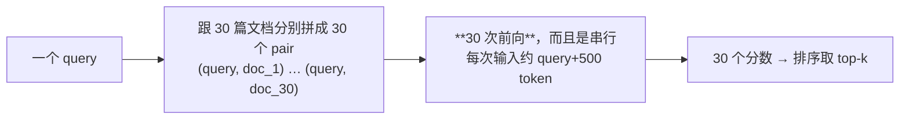
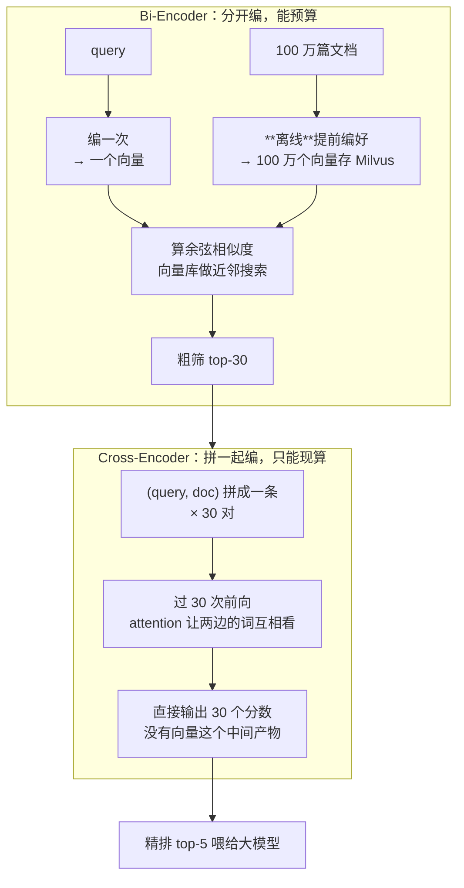
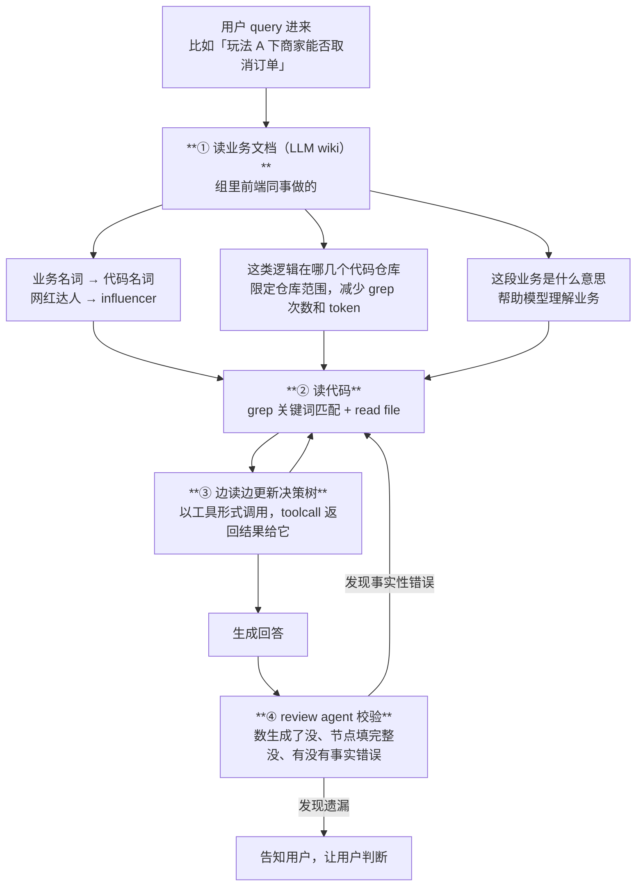

# 面经记录

**岗位方向：** Agent Infra · 中国商业化 Commercial AI（**提前批三面，面试官明说「这一轮应该是最后一轮技术面」**）
**前序：** [[公司/字节/中国商业化/字节商业化AgentInfra一面_2026-07-30]] · [[公司/字节/中国商业化/字节商业化AgentInfra二面_2026-08-06]]
**面试官：** 未自述部门；反问环节只答「主要还是看面试素养」，**信息量远低于一面二面**
**时长：** 57 分 31 秒（转录 04:34–57:26，实际问答约 53 分钟）
**流程：** 自我介绍 → 挑一个最满意的项目 → **西门子 RAG 深挖（~9 min，断在 Bi-Encoder vs Cross-Encoder）** → 谷歌 Memory（~7 min，**面试官几乎零追问**）→ **算法题 完全子数组（~18 min）** → **字节答疑 Bot 深挖（~13 min）** → 反问
**结果：** 未知（当天面完）

---

## 0. 本场主线：不刨机制，刨**原理**

一面是**扫描式**（九个维度一题一问），二面是**刨根式**（咬住一个点连问 3-6 次机制）。**这场又不一样：面试官对「你怎么做的」听一遍就过，只在两个地方停下来——而停下来问的都是「这东西为什么能这样」。**

| 停下来问的两处 | 问法 | 结果 |
|---|---|---|
| **embedding 模型 vs reranker** | 它俩区别是什么 → **那个分数是哪来的** → **原始 embedding 模型不具备打分能力，这能力是你们建设的吗** | 🔴 第一问机制说错，第二三问答案方向对但全程「我理解是」 |
| **决策树** | 这像 workflow / skills 吗 → **能不能沉淀成 skill** → 是给定还是生成 → **怎么保证生成出来的决策树本身没问题** → **review agent 自己的准确率是多少** | ✅ 前四问答得好，🔴 第五问「没有测量过」 |

> 🔑 **这场跟前两场的关系**：一面二面考的是「你这套系统是怎么搭的」，**这场考的是「你用的这些零件为什么能工作」**。
> 同一个岗位三轮，问法从**系统 → 机制 → 原理**逐级下沉。**下一轮如果还有，方向大概率继续往下：训练目标、损失函数、推理时的显存/吞吐。**

> ⚠️ **本场最重的一件事不在这张表里**：§6 那道题，**2026-03-12 贝壳找房一面已经原样考过一次、当时也没答清楚，而且仓库里当场就写下了正确答案**（[[公司/其他/贝壳/贝壳找房一面面经]] §Q，还专门在自评里标了「这是 RAG 岗位的核心知识点」）。
> **五个月后同一道题再考，答的正是那份笔记里明写着「本质区别不是」的那个说法。** 这不是知识缺失，是**同题两次答崩**的老毛病又发作了一次。

---

## 1. 自我介绍（第五次零岗位定制）

**当时：** 华南理工本科 → UCSB 计算机硕士 → 五段实习按时间倒序：谷歌（Pixel testing agent 团队做 memory 的评测与改进）→ 字节（国际化广告，达人商家对接平台的 oncall 答疑机器人，单 agent 扩成多 agent + 决策树工具）→ Arm（复现 2015 年 best paper，扩展成能分析 off-CPU 性能）→ 西门子（CT 机文档 RAG，ETL 落库流水线 + query 改写 + 多路召回 + 重排）→ 用友（中国电信国际人力系统数据迁移，保证格式一致、不漏不重）。

✅ **比二面进步的一点**：字节那段这次**主动把「业务难点」讲出来了**——「玩法逻辑上存在比较多的可能性，导致 agent 回答不全面 + 幻觉」，然后才讲解法。**先给病再给药，顺序是对的。**

🔴 **但仍然零岗位定制，这是第五次。** 五段里三段是 agent，**没有一句把它们串成一条线**；而且**倒序讲完五段花了将近 3 分钟**，面试官听完直接问「哪个你觉得比较满意」——**等于这 3 分钟只起到了一个作用：让他自己挑一个来问。**

**改进稿（开头 20 秒的总纲，二面已经写过一次，这场还是没用上）：**

> 「我这五段实习是一条线：**都在 agent 的运行时和记忆这一层，不在某个具体业务的效果上。** 谷歌在做 memory 的评测和自进化，字节在做多 agent 的门禁和编排，西门子在做检索链路——**我一直在做的是『让 agent 跑得稳、答得准』的那层基建**，这也是我投这个岗的原因。下面挑两段展开，其余的您需要我再补。」

**题型 A（项目叙述）｜扣分：① 落点（无总纲，第五次复发）**

---

## 2. 这些项目哪个你觉得比较满意？

**当时：** 「可能是字节，还有西门子这两个项目，当时是花了比较多时间做在这上面做，也有一定的一个研究吧。」

⚠️ **理由是「花的时间多」。** 面试官这一问是在给你**自选战场**——选完还要顺手给一句「为什么它值得聊」，那句话就是本场的主线钩子。

**改进稿：**

> 「西门子和字节。**选它们不是因为花的时间长，是因为这两个是我唯一做过完整闭环的项目：先建评测、再改系统、最后能拿数字说话。** 西门子是检索链路的闭环，字节是多 agent 编排的闭环——**您想听哪个我都可以从『当时是怎么测出来它不行的』开始讲。**」

**题型 A｜扣分：① 落点（理由是工作量，不是价值）**

---

## 3. 西门子 RAG：你做了什么（一段自述，讲得完整）

**当时：✅ 五个动作讲得有条理，而且每个动作都带着「为什么」**

进组时前后端和基础 RAG 已经有了，他做的是优化，按顺序：

1. **换 embedding 模型 → 被迫换向量库**：千问3 出来后想用，但**它的向量维度高**，原来的 Elasticsearch 存不下 → 迁到 Milvus
2. **重构 embedding 框架**：原框架跟 ES 强绑定、跟 Milvus 接不上，而且**已经很多年没维护**（转录里框架名没听清）→ 直接重写，加了**增量 embedding、文档删除、批量 embedding**
3. **Query 改写**：文档是中文、术语也是中文，**但用户习惯用英文术语提问** → 中英文术语存在 gap，召回率下降 → 一个 query 进来翻译成中英文两版，分别去检索
4. **加 BM25**：原来只有稠密向量（语义）一路，**长文档里那几个 token 的关键词，语义会被稀释掉**，检索不出来 → 补关键词匹配这一路
5. **再加 BGE-M3 的稀疏向量**：「它是既有语义又有关键词的一个比较中间态的形式」
6. **重排选型**：千问3 reranker 重排 30 个文档要 **6 秒**，BGE-M3 reranker 重排 30 个文档要 **2 秒**；跑分比较下来**差距不大**，看最终答案文档一般都能排进前三前五 → **选 BGE-M3**

**结果：76% → 92%，正式上线给用户用。**

> ✅ **口径全对，和 [[西门子RAG]] 追问库一致**（76%→92%、三路混合、BGE-M3 reranker）。
> ✅ **两处成本对比讲得干净**：「30 个文档 6 秒 vs 2 秒」+「分数差距不大、目标文档都在前三前五」——**这是一次标准的选型论证：给出代价、给出收益、给出判据。**
> ✅ **BM25 的存在理由（关键词被稠密向量稀释）跟二面 §22.5 一字不差**——这个点已经稳定了，是他手上少数几个「每场都能打出来」的武器。

**题型 A｜无扣分**

---

## 4. 那个 reranker 为什么排 30 个文档要好几秒？原因是什么？

**当时：⚠️ 全程是推测，而且自己也说了没深究**

> 「我理解是我们自己部署的一个模型，当时用的卡是 A6000 还是多少……我们部署是用 Ollama 来部署的，用 Ollama 部署的话**它底层是走 llama.cpp**，所以说它可能性能会差一点，没有很好地用到 GPU 的一些性能。反正最终实测下来就是 6 秒钟，**为什么这么慢，我现在是这样推测，我当时也没有说做一个很好的、一个提高的想法**。」

> ⚠️ **两个毛病叠在一起**：① **把「部署框架不行」当成唯一原因**，而这是三个候选原因里最不容易验证的那个 ② **主动说「我当时也没有想过怎么提高」**——面试官问原因，不是问你有没有优化过；**这句话是白送的减分**。

> 💡 **先立三个词（仓库里搜不到，C 档）**：
> - **前向（forward pass）**——把一条输入从头到尾过一遍模型、得到输出的这个过程。**推理耗时基本就等于「做了多少次前向」×「每次前向多贵」。**
> - **batch（批）**——把多条输入拼成一摞一次性送进模型。GPU 算一条和算一摞的耗时差不多（**瓶颈在把模型权重从显存搬到计算单元，不在算数本身**），所以不 batch 等于把 GPU 大部分算力闲置。
> - **llama.cpp / Ollama / vLLM**——三个推理部署工具。llama.cpp 最早是为**在 CPU 上跑量化模型**设计的，Ollama 建在它上面，图省事；**vLLM 是专门为 GPU 上的高吞吐服务设计的**，会自动把并发请求攒成 batch。

**这道题的账其实可以当场算出来：**

**改进稿（三段：先算账 → 再给候选原因 → 再说怎么定位）：**

> 「**先说这个耗时是怎么构成的**：重排是 cross-encoder，30 个文档就是 **30 次独立的前向**，每次输入是 query 拼一篇 500 token 左右的文档。6 秒 / 30 篇 = **每篇 200 毫秒**——所以问题不是『某一步特别慢』，是**30 次串行前向的累加**。
>
> **候选原因我当时排了三个，但只验证到第一个：**
> ① **模型体量差一个量级。** 千问3-reranker 有 0.6B / 4B / 8B 几档，BGE-reranker-v2-m3 是**六亿参数这一档**——**换模型带来 3 倍加速，跟参数量的比例大致对得上，所以这一条基本可以确认。**
> ② **没做 batch。** 30 个 pair 如果一次送进去，GPU 一次前向就能算完，理论上能再快几倍；**当时是逐条调 API 的，等于把 GPU 当串行 CPU 用。**
> ③ **部署框架。** Ollama 这类工具默认是给单请求交互式场景用的，不做请求合并；**换 vLLM 这种为吞吐设计的引擎会自动攒 batch。**
>
> **要定位到底是哪个，其实只要看两个数**：跑的时候 **GPU 利用率**是不是压不满，以及**实际 batch size 是不是 1**。这两个数当时我没测——**如果重来，我会先测这两个，再决定是换模型还是换部署方式**，因为**换小模型是拿精度换速度，而 batch 化是白捡的**。」

> 💡 **这段的价值不在于答案对不对，在于它把「我推测是部署框架的问题」换成了「我有三个候选原因、我知道怎么区分它们」。** 面试官问「原因是什么」，想听的从来不是一个名词，是**你怎么定位原因**。

**题型 B（项目机制）｜扣分：② 诊断（推测代替定位）+ ① 落点（主动说「也没想过怎么提高」）**

---

## 5. 召回也是用千问3 的 embedding 模型，是吧？

**当时：** 对，召回是用千问3 的 embedding 做的。

**题型 B｜无扣分**（这一问是在给下一问搭台阶）

---

## 6. 🔴 那它（embedding 模型）和 reranker 的区别是什么？（本场最大失分）

**当时：** 前半段说错，后半段说对。

> 🔴 **前半段（机制，说错了）**：「embedding 模型跟 reranker 模型，**它的底层原理应该是不太一致的**。就是说他们在训的时候，**一个是做词语接龙，一个是做词语填空**，**重排序器应该是用词语填空的方式来做训练，embedding 是用词语接龙的形式来做训练**。」
>
> ✅ **后半段（工程流程，说对了）**：「召回只是简单计算 query 的向量和已经 embedding 好的文档向量，**让它们做叉乘、计算余弦相似度**，本质上更多是数学运算；**rerank 是把用户的 query 跟文档一起喂给模型**，让模型来做分数的计算，更好理解这个问题跟文档是否具有足够的相似度，做一个精排。」

🔴 **为什么这是本场最重的一次失分（三个理由，一个比一个重）：**

1. **这道题五个月前原样考过。** [[公司/其他/贝壳/贝壳找房一面面经]]（2026-03-12，RAG 技术实习生岗）问的就是这个，当时也没答清楚，**复盘时白纸黑字写了「⚠️ Embedding vs Reranker 底层原理（Bi-Encoder vs Cross-Encoder）没答清楚，这是 RAG 岗位的核心知识点」**。
2. **那份笔记里的正确答案，恰好点名否定了这次说的话。** 原句是：「**本质区别不是 BERT vs GPT，而是 Bi-Encoder vs Cross-Encoder。**」——而「词语接龙 vs 词语填空」正是 BERT vs GPT 的另一种说法。
3. **[[公司/字节]] 画像的第一段就写着字节「喜欢顺着追问到底层原理（Bi-Encoder vs Cross-Encoder 一类）」。** 这不是冷门题，是**已经标好的必考题**。

> 💡 **先立定义（B 档但答错过，按 C 档处理）**
>
> **① 技术定义**——这两个词说的是**「query 和文档是分开各编一次，还是拼成一条一起编」**：
> - **Bi-Encoder（双塔）**：query 走一遍模型得一个向量，文档走一遍模型得一个向量，**两次前向互不相干**，最后拿两个向量算余弦相似度。**embedding 模型就是 Bi-Encoder。**
> - **Cross-Encoder（交叉编码）**：把 query 和文档**拼成一条输入**送进模型，模型内部的 attention 能让 query 里的词直接和文档里的词互相看，**最后直接吐一个分数**。**reranker 就是 Cross-Encoder。**
>
> **② 不这样分会怎样**——如果不知道这个区别，就会推出两个错误结论：以为 reranker 也能拿去建索引（**它吐的是分数不是向量，没法存进向量库**），或者以为 embedding 精度不够是模型不行（**是「两边分开编、见不到面」这个结构决定的，换多大的模型都补不回来**）。
>
> **③ 机制**——三条工程后果全部由这个结构差异推出：
>
> | | Bi-Encoder（embedding） | Cross-Encoder（reranker） |
> |---|---|---|
> | **能不能离线预算** | ✅ 文档向量可以提前全部算好存库 | ❌ 分数依赖 query，**只能在线现算** |
> | **一次查询要几次前向** | **1 次**（只编 query），检索靠向量库做近邻搜索 | **N 次**（每个候选文档一次），N 就是候选数 |
> | **精度从哪来** | 全篇压成一个定长向量，**细节必然丢** | token 之间直接交互，**不压缩** |
>
> **所以两者不是替代关系，是流水线的两站**：Bi-Encoder 从百万级里粗筛出几十条（快但糙），Cross-Encoder 对这几十条精排（准但贵）。**§4 那道「为什么 30 个文档要 6 秒」的题，答案就藏在这张表的第二行——那 6 秒是 30 次前向，而 6 秒里没有一秒是浪费的架构缺陷。**

**改进稿（30 秒版，直接背）：**

> 「**区别不在训练目标，在输入方式。**
>
> **embedding 模型是 Bi-Encoder**：query 和文档**分开各编一次**，各得一个向量，再算余弦相似度。好处是**文档向量可以离线全部算好存进向量库**，在线只编 query，一次前向就能从百万篇里捞出候选。代价是**一篇文档被压成一个定长向量，细节一定会丢**。
>
> **reranker 是 Cross-Encoder**：query 和文档**拼成一条**送进模型，attention 让两边的 token 直接交互，**输出的不是向量而是一个标量分数**。好处是精度高，代价是**分数依赖 query，没法预算**——每个候选都要跑一次前向，所以只能放在召回之后，对几十条做精排。
>
> **我补一个我们项目里的证据说明这个二分为什么不是『BERT 还是 GPT』**：我们两个模型都用过——**BGE 那一家的 embedding 和 reranker 都是 XLM-RoBERTa 底座（填空式预训练），千问3 那一家的 embedding 和 reranker 都是 Qwen3 底座（自回归、接龙式）。同一家的两个模型底座是一样的**，所以**决定谁是召回谁是精排的，从来不是预训练目标，是怎么喂输入、吐什么出来。**」
>
> <!-- 来源: Qwen3 Embedding 技术报告 arxiv 2506.05176（decoder-only + [EOS] last-token pooling；reranker 用 yes/no token 的 logit 打分）+ BAAI/bge-reranker-v2-m3 模型卡（XLM-RoBERTa 底座，cross-encoder，sigmoid 映射到 [0,1]）・ 查证于 2026-08-14 -->

**题型 C（通用知识）｜扣分：🔴 ③ 机制（原理说错）+ ④ 口径（同题第二次答崩，仓库里有现成正确答案）**

---

## 7. 🔴 那这个「分数」是哪来的？（面试官连问三次）

**面试官这一段问了三次，一次比一次直白——说明前两次都没听到他要的那句话。**

**第一问：「你们会有一个额外的打分模块的训练，是吧？」**
> **当时：** 「我没有训练。最终打分就是根据 rerank 的分数来。因为我们有多种方式做召回，BM25 一路、dense 一路、sparse 一路，它们都有自己的分数，**最终三种路径的召回用哪一路的文档喂给大模型，是一件需要再排序的事情**。」

**第二问：「我是想说，你如果喂给 embedding 模型，你发现那个模型它吐出来的只是 embedding，它并不是分，对吧？那这个分是哪来的？」**
> **当时：** 「重排的分**是它从模型自己输出的吧，我理解是**，它自己会输出一个分数。**当时直接调 API，我没有仔细思考这个问题。** 我理解是它最终这个模型会有一层 layer，**它这个 layer 会有一个最终的一个分数**，就是能够把这个分数吐出来。」

**第三问：「因为原始的 embedding 模型它并不具备 scoring 打分的能力嘛，它只有 to embedding。我只是想说这个 scoring 的能力是你们建设的还是？」**
> **当时：** 「**不是，这不是 scoring**，就是这个重排序模型它自己会出来的，我理解是它会有专门的一个 layer，就是有一层。」

> ⚠️ **这一段的评价要给准，别一棍子打死**：**答案的方向是对的**——BGE-reranker 确实是在编码器上面接一个打分头（**分类头**，输出一个数再用 sigmoid 压到 0~1）。**他说的「有一层 layer 吐出分数」就是这个东西。**
> 🔴 **失分不在答案，在三处包装**：① **「我理解是」出现了四次**；② **「当时直接调 API，我没有仔细思考这个问题」——这句话是自曝，而且不必要**；③ **说不出这一层是什么、怎么训出来的**，所以面试官只能换着法儿再问一遍。

> 💡 **术语（C 档）**：
> - **打分头 / 分类头（classification head）**——接在模型主体后面的**一层线性变换**，作用是把模型内部那个几百上千维的向量**压成一个数**。「模型能打分」这件事就是靠它实现的。
> - **训练目标**——喂给它 (query, 相关文档) 和 (query, 不相关文档)，**要求前者的分数高于后者**。所以这个分数不是算出来的相似度，**是训出来的偏序**。

**改进稿（一次说完，别等他问三遍）：**

> 「**分数是 reranker 模型自带的，不是我们建的，也不是从 embedding 算出来的。**
>
> **结构上**：cross-encoder 把 query 和文档拼起来编码完之后，**在模型顶上接一层线性层把整条输入的表示压成一个数**，再用 sigmoid 映射到 0~1。**embedding 模型没有这一层，所以它只能吐向量吐不出分**——这正是它们俩的差别之一。
>
> **训练上**：这层是用相关/不相关的文档对训出来的，目标是让相关的那条分数更高。**所以它给的是一个『被训出来的偏序』，不是几何上的相似度**——这也是它比余弦相似度准的原因。
>
> **落到我们系统里，它解决的正好是我三路召回的合并问题**：BM25、稠密、稀疏三路各有各的分数，**量纲不一样、根本不能直接比大小**。reranker 的意义是**把三路的候选拉到同一把尺子上重新量一遍**——所以我在架构上把它放在三路合并之后，而不是每一路各自截断。」

> 💡 **最后那段是这道题真正的加分项**：他在第一问里其实已经说出了「三路分数需要再排序」这个正确观察，**但没把它跟「分数从哪来」连起来**。**把机制问题接回自己的架构决策，是本场唯一能把这道题从『答对』抬到『答好』的方法。**

**题型 C｜扣分：④ 口径（「我理解是」×4 + 主动自曝没思考过）**

---

## 8. 这个项目哪些工作是你自己完成的，哪些是协作完成的？

**当时：✅ 答得干净，边界清楚**
- **整套都是我完成的**：我进去时他们只有一个基础框架，之后就没再做后续研发
- **为什么没人做**：他们主业是 CT 机软件开发，另外投入在做另一个 agent（让 AI 操作 CT 机）
- **推动力两个**：一是自己的主观能动性（看 blog、看文章，想到什么提升就做）；二是 **leader 的需求「我需要知道系统的一个表现」→ 接了 LangSmith 做评测**

> ✅ **「leader 要知道系统表现 → 所以先做评测」这个因果链很值钱**：它说明**评测不是他自己想做的一个技术活，是被业务需求逼出来的**。这比「我觉得应该先建评测」有说服力。
> ⚠️ 但漏了一句收口：**没说这套评测后来变成了所有优化的判据**（76% 这个基线就是它跑出来的）。

**题型 B｜无扣分**

---

## 9. 谷歌 memory 项目（近 7 分钟自述，面试官几乎零追问）

### 9.1 背景：为什么要做这件事

**当时：** 我们 testing agent 原本有自己的一套 memory；后来谷歌政策改变，**不希望我们再用传统 SDK 的方式研发 agent**，而是把 agent 暴露成 tool 或 skill，接入内部那套统一 agent 来做研发迭代。接进去之后**两套 memory 打架**——我们自己的用不了了，只能用它的。所以要看：它的 memory 能力怎么样、跟 testing 场景的需求差在哪。

**面试官提炼：「说白了，本质上是谷歌要收敛所有的 agent 到他那套里面。」** → 确认。

⚠️ **语气纪律第二次复发，而且比二面更明显。** 转录里连着说了：「**我们内部喊它 XX，这个好念一点，我也念不顺，就叫它 XX**」「**就是 Google 内部的 Claude Code**」。

> [[谷歌Memory]] 的红线已经订正过两遍了：**不是不能讲，是要报公开名、语气平常。** 简历第一行写的就是 Antigravity，**这是公开产品名，本来就能讲**；报内部昵称再配一句「我们内部叫它 XX」，**是把公开信息说成了内幕**——既没多给信息，还显得心虚。
> **正确说法**：「我们接的是 Antigravity，形态上就是 Claude Code 那类 ReAct agent。」

**题型 A｜扣分：④ 口径（语气纪律，第二次复发）**

### 9.2 🌟 实测结论（本场最有价值的新素材，直接补上了二面的断点）

**当时：✅ 这一段是全场信息密度最高的地方**

先讲做了什么 infra：
- 6 月 29 号入职，到现在一个多月，**主要工作是把整套 evaluation 的基础设施搭起来**
- **核心是 memory 隔离**：日常自己也在用这个 memory、测试时也要用，所以每次测试**注入的 memory 和它写出来的 memory 都要落在不同地方**，否则跑分互相污染
- 场景：**CI/CD 错误分类 agent**——给一个 CI/CD 报错，判断属于什么 bug、提工单给对应的组；**测的就是分类准不准**

然后给了结论：

> 「这个 memory 在我们场里的作用其实**没想象那么大**。**对准确率是没有提高的**，我觉得它还是在 baseline 的波动范围内上下波动。**但是它会让 model 的 turn 减少、tool call 次数减少、latency 包括 input output token 减少**，这是现在测出来的效果。」

**并且给了机制解释：**

> 「主要原因是 memory 会**简化 agent 的行为**。原本 agent 拿到一个 input 会做推理、做一系列步骤；**memory 里会有些关键词直接做映射——见到什么关键词就是什么错误，那模型就不会做详细推理**，token 消耗就减少了，而且能走到正确的分类。
> **但这也会导致它不会阅读完整的报错信息、不做系统性的分析，它可能会分类错误，因为它没有仔细思考。**
> **它现在的 memory 更像一个 hard code 的形式**，告诉你一定的规则，你跟着规则走，**但它会降低这个模型的思考。**」

**下一步：** 想办法修改 memory 的形式，**把 improvement 保留，把「原本能答对、因为 memory 反而答错」的那些 memory 剔除掉**。

> ✅✅✅ **这一段的价值必须说清楚：它正是二面 §12 答不出来的那道题的答案。**
> 二面（8 天前）面试官追问「举个具体例子——不用你这套 memory 是 badcase，用了之后显著改善」，当时只能答「**我现在还在 develop 它中，这主要是个 design**」，被面试官收口成「**你还没在线上真实 case 里大规模验证，是吧**」。
> **这场他有实测结论了，而且结论比「有改善」更有价值——因为它是个反直觉的结论**：
> - **准确率没涨**（在波动范围内）
> - **但 turn 数、tool call 次数、latency、输入输出 token 全部下降**
> - **而且他解释清楚了为什么**：memory 退化成了关键词到结论的硬映射，**省掉的正是推理本身**——**省 token 和降准确率是同一个机制的两面。**
>
> 🔑 **「memory 更像 hard code，它降低了模型的思考」——这句话是他整个 agent 主线上最锋利的一个观察**，因为它指出了 memory 这类技术**一个内建的、不是 bug 的代价**：你把经验写死成规则，就等于替模型把推理做了，而**规则不适用的那次，模型不会发现，因为它已经不看原始输入了。**

⚠️ **可惜的是：面试官全程没有追问这一段。** 从 17:52 讲到 25:06，将近 7 分钟基本是独白，面试官只在开头确认了两句背景。**这么好的素材没有被追，说明它没有被「问题化」地讲出来。**

**改进稿（同样的内容，换成一个能让人接话的讲法）：**

> 「我先给结论，这个结论跟直觉是反的：**通用 memory 接进来之后，准确率没有提升——在 baseline 的波动范围内；但 turn 数、tool call 次数、latency 和输入输出 token 全部明显下降。**
>
> **为什么会这样，我认为是 memory 的形态决定的。** 它沉淀出来的东西**退化成了关键词到结论的硬映射**——见到某个关键词就判某类错误。这条映射对的时候，模型不用读完整个报错就能直接给出分类，**省下的正是推理那部分开销**；**但它错的时候，模型同样不会去读完整的报错**——因为它已经不看原始输入了。**省 token 和判错，是同一个机制的两面。**
>
> **所以我现在的判断是：memory 在我们这个场景里，价值是降本不是提效。** 而我要做的事情因此也变了——**不是让它记更多，是让它记的东西不要替模型做决定。** 具体到方案上，我在试的是**把 memory 从『结论型』改成『线索型』**：不写『见到 X 就是 Y 类错误』，而写『见到 X 时优先去看某个日志段』——**保留导航价值，去掉裁决权。**
>
> 这也是我为什么坚持先建评测再改 memory：**如果没有这套跑分，这个『准确率没涨但 token 降了』的结论根本浮不出来**，团队会以为 memory 装上就赚了。」

**题型 B｜扣分：② 诊断（结论极好但没有讲成一个问题，对方接不上话）**

> 📌 **待办：这段结论要立刻回填 [[谷歌Memory]] 的 Q8**——那一节现在写的还是「实测数字我现在给不出来」的诚实划线版，**已经过期了。**

---

## 10. 算法题：统计完全子数组的数目（约 18 分钟，25:14 → 43:09）

**题目：** 给一个数组，统计其中**完全子数组**的数目——子数组里不同元素的数目 == 整个数组里不同元素的数目。（LeetCode 2799）

**过程（如实记录，本仓库不补算法内容）：**

| 阶段 | 用时 | 发生了什么 |
|---|---|---|
| 读题 + 确认题意 | 约 3 分钟 | 一开始把「整个数组」理解成了「整个子数组」，**主动问了一句「整个数组是整个大的数组，还是整个子数组的数目？」**，面试官澄清后理解正确 |
| 讲思路 | 约 4 分钟 | 先遍历统计整个数组的不同元素数 → 滑动窗口；**自己想到了关键剪枝：「找到一个答案之后，right 右边的都是答案」** → 然后缩左边界 |
| 编码 | 约 9 分钟 | 中间有一段约 4 分半的沉默，卡在**「怎么维护窗口内不同元素的计数」** |
| 调试 | 约 2 分钟 | 输出多算了，**自己用具体例子核对**（下标 0~5，5-3=2，只有两个答案）→ 定位到「不该加一」→ 改对 |

> ✅✅ **这场编码是自己走通的，面试官全程只澄清了一次题意，没有下场纠正。**
> **跟二面对比极其明显**：二面那道 context manager 走了 26 分钟、**需求理解错三次、面试官下场纠正五次**；一面的会议室 II 思路自己走通但 API 卡壳。**这场是三场里编码表现最好的一次。**
> ✅ **两个进步动作值得固化**：① **动手前先问了一句题意确认**——这正是二面复盘里定的那条「开口第一句必须复述需求」；② **调试时用具体下标手算核对**，而不是改一改再跑。

⚠️ **仍可改的一点**：18 分钟对一道 Medium 偏长，**中间 4 分半的沉默是花在「怎么维护计数」上的**——这是滑动窗口的标准配件，**卡在配件上而不是卡在思路上，属于手熟度问题。**

> 📌 **算法在另一个仓库，本页只记录题目和过程，不补题解。**

**题型 C｜无扣分**

---

## 11. 字节答疑 Bot：一个 query 进来会走什么步骤

**当时：✅ 三步讲得比二面更清楚，而且第一次把「LLM wiki」这一步讲全了**

**决策树的构造规则（他讲的原话逻辑）：**
- **root = 用户 query**，比如「某种玩法下要做什么」，那 root 就是某种玩法
- **每一层 layer = 一组可枚举、可并列的可能性**：枚举类的各个值 / if-else 的各个 case / 一个抽象函数的不同实现 / **一个业务语义的不同实现函数**（「转账在业务里语义一样，但不同情况下会调不同的函数」）
- **同一层放语义可并列的东西**，然后不断往下延伸，把所有可能性讨论完
- **以工具的形式让 agent 调用**，更新完通过 toolcall 的返回把这些可能性喂回给它

⚠️ **整段又是零数字，第三场了。** [[字节答疑Bot]] 的数字口径表就在那儿：**56% → 87%、200+ 用户、50+ 题评测集**。

**题型 A｜扣分：② 诊断（零数字，第三场复发）**

---

## 12. 举个例子，他们具体问的问题是啥？（✅ 全场最好的一次举例）

**当时：** 「比如说**在玩法 A 下，达人跟商家已有撮合了，这个时候如果达人提交了视频、审核通过，这个商家能否取消订单？**」

然后把「为什么这个问题难」拆成了三个变量：
1. **不同玩法下，能否取消订单有不同的可能性**
2. **特定玩法下，审核走的是哪一关**——是商家审核这个订单，还是内部 AI 审核，**审核有不同的关卡**，这会影响最终结果
3. **商家和达人的历史成单状态**——之前有没有过订单、有没有达成过交易、交易曾经被取消过

> ✅✅ **这是他这三场里举得最好的一次例子**，理由有三：
> ① **足够具体**——面试官能立刻想象出这个问题长什么样；
> ② **难点是「组合爆炸」而不是「代码难读」**——三个变量交叉，任何一条路径漏了答案就是错的，**这直接解释了为什么需要决策树而不是更好的 prompt**；
> ③ **没有泄露任何敏感信息**——玩法 A/B、撮合、审核关卡都是通用电商术语。
>
> **对比二面 §13：当时讲的是「商家能否取消退款，某些情况能某些不能」——同一个例子，这场讲出了三个维度，二面只讲了一句。** 举例能力这一项是明确进步了。

**题型 A｜无扣分**

---

## 13. 这个有点像 workflow 或者 skills，可以这样理解吗？

**当时：✅ 没有顺着对方的词走，而是给了自己的类比**

> 「我思考一下。我觉得倒还……因为 **workflow 和 skills 它是编排成一层一层，你需要去先做哪一步、再做哪一步**。但它这个更多的是，**我觉得更像是一个待办事项**——就是说**你这条路径你探索完没有？你找到答案没有？** 我必须要告诉你，你生成的时候你得把这条路径给生成出来。」

> ✅ **答得对，而且用了一个对方一定熟悉的锚点（待办事项 / write todo）。** 这是他从一面（拿 DeerFlow 类比）、二面（「它其实就是一个 Claude Code」）延续下来的稳定习惯：**讲对方不熟的东西时，先找一个对方一定熟的东西当锚。**
> ✅ **区分点抓得准**：workflow/skill 管的是**步骤的顺序**，决策树管的是**分支的覆盖**。**一个是时序问题，一个是完备性问题。**

**可以补的一句（把区分点说透）：**

> 「再精确一点：**workflow 定义的是『先做什么再做什么』，是时序；我这棵树定义的是『还有哪几种情况没验』，是覆盖度。** 它跟 todo list 最像的地方在于——**它是一份会在过程中被不断改写的清单，而不是一份开始前就定好的流程。** 因为你不读代码根本不知道有几个分支。」

**题型 B｜无扣分**

---

## 14. 那这个决策树、分类讨论，是否可以沉淀成 skills？（✅ 本场最好的机制论证）

**当时：**

> 「可以作为 skills，**但是有一个问题就是他不一定会调这个决策树的工具**。我用 skills 做 plan，其实本质也是让 plan 来告诉他怎么生成这个决策树嘛，**但是他不一定会走这个 workflow**——我们就是有这种情况，就是**他不生成决策树**。那你不生成，**但是我们会希望他所有的任务都要生成决策树**。」

（接着补的关键一句）

> 「他其实也可以理解是 skill 或者 prompt 的一个形式，**但是我们会给他做个校验**——我们必须会校验：**在生成回答的时候，你有没有先把这个数生成，再生成回答**；另外就是**这个数的节点，他有没有填完整**。」

> ✅✅ **这是本场技术判断最漂亮的一段，而且它回答的是一个 agent infra 岗位每天都在纠结的问题：能力应该做成「建议」还是「约束」。**
> **他的论证是完整的三段**：① skill / prompt 是**建议**，模型可以不听（**而且我们实测就是有不听的情况**）② 我们的需求是**所有任务都必须生成**，那就不能用建议 ③ 所以做成**工具 + 硬校验**——生成回答前必须先有树，树的节点必须填完。
>
> 🔑 **这段之所以强，是因为它有「裁决者和判据」**——这正是四项评分里「机制」那一项要的东西：**不是「会检查」这种愿望，而是「谁在什么时候拿什么标准判、不过怎么办」。**

**可以补的一句（把它抬成一条可迁移的原则）：**

> 「所以我后来把这件事总结成一条原则：**凡是『大部分时候做了就行』的能力，放 skill；凡是『一次没做就等于系统失效』的能力，必须放成带校验的工具。**
> 我们这个属于后者——**答疑 bot 的卖点就是『把所有情况列全』，漏一次分支，用户拿到的就是一个看起来很有道理的错答案，而且他没法察觉。** 这种错误比报错危险，所以它不能是建议。」

**题型 B｜无扣分**

---

## 15. 决策树是事先给定的还是生成出来的？怎么确保生成出来的树本身没问题？

### 15.1 事先给定还是生成？

**当时：** 生成出来的，他自己生成，我们没有给定。**「我们没办法给好，只能说你用什么逻辑、按照什么逻辑生成。」**

### 15.2 那怎么确保生成出来的决策树本身是没有问题的？（✅ 校验规则极其具体）

**当时：** 没办法用 hard code 的方式判断，只能再加一个 **review agent**，把决策树传给它，让它看。校验四类：

| 校验项 | 规则 | 防的是什么 |
|---|---|---|
| **节点词性** | **每个 node 必须是名词，不能是动词** | 动词节点是「动作」不是「情况」，会让分支失去可枚举性 |
| **同层同类** | **同一层必须是同样的一个类型**，比如同样的枚举；**不同的枚举不能放在同一层** | 同层混类型 = 分类维度串了，覆盖度就无从判断 |
| **节点原子性** | **每个节点必须是一个单独名词，不能是复合的**——玩法 A、B、C 不能塞进同一个节点，必须拆成三个 | **这一条直接防漏**：塞在一起就等于没展开，后面不会逐个验证 |
| **事实性幻觉** | 上下文很长会有总结幻觉，比如「**流程 A 能转到流程 B**」被说成「**流程 A 能转到流程 C**」 | 张冠李戴，**「这是一个不能容忍的错误」** |

**发现问题后怎么处理：** 「像有一个 **user input** 一样的东西，告诉他你错在哪，让你重新再调研，然后重新解决这样的一个错误，让他重新生成一个正确的回答。」

> ✅✅ **前三条校验规则是「只有真做过的人才说得出来」的细节。** 尤其是**节点原子性**那条——**「玩法 A、B、C 不能写在一个节点里」看着像格式要求，实际是覆盖度要求**：写在一起模型就不会逐个展开验证，漏掉的分支在最终答案里完全看不出来。
> ✅ **而且这三条都是可机器判定的**（词性、类型一致、是否复合），**只有第四条「事实性幻觉」必须靠模型**——他的方案实际上是**把能硬校验的部分硬校验掉，把只能软判的部分交给 agent**，这个分工是对的，可惜没有明说。

**可以补的一句：**

> 「补一个我做这套规则时的取舍：**前三条其实不需要 agent，词性、同层类型一致、节点是不是复合的，都可以用规则直接判**——我把它们也交给 review agent 是为了实现简单，**但如果要上量，这三条应该下沉成硬校验，只把『事实对不对』这一条留给模型。** 理由是**规则判的东西 100% 可复现，模型判的东西每次都可能不一样**，把可确定的部分交给不确定的判官，是在给自己制造波动。」

**题型 B｜无扣分**

---

## 16. 🔴 review agent 本身也有答对答错的情况，它的准确率是多少？怎么优化？

**当时：** 「我觉得准确率……我思考一下。**具体准确率我没有测量过**，但它是一定会有错误的。」

然后给了一个类比和一套分级处理：

> 「它更像是一个**挑刺的老师**——你拿一篇文章让 AI 帮你挑刺，那 AI 永远会挑一些刺给你，但这些刺不一定是对的。
> 所以我们只会说：**如果你发现了事实性的错误，那就让这个生成回答的 agent 重新生成；但如果你发现的是这个数生成得不完整、有遗漏，我们会告知用户，让用户注意存在这样的一个错误，让用户自己来判断是否需要做进一步的生成。**」

> 🔴 **前半句「没有测量过」是硬伤**：**这是他自己搭的两个 agent 之一，而且是负责质量把关的那一个。** 而且这场前面刚讲完谷歌那边「**我搭了一整套 evaluation infra**」——**同一场里，评测方法论讲得很好，自己的系统却没测。这个反差面试官一定会注意到。**
> ✅ **但后半段的分级处理是一个很好的答案，而且它其实就是「没测」的正确替代方案**：**高精度的动作走自动（事实错 → 直接重跑），低精度的动作走人工（遗漏 → 交给用户判断）。** 这等于承认了 review agent 的假阳性率，并**用产品设计把它兜住了**。

**改进稿（把「没测」换成「我知道它会错，所以我按精度分级用它」）：**

> 「**这两类判断的准确率是不一样的，所以我是分开用的。**
>
> **事实性错误的判定是高精度的**——review agent 拿着决策树回代码核对『流程 A 到底能不能转到 C』，**这件事有唯一答案、可以回代码验证**，所以它报了我就直接让回答 agent 重跑。
>
> **完整性的判定是低精度的**——『这棵树是不是还漏了一个分支』本质上是要它证明一件事不存在，**任何挑刺型的 agent 在这类判断上都会有大量假阳性**。所以这一类我不自动重跑，**而是把它当成提示抛给用户：『系统认为可能还有某类情况没覆盖，您是否关心』**。
>
> **这个分级本身就是我对它准确率的处理方式：我没有把两类判断的精度当成同一个数，也没有让低精度的判断去驱动高成本的动作。**
>
> **至于具体数字，我没有单独测过 review agent 的准确率，这是个缺口。** 要补的话最省的做法是现成的：**我们有 50 题的精标评测集，跑一遍，把 review agent 报的每条和标准答案比一下，就能拿到假阳性率和假阴性率。** 我更关心的是**假阴性**——**它漏报一次，错答案就直接发给用户了。**」

**题型 B｜扣分：🔴 ② 诊断（自己系统的把关模块没测）+ ① 落点（以「没有测量过」开局，第 N 次复发）**

---

## 17. 🔴 决策树这套有做过消融吗？每个做法各自的准确率？（数字口径第四次打架）

**当时：** 「**有的有的，这个大概是能够提 10 个点，就是从 0.76 提到 0.86**，大概这样的一个 improvement。」
**面试官确认「这指的是 reranker？」→ 答「review 加决策树，这两个合在一起」。**

🔴 **这组数字是错的，而且是第四组互相打架的数字。**

对照 [[字节答疑Bot]] 的数字口径表（简历为准）：

| 说法 | 出处 | 状态 |
|---|---|---|
| **56% → 87%**（三档：裸框架 56 / +决策树 70 出头 / +审核 agent 87） | [[字节实习]] 简历 · 追问库定稿 | ✅ **唯一正确口径** |
| 0.78 → 0.86 | 星河觉醒二面 | ❌ 已弃用 |
| 0.80 ~ 0.86 | 星河觉醒二面（问波动时） | ❌ 已弃用 |
| **0.76 → 0.86** | **本场** | ❌ **新增第四组，同样错** |

🔴 **三个问题：**
1. **主数字报错了**：87% 报成了 0.86，56% 报成了 0.76。**而 0.76 恰好是西门子那个项目的基线**——他在同一场面试里，把西门子的 76% 挪到了字节项目上。
2. **提升幅度缩水一半**：真实是 **31 个点**（56 → 87），报成了 **10 个点**。**这是把自己最强的一个数字砍掉了三分之二。**
3. **最亏的是放弃了三档拆分。** 面试官问的是「**消融**」——他要的就是「每个模块各自值多少」。**追问库里有现成的三档答案**：决策树治「列不全」（56 → 70 出头），审核 agent 治「总结时说错」（70 出头 → 87），**两个模块治的是两种不同的病、收益不重叠，这正是两个都保留的原因**。**这道题是白送的，他手上有满分答案却答成了一句合并数字。**

**定稿话术（照 [[字节答疑Bot]] 背，别再临场想）：**

> 「做过消融，**而且这两个模块治的是两种不同的病，收益不重叠，这就是两个都保留的原因**：
> **裸框架纯看代码是 56%**，病是**列不全**——读了几个文件就下结论。
> **加决策树门禁到 70% 出头**，因为它强制把分支列全、逐个验证完才许总结。
> **再加审核 agent 到 87%**，治的是另一种病——**几十轮探索之后注意力被稀释，thinking 里想到了、最终总结里没写进去**，或者张冠李戴。
> **补一个必须说的边界**：这 87% 是在 **50 题的专家评测集**上，而且**我们对着这 50 题迭代了很多轮，它已经不是线上分布的无偏样本**——所以准确的说法是『在这 50 题上 87%』，**不能直接推广成线上准确率 87%。**」

**题型 B｜扣分：🔴 ④ 口径（第四组打架数字 + 主数字报错 + 放弃三档拆分）**

---

## 18. 这块和知识库的交互也是你在做吗？（✅ 「代码才是真相」讲得很好）

**当时：**

> 「它会在第一步读知识库。但**我们这所有知识库我觉得它都有个问题，就是你不更新，你是会错的**。我们代码是一直在更新的，**我每天有个后台程序，每 3 个小时就从代码平台上面重新把代码拉下来**。
> 所以说我会**最终让它所有的答案都基于代码来生成，因为代码才是真相**；**所有的文档它都是做一个指引，指引怎么看代码的路径和步骤——因为文档它是会过时的。**」

> ✅✅ **「代码才是真相，文档只做导航」是他整个字节项目最核心的一句设计判断**，而且这场讲得比二面更完整——**二面只说了「PRD 模糊陈旧，只有代码是真的」，这场把它变成了一条可执行的架构约束**：文档负责告诉你去哪儿看，答案必须从代码取。
> ✅ **「每 3 小时拉一次代码」是新素材**，一面二面都没说过。**它是这条架构约束的落地保证**——没有这个后台程序，「以代码为准」就只是一句口号。

**题型 B｜无扣分**

---

## 19. 语言模型能读懂你们的业务代码，这块需要做什么建设？这个文档本身会过期吗？

### 19.1 需要做什么建设？

**当时：** 前面那层**代码语义解释**：一些关键词——玩法 A 是什么场景下会用到、它具体指什么、跟什么东西关联。举例：**玩法 A 在某些国家适用，玩法 B 在另一些国家适用**，那 agent 就只会看这些国家的东西，不看别的国家。

### 19.2 🔑 那这个文档本身会过期吗？（✅ 本场收尾最好的一段）

**当时：**

> 「**会过期。** 因为它这文档是根据 **PRD 跟 design doc** 来的，但是**有些东西不一定落 PRD**，而且这个 **PRD 是爬下来的，不是完整的 PRD**。所以说它是会过期的。
> 比如说某些玩法**现在兼容了新的国家**，那如果你完全基于文档来回答，就会出现错误。
> **但是我只是告诉你说这个玩法适配这些国家，具体的适配代码在某个仓库里面，让他去看。** 那这个时候，**因为大家都会把适配的国家写在那个地方**，那 agent 只要他读了代码，他就能回答正确，**而不会说基于文档的回答，导致你漏掉一些国家。**」

> ✅✅✅ **这是全场收尾最强的一段，因为它回答的是一个更深的问题：你这套系统怎么抵抗自身知识的腐烂？**
> **他的答案是结构性的，不是靠勤更新**：**让文档只承担「导航」职责，不承担「结论」职责。** 文档说「适配国家写在 X 仓库」——**这句话本身几乎不会过期**（代码搬家才会过期），而**具体适配哪些国家永远从代码现读**。
> 🔑 **把它抽象一层就是**：**把易变的事实（哪些国家）和稳定的元信息（这类事实写在哪）分开存，只把稳定的那部分写进文档。** 这条原则对任何「文档 + 代码」的知识系统都成立。

**可以补的一句（把它讲成一条设计原则，让面试官带走）：**

> 「所以我给这个文档定的边界是：**它只能写『在哪里能找到答案』，不能写『答案是什么』。**
> **易变的事实（适配了哪些国家、走哪一关审核）永远从代码现读；稳定的元信息（这类事实写在哪个仓库、哪个枚举里）才写进文档。**
> 这样文档的过期速度就从『跟着业务变』降到了『跟着代码结构变』——**业务每周都在变，代码结构几个月才动一次，这中间差着一个数量级。**」

**题型 B｜无扣分**

---

## 20. 反问（🔴 第三次零钩子）

**我问的（一个半）：**
1. 「你们这边会对一个校招生有什么期待吗？希望他入职之后要做到什么样的工作？」
2. （听完后）「方便问一下有多少轮面试吗？」→ **「这一轮应该是最后一轮技术面。」**

**面试官的回答很虚：** 「对校招生主要还是面试角度，可能还是面试些素养吧，你要说要求，可能也是从这来的。」

🔴 **两个问题：**
1. **问的是二面已经问过、而且二面答得远比这场实（memory / sandbox / 评测 / GPU 调度 / 用人三条）的同一个问题。** [[公司/字节/中国商业化/字节商业化AgentInfra二面_2026-08-06]] §26 的部门信息表已经把这个组的画像拼完整了——**这场再问一遍，等于浪费了唯一的一次反问机会。**
2. **面试官答得虚，正是可以往下接的信号**，但没有接。

> ⚠️ **另外一处**：面试官问「你的那个岗位，前一个面试官跟你聊过是吧？」他答「大概是做一个 infra 上面的东西，就做这个模型的一些编排、GPU 调度」——**复述准确，✅ 这个动作是对的**（说明前几轮的情报确实记住了）。**但复述完就停了，没有接一句「所以我特别想知道……」。**

**该问的三个（这一轮是最后一轮技术面，问题要往「落地」上问）：**

> ① 「二面的面试官讲了你们组给十几个业务 agent 提供 memory、sandbox、评测。**我这一个多月在谷歌做的正好是 memory 的评测，而且测出来一个反直觉的结论——准确率没涨但 token 和 turn 明显降。你们给业务方做评测这一层的时候，业务方最认哪个指标？**」
> ② 「**最后一轮了，想问一个更实的问题：如果我入职，前三个月最可能被丢进哪类任务？** 是接一个现成模块做迭代，还是从零起一个方向？」
> ③ 「**你们组的东西是给内部十几个 agent 团队用的，那『业务方不愿意用你们的通用能力、要自己再叠一层』这种情况多吗？你们怎么处理？**」——**这个问题我自己就是那个『在通用 memory 上再叠一层』的业务方，我很想知道从平台侧看这件事是什么样的。**

> 💡 **第 ③ 问最值得问**：**它把你在谷歌的处境直接翻译成了他们组每天面对的问题**，而且是从对方视角提的。**最后一轮技术面的反问，价值不在拿信息，在证明你已经在用他们的视角想问题了。**

**题型 A｜扣分：🔴 ① 落点（重复问二面已问的问题）+ ② 诊断（面试官答虚了也没往下接）**

---

## 21. 总结 / 自评

### ✅ 明显做对的（这些是进步，别一起推翻）

| # | 位置 | 内容 |
|---|---|---|
| 1 | §10 | 🌟 **算法题自己走通，面试官零纠正**——对比二面被下场纠正五次，**这是三场里编码表现最好的一次**；而且**动手前主动确认题意**，正是二面复盘定下的动作 |
| 2 | §9.2 | 🌟 **谷歌 memory 拿到了实测结论**：准确率没涨、但 turn / tool call / latency / token 全降，**并且解释了机制（memory 退化成硬映射，省的正是推理）**——**这正好补上了二面 §12 答不出来的那道题** |
| 3 | §19.2 | 🌟 **「文档只写在哪找答案、不写答案是什么」**——用结构解决文档过期，全场最好的设计判断 |
| 4 | §14 | **「skill 是建议，模型可以不听；我们要求所有任务都必须生成，所以做成工具 + 硬校验」**——有裁决者、有判据 |
| 5 | §15.2 | **决策树四条校验规则极其具体**（节点必须名词 / 同层同枚举 / 不能复合 / 防张冠李戴），**尤其「不能复合」那条是防漏不是防格式** |
| 6 | §12 | **举例能力明显进步**——「玩法 × 审核关卡 × 历史成单状态」三个变量交叉，把难点讲成了组合爆炸 |
| 7 | §18 | **「代码才是真相」+ 每 3 小时后台拉代码**——把口号变成了可执行的架构约束 |
| 8 | §13 | **没有顺着面试官的「workflow / skills」走，给了自己的锚点（待办事项）**——延续了一面二面的好习惯 |
| 9 | §3 | **西门子五个动作 + reranker 选型的成本对比（30 篇 6 秒 vs 2 秒）**，口径跟追问库完全一致 |
| 10 | §16 | **review agent 结果分级处理**（事实错自动重跑 / 遗漏交用户判断）——用产品设计兜住了模型的假阳性 |

### 🔴 待改（按严重程度排）

| # | 问题 | 位置 | 性质 |
|---|---|---|---|
| 1 | 🔴 **embedding vs reranker 答成「词语接龙 vs 词语填空」** | §6 | **同题第二次答崩**（贝壳 2026-03-12 已考过），**而仓库里那条笔记恰好写着「本质区别不是 BERT vs GPT」**，且字节画像里明标为必考 |
| 2 | 🔴 **答疑 Bot 数字报成 0.76 → 0.86** | §17 | **第四组打架数字**，主数字报错（87→0.86、56→0.76），**提升幅度自砍三分之二**，而且**放弃了现成的三档消融答案** |
| 3 | 🔴 **review agent 准确率「没有测量过」** | §16 | 自己系统的把关模块没测，**而同一场刚讲完自己在谷歌搭了整套评测 infra** |
| 4 | ⚠️ **reranker 慢的原因全靠推测**，还主动说「我当时也没想过怎么提高」 | §4 | 推测代替定位 + 无必要的自曝 |
| 5 | ⚠️ **「我理解是」在 §7 一段里出现四次**，还加了「当时直接调 API，我没有仔细思考这个问题」 | §7 | **答案方向其实是对的，是包装把它讲废了** |
| 6 | ⚠️ **谷歌那段报内部昵称 + 「我们内部喊它 XX，这个好念一点」** | §9.1 | **语气纪律第二次复发**（二面同款），公开产品名说成内幕 |
| 7 | ⚠️ **反问重复问了二面已问过、且二面答得更实的问题** | §20 | **零钩子第三次复发**，而且这是最后一轮技术面 |
| 8 | ⚠️ **答疑 Bot 整段零数字** | §11 | **第三场复发**（56% / 87% / 200+ / 50+ 一个没报） |
| 9 | ⚠️ **自我介绍零岗位定制，倒序讲了 3 分钟** | §1 | **第五次复发** |
| 10 | ⚠️ **谷歌那段近 7 分钟独白，面试官零追问** | §9.2 | **手上最好的素材没有被问题化地讲出来，对方接不上话** |

### 📌 结果预判：55–65%，略高于二面

**正面依据：**

| # | 依据 |
|---|---|
| 1 | 🌟 **编码环节这次是自己走通的**——二面复盘认定「计算机基础决定发展上限 + 编码走了 26 分钟」是最大负面依据，**这一条这场翻过来了** |
| 2 | **决策树那条链（§13-§15）连问四问全部接住**，而且给出了「建议 vs 约束」这种平台视角的判断——**这正是 agent infra 岗最想听的** |
| 3 | **§18 §19 两段收尾很强**，面试官听完直接说「行，我这面没啥问题了」 |
| 4 | **面试官对谷歌那段几乎没有追问**，多半是听满意了（也可能是不熟这块） |

**负面依据：**

| # | 依据 |
|---|---|
| 1 | 🔴 **面试官唯一深挖的技术原理点（Bi-Encoder vs Cross-Encoder）答错了**，而且他连问三次要「分数从哪来」，说明他很在意这个 |
| 2 | 🔴 **消融数字答错，这是他主动问的量化题**——问消融的面试官通常自己就做评测，**数字不对比没数字更伤** |
| 3 | ⚠️ **反问零信息量**，而这是最后一轮技术面，**本该用来确认落地细节** |
| 4 | ⚠️ **面试官对校招生要求答得很虚**（「主要还是看面试素养」），**跟二面那位摊开三条要求的态度差很多**——可能是风格，也可能是兴趣不高 |

**面评上最可能的写法接近：**
> 项目经历完整，agent 编排和评测体系有自己的判断，编码基础扎实；**但对所用模型/组件的底层原理掌握不牢（检索与重排的区别答错），关键指标口径不清晰，部分自研模块缺少量化验证。**

### 对应动作（三条，按性价比排）

1. **🔴 把 [[RAG优化全链路]] 的 Bi-Encoder vs Cross-Encoder 那一节背到能张口就来。** 这题已经在两家考过（贝壳 2026-03、字节 2026-08），**画像里也标了字节爱考**，**而且它是「一句话说错就暴露没原理」的那类题**。定稿就是 §6 那段 30 秒版，**核心是「区别在输入方式和输出类型，不在预训练目标」**。
2. **🔴 答疑 Bot 的三档数字（56 / 70 出头 / 87）必须当成一个整体背，不能只记两个端点。** 这场之所以报错，是因为**只记住了「一个起点一个终点」的形状，起点就被西门子的 76% 顶替了**。**三档背下来，起点终点就都不会串。**
3. **🔴 「没测量过 / 没考虑过 / 我理解是」这三句，本场共出现 8 次以上。** 二面复盘已经定过一次模板但没执行，**这次把它降到最简的一条**：
   > **这五个字之前必须先说完一整句正面内容。** 模板：**① 现状是什么、当时为什么这样够用 → ② 边界在哪、我知道它什么时候会炸 → ③ 要我补我会怎么补（给最省的那一步）。**
   >
   > §16 的 review agent 那题就是最好的例子——**他的分级处理方案质量很高，却被前半句「我没有测量过」提前废掉了。**

---

## 原答案速查表（按原话回顾用，别看改进版）

| # | 题目 | 题型 | 当时的原话（浓缩，保留原措辞） | 扣分项 |
|---|---|---|---|---|
| 1 | 自我介绍 | A | 「我主要是有五段的实习，第一段是现在在谷歌做的一个实习，主要是帮助我们 Pixel testing agent 团队做一个 memory 的研发」……字节那段：「当时主要遇到的业务难点就是说**需要回答一个玩法逻辑上存在的比较多的可能性，导致 agent 回答不全面**，以及一些幻觉问题」 | ① 落点（零定制，第五次） |
| 2 | 哪个项目比较满意 | A | 「可能是字节，还有西门子这两个项目，**当时是花了比较多时间做在这上面做**，也有一定的一个研究吧」 | ① 落点 |
| 3 | 西门子做了什么 | A | 「千问3 它的向量维度比较高，所以我们原本用的 Elasticsearch **做不下去了**，必须要改换成 Milvus」「用户他可能习惯用英文来问问题……**中英文存在一定的 gap**，召回率就会有所下降」「语义向量检索**会把一些关键词给稀疏掉**，在一个长文档里面一些小词……导致无法检索到比较关键的文档」「千问3 重排 30 个文档需要 6 秒钟，BGE-M3 重排 30 个文档需要 2 秒钟……**分数差距不大**」「从 **76% 提到 92%**，已经正式能够上线给用户用」 | — ✅ |
| 4 | reranker 为啥要几秒 | B | 「**我理解是**我们自己部署的一个模型，当时用的卡是 A6000 还是用多少……我们部署是用 Ollama 来部署的，**它底层是走 llama.cpp**，所以它可能性能会差一点，没有很好地用到 GPU 的性能……**为什么这么慢，我现在是这样推测，我当时也没有说做一个很好的、一个提高的想法**」 | ② 诊断 · ① 落点 |
| 5 | 召回也是千问3？ | B | 「召回，对，召回是用千问3 的 embedding 做召回的」 | — |
| 6 | embedding 和 reranker 的区别 | C | 🔴「它的一个底层原理应该是不太一致的。就是说他们在训的时候，**一个是做词语接龙，一个是做词语填空，重排序器应该是用词语填空的方式来做训练，embedding 是用这种词语接龙的形式来做训练**」→ ✅「召回只是简单计算 query 的向量还有已经 embedding 好的文档向量，**让他们做叉乘，计算余弦相似度**……rerank **是会把用户的 query 跟文档一起喂给模型**，让模型来做这个分数的计算，更做一个精排序」 | 🔴 ③ 机制 · ④ 口径（同题第二次） |
| 7 | 那个分数是哪来的（连问三次） | C | 🔴「重排的分**是它从模型自己输出的吧，我理解是**，它自己会输出一个分数。**当时直接调 API，我没有仔细思考这个问题**。我理解是它这个模型会有一层 layer，**它这个 layer 会有一个最终的一个分数**」→「**不是，这不是 scoring**，就是这个重排序模型它自己会出来的，我理解是它会有专门的一个 layer」 | ④ 口径（「我理解是」×4） |
| 8 | 哪些你做的、哪些协作 | A | 「**整套工作都是我完成**……他们主要职业是做 CT 机软件的开发，另外在投入做另外一个 agent 的研发」「一方面是 **leader 需求**，说我需要知道系统的一个表现，所以当时也有做了 **LangSmith 做评测**；另一方面就是自己看一些 blog、看一些文章，想到有什么提升方式」 | — ✅ |
| 9.1 | 谷歌在做什么 | A | 「Google 不希望我们再用传统的 SDK 的方式来研发一个 agent，它希望说我们就把这 agent **暴露成个 tool 或暴露成个 skill**……这个时候**两套 memory 系统会打架**」「**我们内部喊它 XX，这个好念一点，我也念不顺，就叫它 XX**」「**就是 Google 内部的 Claude Code**」 | ④ 口径（语气纪律，第二次） |
| 9.2 | memory 的效果 | B | 🌟「这个 memory 其实对于我们的……**它的一个作用其实没想象那么大**……**它对准确率是没有提高的**，我觉得它还是会在 baseline 的波动范围内上下波动。**但是它会让这个 model 的 turn 减少、tool call 次数减少，然后这个 latency 包括 input output token 减少**」「memory 会**简化这个 agent 做的行为**……**memory 会有些关键词直接做映射**，比如说你见到什么什么关键词，那就是什么什么错误，**那这个模型它就不会做详细的推理**……**但这也会导致说它不会阅读完整的报错信息，做一个系统性的分析**，它可能会分类错误，因为它没有仔细思考」「**它现在 memory 更像一个 hard code 的形式**……**但它就会降低这个模型的一个思考**」 | ② 诊断（没讲成问题） |
| 10 | 算法：完全子数组 | C | 「先遍历一遍，统计它有多少个不同的元素，然后是用滑动窗口」「**整个数组是整个大的数组，还是整个子数组的一个数目？**」（主动确认题意）「找到一个之后，**但他后面的所有都是答案**，因为已经满足了所有不同的数目，所以 right 右边的都是答案」「**思考一下怎么维护他这个 diff 的一个数目**」（沉默约 4 分半）「**5-3 是 2，对，所以说只有两个答案，就不该加一**」（自己调试出来） | — ✅✅ |
| 11 | 一个 query 进来走什么步骤 | A | 「首先会用我们组前端同事做的 **LLM wiki** 的形式，先阅读我们内部的一些业务文档，**把用户的问题跟具体的业务代码做一个对应，比如说网红达人就会对应到 influencer 这个名词**」「**我给他限定好仓库会降低他仓库的数量**……减少他 grep 的次数以及 grep 产生的 token」「主要的 root 节点是根据用户的 query……**接下来每一层的 layer 都是一些可以枚举、可以并列的一些可能性**，比如说一些枚举类，比如说一些 if else 的 case，比如说一个抽象函数的不同实现」（全程零数字） | ② 诊断（零数字，第三场） |
| 12 | 举例：他们具体问什么 | A | ✅「比如说**在玩法 A 下，达人跟商家已有撮合了，这个时候如果达人提交了视频、审核通过，这个商家能否取消订单**」「包括说在特定玩法下面，**这个审核是走什么审核**——是商家审核了这个订单，还是我们内部这个 AI 审核」「包括说这个商家跟这个达人**他历史的一个成单状态**……这就是我们的复杂的地点」 | — ✅✅ |
| 13 | 像 workflow 或 skills 吗 | B | 「**workflow 和 skills 它是编排成一层一层，你需要去先做哪一步、再做哪一步**。但它这个更多的是……**我觉得更像是一个待办事项**，就是说**你这条路径你探索完没有？你找到答案没有？**」 | — ✅ |
| 14 | 能否沉淀成 skills | B | ✅「可以作为 skills，**但是有一个问题就是他不一定会调这个决策树的工具**……**他不一定会走这个 workflow，我们就是有这种情况，就是他不生成决策树**，但是我们会希望他所有的任务都要生成决策树」「**但是我们会给他做个校验**，就是在生成回答的时候，**你有没有先把这个数生成，你再生成回答**；另外就是这个数的节点，**他有没有填完整**」 | — ✅✅ |
| 15.1 | 树是给定还是生成 | B | 「**生成出来，他自己生成出来，我们没有给定**，我们没办法给好，就是只能说你用什么逻辑生成、按照什么逻辑生成」 | — |
| 15.2 | 怎么确保树本身没问题 | B | ✅「**我们没有一个很 hard code 的方式来判断说你的决策树本身是没有问题的**，我们只能通过再加个 agent……**比如说你每个 node 它必须是个名词，不能是个动词**；**同一层必须是一个同样的一个类型，比如说同样的枚举，不能说不同的枚举放在同一层**；**每个节点就是一个单独名词，不能是一个复合的名词——玩法 A、B、C，你不能把玩法 A、B、C 都放在同一个节点上面**」「因为我们 context 比较长，它会有一个总结的幻觉，**比如说流程 A 能转到流程 B，它说成流程 A 能转到流程 C，这样子是一个不能容忍的错误**」 | — ✅✅ |
| 16 | review agent 自己的准确率 | B | 🔴「**具体准确率我没有测量过**，但它是一定会有错误」「**它更像是一个挑刺的老师**，你拿一个文章让 AI 帮你挑刺，那 **AI 永远会挑一些刺给你，但这些刺不一定是对的**」→ ✅「**如果你发现了事实性的错误，那你就让这个生成回答的 agent 重新生成；但如果你是发现它这个数生成的不完整、有遗漏，我们会告知用户，让用户注意存在这样的一个错误，然后让用户自己来判断**」 | 🔴 ② 诊断 · ① 落点 |
| 17 | 消融过吗、各自准确率 | B | 🔴「有的有的，这个**大概是能够提 10 个点，就是从 0.76 提到 0.86**，大概这样的一个 improvement」（面试官确认后）「**review 加决策树，这两个合在一起**」 | 🔴 ④ 口径（第四组打架数字） |
| 18 | 和知识库的交互 | B | ✅「**我们这所有知识库我觉得它都有个问题，就是你不更新，你是会错的**。我们代码是一直在更新的，**我每天有个后台程序，每 3 个小时就从代码平台上面重新把代码拉下来**」「所以说我会最终让它**所有的答案都基于代码来生成，因为代码才是真相**，然后所有的文档它都是**做一个指引**，指引怎么看代码的路径、步骤，**因为文档它是会过时的**」 | — ✅✅ |
| 19 | 那个文档本身会过期吗 | B | ✅「**会过期**，因为它这文档是根据 PRD 跟 design doc 来的，但是**有些东西它不一定落 PRD**，包括这个 **PRD 是爬下来的，它不是一些完整的 PRD**」「比如说某些玩法可能**现在兼容了新的国家**，如果你完全基于文档来回答，那就会出现错误。**但是我只是会告诉你说这个玩法适配这些国家，具体的适配代码是在某个仓库里面，让他去看**……**因为大家都会把适配的国家都写在那个地方，那 agent 只要他读了代码，他就能回答正确**」 | — ✅✅✅ |
| 20 | 反问 | A | 「我比较好奇的是，**你们这一边会对一个校招生有什么期待吗**？就希望他如果入职之后有什么要求吧」「**方便问一下有多少轮面试吗？**」（面试官答"这一轮应该是最后一轮技术面"）「哦，好的，了解了。**然后我没有别的问题了，谢谢你**」 | 🔴 ① 落点 · ② 诊断 |

---

## 如果只能改三件事

1. **Bi-Encoder vs Cross-Encoder 必须变成条件反射，因为它已经是「第二次」了。** 这题贝壳考过、字节考了、画像里标了、笔记里写了正确答案——**知识在库里，取不出来。** 定稿一句话：**「区别在输入方式和输出类型，不在预训练目标：embedding 分开编两次吐向量、能离线预算；reranker 拼一起编一次吐分数、只能在线现算。」** 再挂一个自己的证据：**BGE 家的 embedding 和 reranker 同底座，千问3 家的也同底座——同一家底座相同，说明预训练目标根本不是区分点。**
2. **答疑 Bot 的数字按「三档」背，不要按「起点 → 终点」背。** 这场把起点报成了西门子的 76%，**正是因为脑子里只存了「一个数涨到另一个数」的形状**。**56 → 70 出头 → 87，三个数、两段病因（列不全 / 总结时说错），一起背才不会串**——而且**面试官问「消融」时，三档就是满分答案。**
3. **把「没测量过 / 没考虑过 / 我理解是」的位置从句首挪到句尾。** 本场这三句共出现 8 次以上，**而每一次的后半段其实都有内容**（§16 的分级处理、§7 的「有一层 layer」、§4 的三个候选原因）。**顺序固定成：现状 → 边界 → 我会怎么补，把「没做」讲成取舍的第二句，而不是开场白。**

---

**双链复习：** [[字节答疑Bot]] · [[谷歌Memory]] · [[西门子RAG]] · [[RAG优化全链路]] · [[Agent记忆系统]] · [[Agent设计模式与MCP]] · [[幻觉与事实性评测]] · [[公司/字节/中国商业化/字节商业化AgentInfra一面_2026-07-30]] · [[公司/字节/中国商业化/字节商业化AgentInfra二面_2026-08-06]] · [[公司/其他/贝壳/贝壳找房一面面经]] · [[公司/腾讯/微信事业群/腾讯WXG后端实习一面]] · [[公司/字节]]
