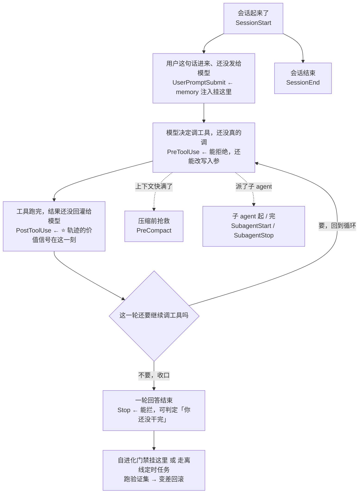

# 面经记录

**岗位方向：** Agent Infra · 中国商业化 Commercial AI（**提前批二面**，一面见 [[公司/字节/中国商业化/字节商业化AgentInfra一面_2026-07-30]]）
**面试官：** 「我是商业化这边的研发」——反问环节自述是 **agent 规划组**，服务十几个业务 agent
**时长：** 1 小时 29 分 42 秒（19:32–21:02）
**流程：** 自我介绍 → 职业规划 → 谷歌 Memory 深挖（~22 min）→ 字节答疑 Bot 深挖（~25 min）→ 简历细节（连接池 / prompt cache）→ 西门子 RAG 深挖（~10 min）→ **代码题 context manager（26 min）** → 反问
**结果：** 未知（当天面完）

> ⏱️ **重要时间线：这场是「裸考」。** 阿里星一面（当天 13:59）的复盘产物落库时间是 **19:31**，[[字节答疑Bot]] / [[谷歌Memory]] 两份追问库的更新时间是 **19:35 / 19:36**——**而这场 19:32 就开始了。**
> 也就是说：**下午那场踩的坑、以及为它准备好的正解，这场一句都没吃到。** 下面凡是标「阿里星那场同款」的，都不是「教了还犯」，是**同一个洞被两家连着踩了两遍**。这两份追问库现在已经写好了，下一场再犯才是真的教了不改。

---

## 部门信息（反问环节挖到的）

面试官对「对校招生的要求」答得很实，顺带把组的定位说清楚了：

| 情报 | 内容 |
|---|---|
| **组的定位** | 「我们算是一个 **agent 规划这个组**」——**不对某个具体业务 agent 的效果做优化** |
| **服务对象** | **十几个不同业务的 agent**，业务方是「真实的 agent 算法和策略」团队 |
| **提供什么** | **memory、sandbox（沙箱）、评测**，甚至 **GPU 相关的调度**——「通用的底层的一些基建」 |
| **合作方式** | 跟业务方共同开发 / 支持他们的业务，**给他们提供 best practice** |
| **用人要求 ①** | **计算机基础**（编码 + 常见基础）——原话「这个可能还是决定了最后的发展的上限」 |
| **用人要求 ②** | **对 AI 这块的理解**，不管是大模型还是 agent 本身 |
| **用人要求 ③** | **保证线上的稳定性、性能**——「所以我们对这个基础的计算机的比如说存储啊、网络啊这些都是有一些要求的」 |

> 🔑 **跟一面情报交叉验证，同一个组的画像已经拼完整了**：一面说的是 **ADK / context service / 沙盒 / GPU 调度**，这场说的是 **memory / sandbox / 评测 / GPU 调度**。两次都点名了**沙盒**和 **GPU 调度**，这场新增了 **memory** 和**评测**。
> **而这场的失分点恰好压在这两个新增项上**——§12（memory 评测拿不出实证案例）和 §18（多租户 / 沙箱隔离）。**面试官问的正是他自己每天在做的东西。**

---

## 0. 本场主线：一面是「扫描式」，二面是「刨根式」

一面的特征是**一题一问、点到即止、覆盖面广**（九个 memory 问题走完一份 checklist）。**这场完全不同：他会咬住一个点连问三到六次，直到问到你答不出来为止。**

四条被咬到底的链：

| 链 | 问法 | 断在第几问 |
|---|---|---|
| **hook 链** | 怎么结合 → **生命周期哪个点** → **还支持哪些 hook** | 🔴 第 3 问：「这方面我确实没有考虑过」 |
| **评测链** | 评测集怎么建 → 只局限这一个场景吗 → 只看分数吗 → **举个具体 badcase** → 所以还没线上验证？ | 🔴 第 4 问答偏两次，第 5 问被迫承认「还在 develop」 |
| **规模化链** | 本地跑？→ 多租户吗 → **代码权限** → **磁盘写满** → **scale 到 1-2 万人怎么改** → 多实例仓库和历史怎么办 → **数据库选哪个** → 为什么写多读少 → **实例挂了内存丢了吗** | ⚠️ 前半程明显好于阿里星那场，🔴 断在「数据库选哪个」 |
| **RAG 链** | 存储选型 → **ES 也能关键词啊** → **Milvus 也支持 BM25？** → **sparse 和 BM25 什么区别** → 什么时候用 BM25 → **它为什么能发现稀有词** | ⚠️ 撑到第 6 问，但最后一问的原理**说反了** |

> **对应策略：一面要「每个维度的第一个答案都完整」，二面要「每条链准备到第四层」。**
> 判断自己准备够没够的方法很简单——**对着简历上的每个名词，自己连问四个「那……呢？」，问到自己答不出来为止，那个点就是下一场会被戳穿的地方。**

---

## 1. 自我介绍（第四次零岗位定制）

**当时：** 五段实习按时间倒序，谷歌 → 字节 → Arm → 西门子 → 用友。

⚠️ 相比阿里星那场有一处**进步**：谷歌那段这次开门见山说了「**评测通用 memory 在我们组 agent 上的效果 + 定制化 + self-evolving**」，比下午那版（先讲组织架构变动）落点更快。

🔴 但仍然**零岗位定制**——对面是 Agent Infra，五段里有三段是 agent，**没有一句把它们串成一条线**。

**改进稿（开头加一句总纲，20 秒）：**

> 「我这几段实习其实是一条线：**都在 agent 的运行时和记忆这一层，而不是在某个具体业务的效果上。** 谷歌在做 memory 的评测和自进化，字节在做 agent 的门禁和多 agent 编排，西门子在做检索链路——**换句话说我一直在做的是『让 agent 跑得稳、答得准』的那一层基建**，这也是我投这个岗的原因。下面按时间倒序讲。」

**题型 A（项目叙述）｜扣分：① 落点（无总纲，复发第四次）**

---

## 2. 职业规划：你实习方向不太一样，校招看什么方向

**当时：** 主要看 **agent 开发**方向，因为比较新、比较火热、有前景。方向不一样是因为「当时 gap 回国，原本对 system 系统方面比较感兴趣，Arm 给了机会就去学习尝试」；西门子 → 字节 → 谷歌一直是 agent 方向。

> ✅ **比阿里星那场（§19 infra vs 垂类答反）好太多**——这次没有被术语绊住，直接给了方向，而且**主动解释了 Arm 那段为什么"不一样"**，把简历上唯一一处方向跳跃提前圆掉了。这个动作要保留。
> ⚠️ 但理由停在「比较新、比较火热、有前景」——**这是任何人都能说的话。** 面试官刚问完「你方向不太一样」，这里正是把「不一样」讲成「收敛」的机会。

**改进稿：**

> 「看 agent 方向，而且更具体一点是 **agent 的基础设施这一层**，不是某个业务 agent 的效果调优。
> Arm 那段确实是个岔路，但它不是浪费——**我在那边做的是性能量化，学的是『怎么把一个说不清的东西变成一个能测的数字』**。这件事后来直接变成了我在字节做门禁、在谷歌做 memory 评测的方法论：**我这三段 agent 实习里最一致的动作，就是先建可校验的指标，再谈优化。**」

**题型 A｜扣分：② 诊断（理由泛化，没把跳跃讲成收敛）**

---

## 3. 介绍最近这段实习（谷歌）

**当时：** 组是 Pixel testing agent 团队，目标是辅助开发人员做测试。原本用谷歌内部的 ADK 开发 agent；后来公司战略性改变，要求所有 agent 产品都接入内部的那套 agent 框架（**转录里直呼内部代号多次**），以 skill 或 tool 的形式暴露。接入之后两套 memory 打架，只能用它们家的 → 那就必须评测它对 testing agent 的帮助有多大；而且它是 general 的（所有人 coding、问问题都在上面跑），我们希望针对 testing 场景做定制化。

⚠️ **踩的是「语气纪律」，不是保密。** [[谷歌Memory]] 2026-08-05 已经订正过：**旧口径「不讲内部框架名」作废**——Antigravity、Pixel Agentic Test System 这些**简历上就写着的公开产品名，本来就可以讲**，回避反而可疑。
**这场踩的是另一条**：他报的是**内部昵称**而不是公开名，还配了「**我们谷歌内部叫它 XX**」「**我就直接叫它 XX 吧，比较好念**」这种句式——**这正是红线里点名禁用的「就是那个 XX 嘛」句式：它把公开信息说成了内幕，既不专业，也显得心虚。**
**正确做法：报公开名，语气平常。**「我们接的是 Antigravity，形态上就是 Claude Code 那类 ReAct agent」——信息量一样，风险为零，而且听起来是在陈述事实而不是在爆料。

**题型 A｜扣分：④ 口径（语气纪律，复发）**

---

## 4. 那它跟你自己拿 ADK 搭的有什么区别

### 4.1 「你们必须用它，它是不是有灵活性问题？我理解它是一种托管式的？」

**当时：** 「它其实就是一个 Claude Code，本质就是 Claude Code，就像字节的 Coco 一样，就是一个 agent、一个 ReAct agent。」

> ✅ **一句话锚定，非常好。** 跟一面拿 DeerFlow 类比是同一个动作：**讲对面不熟悉的系统时，先找一个对面一定熟悉的系统当锚点。** 这个习惯已经稳定下来了，保持。

### 4.2 「那它跟你自己拿 ADK 搭的 agent 有什么区别？」

**当时：** 「区别不大，因为所有 agent 本质都是 reasoning + action……它也没有一个很强的沙箱防御机制，我也没仔细看过。」差距不大的原因是我们的接入方式就是**把自己的 agent 改造成一个 skill 交给它加载**；真正的区别更多在**周边辅助工具**——连接手机的脚本、稳定性脚本，它通过 skill 来调这些脚本。

> ⚠️ **「区别不大」是这场第一个被浪费的开放题。** 面试官问的是**自研 harness 和统一 harness 的取舍**——这是 agent infra 岗最核心的问题之一（他们组做的就是「统一底座」）。
> **对面每天在解决的问题，就是你这句「区别不大」抹掉的东西。**

> 💡 **术语（C 档，仓库里搜不到，先立定义）**：**harness**（框架 / 承载层）——把「跑一个 agent 需要什么」封装起来的那一层：主循环调度、工具注册与分发、上下文拼装、权限与沙箱、状态持久化。它不是模型，也不是业务逻辑。跟一面记过的 **agent runtime** 是同一层东西的两种叫法。

**改进稿（把「区别不大」翻译成「谁承担什么」）：**

> 「从**能力**上说区别确实不大，两边都是 ReAct 循环。但从**归属**上说区别很大，我按三层说：
>
> **① 循环和工具协议这一层，统一之后是净赚的。** 自研 harness 意味着每次模型换代、协议变化、缓存策略调整，每个团队都要各自改一遍。统一之后这些是平台方的事。
> **② 沙箱和权限这一层，统一之后是必须让渡的。** 我们自研时可以自己决定 agent 能碰哪些文件；统一之后要按平台的口子来。**这一层是真正的成本，而不是所谓灵活性。**
> **③ 领域知识这一层，统一之后没有变化，只是换了封装形态。** 我们组的价值是连真机的脚本、稳定性脚本、测试领域的判断——原来是 agent 内部的代码，现在包成 skill 和 tool 给平台调。**同一份知识，换了个接口。**
>
> 所以我的判断是：**统一 harness 让渡的是控制权，换回来的是不用维护基础设施。对我们这种领域知识重、基础设施需求轻的团队，这笔交换是划算的**——代价是 memory 这类「平台觉得通用、我们觉得不够用」的能力，得自己在上面再叠一层，这正是我在做的事。」

**题型 B（项目机制）｜扣分：② 诊断（「区别不大」放掉了对方主场的题）**

---

## 5. 你的 Memory 是怎么接入的？实现了什么策略

**当时：✅ 讲清楚了形态**
- 本质是那套框架的一个**插件**
- 插件管理两件事：① 管好 **hook**，让 agent 在合适的时候沉淀 memory、写进一个 markdown ② 注册一个**每天凌晨 4 点的定时任务**，对所有 memory 做整合
- 现状很诚实：还在开发阶段，框架自己的 memory 也在迭代，现在工程那边就是把插件装上让它自己跑，「install 完就自己启动了，比较傻瓜式」
- 后续方案：拿**我们团队自己的数据集**对它做 evaluation，判断这套 memory 在这个数据集上作用有多大，**沉淀成一套能长期跟踪的 infra**
- 关键差异点：Claude Code / Codex / OpenClaw 这些 memory 都是**针对用户使用体验**做的，**改完之后到底变好还是变差没有概念，因为没有验证方式**；我们在一个 specific 场景里有专门的数据集，能验证每次改写是好是坏 → 所以可以**在 dreaming 过程中多挂一个 hook**，改完就跑数据集，**变差就回滚**

> ✅ **「他们没有验证方式，我们有数据集」这个立论，是他手上最强的一张牌**，这场和阿里星那场都打出来了，而且这场打得更早（第 6 问就摆出来了）。**保持。**

**题型 B｜无扣分**

---

## 6. 记忆整合具体怎么整合？多条合并成一条？

**当时：✅ 机制层描述很完整**
- memory 就是 markdown，**很像 skill**：有标题、有描述、有正文
- 返回给 agent 的**只有名字和描述**，需要具体内容时它才去读
- 整合时看 **24 小时内新增了多少个 memory 文档**，拿它们的**标题 + 描述**做语义向量检索，找到相关的历史文档
- 整合 agent 阅读这些相关文档，判断：是否**冲突**、是否需要**合并**、或者某条 memory **覆盖太大太全面需要拆分**

> ✅ **「拆分」这一条是新素材**，一面没说过。**「合并」和「拆分」是一对相反操作，能同时说出来，说明是真读过流程而不是背了个概念。**

**题型 B｜无扣分**

---

## 7. 语义相似检索这一段（四连问）

### 7.1 语义相似检索是怎么做的？

**当时：** 走内部的一个后端服务。把 memory 的**标题 + 描述**做 embedding；检索时拿**当前对话的最后 200 行**做相似度匹配。「具体怎么 embedding、怎么 search 不是我们负责，是别的团队负责，我们只是调用这个服务。」

### 7.2 「后 200 行」是啥意思？

**当时：⚠️ 答成了吐槽**
> 「其实他们这个设计我也没搞懂……**比较简单粗暴**，不足 200 行就全拿，超过就拿最近 200 行。但具体他为什么选 200 行、**为什么做这么简单粗暴的截断，我也没理解他为什么要这样子**。」

> ⚠️ **这是本场最典型的一次「诊断到一半就停」。** 你已经看出这个设计粗糙了——**那就把它讲完：粗在哪、会导致什么后果、你会怎么改。**
> **面试官问「后 200 行是啥意思」，八成不是在确认字面意思，是在给你一个批评现有设计的机会。**

**改进稿（三段：它在解决什么 → 粗在哪 → 我会怎么改）：**

> 「它要解决的问题是：**检索 memory 需要一个 query，但用户这一轮的输入往往太短，撑不起语义匹配**——用户可能只说了『再试一次』。所以它拿最近的对话内容当 query 的代理。
>
> **粗在三处：** ① **按行截断不按语义边界**，可能把一段代码或一次工具输出从中间劈开 ② **不加权**——200 行里最近一句和 200 行前那句权重一样，而实际上用户最新的意图应该占主导 ③ **不区分角色**，工具返回的大段日志会把用户的真实意图稀释掉，**这在 coding agent 里尤其严重，因为工具输出常常比人说的话长一个量级**。
>
> **我会怎么改：** 先做最省的一步——**只取 user 消息和 assistant 的自然语言回复，排除工具输出**，这一步不用改模型也不用改协议；再往上是**对最近 k 轮做加权或者用一个小模型抽一句 query 意图**。不过这块归属别的团队，我作为消费方能做的是**用我们的数据集测出『换成这种 query 构造之后召回质量变了多少』，拿数字去提需求**——这也是我们有评测集的价值之一。」

### 7.3 你们实际上就是把 memory 扔到那个服务里，它控制 embedding 选型、分块策略？

**当时：** 是的。我们只负责把 markdown 写下来，写到本地但**挂载在云端**，云端操作是那个团队负责的。**「我们控制怎么改写。」**

> ✅ **最后这四个字很关键**——在别人负责的系统里，把自己的职责边界说清楚（**我不控制存取，我控制写什么**），比说「不是我做的」强一个量级。**这是阿里星那场 §5 挨批的地方，这场自己修好了。**

### 7.4 检索策略你们可以自定义吗？语义还是关键词？

**当时：✅ 答得具体**
- 自定义空间不大，只有两个：① 检索多少条 ② **分组**——对 memory 分组后可以只检索指定分组
- 「但我最近测下来，其实并没有什么所谓的自定义空间，因为**它这个 hook 是一段写死的代码**，你想自定义就必须完全自己写一个新 hook 去替代它，**它是后台操作，你也不能传参数进去**」
- **「但它的 hook 本质其实也是一条 CLI 命令，所以也能做到类似的自定义。」**

> ✅ **最后这一句是本场技术判断最漂亮的一处**：从「不能传参 → 看起来封死了」推到「**但它是一条命令，命令就是可替换的**」。**这是 infra 岗要的思维方式——找到系统真正的扩展点，而不是接受它宣称的扩展点。**

**题型 B｜扣分：② 诊断（7.2 诊断到一半就停）**

---

## 8. 🔴 hook 机制三连（本场第一个断点）

### 8.1 介绍一下 hook 机制跟你们的东西怎么结合

**当时：** 谷歌所有工作都在一个大代码仓库里，所以那套框架和它 memory hook 的源码我们全都能看到、能改。hook 本质就是一个**代码路径**，编译之后做成 hook；有一个专门管理 hook 的后台进程，装插件时自动拉起；每次聊天时自动调用这个 hook，注入 memory 信息。**想改 hook，就是改 config 里的路径，把自己的源码放上去。**

### 8.2 这个 hook 是在 agent 生命周期的哪个点做的扩展？

**当时：** 在 **query 进来之后、agent 调用之前**，检索相关 memory，注入到 prompt 里；每轮对话都会调。

> ✅ **这一问答对了。** 对应的就是「用户输入提交后、模型调用前」这个挂载点。

### 8.3 🔴 那这个系统还支持其他生命周期的 hook 吗？

**当时：**
> 「其他生命周期的 hook，这方面我倒是没有考虑过，**我不好意思，这方面我没有考虑过**，因为我还没暂时思考过这方面的定制化，**我没有研究过它在这方面的知识**。是因为它和它的 memory 是两个不同团队开发的……我主要针对它的定制化做研究，定制化主要是改 hook，但是它这个 hook 的生命周期、什么时候调用，**这方面我确实没有思考过**。」

🔴 **四个问题：**
1. **一句话里说了四遍「没有考虑过」。** 一次是诚实，四次是防御——[[谷歌Memory]] 从星河觉醒那场起就记着这条，**这是第三场复发。**
2. **这是全场最不该失的一题。** 你的整个项目就架在 hook 上，**「这个系统一共有哪些 hook」是你的工作说明书**，不是课外知识。
3. **又用了「是两个不同团队开发的」划边界**——而你在 §7.3 刚刚示范过正确姿势（「我们控制怎么改写」）。**同一场里，好答法在前，坏答法在后。**
4. **最亏的是：这一问正是在给你铺台阶。** 面试官已经听你讲了「memory 靠一个注入 hook + 一个定时任务」，他问「还有别的 hook 吗」，**等的是你说出「有，而且我的自进化门禁应该挂在另一个点上」**——这是把项目从「装了个插件」抬到「我设计了挂载点」的唯一机会。

> 📌 **Claude Code 的 hook 事件清单（官方文档，2026-08-06 查证）。** 谷歌内部那套是 Claude Code 形态，公开对标物就是它——**这份清单必须能张口报出主干。**
>
> 官方文档目前列了 **31 个事件**，按生命周期分成七组，主干是这些：
>
> | 生命周期位置 | 事件 | 能不能拦 |
> |---|---|---|
> | 会话开始 / 结束 | `SessionStart` / `SessionEnd` | 只能注入上下文 / 只能做副作用 |
> | 用户输入提交后、模型调用前 | **`UserPromptSubmit`** | ✅ 能拦，也能用 `additionalContext` 注入内容 |
> | 工具调用前 | **`PreToolUse`** | ✅ 能拒绝、能改写工具入参（`updatedInput`） |
> | 工具调用后 | **`PostToolUse`** / `PostToolUseFailure` | ✅ 能拦，也能改写工具输出 |
> | 并行工具批次结束、下一次模型调用前 | `PostToolBatch` | ✅ 能拦 |
> | 子 agent 启动 / 结束 | `SubagentStart` / **`SubagentStop`** | 启动只能注入，结束能拦 |
> | 一轮回答结束 | **`Stop`** | ✅ 能拦（可以要求它继续干活） |
> | 上下文压缩前 / 后 | **`PreCompact`** / `PostCompact` | 压缩前能拦 |
> | 权限请求 | `PermissionRequest` / `PermissionDenied` | ✅ 能直接裁决 allow / deny |
>
> **配置方式**：`settings.json` 里按事件挂，`matcher` 按工具名或子 agent 类型过滤；hook 类型除了 `command`（脚本，stdin 收 JSON、stdout 回 JSON、exit 2 表示拦截），还有 `http`、`mcp_tool`、`prompt`（让模型判一次）、`agent`（起一个子 agent 去验证）。
> **⭐ 对你这个项目最关键的一条**：`UserPromptSubmit` 的注入是通过 `hookSpecificOutput.additionalContext` 完成的——**你描述的「检索 memory 注入进 prompt」，走的就是这个字段。**
> <!-- 来源: Claude Code 官方 hooks 文档 code.claude.com/docs/en/hooks ・ 查证于 2026-08-06 ・ 谷歌内部框架的事件名未公开，此处为公开对标物 -->

**一轮请求里这些钩子按什么顺序被触发（照着这张图报，不会漏）：**



**改进稿（先答有哪些，再答我的门禁该挂哪，最后收口）：**

> 「有，而且**这正好是我方案里必须想清楚的一件事**，我按 agent 的一轮生命周期讲：
>
> **会话级**——开始和结束各一个，开始那个可以注入初始上下文。
> **轮次级**——用户输入提交后、模型调用前一个（**memory 注入就挂在这里，通过往上下文里追加内容的方式生效**）；一轮回答结束时一个，而且**这个是能拦的**，可以判定「你还没干完，接着干」。
> **工具级**——工具调用前后各一个，调用前那个不但能拒绝，还能**改写工具入参**。
> **子 agent 级**——启动和结束各一个。
> **压缩级**——上下文压缩前后各一个，压缩前那个能拦。
>
> **说这些是因为我的自进化门禁不该挂在注入那个点上。** 注入点每轮都跑，只适合做读；而我要做的是「memory 改写之后跑验证集、变差就回滚」，**它天然属于一轮任务闭环之后**——所以应该挂在**一轮回答结束**那个点，或者干脆走**离线定时任务**，不占用户的等待时间。
>
> **再往前一步，我最想挂的其实是工具调用后那个点**：testing agent 的价值信号不在最终回复里，在**中间那些工具结果**里——哪条命令失败了、哪个断言挂了。**要做从轨迹学习，就得在轨迹产生的那一刻取，而不是等对话结束了回头猜。**」

**题型 B｜扣分：🔴 ① 落点（四次「没考虑过」）+ ③ 机制（自己项目的挂载点说不出来）**

---

## 9. 评测集是怎么构建出来的？

**当时：✅ 全场最好的一段之一**

拿一个最好构建的 agent 举例——**CI/CD 失败分类 agent**：
1. 后台每天抓取一定量的 CI/CD 错误，自动跑 agent，让它判断为什么失败、把 bug 分类、提单给对应的组
2. 对应的工程师收到 bug 单，**如果分类正确就不动，分类错了就把分类改掉**
3. **这就拿到了人工标注 = 金标准**
4. 保留 CI 的 **commit id**，可以把场景还原出来，重跑 agent，把结果跟标注比对

> ✅✅ **这段的价值在于它是「白捡的标注」**——**不需要额外雇人标注，工程师修正分类这个动作本身就是标注。** 这是评测集构建里最值钱的一类设计，而且他讲清楚了闭环的每一环（抓取 → 自动跑 → 人工修正 → 场景还原 → 重跑比对）。
> ✅ 「**用 commit id 还原场景**」这一句尤其关键——**它保证了评测是可重放的**，否则每天的错误都不一样，跑分之间没有可比性。

**可以补的一句（把它抬成方法论）：**

> 「这套的核心是：**别去建评测集，去找『人本来就在做修正』的地方。** 工程师改 bug 分类是他本来就要做的工作，我们只是把这个动作记下来当标注。**凡是能找到这种自然标注信号的场景，评测集的边际成本接近零，而且会随业务自动增长——这比任何人工标注集都更值得投入。**」

**题型 B｜无扣分**

---

## 10. 这个测试集只局限于这一个场景吗？你的自进化 memory 是只用于这个场景还是 general 的？

**当时：** 针对 pixel testing 场景，但这个场景下有非常多 agent。除了 CI 分类，还有一个 **description-to-test agent**（自然语言描述 → 测试步骤 → 操作手机），这个数据集已经维护好了，**两个维度打分**：① 生成的步骤跟标准答案做语义相似度 ② agent 操作手机之后**是否真的达成测试目标**。

**但这个测试集有个大问题**：要连真机 → ① 学生权限不够，抢不到手机资源 ② 有网络连接，波动大、测试时间久、**不好复现** → 暂时搁置，改用**以前的 offline shadow 离线数据集**跑分，「这样我就不用跑几百条，可能验证十几二十条就能比较好地验证结果」。

> ✅ **「不好复现所以搁置」这个判断是对的，而且理由给得很硬**（资源抢占 + 网络波动 + 耗时）。**评测集的第一属性是可重放，不是真实——他抓住了这一点。**
> ⚠️ 但「shadow 离线数据集」这个词**没解释**，面试官也没追。**这类只有你们内部知道的词，要么当场立定义，要么换成通用说法。**

> 💡 **术语（C 档）**：**shadow（影子）数据集 / 影子流量**——把线上真实请求复制一份到不影响用户的旁路环境里跑，只记录结果、不返回给用户。好处是**输入分布跟线上完全一致**，坏处是没有人工标注，只能做**新旧版本的相对比较**，不能算绝对准确率。

**题型 B｜扣分：④ 口径（内部术语未展开）**

---

## 11. 评测最终就是看数据集的那个分？有没有其他标准评测有没有更好？

**当时：** 主要就看分数。并研究过相关 paper：**memory 不是沉淀越多越好、改写越多越好，分数会有一个先高后低的过程**——不断重写会把详细的东西抽象掉、把细节抹除掉，导致 agent 没法从 memory 里拿到历史经验教训。所以有数据集验证，**起码能保证 memory 是长期可用的选择，可能不是最优，但是可用**。

> ✅ **「先升后降」这个曲线是他的高频武器**（阿里星那场也说了），而且它正好回答了「为什么只看一个分数就够」——**因为这个分数防的正是无声退化。**

**题型 B｜无扣分**

---

## 12. 🔴 举一个具体例子：不用你这套精细化 memory 是个 badcase，用了之后就好了

**这题面试官问了两遍，第二遍还重新解释了一遍问法——说明第一遍答偏了。**

**第一次答（答偏）：** 「也不叫好，就是这个 badcase 不会进入 memory……所有 markdown 都有一套像 git 一样的版本追溯，改写完之后每天定时任务评判，对评测数据集是否有优化、起码不要负优化，**持平才能存活；一旦发现跑分下降，就把今天的 memory 全部回滚掉**。」

**面试官重新问：** 「我问的是说，他**没有用你们的自进化 memory**，他原始最早的那个版本可能会有一些问题，你们用了你们这个之后**显著改善**的那种情况。」

**第二次答（承认没有）：**
> 「就是**我现在还在 develop 它中，这主要是个 design**，evaluation 这件事我其实在搭……但是**从 paper 理论上来说这是一个非常有改善的事情**」——然后转去讲 SkillOpt 的方法论（批处理、学习率、verify 门禁、消融实验结论）。

**面试官收口：** 「哦，就是现在你这个实现的系统，是你根据一些 paper 然后实现，**但是你还没有在线上的真实 case 里面去大规模的验证**，是吧？」→ **「是的是的是的。」**

🔴 **三个问题：**
1. **第一次把「效果案例」听成了「机制」。** 他问的是**故事**，你给的是**流程**。这两个东西在面试里的作用完全不同：机制证明你懂系统，案例证明这系统有用。
2. **「这主要是个 design」是自我否定式收口**——跟阿里星那场结尾说「Chrome 插件不如我自己找」是同一个毛病：**主动把自己的东西讲小。**
3. **最亏的是：素材是有的，只是没往这个方向取。** 你在 §10 刚讲完 description-to-test agent 会「操作手机、验证是否达成测试目标」——**testing 场景里最典型的 badcase 就在那儿**，你只需要举一个。

**改进稿（先给具体场景，再诚实划线，最后给证伪计划）：**

> 「**实测数字我现在还给不出来，评测流水线刚搭起来，我不想编一个。** 但我可以给一个非常具体的、我们真实会遇到的场景，这也是我设计这套东西的直接动机：
>
> **典型 badcase 是『同一个环境坑反复踩』。** 比如某类设备上某个测试必须先关掉某个后台服务才能跑通，**通用 memory 记不住这件事**——因为它是按用户偏好和通用经验设计的，这条经验既不是偏好，也不通用，它是**「这个测试 × 这类设备」上的一条具体教训**。结果就是每次换个人、换个会话，agent 都要重新踩一遍，花掉一整轮试错。
>
> **而这类经验恰恰是最该被记住的**，因为它有三个特征：**复现率高、代价大、而且有客观的对错**——测试通没通过是明确的信号，不需要人判断。
>
> **所以我要验证的假设很明确**：把这类带环境条件的失败教训沉淀下来，**同类任务的首次通过率应该上升、平均交互步数应该下降**。这两个指标在我们的 CI 数据集上都能直接算。
>
> **我也想清楚了怎么证伪它**：如果加了 memory 之后分数不涨、甚至掉了，那说明沉淀出来的是噪声而不是经验——**这时候该改的不是 memory 的结构，是沉淀的粒度**。所以我把回滚门禁放在了第一位：**没有这道门禁，我连『它有没有用』都答不了，那这个项目就没有意义。**」

**题型 B｜扣分：🔴 ① 落点（答偏，二次追问才对齐）+ ② 诊断（有素材没取，且自我否定收口）**

---

## 13. 介绍一下你在字节的那个项目

**当时：✅ 结构比一面更紧，⚠️ 仍然零数字**
- 业务场景：达人跟商家的广告对接平台，业务术语多、**PRD 文档模糊且陈旧、产品术语跟代码逻辑不匹配** → **只有代码是真的**
- 但代码也难读：业务术语复杂，**测试过 Claude Code、Codex，它们不能把一个代码文件里所有 if-else 情况都列全列准**——「**他会偷懒**，读了几个关键文件就生成答案，没把整个调用链、整个逻辑链捋顺，导致以偏概全」
- 例子：商家能否取消退款，某些情况能、某些不能，它只看到一种就下结论
- 解法：**决策树**——拿用户 query 当 root，代码里的枚举 / 抽象类实现 / if-else case 就是排列组合，顺着枚举值和函数实现不断延展
- 但 **40 多个代码仓库**、链路长，还是会张冠李戴（「A 流程能转到 C，它说成 B 流程能转到 C」）→ 加 **review agent** 回代码验证
- 还有一类漏是**用户自己没问清楚** → agent **反问**用户框定范围

⚠️ **整段零数字，第二场了。** [[字节答疑Bot]] 数字口径表就在那里：**56% → 87%、200+ 用户、50+ 题评测集**。这场后面还专门问了评测（§12 之外没再问答疑 bot 的评测），**等于三个数字一个都没用上。**

**题型 A｜扣分：② 诊断（零数字，复发）**

---

## 14. 为什么没有单独一个 agent 去做反问？

**当时：✅ 答得干脆且有理由**
- 没必要再加一个 agent。**审核 agent 既能做检测也能做反问**
- 而且**它是最有资格反问的那个**：它知道一共存在哪些情况、知道回答 agent 漏了什么，所以能问用户「你是否在乎某些被漏掉的情况」

> ✅ **「谁掌握信息谁提问」这个论证是对的**，而且直接回答了「为什么不拆」——**拆开反而要把「有哪些情况被漏了」这个上下文再传一遍。**

**题型 B｜无扣分**

---

## 15. multi-agent / subagent 四连问

### 15.1 你们主 agent 是哪个？

**当时：** DeerFlow，本质是 ReAct agent，接的是 **GLM 5.1**。

### 15.2 为什么要采用多 agent 架构？有没有可能用单 agent 或 subagent 完成？

**当时：** subagent 和多 agent 本质一样，都是多起一个 agent 做**上下文清空**。选多 agent 是因为：一个 query 进来，agent 要做非常大的调研——读文档、定位代码路径、看代码、把所有可能性列全——**这时候上下文已经很长，attention 不足了**，没办法做出更好的 summary，所以需要一个 review agent 来**刷新上下文**，生成更准确的回答。

### 15.3 multi-agent 和 subagent 有什么相同和不同？

**当时：✅ 分得清楚**
- 共同点：都是多 agent 形态
- 区别看**有没有 supervisor（任务分配者）**：
  - **subagent**：有主从关系，主 agent 分配任务给子 agent，子 agent 做调研，**保证主 agent 的上下文干净**；并行探索还能省整个 agent loop 的时间
  - **multi-agent**：没有主从，多个 agent 并行做不同工作，更像一个 **workflow**；比如一个 query 进来用多个 agent 配不同工具、不同 skill 跑出不同结果，再选一个更好的
- **「在我们的场景里其实也没有主从关系，它更像一个 workflow，两个 agent 做两件事」**

### 15.4 什么场景适合用 subagent？

**当时：✅ 三条，而且第一条最硬**
1. **任务可拆分、边界能定义清楚**——「在 DeerFlow 里其实支持 subagent 探索，但我们遇到的问题是：**用户 query 进来，这个探索路径怎么拆分？拆不好子 agent 会进死循环，或者检索到相似的代码**，做同样的工，那就是浪费 token、浪费时间，没有多大意义」
2. **保证主 agent 的 context 干净**，不被无关内容挤占
3. **加速**——并行探索

> ✅✅ **第一条是本场最有说服力的一段**：不是背「subagent 适合可并行任务」，而是给了**我们试过、失败在哪、为什么失败**（探索路径拆不开 → 子 agent 重复劳动）。**「我们试过但没用」比「我们没试过」强，比「我们用了」更可信。**

### 15.5 你说 subagent 适合可拆分的，那「审核」这件事不是可以独立拆出来的吗？

**当时：✅ 接得住，而且给出了一个新论点**
- 审核**确实可以独立拆分，但它强依赖回答 agent 的产出**——它需要决策树做指引，才能高效地去验证
- 更深一层：**agent 在多轮 loop 里，thinking 里其实想到过正确的东西，但在最终 summary 给用户那段话里没写进去** —— review agent 就是为了解决这个

> ✅ **「thinking 里想到了但没写进最终答案」——这个观察非常锋利**，它把 review agent 的存在理由从「防幻觉」升级成了「防信息在收口时丢失」。**这是一个只有真的看过 trace 的人才说得出的现象。**
> ⚠️ 唯一可惜：**没有把「依赖」和「可拆分」这两个词的关系点破**——面试官问的其实是「可拆分 ≠ 可并行」。

**可以补的一句：**

> 「所以我想区分两个词：**可拆分说的是职责，可并行说的是时序。** 审核在职责上完全可以独立，但在时序上必须排在生成之后——**它是流水线的下一站，不是分出去的一条支线。** 我理解 subagent 真正省的是**并行时间**和**主上下文**，我们这个场景只吃到了第二个好处，所以做成串行的两个 agent 更贴切。」

**题型 B / C 混合｜扣分：④ 口径（可拆分 vs 可并行没点破）**

---

## 16. 你们这个项目的模型是怎么选型的？

**当时：✅ 有判据、有反例，本场最完整的一题**
- 首要考虑：**内部模型能否稳定有效运转**（用户体验）
- 第二个判据非常具体：**工具调用轮数跟正确率正相关**——「你更偏向调用更多工具、做更多探索，就能有更完善的答案」
- **GLM 5.1 做得好**，「它自己训练的问题，非常喜欢多次调用工具做探索」
- **Gemini 效果也不错，但资源紧张**，后期不再用
- **GPT 除了资源紧张还很喜欢偷懒**：GLM / Gemini 二三十轮工具调用能答的问题，**GPT 只有十轮左右**，结果就差——「他可能觉得自己找到答案就停下了，也可能太聪明了吧」

> ✅✅ **「工具调用轮数 vs 正确率正相关」是一条自己测出来的经验规律，而且它直接推导出选型标准**——这比「我们对比了准确率」高一个层次，因为**它解释了为什么会有差异**。
> ✅ 「**二三十轮 vs 十轮**」这个对比数字是本场唯一给对的量化，很有说服力。

**可以补的一句（把观察抬成机制）：**

> 「补一句我后来的理解：**这条相关性不是因果，方向可能是反的。** 不是『多调工具所以答得好』，而是**这类问题的答案本来就分散在很多文件里，一个愿意持续探索的模型才有机会看全**。所以我们选型时看的其实不是轮数本身，是**模型在没拿到明确答案时会不会继续找**——GPT 那种『找到一个像答案的东西就收工』的行为，在别的场景是优点，在我们这里是致命的。」

**题型 B｜无扣分**

---

## 17. 你们 agent 接入了哪些工具？一共多少个？

**当时：✅ 清楚，而且有减法**
- **先做减法**：「因为我们只是一个看代码生成回答的 agent，所以**把很多写的工具全部删掉**」——为了工具选择的准确性
- **两个自研工具**：
  1. **AST 语法解析**——把代码文件里所有 if-else 骨架提取出来喂给模型
  2. **字节内部的 CodeRAG**——自然语言到代码仓库的匹配，定位到具体仓库
- **通用工具**：Grep、Glob、ReadFile

> ✅ **「把写的工具全删掉」是一个很好的设计动作**——**限制能力本身就是一种对准确率的优化**。可惜没有把这个动作的收益讲出来（工具越多，选错工具的概率越高，且 system prompt 越长）。

**题型 B｜无扣分**

---

## 18. 部署 / 多租户 / 权限 / 磁盘（四连）

### 18.1 这些工具跑的脚本都在本地跑？

**当时：** 在服务器，部署在 **TCE** 上，**把所有仓库都 git clone 下来**，在 TCE 上读这些仓库。

### 18.2 它是多租户的吗？如果是，每个租户的请求都在那个容器本地跑？

**当时：** 「**它没有一个多租户的情况，没有多用户**……我没有对用户权限做什么校验，**单纯每个用户都能看到一样的东西**。」

### 18.3 🔴 那如果他把代码都拉到本地了，会不会出现代码权限的问题？有没有可能看到其他人的代码？

**当时：⚠️ 承认得很干脆，但兜底方案是对的**
> 「**是可能的，这个是百分百有可能。** 但在我们场景中没有保密需求……**仓库的权限是跟着我的权限走的**，我能看到的都是比较安全的仓库，没有强保密的；主要流程仓库大家都需要接触、也有权利接触。」
> 「当然想做校验也很简单：**飞书对话里有用户 ID**，拿用户 ID 跟他的权限做匹配，再返回给 agent 的结果里做路径删除就好了。」

> ⚠️ **半对半错，而且错的那半更重要。**
> ✅ 对的：识别出「agent 用的是我的权限，不是提问人的权限」，也给了用用户 ID 做鉴权的方向。
> 🔴 错的：**兜底方案放在了「返回结果里删路径」——这是事后过滤，不是权限控制。** 内容已经进过模型的上下文了，模型完全可能在答案正文里复述它，你删掉路径也拦不住。
> 🔴 而且**「没有保密需求」这个前提对方不会接受**——他这个组是做平台的，他问这个问题就是在测「你知不知道这个设计到了平台上会炸」。

> 💡 **这个问题有正式名字（[[字节答疑Bot]] Q9d 已立定义，B 档）**：**confused deputy（混淆代理人）**——一个高权限程序被低权限的人诱导着做了它有权、而请求者无权的事。**agent 天生是 confused deputy 的重灾区，因为它总是拿着服务账号的权限替用户干活。**

**改进稿（把「没需求」讲成「够用但撑不到平台」，并把过滤点前移）：**

> 「**现在确实没做，这是个明确的取舍，但我知道它的边界在哪。**
>
> **现状为什么够用**：内部工具、只读、40 多个仓库对研发本来就开放，agent 用的服务账号权限跟提问人的权限**实际重合**。
>
> **但这个设计撑不到跨团队**，因为它是个 confused deputy——**任何能进这个飞书话题的人，都能通过提问间接读到服务账号能读的所有代码，而系统从来没检查过提问人自己有没有那个仓库的权限。**
>
> **要补的话，关键是过滤点必须在工具层，不能在输出层。** 我第一反应是在返回给用户之前把敏感路径删掉，**但这是错的**——内容一旦进了上下文，模型就可能在正文里复述它，输出过滤拦不住。**正确做法是把发起人身份透传到工具层**：网关带上发起人 uid，agent 调 grep / 读文件时用**发起人的权限**去读。
>
> **还有一个细节我认为很关键：查不到的时候必须明确告诉模型『这一支你无权访问』，不能静默跳过。** 静默跳过会让决策树少一个分支，而且**答案表面上看不出来是漏的**——对我们这种以『列全』为卖点的系统，无声的漏比明着报错危险得多。」

### 18.4 如果所有代码都在本地，时间长了会不会把本地磁盘写满？

**当时：⚠️ 又是「没考虑过」开局，但后半段的推演很好**
- 「我们倒是没有这样的情况，共 40 多个仓库，**具体大小我们倒是没有看过，因为没考虑过磁盘这个问题**」
- **但后半段答得漂亮**：「如果真出现磁盘限制问题，我觉得**得改一下方法**——因为磁盘都爆了说明仓库数量已经特别特别多，**那时候单纯用关键词匹配已经没办法解决业务场景了**，可能需要额外的工具，比如拿到一个函数的**上下文调用链**给 agent 更抽象的信息。**如果真出现磁盘爆满，整个 agent 的设计其实也要大改，单纯通过关键词匹配看代码就不是一个合理方案了。**」

> ✅✅ **后半段是本场最好的一次「把资源问题翻译成架构问题」**：磁盘写满不是运维问题，**是「关键词匹配这条路已经走到头」的信号**。这个推理层次很高。
> ⚠️ 可惜前半句又是「没考虑过 / 没看过」开局。**同一段话里，先自曝再翻盘，第一印象已经扣掉了。**

**改进稿（换个顺序，同样的内容）：**

> 「**现在不会——40 多个仓库是有界的，而且是全量常驻，不是随用户增长的。** 磁盘占用只跟仓库数和历史深度有关，**跟用户量无关**，所以这块不是先撑不住的地方。
> 真要控的话有两条现成的路：**浅克隆**（只拉最近的提交历史，不要全部历史）和**按需拉取**（冷仓库不常驻，用到才拉）。
> **但我更想说的是：如果真的到了磁盘装不下的规模，该改的不是磁盘方案，是检索方案。** 仓库多到那个量级，靠关键词匹配定位代码本来就已经失效了——那时候要换成基于调用图的结构化检索，让 agent 按调用关系导航。**所以磁盘爆满对我来说是一个架构信号，不是一个容量问题。**」

**题型 B｜扣分：① 落点（18.4 先自曝）+ ③ 机制（18.3 过滤点放错层）**

---

## 19. 🌟 假设 scale 到 1-2 万人，整体架构怎么改（本场最重要的一段）

> 🔑 **这是阿里星那场（5 小时前）的分水岭题，同一条链再考一遍。对比价值极大。**

### 19.1 整体架构应该怎么改？

**当时：⚠️ 明显好于阿里星那场，主动给了三条**
1. **多实例**——现在是单实例，用户问问题经网关转发给这个实例；scale 就需要多实例 + 流量分配
2. **云端挂载磁盘**——本地能看到对应的代码文件，**agent 需要的时候才下载，不需要就剔除**
3. **数据库分离**——多轮对话的 checkpoint 现在写在本地 SQLite，**用户量大了要把存储分离成一个独立服务**
4. **限流**——「其实我们这边没有讨论过一个用户一次能问多少个问题、token 消耗怎么算，用户量大了这方面也需要考虑和限流」

> ✅✅ **这是本场最大的进步。** 阿里星那场同一条链，第 7 问直接是「多实例产物共享**这方面我确实没有思考过**」；**这场自己主动把「云端挂载磁盘、按需下载」说出来了**——而这正是下午那场卡死的地方。**5 小时内自己补上了，这是真的想过，不是背的。**
> ✅ **主动提限流**也是加分——面试官没问，他自己想到了「用户量 = token 成本」这条线。

### 19.2 如果这次打到这个实例、下次打到另一个实例，他下载的仓库和过往的会话历史怎么办？

**当时：✅ 两个都答上了**
- **仓库**：没问题，都挂载在云端，本地能看到共同的仓库，需要时拉下来；**本质上是通过中间件维护在另一套远程服务里**
- **会话历史**：保存在数据库里，**只要在同一个 session / 同一个话题，就能拿到对应的上下文，重新组装 prompt 给它就好**

> ✅ **答对了，而且是下午那场答崩的同一题。**
> ⚠️ 但漏了**最关键的第三类状态**：会话过程中产生的**中间产物**（agent 跑 bash 生成的临时文件）。仓库是只读物料、历史是事件流，**这两类都好办；难的是可写的会话工作区。**

> 📌 **[[字节答疑Bot]] Q9e 已经写好了这题的完整答案（19:35 落库，比这场晚 3 分钟），下一场必须用上。** 核心是**先做三分类**：
>
> | 状态类别 | 例子 | 放哪 |
> |---|---|---|
> | **只读物料** | 40 多个代码仓库 | 共享挂载 / 各实例本地缓存都行，**丢了能重拉** |
> | **会话事件流** | 每轮的 input / output / 工具调用 | 外部数据库，按 `thread_id` 恢复 |
> | **可写会话产物** | bash 生成的临时文件、交付 artifact | 🔴 **最难的一类**：会话亲和（sticky session）/ 共享对象存储 / 每 session 独立沙箱服务，三条路按改动成本递增 |

### 19.3 🔴 那你如果要放到一个外置数据库里，这数据库打算用哪个？

**当时：🔴 本场第二个明确断点**
> 「数据库打算用哪个？**这个确实没有考虑过**，我觉得我们这个是**写多读少**的一个场景。**思考一下哈。**」（长时间停顿）
> 后面被追问后：「**用 PGSQL 吗？Max，因为我也没有很好的思考过最近哪个数据库擅长什么方面**……在我们场景里它确实是写多读少、对事务没有强一致要求，可能更适合**写性能更好、一致性要求低一点**的数据库。」

🔴 **三个问题：**
1. **又是「没有考虑过」开局**——本场第三次（§8.3 hook、§18.4 磁盘、这里）。
2. **「写性能好、一致性弱」推出来的方向是错的。** 这个推理链听起来很像八股（写多 → NoSQL），**但它跳过了唯一重要的一步：算数量级。**
3. **答案其实是现成的**：他自己用的就是 LangGraph，**LangGraph 官方就提供 Postgres 的 checkpointer**。这不是选型题，是「把本地 SQLite 换成官方的 Postgres 实现」。

**改进稿（先算量级，再给答案，最后说什么时候才需要换）：**

> 「**先算一下量级，因为这决定了要不要认真选型。**
> 写入量 = 并发会话数 × 每轮的节点数。1-2 万人的内部工具，**同时在跑的会话撑死几十个**；一次问答二三十轮工具调用、耗时几分钟，**平均下来每秒也就几十次写**。**这个量级任何一个关系型数据库都是随手接住的，所以这里不该做性能选型，该做省事选型。**
>
> **所以答案是 PostgreSQL**——直接原因是 **LangGraph 官方就有 Postgres 的 checkpointer 实现，换掉本地 SQLite 只是换一个连接串**，我不需要自己设计表结构和恢复逻辑。而且 checkpoint 的内容是半结构化的状态快照，**用 JSONB 存正合适**。
>
> **访问模式确实是写多读少，但更准确的说法是：顺序追加写 + 按主键点查。** 每个节点执行完追加一条，读只在会话恢复时按 `thread_id` 取最后一个 checkpoint——**没有范围扫描、没有复杂 join、没有跨行事务。** 正因为模式这么简单，**选型的自由度很大，那就该选运维成本最低的那个。**
>
> **什么时候才需要换**：如果哪天写入真成瓶颈，第一步不是换数据库，是**减少写入次数**——不是每个节点都落盘，改成按边界落（比如每次工具调用批次结束落一次）。**先降写放大，再考虑换存储引擎。**」

### 19.4 为什么是写多读少？什么时候会写、什么时候会读？

**当时：✅ 这一问反而答对了**
- 一个问题进来有很多轮工具调用，**每个 turn 都会写一遍数据库**，写完再发给下一轮
- 读的情况远少于写
- 「上下文正常来说是存在内存里的……**用户越多这个内存能否保管好，我现在一想也没有考虑好**，可能这方面要用 Redis 类似的缓存机制做更好的内存管理」

> ✅ **「每个 turn 都写一次」这个描述是准确的**——这正是 LangGraph checkpointer 的行为（[[LangGraph工程实践]]：每个超步结束落一次 state）。

### 19.5 你刚才说有些东西存在内存里，如果实例挂了，内存里的东西就丢了吗？

**当时：✅ 承认得很清楚，而且指出了最关键的那一个**
- 是的，实例挂了内存就丢
- **「我觉得在我场景里最大的一个问题是决策树是存在内存里面的」**——它只在最终阶段才落盘
- 解法：**分批写磁盘**，每过多少轮对话自动写一次，做 checkpoint 保存

> ✅ **自己点出「决策树在内存里」是最大的问题——这个自我诊断非常准。** 决策树是整个系统最贵的产物（几十轮工具调用换来的），丢了等于整个问答重来。
> ⚠️ 但解法说成「分批写磁盘」，**其实框架已经替你做了**：LangGraph 的 checkpointer 本来就每个节点落一次盘。**真正的问题不是「没有落盘机制」，是「决策树没有放进被 checkpoint 的 state schema」，或者 checkpointer 用的是内存版。**

**改进稿：**

> 「会丢，而且我很清楚最不能丢的是哪一个：**决策树**。它是几十轮工具调用换来的产物，丢了这一次问答就得从头再来，成本比会话历史高得多。
>
> **但这件事其实不需要我自己写落盘逻辑。** LangGraph 的 checkpointer 本来就是**每个节点执行完落一次**，可以从任意一个 checkpoint 恢复继续跑。**所以问题不是『没有持久化机制』，是决策树没有被放进 checkpoint 覆盖的那份 state 里**——我们把它当成了运行时的中间变量。
>
> **改法是把决策树纳入 state schema，让它跟着 checkpointer 一起落**，恢复时按 `thread_id` 拿回来。**这样重启的语义就从『这次问答作废』变成『从上一个节点接着跑』**——对我们这种一次跑几分钟的长任务，这个差别是决定性的。」

**题型 C（通用知识 · 系统设计）｜扣分：🔴 ① 落点（19.3 「没考虑过」）+ ③ 机制（19.3 推理跳过量级估算）｜✅ 但 19.1 / 19.2 / 19.5 明显优于阿里星那场**

---

## 20. 简历里那个 HTTPS 连接池的问题是什么？

**当时：✅ 讲得非常清楚，是本场技术细节讲得最完整的一段**

因果链：
1. 内部的可观测组件 **Fornax** 写日志时，专门起了一个 Python 的**异步线程**做 IO 写操作
2. 因为有网络连接，它会**打开一个 event loop**（事件循环）
3. 它写完之后**把 event loop 关掉**，但**连接被放回了共享连接池**
4. 于是连接池里就有了一条**绑定着已关闭 event loop 的连接**
5. 主流程（回答问题的那个进程）一旦取到这条连接，就会报「event loop 已关闭」，**整个对话直接挂掉**
6. **修法**：所有连接都不 keep-alive，**用完就丢，下次重新建**
7. **理由给得很好**：「其他修法都要改线程池的创建、改 event loop 的创建、改源码；但在我们场景里**每建一个连接也就几百毫秒，而回答一个问题要几分钟**，就算二三十个 turn，最终收益也就几秒钟——**几秒钟相比几分钟微不足道**」

> ✅✅ **这段是「没有必须讲成取舍」的正面范例**，而且是他自己自然做到的：不是「我没改源码」，而是「**我算过收益，几秒 vs 几分钟，不值得**」。**这一段的讲法应该复制到所有『我用了简单方案』的场合。**

⚠️ **但有一处口径要跟 [[字节答疑Bot]] Q6 的定稿对齐**：那边写着「**止血是关闭连接复用，根治是让日志 SDK 用自己独立的 loop 和 client、不共用全局连接池**」，并且明确标注「**per-loop 分池已作废**——你的场景连接池是全局唯一的，按 loop 分池不适用，还会有旧 client 泄漏」。**这场只讲了止血，没讲根治。**

**可以补的一句（说出根治方案，让取舍更可信）：**

> 「补充一下根因和我知道的根治方案：**根因是两个框架对事件循环的所有权认知不一致**——主流程复用一个全局连接池，而日志 SDK 每次写完就把自己起的 loop 关掉，**连接池对此毫无感知**。
> **根治是让日志 SDK 用自己独立的 loop 和 client，彻底不碰全局连接池**——它跟主流程本来就没有共享连接的必要。
> **我当时选的是止血方案（关掉连接复用）**，因为根治要动公共组件的初始化路径，影响面比这个 bug 本身大；而止血的成本我算得清：**每轮多几百毫秒建连，占一次几分钟的问答不到 1%。**」

> 💡 **术语（B 档，[[Python并发与GIL]] 提过事件循环，[[RPC与Netty]] 提过长连接，但隔得远，重新带一句）**：
> - **event loop（事件循环）**：异步 Python 的调度中枢，一个线程一个，负责在多个协程之间轮转。**连接、锁这类异步资源在创建时会绑定到当时的 loop 上，跨 loop 使用会直接报错。**
> - **keep-alive（长连接复用）**：一次 TCP + TLS 握手建立的连接用完不关，留在池里给下一个请求用。省的就是握手那几百毫秒。

**题型 B｜无扣分**

---

## 21. prompt cache（两连）

### 21.1 简历里这个 prompt cache 是指什么？

**当时：** 接入 GLM 时走的是 **Anthropic 协议**（转录音「nforce」，指的是 Anthropic 兼容协议）。这个协议的 prompt cache **需要显式打断点**——你要指定 cache 到哪个位置，比如只 cache system prompt，还是 cache 到 system prompt 后面的多少轮对话。**不打断点默认就不 cache**，所以当时做了打点的功能校验，并**验证是否真的命中了缓存**。

> ✅ **口径正确**，跟 [[LLM多协议网关适配]] 层 6 对得上：Anthropic 协议用 `cache_control:{type:"ephemeral"}` 显式打断点，最多 4 个；OpenAI 那边是自动前缀缓存，不用打点。
> ✅ **「验证是否真的 cache 到了」这个动作值得强调**——[[LLM多协议网关适配]] 记着一条：**断点打错位置不报错，写入按 1.25 倍计费却一次不命中，比不用缓存还贵 25%。** 这句话如果说出来，这题会从「我做过」变成「我知道不做会怎样」。

### 21.2 为什么 prompt cache 能降本增效？底层原理是什么？

**当时：✅ 讲对了**
大模型本质是词语接龙，下一个词取决于前面词的计算结果；每轮对话**前缀是一样的**，一样的前缀计算结果不会变，所以可以复用以前的计算结果，做到更快、更便宜。

> ✅ **跟阿里星那场同题答得一样稳，这是已经稳定的 A 档知识点。**

**可以加一句让它更硬（说出被缓存的到底是什么）：**

> 「更具体一点：被复用的是 **KV cache**——注意力机制里每个 token 算出来的 key / value 向量。**前缀一样，这些向量就一样，所以不用重算。** 这也解释了两件事：**① 为什么必须是前缀严格相同**，中间改一个字后面全废；**② 为什么把变动的内容放前面是灾难性的**——我们在网关这层的规则就是**稳定的放前面（system、工具定义、skill），变动的放后面**。」

**题型 B / C｜无扣分**

---

## 22. 西门子 RAG 存储与检索六连（撑到第六问才断）

### 22.1 RAG 底层存储怎么选型的？

**当时：** 一开始是 **ES 装插件**支持向量存储，**但它只能存到 1024 维**；随着 embedding 模型进步，用到**千问 3 的时候向量维度已经到 4096 维**，所以改用 **Milvus** 专门的向量数据库。「主要考虑就是**向量维度能否存取**的问题。」

### 22.2 但是 ES 应该还能支持关键词检索吧？

**当时：** Milvus 也能——它不仅支持关键词检索，还**特别适配 BGE-M3**：BGE-M3 不仅能生成语义向量（dense embedding），还能生成 **sparse embedding**，「类似关键词检索但也包含语义向量，比较稀疏」。「一般（ES）原设计不支持这样的 sparse embedding 存储，但 Milvus 支持」，所以我不仅能用 BM25、不仅能用语义检索，**还能再加一路 sparse embedding，做更多可能性的召回**。

### 22.3 Milvus 也能支持 BM25 吗？是用 sparse embedding 支持的，还是它本来就支持？

**当时：** 「它就是用 SPARSE，我记得当时是通过 sparse 的标签配置就能支持。」

### 22.4 sparse embedding 和 BM25 都能做关键词，它俩有什么区别？

**当时：✅ 大方向答对了**
- **BM25 是一个算法**：对文本分词，计算词语在文本里的**稀缺性**，还会考虑**文档长度**，「本质是一个算分」
- **sparse embedding 更多是一个词表的向量匹配**：每个词对应的 embedding 分数是多少
- 收口：「一个是经过 **BERT 模型语义理解**之后得到的向量分数，一个是文档分词之后算出来的**比较死的分数**；**一个是纯关键词，一个是又有关键词又有语义**」

### 22.5 什么时候比较适合 BM25？举个例子

**当时：✅ 例子很具体，这是本段最好的一问**
- 一个 chunk 大概 500 token，里面可能只有两三个 token 是关键词
- 这两三个 token 在整个 chunk 里**微不足道**，**会被 dense embedding 把语义稀释掉**，导致语义检索检不出来
- 但 BM25 能发现「在长文档里比较特别的词」，分数会比较高，**用户问到这种特别的词时就能快速准确地检索到**

> ✅✅ **「稀释」这个描述抓到了要害**——单向量 dense embedding 把整段压成一个向量，低频关键信息会被主体语义淹没。**这正是混合检索存在的根本理由，讲得比大多数人清楚。**

### 22.6 🔴 它为什么能发现这些很少的词呀？

**当时：🔴 说反了**
> 「因为它是对文档进行了分词，它的算法会给**在长文档里面出现频率少的词**一个很高的分数，因为它**在一个很长的文档里面只出现一两次**，然后它不是常见词，那说明它是很关键的词语。」

🔴 **把两个不同的统计量混在一起了，而且长度那部分讲反了：**

| 量 | 统计范围 | 在 BM25 里的作用 |
|---|---|---|
| **TF**（term frequency，词频） | **这一篇文档内**，这个词出现了几次 | 出现越多分越高，**但有饱和**（不会线性涨） |
| **IDF**（inverse document frequency，逆文档频率） | **整个语料库**，有多少篇文档包含这个词 | **包含它的文档越少，分越高**——「稀有」是从这来的 |
| **长度归一化** | 这篇文档比平均长多少 | **文档越长，同样的词频得分越低**（惩罚长文档） |

**所以正确的因果是：稀有性来自 IDF，是跨文档统计的，跟这个词在这篇文档里出现几次无关。** 而他说的「在一个很长的文档里只出现一两次所以分高」——**长度那一项的方向恰好是反的：文档长会拉低得分，不是拉高。**

> 💡 **一句话记法：TF 看『这篇里有多少』，IDF 看『别的篇里有没有』，长度归一化看『这篇是不是靠长度刷的词频』。** **「稀有词得分高」= IDF 高，只跟别的文档有关。**

**改进稿：**

> 「关键在 **IDF**——逆文档频率。它统计的是**整个语料库里有多少篇文档包含这个词**，包含得越少，这个词的权重越高。所以『稀有』是**跨文档**统计出来的，跟它在当前这篇里出现几次没关系。
>
> BM25 的打分可以拆成三块：**IDF 决定这个词值不值钱；TF 决定这篇文档提了几次，而且是有饱和的**——提 10 次不会比提 5 次值两倍；**再除一个长度归一化，防止长文档靠篇幅堆词频占便宜。**
>
> 所以在我们的场景里它为什么有用：**手册里的型号、错误码、参数名这类词，全语料只在少数几篇里出现，IDF 极高**，用户一问就能精准命中。**而这正是 dense embedding 最弱的地方**——一个 500 token 的 chunk 压成一个向量，这几个 token 的信号会被整段的主体语义稀释掉。**两条路补的是不同的洞。**」

> 📌 **另外三处口径要订正（都会被追出处）**：
>
> | # | 当时说的 | 实际情况 |
> |---|---|---|
> | 1 | 「ES 只能存 1024 维」 | **是版本问题，不是 ES 的固有限制。** ES 从 **8.11 起 `dense_vector` 上限就是 4096**。正确说法是「**我们当时那个版本**上限是 1024」——否则面试官只要知道新版本，这条选型理由就当场作废 |
> | 2 | 「ES 原设计不支持 sparse embedding 存储」 | **不准确。** ES 有 `sparse_vector` 字段类型（ELSER 用的就是它，**8.8 起**），**8.9 起还支持 RRF 把 BM25 和向量结果融合**。所以「ES 不能做稀疏」这条站不住 |
> | 3 | 「Milvus 的 BM25 就是用 sparse 支持的」 | **方向对，但要说清是两条不同的路**：① **Milvus 2.5 内置 BM25 Function**（集成 Tantivy 全文检索库），**文本直接进，Milvus 自己分词、自己算 TF-IDF，输出稀疏向量**，不需要调模型 ② **你自己用 BGE-M3 / SPLADE 生成 learned sparse 向量再灌进去**。**他们项目用的是第 ②** 条 |
>
> <!-- 来源: Elastic 官方 dense-vector 文档 + Elastic 8.8/8.9 发布博客 + Milvus 官方 BM25 Function / Full Text Search 文档 ・ 查证于 2026-08-06 -->

> ⚠️ **[[RAG优化全链路]] 第 73 行现在写着「换 ES → Milvus 主因：千问3 4096 维 ES 放不下 + ES 不支持 sparse」——这两条按上表都要改口径。已在本次入库时同步修正。**

**改进稿（选型理由重写，不依赖那两条过时事实）：**

> 「当时的直接触发点是维度：**我们那个版本的 ES，索引化的 dense_vector 上限是 1024，而千问 3 的向量是 4096 维，装不下。**（补一句：ES 从 8.11 起上限已经是 4096 了，所以这条理由在今天不成立，我说的是当时。）
>
> **但真正让我们留在 Milvus 的不是维度，是稀疏那一路。** 我们要的是三路召回——dense、BM25、learned sparse——**Milvus 对稀疏向量是原生倒排索引，而且对 BGE-M3 这类同时输出 dense 和 sparse 的模型有现成适配**，三路检索加融合在一套 API 里就完成了。
>
> **反过来我也认为 ES 是个合理选择**：如果这个系统已经在用 ES 做日志和全文检索，那 ES 8.9 之后 BM25 + 向量 + RRF 融合一套就够了，**少维护一个组件的价值，往往大于向量库那点性能优势。** 我们当时没有这个前提，所以选了专用向量库。」

**题型 C（通用知识）｜扣分：🔴 ④ 口径（BM25 原理说反 + 三处事实过时）｜✅ 但 22.5 的例子讲得很好**

---

## 23. 检索这一路后来还留着吗？+ Ranker 选型

### 23.1 加了稀疏向量这一路，对效果有多少提升？

**当时：✅ 诚实且有价值**
> 「其实提升不大。我们当时做过效果测试，**真正有用的是语义 + BM25，把这两个做好、做重排序就能做得比较好。** 稀疏这一路在跑分上我们没看出什么区别。」

### 23.2 那最后还是保留了这一路？

**当时：** 「最后就放在那，因为我们后来改用千问 3 了，BGE-M3 就没有再用了……**一个 query 走两次 embedding 也挺麻烦的**。当时选 Milvus 也是出于 BGE-M3 sparse 的考量。」→ 面试官：「但后来也没有用。」→ 「**对对对，发现效果不好，没有意义。**」

> ✅ **敢说「我加的东西没效果」是加分项**，而且他给了原因（换 embedding 模型后 BGE-M3 不再用了）。
> ⚠️ 但**结尾又是自我否定收口**——「没有意义」。**这句话把一次有价值的负结果讲成了一次失败。**

**改进稿（把负结果讲成决策依据）：**

> 「**提升不大，我们的消融实验里稀疏这一路基本没带来增量**——真正扛事的是 dense + BM25 加重排。后来换成千问 3 的 embedding，BGE-M3 就不用了，这一路自然废掉。
>
> **但这个负结果本身是有用的，它改变了我们后面的判断：召回路数不是越多越好。** 每多一路，query 侧就多一次 embedding、多一次检索、多一份要融合的分数，**延迟和复杂度是实打实涨的，而收益要看这一路补的洞跟已有的路重不重合。** BGE-M3 的 sparse 补的洞跟 BM25 高度重合——**都是词面匹配，一个加了语义扩展而已**，所以它在 BM25 已经在的情况下增量很小。
>
> **如果重来一次，我会先做这个消融再决定选型**，而不是先按能力选了 Milvus、再发现那个能力用不上。」

### 23.3 Ranker 用的是什么？

**当时：✅ 给了唯一一组量化对比**
用 **BGE-M3 的 reranker**，主要出于**时间成本**：千问 3 是 **10 个文档 2 秒**，BGE-M3 是 **30 个文档 2 秒**；我们一般检索 30 个文档，所以选 BGE-M3。「效果差距并不大，甚至可能更看概率分布，但出于时间成本考量用了 BGE-M3。」

> ✅ **「30 篇 2 秒 vs 10 篇 2 秒，而我们正好要排 30 篇」——判据和场景严丝合缝，这是选型题的标准答法。** 本场唯一一次把「为什么选它」讲成了「在我的约束下只有它合适」。

**题型 B｜扣分：② 诊断（23.2 自我否定收口）**

---

## 24. 原始数据怎么处理、最终入库的流程

**当时：✅ 完整，且有两处优化**
- **不做拆分**——文档组已经按他们的理解拆好了
- 主要处理是 **XML → Markdown** 的转换：前面的 tag 做对应转换
- **难点是表格**：XML 的 table 支持单元格合并，**Markdown 不支持** → 专门处理：合并的两行拆开后，**填一样的内容**到对应格子
- 转完过 **BGE-M3 / 千问 3 的 embedding**，落 Milvus
- **两处落库优化**：① **批量 embedding**（batch 送入）② **增量 embedding**——原本的 ETL 流水线不支持增量，后来**按文档 ID 做覆盖**，改了一个文档只重跑那一个

**追问：全文做一个 embedding 吗？** → 不是，文档组拆好了，**平均一篇 500 token**，一个手册两三千篇，一台机器十几二十本手册
**追问：他们是什么拆分算法？** → 「**我没有跟他们聊过**，一般应该就是按小节拆，有时候会合并两三个小节，可能是为了语义连贯，**但具体为什么是这个逻辑我确实没有问过他们。**」

> ✅ **表格合并那处细节很有说服力**——这种「格式转换里的脏活」是真做过才知道的。
> ✅ **增量 embedding 是很实在的工程收益**（全量重跑 → 按 ID 覆盖）。
> ⚠️ **最后又落回「我没有问过他们」**——本场第四次用「不是我做的」收口。**而这题的正确姿势跟 §7.3 一模一样：讲你作为消费方对它的判断。**

**改进稿（最后那问）：**

> 「拆分是文档组做的，**我没有参与他们的规则设计，但我作为下游对它有判断**：从落库的数据看，基本是**按手册的小节拆**，有时候会把两三个小节合成一块——**看得出是在保语义完整性，而不是硬切固定长度**，这也是为什么长度分布很散，平均 500 token，短的几十、长的一两千。
>
> **我对这个策略的评价是：对手册类文档它是对的。** 手册本身有强层级结构，小节边界就是天然的语义边界，**按固定长度硬切反而会把一个操作步骤劈成两半**。
> **我唯一想改的是超长块**：一两千 token 的块压成一个向量，检索时的稀释问题会很严重——**这正好是我们靠 BM25 那一路兜住的部分。**」

**题型 B｜扣分：④ 口径（第四次「不是我做的」收口）**

---

## 25. 🔴 代码题：Agent Context Manager（26 分钟，本场最大失分）

> 按仓库规则，算法只在此如实记录，不建专题。**但这题严格说不是算法题，是一道「你每天在做的东西」的设计题。**

**题目（面试官口述）：** 写一个 agent 的 **context manager**：
- 可以一轮一轮 `add_message`，消息可能是 system / user / assistant / tool call
- 有两个限制：**`max_token`** 和 **`max_turn`**
- `get_context()` 返回**压缩之后、满足这两个限制、可以直接喂给大模型的上下文**

**过程：🔴 01:01:43 → 01:27:38，约 26 分钟，三次理解错需求**

| 时间 | 发生了什么 |
|---|---|
| 01:02 | ✅ 主动确认「简单拿长度当 token 数」，面试官默许 |
| 01:07 | 第一版：`add_message` 时判断超没超 max_token，**超了就不加** |
| 01:08 | 🔴 面试官：「**你现在实现的这个逻辑是加不进去就不加了是吧？**」→「是的」→ 面试官：「**但他每回肯定是要留最近的一条，他淘汰的应该是过往的历史消息**」 |
| 01:09 | 🔴 「OK OK，我理解是插不进去就不加了」——**还没转过来** |
| 01:09 | 面试官再点：「**那我最先说的这句话不就丢了吗？**」 |
| 01:09 | ✅ 转过来了：「那这样子其实**是否转成一个队列**会比较好？」 |
| 01:12 | 🔴 第二次理解错：`get_context` 到 max_turn 就 `return` 空串，**当成对话结束** |
| 01:13 | 面试官：「**它没传一个空是什么？我怎么去对话继续？**」→ 改成返回 tuple(bool, str) |
| 01:13 | 🔴 面试官第三次纠正：「**不不不，不是结束，就是它可以一直对话，只是说它上下文最多有多少轮**」——**明确说了两个限制：token 上限 + 历史轮数上限** |
| 01:14 | 「哦哦，我不好意思，没理解清楚」 |
| 01:15 | 🔴 第三次卡：**turn 怎么数**。先猜「两条消息算一轮」「除以 2 就好」 |
| 01:16 | 面试官：「**但是这个 message 有可能是一些 tool call message**」 |
| 01:16 | 又猜「每次 get_context 算一轮」 |
| 01:16 | 面试官讲死：「**用户问一个问题，中间可能发生了很多次 tool call，最终我们给了用户一个答案——这就是一个 turn**」 |
| 01:23 | 🔴 又回到「一轮两条信息所以乘 2」 |
| 01:23 | 面试官：「**一轮是两条信息吗？如果大模型返回一个 tool call 我们怎么办？**」 |
| 01:24 | ✅ 终于想对：「**我要找到每一轮的 user 的开头算一轮**……从尾部一直往前走」 |
| 01:27 | ✅ 「从后往前看，数有多少轮，一直找到 0」——逻辑讲清了 |
| 01:27 | 面试官：「OK，行，了解了。」 |

🔴 **这题的严重程度高于一面那道会议室 II：**
- 一面是**思路对、API 忘了**（记忆问题）
- 这场是**需求理解错了三次，面试官下场纠正五次**（沟通 + 建模问题）
- 而且**这题考的正是他的主场**——他自己项目里就做过 offload、summary、删旧工具调用；[[Agent上下文压缩链路]] 就是他自己的专题

**🔑 三个坑，性质各不相同：**

**坑 1：把「上限」理解成「拒绝写入」。**
`add_message` 是**无条件接受**的，限制只在 `get_context` 生效——**存储和呈现是两回事。** 这个区分在他自己的系统里天天在用（历史全落库，喂给模型的只是一个窗口），**但换了个题面就没迁移过来。**

**坑 2：把「达到上限」理解成「对话结束」。**
上限是**滑动窗口**，不是熔断。

**坑 3：turn 的定义（最关键）。**
一轮 = **从一条 user 消息开始，到下一条 user 消息之前的所有消息**，中间可以有任意多条 tool call / tool result。
所以数 turn 的唯一正确方法是：**从尾往前扫，每遇到一条 user 消息就算完整一轮。**

**而这题真正的考点，他从头到尾没提到：⭐ 必须整轮丢弃，不能丢半轮。**

> **如果从中间截断，会留下没有配对的 `tool_result`——OpenAI 和 Anthropic 的协议都要求 tool call 和它的结果成对出现，缺了会直接 400 报错。** 这就是为什么必须按 turn 边界裁剪，而不能按 token 硬切。
> **这一点他项目里其实做对了**（阿里星那场讲过「先删前面几轮的工具调用」，删的就是整轮），**但这场一个字没提。第 N 次「知识有但取不出来」。**

**参考实现（下次直接按这个写）：**

```python
class ContextManager:
    def __init__(self, max_tokens: int, max_turns: int):
        self.max_tokens = max_tokens
        self.max_turns = max_turns
        self.system: list[dict] = []   # system 永远保留，不参与淘汰
        self.messages: list[dict] = [] # 其余消息，按时间顺序

    def add_message(self, role: str, content: str) -> None:
        # 只负责存，不做任何淘汰 —— 存储和呈现分开
        msg = {"role": role, "content": content, "tokens": len(content)}
        (self.system if role == "system" else self.messages).append(msg)

    def get_context(self) -> list[dict]:
        # 从尾往前，按「整轮」纳入，两个上限任一触碰就停
        budget = self.max_tokens - sum(m["tokens"] for m in self.system)
        kept, turns, i = [], 0, len(self.messages) - 1

        while i >= 0:
            # 定位这一轮的起点：往前找到最近的一条 user 消息
            start = i
            while start >= 0 and self.messages[start]["role"] != "user":
                start -= 1
            if start < 0:                       # 前面是残缺的半轮，整段丢掉
                break

            turn = self.messages[start:i + 1]   # 一轮 = user + 中间所有 tool call + assistant
            cost = sum(m["tokens"] for m in turn)
            if cost > budget or turns >= self.max_turns:
                break                           # 装不下就整轮不要，绝不切半轮

            kept = turn + kept
            budget -= cost
            turns += 1
            i = start - 1

        return self.system + kept
```

**讲解时要主动说的三句话（这才是这题的分）：**
> ① **「`add_message` 不做淘汰，因为存储和呈现是两件事」**——历史要全留（要落库、要回溯），限制只作用在喂给模型的那一份。
> ② **「必须整轮丢，不能丢半轮」**——半轮会留下孤儿 `tool_result`，两家协议都会直接报错。这是这题唯一一个「不知道就一定写错」的点。
> ③ **「token 数这里用长度代替，真实实现要用 tokenizer」**——而且缓存友好的做法是**在消息入队时就把 token 数算好存下来**，不要每次 `get_context` 重算。

**还可以主动加一句，把它抬到 infra 层：**
> 「再往上一层，真实系统里丢掉的这部分不能直接扔，要走**摘要或 offload**——我在字节的做法是：工具返回过大就落盘、只给模型一个路径；轮数超了就起一个小 agent 把旧轮压成一段摘要，**摘要里保留用户原始问题、当前进度、关键结论**。所以这个类在真实系统里会多一个 `on_evict` 回调，**淘汰不是删除，是降级。**」

**题型 C（通用知识 · 编码）｜扣分：🔴 ① 落点（需求理解错三次）+ ③ 机制（整轮丢弃这个核心考点没提）**

---

## 26. 反问：对校招生的要求

**我问的（只有一个）：** 「你们对一个校招生、如果有机会跟你们共事的同事，要求是怎么样？」

**面试官答得很实**（内容见文首「部门信息」表）。

🔴 **听完之后我说的是：「嗯，好的好的，我们再也没有别的一些问题了。」——一个钩子都没接。**

**面试官摊开的三个钩子，每个我都有对口素材：**

| 钩子 | 我手上的对口素材 |
|---|---|
| 「我们提供 **memory、sandbox、评测**给十几个业务 agent」 | **我这场刚讲了 40 分钟 memory 和评测集构建**——尤其是「用工程师修正 bug 分类当白捡标注」那套 |
| 「我们要保证线上**稳定性、性能**，所以对**存储、网络**有要求」 | **我这场刚讲了连接池跨 event loop 的线上事故**，还讲了 checkpoint 存储选型 |
| 「我们**不对具体业务 agent 的效果做优化**」 | **这正好是我该表态的地方**——阿里星那场就栽在「infra 还是垂类」上 |

**该问的三个（按价值排）：**
> ① 「你们给十几个业务 agent 提供 memory 这一层——**这十几个 agent 的场景差别很大，memory 的接口是怎么抽的？** 我在谷歌遇到的正是这个问题：通用 memory 对 testing 场景不够用，我们只能在上面再叠一层。**你们是让业务方叠，还是在底座里做分场景的策略？**」
> ② 「评测这块你们是提供**框架**还是也管**数据集**？我的体感是框架好做、数据集难，而且数据集必须长在业务里——**你们怎么解决『业务方不愿意投入建评测集』这个问题？**」
> ③ 「沙箱这块，你们的隔离做到哪一档——是路径改写、容器，还是 microVM 这类？**我今天被问到多租户那题时答得不好，想知道你们在真实平台上是怎么划这条线的。**」

> 💡 **第 ③ 问尤其值得问**：**它把本场最大的知识缺口主动摆出来，还转成了求知欲。** 面试官已经看到你答不好了，装作没发生只会留下一个纯负面印象。

**题型 A｜扣分：🔴 ① 落点（只问一个）+ ② 诊断（三个钩子一个没接，同日第二次复发）**

---

## 27. 总结 / 自评

### ✅ 明显做对的（这些是进步，别一起推翻）

| # | 位置 | 内容 |
|---|---|---|
| 1 | §19.1 | 🌟 **规模化那条链自己主动给出了「云端挂载 + 按需下载」**——正是 5 小时前阿里星那场卡死的地方，**而且是在没看到复盘的情况下自己想通的** |
| 2 | §19.5 | **自己点出「决策树在内存里是最大的问题」**——自我诊断很准 |
| 3 | §9 | **「工程师改 bug 分类 = 白捡的人工标注」+ 用 commit id 还原场景重放**——评测集构建里最值钱的设计 |
| 4 | §20 | **连接池跨 event loop 那段是全场技术细节讲得最完整的**，而且「几秒 vs 几分钟」的取舍论证是范例 |
| 5 | §16 | **「工具调用轮数与正确率正相关」+ GPT 只跑十轮**——自测出来的规律，直接推导选型 |
| 6 | §15.4 | **「我们试过 subagent，失败在探索路径拆不开」**——比「我们没试过」和「我们用了」都强 |
| 7 | §7.4 | **「hook 本质是一条 CLI 命令，所以还是能自定义」**——找到系统真正的扩展点 |
| 8 | §7.3 | **「我们控制怎么改写」**——在别人负责的系统里把自己的职责边界说清楚 |
| 9 | §22.5 | **「关键词会被 dense embedding 稀释掉」**——混合检索存在理由讲得比大多数人清楚 |
| 10 | §2 | **主动解释了 Arm 那段为什么方向不同**，提前圆掉简历上唯一的跳跃 |

### 🔴 待改（按严重程度排）

| # | 问题 | 位置 | 性质 |
|---|---|---|---|
| 1 | 🔴 **代码题 26 分钟，需求理解错三次、面试官下场纠正五次**，且「整轮丢弃」这个核心考点没提 | §25 | **连续两场编码失分，而且这场是主场题** |
| 2 | 🔴 **「还支持哪些 hook」四次「没考虑过」**——自己项目就架在 hook 上 | §8.3 | **工作说明书级的东西答不出** |
| 3 | 🔴 **memory badcase 举不出具体例子**，被追问两次后承认「还在 develop」，并自我否定收口 | §12 | 面试官问故事，你给流程 |
| 4 | 🔴 **数据库选型「没考虑过」+ 推理跳过量级估算**，而答案就在自己用的框架里 | §19.3 | 八股式推理（写多→NoSQL） |
| 5 | 🔴 **BM25 稀有词原理说反**（把 IDF 说成「长文档里出现少」，长度那项方向也反了） | §22.6 | 连问两次，正是在戳这里 |
| 6 | 🔴 **多租户过滤点放在输出层**（返回前删路径），而正解是工具层身份透传 | §18.3 | **对方主场，且他们组就做 sandbox** |
| 7 | 🔴 **反问零钩子**，面试官摊开 memory / sandbox / 评测 / 存储网络，三个都有对口素材 | §26 | **同日第二次复发** |
| 8 | ⚠️ **「没有 / 没考虑过 / 不是我做的」开局共 6 次** | §8.3、§18.4、§19.3、§7.1、§24 等 | **复发，且这次密度高于前几场** |
| 9 | ⚠️ **报的是内部昵称而非公开名，还配了「我们内部叫它 XX」「我就直接叫它 XX 吧」的句式** | §3 | **语气纪律**（不是保密）——把公开信息说成内幕 |
| 10 | ⚠️ **答疑 Bot 整段零数字**（56% / 87% / 200+ / 50+ 一个没报） | §13 | 第二场复发 |
| 11 | ⚠️ **自我介绍零岗位定制** | §1 | 第四次复发 |
| 12 | ⚠️ **ES 维度 / ES sparse 两条选型理由已过时**，被知情的面试官一戳就废 | §22.1 | 口径过期 |

### 📌 结果预判：50–60%，比阿里星那场略低

**正面依据：**

| # | 依据 |
|---|---|
| 1 | **深挖了 90 分钟，比一面（48 分钟）长了近一倍**——愿意投入时间通常是正信号 |
| 2 | §19 规模化那条链**明显答出了增量**，而且是面试官连着追了五问之后 |
| 3 | §9 评测集那段、§20 连接池那段**面试官都没有追问**，说明听满意了 |
| 4 | §16 模型选型、§15 subagent 那几问**答得完整且有自己的实验**，这是 agent infra 岗最看重的 |

**负面依据：**

| # | 依据 |
|---|---|
| 1 | 🔴 **代码题面试官下场纠正五次**，最后是「OK，行，了解了」这种收场——**一面的会议室 II 至少思路是自己走通的，这次是被牵着走完的** |
| 2 | 🔴 **三个断点（hook 生命周期 / 数据库选型 / memory badcase）全部落在这个组的主营业务上**——memory、评测、基建 |
| 3 | 🔴 **面试官明说「计算机基础决定发展上限」，而这场唯一的编码题走了 26 分钟** |
| 4 | ⚠️ 反问零钩子，面试官已经把「我们要什么」讲得非常直白了 |

**面评上最可能的写法接近：**
> agent 工程实践扎实，评测体系和模型选型有自己的判断，线上问题定位能力好；**但编码环节需求理解偏慢、抽象建模不清晰；对自己所用框架的扩展机制掌握不全面；系统设计上偏经验、缺乏量级估算的习惯。**

### 对应动作（三条，按性价比排）

1. **🔴 编码练法必须换。** 连续两场编码失分，但**病因完全不同**：一面是 API 记不住，这场是**需求没听清就动手**。
   > **下一场编码题的固定开场（说完再写第一行代码）：**
   > 「我先复述一下需求确认理解：**输入是什么、输出是什么、有哪些约束、边界情况怎么处理。**」
   > 这场如果开场就问一句「**`add_message` 超限时是拒绝写入，还是照收、只在 `get_context` 时裁剪？**」——**26 分钟能省下 15 分钟。**
2. **🔴 把「我用的框架有哪些扩展点」当成简历的一部分背下来。** hook 事件清单、checkpointer 的持久化行为、state schema 怎么定——**这些不是课外知识，是你项目的说明书**，被问到答不出比不会某个算法更伤。
3. **🔴 「没有 / 没考虑过」这句话，本场说了 6 次。** 从下一场开始，**这五个字之前必须先说完一句完整的正面内容**。§18.4 磁盘那题是最好的反面教材——他后半段的推理（磁盘爆满 = 检索方案该换了）质量很高，**却被前半句「我们没考虑过」提前废掉了。**

---

## 原答案速查表（按原话回顾用，别看改进版）

| # | 题目 | 题型 | 当时的原话（浓缩，保留原措辞） | 扣分项 |
|---|---|---|---|---|
| 1 | 自我介绍 | A | 「我主要是有五段比较相关实习，第一段是现在在谷歌的一个实习。我主要负责工作是**评测我们整个谷歌的比较 general 的一个 memory**……以及想办法对它进行一些比较针对于我们团队 agent 的定制化开发」 | ① 落点 |
| 2 | 职业规划 / 方向为什么不一样 | A | 「希望看的方向是 **agent 开发**，因为我觉得它比较新、比较火热、比较有前景……当时 gap 回国，原本对 system 比较感兴趣，所以去了 ARM」 | ② 诊断 |
| 3 | 谷歌这段在做什么 | A | 「谷歌因为**战略性的改变**，希望我们所有 agent 产品都要接入 XX，**我们谷歌内部叫它 XX**……我们原本的 agent 有自己的 memory 系统，接入之后就**打架**了」 | ④ 口径（语气纪律） |
| 4.1 | 它是托管式的吗 | B | 「**它其实就是一个 Claude Code，本质就是 Claude Code，就像字节的一个 Coco 一样**，就是个 agent、一个 ReAct agent」 | — |
| 4.2 | 跟你自己拿 ADK 搭的有什么区别 | B | 「**其实区别不大**，因为所有 agent 本质都是 reasoning + action……它也没有一个很强的沙箱防御机制，**我也没仔细看过**」 | ② 诊断 |
| 5 | memory 怎么接入 / 什么策略 | B | 「它本质是一个插件，这个插件会管理好 hook……并且**每天凌晨 4 点起一个定时任务**做整合」「传统 memory 就是 Claude Code、Codex、OpenClaw，**它们改写之后到底变好变差，你是没有一个很好的概念，因为你没有验证的方式**」 | — |
| 6 | 记忆整合怎么整合 | B | 「看 **24 小时内**更新了多少条 memory……拿标题跟描述通过**语义向量检索**找到相关文档，整合 agent 阅读后判断是否冲突、合并，**或者说这个 memory 太大了、覆盖太全面，需要将它拆分**」 | — |
| 7.1 | 语义相似检索怎么做 | B | 「走我们内部的一个后端服务……embedding memory 的**标题跟 description**，然后拿这个对话的**后 200 行**做相似度匹配。具体怎么 embedding、怎么 search，**是我们别的团队负责，我们只是调用这个服务**」 | ④ 口径 |
| 7.2 | 「后 200 行」是啥意思 | B | 「**其实他们这个设计我也没搞懂**……他比较简单粗暴……**但具体他为什么选 200 行，以及为什么做这么简单粗暴的截断，我也没理解他为什么要这样子**」 | ② 诊断（诊断到一半停） |
| 7.3 | embedding 选型分块是那个服务控制的吧 | B | 「是的，我们这里只是负责把这个 markdown 文件写下来……**我们控制怎么改写**」 | — ✅ |
| 7.4 | 检索策略能自定义吗 | B | 「自定义空间不大，主要是两个：**检索多少条** + **分组**……**它这个 hook 是一个写好的代码文档**，你想自定义就必须完全自己写一个新 hook 替代它……**但它的 hook 本质其实也是一条 CLI 命令，所以也能做到类似的自定义**」 | — ✅ |
| 8.1 | hook 机制怎么跟你们结合 | B | 「我们谷歌所有工作都在一个大的代码仓库里，所以 hook 源代码我们全部能看到、全部能操作……**你想改 hook，就是改这个 config 文件的路径**」 | — |
| 8.2 | hook 在生命周期哪个点 | B | 「是在 **query 进来之后、agent 调用之前**，检索相关 memory，把 memory 注入到 prompt 里面，每轮对话都会调用这个 hook」 | — ✅ |
| 8.3 | 还支持其他生命周期的 hook 吗 | B | 🔴「其他生命周期的 hook，**这方面我倒是没有考虑过，我不好意思，这方面我没有考虑过**，因为我还没暂时思考过这方面的定制化，**我没有研究过它在这方面的知识**……**这方面我确实没有思考过**」 | 🔴 ① 落点 · ③ 机制 |
| 9 | 评测集怎么构建 | B | 「有一个 agent 能拿到 **CI/CD 失败**的信息，自动提 bug 单分类……**对应的工程师如果分类不正确就把分类改掉，这个时候我们就能拿到相当于一个人为的标注信息**，就是金标准。我们也有原本那个 **commit id**，能够把场景还原出来再跑一遍做比对」 | — ✅ |
| 10 | 测试集只局限这个场景吗 | B | 「针对 pixel testing 场景，但 testing 有非常多 agent……**description to test** 那个数据集**要连真机**，学生权限不够抢不到手机资源，网络波动大、时间久、**没那么好复现，所以暂时先搁置了**，现在打算拿以前的 **offline shadow 离线数据集**跑分」 | ④ 口径（术语没解释） |
| 11 | 评测只看那个分吗 | B | 「主要就是看这个分数……你 memory 的改写或沉淀，**不是说沉淀越多越好，它会有一个分数从低变高再变低的过程**，因为不断重写会把详细的东西抽象掉、把细节抹除掉」 | — ✅ |
| 12 | 举个 badcase：不用你这套 vs 用了之后 | B | 🔴（第一次答偏）「也不叫好，就是这个 badcase **不会进入 memory**……跑分下降我们就把 memory 全部回滚掉」→（被重新问）🔴「**我现在还在 develop 它中，这主要是个 design**……但是**从 paper 理论上来说这是一个非常有改善的一件事**」→（面试官收口"还没在线上真实 case 大规模验证是吧"）「**是的是的是的**」 | 🔴 ① 落点 · ② 诊断 |
| 13 | 介绍字节的项目 | A | 「产品的 PRD 文档**有一定的模糊**，术语跟代码逻辑不太匹配，并且比较陈旧，**只能看代码**……用传统的 Claude Code、Codex 我们也测试过，**他会偷懒**，读了几个关键代码文件就生成答案，**没把整个调用链、整个逻辑链捋顺**」（全程零数字） | ② 诊断（零数字） |
| 14 | 为什么没有 agent 做反问 | B | 「**因为没有必要再加多一个 agent 去做反问**……它既能做检测也能做反问，并且它知道一共存在什么情况、回答的 agent 有什么情况漏掉，**它可以反问用户你是否在乎某些已被漏掉的情况**」 | — ✅ |
| 15.1 | 主 agent 是哪个 | B | 「是走 DeerFlow，本质上就是 ReAct agent，**接这个 GLM 5.1 的模型**」 | — |
| 15.2 | 为什么用多 agent | B | 「这个时候他的上下文已经比较长了……**因为它的 attention 已经不足了**，所以我们需要个 review agent 来做上下文的清空」 | — |
| 15.3 | multi-agent 和 subagent 异同 | C | 「区别主要看**你是否有一个 supervisor**……有主 agent、多个从 agent 就是 subagent；multi-agent 就是单纯多个 agent 并行做不同工作，**它可以是一个工作流**……**在我们的场景里它其实也没有主从关系，它更像一个 workflow**」 | — ✅ |
| 15.4 | 什么场景适合 subagent | C | 「**任务是可拆分的，我觉得这是特别关键**……你这个探索路径怎么拆分？**拆分得不好，那个 subagent 就会进入一个死循环，或者检索到相似的代码**，做同样的工，**其实是浪费 token、浪费时间**」 | — ✅ |
| 15.5 | 审核不是可以独立拆分的吗 | B | 「审核是可以独立拆分的事情，**但是它强依赖于回答问题的 agent**……它在 thinking 里面已经想到一些东西了，但是**在 summary 告知用户那段话里面，并没有把 thinking 想到的正确答案写进去**，导致最终答案出错」 | ④ 口径 |
| 16 | 模型怎么选型 | B | 「**工具的调用轮数跟正确率是一个正相关的关系**……GLM 5.1 其实做得比较好，**它非常喜欢调用多次工具来做探索**；Gemini 效果也不错但资源紧张；**GPT 很喜欢偷懒**，GLM 或 Gemini 二三十轮的工具调用，**在 GPT 里面只有十轮左右**，最终结果就比较差」 | — ✅ |
| 17 | 接了哪些工具 | B | 「因为我们只是一个看代码生成回答的 agent，**所以当时我把很多写的工具全部给删掉**……一个是 **AST 语法解析**，能把所有 if-else 骨架抽取出来；另外是字节内部的 **CodeRAG**；别的就是传统的 Grep、Glob、ReadFile」 | — ✅ |
| 18.1 | 脚本在本地跑？ | B | 「是在服务器，我们部署到 **TCE** 上面了，**把所有的仓库都 git 拉下来**，在 TCE 上面做这些仓库的阅读」 | — |
| 18.2 | 是多租户吗 | B | 「**它没有一个多租户的情况，它没有多用户**……我没有对用户权限做什么校验，**单纯每个用户都能看到一样的东西**」 | — |
| 18.3 | 会不会看到其他人的代码 | B | 「**是可能的，这个是百分百有可能**……但是在我们场景中**没有这个保密的需求**，仓库的权限是跟着我的权限走的」「想做校验也很简单，飞书对话里面有用户 ID……**再返回给 agent 的结果里面做一定的路径删除就好了**」 | 🔴 ③ 机制（过滤点放在输出层） |
| 18.4 | 磁盘会不会写满 | B | 「**我们倒是没有这样的情况**……具体大小我们倒是没有看过，**因为没考虑过磁盘这个问题**」→「如果真出现磁盘爆满，**整个 agent 的设计其实也是要进行一个大的修改，你单纯通过关键词匹配看代码，就不是一个很合理的方案了**」 | ① 落点（先自曝） |
| 19.1 | scale 到 1-2 万人怎么改 | C | 「首先我们这个 agent 原本是**单实例**……需要用到多 agent 实例做流量分配」「**我们可以云端挂载磁盘，在本地能看到对应的代码文件，agent 有需要的时候我们才进行下载，不需要的时候就将它剔除**」「checkpoint 我们原本是写在本地 **SQLite**……需要做一个额外的分离，专门做成一个服务」「是否也需要做进一步的考虑，**以及一个限流**」 | — ✅✅ |
| 19.2 | 多实例下仓库和历史怎么办 | C | 「仓库我觉得没有问题，**都是挂载在云端**，本质上你都是通过一个中间件维护在远程另外一套服务里面」「多人对话的记忆**都是保存在数据库里**……只要是在同一个 session、同一个话题，我们都能根据这个话题拿到对应的上下文，**重新组装好这个 prompt 给它就好了**」 | — ✅ |
| 19.3 | 外置数据库用哪个 | C | 🔴「数据库打算用哪个？**这个确实没有考虑过**，我觉得我们这个是**写多读少**的一个场景。**思考一下哈。**」→「**用 PGSQL 吗？Max，因为我也没有很好的思考过最近哪个数据库擅长什么方面**……可能更适合写性能更好、一致性要求低一点的数据库」 | 🔴 ① 落点 · ③ 机制 |
| 19.4 | 为什么写多读少 | C | 「一个问题进来它是有很多轮的……**每一个 turn 你都要写数据库之后再发送给下一个 agent**……上下文正常来说是存在内存里面的，**当用户越多，这个内存能否保管好，我现在一想也没有考虑好**」 | — |
| 19.5 | 实例挂了内存就丢了吗 | C | 「是的……**我觉得在我场景里面最大的一个问题是决策树是存在内存里面的**，它并没有做好一个存，它是在最终的时候才落到磁盘」「可能会把它**按批的分批的写到磁盘里面**，每过多少轮对话就自动写一次，做一定的 checkpoint 保存」 | — ✅ |
| 20 | HTTPS 连接池问题 | B | 「fornax 写日志时**专门调了 Python 的一个异步的线程**……它会打开这个 **event loop**，但是它的调用函数会**强制把这个 event loop 关闭掉**，但这个连接还会**放回到连接池里面**……我一旦把这连接拿到，它就会提示这个 event loop 是被关闭掉，**直接整个对话挂掉**」「**几百毫秒 vs 几分钟**，所以当时就用了一个很简单的方法，**所有的连接都不 keepalive，用完就丢**」 | — ✅✅ |
| 21.1 | prompt cache 指什么 | B | 「接入 GLM，它是走 **Anthropic 协议**的……**你需要打点来进行一个 cache**，如果你不打点它默认就是不 cache 的……我要**校验它是否有真的把这些 prompt 给 cache 掉**」 | — ✅ |
| 21.2 | prompt cache 原理 | C | 「大模型本质是一个**词语接龙**的模型……在每轮对话中前面的词都是一致的，**就它前缀是一样的**，那计算结果是不会改变的，所以就能够复用以前的计算结果」 | — ✅ |
| 22.1 | RAG 底层存储怎么选型 | B | 「一开始是 ES 装了一个插件就能支持向量存储，**它当时有个比较大的问题，它只能存到 1024 维的向量**，但千问三的向量维度已经到 **4096 维**，所以后续改成 **Milvus**」 | ④ 口径（事实过时） |
| 22.2 | ES 也支持关键词检索啊 | C | 「Milvus 也能够……它还**特别适配 BGE-M3**，BGE-M3 不仅能生成 dense embedding，**它支持生成 sparse embedding**……**一般 ES 原设计不支持这样的 sparse embedding 存储，但 Milvus 支持**」 | ④ 口径（事实过时） |
| 22.3 | Milvus 也支持 BM25 吗 | C | 「**它就是用 SPARSE**，我记得当时设的时候就是通过 SPARSE 的一个标签配置，它就能够支持」 | ④ 口径（两条路没分清） |
| 22.4 | sparse embedding 和 BM25 区别 | C | 「**BM25 它主要是一个算法**，它会把文本进行分词，计算这个词语在文本里面的**稀缺性**，还会考虑文本的长度……**Spars embedding 更多的是一个词表的向量匹配**……一个是经过 **BERT 模型语义理解**之后得到的分数，一个是文档分词之后算出来的**比较死的分数**」 | — |
| 22.5 | 什么时候适合 BM25 | C | 「一个文档 500 个 token，它可能有两三个 token 是关键词……**它会被 dense embedding 给稀释掉这几个词的语义**，导致你通过语义检索没有办法把这个文档检索出来。但是如果你通过 BM25 的话……」 | — ✅✅ |
| 22.6 | 它为什么能发现这些很少的词 | C | 🔴「因为它是对文档进行了分词，它的算法会给**在长文档里面出现频率少的词一个很高的分数**，因为**它在一个很长的文档里面只出现一两次**，然后它不是一些常见词的话，那说明它是一些很关键的词语」 | 🔴 ④ 口径（IDF 说成 TF，长度方向说反） |
| 23.1 | 稀疏这一路提升多少 | B | 「**其实提升不大**……真正有用的是语义跟 BM25，把这两个做好、做重排序，它就能做得比较好。**其实这个稀疏跑分上我们没有看出什么区别**」 | — ✅ |
| 23.2 | 最后还是保留了这一路？ | B | 「最后就放在那，因为后来改用千问 3 了，BGE-M3 就没有再用了……一个 query 走两次 embedding 也挺麻烦的」→（面试官"但后来也没有用"）→「**对对对，发现效果不好，没有意义**」 | ② 诊断（自我否定收口） |
| 23.3 | Ranker 用的什么 | B | 「Ranker 是用 **BGE-M3** 的，当时主要出于时间成本的考虑……**千问三是 10 个文档大概要花 2 秒，BGE-M3 是 30 个文档花 2 秒**，我们一般检索大概 30 个文档」 | — ✅✅ |
| 24.1 | 原始数据怎么处理、入库流程 | B | 「**我没有做文档的拆分**，文档组那边已经给好我们了……主要是把 **XML 转成 Markdown**……**XML 的 table 能做表格合并，markdown 不能**，所以专门针对表格合并做了处理，合并的两行就使用一样的内容」「优化：**按批的 embedding** + 根据**文档 ID 做增量 embedding**」 | — ✅ |
| 24.2 | 全文做 embedding 吗 / 拆分算法 | B | 「**平均下来是 500 token**，一个手册大概两三千篇文档，一个机器十几二十本手册」「**应该是我没有跟他们聊过**……一般应该就按小节拆分，有时候他会合并两三个小节，**但具体为什么是这个逻辑，我确实没有问过他们**」 | ④ 口径（第四次"不是我做的"） |
| 25 | 代码题：context manager | C | 🔴 第一版「**加不进去就不加了**」→ 面试官"那我最先说的这句话不就丢了吗" → 「是否转成一个**队列**会比较好」→ 🔴「到达最大轮次就 **return 空**，表示对话结束」→ 面试官"不是结束，它可以一直对话" → 🔴「**一轮就是两条信息，直接除以 2**」→ 面试官"如果大模型返回一个 tool call 怎么办" → ✅「我要**找到每一轮的 user 的开头**算一轮……**从尾部一直往前面走**」 | 🔴 ① 落点 · ③ 机制 |
| 26 | 反问 | A | 「我比较想问就是**你们对一个校招生的一些要求怎么样**？」→（听完部门介绍后）「**嗯，好的好的，我们再也没有别的一些问题了**」 | 🔴 ① 落点 · ② 诊断 |

---

## 如果只能改三件事

1. **编码题开口第一句必须是复述需求，不是写代码。** 这场三次理解错、面试官纠正五次，**而每一次纠正的都是一句开场就能问清的话**（超限是拒收还是裁剪？到上限是结束还是滑窗？一轮怎么数？）。**26 分钟里至少 15 分钟是需求来回，不是编码能力问题。**
2. **「我用的框架有哪些扩展点」= 简历的一部分，必须背。** hook 事件清单、checkpointer 每个节点落盘、state schema 装什么——**这三样这场全被问到，全没答好，而它们都写在你天天用的框架文档第一页。**
3. **「没有 / 没考虑过」六次。这五个字之前，必须先说完一句完整的正面内容。** 模板固定成三段：**① 现状是什么、为什么当时这样够用 ② 它的边界在哪（我知道它什么时候会炸）③ 要我改我会怎么改。** §18.4 磁盘那题证明他完全有能力讲第 ②③ 段——**只是习惯性地把第 ① 段说成了「我们没考虑过」。**

---

**双链复习：** [[字节答疑Bot]] · [[谷歌Memory]] · [[西门子RAG]] · [[Agent记忆系统]] · [[Agent记忆三家实现对比]] · [[Agent上下文压缩链路]] · [[Agent设计模式与MCP]] · [[LangGraph工程实践]] · [[LLM多协议网关适配]] · [[RAG优化全链路]] · [[幻觉与事实性评测]] · [[Python并发与GIL]] · [[公司/字节/中国商业化/字节商业化AgentInfra一面_2026-07-30]] · [[公司/阿里国际/Agent Infra/阿里星一面_2026-08-06]] · [[公司/快手/DataAgent方向/快手数据平台DataAgent一面_2026-07-29]] · [[公司/字节]]
