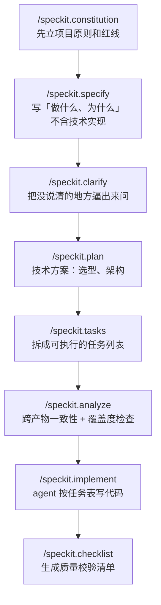

# 面经记录

**岗位方向：** AI/Agent 方向（秋招正式岗）
**时长：** 43 分 38 秒
**上一轮：** [[公司/星河觉醒/Agent方向/星河觉醒Agent一面_2026-07-20]]（通过）
**结果：** 未知

> 我自己的面试，录音转录整理。转录 STT 错误已修正（谭永波→谭演锋、圣家各分校→UCSD、D24/DuoFor/Dialogflow→DeerFlow、coco coder/CommonCodex→Claude Code / Codex、reagent/region→review agent、palm→prompt、marketing 架构→multi-agent 架构、换句率→幻觉率）。
> 少数词转录不清、无法还原的已在正文标注「转录不清」。
>
> **整场结构：** 自我介绍（2 分半）→ 职业诉求 1 问 → **字节答疑 Bot 深挖 18 问（24 分钟，占全场 55%）** → 算法（树上标记均匀分布，只讲思路，12 分钟）→ 反问。
> **和一面的关系：** 一面是「谷歌 Memory + 字节 DeerFlow」双线深挖；**二面只挖字节这一条线，但挖到了一面没碰过的两个新层——评测方法论（Q12–Q15）和线上产品化（Q17–Q18）**。谷歌那段这次一个字没问。

---

## 1. 自我介绍

**当时的回答：** 「我叫谭演锋，本科华南理工计算机，硕士现在在 UCSD 读计算机。主要有五段实习。」然后按「现在→过去」倒序讲：谷歌（Pixel testing 团队的 agent，我负责 agent memory 模块，做 self-evolving）→ 字节 4–6 月（国际商业化业务 oncall 机器人，服务产品运营和研发；把 DeerFlow 从单 agent 改成多 agent，加决策树，让回答全面、降低幻觉率）→ Arm 1–4 月（复现 2015 年系统顶会 best paper，量化「优化某段代码对整体性能提升多少」，移植到 Arm 平台并加 off-CPU 功能）→ 西门子（培训网站 onboarding 问答机器人，重构文档提取到落库的链路，多路召回 + 重排序提准确率）→ 用友（帮中国电信国际人力部门做 BIP 系统数据迁移，保证格式对齐和不重不漏）。

**✅ 相比一面明显修好的两处：**
1. **「五段」数对了**（一面说成「四段」，第一句就在自己简历上出错）
2. **谷歌放第一个讲了**（一面全程没提谷歌，面试官只好自己挖）

**⚠️ 还剩的问题：**
1. **没有定位句。** 开口就是「本科华南理工，硕士在 UCSD」，然后直接进第一段实习。面试官得自己推你是什么方向的。一面复盘里已经写好了定稿的 ①定位（15s）那一段，**这次没用上**。
2. **五段是「时间倒序」不是「相关性排序」。** 倒序碰巧让谷歌排第一，但 Arm / 西门子 / 用友三段各花了近半分钟，2 分半的自我介绍有 1 分半花在跟这个岗位关系最远的三段上。
3. **没有主线句。** 一面定稿里那句「从 RAG 检索，到多 Agent 编排，到 Agent 的记忆系统」是把五段黏成一条线的关键，这次没说。

**→ 定稿仍然用一面那版 90 秒稿**，见 [[公司/星河觉醒/Agent方向/星河觉醒Agent一面_2026-07-20]] §1。**这次是「记住了修数字，忘了背稿子」——两件事都要做。**

## 2. 职业诉求

### Q：未来想找一份什么样的工作？对工作内容有什么诉求？
**题型：** BQ ｜ **评分：** ①落点 ⚠️ ②诊断 — ③机制 — ④口径 ✅

**当时的回答：** 「主要考虑参与 agent 开发相关的工作，因为我 agent 相关经验比较多，并且我也觉得它是一个非常有前景的一个方向。」

**⚠️ 两句话答完，理由是「我经验多」+「它有前景」——这两条谁都能说，且都不是你的判断。** 「有前景」是对赛道的描述，不是对自己的定位。

**改进后的回答（30 秒）：**
> 「想继续做 **Agent 工程化**，尤其是**让 agent 在复杂真实业务里可信**这一段。
> 我这三段实习其实是一条线：西门子做 RAG 检索，解决『怎么找到信息』；字节做多 Agent 编排和评测，解决『怎么保证它答得全、答得对』；谷歌做 memory，解决『怎么让它积累经验』。
> **我最感兴趣的是中间那段**——因为它是唯一一段我能拿数字说话的：56% 到 87%，而且我知道剩下 13% 错在哪。**我想找的是能把这件事做到生产级、有真实流量能验证的地方**，这是实习环境给不了的。」

---

## 3. 字节答疑 Bot 深挖（18 问，全场主体）

> 📌 **本节的现成弹药全在 [[追问/字节答疑Bot]]。** 复盘时对着那一页看——**这场至少五处是「页面上有定稿答案、现场没取出来」**，不是不会，是检索失败。

### Q1：这个项目大概的背景？为什么会选择做这么一个东西？
**题型：** A 项目叙述 ｜ **评分：** ①落点 ✅ ②诊断 ✅ ③机制 ⚠️ ④口径 ⚠️

**当时的回答：** 「背景主要是因为我们团队业务非常复杂，没有一个人能够把这个业务给回答全面。出现问题运营、产品都会找我们研发，包括说我们自己研发有时候会搞不清楚这个业务的逻辑，所以需要有一个专门的机器人来回答这个产品逻辑、这个代码的逻辑。当时比较大的一个困难挑战，就是我们逻辑比较复杂，一个普通的类似 Claude Code 这样的 agent，它没有办法很好地把产品的所有逻辑链路给说明白，并且很容易出现一些幻觉现象。所以当时提出了 review agent，从单 agent 变成多 agent 重新 review 这个回答，并且加上决策树来指引这个 agent 做分类讨论。」

**⚠️ 两个高价值素材没说：**
1. **「服务 200+ 用户」** —— 全场 43 分钟一次没提。这是唯一能证明「这东西真被人用」的数字。
2. **「内部文档常年过期，只有代码是真的」** —— 这句是整个项目立项逻辑的地基，也是一面被夸过的表达。**没有这句，「为什么要做一个读代码的 agent 而不是读文档的 agent」就悬空了**，后面 Q16 讲术语文档时也会显得自相矛盾。

**改进后的回答（在原骨架上补两句，其余不动）：**
> 「TTO 广告平台的业务特别复杂——新旧玩法、各种状态叉乘在一起，运营、产品甚至研发自己都理不清一个用户状态能流转到哪。**而且内部文档常年过期，只有代码是真的。** 所以我们做了一个『看代码回答业务问题』的答疑 Bot，**服务 200+ 用户**，让产品运营不用再抓研发 oncall。
> 难点是普通 agent 会**以偏概全**：状态 A 明明能到 B 也能到 C，它读了个片段就只答 B。解法是决策树强制它列全分支 + 审核 Agent 复查。」

### Q2：说 Claude Code / Codex 解决不了这个问题，具体指的是啥？做过验证吗？
**题型：** B 项目机制 ｜ **评分：** ①落点 ✅ ②诊断 ✅ ③机制 ✅ ④口径 🔴

**当时的回答：** 「对，我们做过验证，跑过分，有看过它的一些东西。」然后举例：「我们是做达人跟商家对接平台，如果这个达人已经给商家提交了视频、视频审核通过，那这个商家能否取消这次合作？这其实有很多可能性——不同玩法、不同合作模式下不一样；还涉及达人跟商家是否有过历史成交；还涉及合作的商品类型，可能是电商产品或者实际的物品。各种因素相互纠葛，必须分情况讨论。像 Claude Code 跟 Codex，他们可能比较聪明，**习惯于偷懒**，看到一两个代码文件、找到一个觉得很相关的答案，就生成一个回答，很容易回答一个很片面的内容。包括一个代码文件里有很多 if-else 条件，他们没有办法把所有 if-else 的可能性都列举出来。」

**🔴 说了「跑过分」，然后没报分。** 这是本场**第一次错失报数字的机会**，而且是最好的那一次——面试官主动问「做过验证吗」，等的就是一个数字。[[追问/字节答疑Bot]] 数字口径表白纸黑字写着**基线 = 裸 DeerFlow 纯看代码 56%**。

**改进后的回答（原答案不动，只在开头加一句）：**
> 「做过，而且这就是我们评测集的基线：**裸 DeerFlow 纯看代码是 56%**。我们还横向比过 Claude、Opus 4.8、GLM 5.1，**三家都会以偏概全**——所以这不是选错模型，是模型的共性行为。具体表现是……（接原答案的例子）」

### Q3：那你的方案是怎么解决这个问题的？
**题型：** B ｜ **评分：** ①落点 ✅ ②诊断 ✅ ③机制 ✅ ④口径 ⚠️

**当时的回答：** 「主要两点。第一点是决策树：我会显式引导这个 agent，告诉他可能会出现分类讨论的情况——一些枚举、一些抽象的实现、或者统一的函数，让他们意识到这些东西存在。并且专门做一个基于语法树 AST 的工具，它能解析代码文件的 if-else 情况，把代码无关内容抽掉、只分析 if-else，给 agent 更充分的理解说代码有多少可能性。另外让它把决策树生成清楚，**我会有一个强制校验，说它一定要把决策树生成清楚之后，才能够输出这个回答**。并且我们有个 review agent，主要用来检测它是否全面、是否有遗漏，有遗漏的话我会提示给用户。包括说之所以会出现回答不全，可能还是因为用户问的问题就没问好——他只是想问某些限制条件下的具体可能性，但他的 query 是一个很 general 的情况，所以我们会引导用户，问他到底特指什么条件。」

**⚠️ 三板斧只讲了两斧半——「检索三层漏斗」整块丢了。** [[追问/字节答疑Bot]] 的口语稿第一板斧是 **ByteRAG 检索业务文档粗定位 → CodeRAG 语义代码检索 → grep/glob 精确收敛**。这次直接从决策树开始讲。**代价在 Q7 立刻显现**：他说「我们只做关键词的匹配，不是做那种 RAG 一样的东西」——如果第一板斧讲了，这句自相矛盾的话就不会出口。

### Q4：如果把这套标准流程或方案作为一个 skill 给到原来的 Codex 或 Claude Code，他们能做吗？
**题型：** B（兼 C：agent harness 能力边界）｜ **评分：** ①落点 ✅ ②诊断 ✅ ③机制 ✅ ④口径 ✅

**当时的回答：** 「思考一下哈。我觉得他们不一定能做，主要是一个**强校验**的能力。其实在我们实测中，这个模型它并不是 100%——它并不是每次问题都能有意识地调用决策树的工具、然后生成这个决策树，**这个工具调用的可能性不是一定会调用**。所以我们必须有一个门禁来做引导，告诉他把这个工具调用明白，才能够更好地引导他进行下一步的思考。所以如果换成 Claude Code / Codex，如果没办法很好地把源代码修改成我们需要的输出校验形式的话，它可能就做不出来。**单纯 prompt 的形式的话，就还太软了。**」

**✅ 这题是全场答得最好的一道，而且是「预习生效」的直接证据。** [[追问/字节答疑Bot]] Q8c 第 3 枪预警的正是这个：「**如果只是 prompt 里写『你必须先调用』，那不叫门禁叫祈祷**」。现场用自己的话把它讲出来了。

**可以更强的地方——把「能不能」拆成分档，而不是一个「不一定能」：**
> 「分三层看，**能做到哪一层取决于 harness 给不给你拦截点**：
> **① prompt / skill 层——做不到。** skill 本质是往上下文里塞一段说明，模型读不读、照不照做没有强制力。我们实测过：**同一个 prompt，模型不是每轮都会调用决策树工具**。
> **② 工具调用约束层——部分能做。** 比如 `tool_choice` 强制这一轮必须调某个工具，或者 Claude Code 的 **PostToolUse hook**（工具调用完成后触发的拦截钩子，能检查结果并把非零退出的信息回注给模型）。这一层能做到『调用了就检查』，但做不到『不调用就不许往下走』。
> **③ 循环控制层——必须改 harness。** 我们的门禁是在**模型每轮输出之后拦截**，去检查 LangGraph state 里决策树完不完整，不完整就合成一条消息塞回消息列表让它重来。**这一步等于改写了 agent 的停止条件**，这是 skill 这种配置形态碰不到的地方。
> **一句话：skill 能给它知识，给不了它约束。**」

<!-- 来源: Claude Code hooks 官方文档（PostToolUse 语义）・ 查证于 2026-08-08 ・ ③ 是我们项目的实现，①② 是通用能力分档 -->

### Q5：具体的技术架构实现上是怎么做到这个东西的？
**题型：** B ｜ **评分：** ①落点 ✅ ②诊断 — ③机制 ✅ ④口径 ✅

**当时的回答：** 「DeerFlow 本质就是一个单 agent 形态。它会 reasoning、输出一堆 token，这些 token 会被检查：如果是工具调用，就调用相应的工具，生成工具结果再返回给模型作为下一轮输入；如果输出的是单纯的文本，我们就直接结束流程、生成最终答案。你想对它进行扩展的话，主要是开发一个叫 **middleware** 的东西——在**模型调用前后、工具使用前后**做 hook 拦截。所以决策树的实现就是：在模型生成回答之后我们会做拦截，校验它的状态——我们是基于 **LangGraph** 实现的 DeerFlow，会校验 LangGraph 那个 state 里面是否有决策树、决策树是否完整；如果不完整，我们会**返回一个 prompt，类似工具调用一样，返回给模型**，提醒它再次做决策树的更新。」

**✅ 全场最扎实的一段技术描述，而且是 [[追问/字节答疑Bot]] 里没有的新素材**（middleware / hook 拦截点、state 校验、把提醒当成工具返回回注）。**已同步补进追问库。**

**唯一可以加的一句（把机制拔到设计层）：**
> 「**这么做的本质是：把 agent 的停止条件从『模型觉得答完了』改成『决策树上所有分支都验证完了』。** 普通 ReAct 循环的退出条件握在模型手里，我们把它挪到了框架手里。」

### Q6：这个方案听起来相对还比较 SOP，当时为什么没想到用 workflow 的方式来做？
**题型：** B ｜ **评分：** ①落点 🔴 ②诊断 ⚠️ ③机制 ✅ ④口径 ✅

**当时的回答：** 「用 workflow 的方式来做的话，**主要是架构的问题**。现在比较流行的架构还是一个 ReAct agent，就是单 agent 框架做所有的事情。我们一开始拿到 DeerFlow 这个项目的时候，它就已经是个单 agent 来做所有功能了，它并不是一个 workflow 的组织形式，所以当时就是在此基础上开发、在原本的形态上进行一系列的魔改。
这个决策树它本质可能更像也是一个工具，**你无法判断这个工具到底在什么时候调用**、什么时候让模型输出更新、生成它的决策树。你在 workflow 里还是要有一个节点到节点流转的状态判断，**但是我没有一个很好的判断条件**，所以做成 workflow 其实也不算特别合适。当然如果是我们这个『生成答案 → review』的情况，确实能够做成一个 workflow 的形态。」

**🔴 答案顺序整个反了。** 真正有说服力的理由是第二段（分支不可预测），他把它放在了第二位；第一位放的是「框架本来就是这样，我是在别人的东西上魔改」——**这是历史包袱开局，不是取舍开局**，听起来像「没得选」而不是「选了」。

**✅ 结尾主动承认「review 那段确实可以 workflow 化」是加分**——不硬撑。

**改进后的回答（把顺序倒过来，理由前置）：**
> 「**这个问题的关键是：分支的数量和顺序，在运行前不知道。**
> workflow 是一张**编译期就确定的静态图**——你得先知道有哪些节点、怎么连。但我们这里，**决策树上有几个分支、长什么样，完全由用户问的那个问题牵扯到哪几段代码决定**，是运行时 AST 提取出来才知道的。你没法提前把它画成图。
> **所以我选的是『动态循环 + 静态门禁』**：循环的路径让模型自己走，但**退出条件写死在框架里**——所有分支验证完才许总结。**要的是 workflow 的确定性，但只把确定性加在退出条件上，不加在路径上。**
> **不过有一段确实该 workflow 化，而且我们本来就是那么做的**：『主 agent 生成答案 → 审核 agent 复查 → 打回或放行』这一段节点固定、流转确定，就是一个标准的 workflow。**所以准确说是混合的：探索阶段是 agent，交付阶段是 workflow。**」

### Q7：为什么会变成一个 multi-agent 的架构？我的感觉是说其实一个应该也够
**题型：** B ｜ **评分：** ①落点 ✅ ②诊断 ✅ ③机制 ⚠️ ④口径 🔴

**当时的回答：** 「一个它其实并没有那么够。首先它确实会存在遗漏——哪怕加这么多东西，它是会存在遗漏的，所以我们还是需要一个 review 来做强提醒，告诉用户这个回答并不完善、可能还有什么方面需要思考。
另外是因为我们代码仓库比较大、上下文比较多，他在做探索的时候会探索到比较多的代码文件。**因为我们只做关键词的匹配，不是做那种 RAG 一样的东西**，所以他阅读的代码文件会比较多，导致他的 context 上下文会比较大，最终他的回答有一定几率出现幻觉，就出现一个**张冠李戴**的情况——比如原本是 A 状态能流转到 C 状态，他说成 A 状态能流转到 B 状态。**这个错误他是没有办法意识到的**，所以我们必须要有个 review agent 来做强校验。」

**🔴 「我们只做关键词的匹配，不是做那种 RAG 一样的东西」——这句跟 [[追问/字节答疑Bot]] 的三层漏斗口径直接打架**（那里写的是 ByteRAG 检索业务文档 + CodeRAG 语义代码检索 + grep 收敛）。**本场最严重的口径冲突，根因是 Q3 没讲第一板斧。**

**✅ 「这个错误他自己意识不到」抓到了要害，但没往下推一步。** 追问库 Q2b③ 有现成的、更锋利的论证：

**改进后的回答（补上那一步推理）：**
> 「不够，而且我能说清**为什么不够**。
> 我们 review 抓的主要是**事实性错误**——张冠李戴，把 A 链路的状态流转安到 B 上。**关键观察是：这类错误只要被提醒，模型立刻就能改对。**
> **这说明不是模型不知道，是它在几十轮工具调用之后没注意到——是注意力问题，不是能力问题。** 病因是注意力，对症的药就是**换一份干净的上下文**，不是换一个更强的模型。所以审核 agent 拿到的是**压缩后的结构化输入**（决策树 + 答案草稿）+ **干净的初始上下文**，但保留代码读取权限——它做的是『对着清单核对』这种窄任务，注意力不会被稀释。
> **这也是它必须是另一个 agent 而不是同一个 agent 多跑一轮的原因：同一个 agent 再跑一轮，上下文还是那份被稀释过的。**」

### Q8：我们门禁校验现在都校验啥呢？校验的内容有哪些？
**题型：** B ｜ **评分：** ①落点 🔴 ②诊断 — ③机制 ⚠️ ④口径 ⚠️

**当时的回答：** 「就有个 agent 校验的话，我们会把用户的问题、模型的回答、以及这个决策树发给这个 agent，它会再做一次相似的代码探索的过程。但它有一个更直接的引导——因为我这个决策树会告诉说，你每个节点生成的来源的代码文件依据是哪里，所以它能够看到这些代码的路径，进行更加直接明白的探索，能够更好地理清中间的逻辑，判断它是否出现逻辑错误。主要还是判断这个从 A 状态转到 B 状态、C 状态的张冠李戴的情况。如果出现这种情况，我们会把这个问题重新抛给生成回答的机器人，让它重新生成一遍正确的回答。」

**🔴 答偏了一个对象，而且答案在上一题刚讲过。**
面试官问的是**门禁**校验什么。门禁 = **Q5 里你自己刚说的那个**「校验 LangGraph state 里决策树是否完整，不完整就回注 prompt」。你答成了**审核 agent** 校验什么——那是另一个东西。

> 🔴 **这是「上一题讲过的机制，下一题取不出来」的第 N 次复发。** 一面复盘、快手复盘、字节两场复盘都记过这条。**这次更典型：间隔只有三题、五分钟。**

**而且 [[追问/字节答疑Bot]] Q1d 有一整套现成的门禁校验清单，一条没取出来：**

**改进后的回答（先分清两个门禁，再给清单）：**
> 「**先分清楚，我们有两道门禁，校验的东西完全不同：**
>
> **① 结构门禁（在总结之前）——校验决策树本身合不合格。** 四个必填字段：**节点名、分类指标、来源 source file 路径、为什么这样分类的代码依据**。四项填全才允许进入总结。
> 另外还有三条形式约束，**这三条能被机器自动检查，正是因为它们约束的全是形式不是内容**：
> - **每个节点必须是名词**（不能是动词或形容词）——名词化才可验证，动词短语没法对着代码核对
> - **每一层必须是同一个种类**（不同类型的枚举值不能混在一层）——保证不漏平行分支
> - **每个节点只能是一个值**（商家有三个子类就必须拆三个节点）——不许用模糊表述蒙混
>
> **② 内容门禁（在总结之后）——就是审核 Agent。** 它拿到决策树 + 答案草稿 + 干净上下文 + 代码读取权，抓的是张冠李戴这类事实错误。
>
> **两道门禁的分工是：结构门禁管『有没有列全』，内容门禁管『列的对不对』。**」

### Q9：有去关注过，比如说我们幻觉率大概会是多少？
**题型：** B ｜ **评分：** ①落点 🔴 ②诊断 ⚠️ ③机制 — ④口径 🔴

**当时的回答：** 「**我没有做一个具体的统计，就是因为没有个很好的一个统计方式。** 但如果说这个张冠李戴的情况，大概可能会一个 20 题、可能会出现大概一题，就十几二十题会出现一题这样的情况，**确实会有，5% 左右吧**。就平时观察日常用户的使用的话，有这种感觉。」

**🔴 两处复发：**
1. **「没有」开局** —— 复发毛病第一条，一面 Q1b「打分我们没有」同款。
2. **分母不清** —— [[追问/字节答疑Bot]] Q8c 第 2 枪原文预警：「『20 个问题触发 1 次』的分母是评测集的 20 题还是线上真实 20 个问题？」**这次是自己主动把这句话说出口的**，等于自己递刀。

**还有一处没人问但站不住：** 5% 幻觉率和 87% 准确率的关系没交代。听的人会算：13% 失分里 5% 是幻觉，剩下 8% 是什么？

**改进后的回答（先给口径，再给数，最后给不确定性）：**
> 「**分两个口径说，因为它们的分母不一样。**
> **评测集口径（有数）**：50 题精标评测集上最终是 **87%**，剩下 13% 拆开是两类——**漏答**（某个分支没讲到）和**问题本身歧义**导致理解跑偏，**张冠李戴这类硬错误在评测集上是少数**，因为审核 Agent 主要就是治它的。
> **线上口径（只有观察，没有统计）**：日常使用里张冠李戴大概**十几二十题遇到一次**。**但我要说清楚这个数的性质——它是我人工看 case 的印象，不是统计出来的**，因为线上没有标准答案，没法自动判对错。
> **而『线上没法自动判对错』这件事本身才是真问题**，我想过怎么补：**用户追问和用户纠正是天然的负样本信号**，把这些 case 捞出来人工标，就能长出一个持续更新的线上评测集。这是我离开时还没来得及做的。」

### Q10：有去了解过为什么幻觉会特别困难吗？除了 review 还有其他手段可以降低这个概率吗？
**题型：** C 通用知识 ｜ **评分：** ①落点 ⚠️ ②诊断 ⚠️ ③机制 🔴 ④口径 ⚠️

**当时的回答：** 「我了解另外一个方式，就是**让他输出这个文件引用**，就是他要根据这个文件来进行回答，通过这样的方式来降低他的幻觉率，就是他忠实地忠于原文来回答。但是在我们的情况里面，因为上下文窗口比较长，我们也没有一个很好的判断条件来裁剪究竟要裁剪什么样的上下文，导致出现幻觉率比较高的情况。**可能最好的方法还是降低上下文的长度吧。**」

**🔴 只给了一个手段，而且这个手段他自己已经做了却没意识到。**
Q8 刚说完「决策树每个节点会写明来源的代码文件依据」——**那就是文件引用/溯源，已经落地了**。现场却把它讲成「我了解另外一个方式」，像是一个还没做的备选。**这是本场第二次「答案在自己嘴里，取不出来」。**

**这题是纯 C 档通用知识题，换一家公司还会问，必须有成套答案。**

**改进后的回答（分层给，从「为什么难」到「四类手段」）：**
> **① 为什么难（一句话）**
> 「因为幻觉不是 bug，是训练目标的产物——模型被训练成**总要给出一个流畅的答案**，『我不知道』在训练信号里几乎不被奖励。所以工程上能做的不是『消灭它』，**是把不确定变成可观测、可判定的信号**。
>
> **② 先分清两个词（分不清是最常见的减分点）**
> - **忠实度**（faithfulness）：答案对不对得上**你给它的材料** —— 不需要标准答案就能自动跑
> - **事实度**（factuality）：答案对不对得上**世界真相** —— 需要外部可信源或人标
> **我们这个场景幸运的地方是：代码就是唯一事实来源，所以事实度问题被压缩成了忠实度问题** —— 这也是这套东西能做评测的根本原因。
>
> **③ 四类手段，按我们做没做分开讲**
>
> | 手段 | 机制 | 我们的状态 |
> |---|---|---|
> | **强制溯源** | 每个结论必须挂来源文件路径 + 代码依据，挂不上就不许输出 | ✅ **已做** —— 决策树节点的必填字段就是这个 |
> | **交叉验证** | 独立的审核 agent 拿干净上下文重新取证 | ✅ **已做** |
> | **上下文治理** | 减少无关上下文进入窗口（结构化检索代替全文读取） | ⚠️ **部分** —— 这是我们最大的欠账 |
> | **让模型能说「不知道」** | 找不到依据时拒答，而不是猜 | ❌ **没做，是我认为下一步最该做的** |
>
> **④ 最后一条最重要，讲清楚为什么：**
> 「现在系统的失败模式是**静默的错误**——玩法 A 没进业务词表，agent 就挑一个 A 开头的变量当成它，然后基于**错的那段代码**生成一个『有代码依据』的答案。**它有依据、有引用、看起来完全可信，但引用的是错的东西。**
> 所以比『降低上下文长度』更值钱的是**把隐含假设变成显式输出**：答案里必须写明『我理解玩法 A 对应变量 X，依据是 Z』。**假设写出来了，用户一眼能看出路由错了；假设藏在推理里，用户只看到结论，纠正不动。**
> **这跟决策树解决的是同一件事——都是把模型藏起来的假设逼出来。**」

> 📖 完整版见 [[幻觉与事实性评测]]；路由错误那一节见 [[追问/字节答疑Bot]] Q8b。

### Q11：有去参考类似于比如说像 SPEC 这种方式吗？这种方式其实是一个比较好的来解决你当前路径上的问题的
**题型：** C 通用知识 ｜ **评分：** ①落点 ⚠️ ②诊断 — ③机制 ⚠️ ④口径 🔴

**当时的回答：** 先反问澄清：「SPEC 的一个形式，我理解它更多的是一个工程上的一个指引，不知道您的意思是它怎么能够解决我们这个幻觉率的问题吗？还是这个路径指引的问题？」
面试官解释：「在你那个场景中，第一个是说上下文比较长，第二个是说逻辑比较多，导致他每次回答的问题可能不太符合预期。**我理解是不是说我们会有一些比较标准的 SOP、或者问题排查的一些流程，以及一些比较标准的 checkpoint，就能够让我们去降低这个点**，相当于是说把它 SOP 化。」
他的回答：「**这个方面我确实没有考虑过，现在思考一下哈**……我觉得有可能可以。我觉得这个 checkpoint，我们可以有一些 spec checkpoint，让它做这样子的一个自我审视。但是我觉得它更抽象来说，它需要审视这些 if-else、还有这些枚举值的不同、包括状态的流转、以及重载函数的实现，这样的一些枚举来做自我的 review。**但我觉得这样子我觉得有点像我这个决策树的逻辑了。** 另外想说就是这个 spec 有点也有点像 skill 吧，让他做自我的探索跟检查。当时我也有做过，就是通过简单的修改 prompt，让他自我反思——他生成的回答有哪些错误，把正确答案给他，然后他自我反思，生成一些可以阻止他做类似错误行为的 prompt，然后把这些 prompt 再重新加回他的 system prompt。用了之后其实发现**它收益并没有特别明显**，可能还是我们这个场景过于复杂，单纯用 prompt 没有办法很好地强制让这个流程流转起来。」

**🔴 这是本场第一个分水岭：不知道 SPEC 指什么。**
✅ **反问澄清是对的**（不装懂），✅ **把它接回自己的决策树也是对的且有力**，✅ **拿出「自我反思 prompt 试过、收益不明显」的实证也是加分**。
**但因为不知道这个词具体指什么，整段答得含糊、绕，而且「确实没有考虑过」这句在这个位置说，等于承认自己没跟进这个领域最近一年最主流的方法论。**

---

**📚 补课：SPEC / 规格驱动开发（spec-driven development, SDD）—— C 档，之前仓库里零记录**

**① 技术定义**
**SDD = 把一份写下来的「规格文档」当成项目的主产物，代码是从规格文档生成出来的、可再生的产出。** 对话式 prompt 不是事实来源，那份文档才是。

**② 不用它会怎样**
不用 SDD 的做法（业界叫 vibe coding）是：需求在一次性的聊天消息里，模型猜剩下的部分。坏结果有三个——**改一次需求就要把整个上下文重讲一遍**；**没有任何东西可以 review**（你 review 的是代码，不是意图）；**同一个需求两次生成的结果不一样，且没法定位是哪句话理解偏了**。

**③ 机制：四个阶段 + 两个检查器**
以 GitHub 的 **spec-kit**（目前社区采用最广的开源实现，Python CLI，125.7k stars，支持 30+ 种 coding agent）为例，它把流程切成一串斜杠命令：

**关键的不是四个阶段，是那两个检查器**——`analyze`（检查 spec / plan / tasks 三份产物之间有没有互相矛盾、有没有需求没被任何任务覆盖）和 `checklist`（生成可勾选的质量校验项）。**面试官说的「标准 checkpoint」指的就是这两个。**

另一条路线是 **Kiro**（AWS 2026 年 5 月国际版发布的 IDE），它不是往现有工具上叠 prompt，而是**把 spec 做成编辑器里的一等公民对象**。

**④ 这题该怎么答（面试口语稿）**

> 「**我们做的其实是 SDD 的一个领域特化版本，只是我没用这个名字。**
> SDD 的核心是**把『要做什么』写成一份可检查的结构化产物，然后让 agent 对着它执行、并用检查器验证覆盖度**。我们的决策树就是这个产物——**它同时是检查清单和答案骨架**，门禁就是覆盖度检查器：所有分支验证完才许总结。
> **但有一个本质区别，我认为这个区别值得说：SDD 里的 spec 是人写的，我们的『spec』是 agent 从代码里长出来的。**
> 原因是我们的场景不是『从需求生成代码』，是『从代码反推业务逻辑』——**需求那一头根本不存在，代码才是唯一事实来源**。所以人写不出这份规格，只能让 AST 从语法树里把真实分支提出来，agent 再把它组织成树。
> **不过您这个提示确实点到一个我们缺的东西：spec-kit 有个 `analyze` 命令做跨产物一致性检查，我们缺的正是这一层——**我们检查了『树上的分支都验证了吗』，但没检查『**这棵树本身完不完整**』。这两件事不一样，后者才是我们剩下 13% 里漏答那部分的根因。」

<!-- 来源: github/spec-kit README（命令清单、star 数）+ AWS Kiro 公开资料 + 社区综述 ・ 查证于 2026-08-08 ・ 「我们是 SDD 特化版」是我的类比，不是官方说法 -->

### Q12：我们准确率能做到 87%，我想了解样本量有多少？
**题型：** B ｜ **评分：** ①落点 ✅ ②诊断 ✅ ③机制 ✅ ④口径 ✅

**当时的回答：** 「样本量其实并不多，大概就是有 **50 道题**，但是每一道题有一个**分点的评分指标**——就像你语文阅读理解题一样，一道题有很多个打分点，踩到一个打分点就拿 1 分。有一个『全错』的设置，就是你要打出某个点就直接给你 0 分。通过这样的方式来打分。样本量不大，但是这个评分标准还是比较细致、比较全面。」

**✅ 干净利落，跟 [[追问/字节答疑Bot]] 口径完全一致（50+ 题专家 rubric、AI 踩点判卷）。** 而且主动承认「样本量不大」再补「但评分标准细」——**先认弱点再给理由，比硬撑可信。**

### Q13：这个 87 是跑多少轮得到的结果？
**题型：** B ｜ **评分：** ①落点 ✅ ②诊断 — ③机制 ✅ ④口径 ✅

**当时的回答：** 「生成回答的话跑三轮，就生成答案跑三轮，每一轮答案会测五轮，就用 LLM judge 抓取 5 人（取 5 次），拿一个平均分。」

**✅ 严谨，而且这是 [[追问/字节答疑Bot]] 里没有的新素材，已补进去。** 3 × 5 = 双层重复，说明既控了生成的随机性也控了判卷的随机性。

### Q14：我们上下波动会有多大？
**题型：** B ｜ **评分：** ①落点 🔴 ②诊断 — ③机制 — ④口径 🔴

**当时的回答：** 「上下波动的话倒是不大，我思考一下……**这个倒是我没有测量**。但一般的话就是像这个 0.86、0.87 分嘛，那它上下波动一般会在 **0.80 到 0.86** 这样的一个波动范围。就是它能够比较好地到了一个……就从 0.7、0.8 这样的一个阶段，它是能够达到这样的一个提升的。」

**🔴 本场最直接的数字翻车，两层：**
1. **「波动不大」和「我没有测量」在同一句话里** —— 先给结论再说没测，等于承认前半句是编的。
2. **0.80 ~ 0.86 的上界比 87% 还低。** 面试官只要多问一句「那 87 是怎么来的，是最好的那一次吗」，整套数据的可信度就没了。**上一题刚说了「跑三轮、每轮判五次取平均」，那方差是现成能算的——你有数据，只是没算。**

**改进后的回答：**
> 「**这个我该算但没算，我说清楚现在能给到什么程度。**
> 评测跑的是三轮生成 × 每轮五次判卷，**所以方差是现成能算的，我当时只取了均值没保留分布，这是我评测设计上的一个疏漏。**
> **凭观察，跨轮的差异主要来自两处**：一是模型探索路径的随机性——同一个问题它可能先读 A 文件也可能先读 B 文件，走到的分支不完全一样；二是判卷模型在边界得分点上的松紧。**第二处比第一处小，因为 rubric 是踩点式的、判断空间被压得很窄。**
> **如果重做，我会把三轮的单轮分数和标准差一起报，并且把『87%』改成『87% ± x』。** 一个没有方差的准确率，在 50 题的样本量下说服力是不够的——**50 题里差一道题就是 2 个点。**」

> 💡 **这题真正在考的不是波动多大，是「你知不知道 50 题的样本量意味着什么」。** 主动说出「差一题就是 2 个点」，比报任何数字都能证明你懂评测。

### Q15：有去观察过，提升带来的分数大概是哪些维度的？以及为什么是这些维度能够提升？
**题型：** B ｜ **评分：** ①落点 ✅ ②诊断 ✅ ③机制 ⚠️ ④口径 🔴

**当时的回答：** 「主要有两点。**第一点是全面**——把这个问题答得全面了，确实能很好地把各种情况考虑到。包括我有这个 review agent 做兜底，它确实会存在一些幻觉错误的情况，但这些错误在评分标准里可能不算致命错误，只是因为漏答了某些点少了某些分；我们通过 review agent 能够重新告诉它有什么可能性需要讨论、以及它错答漏答什么情况，让它重新生成一遍更加完善的回答，这个时候也能提高分数。
**另外就是我们后来接入了另外一个组同事做的一个文档**，那个文档能够很好地把我们所有的术语做一个**自然语言到代码编码的映射**以及解释，并且他尽量用（转录不清）的方式，能够给他做更好的路径发现，让他知道需要怎么分类讨论。通过这样的方式，当时大概是**从 0.78 分提到 0.86 分**这样的水准。可能他原本答 0 分的问题、或者答得不太好的问题，也能够做更全面的提高。」

**🔴 同一场里第四组数字。** 到这里全场已经出现：**87** / **0.80~0.86** / **0.78→0.86** / 「0.7、0.8 这样的阶段」。而 [[追问/字节答疑Bot]] 的消融口径是明确的三档：

| 配置 | 分数 |
|---|---|
| 裸 DeerFlow，纯看代码 | **56%** |
| + 决策树门禁 | **70% 出头** |
| + 审核 Agent | **87%** |

**0.78 → 0.86 这一组挂不进这张表。** 如果术语文档是第四个变量，那它必须被明确说成第四档，而不是一个孤零零的数字对。

**⚠️ 还有一个更隐蔽的问题：把主要提升归给了别人组做的文档。** 「另外一个组同事做的一个文档」+「从 0.78 提到 0.86」——**听起来 8 个点里最大的一块不是你做的**。归因慷慨在同事之间是美德，在面试里是减分，而且这里还不准确：**那份文档能生效，是因为你的决策树给了它一个消费入口**。

**改进后的回答（先给消融表，再讲两类病，最后把文档摆回正确位置）：**
> 「**提升拆成两个正交的维度，因为它们治的是两种不同的病：**
>
> **① 列不全（以偏概全）→ 决策树门禁治的。** 从 **56% 到 70% 出头**。病因是模型读了个片段就下结论，药是强制它把所有分支列出来、逐个验证完才许总结。
> **② 说错（张冠李戴 / 总结时漏）→ 审核 Agent 治的。** 从 **70% 出头到 87%**。病因是几十轮探索之后注意力被稀释，药是换一份干净上下文重新核对。
> **这两个是不同的病、收益不重叠——这就是两个都保留的原因。**
>
> **③ 还有一个正交的输入侧改进：业务术语表。** 我们后来接了一份术语文档，把中文业务词映射到代码里的英文符号。**它治的是第三类病：检索入口找错。**
> **我把它单独拿出来说，是因为它证明了一件事**——决策树能生效的前提是 agent 先找对了代码。文档不参与生成答案，**但它决定 agent 去读哪段代码**。所以准确说法是：**代码是唯一事实来源，文档是检索入口**；入口错了，agent 依然会给出『有代码依据』的答案，只是依据了错的那段代码。」

### Q16：如果希望这个数持续优化，比如做到 95% 以上，你觉得应该怎么做？
**题型：** B ｜ **评分：** ①落点 ⚠️ ②诊断 ✅✅ ③机制 🔴 ④口径 🔴

**当时的回答：** 「得有个**更加全面详细的引导**。它遗漏的情况主要是——**一个问题的答案在两个 domain 里面，他没有意识到这两个 domain 是同义的、语义相近的，就没有对另外的 domain 进行检测。**
主要还是这个术语没有表达清楚。比如说我们这个商家、达人要跟广告主做对接，在我们场景里面，广告主在代码里会对应 **partner**、对应 **MCN**、对应 **agency**，他们之间会有一些功能上的重叠、一些功能上的区别，会出现这种术语难以区分的情况，导致他看代码会看得比较片面、存在一些遗漏。**因为他原本在数据表里面就应该分开，但在代码逻辑里面就混在一起。**
再举个更简单的例子：**『拒绝这份订单』跟『这个订单被取消了』，在我们的业务语义里是不一样的**——拒绝就是商家跟达人拒绝合作；取消可能是因为超时、可能是因为审核有问题、或者对接超时导致订单被取消；完成又是另外一个状态，是交易已经达成。**但对于 agent 来说，这三个词可能是比较类似的语义，它难以做更好的区分，甚至可能找到一个情况就把另外两个遗漏。**
所以要优化的话两个方面：一个是**术语表要指示得更清楚**，遇到一种情况就慢慢补上——这也是历史遗留问题，产品那边的术语没确定好，大家没用同一份术语表示同一种东西。另外是后续要做好**代码逻辑上的统一以及术语的统一**，做好映射之后我觉得这个问题提到 **90%** 那肯定就不是问题。」

**✅✅ 诊断是全场最有价值的内容，两个例子都极其具体**（partner/MCN/agency 的重叠、拒绝 vs 取消 vs 完成的语义分岔）。**这段说明你是真的看过 bad case，不是纸上谈兵。**

**🔴 但只有愿望，没有机制。** 「术语表要指示得更清楚」——**谁来发现该补哪个词？靠什么判断两个 domain 语义相近？什么时候算补完了？** 一个没有裁决者的方案，在面试里等于没有方案。**这是复发毛病第三条。**

**🔴 又冒出「90%」** —— [[追问/字节答疑Bot]] 数字口径表里明令弃用的数字（`~~90%~~ ❌ 弃用`）。而且这题问的是 95%，答 90% 等于没回答问题。

**改进后的回答（诊断原样保留，把两条愿望换成三条带裁决者的机制）：**

> **诊断照原样讲**（partner/MCN/agency + 拒绝/取消/完成，两个例子都保留），**然后：**
>
> 「**这个诊断指向一个具体的结论：我们剩下的错误不在推理层，在检索入口层。所以要到 95%，该加的不是更强的模型，是三个能自动跑的东西。**
>
> **① 词表覆盖率反哺（解决『谁来发现该补哪个词』）**
> 统计**用户问题里出现过、但业务词表里没有的名词**，按出现频次排序。**这个列表就是文档维护的优先级队列。** 现在术语表靠同事想起来才补，这么做之后它被真实流量驱动。**关键是它把『慢慢补』变成了一个有终点、有进度的事。**
>
> **② 同义 domain 的显式声明 + 找不到就拒答（解决『靠什么判断两个 domain 相近』）**
> 不指望 agent 自己悟出 partner 和 MCN 是不是一回事——**让词表里显式写上『广告主 → partner | MCN | agency，三者的区别是 X』，并且规定：一个业务词命中多个代码符号时，必须每个都查。**
> 配套的是**拒答规则**：词表里查不到的业务名词，**宁可回『词表里没有玩法 A，请补充它对应的代码标识』，也不许猜一个 A 开头的变量**。现在的失败模式是静默猜错，改完变成显式报缺。
>
> **③ 把路由假设写进答案（解决『什么时候算补完了』）**
> 答案里必须写明「我理解广告主在这里对应 partner，依据是 X 文件」。**假设写出来，用户一眼能看出路由错了并当场纠正；假设藏在推理里，用户只看到结论，纠正不动。** 而这些纠正就是 ① 的输入。**三条接成一个闭环。**
>
> **最后说一句边界**：到 95% 我认为**术语层能推到 92% 左右，剩下的必须动代码**——同一个业务语义在两个 domain 里有两份实现，这不是 agent 该扛的复杂度，是代码本身的债。**这部分不是靠 agent 优化能解决的，得推动业务侧收敛。**」

> 💡 **收尾那句边界最值钱**：它证明你知道哪些问题不该由你的系统解决。**「我能做到 92%，剩下 3% 不是我的问题」比「我觉得能到 95%」可信十倍。**

### Q17：我们这个算是一个 benchmark，那有去看过这个东西到真实的线上生产环境，大家的反馈、或者大家的问题解决率是什么样的吗？
**题型：** B ｜ **评分：** ①落点 🔴 ②诊断 🔴 ③机制 — ④口径 ⚠️

**当时的回答：** 先反问：「你意思是到真实的生产环境吗？大家会有什么问题？」然后：「其实我们那些 benchmark、那些测试答案**就是从真实的生产环境里面弄下来的**，然后做人工标注，都是差不多、都是类似的问题。一般会问某个逻辑是怎么运转的，或者说为什么。另外一种可能测的比较少，就是有些运营会拿到某个特别的用户 ID 以及对应的信息，我们查数据库，问这个用户为什么在某个流程里面被卡住了。这个情况会用到查数据库——因为我们是国际化部门，我们这边没有数据权限，就需要用到我们在美国的同事，他们的 agent 查这个数据，然后再发给我们的 agent 做下一步调查。所以一般这个场景可能测得比较少，别的场景其实我们都是有覆盖好的。」

**🔴 答非所问，而且是本场第二个分水岭。**
面试官问的是「**线上效果怎么样**」，他答的是「**评测集来自线上**」。**这两件事完全不同**：评测集来自线上只能说明题目分布是真实的，**说明不了系统在线上真的帮到了人**。

**而且这个回答有个反效果**：它听起来像在说「我们测了，所以线上没问题」——**用「覆盖度」偷换了「效果」。** 面试官接着立刻问了 Q18（让你设计线上指标），就是因为这题没答到。

**🔴 更深一层：这题真正暴露的是「这个系统没有任何线上度量」。** 而这恰恰是 benchmark 驱动的项目最常见、也最致命的软肋。

**改进后的回答（承认没有，然后把「没有」讲成一个有诊断的空白）：**
> 「**先直接回答：线上没有量化的解决率，我们只有定性反馈。这是我们评测体系的一个真实缺口，我说一下我对它的判断。**
>
> **定性上有的：** 用户是 200+ 的产品运营和研发，最直接的信号是**他们不再来抓研发 oncall**了；每周评审会上过 bad case，坏例子是被主动报上来的。
>
> **为什么没有量化：** 线上没有标准答案。**评测集能算分是因为有专家标注，线上一条问答没人告诉你对不对。** 所以这不是我们懒得测，是**线上和离线的判定条件本质不同**。
>
> **⚠️ 而且我要主动说一个风险：评测集虽然是从线上捞的，但它被优化过了。** 我们对着这 50 题迭代了很多轮，**它已经不是线上分布的无偏样本了**。所以 87% 更准确的说法是『在这 50 题上』，不能直接推广成『线上准确率 87%』。
>
> **如果我继续做，会怎么补这个缺口——**（自然接 Q18）」

> 🔴 **复盘要点：这一题和 Q9 是同一个洞的两次暴露。** Q9 问幻觉率、Q17 问线上解决率，**问的都是「你的系统上线之后你怎么知道它好不好」，两次都没有答案。** 这是这个项目最大的结构性短板，**下一场一定还会被问，必须提前把 Q18 那套指标背熟**。

### Q18：如果让你来设计一个线上的指标，能够去衡量你这个 bot 做得好还是不好，应该怎么设计？
**题型：** C 通用知识 ｜ **评分：** ①落点 ✅ ②诊断 ⚠️ ③机制 🔴 ④口径 ✅

**当时的回答：** 「我觉得可能是**他会不会追问**。我们这个多轮对话，一般就是一个问题过来、我解答他就 OK、这个对话就结束了，不会有很长的对话逻辑。我觉得最好衡量的、也不叫最好，**间接的指标就是这个用户追问了多少轮**——你一个 session、一个话题里这个用户问了多少次，做一个平均。**如果这个平均数越高，说明这个回答肯定就是越差的**；如果轮次比较少，理论上他这个回答应该是更好的，就是他能够一次性地满足用户的需求。」

**✅ 给了一个明确、可算、且确实是行业常用的代理指标**（追问轮次 / 会话长度）。开口就给结论，落点没问题。

**🔴 但只有一个指标，而且这个指标的方向可能是反的。** 面试官没追问，但下一场会追：
- **用户放弃了也是轮次少** —— 答得太烂直接关掉，和答得完美一次解决，在这个指标上长得一模一样
- **追问多也可能是深入探讨** —— 用户觉得有用才愿意继续问
- **没有分母** —— 平均轮次涨了，是回答变差了，还是来了一批更难的问题？

**改进后的回答（三层指标 + 一句关于代理指标的判断）：**

> 「**先说一个前提：这个 bot 的『好』没法直接测量，因为线上没有标准答案。所以所有线上指标都是代理指标，设计的关键是让几个代理指标互相纠偏,不能只用一个。**
>
> **① 结果层——它到底有没有替代人工（这是这个项目立项时的目标，所以是北极星）**
> - **人工 oncall 转人工率**：用户问完之后，**还是去群里 @ 了研发**的比例。**这是最硬的指标，因为它直接对应立项理由**，而且它有天然的采集点——oncall 群本来就在。
> - 对照口径：上线前后同口径的 oncall 提问量对比。
>
> **② 交互层——用户当场的行为信号（就是你说的那个，但要修方向）**
> - **追问轮次**：你说的这个保留，**但必须和「会话结局」一起看才有意义**。我会把会话分成三类：**一次解决 / 追问后解决 / 放弃**。放弃的判据是最后一轮之后用户没有任何正向动作且转去问人了。
> **为什么必须这么拆**：**『一次解决』和『直接放弃』在平均轮次上是同一个数字，方向完全相反。只报均值会把最差的一批算成最好的。**
> - **用户纠正率**：用户回复里出现「不对 / 你说的是 X 吧 / 这个是旧逻辑」的比例。**这是幻觉在线上最直接的信号**，而且这些 case 捞出来人工标，就是 Q17 说的那个线上评测集的种子。
>
> **③ 质量层——抽样人工审计（兜住前两层都测不到的东西）**
> - 每周随机抽 N 条线上问答，用和评测集同一套 rubric 判分。**关键是随机抽，不是抽 bad case**——抽 bad case 永远看不到系统整体在漂到哪。
> - 这一层还负责监控一件前两层看不见的事：**静默的错误**。用户没追问、没纠正、看起来很满意，但答案是错的——**这类错误只有人工审计能抓到，而它恰恰是最危险的一类。**
>
> **最后一句判断**：「如果只能留一个指标，我留**转人工率**——因为它是唯一一个用户用脚投票、没法被系统自己刷高的指标。**追问轮次可以被『答案写得又长又全但没解决问题』刷低，转人工率不行。**」

<!-- CSAT（customer satisfaction，用户满意度打分）这类显式反馈按钮这里刻意没列为主指标：内部工具、用户量小、点击率会低到没有统计意义，采集成本高于信息量。要说的话作为辅助信号提一句即可。 -->

---

## 4. 算法题（只记题面 + 思路复盘，解法去算法仓库）

> ⚠️ **面试官明确说了「不需要 coding，告诉我思路就好」，全程口述 + 共享桌面手画。**

**题面（从对话重建）：** 给一棵树，共 n 个节点、n 个标记，标记初始任意分布在节点上（某些节点可能有多个，某些可能是 0 个）。每次操作可以把**一个**标记沿一条边移动到相邻节点。求让**每个节点恰好有一个标记**的最少移动次数。
面试官先让按二叉树讨论，**最后追问推广**：「假设右边这一个是一个 1000 叉树，根节点有 5000 个标记，那应该怎么分呢？」

> 📌 这是 **LC979「二叉树中分配硬币」的 N 叉推广**。进算法仓库重点题。

**当时的思路轨迹（12 分钟，绕了很久）：**
1. 一开始就抓对了方向：「统计左子树和右子树各有多少标记，从多的往少的挪」，并且写出了 `A + B = 总数 - 1` 的平衡关系
2. 明确了递归顺序：后序（先递归到叶子 4，再 5，再回到 2，再回到 1），**并且说出了关键动作——「上报给 2，告诉 2 我缺多少」**
3. **然后卡在「这个次数怎么统计」，卡了将近 6 分钟**，反复画图演算 0 标记 / 2 标记的极端例子，一直在描述「怎么挪」而不是「挪了几次」
4. 最后被 1000 叉树的追问逼出来：「每一棵子树能够上报自己缺了多少个，往 root 节点报，root 就知道要分多少个，然后再分给它」

**复盘：**

**✅ 方向从第一分钟就是对的**（后序遍历 + 子树盈亏上报），**而且没有等提示**。分叉数从 2 变 1000 时答案没有崩，说明抽象是真的抓住了。

**🔴 但从头到尾没说出那个能收口的公式，导致讲了 12 分钟还在演算：**

> **答案 = 每条边上流过的标记数的绝对值之和。**
>
> 定义 `balance(u)` = 以 u 为根的子树里（标记数 − 节点数）。那么 u 和它父节点之间那条边上，**必然要流过 `|balance(u)|` 个标记**——多了就往上推，少了就从上面拉，方向由符号决定，而且**没有任何更省的走法**。
> 所以：`答案 = Σ |balance(u)|`，u 取遍所有非根节点。一次后序遍历，**O(n)**。
> **N 叉树完全不用改**：`balance(u) = 标记数(u) - 1 + Σ balance(子节点)`。

**🔴 卡住的根因：一直在想「标记具体怎么走」，而正确的抽象是「每条边上净流量是多少」。**
「怎么走」是一个调度问题，分支一多就想不清；「每条边净流量多少」是一个**局部就能算完、且不依赖顺序**的量。**你在第 2 步已经说出了「上报缺多少」——那就是 balance，只差把它和「边」绑在一起。**

> 💡 **可迁移的教训：树上求最少操作次数，先问「每条边上必须发生多少次」，不要问「东西怎么走」。** 边是局部的、可独立计算的；路径是全局的、要排顺序的。
>
> ⚠️ **另外，12 分钟里有大量时间花在画图和自言自语的演算上，没有一次主动说「我现在的思路是 X，我在卡 Y」。** 面试官在你卡住的整整 6 分钟里只说了一句话。**卡住时把卡点说出来，是让面试官能给提示的唯一方式**——[[公司/腾讯/微信事业群/腾讯微信支付一面_2026-07-20]] 复盘里记过同款问题（憋在心里的假设只会在论证到一半时爆炸）。

## 5. 反问环节

**问了两个：** ① 你们公司对秋招正式员工有什么要求？② 具体可能会负责什么样的业务？

**面试官的回答（信息量很大，值得完整留档）：**

**要求两方面：**
1. **创业公司 vs 大公司的差异**
   - 大公司接到的多是**命题作文**——解决某个特定的问题，或者在某些特定项目上做持续迭代
   - 创业公司需要你**自己寻找问题、自己分析问题、自己解决问题**，没有那么多命题作文
   - 而且不像大公司「做了以后就得顺着这条路一直往下做」——**发现有更好的路径或思路，可以快速掉头、快速迭代**，不是固定一个方案闷头往前冲
2. **各家都有的**：学习能力 + 整体的交付能力，「**能力上和态度上没有问题**」

**业务三大类（原话：整体业务发展比较快，来了不会很明确说就做 A 或做 B）：**

| 类 | 内容 |
|---|---|
| **① 传统业务迭代** | 正常需求交付、功能更新 / 优化、性能稳定性治理 |
| **② Agent 方向** | **记忆**、agent 迭代；面向**研发效率** / **运营效率** 的 agent，以及 **to C 端**的 agent |
| **③ 基建** | **传统业务基建**：AB 实验平台、流量 shuffle 平台（转录不清）、流量分发平台、网关 **大模型基建**：大模型网关、大模型分发平台、模型调度平台 |

**⚠️ 反问质量：两个问题都问在「你们要什么 / 你们做什么」上，一个都没展示自己的判断。**
而且**一面已经问过一次「如果我有机会来会负责什么工作」**——同一个问题在同一家公司问两轮，说明反问是临时想的，不是准备的。

**下次该问的（挑一到两个）：**
> - 「您刚提到 agent 记忆和 for 研发效率的 agent——**我在谷歌做的正好是 agent memory 的自进化**。想问一下你们现在 memory 这块的瓶颈是在写入侧（什么时候该记）还是检索侧（怎么取对）？我在这两边踩的坑不太一样。」
>   → **把反问变成第二次技术展示，而且是唯一一次能主动选题的机会。**
> - 「刚说到大模型网关和模型调度——**我在字节做过三家协议的统一接入**，最脏的活是思考上下文在多轮工具调用中的回传。想问你们网关现在到哪一步了，是纯转发还是已经做了能力抽象？」
>   → **证明你听懂了他刚才说的三类业务，而不是听完就完了。**
> - 「您提到创业公司要自己找问题——**想问一个具体的：过去半年团队自己发起、而不是老板指定的项目里，有哪个是你觉得做得最对的？**」
>   → **把抽象的「自主性」问成可验证的例子，同时也是在替自己尽调。**

---

## 6. 总结 / 自评

### 答得好的
1. **Q4（skill 能不能做到强校验）** —— 全场最佳，**而且是 [[追问/字节答疑Bot]] Q8c 第 3 枪的预习直接生效**，「单纯 prompt 太软」这句是自己讲出来的
2. **Q5（middleware / hook / state 校验）** —— 全场最扎实的技术描述，是追问库里没有的新素材
3. **Q12 / Q13（评测样本量和轮次）** —— 口径准、主动认样本量小再补理由
4. **Q16 的诊断部分** —— partner/MCN/agency 和 拒绝/取消/完成 两个例子极具体，证明真看过 bad case
5. **算法题方向对且抗住了推广** —— 从二叉树到 1000 叉树抽象没崩
6. **自我介绍修好了一面的两处**（「五段」数对了、谷歌放第一个）

### 答崩 / 复发
| # | 问题 | 复发次数 | 页面上有没有现成答案 |
|---|---|---|---|
| 🔴 1 | **Q9 用「我没有做统计」开局**、Q14「这个倒是我没有测量」 | 一面 Q1b 同款，**至少第 4 次** | 有——「没有」必须讲成取舍 |
| 🔴 2 | **Q8 门禁校验答成 review agent 校验** ——**答案在三题之前的 Q5 自己嘴里** | 快手 / 字节两场同款，**至少第 5 次** | 有——追问库 Q1d 整套清单 |
| 🔴 3 | **Q10「让他输出文件引用」当成没做的备选**——Q8 刚说过决策树节点带代码依据 | 同上，同一场内第二次检索失败 | 有 |
| 🔴 4 | **数字口径四组打架**：87 / 0.80~0.86 / 0.78→0.86 / 「0.7、0.8 阶段」，末尾还冒出弃用的「90%」 | 字节一面同款 | 有——数字口径表 + 消融三档 |
| 🔴 5 | **Q16 只有愿望没有裁决者**（「术语表要指示得更清楚」） | 复发毛病第三条 | 有——追问库 Q8b 三条防线 |
| 🔴 6 | **Q17 答非所问**，用「评测集来自线上」偷换「线上效果」 | 新 | 无——本场新暴露 |
| 🔴 7 | **Q11 不知道 SPEC / spec-driven development 是什么** | 新 | 无——本页已补课 |
| ⚠️ 8 | **Q2「跑过分」没报 56% 基线**；全场没提「200+ 用户」和「只有代码是真的」 | 新 | 有 |
| ⚠️ 9 | **Q3 三板斧丢了第一板斧（检索层）**，直接导致 Q7 说出「我们不做 RAG」的自相矛盾 | 新 | 有 |
| ⚠️ 10 | **反问两题都在问「你们要什么」**，且一面问过同款 | 一面同款，第 2 次 | — |

### 这场最该带走的三句话

1. **「答案在自己嘴里取不出来」这次占了三处（Q8 / Q10 / Q15 归因）**，都不是知识缺失。**复习方式要改：不能只读追问库，要合上页面自问自答。**
2. **数字必须只有一个版本。** 这场四组数字全是同一件事的不同说法——**面试官只要记录两个，你就完了**。开口报数前先默念 [[追问/字节答疑Bot]] 的口径表。
3. **Q9 和 Q17 是同一个洞的两次暴露**：这个项目**没有任何线上度量**。这是 benchmark 驱动项目的通病，**下一场一定还问，Q18 那套三层指标必须能张口就来**。

### 面试官特点
- **和一面是同一条业务线但不同层次**：一面挖「你怎么做的」，二面挖「你怎么知道它有用」——**从工程实现推到评测方法论再推到线上产品化**，一路往上问
- **对评测方法论极敏感**：样本量 → 跑几轮 → 方差 → 分数来自哪些维度 → 怎么再提 8 个点 → 线上怎么样 → 怎么设计线上指标，**七问一气呵成**，这是产品思维不是纯工程思维
- **给提示很克制**：算法题卡了 6 分钟只说了一句话；Q11 反问 SPEC 时才展开解释
- **公司在快速迭代期**，明确说「不会很明确说来了做 A 或做 B」——**面这家要准备好回答「你能不能在没有命题作文的情况下自己找问题」**

---

## 7. 原答案速查表（复习用：先只看这一列，自己重答一遍）

> 用法：**盖住右边三列**，只看「当时的原话」，自己讲一遍，再对照扣分项和上文的改进版。

| # | 题 | 当时的原话（转录浓缩，保留原措辞） | 题型 | 扣分项 |
|---|---|---|---|---|
| 0 | 自我介绍 | 「我叫谭演锋，本科华南理工，硕士在 UCSD……**主要是有五段实习**，第一段是现在在谷歌做的……」（倒序讲完五段，无定位句无主线） | — | ①落点 |
| 1 | 职业诉求 | 「主要考虑参与 **agent 开发相关**一些工作吧，因为我 **agent 相关经验比较多**，并且我也觉得它是一个**非常有前景**的一个方向」 | BQ | ①落点 |
| 2 | 项目背景 | 「我们的团队业务非常复杂，**没有一个人能够把这个业务给回答全面**……一个普通的类似 Claude Code 这样的 agent，它是没有办法很好地把产品的所有逻辑链路给说明白」 | A | ③机制 ④口径 |
| 3 | Claude Code 为什么不行 / 验证过吗 | 「对，我们做过验证，**就是有跑过分**，然后有看过它的一些东西」→ 达人提交视频商家能否取消的例子 →「他们可能比较聪明，**习惯于偷懒**」 | B | 🔴④口径（没报 56%） |
| 4 | 你的方案 | 「主要有两点……**基于语法树 AST 的工具**……**我会有一个强制校验，说它一定要把这个决策树生成清楚之后，才能够输出这个回答**」 | B | ⚠️ 丢了检索层 |
| 5 | 做成 skill 给 Codex 能行吗 | 「思考一下哈。**我觉得他们不一定能做，主要是一个强校验的一个能力**……**这个工具调用的可能性不是一定会调用**……**单纯 prompt 的形式的话，就还太软了**」 | B | ✅ 全场最佳 |
| 6 | 技术架构怎么实现 | 「DeerFlow 本质就是一个单 agent……主要是开发一个叫 **middleware** 的东西，在模型调用前后、工具使用前后做 **hook 拦截**……校验 **LangGraph state** 里面是否有决策树、是否完整，不完整就**返回一个 prompt，类似工具调用一样**」 | B | ✅ 最扎实 |
| 7 | 为什么不用 workflow | 「**主要是架构的问题**……我们一开始拿到 DeerFlow 的时候它就已经是个单 agent 了……**你无法判断这个工具到底在什么时候调用**……**但是我没有这个很好的判断条件**」 | B | 🔴①落点（顺序反了） |
| 8 | 为什么要 multi-agent，一个不够吗 | 「**一个它其实并没有那么够**……**因为我们只做关键词的匹配，不是做那种 RAG 一样的东西**……**这个错误他是没有办法意识到的**」 | B | 🔴④口径（跟三层漏斗打架） |
| 9 | 门禁校验啥 | 「就有个 **agent 校验**的话，我们会把用户的问题、模型的回答、以及决策树发给这个 agent，它会再做一次相似的代码探索……」 | B | 🔴①落点（答成 review agent，**答案在第 6 题**） |
| 10 | 幻觉率多少 | 「**我没有做一个具体的统计，就是因为没有个很好的一个统计方式**……大概一个 20 题会出现大概一题……**5% 左右吧**……就平时观察日常用户的使用」 | B | 🔴①落点 ④分母 |
| 11 | 还有什么手段降幻觉 | 「我了解另外一个方式，就是**让他输出这个文件引用**……**可能最好方法还是降低这个上下文的长度吧**」 | C | 🔴③机制（**自己已经做了却当成没做**） |
| 12 | 参考过 SPEC 吗 | 「SPEC 的一个形式，**我理解它更多的是一个工程上的一个指引**，不知道您的意思是……」→「**这个方面我确实没有考虑过，现在思考一下哈**」→「**但我觉得这样子有点像我这个决策树的一个逻辑了**」 | C | 🔴④口径（不知道这个词） |
| 13 | 样本量多少 | 「**大概就是有 50 道题**，但是每一道题有一个**分点的评分指标**，就像你语文阅读理解题一样……有一个全错的，就是打出某个点直接给你 0 分」 | B | ✅ |
| 14 | 跑多少轮 | 「**生成答案跑三轮，每一轮答案会测五轮**，就用 LLM judge，拿取一个平均分」 | B | ✅ |
| 15 | 上下波动多大 | 「**上下波动倒是不大**，我思考一下，**这个倒是我没有测量**……它会在 **0.80 到 0.86** 这样的一个波动范围」 | B | 🔴①落点 ④口径（上界低于 87） |
| 16 | 提升来自哪些维度 | 「第一点是**全面**……另外就是我们后来**接入了另外一个组同事做的一个文档**……**当时大概是从 0.78 分提到 0.86 分**」 | B | 🔴④口径 ⚠️ 归因给了别人 |
| 17 | 怎么做到 95% | 「得有个**更加全面详细的引导**……**他没有意识到这两个 domain 是同义的**……广告主对应 **partner、MCN、agency**……**『拒绝』跟『取消』在我们的业务语义里是不一样的**……**术语表要指示得更清楚**……做好映射之后提到 **90%** 那肯定就不是问题」 | B | 🔴③机制（无裁决者）④「90%」已弃用 |
| 18 | 线上真实反馈如何 | 「**你意思是到真实的生产环境吗？**」→「**其实我们那些 benchmark 那些测试答案就是从真实的生产环境里面弄下来的**，然后是做人工标注，都是差不多、都是类似的问题」 | B | 🔴①落点（答非所问） |
| 19 | 设计一个线上指标 | 「我觉得可能是**他会不会追问**……**这个用户追问了多少轮**，做一个平均，**如果这个平均数越高，说明这个回答肯定就是越差的**」 | C | 🔴③机制（单指标，方向可能反） |
| 20 | 算法（树上标记均分） | 「统计它左子树和右子树有多少个标记……**从多的往不多的里面挪动**……**我思考一下哈，这个次数怎么统计？**」（卡约 6 分钟）→「**每一棵子树能够上报自己缺了多少个，往 root 节点报**」 | 算法 | ⚠️ 没收口成公式；卡住时不出声 |
| 21 | 反问 | 「你们公司对一个秋招的正式员工有什么要求？以及你们具体是有可能会负责一些什么样的业务嘛？」 | — | ⚠️ 两题都在问「你们要什么」，一面问过同款 |

---

**双链复习：** [[追问/字节答疑Bot]] · [[幻觉与事实性评测]] · [[Agent设计模式与MCP]] · [[LangGraph工程实践]] · [[AI-Coding工程实践]] · [[字节实习]] · [[公司/星河觉醒/Agent方向/星河觉醒Agent一面_2026-07-20]]
