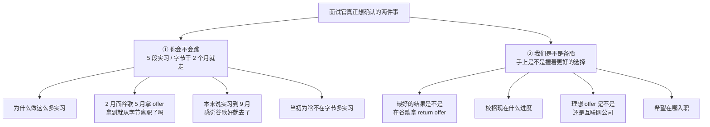
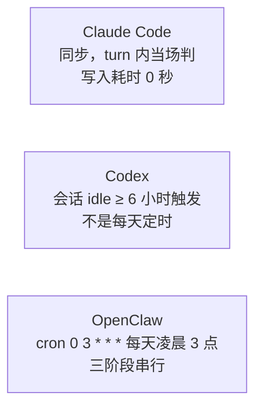

# 面经记录

**岗位方向：** AI Agent 工程师 · AI 中台部门（游戏公司）· **人才计划**（提前批精英校招）
**时长：** 26 分 22 秒
**面试官：** 「点点这边负责 AI 业务的同事」——**业务负责人，不是技术面试官**
**结果：** 未知（结束语「我会内部同步一下，看我们后面怎么去推进」）

> 我自己的面试，录音转录整理。**这是一场纯 BQ 面（behavioral question，考动机与稳定性的行为面），26 分钟里零八股、零算法、零项目细节追问**——唯一的深度技术题是「你看源码，Claude Code / Codex / OpenClaw 有什么设计特别好」。
> **接在 [[公司/点点互动/AI Agent方向/点点互动AI Agent一面_2026-07-27]] 后面**，一面是技术面（算法 + 项目深挖 65 分钟），二面换成业务侧看人。

> ⚠️ **转录里的名字被 ASR（自动语音识别）打乱了，下面已订正**：「Calco / Cloak / coco / call code」= **Claude Code**；「CodaS / codebase」= **Codex**；「小龙虾」= **OpenClaw**；「Skillop」= **SkillOpt**；「谭海峰」= 谭演锋；「华理工大学」= 华南理工大学；「应用网络」= 用友网络。

---

## 这场面试的真实结构（先看懂它在问什么）

面试官 23 个问题里有 **11 个是同一件事的不同问法**：

**判断依据：他对我的技术回答几乎不追问**（三家 memory 架构讲了 3 分半，他只回一句「明白明白」就转下一题），**但对「为什么离开字节」换了四个角度问**。这场的分不在技术上。

---

## 1. 自我介绍

**当时的回答：** 华南理工计算机本科 + UCSD 计算机硕士，**五段实习**，按新→旧讲：谷歌（Agent memory 的 evaluate + 定制化）→ 字节国际商业化（DeerFlow 单 agent 改多 agent + 决策树降幻觉）→ Arm（复现 2015 年系统 best paper 到 ARM 平台，扩展到 off-CPU 的 IO/锁等待量化）→ 西门子（RAG 问答系统，重构 embedding 链路 + 多路召回 + query 改写 + 重排）→ 用友（人力资源系统数据迁移，不重不漏 + 一致性）。

> ✅ **顺序对（新→旧）、每段都带了「我具体做了什么」而不是「我参与了什么」。** 和 [[基础信息]] 的自陈口径一致。

---

## 2. 你在美国的实习是怎么进行的？

**面试官的真实疑问：** 简历上谷歌 / Arm / 西门子三家外企，他默认这些在美国，想确认时间线合不合理。

**当时的回答：** 「不是，我主要在中国。我 gap 了一段时间，正常来说今年 12 月份就能毕业，我把 12 月到 6 月这段没事做的时间挪到现在用来 gap 实习。所以这些实习都是在中国做的，Arm 和谷歌都是中国的（团队）。」

> 🔴 **这句话和简历上 UCSD 2025/09 – 2027/06 对不上。** 单独听就是「2026 年 12 月毕业」。
>
> **真正的伤害不是校招资格**——2026/12 和 2027/06 大概率都算 2027 届，资格两边都过。**伤害在入职时间：** HR 听成 12 月毕业，就会按 2027 年初能到岗排 headcount；实际要等到 2027 年年中。**这个错位到 offer 阶段才暴露，比面试当场答错难收拾得多。** 其次才是可信度——简历写一个、嘴上说另一个，对方无法判断哪个是真的。

#### 🔒 统一口径（默认用这版，全部是确定事实，不需要记住任何细节）

> 「我 **2027 年 6 月毕业**，走 **2027 届**校招。现在这段时间在做全职实习，**今年 9 月之后回学校上剩下的课**。」

**三句话，每一句都能被简历和在读证明直接印证，没有任何需要临场推算的东西。**

#### 🎁 加分版（只有在你确认过「原本能提前修完」之后才用）

> 「按最紧的排法我本来能提前小半年修完，但那样**毕业和入职之间会空半年**。所以我把这半年提前挪到现在做全职实习——**毕业时间不变，还是 2027 年 6 月正常入职，中间不空转。**」

**它把 gap 从「延毕」讲成「把闲置时间前置」**，是主动的资源调度而不是进度落后。但**前提是你真能确认这件事**——记不清就用上面的默认版，别为了这一点加分去编一个会被追问细节的版本。

> 📌 **原则：口径的可靠性优先于漂亮程度。** 不确定的细节**不主动加**——主动加的每一句都会被当成你确认过的事实来追问。（对照一面那条「不确定的剪枝要么当场验证要么不写」，是同一条规则的另一半。）

## 3. 所以你没有在美国实习，没有 CPT？

> `CPT`（Curricular Practical Training，课程实践训练）：美国 F-1 留学生在校期间合法校外实习的授权，通常要求实习和专业相关且计入学分。面试官问这个是在确认「你有没有在美国合法工作过」。

**当时的回答：** 「对的。」

## 4. 这是怎么考虑的？现在很多人挺想在美国 AI 公司看机会的

**当时的回答：**
- 一是在美国找工作比较困难
- 二是倾向于毕业后回国工作——**女朋友在这边、爸妈在这边、家庭上也有点事情，不能长期离开中国**

> ✅ **这题答对了，而且是这场最扎实的一个回答。** 回国动机给的是**不可辩驳的私人理由**（家庭），不是「我看好国内 AI 发展」这种一戳就破的场面话。面试官紧接着追问「你在美国有找工作吗」，说明他在验证这个说法是不是事后编的——而我给的是「找过 summer intern，行情不好 + 准备不充分，结果一般」，**承认了不利事实，反而让前面的理由更可信。**

**唯一可优化的：** 「在美国找工作比较困难」放在第一位，听起来像**回国是退而求其次**。**顺序应该反过来**：先讲家庭这个主动选择，再补一句「客观上美国这两年行情也确实不好，所以这个决定做得没什么纠结」——**把被动因素降级成佐证，而不是主因。**

## 5. 你的实习各行各业都有，用什么决策方法选不同的实习公司？

**当时的回答（按时间线逐段解释）：**
- 用友：当时比较懵懂，一个还 OK 的公司给了机会就去了
- 西门子：两点——① 是外企（当时还打算在美国工作）② 做 AI，当时是新潮领域，感兴趣
- Arm：回国后时间多，本来就对**系统开发**感兴趣，Arm 给了机会就去尝试
- 字节：Arm 是 project 制 4 月结束，当时觉得自己**欠缺业务后端开发**，所以去补；没想到分到的是 agent 方向，因为一直在跟这个方向，上手很快
- 谷歌：5 月拿到 offer，谷歌也给的是 agent 开发

> ⚠️ **这个回答是「逐段解释」而不是「给一条主线」。** 面试官问的是「决策方法」——他要的是一个**可复用的判断标准**，我给的是五段各自的偶然原因（懵懂 / 外企 / 时间多 / 机缘巧合）。听下来的印象是**没有规划、随机漂移**，这恰恰是他担心的。

**改进后的回答（一条主线 + 一次转折，30 秒）：**
> 「前两段是**试方向**：用友试后端业务，Arm 试系统底层——都是我当时不确定自己适不适合的领域，试完知道了。
> **西门子是转折点**——那是我第一个从零 own 到上线的 AI 项目，做完确定了要走 AI 这条线。
> **后两段就不是在试了，是在同一个方向上换深度**：字节是**业务侧的 agent**——怎么把 agent 做到生产可用、准确率能验证；谷歌是**基建侧的 agent**——memory 这一层怎么自进化。
> 所以标准从「试试看」变成了一条：**这段经历能不能让我在 agent 这个方向上多知道一件别人不知道的事。**」

## 6. （插问）你在字节是哪个业务？

**当时的回答：** 国际商业化部门。（对应简历上服务 **TTO 广告平台** 200+ 用户，见 [[字节实习]]）

## 7. 2 月面的谷歌 5 月才收到 offer，收到之后你就从字节离职了？

**当时的回答：** 「差不多。刚好字节那个 project 我做得差不多了——我一进来就 own 那个 project，做到 5 月底基本收尾；谷歌 6 月底能让我入职，所以我 6 月 29 号入职谷歌，现在入职一个月出头。」

> ✅ **这句「我 own 的 project 做完了才走」是关键，一定要说，而且要说在最前面。** 它把「拿到 offer 就跑」改写成「交付完才走」——**唯一能证明我不是跳来跳去的证据就是这个。**

## 8. （追问）你现在在荣科资讯中心 B 座？

**当时的回答：** 「我在**上海陆家嘴环球金融中心**，不在北京的谷歌。」（他随即确认字节也在上海——漕河泾）

> 面试官在**核实地点**。这是个信号：**他在评估我能不能在上海入职**，跟后面第 13 题连着。

## 9. 做这么多实习出于什么考虑？哪段收获最大？

**当时的回答：**
- 「主要就是**为了丰富简历**吧，这是一个。另外就是**机缘巧合**——Arm 给了机会，谷歌给了 offer，都是没想到的。」
- 收获最大的是**西门子**：第一个自己完全 own、从零开始的项目；当时 AI agent 基础很薄弱，从零学 LangChain、搭 agent 流程、把项目部署上线，整套都在学，**从一张白纸到理解 agent 和 RAG 怎么运作**，提升最快。

> 🔴 **「为了丰富简历」是这场最该改掉的一句话。** 它把五段实习的动机降格成**刷履历**——而面试官正在担心的就是「你会不会为了下一行简历再跳一次」。**这句话等于亲手给他递了证据。**
>
> ✅ **后半段「西门子收获最大」答得很好**：选了一段**不显赫但能讲出成长曲线**的经历（而不是顺口说谷歌），并且给了具体的成长内容（从零学 LangChain → 部署上线）。**选西门子比选谷歌可信得多**，因为它证明我判断价值的标准不是公司牌子。

**改进后的回答（把「丰富简历」换成「验证假设」）：**
> 「不是为了凑数量。**前面几段是在快速排除方向**——我不想在毕业后才发现自己选错了赛道，所以趁在校把后端、系统底层、AI 都真做过一遍，代价最低。
> 排除完之后就不再横向铺了，**字节和谷歌是同一个方向的两层**。
> 收获最大的是**西门子**——它是我第一个从零 own 到上线的项目，当时 agent 基础基本为零，从 LangChain 怎么搭、链路怎么串到怎么部署上线全是现学。**它的价值不在技术难度，在于它是我第一次证明『没人教我也能把一个东西做出来』。**」

## 10. 你本来说实习到 9 月，感觉谷歌机会更好就去了？

**当时的回答：** 「是的，主要是因为**谷歌有这个 title 嘛**，所以就来到谷歌。」

> 🔴 **全场最危险的一句话。** 承认「为了 title 换公司」的直接推论是：**如果有人给我更好的 title，我也会离开你们。** 面试官后面立刻问「那当初为啥不在字节多实习」和「最好的结果是不是谷歌 return offer」，就是在顺着这条线往下验证。

**改进后的回答（把 title 换成不可替代性）：**
> 「有两个原因，**title 是次要的那个**。
> 主要是**这个机会的窗口性**——谷歌在国内的 headcount 极少，错过基本不会有第二次；而字节这条路我随时可以再走。**在两个都想要的东西里，我选了那个过期不候的。**
> 另一个是**内容确实不同**：字节做的是业务侧 agent 的准确率工程，谷歌做的是 memory 这层基建的自进化——**我想在同一个方向上把上下游都摸一遍**，而不是把同一件事再做三个月。」

## 11. 这次找工作主要看重什么方向？

**当时的回答：** 看重**个人发展**——实习这么多段最终也是为了找工作的结果；重要的是公司能给的发展平台和成长可能性；**希望能一直在一个领域探索、深耕，做到比较前沿的方向。**

> ⚠️ 「个人发展 / 平台 / 成长可能性」是标准套话，**面试官听不出任何信息**。到第 20 题他又问了一次「对校招公司有什么期待」，我那次答得具体得多（见下）——**说明第一次没答到点上，他才重问。**

## 12. ⭐ 最好的结果是不是在谷歌拿 return offer？

**当时的回答（本场最佳）：**
> 「不一定。谷歌确实是一个好的选择，但**它在中国的业务还是比较边缘的**，没有那么大的发展空间。包括我现在做的工作，**也没办法真正上手去改内部的 memory 系统**——那是谷歌更核心的团队在做的事。我们只是把它**接入到自己的 agent 里，做一些细枝末节的定制化，或者对它做 evaluation** 看效果怎么样、有什么小地方可以改进。**我完全不能参与到 Claude Code 那种级别的项目开发，或者一个 memory 系统本身的开发。**
> 所以谷歌是我的一个选择，但不一定是最好的，还是得看每家公司给我的可能性。」

> ✅ **这是这场唯一一个「拒绝顺着面试官的预设走」的回答，而且给了具体、可验证的理由，不是空话。** 和一面那个「多 agent 提高准确度这方面我觉得反倒还好，真正提高的是决策树」是同一个能力——**面试官给一个看似正确的预设，我不接，给真实因果。**
>
> ⚠️ **但有个风险点：全程在讲现雇主的局限。** 讲现在的公司不好，天然会让人联想「他将来也会这么讲我们」。**救回来的关键是给出「我要的是什么」而不只是「这里没有什么」**——我这次只讲了前半段。

**改进后的收尾（在原答案后面加一句，把评价变成标准）：**
> 「所以我判断一个机会的标准就是这一条：**这个东西的核心设计我能不能参与，还是我只能在它外面做适配。** 我不是在比公司大小，是在比这个。」

## 13. （追问）那当初为啥不在字节多实习？

**当时的回答：** 「单纯出于好奇探索的心理。谷歌每年 headcount 特别少，**我以后还能回字节，但以后再去谷歌的机会非常渺茫**，特别是中国的谷歌。我还年轻，有机会就想去探索见识一下。」

> ✅ **「可逆的选择往后放，不可逆的选择先做」这个逻辑本身是对的，而且是成年人的决策方式。** 这题救回了第 10 题的「为了 title」——**它才是第 10 题应该给的答案。**
> 📌 **教训：好答案出现在第三次被追问时，说明前两次没答到位。** 这个「窗口性 vs 可重复性」的框架应该在第 10 题一次讲完，而不是等面试官问第三遍才挤出来。

## 14. 希望在哪里入职？

**当时的回答：** 上海，更偏好上海。

## 15. （追问）是因为女朋友在上海吗？

**当时的回答：** 「也不是。我本来就是南方人，**广东人，上海离家近一点**，所以更喜欢上海。其实北京也没关系。」

> ✅ **面试官递了「女朋友」这个台阶，我没接，给了「离家近 + 北京也可以」——这个处理是对的。**「女朋友在这」是**会变的理由**，「我是广东人」是**不会变的理由**；而且补一句「北京也没关系」表明**地点不是我的硬门槛**，不给对方制造顾虑。
> ⚠️ 唯一注意：第 4 题回国原因里我说了「女朋友在这边」，这里又说不是因为女朋友——**两句连起来听会有点绕。** 统一成：**回国是因为家庭（含女朋友），城市偏好是因为离广东近。** 一个是国别决策，一个是城市决策，讲清楚层次就不矛盾。

## 16. 你现在怎么学 AI 相关的知识？

**当时的回答（三个渠道，有结构）：**
1. **前沿动态**：推特 / 知乎 / 小红书 / 公众号
2. **论文**：因为在做 memory 开发，主要看 memory 相关的 paper，看他们提了什么 idea、能不能拿来优化我们的 memory
3. **源码 + 官方 blog**：读 OpenAI 的源码看他们 memory 系统怎么做的，学设计思路；Anthropic 和 OpenAI 的 blog 也会跟

> ✅ **三层递进（动态 → 论文 → 源码）本身是好答案**，而且第 2 条挂到了自己的在职工作上，不是泛泛而谈。这个回答直接触发了下一题——**面试官抓住「你说你看源码」就深挖了，这是全场唯一的技术题。**

---

## 17. ⭐ 唯一的技术题：OpenClaw / Codex / Claude Code 的源码，你觉得有什么架构或设计做得特别好？

**当时的回答（讲了约 3 分半，按三家 memory 系统的复杂度递增排）：**

**① Claude Code —— 最简单，写完就是终点**
> 「它是直接通过 **agent inline**——用户跟它对话，agent 觉得这东西有必要记就写进 memory，**用户没有感知，也没有 subagent 帮你做**。memory 的组织架构是一个 **wiki 式的 map**，后面引导到不同的子 memory，用这样一个很简单的架构实现 memory 系统。
> 他们敢这么设计，是**对自己的模型有足够强的自信**。有个说法叫 **bitter lesson**——当模型能力在增强的时候，你搞那么多复杂架构其实是没有意义的，把最重要最基础的东西做好就够了。」

**② Codex —— 多了一层中间层**
> 「它会把对话记录**提取出来凝练成一个中间层**，中间层里有对话的 summary、抽象，还有整个轨迹的 summary。最终**每天有个定时任务**处理这些 summary，把它落到 memory 里，做合并、删除。
> 分成两层，我觉得**有点对自己的模型能力不太自信**——Claude Code 里所有 memory 管理都是 main agent 做的，Codex 反而分成多步、抽象出更多 context 把 context 降下来，让两个 agent 来做，保证准确性。」

**③ OpenClaw —— 最复杂**
> 「它从**每一个 step、每个对话都写日志、写 memory** 开始，有一个 **dream 机制**、每日的定时任务管理，记忆有**严格的升降级机制**保证不被污染、不过时，有打分的升降级，中间有两三层升降级来实现功能。我觉得它可能**对自己的框架和模型没那么自信**，才把架构弄得特别复杂。」

**④ 附加观察：框架一直在变**
> 「3 月份它比较火的时候，大家吐槽最大的问题是**记忆不会过时**——永久保存在本地，不会删旧的、不会合并。但到最近 7 月我再看，**已经完全有过时处理和后台合并了**。它一直在发展，当然也变得越来越复杂、越来越臃肿。」

**⑤ 结论：花哨的架构不重要，verify 门禁才重要**
> 「读 paper 也一样，大家给 memory 弄了很多花里胡哨的方法——什么架构、从轨迹上学习、改学习率、用反向传播的思想来学。但**有 paper 论证过很多东西都是没用的，最终有用的是那个 verify 的门禁**：你能不能在改完 memory 之后有一个反馈，告诉 agent 这条 memory 是好的还是坏的。**这才是最重要的。** 随着模型能力进步，那么多步骤其实并不是有效的方法。」

---

### 🔴 对照已查证口径逐条批改

> **批改依据**：[[Agent记忆三家实现对比]]（本仓库 2026-08-04 查证，来源含 openai/codex 官方 README、OpenClaw 官方文档、社区逆向、本机 memory 目录实测）。

**✅ 讲对的部分**

| 我说的 | 核对结果 |
|---|---|
| Claude Code 同步 inline 写、无 subagent、无后台任务 | ✅ 完全正确，**它是三家里唯一没有后台整合的** |
| Claude Code 用「目录页 → 子 memory」的 wiki 式组织 | ✅ 正确（`MEMORY.md` 是纯指针目录，条目间还能用双方括号包 `name` 字段互链） |
| Codex 有中间层，存 summary + 轨迹 summary | ✅ 正确（`raw_memories.md` + `rollout_summaries/`） |
| OpenClaw 按天写日记 + dream 机制 + 打分升降级 + 多层 | ✅ 正确（cron 0 3 * * * 跑 Light/REM/Deep 三阶段，Deep 六信号加权打分 + 三重门） |
| **最终有用的是 verify 门禁，不是花哨架构** | ✅ **这条最漂亮**，和 SkillOpt「一次候选编辑只有严格提升 held-out 验证分才被接受」完全一致 |

> `held-out 验证集`：训练/优化时**故意不参与优化**、只用来打分的那批数据。作用是防止「改动只在自己看得见的数据上变好」。

**🔴 讲错的部分（两处，第二处更严重）**

**错误一：把 Codex 的触发说成「每天定时任务」。**

实际是 **会话闲置（idle）满 6 小时**才触发抽取，**活跃会话永不触发**——是事件驱动，不是 cron。**「每天凌晨跑一遍」的是 OpenClaw（`cron: 0 3 * * *`）。我把两家的触发机制串了。**

**错误二（更严重）：把架构复杂度归因成「对自己的模型不自信」。**

这个归因在三家上说了三遍，是这段的主线论点——**但它是错的**。正确的口径是**「不是谁更先进，也不是谁更自信，是约束不同」**：

**Codex 拆两阶段，是四条硬约束逼出来的，本质是 MapReduce：**

1. **上下文物理装不下。** Phase 1 要读**一整条完整会话轨迹**（几十万 token），Phase 2 要读**全部已有记忆**才能判矛盾——合成一个 agent 就得同时装下两者。这是最硬的一条，其余三条都是它的延伸。
2. **一个能并发一个必须串行。** Phase 1 是 per-thread 的可并发；Phase 2 在写同一份全局文件必须串行（靠数据库锁）。合成一个只有两种下场：全串行慢 N 倍，或并发写全局文件互相覆盖。
3. **成本。** Phase 1 是机械活（读轨迹挑重点），`gpt-5.1-codex-mini` 就够；Phase 2 是判断活（矛盾裁决、去重、排序）要强模型。不拆就得**用强模型去做最不需要智力的那一步**。
4. **失败恢复。** Phase 1 挂一条只影响那条；不拆的话读了 20 条轨迹写到一半挂掉，全局记忆处于半更新状态。

**而 Claude Code 敢不拆，不是因为「自信」，是因为它记的东西性质不同：**

| | 记什么 | 什么时候能确定它对不对 |
|---|---|---|
| **Claude Code** | 用户是谁 / 工作方式偏好 / 在做什么 / 外部资源 | **当场。** 用户说「别用生活比喻」，不会因为会话后续发展而变错 |
| **Codex** | 个人偏好 + **学到的模式** + **踩过的坑** | **要等任务结束。** 「这是个坑」得看最后有没有真绊倒 |

> **一句话总纲：同步写记的是「用户说了什么」——陈述性事实，当场为真；异步写记的是「这次任务学到了什么」——经验性教训，要等结局。内容的性质决定写入时机，跟自信没关系。**
>
> 而检索范式的差异是**记忆规模倒逼的**：几百条以内全量注入索引最准（没有召回损失），上千条索引本身就撑爆上下文、必须上检索。Claude Code 赌的是「一个项目的长期记忆本来就不该有上千条」，所以它 prompt 里有一堆「不许存 repo 已有信息」的硬约束——**是从源头控规模，不是靠自信。**

> ⚠️ **为什么这个错误值得单独拎出来**：面试官如果读过源码，「他们不自信」这句话会直接暴露**只看了表面结构、没推导约束**。而「不是谁更先进，是约束不同」这句话本身就是加分项——**它证明你能从实现反推设计压力。**

**❓ 未核实的部分**

「3 月份 OpenClaw 记忆永久保存、不会过时不会合并，7 月已经有了」——**本仓库没有记录 OpenClaw 的历史演进时间线，这条是我当时的记忆，未交叉验证。** 面试里讲历史演进风险高（时间点、版本号一旦被追问就露馅），**建议以后不主动提，或者改成「我最近一次读到的版本已经有 X 了，早期版本据说没有」这种带来源限定的说法。**

### 改进后的回答（90 秒，把「不自信」换成「约束」）

> 「我从**同一个问题的三种答案**来讲：**谁来判定什么值得长期记。**
>
> **Claude Code 交给主模型当场判**——对话中模型自己决定写不写，同步落盘，一事一文件，目录页常驻上下文让模型自己挑，**没有任何后台任务**。
>
> **Codex 交给专职 agent 离线判**——会话闲置六小时才够格，抽取和合并拆成两阶段。**这不是因为它对模型没信心，本质是 MapReduce**：抽取是 per-thread 的、可并发、便宜小模型够用；合并是全局的、必须串行、要强模型判矛盾。合成一个 agent 的话，上下文根本装不下「一条完整轨迹 + 全部历史记忆」。
>
> **OpenClaw 交给统计打分器跨天判**——每天凌晨三点跑三阶段，只有最后一阶段能写长期库，六个加权信号打分，过分数、过召回次数、**至少三个不同查询命中过**，三道门才晋升。
>
> **我的判断是这三条路对应的是不同的记忆规模和不同的内容性质**，不是谁先进。几百条以内全量注入最准，上千条必须上检索；当场为真的事实可以同步写，要等结局才知道对错的教训必须异步写。
>
> **最值得学的是 OpenClaw 那条 `minUniqueQueries`——一条记忆要被至少三个不同问题命中过才算真知识。** 因为这三家的回填信号全是**使用频率**，没有一家用**任务成败**——而频率只能证明「被检索到」，成功率才能证明「有用」。**一条错误记忆如果语义匹配度高，会被反复检索，在现有机制下分数不降反升。** 这正是我在谷歌那边想解决的问题。」

> 💡 **最后那一句是这题真正的落点**：把源码阅读接回自己在做的事，从「我读过」变成「我在解决他们没解决的问题」。**当时完全没接。**

---

## 18. 你最近看到觉得比较有趣的新项目是什么？

**当时的回答（第一次，答偏了）：** 讲了两个**生活向**的项目——
1. 一个**屏幕录制分析工具**：实时分析屏幕内容做 summary，判断这段时间是在工作还是娱乐。「它不是看你用什么软件，是看你具体的内容」——传统计时器是 hard code 按 APP 分类，但微信这类 APP 有时工作有时娱乐，分不了。
2. 一个**个人资产记录 skill**：微信支付 / 支付宝 / 支付宝扣银行卡混在一起，传统记账软件做不了跨渠道去重；把账单定时传给 agent 就能解决。

结论是「agent 能做到很多 hard code 做不到的事，解决生活上的小难题，这是很有意义的方向」。

**面试官打断：** 「嗯，就是它不是一个 AI 的项目，是吧？」

**当时的处理：** 我先反问澄清了——「它们本质都是通过 AI 来做工作……但我不理解你说的 AI 项目是什么样？是类似于 Claude Code 这样的 AI 项目吗？」面试官解释「因为刚聊的是怎么学 AI 知识、看源代码，我想问的是你最近看到一个觉得非常有趣的、AI 相关的东西」。

> ✅ **反问澄清这个动作是对的**，比硬答一个错方向强。但**根因是第一次答偏了**——他前一题问的是「你怎么学 AI」，紧接着问「有趣的项目」，语境明摆着是**技术项目**，我给的是**AI 应用**。
> 📌 **教训：「有趣的项目」这种开放题，先花两秒判断语境落在哪一层**（技术实现层 / 产品应用层），拿不准就先给一句「我分两类讲，一个是实现上让我有启发的，一个是应用形态上的」——**两边都覆盖，不用赌。**

**第二次回答（答对了）：**
> 「**SkillOpt**，微软做的一个不断自进化的 skill 优化工作。它**通过模仿深度学习的方式对 skill 进行改写**，对我启发蛮大。
> 主要是现在比较热的是 **RSI —— recursive self improvement（递归自我改进）**，就是通过不断迭代自进化提高 agent。RSI 有很多种，比如改 harness 框架、改权重、改很多东西；但**对我这种工程人员来说，我能做的更多是对 skill 或者 memory 的改写——它们本质都是一段 prompt。**
> 怎么通过不断学习迭代持续提高 agent 的能力，是我最近受启发最大的一个项目。」

> ✅ **这段答得好，而且和第 17 题的「verify 门禁」结论完全咬合。** 「skill 和 memory 本质都是一段 prompt，所以对工程人员来说 RSI 就是文本空间的优化」——**这句是有洞见的收敛，不是复述。**
>
> ⚠️ **但缺了 SkillOpt 最该讲的那一点：门禁。** 「模仿深度学习」只说了形式，没说**为什么它有效**——见 [[追问/谷歌Memory]] 的已查证口径：
> - 循环六步：**rollout → reflect → aggregate → select → update → evaluate**
> - **一次候选编辑只有严格提升 held-out 验证分才被接受，否则回滚**；配套有文本学习率预算、被拒编辑缓冲区、epoch 级慢更新
> - 数字：GPT-5.5 直接对话 **+23.5** / Codex 循环内 **+24.8** / Claude Code 内 **+19.1**；6 benchmark × 7 模型 × 3 harness **52 格全部最优或并列最优**
> - **SkillOpt-Sleep**（2026-06 preview）：给本地 coding agent 的**夜间离线自进化伴侣**
>
> **补一句就够：「它真正的杀手锏不是『像深度学习』这个形式，是那道验收门——每次编辑必须严格提升留出验证分才被接受，否则直接回滚。这正好回答了我上一题说的『verify 门禁才是关键』。」**

## 19. 你对这次校招的公司有什么期待？

**当时的回答（比第 11 题具体得多）：**
> 「一个足够高的平台，能让我做**比较前沿的 agent 探索**——**不要单单做个 RAG 系统这么简单**，或者大家已经做过、有比较定式结果的东西。我希望跟着时代的浪潮再进一步做比较大的东西。
> 比如我在字节主要研究**怎么 harness 这个 agent**、让它回答问题更好；现在在谷歌研究**怎么 self improvement**——在用户提问的时候不断自进化提高 memory 的内容。
> 我希望加入的团队也能一直关注前沿浪潮，在比较前沿的地方探索 agent 的新实现、新功能。」

> ✅ **这才是第 11 题该给的答案。** 有具体的排除项（「不要单单做 RAG」）、有自己的演进轨迹（harness → self-improvement）、有对团队的具体要求。**同一个问题问两遍，第二遍才答到位——说明第一遍太空。**
>
> ⚠️ **但对着一家游戏公司讲期待，完全没提游戏。** 一面面试官明确讲过他们在做「端到端的游戏生成 agent，目标是生产级」——**这是现成的接口，二面完全没接上。** 应该补一句：「我看一面聊到你们在做端到端的游戏生成 agent——**这类任务的验收信号比问答类清晰得多（能不能跑起来、能不能玩），正好是自进化最需要的那种反馈**，这是我特别感兴趣的点。」

## 20. 你现在校招大概什么进度？

**当时的回答：** 「一直在一面二面的过程中，校招刚开始，而且我平时**六点才下班**，一天大概只能面一场。快手二面、**你们二面**、字节二面；阿里今天约了一面，文远知行也约了一面。」

> ⚠️ **信息给得太全，而且顺序把自己放低了。** 「一天只能面一场」+ 列全五家进度，传达的是「我很忙、你们在队列里」。
> **改进：给进度但控制颗粒度 + 明确优先级** ——「校招刚开始，手上有几家在二面，具体推进节奏我这边可以配合你们优先安排。」**既诚实（有其他 offer 是筹码），又不把自己排成待办列表里的一项。**

## 21. 你比较理想的 offer 是不是还是互联网公司？

**当时的回答：**
> 「我觉得**不局限于互联网公司这个名词**，应该说它是一个**科技公司**，并且能做一些前沿的东西。**我并不排斥游戏公司**——其实我昨天面了米哈游，然后把我挂了。其实我觉得这并不重要。还有我昨天也投递了网易雷火的游戏 agent 开发。是不是互联网公司不重要，哪怕它是个车企或者什么，我觉得都 OK，主要是它**有没有在做比较前沿的东西**。」

> ✅ **核心判断标准（「做不做前沿的东西」而不是「什么行业」）是对的**，而且用「投了网易雷火的游戏 agent」作证据，比空口说不排斥游戏强。
>
> 🔴 **但有两个明显失分：**
>
> **① 「我昨天面了米哈游，然后把我挂了」——主动汇报自己被拒，纯减分，零收益。**
> 对面是游戏公司，我告诉他**另一家游戏公司刚挂了我**。他没有渠道核实原因，只会记住结论。**这句话完全可以不说，说了也没有换来任何可信度。**（米哈游那场见 [[公司/米哈游/米哈游提前批一面_约2026-08]]）
>
> **② 「我并不排斥游戏公司」——面的就是游戏公司，「不排斥」是消极表述。**
> 「不排斥」的言下之意是「游戏公司是我要克服的一个障碍」。**对着面试官说这句话，等于告诉他我把他们家归在了需要说服自己的那一档。**

**改进后的回答（把「不排斥」换成正向理由，删掉米哈游）：**
> 「我的标准不是行业，是**这个团队在解决的问题够不够前沿**——是科技公司就行，车企我也投过。
> **游戏其实是我主动看的方向之一**：游戏场景对 agent 来说验收信号特别清晰——**能不能跑、好不好玩，是可以直接量化的反馈**，比通用问答那种模糊评价更适合做自进化。所以我也投了网易雷火的游戏 agent 开发。
> 具体到你们这边，一面聊到的**端到端游戏生成 agent** 正好是这类问题里最完整的一个形态，这是我很想参与的原因。」

## 22. 反问环节

**无。** 面试官直接结束：「我这边没有问题了，我会内部同步一下，看我们后面怎么去推进。」

> ⚠️ **没有反问不代表不能问。** 结束语给了明确的接话口——**可以顺势问一句「方便的话，想了解一下后面还有几轮、大概什么节奏？」** 这既是获取信息，也是**表达优先级**。一面结束时我问了流程（业务侧 2 轮 + HR + 可能 CTO），二面这次一句没问就挂了。

---

## 23. 总结 / 自评

### 这场的性质
**26 分钟纯 BQ，面试官是业务负责人。** 一面已经验过技术（算法 + 项目深挖 65 分钟），二面在验的是**动机一致性和留存风险**。**技术只占一题，而且他不追问。**

### ✅ 做对的三件事
1. **「最好的结果是不是谷歌 return offer」没有顺着答是**——给了具体、可验证的理由（谷歌中国业务边缘 / 只能做外围定制化和 evaluation，碰不到 memory 核心开发）。**和一面「主动纠正面试官预设」是同一个能力，这个能力已经稳定复现两次了。**
2. **回国动机给的是不可辩驳的私人理由**（家庭），并且主动承认「在美国找工作结果一般」这个不利事实——**承认不利事实反而让主要理由更可信。**
3. **面试官递「女朋友在上海」的台阶没接**，给了「广东人离家近」+「北京也可以」——把会变的理由换成不会变的，且不制造硬门槛。

### 🔴 待改的五件事（按严重程度排）

| # | 问题 | 为什么严重 | 一句话改法 |
|---|---|---|---|
| 1 | **「做这么多实习主要是为了丰富简历」** | 亲手把动机降格成刷履历，正中面试官对「会不会再跳」的担心 | 换成「**前几段在低成本排除方向，排除完就不横向铺了**」 |
| 2 | **「主要是因为谷歌有这个 title 嘛」** | 直接推论是「有更好 title 我也会走」 | 换成**窗口性 vs 可重复性**（第 13 题我自己给出了这个框架，只是晚了三问） |
| 3 | **主动说「昨天面米哈游把我挂了」** | 对游戏公司汇报另一家游戏公司拒了我，零收益纯减分 | **删掉。不利信息不主动提。** |
| 4 | **「我并不排斥游戏公司」** | 面的就是游戏公司，「不排斥」是消极表述 | 换成「**游戏场景的验收信号最清晰，正适合自进化**」 |
| 5 | **技术题把架构复杂度归因为「对模型不自信」** | 只看表面结构没推导约束；且 Codex 触发说成「每天定时」（实为 idle 6h） | 换成「**不是谁更先进，是约束不同**」+ MapReduce 四条 |

### 📌 一条贯穿全场的模式：好答案总是出现在第三次追问时

| 问题 | 第一次答 | 被追问后答 |
|---|---|---|
| 为什么离开字节 | 「谷歌有 title」🔴 | 「不可逆的机会先做，可逆的往后放」✅ |
| 对公司的期待 | 「个人发展 / 平台 / 成长可能性」（套话） | 「不要单单做 RAG / harness → self-improvement」✅ |
| 有趣的项目 | 屏幕分析 + 记账 skill（答偏） | SkillOpt / RSI ✅ |

**根因不是不会答，是第一次答的时候没判断清楚「他到底在问什么」。** 一面的复盘结论是「主动纠正面试官的预设」——**这场证明还差一步：先确认预设是什么。** 开放题在开口前花两秒定位问题落在哪一层（动机 / 方法 / 具体案例；技术层 / 产品层），拿不准就先给一句分类再展开。

### 🔧 面向后续面试的三条硬性口径
1. **毕业时间**：统一说「**我 2027 年 6 月毕业，走 2027 届校招；现在在做全职实习，今年 9 月之后回学校上剩下的课**」——**绝不再说「12 月就能毕业」**。后半句（9 月回校）必须主动说，否则对方会默认你能一直实习到入职。
2. **五段实习的主线**：**试方向（用友 / Arm）→ 西门子定方向 → 字节业务侧 agent → 谷歌基建侧 agent**。绝不说「丰富简历」。
3. **离开字节**：**「我 own 的 project 做完才走」放最前面**，再讲窗口性。绝不先说 title。

---

**双链复习：** [[Agent记忆三家实现对比]]（**本场技术题的完整正确口径**：三家触发机制 / MapReduce 四条 / 为什么不是「自信」问题）· [[追问/谷歌Memory]]（SkillOpt 已查证口径 + 自进化弹药库）· [[Agent记忆系统]]（七个设计维度）· [[公司/点点互动/AI Agent方向/点点互动AI Agent一面_2026-07-27]]（一面技术面）· [[基础信息]]（毕业时间 ground truth）
