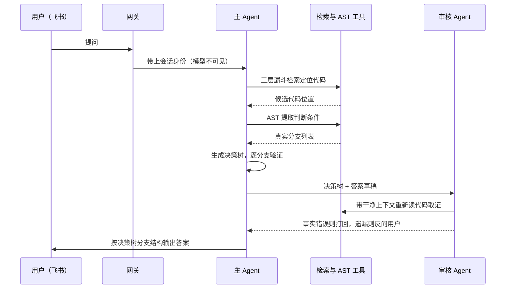
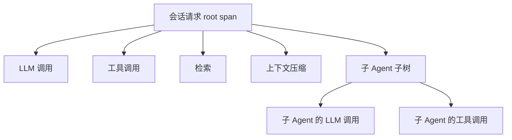

# 面经记录

**岗位方向：** 27 届秋招**提前批**，AI / Agent 方向（BU 未确认）
**来源：** 我自己的面试，**录音丢了**，只有事后回忆的问题清单。
**结果：** 🔴 **挂**

> ⚠️ **本文和仓库里其他「我面试」的面经不一样：没有「当时的回答」。**
> 录音没录上，只能凭记忆列出问题。所以下面每题写的是**定稿答法**（该怎么答），不是「我当时怎么答的」。
> 想知道当场答得怎么样，得靠 `/new-review` 自己回忆填。
>
> 同公司的另外两场（**转载**，不是我的）：[[公司/米哈游/米哈游提前批一面_约2026-08]] · [[公司/米哈游/米哈游提前批二面_约2026-08]]

## 🔴 本场画像（准备时先看这段）

**这场跟转载的那两场完全不是一个考法。** 转载那两场是「Agent 场景题 + 后端高并发八股 + 算法」；**我这场几乎没有后端八股，全程是 LLM / Agent 的原理与工程**，外加一道很轻的代码题。

四条主线：

1. **AI coding 本身被当成考点**（Q1–Q2b，**连问三题**）——「你怎么用」→「怎么保证质量」→「**有没有工程化的方式保证有效性**」。🔴 **同一主题连问三次，通常意味着前两问没答到他要的东西**，第三问是他在直接给提示：他要的是**不依赖人的自觉的机制**。见 [[AI-Coding工程实践]] §3.4。
2. **LLM 的「为什么会错」和「怎么证明它没错」**（Q4 幻觉原理 / Q6 事实度忠实度）——考的是**原理**不是调参技巧。见 [[幻觉与事实性评测]]。
3. **Agent 运行时的交互控制**（Q13 并发两条消息 / Q14 steer 续接）——**这两题仓库里原来完全没有**，是这场最新的增量，答案见下面 Q13/Q14。
4. **拿我的字节实习当靶子逐层深挖**（Q10 全流程 / Q11 压缩 / Q12 summary / Q15 trace）——四题全部能从 [[追问/字节答疑Bot]] 和 [[Agent上下文压缩链路]] 取材。

> 💡 **一句话记住这场：它问的不是「你会不会用 Agent」，是「你知不知道 Agent 为什么会坏、坏了怎么看出来」。**

---

## 1. 你怎么用 AI coding 的？

**答题骨架**

**先给分层，别直接报工具名。** 用法按「谁掌握控制权」分三档，成本和风险递增：

| 档 | 形态 | 我掌握什么 | 适合什么 |
|---|---|---|---|
| **补全档** | IDE 内联补全 | 每一行我都看着 | 熟悉的代码、样板 |
| **对话档** | 选中一段问 / 让它改这个函数 | 改动范围我圈定 | 局部重构、看不懂的代码 |
| **代理档** | agent 自己读文件、跑测试、改多个文件 | 只给目标和验收标准 | 我不熟的模块、跨文件的机械改动 |

**真正的判据是一句话：给它上下文的成本，会不会超过我自己写的成本。** 一个我脑子里已经很清楚的 20 行函数，描述清楚需要三分钟，自己写只要两分钟——这种就不该用。反过来，一个跨 8 个文件的重命名，我讲清楚只要一句话。

**我自己的具体做法（这段才是面试官想听的）：**
- **把项目约定写成文件而不是每次重复说**——`CLAUDE.md` / `AGENTS.md` 放在仓库里，每轮自动进上下文。这跟 Q11 那题是同一个原理：**外置到文件系统的状态不会被压缩衰减**。
- **把重复流程固化成 skill**（见 Q7/Q8），不是每次重新描述。
- **不给它开无边界的探索**：先自己 grep 定位到大致范围，再让它在这个范围内做。理由跟我在字节做的事一样——**harness 的一个核心工作就是尽可能少给上下文**，上下文越长它越容易以偏概全。

**收口（把它接回我的项目，显示我不是只会当用户）：**
> 「我不只是 AI coding 的使用者，我在字节做的就是这类系统本身——多 Agent 编排、上下文管理、trace 和评测。所以我看 Cursor / Claude Code 的时候，看的是它的 harness 怎么设计的，比如工具结果怎么裁剪、什么时候触发压缩。」

> 📌 参考 [[AI-Coding工程实践]]；同类真题：[[公司/其他/PingCAP/面试问题总结]]（「你用 cursor 过程中有没有遇到实际问题」，有完整的问题表）

---

## 2. 怎么保证 AI coding 生成代码的质量？

**答题骨架**

🔴 **这题的分水岭：答「我会 review 一遍」是最低档。** 因为它默认人眼能看出问题，而 AI 代码最大的风险恰恰是**看起来对**。

**开口第一句就要点破因果**（还能顺势跟 Q4 的幻觉原理串起来）：
> 「模型优化的目标是**输出像不像对的**，不是**对不对**。所以它产出的错误天生是『读起来很顺、命名很合理、结构很像那么回事』的那一类——**这正好是人工 review 最容易放过的一类**。所以质量保证不能建立在人眼上，得建立在**机器能自动判定的信号**上。」

**三层，按能不能自动化排序：**

**① 输入侧——缩小它能犯错的空间**
- **先写测试再让它实现**：测试就是规格，而且是机器可执行的规格。这是把「我要什么」从自然语言变成可判定的东西。
- 给它现有代码当风格样例，别让它自由发挥
- **一次只让它做一件事**——大 diff 是不可 review 的，这是人的带宽问题不是 AI 的问题

**② 生成侧——限制单次改动的规模**
- 拒绝一次几百上千行的产出（[[公司/其他/PingCAP/面试问题总结]] 里踩过这个坑：能跑，但结构和命名不统一）
- 让它先说方案再动手，方案错了成本是零

**③ 验证侧——唯一可信的是不依赖人眼的信号**
- 类型检查 / lint / 测试 / CI 门禁，**这四个是硬信号**
- **人工 review 只保留给两类地方**：安全和权限相关的、以及「它做了我没让它做的事」（AI 特别爱顺手加 fallback、加 try-except 吞异常、加没要求的配置层）
- 覆盖率不是质量指标，但**「新增代码有没有对应测试」是**

**AI 特有的三个坑（说这个才显得真用过）：**

| 坑 | 表现 | 怎么防 |
|---|---|---|
| **假设理想输入** | 不写边界检查，默认所有字段都存在 | 让它先列 edge case 再写实现 |
| **局部视角** | 只看它读到的那几个文件就改，忽略其他模块 | 先自己划范围，改完全局搜一遍受影响点 |
| **过度设计** | 主动加抽象层、fallback、配置项 | 明确写「不要加没要求的东西」，diff 里逐条砍 |

**收口金句：**
> 「一句话：**把『对不对』这件事，从人的判断变成机器的判断。** 我在字节做答疑 Bot 也是这个思路——不是让人去看 agent 答得对不对，是做 50+ 题的专家 rubric 评测集，让分数说话。」

---

## 2b. 有没有工程化的方式，保证编码的有效性？

> 🔴 **这是 AI coding 这条线上的第三问。连问三次同一个主题，通常意味着前两问没答到他要的东西。**
> **他加的两个词是关键**：「**工程化**」= 不依赖人的自觉，能进流水线、自动跑、可复现、失败能阻断（所以「我会认真 review」「我会写测试」是**习惯不是工程**）；「**有效性**」比「质量」窄，只问**代码是不是真的做对了它该做的事**。

**答题骨架**

**开口第一句先点破那个死循环（这是题眼）：**

> 「AI coding 里有个独特的死循环——**让 AI 写代码，再让 AI 写测试，等于让它自己给自己判卷**。而且它作弊的方式很具体：**跑不过就改测试**。所以工程化的手段，本质上都是在破这个循环。」

**然后四个手段，每个一句话：**

**① 把「规格」的所有权从模型手里拿走。**
测试由人定义，模型只写实现。**最工程化的动作是禁止模型改测试文件**——用 `CODEOWNERS`（仓库里的一个文件，规定哪些路径的改动必须由指定的人批准）把测试目录锁给人；CI 再加一条：同一个 PR 里实现和测试同时被改就强制人工确认。**这是机制不是自觉，所以才叫工程化。**

**② 验证「测试本身有没有用」——变异测试。**

> `变异测试（mutation testing）`：**故意往代码里注入小 bug**（`>` 改 `>=`、`+` 改 `-`、返回值改 null），然后跑现有测试。**测试还全绿，就说明这个 bug 你根本测不出来。**
> `变异分数` = 被杀掉的变异体 / 注入的总数。

> 🔑 **为什么这条是核心**：覆盖率只说明「这行**被执行过**」，**不说明「这行错了会被发现」**。而 **AI 特别容易写出覆盖率很高但断言很弱的测试**（典型：只 assert 不抛异常）。**变异测试是唯一直接度量「测试有没有用」的手段。**

**③ 不变量由人定、用例由机器生成——基于属性的测试。**

> `基于属性的测试（property-based testing）`：不写具体用例，写**不变量**——「不管输入是什么这条永远成立」：排序后长度不变、序列化再反序列化等于原值、转账前后总额不变。框架自动生成成百上千输入去打，失败还会把反例自动缩到最小。

**为什么它专治 AI 代码：AI 最擅长的就是通过你想到的那几个用例。** 而不变量它绕不过去——你说的是「对所有输入」。

> ⭐ **这就是我已经会的东西的另一个形态**：[[测试设计方法论]] §7 的**随机序列对拍**是「拿一个显然正确的实现当**影子模型**，随机序列打，每步查不变量」；property-based 是**没有参考实现，直接断言不变量**。**同一个思想。面试时可以直接说「我在测试设计里一直用对拍，property-based 是它的无参考实现版本」。**

**④ 重构场景的护栏——影子对比（golden master）。**
改之前录一批真实输入输出，改之后重放比对。**它的价值在于不需要你理解那段代码**——**而这恰恰是让 AI 重构遗留代码的典型场景：你就是因为不懂它才让 AI 改的。** 这是对拍的生产版本，参考实现 = 旧代码。

**然后是固化进流水线：**
- **门禁必须是阻断不是告警**——告警一定会被忽略
- **增量覆盖率**（只看这个 PR 新增/修改的那些行）而不是总覆盖率——**总覆盖率在大仓库里几乎不动，没有信号**
- 测试文件保护 + diff 规模上限

**收口：度量「有效性」本身（这段能拉开档次）**

| 指标 | 测什么 |
|---|---|
| 增量覆盖率 | 新代码**有没有被测到** |
| **变异分数** | 测试**有没有用** |
| 🔑 **逃逸缺陷率**（CI 全绿但线上出问题的比例） | **唯一的终极指标** |

> 「前两个都是逃逸缺陷率的**代理指标**。**如果变异分数上去了但逃逸缺陷没降，说明我测的方向不对**——那比测得不够更值得警惕。」

**⑥ 40 秒口语稿**
> 「工程化的意思是**不能依赖人的自觉**，得进流水线、自动跑、失败能阻断。
> AI coding 这里有个独特的死循环：**让 AI 写代码再让 AI 写测试，等于自己给自己判卷，而且它作弊很具体——跑不过就改测试。** 所以我的手段都围绕破这个循环。
> **第一，规格的所有权归人**：测试由人定义，并且**用 CODEOWNERS 把测试目录锁住，禁止模型改**；同一个 PR 里实现和测试同时被改就强制人工确认。**这是机制不是自觉。**
> **第二，用变异测试验测试本身有没有用**——故意往代码里注入小 bug，测试还全绿就说明测了等于没测。**因为覆盖率只说明这行被执行过，不说明它错了会被发现，而 AI 最爱写断言很弱的测试。**
> **第三，基于属性的测试**——不变量由人写、用例由机器生成，专治『AI 只通过你想到的那几个用例』。这跟我在测试设计里一直用的随机序列对拍是同一个思想，只是没有参考实现。
> **第四，重构场景上影子对比**，改前录输入输出、改后重放比对——**它的好处是不需要我理解那段代码，而那正是我让 AI 改遗留代码的原因。**
> 最后是度量：增量覆盖率、变异分数，但**终极指标是逃逸缺陷率——CI 全绿却在线上出问题的比例**，前两个都只是它的代理。」

**预备追问**

| 追问 | 答法 |
|---|---|
| **变异测试太慢了吧** | 是，全量跑不现实。**只对本次 diff 涉及的文件跑增量变异测试**，跟增量覆盖率一个思路 |
| **不变量不好想怎么办** | 从三类下手：**往返性**（序列化↔反序列化）、**守恒量**（总额、长度、集合大小）、**与参考实现等价**（就是对拍）。见 [[测试设计方法论]] |
| **这些不都是普通工程实践吗，跟 AI 有什么关系** | ✅ 正面接：**手段是老的，但权重完全变了。** 人写代码时产出速度受限，review 跟得上；**AI 把产出速度放大十倍，人工 review 带宽没变——它会先变成瓶颈，再变成橡皮图章。** 所以以前「有更好」的东西，现在是「没有就崩」 |
| **那还需要人 review 吗** | 需要，但**只保留给两类**：安全权限相关的路径、以及「它做了我没让它做的事」 |

> 📌 变异测试 / property-based testing / CODEOWNERS / 增量覆盖率在本仓库属首次出现，已就地立定义。「对拍 ↔ property-based 是同一思想的两种形态」是我的归纳。

---

## 3. 二选一：Python 装饰器打 log，或 ACM 模式排序题

> 面试官给了两道让我挑一道。**两道都不难，题目的重点在细节。**

### 3a. Python 实现装饰器，打印 log

**基础版：**

```python
import functools
import logging
import time

def log(func):
    @functools.wraps(func)                      # 保住原函数的 __name__ / __doc__ / 签名
    def wrapper(*args, **kwargs):
        start = time.perf_counter()
        try:
            result = func(*args, **kwargs)
        except Exception:
            logging.exception("%s failed", func.__name__)   # 异常也要记，然后原样抛出
            raise
        cost = (time.perf_counter() - start) * 1000
        logging.info("%s(args=%s, kwargs=%s) -> %r  [%.2f ms]",
                     func.__name__, args, kwargs, result, cost)
        return result
    return wrapper
```

**四个细节，每一个都是考点：**

1. **`@functools.wraps(func)` 必须加。** 不加的话被装饰后函数的 `__name__` 变成 `"wrapper"`，日志里全是 wrapper，而且文档字符串和签名都丢了。**这是这题最常见的减分点。**
2. **异常路径也要打日志，而且要 `raise` 原样抛出。** 吞掉异常是灾难。
3. `*args, **kwargs` 透传，装饰器不能改变函数签名。
4. `time.perf_counter()` 而不是 `time.time()`——前者是单调时钟（monotonic clock，只会往前走，不受系统时间调整影响），测耗时该用它。

**带参数版（面试官大概率追问 `@log(level="INFO")`）——三层嵌套：**

```python
def log(level=logging.INFO):
    def decorator(func):
        @functools.wraps(func)
        def wrapper(*args, **kwargs):
            result = func(*args, **kwargs)
            logging.log(level, "%s -> %r", func.__name__, result)
            return result
        return wrapper
    return decorator
```

**为什么多一层：** `@log(level=...)` 这个写法里，`log(level=...)` **先被调用**，它的返回值才是真正的装饰器。所以结构是「函数 → 返回装饰器 → 返回 wrapper」。

**预备追问：**
- **「装饰类的方法呢？」** → 一样能用，`self` 会作为 `args[0]` 传进来。
- **「异步函数呢？」** → 要写 `async def wrapper` 并 `await func(...)`，同步的 wrapper 包异步函数只会拿到一个协程对象不会真正执行。**这是很好的加分点。**
- **「装饰器和 Java 的注解一样吗？」** → 不一样。Java 注解是**元数据**，本身不改变行为，要靠反射或编译期处理器去读；Python 装饰器是**真的把函数换成另一个函数**，是运行时的函数变换。见 [[Java语法基础速查]]。

### 3b. ACM 模式：售价 / 售出 / 买入 排序

**题目：** 输入若干组 `(售价, 售出, 买入)`，输出**售价最便宜的前 4 个**，且**售出和买入都不为 0**。

```python
import sys

def main():
    data = sys.stdin.read().split()
    n = int(data[0])
    items = []
    for i in range(n):
        price, sold, bought = map(int, data[1 + i * 3: 4 + i * 3])
        if sold != 0 and bought != 0:          # 先过滤
            items.append((price, sold, bought))
    items.sort(key=lambda x: x[0])             # 再按售价升序
    for it in items[:4]:
        print(*it)

main()
```

**三个要说出来的点：**
1. **先过滤再排序**，不是先排序再过滤——过滤把参与排序的规模降下来了。
2. **不足 4 个要能正常输出**：`items[:4]` 天然安全，不用特判。
3. **数据量大时可以不排全序**：`heapq.nsmallest(4, items)` 是 O(n log 4)，比全排序的 O(n log n) 好。**主动提这一句，比写完就交好。**

> 🔸 本仓库不收算法题解。刷题在另一个仓库，这里只如实记录考了什么。

---

## 4. AI 的幻觉原理是什么？

**答题骨架**

> ⚠️ 这题问的是**原理**不是「怎么缓解」。上来就答「用 RAG 缓解」是答偏了——那是 Q6 的答案。

**① 技术定义（先立准）**
> 幻觉 = 模型输出了**流畅、自信、但没有依据或与事实不符**的内容。**关键在于它不是 bug，是训练目标的必然产物。**

**② 机制——分两段讲，这个分法是这题的分水岭**

**第一段：预训练为什么必然产生幻觉。**
语言模型优化的目标是**似然**——

> `似然（likelihood）`：给定前面的文本，模型认为下一个词该是某个具体词的概率。训练就是把训练语料里真实出现的那个词的概率往上抬。

**注意这里面没有任何一项是「这句话是不是真的」。** 语料里出现频率高的说法，就是模型眼里"该说"的话。

OpenAI 2025 年那篇 *Why Language Models Hallucinate*（Kalai / Nachum / Vempala / Zhang）把这件事**归约成一个二分类问题**：如果模型没能力把「错误陈述」和「事实陈述」分开，那么在自然的统计压力下，预训练模型**一定**会产生幻觉。特别是**训练语料里只出现过一次的事实**（论文里叫 singleton，比如某个人的生日），模型没有足够信号学会它，只能靠语言规律去猜一个**看起来对**的答案。

**第二段：为什么后训练之后幻觉还在——这段才是那篇论文真正的新意，也最容易拿分。**

> **因为评测在奖励猜测。**

绝大多数评测集是 0/1 打分：答错得 0 分，答「不知道」也得 0 分。那么对模型来说，**猜是严格占优策略**——猜对了有分，猜错了不比弃答更亏。模型被优化成一个好的应试者，而好的应试者遇到不会的题就是要蒙。论文对主流评测集做了一次元评估，确认**大多数评测确实偏向奖励猜测**。

**所以修法在评分规则上**：对错误答案扣分、对「不确定」给部分分，让**校准**比装懂更划算。

> `校准（calibration）`：模型说「我有 70% 把握」的那批回答，实际正确率就该接近 70%。论文的一个反直觉结论是——**做到校准比做到准确要容易得多。**

**第三段（检索场景补一句，直接接下一题）：**
上下文里放了正确材料，模型照样可能不用——因为**注意力被稀释**了。上下文越长这个现象越明显，这也是为什么压缩不只是省钱，是提准确率的手段（见 [[Agent上下文压缩链路]]）。

**③ 30 秒口语稿**
> 「幻觉不是 bug 是训练目标的产物。预训练优化的是**下一个词的似然**，里面根本没有『这句是不是真的』这一项，所以对语料里只出现过一次的冷门事实，模型只能猜一个像样的。这是第一层。
> 第二层更关键：**后训练之后幻觉还在，是因为评测在奖励猜测**——大部分评测集答错和说不知道都是零分，那猜就是占优策略，模型被训练成一个会蒙题的应试者。OpenAI 2025 年那篇论文的核心主张就是**改评分规则**，对错误扣分、对弃答给分，让『校准』比『装懂』更划算。
> 落到工程上就是第三层：我们没法改预训练，但可以改**我们自己的评测**和**我们给它的上下文**——这就是我在字节做的事。」

> 📌 出处：[Why Language Models Hallucinate](https://arxiv.org/abs/2509.04664)（OpenAI，2025-09）+ [OpenAI 官方解读](https://openai.com/index/why-language-models-hallucinate/) ・ 查证于 2026-08-04 ・ 官方论文 + 官方博客双确认
> 详见 [[幻觉与事实性评测]]

---

## 5. DeepSeek、OpenAI 这些 API 有什么接口？

**答题骨架**

> ⚠️ 这题看着像送分，其实在验「你到底读没读过文档」。**分两层答：端点层 + 能力层。** 只报端点名是背书，加上能力层才是做过网关的人。

**① 端点层**

| 厂商 | 主要端点 |
|---|---|
| **OpenAI** | `/v1/responses`（**现在主推**，有状态，内置 web search / file search / code interpreter / computer use / 远程 MCP）· `/v1/chat/completions`（经典，仍在）· `/v1/embeddings` · `/v1/models` · `/v1/batches` · `/v1/files` · audio / images / moderations · Realtime（WebSocket / WebRTC） |
| **Anthropic** | `/v1/messages`（+ `/v1/messages/count_tokens`）· Batches · Files · **`/v1/skills`**（Agent Skills 上传，beta header `skills-2025-10-02`） |
| **DeepSeek** | `/chat/completions` · `/models` · `/user/balance`；**base_url 有三个**：`https://api.deepseek.com`（OpenAI 兼容）/ `https://api.deepseek.com/anthropic`（Anthropic 兼容）/ `https://api.deepseek.com/beta`（beta 功能） |

**② DeepSeek 有两个别家没有的东西，值得单独点出来：**
- **FIM 补全**（fill-in-the-middle，填中间）：给**前缀和后缀**让模型补中间那段。**这是代码补全的形状**——IDE 里光标前后都有代码，跟聊天式的「只给前文」根本不是一回事。走 beta base_url。
- **Chat Prefix Completion**：把 messages 最后一条设成 `role=assistant` 且 `prefix=True`，模型**接着这句往下写**。用来强制输出格式（比如让它必须以 `{` 开头）。也走 beta base_url。
- 另外思考内容单独放在 **`reasoning_content`** 字段里，跟正文 `content` 分开。

**③ 能力层——这才是加分的部分**

同一个 `/chat/completions` 端点，下面这几件事三家全不一样，我在字节的网关里全踩过：
- **system prompt 放哪**（OpenAI 在 messages 里 / Anthropic 是顶层 `system` / Gemini 是 `systemInstruction`）
- **工具调用参数的类型**（OpenAI 给的是 **JSON 字符串**要自己 parse，另两家是对象）
- **思考上下文怎么回传**（Gemini 的 `thoughtSignature` 漏了直接 400）
- **prompt cache 怎么触发**（OpenAI 全自动 / Anthropic 要显式打断点且写入加价）

**④ 收口金句（这句最值钱）：**
> 「DeepSeek 同时提供 OpenAI 兼容层和 Anthropic 兼容层，这件事本身说明**协议已经收敛成两三套事实标准**了。但**兼容不等于等价**——兼容层通常只覆盖 chat/completions 的公共子集，思考回传、缓存断点、并行工具调用这些不一定一致。所以我们网关的能力表是按**『模型 × 能力』**维护的，不是按协议维护。」

> 📌 端点与特性查证于 2026-08-04（各家官方文档）。**这块变化极快，用前重核。** 完整六层差异见 [[LLM多协议网关适配]]

---

## 6. 怎么解决 AI 回答的事实度、忠实度？

**答题骨架**

🔴 **这题的分水岭在第一句：先把两个词掰开。** 面试官把两个词并列着问，就是在看你知不知道它们不是一回事。

**① 定义**

| | **忠实度**（faithfulness / groundedness） | **事实度**（factuality / factual correctness） |
|---|---|---|
| 比对的对象 | **你给它的材料** | **世界真相** |
| 需要什么 | 只要有检索到的上下文 | 需要外部标准答案 |
| 能不能自动化 | ✅ 能，不需要标注 | ❌ 难，要人标或可信知识源 |
| 能不能上线上跑 | ✅ 能（reference-free） | 一般只能抽样离线跑 |

**② 关键洞察：两者会背离，而且是双向的。**
- 材料本身是错的，模型**忠实地**照抄 → **忠实度满分，事实度 0**
- 模型凭参数里的记忆答对了，但材料里没有 → **事实度满分，忠实度低**

**所以工程上的排序是：先死保忠实度，事实度靠语料治理。** 理由很硬——忠实度是我**能控制**的（材料是我给的，比对是自动的）；事实度取决于知识库本身对不对，那是**数据治理问题不是模型问题**。

**③ 手段，按链路三段排**


| 段 | 做什么 |
|---|---|
| **检索侧** | 混合检索 + rerank 提高「材料本身对」的概率；**召回不到就拒答，不许猜**——宁可回「知识库里没有这个」也不给一个自信的错答案 |
| **生成侧** | 强制引用（每个结论挂来源 ID）；结构化输出；**把「无法从材料中确定」列为一个合法输出**——如果模型没有认输的选项，它一定会编（这条直接呼应 Q4 的评分机制） |
| **生成后** | **claim 级回验**：把回答拆成一条条原子断言，逐条回材料判「有没有支撑」，命中比例就是忠实度分数 |

**④ 评测怎么落地**
RAGAS 那套四个指标：**faithfulness / answer relevancy / context precision / context recall**。其中 faithfulness 的算法就是上面说的 claim 级回验（抽 claim → 逐条比对 → 算命中比例），**而且它是 reference-free 的——不需要标准答案，所以能挂在线上跑**。这是它比其他指标实用的地方。

**⑤ 我自己项目里的对应（这段最有说服力）**
> 「我在字节做的**审核 Agent** 干的就是 claim 级回验这件事——它拿到干净的初始上下文 + 决策树 + 答案草稿，**并且保留代码读取权限**，要验哪段自己去读哪段。结构上对着决策树查完备性，事实上回代码验证链路。发现事实错误就打回重生成，发现是问题本身歧义就反问用户。评测上从 56% 到 87%。
> 而且我们的评测是 50+ 题**专家写 rubric、AI 按得分点判卷**——得分点是人定的，AI 只做匹配不做主观评价，比自由式的 LLM-as-judge 可靠。」

**⑥ 一个必须主动说的边界（说了显得诚实且懂行）：**
> 「有个天花板要讲清楚：**忠实度指标测不出『材料本身是错的』**。独立评测也确认了目前没有框架能区分「检索到的上下文是对的」还是「是错的」。所以忠实度做到 100% 也不等于答案对——**剩下那一半必须靠知识库治理**，不能指望评测框架替你兜。」

> 📌 RAGAS 指标定义与 reference-free 特性查证于 2026-08-04（社区文档与综述，非官方一手）。详见 [[幻觉与事实性评测]] · [[RAG优化全链路]]

---

## 7. Skill 和 MCP 的区别？

**答题骨架**

**① 一句话对立（开口就要给这个）：**
> **MCP 解决「够不够得到」，Skill 解决「会不会做」。**
> MCP 是**协议**，让 agent 能连上外部工具和数据；Skill 是**目录格式**，教 agent 一类任务该怎么做。

**② 五维对比表**

| | **MCP**（Model Context Protocol） | **Skill**（Agent Skills） |
|---|---|---|
| 性质 | 协议（JSON-RPC 2.0，跑在 stdio 或 Streamable HTTP 上） | 目录约定（`SKILL.md` + YAML frontmatter + 可选脚本/资料） |
| 要不要跑进程 | **要**，server 是独立进程或远程服务 | **不要**，就是文件，跟着 agent 一起跑 |
| 上下文成本 | **工具定义常驻**——装得多，会话还没开始就先吃掉一大块窗口 | **渐进披露**，没触发时只占 `name` + `description`，官方口径**约 100 token/skill** |
| 带来什么 | 新的**能力**（连数据库、发消息、读私有系统） | 新的**流程与判断**（步骤、模板、质量检查清单） |
| 谁决定用它 | 模型从工具列表里挑一个调 | 模型拿 `description` 跟用户请求匹配，决定要不要加载 |

**③ Skill 的核心机制：渐进披露（progressive disclosure）三级**——这是它跟 MCP 最本质的差别，必须讲：

| 级 | 什么时候进上下文 | token 成本 | 内容 |
|---|---|---|---|
| **L1 元数据** | 启动就在系统提示里 | **约 100 token / skill** | frontmatter 的 `name` + `description` |
| **L2 正文** | 被触发时才读 | 官方建议 **< 5k token** | `SKILL.md` 正文 |
| **L3 资源与脚本** | 用到才读 | **没用到就是 0** | 附带的参考文件；**脚本走 bash 执行，只有输出进上下文，代码本身不进** |

因为 L3 不用不花钱，**一个 skill 能捆多少内容实际上没有上限**——这是官方明确讲的设计目的。

**④ 最该说的一句（把两者统一起来）：**
> 「它们其实在治同一个病——**上下文窗口有限**。**MCP 把能力放到进程外，Skill 把知识放到窗口外。** 一个是空间上的外置，一个是时间上的延迟加载。」
> <!-- 这句是我自己的归纳，不是官方口径，标为推断 -->

**⑤ 什么时候选哪个**
- 要连**活数据**、有状态的服务、跨应用复用 → **MCP**
- 要固化**一套做事方法**（步骤、模板、检查清单、要跑的脚本）→ **Skill**
- **生产系统通常两个都要**——官方自己的说法也是互补不是替代

**⑥ 两个安全坑（各说一条，显得两边都真用过）**
- **MCP**：tool description 是 server 完全控制的一段 prompt，**而且不签名**——你信任它之后它可以被改掉（rug pull）
- **Skill**：官方明确警告**只用可信来源的 skill**。它带可执行代码和指令，恶意 skill 可以让 agent 干和它声称的用途完全无关的事，导致数据外泄

> 📌 渐进披露三级、约 100 token、< 5k token 等数字来自 [Anthropic 官方文档](https://platform.claude.com/docs/en/agents-and-tools/agent-skills/overview) + [官方工程博客](https://www.anthropic.com/engineering/equipping-agents-for-the-real-world-with-agent-skills) ・ 查证于 2026-08-04
> 详见 [[Agent设计模式与MCP]]（已按本场更新 Skill 一节）

---

## 8. Skill 有什么特性？

**答题骨架**

> 上一题讲的是「和 MCP 比」，这题要讲「它自己长什么样」。**分五条说，最后一定要带限制**——只说优点听起来像念官网。

**① 结构极简：一个目录 + 一个 `SKILL.md`**

```
pdf-processing/
├── SKILL.md          ← 入口，YAML frontmatter + Markdown 正文
├── FORMS.md          ← 按需加载的细分指引
├── REFERENCE.md      ← 参考资料
└── scripts/
    └── fill_form.py  ← 可执行脚本，bash 跑，代码不进上下文
```

**frontmatter 只有两个必填字段，但约束很具体：**
- **`name`**：≤ 64 字符，只能小写字母/数字/连字符，**不能含 "anthropic" / "claude"**
- **`description`**：非空，≤ 1024 字符，**必须同时写清「做什么」和「什么时候用」**

> ⭐ **`description` 是整个 skill 最重要的一行**，因为它是**唯一的触发依据**——模型拿它跟用户请求匹配。写「处理 PDF」不行，要写「提取 PDF 文本和表格、填表单、合并文档。当用户提到 PDF、表单或文档提取时使用」。**这跟 MCP 里 tool description 决定选不选得对是同一个道理。**

**② 渐进披露三级**（见上题表，不重复）

**③ 可执行代码，而且是零上下文成本的**
脚本通过 bash 跑，**只有输出进上下文，代码本身永远不进**。这带来两件事：
- **省 token**：让 agent 现场生成等价代码要花掉那些 token，跑现成脚本不用
- **确定性**：官方原话的意思是——拿到「只有代码才能给的确定性」。格式转换、校验、计算这类事情，写死在脚本里就不会每次结果不一样

**④ 可组合 + 可移植**
多个 skill 能一起用。因为它就是个文件夹，可以打包分发：
- Claude Code：`~/.claude/skills/`（个人）或 `.claude/skills/`（项目），**文件系统直接发现，不用上传**
- API：走 `/v1/skills` 上传，**workspace 内共享**
- claude.ai：传 zip，**每个用户各自上传**

**⑤ 限制——说这个才显得真用过，不是念官网**
- 🔴 **不跨 surface 同步**：claude.ai 上传的 skill 在 API 上没有，Claude Code 的又是另一套。三边各管各的
- 🔴 **API 上的 skill 跑在沙箱里：无网络访问、不能运行时装包**，只能用预装依赖。Claude Code 里则和普通程序一样有完整网络
- ⚠️ **`allowed-tools` 这个 frontmatter 字段**：只在 Claude Code CLI 支持，而且**有社区 issue 报告它被解析了但没有真正强制**——写了它 Claude 依然能访问所有工具。**别把它当安全边界。**
- ⚠️ 安全模型：**skill 等同于安装软件**，只用自己写的或来自 Anthropic 的

**⑥ 30 秒口语稿**
> 「Skill 就是一个文件夹加一个 `SKILL.md`，frontmatter 只要 name 和 description 两个字段，**description 是唯一的触发依据所以最关键**。
> 核心机制是**渐进披露三级**：启动时只有名字和描述进系统提示，大概 100 个 token；被触发才读正文，官方建议 5k 以内；附带的文件和脚本用到才读。**脚本是 bash 跑的，只有输出进上下文，代码不进**——所以一个 skill 能捆的内容实际上没有上限，这是它跟 MCP 最大的区别：**MCP 的工具定义是常驻的，装多了会话没开始就先吃掉窗口。**
> 限制我也踩过：不跨 surface 同步，API 上跑在无网络的沙箱里，还有 `allowed-tools` 字段目前有 issue 说它不真正强制，**不能当安全边界用。**」

> 📌 字段限制与限制条款来自 [Anthropic 官方文档](https://platform.claude.com/docs/en/agents-and-tools/agent-skills/overview)；`allowed-tools` 不强制来自 [claude-code issue #37683](https://github.com/anthropics/claude-code/issues/37683)（社区 issue，未见官方确认）・ 查证于 2026-08-04

---

## 9. 你认为游戏 Agent 有什么发展方向？

**答题骨架**

> ⚠️ 开放题。**最容易失败的答法是发散地列一堆「智能 NPC、AIGC、个性化」——听起来像行业报告，没有工程判断。**
> 正确姿势：**先给一个切分框架，再在每一格里说清楚「瓶颈在哪」。** 面试官要的是判断力不是热情。

**开口先给框架：**
> 「我把游戏里的 agent 分成三个位置：**它作为游戏内容 / 它作为生产力 / 游戏作为它的训练场**。这三个的成熟度和瓶颈完全不同。」

### ① 玩家侧——agent 作为游戏内容（NPC / 队友 / GM）

**现状判断：能对话，但不能行动。** 真正的门槛不是对话质量——那已经够用了——是**把语言层的决策接到游戏状态机上，并且不破坏数值平衡和剧情一致性**。

**三个硬约束，一个都绕不过：**

| 约束 | 具体是什么 | 方向 |
|---|---|---|
| **延迟** | 游戏是帧驱动的。战斗里等一次秒级的模型响应等于卡死 | **分层**：慢思考做规划（可以几秒），快策略做执行（必须毫秒级）；或者离线预生成 + 运行时检索 |
| **成本** | DAU 千万的游戏，每个 NPC 每句话都调一次模型，账算不过来 | 小模型 + 端侧 + 缓存高频对话；**把模型用在「稀有时刻」不是「每一句」** |
| **可控性** | NPC 不能剧透、不能违规、不能 OOC | **硬门禁**，不是 prompt 里劝它。这跟我做的决策树门禁是同一个思路：**用可自动检查的结构约束，代替祈祷模型听话** |

**再加一层，是我做过的：记忆。** NPC 要记得玩家上次做了什么、关系怎么变的——这就是**跨会话持久记忆**问题：存什么、什么时候写、怎么检索、久了怎么淘汰。见 [[Agent记忆系统]]。

### ② 开发侧——agent 作为生产力（我判断这是短期最确定的一块）

- **自动化测试**：游戏测试天生是**长程决策 + 状态空间爆炸**，人工覆盖不到。让 agent 做探索式测试、回归、找卡关和穿模。**我在谷歌那段做的就是 Agentic 测试系统的自进化 Memory**，直接对口。
- **内容生产**：关卡、剧情分支、本地化。要点是**约束生成**——产出必须落在策划定义的 schema 和数值区间内，否则就是不可用的素材。
- **研发/运营答疑**：**这个跟我在字节做的一模一样。** 游戏项目代码体量大、策划配置表多、口径散落在人脑子里，「文档常年过期，只有代码和配置是真的」——**这句话在游戏项目里比在广告平台更成立。**

### ③ 研究侧——游戏作为 agent 的训练与评测环境

学术上游戏一直是 agent 的标准试验场：ACM CSUR 那篇 LLM 游戏 agent 综述的论文库里，Minecraft 60 篇、文字冒险 135 篇、社交推理 47 篇、策略对抗 51 篇。

**为什么这条对米哈游特别重要（这句是这题的收口）：**
> 「游戏提供了**可验证的、可无限重来的、长程的**任务信号——这恰恰是 agent 训练最缺的东西。真实世界的任务很难自动判定对错，游戏里天然有输赢和进度。**所以对一家游戏公司来说，你的游戏本身就是一个别人没有的 agent 训练和评测环境**，这是我觉得最有差异化的方向。」

**已知难点也要带，证明不是空谈：** 领域幻觉（有研究报告在宝可梦环境里因为属性克制推理错，胜率只有 26%）、实时动作控制的延迟、多轮 NPC 对话的叙事一致性。

**收口一句：**
> 「短期最确定的是**开发侧**——测试、答疑、约束生成，这三件事今天就能落地且 ROI 清楚。**玩家侧**的瓶颈不在模型能力，在延迟、成本和可控性，需要工程分层去解。**长期最大的差异化在第三条**——把游戏本身当成 agent 的训练场。」

> 📌 综述论文分类数据来自 [awesome-LLM-game-agent-papers](https://github.com/git-disl/awesome-LLM-game-agent-papers)（ACM CSUR 综述配套仓库）；26% 胜率数据来自搜索到的综述二手转述，**未核到一手论文，引用时说「有研究报告」不要说死** ・ 查证于 2026-08-04

---

## 10. 你的字节实习 agent 整个流程是怎么样的？以一个 query 为例

**答题骨架**

> 这题要的是**一条完整链路**，不是功能列表。**用一个具体 query 从头走到尾**，每一步说清「为什么有这一步」。

**取一个真实 query：**「玩法 A 的用户在 X 状态下，能流转到哪些状态？」



**逐段口语稿：**

**① 入口与身份**——消息从飞书进来，网关校验后把身份放进**对模型完全不可见的运行时上下文**，不在 system prompt 里也不在工具参数表里。**因为身份如果是模型填进工具参数的，等于把越权能力交给一个概率系统。**

**② 检索三层漏斗**——
- **ByteRAG** 检索业务文档做粗定位：**文档旧了不能当答案，但可以当地图**
- **CodeRAG** 语义代码检索，顺手解决中文业务词到英文代码符号的鸿沟，配一份业务语义词表兜底
- **grep / glob** 精确收敛

**③ 决策树**——业务分叉抽象下来就三类：枚举值 if-else、抽象方法多实现、同语义函数聚集。我做了个 **AST 工具直接从语法树提取判断条件**，不用读全文件。主 Agent 用工具调用把分支显式写进决策树，**每轮追加到消息列表末尾**——历史 append-only，保住 prompt cache 的前缀。

> **这里有个能算的数字，是这个设计最值钱的地方：** 节点来自 AST 提取的**真实分支**，不是笛卡尔积穷举，所以分母是有界且可计算的。AST 提取 N 个条件、树上验证 M 个，**覆盖率 = M/N——完备性从主观感觉变成了一个比例。**

**④ 门禁**——树上所有分支验证完，才允许进入总结。**这是把「什么时候算答完了」从「模型觉得答完了」换成一个可自动检查的条件。**

**⑤ 审核 Agent**——拿到**干净的初始上下文 + 决策树 + 答案草稿**，**并保留代码读取权限**。它有效的原因是两个：主 Agent 被几十轮工具调用稀释了注意力，审核 Agent 拿的是压缩后的结构化输入做「对着清单核对」这种窄任务；而且它能自己重新读代码取证。
响应分两级：**事实性错误 → 直接打回重生成**；**完备性遗漏 → 不重生成，只反问用户**，裁决权交给人。

**⑥ 输出与沉淀**——答案按决策树分支结构输出，用户能看出少了哪一支。全链路进 **Fornax trace**（见 Q15），每次问答沉淀专家评价，累计 50+ 条回归评测集。

**⑦ 数字收口**（一定要带消融，别只报终值）：

| 配置 | 分数 | 治的病 |
|---|---|---|
| 裸 DeerFlow 纯看代码 | **56%** | — |
| + 决策树门禁 | **70% 出头** | 列不全（以偏概全） |
| + 审核 Agent | **87%** | 总结时说错（张冠李戴 / 遗漏） |

> **两个是不同的病、收益不重叠——这就是两个都保留的原因。**

> 📌 全部追问答法（决策树怎么构建 / 树会不会爆炸 / 和 prompt cache 冲不冲突 / review agent 读不读代码 / 业务涨十倍还 run 不 run 得动）见 [[追问/字节答疑Bot]]。**数字口径以那一页为准，别用别的版本。**

---

## 11. 多轮对话怎么压缩？怎么处理 context window？

**答题骨架**

> 直接走 [[Agent上下文压缩链路]] 的口径。**核心不是「用 LLM 总结一下」，是分级。**

**一句话总纲：** 上下文管理是**一条按成本和损失排序的链路，目标是尽量少触发全量压缩**。

**五级 + 一个兜底，排序原则是「成本递增、损失递增、可逆性递减，永远用够用的最便宜那级」：**

| 级 | 粒度 | 调 LLM | 可逆 | 关键行为 |
|---|---|---|---|---|
| ① 工具结果预算 | 单条消息里的工具结果 | ❌ | ✅ | **先落盘再换占位符**，模型能读回来。**唯一的预防型** |
| ② 消息裁剪 | 整条消息 | ❌ | ❌ | 砍中段，保头（system + 工具定义）保尾（最近交互） |
| ③ 微压缩 | 工具结果的内容 | ❌ | ❌ | 针对文件读取、shell 输出这类高产出源 |
| ④ 段级折叠 | 一段连续对话 | ✅ 后台预生成 | ✅ 可反折叠 | **读时投影**：原文在磁盘上没动，只是发给模型时用摘要替代 |
| ⑤ 全量压缩 | 全历史 | ✅ 同步 | ❌ | 超阈值才触发，见下一题 |
| ⑥ 错误触发强压 | 全历史 | ✅ | ❌ | API 报超长时捕获重试，**连续失败 3 次熔断** |

**三个能拿分的细节：**
1. **① 是唯一的预防型，其他都是治疗型**——它省的是从来没花过的 token，性价比高一个量级。
2. **④ 段级折叠是读时投影**：改的是「构建函数里的一条替换规则」，不是删数据。而 ⑤ 改的是「构建函数的遍历起点」，回不去了。**所以 ④ 可以反复用，⑤ 只能是最后手段。**
3. **反复压缩是指数衰减不是线性**：保留率 40% 压 n 次剩 `0.4^n`，压三次剩 6.4%。前面几级存在的意义就是**降低 n**。

**跟 prompt cache 的张力（最容易被追问）：**
prompt cache 是**前缀匹配**——从消息数组开头逐字节比对，某个位置变了，从那往后的缓存全废。而裁剪砍的恰恰是中段，那是命中率最高的部分。所以排序不只看省多少 token，**还看毁多少缓存**。

**「窗口更大不就行了？」的三条反驳：**
① 成本线性涨，每轮重发 ② **长上下文本身导致幻觉**（呼应 Q4）③ 窗口再大注意力也会稀释——**压缩不只是省钱，是提准确率的手段**。

---

## 12. Summary 的时候有什么要点？怎么保持关键信息？

**答题骨架**

> 这题是上一题的深挖，问的是**摘要的结构**。**这是「压得准」的答案所在。**

**① 核心原则一句话：牺牲可再生的，死保不可再生的。**

**② 用结构化槽位，不是自由文本概括。** Claude Code 的 autocompact 摘要是**九段固定模板**：

| # | 段 | 要点 |
|---|---|---|
| 1 | 最初的请求与意图 | 用户最初要什么 |
| 2 | 关键技术概念 | 涉及的技术名词 |
| 3 | 文件与代码片段 | **带实际代码，不是只列文件名** |
| 4 | 踩过的错误与修法 | |
| 5 | 问题解决过程 | 推理路径 |
| 6 | **全部用户消息** ⭐ | **逐字保留，不许总结** |
| 7 | 待办事项 | |
| 8 | 当前进行的工作 | 接续点 |
| 9 | 下一步（可选） | **要求配原文引用** |

**为什么固定槽位比自由概括好：** 压缩变成往固定格子里填，每次覆盖同一批槽位，**漂移比「概括概括再概括」小一个量级**。

**③ 第 6 段是题眼，必须单独讲：**
> 「其他八段都是总结，**只有第 6 段原样搬运**。理由是——代码在磁盘上、错误能重现、文件能重读，**只有用户原话丢了就永远没了**。它同时还防目标漂移：初衷写在用户消息里，用户消息不衰减，目标就不会漂。」

**④ 压缩后要重新注入可再生内容。** Claude Code 补最近读过的 top 5 文件 + 用过的 skills；Codex 补最近编辑的 5 个文件。**两家不约而同都是 top 5。**

**⑤ 一个工程细节（说这个显得读过实现）：** 给 summarizer 配一个 `<analysis>` 草稿块，让它先推理哪些该留，**输出后草稿被剥掉不进上下文**——**拿到推理质量，但不为草稿付 token。**

**⑥ 三道防线对抗衰减（被追问「反复压缩会不会越压越差」时用）：**
1. 前面几级压缩都是为了**推迟全量压缩**（降低压缩次数 n）
2. **结构化槽位**提高单次保留率
3. **把状态外置到文件系统**——项目约定文件、memory 文件、todo 不走 summarizer，每轮重读原件，**把 n 归零**

**⑦ 怎么评估压缩效果（追问预备）：**
**不看压缩率，看任务成功率 + 「压缩后有没有重复劳动 / 违反早期约束」的发生率。** 压缩率高但衰减了是负分。

> 📌 九段模板与 top5 重注入：社区逆向 + 两处独立来源交叉确认，非官方公开文档 ・ 详见 [[Agent上下文压缩链路]] §3.4

---

## 13. 用户同时发两个对话，你是怎么解决的、怎么处理的？

> 🆕 **仓库里原来没有这题。** 下面是查证 + 现构的答法。

**答题骨架**

**① 开口先澄清（这本身就是加分）：**
> 「这个问题有两种读法，我都说一下：一种是**并发请求**——不同用户、或同一用户多个会话同时打进来；另一种是**同一个会话里用户连着发两条**，第二条到的时候第一条还在跑。后者才是真问题。」

**② 并发请求（工程侧，简单，快速带过）**
- **按会话 ID 分隔离域**：会话内串行，会话间并发
- 状态按会话 ID 存（LangGraph 里就是 `thread_id` + checkpointer）
- 真正的资源约束不是线程数，是**同时在途的模型调用数**——LLM 应用是极端 IO 密集，控制量应该是并发槽位，不是 CPU 核数那套（这条口径见 [[公司/米哈游/米哈游提前批二面_约2026-08]] 的线程池题）

**③ 同会话内两条消息（这才是重点）——四种策略**

| 策略 | 做法 | 代价 |
|---|---|---|
| **排队** | 等当前 turn 跑完再处理第二条 | 用户要等很久，而且他可能就是想纠正你 |
| **打断重投** | 软中断当前 turn，两条合并成新输入重新发 | **已跑的工具调用白跑**，prompt cache 前缀被改 |
| **合并** | 请求还没发出去，就把第二条追加进同一轮 | 只在窗口期内有效 |
| **步间注入** | 在**工具调用的间隙**把新消息作为高优先级上下文插进去 | 实现复杂；目前主流产品还没做 |

**④ 工程上真正的难点（这段是这题的核心，一定要说）：**

> 「难点在于——**agent 的一个 turn 不是一次 API 调用，是几十次调用的循环。** 所以问题变成『**哪些点是安全的插入点**』。
>
> **答案是：只有工具执行的边界是安全的。** 因为在那一刻消息数组是自洽的——每一个 `tool_use` 都配好了对应的 `tool_result`。**如果在一次 API 调用中途插入，消息结构就非法了，下次请求直接 400。**
>
> 这也解释了为什么 Claude Code 目前的实际行为是**排队不打断**：你在它工作时按回车，消息只是进队列，它继续干它的；要真打断得先 Ctrl+C。**而且这一点它的文档和实现是对不上的，社区有好几个 issue 在追。** 真正的 mid-turn steering 目前还是 feature request。」

**⑤ 落到我自己的场景（⚠️ 用前先跟自己项目的真实实现核对，别照背）**
> 飞书 Bot 场景一次问答要几十轮工具调用、跑几分钟。这种长任务下**允许随意打断的代价很高**——已经验证过的分支会白费。所以合理的设计是**会话级串行 + 排队**，同时把**进度暴露出去**（当前在验证哪个分支），让用户自己判断要不要等。

> 📌 Claude Code 排队不打断的现状：[issue #36326](https://github.com/anthropics/claude-code/issues/36326) · [issue #60657](https://github.com/anthropics/claude-code/issues/60657)（社区 issue，均为「文档说会打断、实际只入队」）；mid-turn steering 为 open feature request：[#64624](https://github.com/anthropics/claude-code/issues/64624) · [#30492](https://github.com/anthropics/claude-code/issues/30492) ・ 查证于 2026-08-04
> **「只有工具边界是安全插入点」这条是我基于消息结构约束的推断**，不是官方口径——但 `tool_use` 必须配 `tool_result` 是 API 硬要求，这一半是确定的。

---

## 14. 你是怎么实现 AI 的 steer 的？就是续接说话

> 🆕 **仓库里原来没有这题，`steer` 这个词在整个仓库里搜不到。** 下面是查证 + 现构。

**答题骨架**

**① 先立定义（这个词不立定义后面全是空话）**

> **`steer`（引导 / 转向）**：在 agent **已经开始跑、还没跑完**的时候，插入一条新指令去改变它接下来的行为，而不是等它跑完再说。
> **「续接说话」** 是它的一个具体形态：用户话说了一半又补一句，系统要把补的这句**接进当前这一轮**，而不是当成新的一轮。

**② 不做会怎样（具体坏结果，不要说「体验不好」）**
- agent 跑偏了，你只能眼睁睁看它烧完二十轮工具调用
- 你 Ctrl+C 硬打断，**前面所有探索全丢**，而且 prompt cache 从断点往后全废，重来一遍要重新付一次前缀的钱
- IM 场景里用户习惯连发短句，不做聚合的话，第一句「帮我查一下」就把一整轮触发了，第二句「玩法 A 的」才是真正的约束条件——**agent 已经跑在错的目标上了**

**③ 机制——四个层次，从最便宜到最难**

**层 1：输入侧聚合（最便宜，跟模型完全无关）**
收到消息**不立即触发**，开一个短窗口（比如 1~2 秒）等着；窗口内又来消息就**重置计时**，一起打包。这一层能解决绝大部分「续接说话」的场景，成本几乎为零。

**层 2：turn 内 steering（真正的 steer）**
需要一个**安全插入点**——**只有工具执行的边界是安全的**（理由见上一题）。实现是：主循环每次准备发下一次 API 调用之前，检查有没有 pending 的用户消息，有就**追加**一条进消息数组。

> 🔑 **关键是「追加」不是「重写」。** 追加在数组末尾 → 前面的前缀一字节没变 → **prompt cache 照常命中**；重写历史 → 从改动位置往后缓存全废。**这跟我在字节把决策树 append 到消息末尾是同一个道理。**

**层 3：硬打断（真要立刻停）**
三件事一件都不能少：
1. 取消当前在途的 API 请求
2. 丢弃还没执行完的工具调用
3. 🔴 **把已经发出的 `tool_use` 补上对应的 `tool_result`，哪怕内容是「已取消」**——否则消息结构非法，下一次请求直接 400

> **第 3 条最容易被忽略，也最能证明你真写过这段代码。**

**层 4：流式中途插话**
如果模型正在流式输出，得先把**已经流出的部分**作为一条 partial 的 assistant 消息落下来，再接新输入——否则那段输出既没进历史，用户又看见了，下一轮模型会自相矛盾。

**④ 30 秒口语稿**
> 「steer 就是在 agent 还在跑的时候插话改变它的行为。我分四层做：
> **最外层是输入聚合**——IM 场景用户爱连发，收到消息先等一两秒，期间再来消息就重置计时一起打包。这层最便宜，跟模型无关，能解决大部分『续接说话』。
> **第二层才是真正的 turn 内 steering**：难点是 agent 一个 turn 是几十次 API 调用的循环，**只有工具执行的边界是安全插入点**——那一刻每个 `tool_use` 都配好了 `tool_result`，消息结构自洽。**而且必须是追加不是重写历史，否则 prompt cache 前缀就废了。**
> **第三层是硬打断**，这里有个坑：取消掉的工具调用**也必须补一条 `tool_result` 说『已取消』**，不然消息结构非法下次请求 400。
> **第四层是流式中途插话**，要先把已经流出的部分落成 partial 消息再接。
> 顺带说一下，**Claude Code 目前的实际行为是排队不打断**——工作时按回车只是入队，要打断得 Ctrl+C。真正的 mid-turn steering 还是 open 的 feature request。」

> 📌 「stream-json 输入格式里没有非打断式的 steer 原语，目前只能 interrupt + resubmit（软打断）」——来自社区 issue 讨论 ・ 查证于 2026-08-04。**层 1/3/4 的做法是通用工程结论 + 我的推断，不是某家官方实现的复述。**

---

## 15. 你是怎么做 trace 的？Agent 开发有什么需要记录的重点信息？

**答题骨架**

**① 定义（`trace` / `span` 要立一下）**
> **`trace`（链路追踪）**：把一次请求在系统里经过的所有步骤串成一棵有父子关系的树。
> **`span`（跨度）**：树上的一个节点，代表一个步骤，带开始时间、耗时和一组属性。

**② 为什么 Agent 比传统服务更需要 trace（这段是这题的分水岭）**
> 「传统服务是确定性的：同样的输入走同样的代码路径，出问题看日志和堆栈就够了。**Agent 不是——它是非确定性的，同一个问题两次跑出来的工具调用序列可能完全不同。**
> 所以没有 trace 的话，你手上只有一个错答案，**连『它为什么错』都复现不了。**
> 更麻烦的是**质量退化是静默的**：换个模型版本、prompt 改一行，评测分掉了三个点，你不知道掉在哪一步——是检索没召回，还是压缩把约束压没了，还是审核环节放过去了。」

**③ 结构：一次问答 = 一棵树**



**④ 每类 span 记什么（问题的后半段，要给清单）**

| span 类型 | 必记字段 |
|---|---|
| **LLM 调用** | 模型名 + 版本、厂商、完整 messages（含 system）、tools 定义、参数（温度 / 思考档位）、**输入 / 输出 / 思考 / 缓存读写四个 token 数**、停止原因、耗时、首 token 延迟、重试次数 |
| **工具调用** | 工具名、入参、返回值（**要有截断策略，一次 grep 能吐几 MB**）、成功 / 失败、耗时、是模型自选的还是强制调的 |
| **检索** | 原始 query 和改写后的 query、召回的文档 ID + 分数、rerank 前后的顺序、**最终真正塞进上下文的是哪几条** |
| **上下文管理** | **触发了哪一级压缩、压缩前后 token 数、摘要内容** |
| **会话级** | 用户身份 / 角色、会话 ID、总轮数、总成本、最终结果、**用户有没有追问**（隐式满意度信号） |

> ⭐ **「上下文管理」那一行是最容易漏、也最值钱的一条。** 排查「它怎么把我早期说的约束忘了」，全靠这条——不记的话你永远只能猜。

**⑤ 有没有标准（说这个显得不是自己瞎做的）**
**OpenTelemetry 的 GenAI 语义约定**——

> `语义约定（semantic conventions）`：给属性名定一套统一标准，比如模型名固定叫 `gen_ai.request.model`、输入 token 固定叫 `gen_ai.usage.input_tokens`，这样不同厂商的埋点能被同一套工具消费。

2026 年初这套约定覆盖四块：LLM client span、agent span、事件（用来装 prompt / completion 内容）、指标。**默认不记 prompt 内容**（敏感数据顾虑），要显式打开 content capture。

**⑥ 我自己怎么做的**
> 「我在字节基于内部的 **Fornax** 平台搭了 trace 链路和评测数据飞轮：全链路请求可追踪、可持久化，**还能横向对比不同 harness 框架的表现**。每次问答沉淀专家评价 + 每周评审周报，累计 50+ 条可复用回归评测集。」

**⑦ 收口金句（这句最重要）**
> 「**trace 的真正价值不是 debug，是评测飞轮。** 光能查问题只是止损；真正的杠杆是——trace 落盘 → 从里面挑 bad case → 变成回归评测集 → 下次改完跑一遍看有没有回退。**没有 trace 就没有 bad case 的原始现场，评测集只能靠人凭空想，而人想出来的 case 和线上真实分布是两回事。**」

**⑧ 预备追问**

| 追问 | 答法 |
|---|---|
| 全量记成本受不了怎么办 | **错误和低分的全采，正常的按比例抽样**；大字段（工具返回、检索原文）落对象存储，span 里只留引用 |
| 敏感数据怎么办 | OTel 默认就不记内容；要记的话入库时脱敏，**不是查询时脱敏**——入库脱一次所有下游都安全 |
| 怎么定位是哪一步坏了 | 按 span 类型分组看指标：检索的召回命中率、工具的失败率、压缩的触发频率。**先定位到层，再看具体 case** |
| 多 Agent 怎么串 | 子 Agent 是子树，父 span ID 挂上去；**注意子 Agent 的 token 成本要能单独算**，不然优化的时候不知道钱花在哪 |

> 📌 OTel GenAI 语义约定的覆盖范围与「默认不捕获内容」：查证于 2026-08-04（OpenTelemetry 官方博客 + 多家厂商实现文档）。**具体属性名以最新规范为准，这块还在演进。**

---

## 16. 你认为有什么你没提到的自己的闪光点？

**答题骨架**

> ⚠️ 这是行为题，但**不能答成性格描述**（「我学习能力强」「我抗压」）。要给**一个具体的、能被验证的判断力样本**。
> **面米哈游（游戏公司 + Agent 岗）应该挑这两个：**

**① 主打——「知道什么时候不该优化」（用 httpx 那个 bug 当载体）**

> 「有一个我觉得比『我修好了某个 bug』更值得说的东西：**我会先算账再选方案。**
> 线上有个 `Event loop is closed` 的偶发 bug，根因是日志 SDK 会关掉一个它不拥有的事件循环，而 httpx 连接池对此毫无感知。**能修的方案有五六种**——按 loop 分池、借出前校验、patch 标准库……
> 但我先算了一笔账：我们调的是**内网网关**，一次 TCP + TLS 握手大概 **2~5 毫秒**；一次 LLM 调用是**秒级**的还开了最高思考强度。**握手占整体延迟不到千分之一。**
> **所以那些复杂方案的复杂度，全是为了保住一个不到 0.1% 的收益。** 我最后选的是最笨的——**直接关掉连接复用**。
> 我的判断是：**这里正确的做法不是把连接池做得更聪明，是意识到我们根本不需要连接池。**
> 我觉得这个比技术细节更值钱——**知道什么时候不该优化，比会优化难。** 但前提是**必须先给出数字**，不然听起来就是偷懒。」

**② 补充——「把主观判断变成可计算的数字」**
> 「决策树那套的核心不是树本身，是**它让完备性变成一个能算的比例**——AST 提取到 N 个真实分支，树上验证了 M 个，覆盖率就是 M/N。**从『我觉得答全了』变成一个数。** 我做评测集、做 trace，本质上都是同一件事：**把靠感觉的判断换成靠信号的判断。**」

**③ 如果还有时间，加一句差异化（对游戏公司特别有用）**
> 「还有一点：**我不是只做 Agent 的。** 用友那段做过 PostgreSQL 查询优化和缓存，自研过 RPC 框架，做过秒杀的限流和线程隔离。所以我看 Agent 系统的时候，是**带着后端的容量、稳定性、成本视角**在看的——**游戏后端本身是真高并发，这两块我都接得住。**」

> 📌 素材出处：[[追问/字节答疑Bot]] Q6（httpx 完整版）· [[追问/字节答疑Bot]] Q1c（覆盖率 M/N）· [[用友实习]] · [[Java-RPC框架]] · [[黑马点评项目]]

---

## 复盘要点（下一场之前必须过一遍）

1. **Q13 / Q14 是全新增量**——「安全插入点只有工具边界」「取消的 `tool_use` 也要补 `tool_result`」这两条是硬结论，背下来。
2. **Q4 幻觉题不许答成缓解手段**——问的是原理，两段式（预训练的似然目标 + 评测奖励猜测）缺一不可。
3. **Q6 第一句必须掰开忠实度和事实度**，然后给「两者会双向背离」的例子。
4. **Q7/Q8 的数字要记住**：约 100 token / skill、正文 < 5k、`name` ≤ 64 字符、`description` ≤ 1024 字符。
5. **Q9 游戏 Agent 别发散**——三个位置的框架 + 每格的瓶颈，收口在「游戏本身是 agent 的训练场」。
6. **Q1/Q2/Q2b 的 AI coding 三连是通用题**，得有一套定稿说法，见 [[AI-Coding工程实践]]。
7. 🔴 **Q2b 是全场最强的信号**：**同一主题被追问第三次 = 前两次没答到。** 下次遇到连追，别继续补充细节，**先反过来确认他要的是哪一层**——「您是想听流程上的做法，还是能固化进 CI 的机制？」一句话就能把话题拉回正轨。

## 双链

- 主题：[[幻觉与事实性评测]] · [[AI-Coding工程实践]] · [[Agent上下文压缩链路]] · [[Agent设计模式与MCP]] · [[LLM多协议网关适配]] · [[Agent记忆系统]] · [[RAG优化全链路]] · [[Java语法基础速查]]
- 项目追问：[[追问/字节答疑Bot]]（Q10 全流程 + Q16 闪光点素材）· [[追问/谷歌Memory]]（Q9 游戏 Agent 的测试方向）
- 简历：[[字节实习]] · [[谷歌实习]] · [[用友实习]]
- 同公司：[[公司/米哈游/米哈游提前批一面_约2026-08]] · [[公司/米哈游/米哈游提前批二面_约2026-08]]
- 同类考法：[[公司/淘天/AI Agent/淘天AI-Agent一面_2026-07-30]] · [[公司/快手/DataAgent方向/快手数据平台DataAgent一面_2026-07-29]] · [[公司/其他/PingCAP/面试问题总结]]（AI coding 实际问题）
