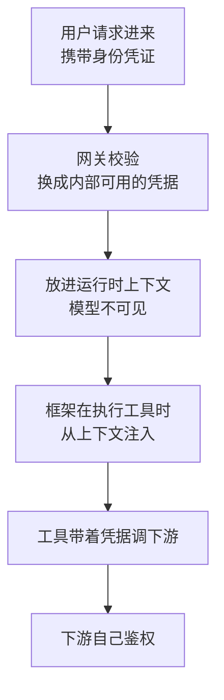

# 面经记录

**岗位方向：** 27 届秋招提前批，Agent 相关
**来源：** 小红书「悲伤土豆鸡肉饭」，一面见 [[公司/米哈游/米哈游提前批一面_约2026-08]]
**结果：** 未知

> 作者原话：「从一面到二面，可以明显感觉到面试官问题的维度在上升。**一面问的问题主要是如何解决 Agent 相关场景问题，二面……**」（原帖此处截断）

## 🔴 本场的画像（准备时先看这段）

**二面不考八股，只考两件事：**

1. **你是不是真的在 own 这个系统** —— Q1–Q3 全是「使用情况怎样 / 用户在问什么 / 用户画像分析过吗」。**这三题跟技术无关，答不上来说明你只是个执行者。**
2. **你到底跑没跑过生产** —— Q6–Q7 追问「线程池配多大」「实际观测过吗」「阈值是 QPS 吗」「混合测还是分别测」「阈值大概多少」。**每一刀都在验证你说的是不是编的。**

**外加一条主线：数据安全被拆成三层追问**（身份参数从哪来 → 认证态怎么注入工具 → 数据召回时做了什么处理），一面的 Q14 在这里被打到了实现层。

> ⚠️ **准备策略（重要）**：高并发 / 线程池 / 限流这几题，**别硬套到 Agent 项目上**——你的字节 Bot 是 200+ 内部用户、LLM 秒级响应，QPS 只有几十，硬编一个「线程池 200」当场就会被拆穿。**正确做法是先诚实划清场景，再主动把话头引到真正有高并发经验的项目上**（[[黑马点评项目]] 的 Sentinel 限流 + 线程隔离 + 降级、[[用友实习]] 的缓存降 1K QPS / p95 -40%）。详见 Q6。

---

## 1. 简单介绍实习项目的核心功能和落地场景

**骨架**
- 用 [[追问/字节答疑Bot]] 的两分钟口语稿，但**二面要把「落地场景」讲得比一面重**
- **核心功能一句话**：看代码回答 TTO 广告平台的复杂业务问题
- **落地场景要具体到人**：内部文档常年过期、只有代码是真的 → 运营和产品理不清一个用户状态能流转到哪 → 以前只能抓研发 oncall → 现在 200+ 用户在飞书里直接问
- **价值口径**：不是「提升了效率」，是「**把研发的 oncall 负担转移掉了**」

### 追问：这个系统除了问答还有什么其他的一些能力吗？

> ⚠️ **这题是在探边界：如果只有问答，说明它是个玩具。**

**三个可说的方向（按真实度排序，别编）：**
1. **反问澄清**：审核 Agent 发现用户问题本身有歧义（没约束到哪个分支）时会主动反问框定范围——**这是一个交互能力，不是问答能力**
2. **结构化输出**：答案按决策树的分支结构组织，用户能一眼看出讲了哪几支、少了哪一支
3. **可追溯**：每个结论挂代码依据（文件路径 + 判断条件），**用户可以自己去核**

**诚实收尾**：「目前主体还是问答。我们讨论过但没做的方向是**主动推送**——代码提交时反向检测哪些已回答过的问题会因为这次改动而失效。**这个想法的价值在于它把系统从被动查询变成主动维护**，但需要先把代码影响面分析做出来。」

---

## 2. 现在这个项目的使用情况是怎样的？

**骨架（数字要有层次，不要只报一个总数）**
- **规模**：服务 200+ 用户
- **来源**：飞书 Bot，在业务群里 @ 就能问
- **诚实边界**：这是内部工具，不是 to C 产品——**日活是两位数量级，不是高并发场景**（这句主动说，为后面 Q6 的场景划清做铺垫）

### 追问：用户都在问哪些问题有关注过吗？

> ⚠️ **这是本场第一个「你是不是 owner」的验证题。答「没特别关注」直接减分。**

**必答的三段：**
1. **有关注，而且这是我们迭代的输入**——每次问答都会沉淀专家评价，每周评审会过 bad case
2. **问题分布**：最集中的是「某个状态什么条件下会流转到哪」和「某个动作之后多久会触发什么」这类**分支穷举型**问题——**这个分布正是我们做决策树的原因**，不是先有方案再找问题
3. **评测集就是从真实问题长出来的**：50+ 条回归评测集来自真实提问，不是人凭空想的

**加分收尾（把观察变成设计）：**
> 「我们从问题分布里还得到一个反哺机制：**统计用户问题里出现过、但业务词表里没有的名词——这个列表就是文档维护的优先级队列。** 让文档被真实流量驱动，而不是靠同事想起来。」

---

## 3. 用户画像你们有分析过吗？每天使用的都是怎样的用户？

**骨架（按角色分层，每层的诉求不同——这才叫画像）**

| 角色 | 问什么 | 对系统的要求 |
|---|---|---|
| **运营** | 「这个玩法下用户为什么没收到钱」——**具体 case 排查** | 要**结论 + 可核对的依据**，不要代码 |
| **产品** | 「这个状态能流转到哪些地方」——**分支穷举** | 要**完备性**，漏一支就是需求写错 |
| **研发** | 「这段逻辑上下游是谁」——**代码定位** | 要**准确的文件路径和调用关系** |

**关键洞察（说这一句，画像才有价值）：**
> 「三类用户对『错』的容忍度完全不同。**运营问的是单个 case，答错了当场就发现；产品问的是分支穷举，漏一支不会当场暴露，会带到需求文档里去。所以产品这条路径的完备性要求最高——这直接决定了我们把力气花在决策树的完备性上，而不是单点准确率上。**」

### 追问：简历上提到这个系统为员工提供高可扩展或者个性化的能力，可以解释一下吗？

> ⚠️ **面试官在查你简历上那句话是不是水词。「高可扩展」「个性化」这类形容词必须能落到具体机制上，落不下来就是给自己挖坑。**

**「可扩展」落到三个具体机制：**
1. **接入层可扩展**：网关层统一了三家模型协议（Gemini / Anthropic / OpenAI），**换模型对业务方是一个开关，不是一次改造**
2. **知识面可扩展**：新增业务只需要往业务语义词表里补词条 + 把新仓库纳入检索范围，**不用改 Agent 逻辑**
3. **角色可扩展**：主 Agent / 审核 Agent 是独立的角色，加一个新角色不需要动已有的

**「个性化」要诚实，别吹：**
> 「个性化目前是**基于角色的呈现差异**——运营问的时候给结论和依据，研发问的时候直接给文件路径和调用链。**它是通过问法自然区分的，不是我们做了用户建模。**
> **真正的个性化要靠记忆——记住这个人负责哪条业务线、习惯什么粒度的回答——这是我在下一段实习（谷歌）做的方向，在字节这个项目里还没有。**」

> 💡 这样答的好处：**把「没做」变成「我知道它该怎么做，而且我后来真的去做了」**，顺势把话题引到你更强的 memory 项目上。

---

## 4. 这个多 Agent 架构，你们具体是如何实现的？

**骨架**（一面 Q3 的实现层版本，要给出**具体的落地形式**而不是概念图）
- **底座**：基于 DeerFlow 二次开发，DeerFlow 建在 **LangGraph** 上——所以整个多 Agent 编排本质是一张**有向图**：节点是一次 Agent 调用或一次工具调用，边是状态转移，**全局共享一个 state 对象**
- **主 Agent**：一个标准 code agent 循环（grep / glob / readfile）+ 一个**决策树工具**。工具调用是显式的，门禁检查的是「树上分支是否全部标记为已验证」
- **审核 Agent**：图里的一个独立节点，**输入是干净初始上下文 + 决策树 + 答案草稿，且保留代码读取权限**
- **控制流**：审核不通过 → 边指回主 Agent 重新生成；判定为用户问题歧义 → 边指向「反问用户」

> 详见 [[LangGraph工程实践]]（State / Checkpointer / 条件边）和 [[追问/字节答疑Bot]]。

### 追问：这个子 Agent 具体是以怎样的形式加载出来的？

> ⚠️ **这题问的是「运行时形态」，答「就是调了个函数」太浅，答「起了个服务」是编的。要答清楚三层。**

**三种业界形态（先给全景，再定位自己）：**

| 形态 | 怎么加载 | 特点 |
|---|---|---|
| **图节点 / 函数调用** | 就是同一个进程里的一个节点，换一套 system prompt + 换一份工具集 + 新开一个消息列表 | 最轻，启动零成本；**上下文隔离靠「新开消息列表」实现，不靠进程隔离** |
| **当工具调（tool-as-agent）** | 把子 Agent 包装成一个工具，主 Agent 像调工具一样调起它，做完返回结果 | 主 Agent 不用感知内部，接口就是工具的入参出参 |
| **暴露成 skill** | 把原 Agent 的 system prompt 作为一份文档注入，让宿主框架理解并模仿它的行为 | 不起新循环，最省 token，但行为保真度低 |

**我们的是第一种**：LangGraph 图里的一个节点，**加载 = 拼一个新的 system prompt + 绑定一份受限的工具集 + 从 state 里取它需要的那几个字段作为初始消息**。没有独立进程，没有服务发现。

**关键一句（把「简单」讲成「够用」）：**
> 「**这里的『隔离』要的是上下文隔离，不是资源隔离。** 审核 Agent 的价值来自它拿到的是一份干净的消息历史——这个用『新开一个消息列表』就实现了，起独立进程不会带来任何额外的隔离收益，只会增加序列化成本和运维复杂度。」

---

## 5. 这里的子 Agent 和主 Agent 是同一进程还是不同进程的？

> **答案：同一进程。但这题的分值全在「你知不知道两种选择的代价」。**

### 同进程 vs 跨进程，五个维度对比

| 维度 | 同进程 | 跨进程 / 独立服务 |
|---|---|---|
| **上下文传递** | 直接传对象引用，零成本 | **必须序列化**，大上下文的编解码开销不可忽略 |
| **故障隔离** | 一个崩全崩 | 子 Agent 挂了主流程还能降级继续 |
| **资源隔离** | 共享同一份 CPU / 内存 / 连接池，**一个跑飞会拖垮全部** | 可以单独限流、单独扩缩容 |
| **独立伸缩** | 做不到——主子必须一起扩 | **子 Agent 是热点时可以只扩它** |
| **调试** | 一个进程内堆栈完整，最好查 | 要分布式追踪才能拼出全貌 |

### 我们选同进程的理由（要给判断依据，不是「就这么写的」）

> 「三个理由。**第一，我们的子 Agent 不是热点**——一次问答只调一次审核，不存在需要单独扩容的情况。**第二，上下文是大对象**——决策树 + 答案草稿，跨进程要序列化，白付成本。**第三，故障隔离在这里价值不大**——审核 Agent 挂了这次问答本来就不该出结果，让它一起失败反而是对的。
> **我什么时候会拆进程？当子 Agent 的资源画像和主 Agent 明显不同的时候。** 比如子 Agent 要跑一个重的本地模型或者要长时间占用 GPU，那它跟主 Agent 抢资源就必须隔离；或者子 Agent 被多个上游复用，那它就该是个独立服务。」

**预备追问**
- **「同进程的话，主 Agent 等子 Agent 的时候在干嘛？」** → 我们是异步的（Python asyncio），**等待是让出事件循环，不是阻塞线程**——所以同进程也能同时服务多个用户会话
- **「那多个用户的会话互相影响吗？」** → 会话状态在 LangGraph 的 state 里按会话 ID 隔离；真正共享的是模型网关的并发额度，**那才是真正的争抢点**

---

## 6. 对于高并发，你们是怎么做的稳定性的保障？

> 🔴 **本场最危险的一题。后面三个追问（线程池多大 / 观测过吗 / 怎么调的）是连环验证，编一个数字就要编三个。**

### 第一句必须先划清场景（诚实，且这句话本身是加分的）

> 「先说清楚我这个项目的量级：**内部工具，200+ 用户，QPS 是几十的量级，不是 to C 高并发。** 所以我们的稳定性重点跟典型 Web 服务不一样——**瓶颈不在我们自己的 CPU 和 DB，在模型网关。单次 LLM 调用是秒级的，还开了最高强度思考模式，一次问答几十轮工具调用能到分钟级。**
> **真正的高并发经验我是在另外两个项目里的**，如果您想听那块我可以展开。」

### 我们做的稳定性保障（按真实的瓶颈答）

1. **并发额度控制**：限制同时在途的模型调用数，超了排队而不是全部打过去——**因为网关侧本身有配额，打爆了是整体 429（请求过多被拒），不是单个请求慢**
2. **超时与重试**：给模型调用设超时，失败重试用指数退避 + 抖动；**重试有次数上限，超了就明确告诉用户失败，不无限重试**
3. **降级**：网关不可用时降到备用模型协议——**这是三协议统一接入层的一个额外收益，本来做它是为了统一开关，结果顺带有了降级路径**
4. **稳定性 bug 的真实案例**：定位并修复了 httpx 连接池跨事件循环导致的 `Event loop is closed`——**这题是我这个项目里真正的稳定性硬货**，见 [[追问/字节答疑Bot]] Q6
5. **可观测**：基于内部 Trace 平台做全链路追踪，每次请求可追溯、可持久化

### 追问：生产配的线程池是多大？

> 🔴 **千万别编一个数字。** 你的项目是 Python 异步，压根没有传统意义上的业务线程池——**编了会在下一个追问「怎么调的」当场崩。**

**正确答法：先纠正前提，再给出真正的并发控制点，最后给方法论。**

**① 纠正前提（一句话，不要显得在躲）**
> 「我们是 Python 异步，不是线程池模型——**并发靠事件循环，一个线程可以同时挂着几百个在等 LLM 响应的协程。** 所以对我们来说『配多大』这个参数不是线程数，是**同时在途的模型调用数（并发信号量）**。」

**② 那这个数怎么定（这才是面试官真正想听的）**

**先给公式的定义（C 档词，必须先立）：**
> **Little's Law（利特尔法则）：一个稳定的排队系统里，系统内平均在途的请求数 = 平均到达率 × 单个请求的平均停留时间。**

代进去算：
- 单次 LLM 调用平均 10 秒，想撑住 20 QPS → **需要 20 × 10 = 200 个并发槽位**
- **注意这个数跟 CPU 核数完全无关**——因为这 200 个槽位全在等网络，不吃 CPU

> **这就是为什么「线程数 = CPU 核数 × 2」那套公式在 LLM 应用上完全失效**：那套公式是给 CPU 密集型任务用的。**LLM 应用是极端 IO 密集型，单请求耗时比传统接口长两三个数量级**，用 CPU 核数去推并发数会小到离谱。

**③ 收口（把「算出来的」和「压出来的」分清）**
> 「**但公式只给初值。真正的数是压出来的**——公式假设资源无限，实际会先撞到别的墙：网关的配额、连接数上限、内存。所以流程是：**公式给初值 → 阶梯加压找拐点 → 按拐点的 70~80% 定线上值留余量。**」

### 追问：你们有实际观测过吗？在高并发场景是否符合预期？如何调整的？

> **这题在验证上一题是不是编的。答「没观测过」比答错还糟——它等于承认前面的数字是拍的。**

**观测什么（三个指标，缺一不可）**
1. **延迟分位数**：p95 / p99 —— **只看平均值是最常见的错误**，平均值被大量快请求拉低，真正难受的是尾部那 5%
2. **在途请求数 / 队列深度** —— 这个指标直接对应上面那个并发槽位有没有打满
3. **错误率的构成** —— 超时、被限流（429）、上游 5xx 要**分开统计**。它们的处方完全不同：超时要调超时预算，429 要调并发额度，5xx 要找上游

**「不符合预期」通常长什么样（给一个具体的现象，证明真的看过）**
> 「最典型的一种：**吞吐上不去但 CPU 很低，同时 p99 暴涨。** 这个组合基本可以断定是**某个地方在排队**——不是算力不够，是槽位不够或者被上游限流了。
> 判断方法：**看在途请求数有没有贴着上限跑。** 贴着上限 → 是我们自己的并发限制卡住了，放大;没贴上限但延迟高 → 是上游变慢了，这时候放大并发只会让情况更糟，**应该反过来收紧，防止把上游打死**。」

**怎么调（讲成一个闭环，不是一次拍板）**
> 「**调整不是一次性的**：先按公式给初值 → 压测找拐点 → 上线后按真实流量的 p99 和排队指标做微调 → **业务量涨了要重新压。**
> 还有一条经验：**并发上限和超时时间要一起调，单独调一个没意义。** 并发放大但超时不变，结果就是更多请求一起超时；超时放长但并发不变，结果是槽位被慢请求长时间占住，吞吐反而降。」

**🔴 如果你确实没压过，唯一正确的答法：**
> 「诚实说，我们这个量级还没做过正式压测——**QPS 几十、瓶颈明确在模型侧，压我们自己这一层意义不大。** 我们做的是线上观测：看 p95 延迟和错误率构成。
> **如果要我做，我会这么做**：[讲上面那套公式 → 阶梯加压 → 拐点 → 留余量]。
> **另外我在[[黑马点评项目]]里做过限流和线程隔离，用的是 Sentinel，那块有具体的配置和验证。**」
> 💡 **「我没做过 + 我知道该怎么做 + 我在另一个项目做过类似的」——这三段合起来的分数，比编一个数字然后被拆穿高得多。**

---

## 7. 对于你们的限流，写入是什么样的场景你们会去限流？

### 先分清两种限流（这个区分本身是加分的）

- **保护自己**：入口限流，防止流量超过自己的处理能力
- **保护下游**：出口限流，防止把下游打死。**Agent 系统的限流大头在这一侧**——一次问答会发几十次工具调用和模型调用

### 什么写入场景要限流（按真实的风险排序）

1. **模型调用**（最重要）：**一次问答会放大成几十次模型调用**，10 个用户同时问就是几百次并发。这是唯一一个「输入的小波动会被放大两个数量级」的地方
2. **记忆 / 日志的异步写入**：本身不重要但量大，**必须限流并且可以直接丢弃**——它们不能跟主链路抢资源
3. **代码检索**：grep 这类操作在大仓库上很吃 IO，并发高了会拖慢所有人
4. **对外部系统的写**：任何调下游写接口的工具都要限，因为**下游的容量不是你能控制的**

> **一句话原则：限流要加在「放大倍数最大」的那一环，不是加在入口。** 入口限流只能挡住量，挡不住单个请求内部的放大。

### 追问：你们这个限流的策略具体是怎么做的？

**分层答：**
- **算法**：**令牌桶**——按固定速率放令牌，桶里能攒令牌所以允许短暂突发。相比漏桶严格平滑，令牌桶更适合真实流量（见 [[限流熔断容错]] §1–§2）
- **粒度**：全局配额 + 单用户配额两层。**只有全局的话，一个用户跑个批量任务就能把所有人的额度吃光**
- **超限之后做什么**（这一层最容易漏答）：
  - 主链路（模型调用）→ **排队等待**，不是拒绝。用户宁可等也不想收到一句「系统繁忙」
  - 旁路（日志、记忆写入）→ **直接丢弃**，不排队不重试
  - **这个区分才是限流设计的核心：不是「限多少」，是「超了之后怎么办」**
- **分布式场景**：多实例时单机限流的总和 ≠ 集群限流，要靠 Redis + Lua 做中心化计数（多步操作必须在 Lua 脚本里保证原子）

### 追问：你们测的时候最终得出来的数值是 QPS 吗？测的是混合阈值还是分别测得出的阈值？

> 🔴 **这是全场最有含金量的一题，也是最容易露馅的一题。两个子问题都要正面回答。**

**① 「是 QPS 吗？」——正确答案是「对我们这类系统，QPS 是个坏指标」**

> 「**不完全是 QPS。原因是单请求的耗时方差太大**——同样一个请求，简单问题 5 秒、复杂问题几十轮工具调用要几分钟。**QPS 相同的两个时刻，系统里实际压着的负载可能差十倍。**
> 所以我们真正管的是两个别的量：
> - **在途并发数（in-flight）**：同时有多少个请求没结束。**这个才直接对应资源占用。**
> - **token 速率**：每分钟消耗的 token。**因为模型网关的配额本来就是按 token 计的，不是按请求数计的。**
>
> **QPS 我们也看，但它是观测指标不是控制指标。**」

> 💡 **这段话的价值在于：它证明你真的按自己系统的特性想过，而不是把「限流 = 限 QPS」当成公式套。**

**② 「混合阈值还是分别测？」——两个都要，用途不同**

| 测法 | 得到什么 | 局限 |
|---|---|---|
| **分别测**（单接口独立压） | 每个接口的**理论天花板**，以及它自己的瓶颈在哪 | **线上不存在这种情况**——各接口共享连接池、DB、下游配额，分别测的数加起来一定超过系统真实容量 |
| **混合测**（按线上真实流量配比压） | **系统的真实容量**，以及哪个接口先成为瓶颈 | 流量配比一变，结论就要重测 |

> **收口一句：分别测用来定位瓶颈，混合测用来定线上阈值。** 只做分别测的典型事故是——每个接口单看都没超阈值，但合起来把共享的连接池打满了。
>
> **配比怎么定**：从线上真实流量的接口调用比例来，不能凭感觉分配。**这也意味着大促/活动这种流量结构会变的场景，必须按预期的新配比重新压。**

### 追问：那你们当时限流的一个阈值大概是多少？

> 🔴 **绝对不要为了答上而编一个数。** 面试官问到这一层，说明他自己压过，一个不合理的数字（比如说「线程池 2000」或者「限流 10 万 QPS」）会当场暴露。

**正确答法（三段）：**
> 「**我们的量级不大**——同时在途的模型调用限在几十这个量级，对应的用户侧 QPS 也就几十。**这个数不是压出来的，是从模型网关给我们的配额倒推的**：网关按 token 给配额，我们按平均每次问答消耗的 token 反算出能同时跑多少个会话，再留了余量。
> **诚实说这个数偏保守**——因为超了之后的代价（整体被网关限流，所有人都受影响）远大于排队多等几秒的代价。
> **如果是 to C 场景我不会这么定**，那时候用户等待是不可接受的，就得反过来先定 SLA（服务等级目标，比如 p99 必须小于 2 秒），再倒推能放多少并发。」

> 💡 **这个答法的三个加分点：① 给了真实的数量级 ② 说清了这个数是怎么来的（倒推而不是压测，且说明了为什么）③ 主动指出它在别的场景该怎么变。**

---

## 8. 你们这个 Agent 在系统层面对于数据安全性做了哪些方面的工作？

> 一面 Q14 的实现层版本。**核心命题不变：权限判断不能经过模型。** 见一面的完整推理。

**系统层面四件事：**

1. **身份不经过模型**：调用者身份从会话上下文取，**工具的参数表里根本没有 `user_id` 这个字段**——模型没法填，也就没法伪造
2. **检索侧前置过滤**：用户无权访问的数据从一开始就不在候选集里，不是检索完再踢（后置过滤已经把内容取出来了，等于泄漏）
3. **工具侧下沉鉴权**：工具带着调用者身份去调下游，**由下游系统自己判断能不能给**，Agent 不做权限判断
4. **输出侧 + 审计**：密钥、手机号这类做规则遮蔽；全链路审计日志记录「谁、通过哪个工具、访问了哪条数据」——**Agent 的调用链是模型动态决定的，事前无法穷举，所以事后审计比传统系统更重要**

**我们项目的真实情况（诚实版）：**
> 「我们的场景相对简单——**读的是代码仓库，权限边界跟代码仓库本身的权限一致**，agent 能读的就是这个用户本来就能读的仓库。**真正复杂的权限问题出现在需要查用户实时标签和配置的时候，那部分我们是拆给另一个有权限的 Agent 做的：它先查到具体状态，再以工具的形式调用我们，传过来的是『用户 ID + 状态 + 问题』。我们只负责从代码找原因，不碰用户数据。**」
> 💡 **这个「职责拆分」本身就是一个安全设计——把有数据权限的部分和有代码权限的部分分开，两边都拿不到完整的东西。**

### 追问：你们的这个身份参数是从哪获取的呢？

> **这是全场最刁的一刀，答错直接暴露安全意识缺失。**

**唯一正确的答案：**
> 「**从请求入口的会话上下文里取，不是从模型的输出里取。**
> 这一点必须说死：**如果身份是模型填进工具参数的，那就等于把越权的能力交给了一个概率系统**——它可能被提示注入诱导填别人的 ID，甚至可能只是幻觉就填错了。
> 具体来说：飞书 Bot 的每条消息本身携带发送者身份，网关层校验后把它放进运行时上下文，**这个上下文对模型完全不可见**——它既不在 system prompt 里，也不在工具的参数表里。工具执行时由框架从上下文里取。」

**必须补的一句（防「那模型怎么知道在给谁服务」）：**
> 「模型可以知道『当前用户是运营角色』这种**用于调整回答风格**的信息，但它拿到的是一个**已经脱敏的角色标签，不是可用于鉴权的身份凭证**。**能影响表达的信息和能影响授权的信息，必须是两份。**」

### 追问：你的这个认证态是从哪里注入到工具的呢？

> **「认证态」= 用于向下游证明身份的那份凭据（token / 会话票据）。这题问的是它在代码里的传递路径。**

**分三层答：**

1. **入口**：请求携带的身份凭证在网关层被校验，换成内部可用的凭据
2. **传递**：**存在运行时上下文里**（一个跟着当前请求走、模型看不到的容器）。**关键是它跟着「请求」走，不跟着「消息列表」走**——消息列表会进模型，运行时上下文不会
3. **注入点**：**在框架执行工具的那一层注入，不是在工具的业务代码里现取。** 工具的函数签名里没有凭据参数，是执行器在调用时补上的
4. **下游**：工具带着凭据调下游，**下游自己鉴权**

**加分：业界的标准做法（C 档，要立定义再用）**
> 「业界对这个问题有标准答案，叫**代理授权 / on-behalf-of（代表用户行事）流程**：agent 不复用用户的原始凭证，而是通过 **OAuth 2.0 Token Exchange（RFC 8693，令牌交换）**换一个**降权的短时凭据**。
> **这个凭据里两个身份是分开放的：主体（`sub`）仍然是那个用户——被代表的人；agent 放在一个专门的『代理』字段（`act`）里。** 换句话说**「谁被代表」在主位，「谁在代劳」在附加位**，另外还带明确的权限范围和过期时间。授权服务器还可以在用户的令牌上标一个字段，声明**允许哪些 agent 代表这个用户行事**。
> **好处有三个**：① 权限可以收窄到「本次任务需要的那一点」而不是用户的全部权限 ② 审计日志里能同时看到「是哪个 agent 代表哪个用户干的」 ③ 凭据短时有效，泄漏的窗口小。
> **我们内部没有走到这么标准的程度**，是靠内部网关做的等价的事，但这是我认为正确的方向。」

> ⚠️ **别把主体和代理说反**（这是最容易翻车的一处）：不是「agent 是主体、用户是委托方」，而是**用户在 `sub`、agent 在 `act`**。请求侧对应的是 `subject_token`（被代表的用户）+ `actor_token`（代为行事的 agent）。
> 📌 出处：RFC 8693 §4.1（`act` / `may_act` 声明）+ 2026 年多篇 agent 身份与访问控制指南（WorkOS / Oso / Nango / Auth0）・ 2026-08-04 查证。

---

## 9. 那除了在方法内部你们做了这个权限的处理，还有什么地方吗？

> **面试官在提示你：「方法内部鉴权」只是最里面那一层，他想听纵深防御。**

**从外到内五层，往回数：**

| 层 | 做什么 | 挡住什么 |
|---|---|---|
| **① 网关 / 入口** | 身份认证、租户隔离 | 未认证的请求根本进不来 |
| **② 工具注册层** | **这个角色能看到哪些工具**——没权限的工具压根不出现在工具列表里 | 模型看不到就调不了，**这是最省事的一层** |
| **③ 数据召回层** | 前置过滤（下一题详述） | 无权的数据从不进上下文 |
| **④ 方法内部** | 具体的业务规则校验 | 细粒度的条件判断 |
| **⑤ 输出 + 审计** | 脱敏、日志留痕 | 兜底和事后追溯 |

**最该强调的是第②层（很多人不会想到）：**
> 「**Agent 系统有一层传统系统没有的权限点：工具的可见性。**
> 传统系统里，接口存在但你调不动；Agent 系统里，**如果一个工具出现在模型的工具列表里，模型就会尝试去调它**——即使最终被拒绝，这个尝试本身也有成本：浪费轮次、可能在报错信息里泄漏结构、还会让模型基于失败去猜测和编造。
> **所以正确做法是按角色动态组装工具列表——不该看到的工具，从一开始就不告诉模型它存在。**」

**再加一层 Agent 特有的：**
> 「还有一层是**提示注入防护**。检索回来的代码注释、文档内容里可能藏着『忽略之前的指令』这类文本，模型会把它当指令执行。**所以从外部来的内容必须和指令严格分开**——放进明确标记的数据区、并且在 system prompt 里声明数据区的内容一律不作为指令。这跟 SQL 注入是同一类问题：**数据和指令混在一个通道里传。**」

### 追问：那你有去了解，你们这个 Agent 最终依赖的数据，他们在被召回的时候做过一些什么处理吗？

> **这题问的是检索链路上的数据处理。答「就是向量检索」太浅，要答出「召回时都对数据做了什么」。**

**四类处理，按顺序：**

1. **权限过滤（前置，最重要）**
   - **必须在检索之前或之中做，不能在之后做。** 后置过滤的两个问题：① 敏感内容已经被取出来，日志、缓存、异常信息都可能泄漏 ② 过滤完可能只剩两三条，**召回质量塌了却没有任何信号**
   - 实现：要么按权限域分索引/分命名空间物理隔离，要么在每个切片上挂访问控制元数据参与过滤

2. **切分与清洗**
   - 代码按语法结构切（函数、类为单位），**不能按固定字符数硬切**——切断一个函数体，检索出来的片段就是无意义的
   - 清掉噪声：自动生成的代码、依赖目录、二进制

3. **融合与精排**
   - 我们是三层漏斗：文档检索粗定位 → 语义代码检索 → grep 精确收敛
   - **多路召回的结果不能直接把分数相加**——不同检索方式的分数量纲不同。正确做法是按排名融合（RRF），见 [[RAG优化全链路]]

4. **脱敏**
   - 代码里的密钥、内网地址、测试账号在入库时就要过一遍规则检测。**注意是入库时，不是查询时**——**入库时脱敏一次，之后所有查询都安全；查询时脱敏，每条查询路径都要记得做，漏一条就是漏洞。**

**诚实边界（如果确实没做过这层）：**
> 「切分和检索这块是我做的，脱敏和入库那条链路是数据侧同事维护的，**我知道的粒度是接口层面**——但如果让我设计，我会坚持两条：**权限过滤必须前置，脱敏必须在入库时做。**」
> 💡 **「现状 → 我的诊断 → 我会怎么改」三段式，比说「不是我做的」强得多。** 这是本仓库反复强调的铁律。

---

## 10. 你们的记忆管理机制为什么要这样设计？

> **注意问的是「为什么」不是「是什么」。上来讲存储结构 = 答偏。要讲取舍。**

### 按七个维度讲「为什么」（见 [[Agent记忆系统]]）

**① 为什么记忆是 markdown 文件，不是向量库**
> 「因为**人可读、可改、可 diff**。记忆系统最难的不是存，是出问题时定位到底是哪一条记忆把 agent 带偏了。**向量库召回强但不可读，一旦被污染基本查不出来。** 这是取舍：我们用一部分召回能力换可运维性。」

**② 为什么检索是两级的（标题+描述常驻，正文按需读）**
> 「因为**记忆条数会无限增长，全量注入必然爆上下文**。只让标题和描述常驻，正文让 agent 判断相关了再读——**用一次判断换掉大部分 token**。
> **但这个设计有个直接后果必须说出来：描述层是常驻的，所以描述层的污染就是全局污染，检索这道过滤器完全失效。** 所以防护要放在写入侧——**不允许在描述字段里写祈使句式的行为指令**（『以后每次都要……』这种），这类要么降级到正文、要么走显式配置。」

**③ 为什么写入分在线和离线两条路**
> 「**在线写的是『这次学到了什么』，离线做的是『这些天学到的该怎么合并去重』——前者管召回，后者管精度。**
> 而且离线批处理还替我们绕过了一个问题：**本来短期记忆和长期记忆需要分层管理，但只要有一个每天跑的批量重组任务，就可以用一次批处理代替实时分层。** 写入量不大的时候这更省。」

**④ 为什么冲突消解不交给模型判断新鲜度**
> 「**模型只负责『发现这两条矛盾』（语义任务，它擅长），不负责『判定谁赢』（事实任务，它不擅长）。**
> 两条记忆都写着『应该用 X 方式』，模型看不出哪条是三个月前写的。**这是 2026 年业界的共识。**
> 现有系统是靠模型在离线合并时自己判断、合并成一条、不问用户。**我的诊断是这有两个问题：判断不可靠，而且合并完原始两条都没了，错了回溯不了。**
> **我会改两件事：合并不删除只标失效**（每条挂『何时成立 / 何时被取代』的时间区间），**裁决用系统字段**（写入时间、来源可信度——用户显式指定的 > agent 自己总结的、作用域——项目级 > 全局级）。**这两件事都不需要模型判断。**」

> 📌 业界三条路线：覆盖式（最新的赢，旧的删掉，**证据链断了**）／ 双时间戳失效（每条事实带 `valid_at` / `expired_at` / `invalid_at`，**不删只标失效**，机制最强）／ 确定性优先级（用系统可读字段排序裁决）。<!-- 来源: 社区技术博客 + arXiv 2606.01435 ・ 查证于 2026-07-31 ・ 二手来源，未读源码 -->

### 追问：随着长期使用，有些信息会很久远，做记忆管理时会做什么淘汰的机制吗？

> 🔴 **这题最容易掉的坑：把「久远」直接等同于「该淘汰」。第一句话就要把这个前提掰开。**

**① 先纠正前提（这是本题最值钱的一句）**
> 「**『久远』和『过时』是两回事，不能按时间一刀切。**
> 用户三年前说『我习惯用 pytest』，这条到今天依然成立；而昨天写的『这个接口返回字段叫 X』，今天改个版就失效了。**纯按时间淘汰会先删掉最稳定的那批记忆——那恰恰是最有价值的。**
> 所以正确的淘汰信号不是**写入时间**，是**最近被用到的时间**和**用了之后有没有帮上忙**。」

**② 三种机制，按成熟度递进**

| 机制 | 怎么做 | 适用 |
|---|---|---|
| **时间过期（TTL）** | 到期直接失效 | 只适合**天生有时效性**的记忆（临时状态、当前任务上下文），不适合偏好和经验 |
| **使用衰减** | 每条记忆有个热度分，随时间衰减，**每次被检索命中就回补** | 主力机制。长期没人用的自然沉下去 |
| **失效检测** | 主动发现「这条记忆描述的事实已经变了」 | 最有价值也最难做——需要把记忆和它依赖的事实源关联起来 |

**③ 我们的打分（要给出具体的信号组合）**
> 「按三个信号联合打分排序：**引用次数、最近使用时间、被引用之后任务的成功率。**
> **第三个是最关键的，也是自进化记忆和普通记忆的分界**——一条经验被检索命中后，任务的成败会回填到它的分数上。**引用了且成功加分，引用了且失败扣分。** 这样淘汰的不是『老的』，是『没用的』和『有害的』。
> 归因确实有噪声——单次成败说明不了什么，所以用平滑处理：给新经验一个中性的先验分，靠语义相似度先上场，引用次数多了分数才收敛。**严格说这只能拿到相关性不是因果性，我承认这是个难点。**」

**④ 两级 token 预算（很多人漏掉这层）**
> 「淘汰不只是按条数，还要按**位置**分开管：
> - **常驻的描述层要设总 token 预算**，超了强制淘汰——因为它每轮都注入，膨胀是慢性中毒
> - **正文层可以宽松得多**，因为它按需读，不占常驻成本
> - 另外**单条记忆有 token 上限**（我们是 2000），防的是单条无限膨胀
>
> **这三个预算防的是三种不同的膨胀，不能只设一个。**」

**⑤ 收尾（把「淘汰」重新定义一遍）**
> 「最后一句我想强调：**淘汰不应该等于物理删除。**
> 删掉之后就没法回答『上个季度的偏好是什么』，更麻烦的是——**如果新记忆后来被证明是错的，你没法滚回去。**
> 所以我倾向的做法是**标记失效而不是删除**：从检索候选集里移出去（不占检索成本），但记录还在（可回溯、可恢复）。**真正的物理删除只做一种：明确识别为污染或错误的内容。**」

---

## 本场考点双链

- [[Agent记忆系统]] · [[Agent设计模式与MCP]] · [[LangGraph工程实践]] · [[RAG优化全链路]]
- [[限流熔断容错]] · [[缓存一致性]] · [[Python并发与GIL]]
- [[追问/字节答疑Bot]] · [[追问/谷歌Memory]] · [[黑马点评项目]] · [[用友实习]]
- 一面：[[公司/米哈游/米哈游提前批一面_约2026-08]]
- 同类型公司：[[公司/点点互动/AI Agent方向/点点互动AI Agent一面_2026-07-27]]
