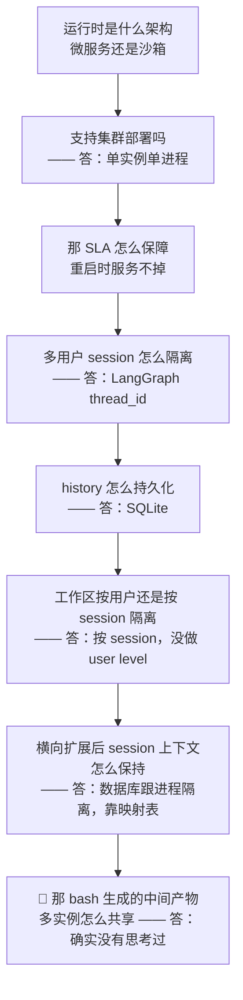
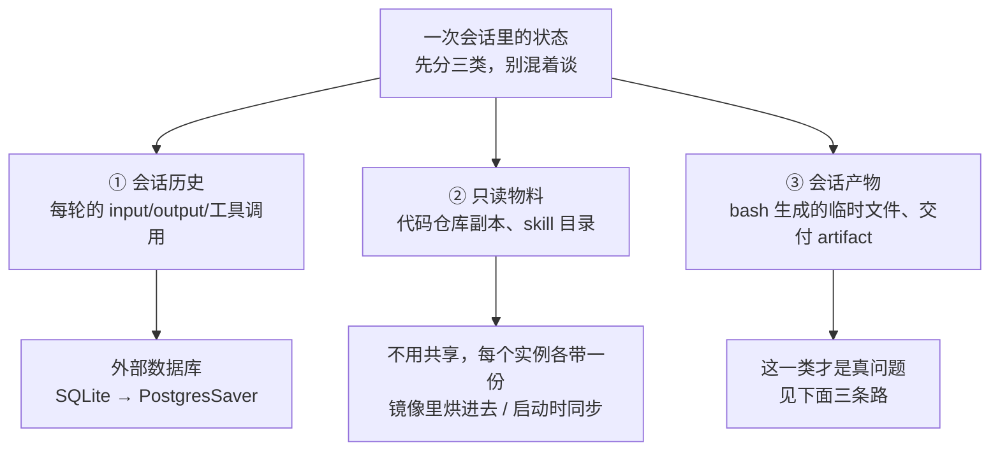
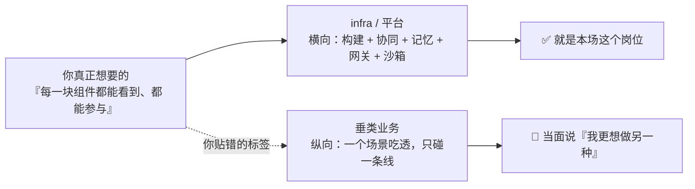

# 面经记录

**岗位方向：** 阿里国际（AIDC）电商集团下的**平台型部门**，做整个 agent infra
**时长：** 1 小时 1 分钟
**流程：** 自我介绍 → 字节答疑 Bot 深挖（约 30 分钟）→ 谷歌 Memory 深挖（约 13 分钟）→ 个人 workflow / 职业规划 → 算法题（约 5 分钟）→ 反问
**结果：** **通过**

> 我自己的面试，录音转录整理。**这场是这个仓库第一次出现「agent 平台化」考法**——见下面 §0。

## 部门信息（反问环节挖到的，信息量很大）

面试官在反问环节讲了 3 分钟，把部门做的三块全摊开了：

1. **agent 怎么构建**——① 低码：`app builder`，类 Dify 的拖拉拽搭建 ② 高码：`AgentScope` 框架 ③ vibe coding：类似扣子编程那种范式，**给一线非技术业务同学用的 agent 生成方案**
2. **agent 协同**——每个业务团队都在造自己的 agent，企业内怎么把它们串通：A2A 协议、权限授权、数据与记忆打通
3. **企业记忆中心 / 知识中心**——重点在做

> 面试官原话定位：「更多的偏向于这种平台的基建……因为要达到一些规模化复用，一些能力复用，一些共同的标准在企业内部去落地，肯定是在 infra 团队去建设的。」

<!-- 来源: 面试官现场自述 ・ AgentScope 为阿里通义实验室开源框架，2.0 于 2026-05 发布，支持 A2A 协议 + Nacos 做 Registry（社区/官方文档，查证于 2026-08-06） -->

> 📌 **「阿里星」在阿里国际这边的正式名称是 Bravo Star 顶尖人才计划**，官方口径是「继承阿里星使命与愿景」的旗舰项目，聚焦 AI / 算法 / 产品。<!-- 来源: 阿里国际校招公告 ・ 查证于 2026-08-06 -->

---

## 0. 🔴 本场主线：他不是在深挖你的项目，是在问「你这个 bot 能不能变成平台」

**前 30 分钟看起来在问字节答疑 Bot，实际上从第 20 分钟起，连着 7 问全是同一件事的不同侧面：单实例的东西怎么变成多实例的平台。**

**这条链路是标准的「有状态服务怎么水平扩展」在 agent 场景下的复现**，跟这个部门做的事完全对口（他们要把 agent 能力做成企业内规模化复用的基建）。链路走到第 7 问断了。

### 这场跟之前每一场 agent 面的考法都不一样

| 场次 | 考的是 |
|---|---|
| [[公司/淘天/AI Agent/淘天AI-Agent一面_2026-07-30]] | 你**踩没踩过**（RAG / MCP / LangGraph 的实现细节） |
| [[公司/快手/DataAgent方向/快手数据平台DataAgent一面_2026-07-29]]、[[公司/字节/中国商业化/字节商业化AgentInfra一面_2026-07-30]] | 你的设计**有没有理由和取舍**（决策树 / 门禁 / 记忆九问） |
| [[公司/上海AI Lab/后训练数据/上海AI Lab后训练数据一面_2026-07-31]] | 你能不能**对 AI 生成的代码负责** |
| **本场（阿里国际 Agent Infra）** | **你的单机 demo 能不能变成多租户平台** |

> 🔴 **准备动作**：以后凡是投「平台 / infra / 中台」岗，答疑 Bot 这个项目必须补一套「**如果要把它变成给 100 个团队用的平台，我会怎么改**」的说法。这套说法本场一次都没准备。

---

## 1. 自我介绍（零岗位定制，复发）

**当时：** 按时间倒序讲了五段实习（谷歌 → 字节 → ARM → 西门子 → 用友），每段一句话流水账。

> ⚠️ **跟 [[公司/上海AI Lab/后训练数据/上海AI Lab后训练数据一面_2026-07-31]] 是同一个毛病，一周内第二次。** 那场的铁律是「**开口前把 JD 的名词当排序键**」，这场投的是 agent infra 平台，排序键应该是「跟平台化的距离」，结果还是按时间倒序。
> ⚠️ ARM 那段又出现了 `off CPU`、`量化吞吐量` 这类要立定义才讲得清的词，在自我介绍里性价比不对。

**改进稿（按跟「agent 平台化」的距离排）：**

> 「我按**跟 agent 平台化的距离**排，不按时间倒序。
>
> 我这两年做的其实是同一件事：**把一个能跑的 agent 变成一个能被别人用、并且能证明它变好了的系统。**
>
> **最靠近你们的是字节那段。** 我在 TTO 广告平台做业务答疑 Bot，服务 200 多个内部用户，产品、运营、研发三类角色都在用。它是一个**多租户的内部 agent 服务**——外面一层 IM 网关对接飞书，里面是 DeerFlow 改的多 agent，我加的是决策树门禁和审核 agent 这两层。评测上从裸框架 56% 做到 87%。
>
> **然后是现在在谷歌这段**，做测试系统的自进化 memory。这段跟你们做记忆中心是同一类问题：**记忆怎么才能越改越好，而不是越改越烂。** 我的做法是把记忆当成可训练的参数——模型冻住不动，改的是记忆文件本身，**每次改写必须在一个留出验证集上严格提分才被接受，否则回滚。**
>
> 再往前是 ARM 做性能量化、西门子做 RAG 问答、用友做数据迁移，这三段给我的是后端和系统那一侧的底子。
>
> 所以我熟的不是把 agent 跑起来，是**怎么把它做成一个多人用的服务，以及怎么判断这一版比上一版好**。」

**题型 A（项目叙述）｜扣分：① 落点**

---

## 2. 答疑 Bot 解决什么问题 + 你怎么设计的

**当时（答得完整）：** 国际化部门，不同国家地区的达人 / 商家对接，业务玩法 + 税收政策叉乘，逻辑复杂 → 举了具体例子：**「达人向商家提交视频，商家审核通过之后，能否取消订单？」要分类讨论达人商家有没有历史交易、是否同地区、不同玩法下规则不同** → 实测 Codex、Claude、GLM 原生都列不全 → 我的两个思考点：① 怎么让 agent 意识到有这么多可能性并回答完全 ② 怎么延长它的思考时间 → 决策树（比 write todo 好在能显式列全所有可能性，每个 node 要写来源代码文件降低幻觉，门禁校验完整性）→ 审核 agent 兜底（context 太大导致**张冠李戴**：本来是 A→B，答成 C→B）→ 问题本身有歧义时**反问用户**框定范围。

> ✅ **这题答得好**：有具体业务例子、有演化路径、有失败模式的具体形态（张冠李戴）、有兜底机制。跟 [[字节答疑Bot]] 的定稿口径一致。
> ⚠️ 唯一的软肋是这句：「**理论上你这个 tool 的调用次数越多，agent 思考时间越长，回答效果会越好**」——这是经验观察被讲成了原理，会招来「那为什么不让它无限调」这一刀。**本场没被追，下次不一定。**

**改进（只改那半句，别的保留）：**

> 「更准确的说法是：**不是轮次越多越好，是覆盖的分支越多越好，轮次只是覆盖的副产品。**
>
> 我们真正想拉高的是分支覆盖率，而不是调用次数。这两个东西会分家——模型完全可以在一个分支上反复读同一批文件，轮次涨了、覆盖没涨。所以决策树的价值不是逼它多跑几轮，是**给「跑够了没有」一个可验证的判据**：树上的分支全部验证完才允许总结。
>
> 反过来也有代价：轮次多了 context 会被稀释，我们的典型 bad case『张冠李戴』就是这么来的。**所以审核 agent 不是锦上添花，它是为轮次变多这个代价配的解药。**」

**题型 B（项目机制）｜扣分：② 诊断（把观察讲成原理）**

---

## 3. ✅ 门禁在技术上具体怎么实现（本场最好的一题）

**当时：**
- DeerFlow 本质是一个 **ReAct 单 agent**：循环里模型输出工具调用就把工具结果回灌，输出纯文本就直接返回给用户
- 所以我所有的开发都在 **middleware 中间件层**——模型调用前 / 模型调用后 / 工具调用前 / 工具调用后各做一次拦截（原话说的是「面向切片」，应为**面向切面**）
- 决策树保存在 **LangChain 的 state 里**
- 模型输出纯文本时，校验 state 里有没有决策树；**没有就把提醒 prompt 回灌**让它重新生成
- 校验到某个 node 的 source 文档路径没填，就告诉它**哪个节点没填完**，让它再去查证
- 还有几条硬编码的形式校验：**每个节点必须是一个单独的名词**（不能用斜杠把两个名词塞进一个节点）、**每一层必须是同级的枚举**（不能同级里混不同级的枚举或函数）

> ✅ **这题是全场最好的一题**：有架构层次（单 agent → middleware）、有具体拦截点（四个）、有具体状态载体（LangGraph state）、有具体规则（三条形式约束）。跟 [[字节答疑Bot]] Q1d 的口径完全对得上。
> ⚠️ 唯一要改：「**面向切片**」是口误，正式说法是 **AOP（Aspect-Oriented Programming，面向切面编程）**——把「在方法执行前后插一段逻辑」这件事从业务代码里抽出来单独写。这个词说错在 Java 岗会直接扣分。

**可以补的一句（收口更有力）：**

> 「这三条约束有个共同点：**它们约束的全是形式，不是内容**——正因为只管形式，门禁才能自动检查。内容对不对是模型的事，形式对不对是代码的事，**我把能自动判的那部分从模型手里拿回来了。**」

**题型 B｜扣分：④ 口径（面向切面说成面向切片）**

---

## 4. 🔴 决策树的高度和宽度怎么保障（上一题刚说的 AST 没取出来）

**当时：** 高度宽度我没有让它做保障，树是 agent 生成的，我只给 prompt 准则——根据 query 先定 root 节点，浏览代码时要留意 `if-else`、`switch-case`、抽象类的不同 implement、同名函数，把这些填进决策树；另外专门开发了一个 **AST 工具**，能把代码文件里的 if-else 骨架全部提取出来做强提醒。**宽度跟高度没有限制，因为问之前也不清楚有多少种情况，所以才需要 agent 自己做决断。**

> 🔴 **答案在你自己上一句话里，你没接上。**
> 你刚说完「AST 工具能把 if-else 骨架**全部提取出来**」——那**上界就已经有了**：代码里写了几条分支，树就最多有几个节点。这不是「没有限制」，这是「**有界，而且界可以算出来**」。
> [[字节答疑Bot]] Q1c 白纸黑字写着这个答案：「**分母不是组合数，是代码里真实存在的分支……覆盖率 = M/N。这是这个设计最值钱的一点——把完备性从主观感觉变成可算的比例。**」
> **这是「知识有但取不出来」在本场的第一次复发**，而且间隔只有 30 秒。

**改进稿：**

> 「我没有给树设硬性的高度和宽度上限——**但它不是无界的，界来自代码本身。**
>
> 因为节点不是模型凭空想的，是从 AST（抽象语法树，编译器把源码解析成的树状结构，能直接读出代码里写了哪些判断分支）里提取的真实判断条件。**代码里有 N 个分支，树的规模就被 N 卡住了**，不会变成『国家 × 玩法 × 付款方式』那种笛卡尔积爆炸。
>
> **这一点是这个设计最值钱的地方**：它把『答全了没有』从一个主观感觉变成了一个能算的比例——AST 提取出 N 个条件、树上验证了 M 个，覆盖率就是 M/N。
>
> 漏在哪我也说清楚：不漏在『树上有但没验』，漏在 **AST 提取不到的分支**——运行时配置决定的路径、下游服务返回值决定的路径、反射调用。静态分析拿不到。这部分的兜底是让审核 agent 显式标注『这一支我没有代码依据』，**把裁决权交回给人，而不是假装覆盖了。**
>
> 真的爆炸了才引入优先级调度，但那个优先级的语义是『**先验证哪个**』，不是『**答哪个**』——打分用来剪枝在这里是有害的，模型会倾向答高分分支，那正是我要治的病。」

**题型 B｜扣分：② 诊断（有正面答案却说成"没有保障"）+ 检索失败（上一题的素材取不出来）**

---

## 5. 知识库怎么建设的（多角色的上下文不一样，你怎么维护）

**当时：** 先说了一个 query 进来会发生什么——先看业务文档定位到代码仓库，做业务名词到代码名词的匹配（达人→`influencer`，商家→`partner` / `agency` / `MCN`），agent 按这些关键词做匹配再读代码。业务文档是**另一个组（前端组）的同事**做的，基于 LLM wiki 的形式，把产品文档、PRD、design doc 全爬下来让 agent 自动生成，把每个名词做好解释和匹配。**「这是他们具体怎么负责的，我没有特别关注。」**

> ⚠️ **答偏了。** 面试官问的是「**研发要 down 到代码粒度，产品运营要的是产品文档粒度，每个角色的知识上下文不一样，你怎么维护这条链路**」——他问的是**分角色**，你答的是**一条通用链路**。
> ⚠️ 「**这是另一个组做的，我没有特别关注**」是「不是我做的」开局的第二次出现（[[字节答疑Bot]] 和 [[谷歌Memory]] 都记过这个毛病）。**协作项目里讲别人做的部分，正确姿势是讲『我作为消费方对它提了什么要求』，那部分永远是你做的。**

**改进稿（先回答分角色，再讲链路）：**

> 「我们其实**没有按角色分知识库，是按知识的形态分层**——这是个有意的取舍，我说下理由。
>
> 分层是三层：**产品文档（人写的、会过期）→ 业务名词表（中文业务词到英文代码符号的映射）→ 代码（唯一不会过期的事实源）**。
>
> **为什么不按角色分**：同一个问题，运营问『这个订单能不能取消』，研发问『取消订单走哪个分支』——**要查的是同一段代码，差的只是答案的呈现粒度，不是知识源。** 按角色分知识库会导致三份内容各自过期，而且交叉问题没法回答。所以我们把**分角色这件事放在输出侧**：决策树是共用的，答案渲染的时候运营看到的是业务结论、研发能展开到 source file 那一层。
>
> **文档层是另一个组用 LLM wiki 的形式做的**——爬 PRD、design doc、产品文档自动生成带层级的知识页。我是它的消费方，我对他们提的要求只有一条：**每个业务名词必须带上它在代码里对应的符号名**。因为我们最痛的不是文档过期，是中文业务词和英文代码符号对不上——达人在代码里可能叫 influencer、creator，商家可能叫 partner、agency、MCN。**这一条映射解决了我检索链路上最大的一处断点。**
>
> 另外有一条口径我要说清楚：**文档层我们只当地图，不当答案。** 它旧了没关系,它的作用是把范围从整个仓库收敛到几个目录；真正的答案一律回代码里取。」

**题型 B｜扣分：① 落点（没回答"分角色"）+ ④ 口径（"不是我做的"开局）**

---

## 6. ✅ RAG 和 LLM Wiki 的区别 / AI Wiki 的原理 / 什么场景用什么（三连问）

**当时（方向全对）：**
- **区别**：RAG 把文档切片，只返回某一个片段，**没有形成知识链路**；LLM wiki 有层级结构，agent 能理解层级、能自主探索；RAG 的探索只能靠 query 改写，wiki 有关键词和链接做引导，能了解更全面的业务知识
- **原理**：先有一批原生文档 → 让 agent 生成一个 **map**，起 reference 指引的作用，告诉你想找什么内容要去看哪一层 → 像文件库一样管理 → 先看 map 导航拿索引信息，再一步步查询；维护靠规则 + agent 增量更新
- **选型**：**文档库数据量大的时候更适合 RAG**——map 本身也是个文档，你不可能把它弄得特别长特别大，塞不进 context；而且难以做层级抽象的时候也用不了 wiki。**LLM wiki 适合小型知识库。** 另外 wiki 比较耗 token、耗轮次，因为要 agent 不断探索检索；RAG 一次检索就完，哪怕 query 改写也不会改那么多次。**为了快速定位、减少 token，用 RAG 也是非常合理的选择。**

> ✅ **本场第二好的一题。** 三问全部答在点上，而且给了取舍（不是"哪个更好"，是"什么时候用哪个"），最后还主动补了成本维度。
> ⚠️ **口径问题**：全程 `RAG / LLM wiki / LLMwiki / AI Wiki / LMViki` 五个叫法混用，转录里连他自己都卡了一下（「Reid，稍等一下」）。**一个概念固定一个词，全程不换**——面试官会以为你在说不同的东西。
> ⚠️ **缺一个可测的分界线**：说了「数据量大用 RAG」，但没说**大到多少算大**。

**改进（补分界线 + 补"两者不是二选一"）：**

> 「我给一个可以当场判的分界线：**看导航层还能不能装进上下文预算。**
>
> LLM wiki 这套东西的命门是那张导航页——它必须常驻上下文，agent 才知道往哪走。所以约束不是文档总量，是**导航页的大小**。文档从一千篇涨到一万篇，正文你可以不读，但导航页一定跟着涨。导航页超过上下文预算的那一刻，这套机制就退化成"agent 在一份读不完的目录里瞎猜"。
>
> **所以真正的判据是：知识有没有天然的树状结构。** 有结构，导航页就能靠层级压缩，规模再大也撑得住；没结构（比如一堆平铺的工单、日志、聊天记录），导航页只能线性增长，那必须上 RAG。
>
> 还有一点：**这两个在工业界通常不是二选一，是叠加的。** wiki 当地图做粗定位，RAG 当索引在定位到的子集里做精排。我们答疑 Bot 就是这么做的——**先用文档层定位到几个代码仓库，再在仓库里做语义检索，最后用 grep 精确收敛。三层漏斗，每一层的召回集都比上一层小一个量级。**
>
> 代价也说清楚：wiki 那一层是拿**轮次和 token** 换**链路完整性**。我们能接受是因为这是内部工具、用户能等几十秒；如果是 C 端毫秒级响应的场景，这个代价付不起，只能纯 RAG。」

**题型 C（通用知识）｜扣分：④ 口径（同一概念五个叫法）**

---

## 7. 🔴 上下文怎么控制（答得好，但踩了追问库明令禁止的那句）

**当时（内容扎实）：**
- 工具返回结果太大 → 做 **offload**：告诉 agent 结果已经存到磁盘某个位置，需要就自己去读那个路径，保证 context 不爆
- **决策树是最关键的部分，所以每一轮拼接我都把它放在 prompt 的最后面**——既保证了 prompt cache，也做了强提醒，「因为放在 prompt 最后面 attention 比较好」
- 轮次多了 → 先删掉前几轮的工具调用；还不够就**起一个 agent 做 summary**，按 prompt 指令保留：用户的 question 是什么、现在进行到哪一步、探索过什么文件、有什么关键结论，再加上**最近几轮的工具调用和决策树**

> 🔴 **「放在 prompt 最后面」是 [[字节答疑Bot]] Q2 明令改口的说法，这是第三次复发。**
> 那条记录原文：「**两场面试都说过『放 prompt 最后面』**……必须改口」。正确说法是「**每轮追加到消息列表末尾**」——渲染顺序是 `tools → system → messages`，system 和历史不动，前缀才稳定，cache 才命中。
> **而这场的凶险程度是三次里最高的**：第 30 分钟他自己完整讲了 prompt cache 的前缀匹配原理（见 §10）。**面试官只要把这两段一连，就是"你说树放在 prompt 最后面，又说 cache 靠前缀匹配，那你每轮改 prompt 尾巴，cache 到底命中在哪"——当场打脸。本场没被连上，是运气。**

**改进稿（这段只改说法，机制本身是对的）：**

> 「分三层，按代价从低到高上。
>
> **第一层是工具结果的 offload。** 大的工具返回不进上下文，直接落盘，只回给 agent 一个路径和一句摘要，它要细节自己去读。**这一层最划算，因为绝大多数大返回其实只有几行有用。**
>
> **第二层是决策树的摆放位置。** 决策树每一轮**追加到消息列表的末尾**——注意不是塞进 system prompt。这样有两个好处：`tools` 和 `system` 这段前缀完全不动，**prompt cache 照常命中**；同时最新的树离生成位置最近，注意力上是强提醒。**旧的树快照是 append-only 留在历史里的，不做原地修改**——原地改会把前缀破坏掉。
>
> **第三层才是压缩，因为它最贵——一压就有信息损失。** 我分两级：先丢弃早期轮次的工具调用结果（那些内容多半已经被决策树吸收了，是冗余）；还不够才起一个 subagent 做摘要，摘要有固定的保留清单——用户原始问题、当前进行到哪一步、探索过哪些文件、已确认的结论，**再加上最近几轮工具调用和完整的决策树**。
>
> **决策树在压缩时是免疫的**，因为它是这个任务的骨架，压掉它等于重来。」

**题型 B｜扣分：④ 口径（🔴 第三次复发，追问库已明令改口）**

---

## 8. 🔴 运行时与水平扩展连环七问（本场核心战场）

### 8.1 运行时是什么架构？微服务还是沙箱？

**当时：** 部署到我们的服务器里，就相当于一个进程，接收用户信息之后跑这个进程。运行环境是**沙箱**——我们把整个服务器的代码路径做了抽象，agent 只知道一个抽象路径；**工具调用出现路径的时候做前缀匹配，把路径换成真实的服务器路径**，通过这种方式实现沙箱环境。

> 🔴 **这不是沙箱，是路径改写。** agent 手上有 bash，`cd ..`、绝对路径、软链接、`find /` 任何一个都能绕出去——**前缀替换只改了它"看到"的字符串，没有改内核能"允许"它访问的范围。** 把它叫沙箱，在一个做 agent infra 的面试官面前是术语误用，而且这恰好是他们的主场。

**改进稿（把隔离强度分档说清楚，并给出选最弱那档的理由）：**

> 「我先纠正一下我自己的用词：**我们那个严格说不是沙箱，是路径改写。** 它做的是把 agent 看到的抽象路径在工具层前缀替换成真实路径，**只挡住了信息泄露（不让它知道真实目录结构），没有挡住访问**——agent 手上有 bash，一个绝对路径就绕过去了。
>
> 隔离这件事按强度分四档，代价依次上升：
>
> | 档 | 手段 | 挡得住什么 | 代价 |
> |---|---|---|---|
> | 0 | 工具层路径改写（**我们现在这档**） | 只挡住"看到"，挡不住"访问" | 几乎为零 |
> | 1 | `chroot` / Linux namespace（内核提供的资源视图隔离，让进程只看得见指定的文件系统和进程列表） | 挡住文件系统越界，挡不住内核漏洞 | 低 |
> | 2 | 容器 + seccomp（限制进程能调用哪些系统调用的内核机制） | 挡住绝大多数越权，共享内核 | 中 |
> | 3 | **gVisor**（在用户态重新实现一层内核接口，容器的系统调用打到它这里而不是宿主内核）/ **microVM**（每个沙箱一个独立内核的轻量虚拟机，代表是 Firecracker） | 挡住内核逃逸 | 高，但现在冷启动已经到百毫秒级 |
>
> **我们选第 0 档是有理由的，不是没想过**：这个 bot 是内部工具，用户是我们自己公司的产品运营和研发，**代码仓库对他们本来就是有权限的**，而且 agent 只读不写。在这个前提下，隔离的目标不是防恶意，是防误伤——防它把 grep 的范围扩到整台机器把负载打满。这一档够用。
>
> **但如果要做成对外的平台，这一档立刻不够**，因为前提全变了：用户不可信、代码可能是别人的、agent 可能被提示注入诱导去读不该读的东西。那时候必须直接上到第 3 档——**每个 session 一个独立沙箱，bash 走 RPC 打进去执行，agent 进程本身不碰宿主文件系统。** 阿里云 ACS 的 Agent Sandbox 就是这个形态（MicroVM 级隔离，支持内存级休眠唤醒和 checkpoint 克隆，兼容 E2B SDK），E2B 自己是 Firecracker microVM。」

<!-- 来源: 阿里云 ACS Agent Sandbox 官方文档 + E2B / Firecracker 公开资料 ・ 查证于 2026-08-06 ・ 置信度：产品形态高置信；"百毫秒级冷启动"是厂商宣称值，别当自己实测数报 -->

**题型 B｜扣分：④ 口径（术语用错，把路径改写叫沙箱）**

### 8.2 支持集群部署吗？

**当时：** 「我思考一下哈……**因为我们是针对内部嘛，所以说我们没有特别考虑到这个可用性的问题**，但是我现在思考一下，它是能够支持多实例的」→ 然后自己补出：本质上它跟飞书 bot 交流，是在 agent 外面套了一层 IM 框架，**外面有一层网关**负责接收用户消息（因为原生框架不只对接飞书，也能对接 Slack），网关拿到消息再把请求发到后台进程。所以只要在中间层转发时多做点操作，就能做到多实例。

> ⚠️ **开局那句「我们没有特别考虑可用性」是白送的。** 这是「用『没有』开局」的复发（[[字节答疑Bot]] Q1b 已经写死铁律：**「没有」必须讲成「取舍」**）。
> ✅ **但后面自救得不错**——自己找到了网关这个已有的抽象层，并指出它就是扩展点。**这是本场少数几次"被追问后主动往前走"的时刻，值得保留。**

**改进稿（把同一件事说成决策）：**

> 「现在是单实例单进程，**这是一个明确的取舍，不是漏掉了。** 200 多个内部用户、飞书异步消息、峰值是上班时间零星几个并发——单进程的吞吐远远够用，而多实例会立刻带来三个真问题：会话状态往哪放、工作区往哪放、长任务在滚动发布时怎么办。**在用户量涨十倍之前，这三个问题的解决成本高于它带来的收益。**
>
> 但架构上留了口子：**它前面本来就有一层网关**——因为这套框架不只对接飞书，也能对接 Slack，所以消息接入天然是一层独立的 adapter。**这一层就是扩展点**，要横向扩展的话，改动集中在它这里。」

**题型 B｜扣分：① 落点（"没有"开局）**

### 8.3 那 SLA 怎么保障？重启时服务不掉？

**当时：** 基本没答 SLA 本身，答的是「它能支持多实例，因为我们有一层网关」。

> ⚠️ **问的是「重启过程中服务不掉」，答的是「能扩到多实例」。** 这两件事不一样：多实例解决的是容量和单点，**优雅重启解决的是"正在跑的那次问答会不会断"**。而 agent 服务的重启恰恰比普通服务难，因为它有长任务。

**改进稿（agent 服务的重启难在长任务上）：**

> 「agent 服务的可用性，难点跟普通无状态服务不在一个地方：**一次问答可能跑几十轮工具调用、几分钟，滚动发布的时候这些在途任务怎么办。**
>
> 三层：
>
> **第一层，优雅停机。** 进程收到 `SIGTERM`（操作系统发给进程的"请你自己退出"信号，跟 `SIGKILL` 的区别是它可以被捕获、可以做善后）之后，先从网关摘掉流量、不再接新会话，然后等在途任务跑完再退。K8s 上对应的是 `terminationGracePeriodSeconds` 这个参数。
>
> **第二层，超过宽限期的长任务靠断点续跑。** 这一层 LangGraph 本身就给了——**checkpointer 在每个节点执行完之后把状态落库**，新实例拿同一个 `thread_id` 就能从最后一个 checkpoint 继续，不用从头重跑。**前提是 checkpoint 存在外部数据库里，不是本地文件**——我们现在是 SQLite，这一条就不成立，见下面 8.5。
>
> **第三层是用户侧的感知，这一层其实是我们最大的优势。** 飞书 bot 是**异步消息**，不是同步 HTTP 请求——用户发完问题就去干别的了，几秒到几十秒的延迟他感知不到。**所以我们的可用性目标可以定成『消息不丢』而不是『请求不失败』**，这比同步接口宽松一个量级：网关收到消息先落队列再 ack，后端实例挂了消息还在队列里，换个实例重新消费就行。
>
> **一句话：同步接口的可用性靠冗余实例，异步 bot 的可用性靠消息队列加断点续跑。** 我们选后者，因为交互形态本来就允许。」

**题型 C（通用知识 · 系统设计）｜扣分：① 落点（答的不是问的）+ ③ 机制（没有裁决者和具体手段）**

### 8.4 多用户 session 怎么隔离？

**当时：** 靠 LangGraph 自带的 `thread_id` 隔离，每个 session 有专门对应的一个 id，拿不同 id 就能拿到不同的上下文。

> ✅ 机制答对了。这是标准答案。

**题型 B｜无扣分**

### 8.5 🔴 历史会话怎么持久化？存储结构是什么？

**当时：** 落到这个进程对应的一个 **SQLite 数据库**里。每一个 turn 都会先落库，存这一轮的 input、output、思考、工具调用以及工具调用的结果。用户刷新页面或者再次对话，都能从 SQLite 里拿到对应结果。

> ✅ 机制和字段都答对了。
> 🔴 **但你刚刚亲手交出了"为什么不能水平扩展"的答案，自己没看见。** SQLite 是**单文件的嵌入式数据库，跟进程绑在同一台机器上**——它就是 8.2 那个"能不能集群部署"的第一个硬卡点。面试官紧接着的三问（8.6、8.7）全是在这条线上往下走。**主动点破它，比被追问出来强得多。**

**改进稿（把它讲成"我知道这是卡点"）：**

> 「现在落在 SQLite 里，每个 turn 一条记录，存这一轮的输入、输出、思考过程、工具调用和工具返回。用户刷新页面或者隔天再来，都能按 `thread_id` 恢复出完整上下文。
>
> **我要主动说一句：SQLite 是本地单文件数据库，它跟进程绑死在一台机器上——这是我们水平扩展的第一个卡点，而且是我有意接受的。** 单实例场景下它有实打实的好处：零运维、事务完整、本地读没有网络往返，写入延迟基本可以忽略。
>
> **要多实例，第一件事就是把它换掉。** LangGraph 官方有 `PostgresSaver`，多个 worker 可以读写同一份 checkpoint 表，任何实例都能接任何 thread——**换完之后 agent 进程对『会话历史』这件事就彻底无状态了。**
>
> 但换完只解决了历史。**还有两样东西没跟着走：一个是会话产生的文件，一个是长任务的执行位置。** 这两个才是真麻烦。」

<!-- 来源: LangGraph 官方 persistence 文档（PostgresSaver 支持多 worker 共享 checkpoint 表）・ 查证于 2026-08-06 -->

**题型 B｜扣分：② 诊断（没意识到自己给出的答案就是扩展性瓶颈）**

### 8.6 🔴 工作区按用户隔离还是按 session 隔离？

**当时：** 按 **session** 隔离——一个 session 就是一个对话框、一个话题、一段对话历史。「用户 A、用户 B，**你只要在那个话题里面聊天，这个机器人都能够拿到所有的上下文**」，**没有专门针对 user level 做隔离**。

> 🔴 **答得很自信，但这里有一个没被识别出来的安全问题，而且比 8.7 那个"没思考过"更严重——因为 8.7 至少知道自己不知道。**
>
> 面试官问的是**多租户**，你答的是**会话作用域**。这两件事在一个「服务研发 / 产品 / 运营三类角色、且 agent 有代码仓库读权限」的系统里必须分开：
>
> | 层 | 问题 | 你答的 |
> |---|---|---|
> | **数据可见性** | 谁能看到这次对话的内容 | ✅ 按 session |
> | **执行权限** | agent 代表**谁**去读代码 | ❌ 没提 |
>
> 第二层才是 infra 关心的：**agent 用的是它自己的服务账号，不是提问人的身份。** 也就是说，任何人只要进到那个话题里问一句，就能拿到"这个服务账号有权限读的全部代码"——**发起人自己有没有那个权限，系统根本没检查。** 这类问题有正式名字叫 **confused deputy（混淆代理人）**：一个高权限的程序被低权限的人诱导着去做了它自己有权、但请求者无权的事。

**改进稿：**

> 「现在是按 **session** 隔离——一个飞书话题对应一个 `thread_id`，工作区和上下文都挂在它下面。**没做 user level 的隔离，这一点我要展开说，因为它其实是两个问题：**
>
> **第一个是数据可见性——谁能看到这段对话。** 按 session 隔离在这一层是合适的，因为飞书话题本身就是一个天然的可见范围：能进这个话题的人本来就能看到里面所有消息，agent 的回答跟别人发的消息是同一个可见性等级，**我没有额外放大任何东西。**
>
> **第二个是执行权限——agent 代表谁去读代码。这一层我们现在是有缺口的。** agent 用的是它自己的服务账号，权限是所有仓库的只读。所以严格说，**任何能进话题的人，都能通过提问间接读到服务账号能读的全部代码**，而系统没有检查提问人自己有没有那个仓库的权限。
>
> 内部工具、只读、且这些仓库对研发本来就开放，所以现阶段风险可控。**但这个设计撑不到平台化**——一旦跨团队用，A 团队的人就能问出 B 团队的代码。
>
> **正确的做法是把发起人身份透传到工具层做鉴权**：网关拿到飞书消息时带上发起人的 uid，agent 调用 grep 或读文件这类工具的时候，**不是用服务账号的权限，而是用发起人的权限去查**——查不到就明确告诉模型"这一支你无权访问"，而不是静默跳过（静默跳过会导致决策树漏分支，答案还看不出来是漏的）。
>
> **这一层做对了，隔离粒度就自然变成了 session × user 两维**，而不是现在的一维。」

**题型 B｜扣分：② 诊断（把多租户问题当成会话作用域问题，且答得自信）**

### 8.7 🔴🔴 多实例下，中间产物怎么共享？（本场唯一明确的"没思考过"）

**当时：**
> 面试官：「你中间对话过程可能会生成一些临时的文件产物，或者说是一个交付的 artifact，那这个产物怎么样做到多实例共享呢？」
> 我：「多实例……**这方面我确实没有思考过。**」

被引导「肯定不在一台机器，否则不支持水平扩展」之后补答：

> 「那我觉得就是还得加东西，得加个中间件。**这个文件系统不是真实的一个文件，它应该是一个本地文件系统跟云端文件系统的一个 map**，你在改本地文件的同时，后台还有个进程，其实这是一个**虚拟挂载**的路径，本质上还是在改一个云端的路径。通过这种方式做到大家虽然读同样的路径，但访问的是一个云端的共享仓库，这样来实现一个**多 session 的文件隔离**。」

> ✅ **补答的方向是对的**（共享存储 + 挂载抽象，让路径不变而底层换成远端），这说明知识是有的。
> 🔴 **但三处失分**：① 用「确实没有思考过」开局——**这一句话本身比答不出来更贵**，因为它把"没准备"说成了"没想过" ② 最后一句把**共享**说成了**隔离**（「实现一个多 session 的文件隔离」），**结论词说反了** ③ 没有把问题拆开——**不是所有状态都要共享，混在一起谈就必然卡住**

**这题的完整答案（下次必须能脱口而出）：**

**第一步：先拆状态，不同状态的解法完全不同。**

> 💡 **②「只读物料不需要共享」这一条最容易被漏掉，但说出来最能证明你分得清。** 面试官问"产物怎么共享"，很多人会连代码仓库一起往共享存储上放——那是白白付一份 NAS 的元数据开销。

**第二步：会话产物的三条路，按改动成本从小到大。**

| 方案 | 怎么做 | 代价 |
|---|---|---|
| **会话亲和（sticky session）** | 网关按 `session_id` 做一致性哈希，同一会话永远路由到同一个实例，产物就留在那台机的本地盘 | 那台机挂了这个会话的产物就没了；扩缩容时哈希环变动会重新分片。**适合产物是纯中间态、丢了可以重跑的场景** |
| **共享文件系统** | NAS 挂到所有实例的同一路径；K8s 上是 `ReadWriteMany` 的 PVC（PVC = 持久卷声明；ReadWriteMany = 允许多个 Pod 同时读写同一份卷） | **改动最小——agent 看到的路径完全不变。** 代价是 NAS 的元数据操作（大量小文件的 open/stat）比本地盘慢一个量级，**而 agent 干的恰好是大量小文件读写** |
| **对象存储 + 会话工作区** | 产物落 OSS/S3，key 用 `session_id/文件名` | 最干净、最能扛。代价是 bash 工具层要改：**POSIX 语义（`seek` 定位、追加写、`rename` 原子改名）对象存储给不了**，得封装成"下载→改→上传" |

**第三步：真正的工业界做法——把工作区和 agent 进程解耦。**

> 「上面三条都是在『agent 进程持有工作区』这个前提下打补丁。**这个前提本身可以拆掉。**
>
> 做法是把工作区做成一个**独立的沙箱服务**：每个 session 分配一个远端沙箱，bash 工具不再在本地执行，而是走 RPC 打到沙箱里跑。**这样 agent 进程彻底无状态**——任何实例接任何会话都行，产物天然跟着沙箱走，实例重启、扩缩容、漂移都不影响。
>
> **而且它顺带解决了 8.1 那个『我们那个不是真沙箱』的问题**——隔离和产物共享本来就是同一件事的两面：**你把工作区搬出进程之后，隔离和可迁移性一起拿到了。**
>
> 现成的东西：阿里云 ACS 的 Agent Sandbox 是 MicroVM 级隔离，支持**内存级休眠唤醒**和 **checkpoint 克隆**（会话闲置时把整个沙箱冻住不占算力，用户回来再唤醒，这个特性对 agent 特别关键，因为 agent 会话的空闲时间远长于活跃时间）；E2B 是 Firecracker microVM，同样有 pause / resume / snapshot。」

**第四步：一句话收口。**

> 「**『无状态』不是把状态删掉，是把状态从进程内存里挪出去，然后按状态的性质分别选存储：历史进数据库，产物进沙箱或对象存储，只读物料每个实例自带一份。**
>
> 顺带说一个必然会遇到的坑：**产物要有生命周期。** 会话结束或超时之后沙箱要销毁、对象存储的 key 要设过期，否则这部分存储是只增不减的。**这一条在单实例时代完全看不出来**——本地盘满了会有人喊；上了对象存储之后没人喊，只有账单会涨。」

<!-- 来源: 阿里云 ACS Agent Sandbox 官方文档 + E2B 公开文档 ・ 查证于 2026-08-06 ・ 沙箱服务这一节是业界通行做法，不是我们项目里已有的东西，讲的时候要明确区分 -->

**题型 C（通用知识 · 系统设计）｜扣分：① 落点（"没思考过"开局）+ ③ 机制（补答含糊）+ ④ 口径（共享说成隔离）**

---

## 9. ✅ Skill 的加载和运行机制

**当时：** 加载是在 **system prompt** 里把所有 skill 的名字和 description 给到 agent，让 agent 自己选。运行时它发现某个 skill 需要用到，就通过读文档的方式把 `SKILL.md` 读起来。`SKILL.md` 相当于一个 workflow、一个流程，或者相当于一个 map，能指引 agent 继续去读别的相关文档，或者按 workflow 工作。**它本质就是一段 prompt，只是一个渐进式加载的 prompt，在有需要用到的时候才加入到 context 里面。**

> ✅ **答得准确、完整，这就是标准答案。** 「渐进式加载」这个词用对了（官方叫 progressive disclosure，渐进式披露）。

**可以补的两句（把它抬到设计层）：**

> 「补两点。
>
> **第一，它是三级加载不是两级**：常驻上下文的只有 frontmatter 里的 name 和 description（几十个 token）→ 判断相关了才读 `SKILL.md` 正文 → 正文里引用的脚本和参考文档再按需读。**所以装 100 个 skill 的常驻成本，跟装 1 个的正文成本差不多。**
>
> **第二，skill 和 MCP 是两个层次的东西，经常被放在一起比其实不对**：
> - **MCP 提供的是能力**——一个模型本来做不到的动作，比如查数据库、调内部接口。它的工具定义要常驻上下文，有协议成本。
> - **skill 提供的是流程知识**——模型本来就能做这些动作，但它不知道在你们公司应该按什么顺序、什么规范做。它零协议成本，纯文件。
>
> **判据很干脆：需要新增一个模型做不到的动作，用 MCP；只是要教它一套做法，用 skill。**
>
> 我们那个业务文档就是这么接的——另一个组产出的 LLM wiki 我没有让他们提供 API，直接 git clone 下来放进 skill 目录。**因为它本质是知识不是能力，包一层 API 只会多一个会挂的依赖。**」

**题型 C｜无扣分**

---

## 10. 模型网关、多模型、prompt cache（三连）

### 10.1 ✅ 打通模型网关接了多种模型，产品态到技术态是什么链路？

**当时：** 首先支持产品态用户去选。但**后续其实更多不是选择，而是内部模型资源竞争压力比较大**——为了保证服务的稳定性，需要选一个既能保持一定能力、也比较稳定的模型。所以当时测了很多：Gemini、GLM、Kimi、GPT 等等。**「其实通为了一个可用性的考虑，所以尝试了很多模型接入。」**

> ✅ **这是一个很实在的洞察，而且是从踩坑里长出来的**：多模型接入在大厂内部的**真实驱动力是可用性，不是效果**。这句话比"我们支持多模型"值钱得多。
> ⚠️ 可惜没接一句「所以我在网关层做了什么」——[[LLM多协议网关适配]] 里有素材（统一三家的最高强度思考模式，评测涨约 10 个点），**本场又是一次弹药没取。**

**改进（补一句把它从"我测过很多"抬成"我做了一层抽象"）：**

> 「产品上是给用户一个下拉框，但**真实的驱动力不是让用户挑效果，是可用性**——内部模型资源竞争很激烈，单押一家的话它一限流我们整个服务就不可用了。所以多模型对我们首先是一条**容灾链路**。
>
> 但这带来一个真问题：**各家的协议不一样，而且不一样的恰恰是最影响效果的那几个地方**——思考强度怎么开、工具调用的 schema 方言、prompt cache 的断点怎么打。如果每家在业务代码里各写一套，加一个模型就要改一遍业务代码。
>
> 所以网关层我做的是**把这些差异收敛成一组统一的语义参数**。最有价值的一条是**统一了三家的最高强度思考模式**——各家开法完全不同，收敛之后一个开关全打开，**评测上涨了大概 10 个点**。这是一笔明码标价的『花钱买准确率』：问题不是贵不贵，是这 10 个点值不值这个价。」

**题型 B｜扣分：② 诊断（有更强的素材没取）**

### 10.2 ✅ prompt cache 是在什么环节实现的？

**当时：** 主要是接入 **GLM** 的时候踩的坑——他们的协议要求**打断点**，就是打一个 cache 点，你要 cache 到哪个点就对那个点去 cache。这个东西**接入前不知道，后面研究了具体协议才发现**。后面新版本协议能自动打断点，那我们就自动打到最后，没做额外优化。当时会专门拿输入输出验证，**确认有没有真的 cache 到内容**。

> ✅ **这是很好的实战细节**——显式 `cache_control` 断点 vs 自动前缀缓存，这个区别只有真接过才知道。而且「拿输入输出验证有没有真 cache 到」这个动作是加分的：**没验证过的优化等于没做。**

**可以补的一句（断点该打在哪）：**

> 「断点该打在哪其实有个明确判据：**打在『每轮都不变的前缀』的最后一个 token 之后。** 对我们来说就是 `tools` 定义 + `system prompt` + 常驻 skill 的 description 这一段，这段跨轮完全不动。
>
> **而决策树必须在断点之后**——它每轮都变，放断点前面会让整段缓存每轮失效。这也是为什么它是**追加到消息列表末尾**，而不是塞进 system prompt。」

**题型 B｜无扣分**

### 10.3 ✅ prompt cache 的原理是什么？

**当时：** 大语言模型本质上是一个词语接龙游戏，根据前文得到后文。所以像 system prompt 这些永远固定、并且放在前面位置的东西，**已经被计算过了，不需要再次计算，从内存里把计算结果拿出来就好**。原理就是**按前缀匹配**，把已经计算好的结果重新取出来，然后在后面做后续的接龙，实现更便宜更快的生成。

> ✅ **答对了，而且"前缀匹配"这个关键词点到了**，这是这题的分水岭。

**可以补的一层（说清缓存的到底是什么）：**

> 「再往下钉一层：**缓存的具体是 KV cache。**
>
> 注意力机制里，每个 token 会算出一对向量叫 key 和 value，后面的 token 生成时都要回头看前面所有 token 的这对向量。**这对向量只跟『这个 token 以及它前面的所有 token』有关**——所以只要前缀一个字符不变，前缀里每个 token 的 KV 就是完全一样的，可以直接复用。
>
> 由此得到两个结论：
> 1. **省的是 prefill 阶段**（把整段输入一次性算出 KV 的那一步），**不省 decode 阶段**（一个字一个字往外吐的那一步）。所以长输入短输出的场景收益最大，agent 恰好是这种。
> 2. **前缀改一个字符，后面全部失效**——因为每个 token 的 KV 都依赖它前面的全部内容。**这就是所有『变化的东西必须往后放』的规则的来源。**」

**题型 C｜无扣分**

---

## 11. ⚠️ 支持多模态吗？

**当时：** 「支持。**其实就是个开关，我理解是一个开关，没有，我也没有深入探索这个，但这是一个 config 开关嘛。**」

> ⚠️ **「我也没有深入探索」是本场第三次「没有」开局**（前两次：§5「不是我做的」、§8.2「没考虑可用性」）。而且这题有正经答案可以答，白送。

**改进稿：**

> 「支持，模型侧只是个开关。**但真正要处理的不在模型侧，在检索侧**——用户截图进来通常是一个报错页面或者一个后台界面，模型能看懂图，但**图里的东西没法拿去 grep 代码**。
>
> 所以我们的链路是**先把图转成检索词**：让模型从截图里抽出错误码、页面标题、字段名这些可检索的字符串，再走原来那套文档定位加代码检索的漏斗。**图只在第一步用一次，后面全链路走的还是文本。**
>
> 代价也说一下：截图进 context 是按 patch 数算 token 的，一张后台截图不便宜，而且**它进了 context 就会一直占着位置**。所以我们的做法是抽完检索词之后**把原图 offload 掉**，只留抽出来的文本，需要再看细节才重新取。这跟大工具返回的处理是同一套逻辑。」

**题型 B｜扣分：① 落点（"没深入探索"开局）**

---

## 12. ✅ 这个智能体怎么做评测？

**当时：** 有一套数据（**另一个组做的**）——常问的问题和对应答案，加一个评分标准，像阅读理解题一样，一个问题有好几个得分点，答对一点 1 分，**有关键错误直接 0 分**。把 agent 生成的结果放到内部的 **Fornax**（类似 LangSmith 的评测框架），让 LLM as judge 打分。**为了保证结果确定性跑了多轮：一个方案生成三遍结果，每个结果跑五遍抓取，最终拿一个比较合理的均分。**

> ✅ **答得完整、有具体机制、有方差控制的数字**，跟 [[字节答疑Bot]] 定稿口径一致。
> ⚠️ **但没报 56% → 87% 这三档数字。** 这是本场第三次弹药没取（前两次：§4 的 AST 覆盖率、§10.1 的 10 个点）。**评测这题不给数字，等于把最有说服力的部分留在家里。**

**改进（只在结尾加一段）：**

> 「……取均分。
>
> **这套评测的价值在于它真的把三档分开了**：裸 DeerFlow 只看代码是 56%，加决策树门禁到 70% 出头，再加审核 agent 到 87%。**三档不重叠**——所以我才敢说审核 agent 是有用的，而不是靠感觉。
>
> 它也有一个我知道的真短板，不是『题少』，是『**分布**』：这 50 多题是人想出来的『我们以为用户会问什么』，不是线上真实问的什么，长尾一定没覆盖。**所以下一步不是加题量，是换题源**——线上真实 query 按频次分层采样，加上用 AST 提取的真实分支数当分母，把『漏了多少』从感觉变成可算的比例。」

**题型 B｜扣分：② 诊断（数字没取）**

---

## 13. 谷歌那段在做什么（Antigravity + 内部 Claude Code）

**当时：** 谷歌内部叫 Antigravity。原本团队架构是用 **ADK**（谷歌的类 LangChain 框架）开发 agent 给用户用，但最近团队业务改革——**谷歌内部要求所有 agent 都不要自己开发，要接入内部的那个 agent，以 skill 的形式或 tool 的形式接入，不要再做二次开发**。接入之后，原本 ADK 那套 memory 机制跟它自带的 memory 打架，我们那套用不了了，必须用他们家的。那问题就来了：**他们家的 memory 效果怎么样？必须评测。** 它是针对所有用户、所有 general 场景（coding、问问题）的，对我们 testing 场景肯定不是特别合适，所以我们希望发现它的问题，针对 testing 场景做专门的 memory 决策。另外想做一个 **self-evolving memory**，从测试轨迹里学历史经验，并且我们自己有内部测试数据集能做评测，希望它**越改越好**。

> ⚠️ **保密线：「谷歌内部要求所有 agent 都不要自己开发，必须接入内部 X」这一句踩线了。**
> [[谷歌Memory]] 2026-08-05 订正后的红线是：**可以讲公开产品名和公开能力（Antigravity 写在自己简历第一行，说它没问题），不讲内部魔改点、团队排期、未发布功能。** 「公司要求所有团队做技术收敛」属于内部组织决策，不是公开信息。
> **改法很简单**——把主语从"谷歌要求"换成"我们团队选择"，信息量一点不少：
> > 「我们团队原来自研了一套 agent，最近迁到了公司内部统一的 agent 框架上，以 skill 和 tool 的形式接入。**这次迁移把 memory 这块的主动权交出去了**——框架自带 memory，跟我们原来那套冲突，只能用它的。所以我现在的题目是：**它是为通用场景设计的，我要评估它在测试场景下差在哪，然后在它之上补一层。**」

> ⚠️ 另外转录里 `Antigravity` 反复读音含糊、还临时换了个更好念的叫法——**现场对一个反复要说的名词读不利索，听感上很像不熟。** 会前把要说的产品名逐字念一遍。

**题型 A（项目叙述）｜扣分：④ 口径（保密线 + 名词读音）**

---

## 14. ✅ 自进化 memory 怎么设计 / 怎么对外透出

**当时（结构完整）：**
- 保存 chat 的历史轨迹 → 后台**每天定时任务**把 chat 给内部 agent，让它评价这次结果是成功还是失败
- 把评价过成败的轨迹打包给**记忆沉淀 Agent**，它根据这些轨迹沉淀记忆
- 沉淀完之后**调用评分模块**，拿验证数据集对沉淀后的记忆再次评分
- **有提升就采用这次修改，没提升就回滚**，形成不断迭代的过程
- **透出方式**：那个框架的 memory 本质是两个 **hook** 实现的——一个是注入 hook（每次对话做相似度检索，把 memory 注入到用户消息里），一个是每天定时任务的 hook。**我们要做的就是把 hook 的路径改成我们自己实现的路径。** 谷歌所有代码在一个大仓库里，改好路径就能调到定制插件。

> ✅ **跟 [[谷歌Memory]] 的定稿口径一致，讲得清楚。** 「门禁 + 回滚」这个核心机制说到位了。
> ✅ 「两个 hook」这个透出方式讲得很具体，是实打实做过的信号。

**题型 B｜无扣分**

---

## 15. 🌟 调研过业界的 memory 吗？跟 Mem0 / Claude Code / Codex 有什么区别（全场最高光）

**当时说了六件事：**

1. **Claude Code**：他们那套**没有门禁**，最大的问题是**没有一个可校验的数据集**。它就是一个 inline 的 agent，觉得该记就记，记完就完了；通过一个大的 memory model 来管理所有小的 memory；有一些更新、防腐化的机制
2. **Codex**：有一个**中间层**，会把所有轨迹先做一次简单的 summary 总结；把多天的多个轨迹合并，再一起发给那个比较强的大 agent，由它对整体记忆做管理——去重、删除、新增。本质也是定时任务，跟我们的场景类似
3. **共同缺口**：**它们都没有评测指标、没有基线**——「因为你改完之后效果怎么样，大家都不知道」。面试官当场接：「**没有基线啊，没有对比基线。**」→ **「对，但是我们能有这个东西，我觉得是最大的一个不一样。」**
4. **SkillOpt（当时说成「Skill Up」并自陈"我忘了"）**：skill 跟 memory 本质都是一段 prompt，但它用深度学习的方法不断优化，让 skill 变成 best skill；用到了批处理、学习率、校验门禁、反思机制。**今年 7 月读到他们后续的文章，做了消融 AB 实验，发现学习率这些可能没特别有效果，反向传播、batch 有效果，但不管怎么样，最重要的是 verify 门禁**——每次改写都有腐化风险，没有门禁前面所有机制都没效果
5. **ReasoningBank（谷歌）**：agent 对轨迹成败的分类**其实没有多大影响**——有一定影响，但没有特别重要。本质上还是需要通过轨迹来学习，就够了
6. **Mem0 / A-Mem 对比**：后台 dreaming 管理记忆的过程中，**performance 曲线是先上升再下降**——多轮总结会把很多重要信息抽象掉、消掉，导致多轮沉淀之后 memory 效果并没有想象中那么好
7. **结论**：结构怎么管理、怎么 add/删除，**并不起决定性作用；最重要的是能否有一个 verify 的门禁，能否找到 golden data**。引 **the bitter lesson**：模型能力越来越强，很多花里胡哨的工程方法就不适用了，你只需要有一个 verify，它就足够聪明把东西总结好

> ✅✅ **这是全场最高光的一段，而且高光在一个具体的动作上：你主动下了判断并署了名。**
>
> 「**最重要的就是门禁，别的都不太有用**」——这是一个可以被反驳、需要自己扛的判断。[[公司/上海AI Lab/后训练数据/上海AI Lab后训练数据一面_2026-07-31]] 那场的根因诊断是「**持有正确的材料，但从不对材料署名下判断**」，**这一段是那条诊断之后的第一次正面纠正，要明确记为进步。**
>
> ✅ 而且用了正确的结构：**先分别讲三家怎么运转 → 再指出它们的共同缺口 → 再用自己的优势收口**，而不是一上来摆对比表。

### 🔴 但有四处口径必须订正（会被追出处的那种）

| # | 当时说的 | 正确的 | 严重度 |
|---|---|---|---|
| 1 | 「Skill Up」，**归属没说** | **SkillOpt**，**Microsoft Research** 的工作（arXiv 2605.23904，2026-05），不是谷歌的 | 🔴 名字说错 + 上下文里紧挨着 ReasoningBank（谷歌），容易被听成同一家 |
| 2 | 「学习率这些可能没特别有效果，最重要的是门禁」 | **说反了一半。** 论文的消融结论是：**textual learning rate 是关键的**——有界更新明显优于无界重写，`L_t=4` 最优；**validation gate + rejected-edit buffer 是核心稳定器**，去掉 buffer 最多掉 4.6 分。所以正确说法是「**门禁和更新幅度都关键**」 | 🔴 被追出处会翻车 |
| 3 | Claude Code「有更新、防腐化的机制」「一个大的 memory model 管理所有小 memory」 | **反了。** Claude Code 是**写完就是终点**：没有后台任务、没有整理流程、没有打分。`MEMORY.md` 是**索引页**，不是管理者。**「没有门禁」这半句对，「有防腐化机制」这半句错** | ⚠️ 说反了会显得没真看过 |
| 4 | Codex「多天的多个轨迹合并」，暗示每天定时 | 触发条件是**会话闲置满 6 小时**，不是按天。两阶段：Phase 1 小模型抽（并发 8）→ 暂存区（工作 agent 看不见）→ Phase 2 专职 Memory Writing Agent 合并，淘汰按 `usage_count` + recency 排 top-N | ⚠️ 细节不准 |

> 📌 **术语补充（下次可以直接报名字加分）**：
> - **textual learning rate（文本学习率）**：SkillOpt 里给每一步改写设的**编辑条数预算**——一次最多允许 add/delete/replace 多少条，防止优化器一口气把整份 skill 重写掉。它是「学习率」在文本空间的类比。
> - **rejected-edit buffer（被拒编辑缓冲区）**：把没通过门禁的候选编辑存下来，下一轮优化器能看到「这些方向试过、被拒了」，避免反复提同一个坏改法。
> - **ReasoningBank** 的正确主张是：**从 agent 自判（self-judged）的成功与失败经验里蒸馏出策略级记忆**，效果优于只存成功轨迹的做法；配合 memory-aware test-time scaling 最高 +34.2% 相对提升、交互步数 −16%。所以你说的「成败分类影响不大」要改成更准的版本：**「成败判定用的是 agent 自判，不需要 ground-truth 标注，这一点不构成瓶颈；而且失败经验本身就是有价值的一半。」**

<!-- 来源: SkillOpt arXiv 2605.23904 + Microsoft Research 官方博客（2026-05）；ReasoningBank arXiv 2509.25140 + Google Research 博客；Claude Code / Codex 机制口径来自 [[Agent记忆四家实现对比]]（2026-08-04 查证）・ 本表查证于 2026-08-06 -->

**题型 C｜扣分：④ 口径（四处，其中两处会被追出处翻车）｜✅ 但落点、诊断、机制三项全满**

---

## 16. ✅ 通用 agent（比如 OpenClaw）的 memory 该怎么设计？

**面试官的追问很关键**：「你所谓 verify 是需要针对某类特定场景的。coding agent 有 verify 的样本摆在那；**那如果是一个通用办公型的 agent，它的 memory 应该怎么设？**」

**当时：** 我当时研究过 OpenClaw。3 月刚出很火的时候，他们的 memory 就直接全写进数据库，做一定总结，通过 react 检索出来就够了。**当时大家吐槽他们没有记忆过期、防腐化的机制。** 我今年 7 月重新捡起 memory 这块在看，**他们现在搞得挺复杂，有三层门禁做 memory 的一步步升级**——从一开始的简单总结，会评价这条 memory 被召回了几次、历史时间、有没有被用到、**是单天多次用到还是多天多次用到**，用这些指标评价它是否升级。**并且每层看的时间维度不一样：第一层看一天，第二层看七天，第三层是总结、不再看多少天的问题。** 我觉得他们的思路就是为了通用模式——**他们没办法做强校验，只能通过历史经验、用户习惯，统计这条 memory 被召回了几次、被用到几次、是否成功过，用时间维度的验证来验证它的有效性。**

> ✅✅ **答得非常具体，具体到能看出是真读过源码/文档的程度。** 而且抓住了这题真正的考点：**通用场景没有 golden data，所以只能用「被使用」当代理指标。** 这个转换是这题的分水岭。
> ✅ 「**单天多次 vs 多天多次**」这个区分尤其准——这正是 OpenClaw 里 **Frequency（总量）vs Consolidation（跨天复现强度）** 两个信号存在的理由。**下次可以直接报出这两个名字。**

### ⚠️ 三处口径订正

1. **「三层门禁」把两个不同的东西说成了一个。** OpenClaw 里是两套机制：
   - **三阶段流水线**：`Light Sleep`（最近 **2 天**，不是 1 天）→ `REM Sleep`（最近 **7 天** ✅）→ `Deep Sleep`（全部候选 ✅）。**只有 Deep 能写正式记忆。**
   - **三重门**：`minScore ≥ 0.8`、`minRecallCount ≥ 3`、`minUniqueQueries ≥ 3`，三条全过才晋升——**这是 Deep 阶段内部的准入条件，不是三个阶段各一道门。**
2. **`recall` 信号的来源要说准**：是**正常对话里 `memory_search` 命中了这条候选**，不是"用户提了几次"。这个区别决定了整套机制的性质。
3. **最强的一句你没说出来**：**OpenClaw 是三家里唯一把「被使用过」设成入库前置条件的**——Claude Code 和 Codex 的使用统计都是**入库之后**的排序依据，不是**入库前**的门槛。

**改进稿收口（把它抬成一个通用结论）：**

> 「我把这题抽象一层：**verify 这件事在通用场景下并没有消失，是换了代理指标。**
>
> 有 golden data 的时候，判据是『改完之后验证集分数有没有涨』——**直接、可证伪。**
> 没有 golden data 的时候，只能退到『这条记忆有没有真的被用上过、被多少个不同的问题用上过』——**间接、但同样可证伪。**
>
> OpenClaw 那套三重门就是这个思路的极致：**分数够、被召回够 3 次、且这些召回来自至少 3 个不同的查询语境**，三条全过才准入库。第三条最关键——**它是唯一能区分『可复用经验』和『某个特定问题的附属答案』的。** 一条被命中 5 次但全是同一个问题反复问的候选，第一道过、第二道不过。
>
> **整套设计的核心是『用进废退』：候选只有被真的检索用上过，才可能转正。** 而且它是三家里唯一把这一条设成**入库前置条件**的——另外两家的使用统计都是入库之后的排序依据。
>
> **所以我的结论是：通用 agent 的 memory 设计，重点不在结构，在于你能不能给『这条记忆有用』找到一个可观测的代理信号，然后把它做成硬门槛而不是软排序。** 反过来说，如果这个信号找不到，那再复杂的分层结构都只是在延后腐化，不是在阻止腐化。」

**题型 C｜扣分：④ 口径（三处细节）｜✅ 落点、诊断、机制三项全满**

---

## 17. ✅ 你个人的 AI native workflow 是什么样的？

**当时：** 拿到一个 idea，先用 **brainstorming**（superpower brainstorming）跟它讨论这个 idea 要怎么设计、怎么实现 → 它写一份 **spec 文档** → 拿 spec 再做 **grooming**，针对性讨论所有 design 的结果 → 通过反复多轮对话，对它设计的框架有比较清晰的理解 → **让它先写测试样例**（「首先你要先写测试样例，再 coding，不能先 coding 再写测试样例，因为这样就变成先射箭再画靶」）→ **我自己看测试样例**，看它到底怎么测的、测了些什么、是不是按我的需求测的（「相比 coding 时间，我更希望能看到它测试的链路怎么样」）→ 实现时**让它把每一个逻辑的 log 都打出来**，我要看到中间过程数据怎么变化 → 最后过 CI/CD 检查才交付。

> ✅ **答得很好，而且这次是主动讲出来的。** [[公司/上海AI Lab/后训练数据/上海AI Lab后训练数据一面_2026-07-31]] 那场面试官明确夸过其中两条（先写 SPEC、测试分层），**那场是被追问才挤出来的，这场是主动给的——这是明确进步。**
> ✅ 「先射箭再画靶」这个说法很到位，一句话就说清了为什么测试必须在前。

**可以补的一条（把上一场被夸的第三项补上）：**

> 「还有一条我会明确要求：**测试要分三层——功能、边界、压力。** 功能是正常路径；边界是空输入、超长输入、并发；压力是持续跑看有没有泄漏。**光有功能测试通过，我不认为可以交付。**
>
> 另外我 review 是**按风险分档**的，不是全部逐行读——**改了状态、改了并发、改了对外接口的那几块逐行读，纯数据变换的部分看测试就够了。** 全部逐行读在 AI coding 下不现实，但不分档就等于没 review。」

**题型 A｜无扣分**

---

## 18. 关注渠道

**当时：** ① 推特（关注比较知名的博主）② 订阅博客，OpenAI 的博客有专门的 RSS 订阅，每天下班翻一下，感兴趣的点进去看 ③ 公众号、小红书、知乎 ④ **看源代码**——Claude Code、Codex 都是开源的，遇到问题会看它们源码怎么实现、为什么这样实现、哲学在哪 ⑤ 最近开始做 memory 才**认真开始看 paper**（原本工程出身看得少），让 AI 推荐著名 paper，也找朋友要他们觉得好的 paper

> ✅ **真实、有层次，而且最后那条自陈"原本工程出身 paper 看得少、最近才开始"反而加分**——它跟 §15 那段扎实的论文调研互相印证，可信度很高。

**题型 A｜无扣分**

---

## 19. 🔴🔴 未来计划：想做 infra 还是垂直业务？（本场第二大失分点）

### 完整失败链路

| 轮 | 面试官 | 我 |
|---|---|---|
| 1 | 「你未来是想做偏 infra 层的，还是一个垂直的业务场景？比如在字节那种非常具体的业务里做 agent 解决方案」 | 🔴「**层是什么意思？我能理解 infra。**」 |
| — | （解释）「infra 层就是平台型的，比如模型网关、agent 搭建平台像 Dify、agent 构建平台……帮助用户在上面构建自己的 agent harness，包括记忆的横向能力」 | — |
| 2 | — | 「我可能会更加希望做**垂类的业务**这方面……能够有一个比较 overview 的了解，每一块都能参与到其中，对整体架构有理解，**每一块都能看到行业比较前沿的风景**」 |
| 3 | 「嗯嗯，**你说 infra 层吗？**」（给了一次改口机会） | 🔴「**不是，我觉得垂类就是 infra 层。** 我的理解是你必须要专门深入某一块去做，但如果是一个比较垂类的 agent 的话，我能看到它每一块组件、每一块模块是怎么做的」 |

### 🔴 三重问题

1. **对面就是 infra 团队。** 面试官在反问环节自陈「我们是平台型部门，做整个 agent infra」。你在他面前说「我更想做垂类业务」。
2. **两个词的意思用反了。** 你把「垂类」理解成"能看到全景"、把「infra」理解成"只深入一块"——**实际正好相反**：
   - **infra / 平台** = **横向**，一套东西服务所有业务线，你会同时碰到构建、协同、记忆、网关、沙箱**每一块**
   - **垂类业务** = **纵向**，一个具体场景做到底，你会把那个场景的业务逻辑吃透，但只碰到这一条线
3. **最后一句自相矛盾，而且是在被给了改口机会之后。** 面试官已经用一整段解释过 infra 是什么，你还是答「垂类就是 infra 层」。**这在面评里最可能被写成「对岗位定位理解不清」。**

### 🔑 而你真正想说的那个意思，本身完全站得住——你只是把标签贴反了

你的原话是：「**我能够看到它每一块组件、每一块模块是怎么做的**」「**agent 变化特别快，三个月前三个月后完全不一样，我希望把时间花在最前沿的东西上**」

**这两句描述的就是 infra 岗。** 你想要的东西正是这个岗位——**你把它说成了拒绝。**

### 改进稿

> 「我先把我理解的这两个词对齐一下，免得说岔：**infra 是横向的**——一套能力服务所有业务线，你会同时碰到构建、协同、记忆、网关、沙箱这些模块；**垂类是纵向的**——一个具体场景做到底，业务逻辑吃得最透，但只碰这一条线。
>
> **按这个划分，我明确选 infra。理由不是它更时髦，是我这两段实习的经验形状本来就是横向的。**
>
> 在字节，我做的是一个内部 agent 服务，服务产品、运营、研发三类角色。**我真正花时间的地方不是业务逻辑本身**——业务逻辑是运营懂得比我多；我花时间的是**在 agent 框架的 middleware 层加门禁、把决策树做成可校验的结构、在网关层收敛三家模型的协议差异、搭评测流水线**。这几件事一件都不是 TTO 广告业务特有的，**换个业务全都能复用。**
>
> 在谷歌，我做的是记忆机制怎么才能越改越好——**这就是你们说的记忆中心那一块的核心问题。**
>
> 而且我承认一个短板，正好也是我想来做 infra 的原因：**我今天被你问到的那几个问题——多实例怎么扩、工作区怎么隔离、产物怎么共享——我答得不好，因为我做的那个东西一直是单实例内部工具，没有被逼到那一步。这恰恰是垂类做不到、只有平台团队才会被逼着解决的问题。** 我想去被这些问题逼一次。
>
> 最后一句：agent 这块三个月就换一茬，**而横向能力是唯一能跨过换代活下来的东西**——上一代的 workflow 编排现在没人写了，但评测、门禁、隔离、网关这几层每一代都要重做一遍。**我想待在那一层。**」

> 🔴 **铁律：被问「你想做 A 还是 B」时，第一句必须是「我理解 A 是……B 是……」的口径对齐，第二句必须是选边 + 理由。**
> **绝不能：① 反问对方"A 是什么意思" ② 选完之后又说"我觉得 B 就是 A"。**
> 而且——**面试官问这个问题的时候，答案已经写在他的部门名字里了。会前把 JD 上的部门定位抄下来，这题是唯一一道可以百分之百提前备好的题。**

**题型 A（意愿匹配）｜扣分：① 落点（反问"层是什么意思"）+ ④ 口径（术语用反 + 自相矛盾）**

---

## 20. ✅ 算法题：无重复字符的最长子串（秒了）

**题目**（面试官邮件发的）：给定一个字符串，找出其中不含有重复字符的最长子串的长度。

**当时：** 看到题就说「字串就是连续的，OK，这个用个滑动窗口来做就好了」，写完之后口述逻辑：

> 「它是连续子串，所以用滑动窗口。窗口括住它看的子串范围，每次迭代先把右边界纳入窗口，对窗口里每个字符的数量做计数；如果发现某个计数大于 1，说明窗口里存在重复字符，这时候左边界往右缩，左边那个字符的计数减一，再判断是否还有重复；没有重复就退出 while 循环，有就一直缩，缩到没有重复为止。这时候就是一个可能的答案位置，因为它是一个没有重复的窗口。从左遍历到右，找到所有子窗口里最长的那个返回。」

**面试官：** 「不用（测试），你先说一下逻辑就好。」听完直接进下一个话题。

> ✅ **无失分。** 判断快（一眼滑动窗口）、口述清楚（右扩 → 判重 → 左缩 → 记录最值）、没有卡壳。
> 📌 按仓库约定，**算法内容不进 wiki**，只在面经里如实记录。

**题型 C｜无扣分**

---

## 21. ⚠️ 自己做的小工具

**当时：** 有，正在做一个 **Chrome 插件**——能帮我把所有 JD 都看清楚，找到适合我的 JD，这样就不用一个个翻了，有些公司 JD 还是很多的。**「但发现他有点慢，有点耗 token，还没优化，我觉得他不如我自己一个一个慢慢找，可能我找 5 分钟，他自己弄还要弄很久。」**

> ⚠️ **诚实是好的，但结尾自我否定把这个项目整个白送了。** 「不如我自己找」这句话让面试官听到的是"这人做了个没用的东西"，而不是"这人会衡量自动化的边界"。
> ⚠️ 而且**这个项目其实有一个很对口的技术点**：它就是一个"批量结构化抽取 + 缓存"的小系统，跟他们做的 vibe coding 生成 agent 是同一类问题。

**改进稿（同样的事实，讲成一次判断）：**

> 「在做一个 Chrome 插件，批量读 JD 然后按我的条件筛。
>
> **现在的状态是：能跑，但我判断它还不值得用**——因为我自己人肉筛 5 分钟能做完的事，它要跑几分钟还要烧不少 token。**我把这个当成一个明确的结论，不是一个待修的 bug。**
>
> 瓶颈也定位清楚了，是**每条 JD 都独立走一次完整推理**，既慢又贵。要让它划算，得改两件事：**一是把「抽结构化字段」和「按条件打分」拆开**——抽字段可以批量、可以缓存，同一家公司的 JD 模板是重复的；打分才需要模型每次做。**二是缓存要按 JD 内容做哈希**，改版才重抽。
>
> **但我没有继续做，因为我算了一下：我一年也就找两次工作，这个优化的总收益不到一小时。** 我更愿意把时间放在能反复复用的东西上。」

**题型 A｜扣分：① 落点（结尾自我否定）**

---

## 22. ⚠️ 毕业时间 / 回国 / 城市

**当时：** 明年毕业。计划回国工作——「一个是我家人朋友，我女朋友也在这边，我也比较习惯在国内生活；另外的话就是**今年回国之后，家里出了点事，我可能不能特别长的时间离开中国这一边**」。城市倾向南方、离家近，我是广州人。

> ⚠️ **「家里出了点事」是 [[公司/上海AI Lab/后训练数据/上海AI Lab后训练数据一面_2026-07-31]] 已经写过铁律的同一句话，一周内第二次。**
> 那条铁律是：**说时间线和状态（可控、可查），不说原因（不可控、听起来会持续）。** 面试官听到"家里出了点事"，读到的是"这个原因可能还在持续，会不会影响出勤"。
> **而且这一次完全没必要说**——他前面已经给了三个充分且正面的理由（家人朋友、女朋友、习惯国内生活），第四个理由是纯负担。

**改进稿：**

> 「明年毕业，**回国工作是已经定下来的，不是在权衡的**——女朋友和家人都在国内，我自己也更习惯在国内生活。城市优先南方，我是广州人，杭州、深圳、广州都可以。
>
> 时间上：**最快 X 月可以全职入职**，之前可以先实习。」

> **硬规则：涉及个人情况的问题，一律只给『已经定下来的结论 + 可验证的时间线』，不给原因。** 原因一旦说出口，对方评估的就不再是你的答案，是那个原因会不会持续。

**题型 A｜扣分：④ 口径（复发）**

---

## 23. 🔴 反问环节：他把整个部门摊开了，我一个钩子都没接

**当时：** 只问了一个问题——「我想问一下，你们这边的一个业务是什么样子的？我比较好奇这个。」

面试官答了整整 3 分钟，把部门的三块业务全讲了（见文首「部门信息」）。**我的回应是：「没事，我觉得能够有个 overview 我觉得就挺好，就是我更希望能 overview 整个 agent 是怎么 develop 的。」**

> 🔴 **这是本场最大的一次机会浪费，比 §8.7 答不出来更可惜——因为那题是知识缺口，这题是弹药就在手里没开枪。**
>
> 他讲的三块业务，**每一块你都有直接对口的经验：**
>
> | 他说的 | 你手上有什么 | 一句话就能接上 |
> |---|---|---|
> | **低码 app builder / 高码 AgentScope / vibe coding 给业务同学生成 agent** | 你在字节做的就是给**非技术的产品运营**用的 agent；你知道非技术用户提的问题**本身就是歧义的**（"能否取消订单"没说是哪个玩法） | 「让业务同学自己搭 agent，我踩过一个具体的坑：**非技术用户描述需求时的默认前提是不写出来的。** 我们的做法是让 agent 反问用户框定范围——这个动作在生成式搭建里应该是必需品」 |
| **agent 协同：权限、授权、数据、记忆打通** | 你今天刚被问崩的 session / 工作区隔离，正是这个问题的单团队版本 | 「今天您问的工作区隔离那题我答得不好，但它跟你们做的跨团队授权是同一个问题的两个规模——**agent 用服务账号还是用发起人身份去访问资源**，单团队里能糊弄过去，跨团队糊弄不过去」 |
| **企业记忆中心** | 你在谷歌做的自进化 memory + 你刚讲完的三家对比 | 「记忆中心我最想问一个问题：**企业级记忆最难的是不是『这条记忆属于谁』？** 我在做的是单 agent 的自进化，判据是留出验证集分数；但企业级的记忆有归属和权限，A 团队沉淀的经验 B 团队能不能召回？**这个约束会不会让『被使用次数』这类代理指标失效？**」 |
>
> **而你的回应「我觉得能有个 overview 就挺好」，不但没接任何钩子，还第三次强化了 §19 那个已经贴反的标签。**

**改进稿（反问环节该问的三个）：**

> 「有，我准备了三个，您时间紧的话我问前两个。
>
> **第一个是关于记忆中心的，我最想问。** 我在谷歌做的是单个 agent 的自进化记忆，判据很干脆——每次改写必须在留出验证集上提分才收，否则回滚。**但企业级记忆多了一个我这边没有的约束：归属和权限。** A 团队沉淀的经验，B 团队能不能召回？如果不能，那『被多少个不同查询命中过』这类代理指标就被切碎了，每个团队的样本量都小到没有统计意义。**你们现在是怎么处理这个的——是按团队分库，还是有统一库加权限过滤？**
>
> **第二个是关于沙箱和运行时的。** 今天您问我的多实例产物共享那题，我答得不好，我回去想清楚了：根子在于我们那个 agent 进程自己持有工作区。**你们做平台，我猜工作区是独立成沙箱服务的——那我想知道的是取舍：沙箱的冷启动和常驻成本怎么摊？** 因为 agent 会话的特点是空闲时间远长于活跃时间。
>
> **第三个是岗位定位。** 三块业务里——构建、协同、记忆——如果我进来，大概率会在哪一块？我的经验最集中在**记忆和评测**这一侧，其次是网关和门禁这类横向的工程能力。
>
> 如果还有一分钟，最后一句：**这一轮之后还有几轮，您觉得我今天暴露出来的最大的一块短板是什么？我想在下一轮之前补掉。**」

**题型 A｜扣分：① 落点（只问一个泛问题）+ ② 诊断（三个钩子一个没接）**

---

## 24. 总结 / 自评

### ✅ 明显做对的（这些是进步，别一起推翻）

1. **🌟 §15 主动下判断并署名**——「最重要的就是门禁，别的都不太有用」是一个可被反驳、需要自己扛的判断。**[[公司/上海AI Lab/后训练数据/上海AI Lab后训练数据一面_2026-07-31]] 那场诊断出的根因（持有材料但不署名判断）在这场被正面纠正了一次。这是本次最重要的进步。**
2. **§3 门禁的技术实现**——架构层次、四个拦截点、三条形式规则，讲得干净
3. **§6 RAG vs LLM wiki**——三问全中，而且给的是取舍不是排名，还主动补了成本维度
4. **§16 OpenClaw 三阶段 + 六信号**——具体到能看出真读过；抓住了"通用场景只能用代理指标"这个考点
5. **§17 workflow 主动讲出 spec → 测试 → coding 的顺序**——上一场是被追问才挤出来的，这场是主动给的
6. **§10.2 prompt cache 断点是实战细节**——「接入前不知道，研究协议才发现」+「拿输入输出验证真的 cache 到没有」，这两句都很值钱
7. **§20 算法秒了**——判断快、口述清楚、零卡壳
8. **§8.2 被追问后自己找到网关这个扩展点**——自救成功的一次

### 🔴 待改（按严重程度排）

| # | 问题 | 位置 | 性质 |
|---|---|---|---|
| 1 | 🔴 **infra vs 垂类术语用反 + 被给改口机会后仍自相矛盾**，而对面就是 infra 团队 | §19 | **意愿错配，唯一能 100% 提前备好的题** |
| 2 | 🔴 **多实例产物共享「确实没有思考过」**，补答又把共享说成隔离 | §8.7 | 知识缺口 + 开局用「没有」 |
| 3 | 🔴 **工作区隔离答成会话作用域，没识别出这是多租户权限问题**，而且答得很自信 | §8.6 | **比 #2 更危险——不知道自己不知道** |
| 4 | 🔴 **「决策树放 prompt 最后面」第三次复发**，追问库已明令改口；而本场自己还讲了 cache 前缀匹配 | §7 | 差点当场打脸 |
| 5 | 🔴 **反问环节三个钩子一个没接**，面试官摊开三块业务，每块都有对口经验 | §23 | 弹药在手没开枪 |
| 6 | 🔴 **SkillOpt 归属说错 + 消融结论说反一半** | §15 | 被追出处会翻车 |
| 7 | ⚠️ **AST 覆盖率答不出来**——上一题刚讲完 AST 工具，下一题取不出「界可以算」 | §4 | **「知识有但取不出来」复发，间隔 30 秒** |
| 8 | ⚠️ **「没有 / 没深入探索 / 不是我做的」开局三次** | §5、§8.2、§11 | 复发 |
| 9 | ⚠️ **自我介绍零岗位定制** | §1 | 复发（距上一场 6 天） |
| 10 | ⚠️ **56%→87% 一次没报**，评测题、选型题、成本相关的地方都能用 | §12 等 | 弹药没取 |
| 11 | ⚠️ **「家里出了点事」** | §22 | 复发（距上一场 6 天） |
| 12 | ⚠️ **把路径改写叫沙箱** | §8.1 | 术语误用，且是对方主场 |

### 📌 结果预判：略偏过，55–65% 进下一轮

**正面依据（全部来自面试官的行为，不是感觉）：**

| # | 依据 |
|---|---|
| 1 | **全程零打断纠正**——对比上一场面试官三次下场帮他重排、一次直接说「你不能拿他自己解释他自己」 |
| 2 | §15 memory 调研那段，面试官**主动补话**（「没有基线啊，没有对比基线」）——**这是共鸣，不是考核** |
| 3 | 算法题**只让口述逻辑、不让跑测试**，听完直接换话题 |
| 4 | 反问环节讲了 **3 分钟部门介绍**，把三块业务全摊开——**愿意"卖"部门通常是正信号** |
| 5 | 最后主动补了一段"业务和 infra 怎么合作"的解释，像是在化解 §19 那个错配 |

**负面依据：**

| # | 依据 |
|---|---|
| 1 | 🔴 §19 意愿错配，而且是**在被给了一次改口机会之后**仍然说反 |
| 2 | 🔴 infra 链路（8.6 / 8.7）在**对方主场**上断了，这是他们每天在解决的问题 |
| 3 | 反问零钩子，第三次强化了错配的标签 |
| 4 | 这是**阿里星 / Bravo Star 顶尖人才计划**，标准高于普通校招，后面还有多轮 |

**面评上最可能的写法接近：**
> agent 工程经验扎实，记忆机制与评测体系的调研深度罕见，工程习惯（spec / 测试前置 / 门禁）好；**但分布式与多租户这一侧明显薄弱（单实例思维），且对平台岗与业务岗的定位理解有偏差，需要确认求职意愿。**

### 对应动作（按已挂准备，但这场有翻盘余地）

1. **§19 那段必须重写成一分钟口语稿并背下来。** 它是唯一一道能 100% 提前备好的题，而且这场的错法是可以直接在下一轮开场或反问时主动纠正的：
   > 「上一轮我在『infra 还是垂类』这个问题上答得不清楚，我回去想明白了：**我要的是横向——每一块组件都能碰到，而且横向能力是唯一能跨过 agent 换代活下来的东西。** 我在字节真正花时间的那几件事——middleware 门禁、决策树的可校验结构、网关收敛协议差异、评测流水线——**换个业务全都能复用，它们本来就是 infra。**」
2. **「单实例 → 平台」这套说法必须补齐并背下来**（§8.5 / 8.6 / 8.7 三段），下一轮大概率被复测同一条链路。
3. **答疑 Bot 从此多一个必备版本：「如果要给 100 个团队用，我会怎么改」。**

---

## 原答案速查表（按原话回顾用，别看改进版）

| # | 题目 | 题型 | 当时的原话（浓缩，保留原措辞） | 扣分项 |
|---|---|---|---|---|
| 1 | 自我介绍 | A | 「我主要是有五段的一个实习经历，第一段是我现在在做的一个在谷歌的一个实习……」（时间倒序流水账） | ① 落点 |
| 2 | 答疑 bot 解决什么问题 | B | 「我们业务场景比较复杂……达人向商家提交视频，商家审核通过之后，能否取消这个订单？其实我们是需要分类讨论……」「理论上你这个 tool 的调用次数越多，思考时间越长，回答效果会越好」 | ② 诊断 |
| 3 | 门禁技术上怎么实现 | B | 「它本质上就是一个 react，单 agent 架构……我对它所有的开发其实是在 agent 架构上面做的一些 Middleware 中间软件的开发，在模型调用前、模型调用之后，还有工具调用前、工具调用之后做一定的拦截，做**面向切片**这样子的拦截」 | ④ 口径 |
| 4 | 决策树高度宽度怎么保障 | B | 「**高度宽度我没有让它来做一个保障**……宽度跟高度其实没有限制，因为我们其实问这个问题之前，我们也不清楚有多少种情况」 | ② 诊断 · 检索失败 |
| 5 | 多角色知识库怎么建设 | B | 「一个 query 进来，它首先第一步就是先看一些相关的业务文档……**具体他们怎么负责，我没有特别关注**」 | ① 落点 · ④ 口径 |
| 6 | RAG vs LLM Wiki | C | 「RAG 它就是没有一个逻辑链……但像 LLMwiki 的话，它是有存在于层级结构的」「我觉得在文档库数据量比较大的情况下，更适合用这个 R**AG**……LLM wiki 还是适合一个小型的知识库」 | ④ 口径（五个叫法） |
| 7 | 上下文怎么控制 | B | 「工具返回结果比较大的话，我会将它做一个 offload」「我都会把这个决策树**放在它的 prompt 的一个最后面**，这样既保证了 prompt cache，也做一个强提醒，因为它放在 prompt 最后面是 attention 比较好嘛」 | 🔴 ④ 口径（第三次复发） |
| 8.1 | 运行时架构 / 沙箱 | B | 「它就相当于一个进程……运行环境是一个**沙箱**，我们会把整个服务器的代码路径做好一个抽象，他只能知道一个抽象的路径。我们会在他工具调用出现路径的时候做**前缀匹配**，把路径换掉」 | ④ 口径（不是沙箱） |
| 8.2 | 支持集群部署吗 | B | 「我思考一下哈……**因为我们是针对内部嘛，所以说我们没有特别考虑到这个可用的一个问题**，但是我现在思考一下，它是能够支持多实例」 | ① 落点 |
| 8.3 | SLA 怎么保障 | C | （未答 SLA，答的是"能支持多实例，因为有一层网关"） | ① 落点 · ③ 机制 |
| 8.4 | session 怎么隔离 | B | 「通过这个 launching 它自己自带的一个 **thread id** 做一个隔离」 | — |
| 8.5 | history 怎么持久化 | B | 「落到他们这个进程对应的一个 **SQLite** 的数据库里，每一个 turn 都会先落库……存每一轮 turn 的 input output、思考、工具调用以及工具调用的结果」 | ② 诊断 |
| 8.6 | 工作区按用户还是 session 隔离 | B | 「是按 **session** 隔离，就是一个 session 就是一个对话框、一个话题……用户 A、用户 B，你只要在那个话题里面聊天，这个机器人都能够拿到所有的上下文。**没有专门针对 user level 做一个隔离**」 | 🔴 ② 诊断 |
| 8.7 | 多实例中间产物怎么共享 | C | 🔴「多实例……**这方面我确实没有思考过**」→（引导后）「得加个中间件，这个文件系统不是真实的文件，它应该是一个本地文件系统跟云端文件系统的一个 map……**这样子来实现一个多 session 的文件隔离**」 | 🔴 ① 落点 · ③ 机制 · ④ 口径 |
| 9 | skill 加载运行机制 | C | 「在 system prompt 里面把所有的 skill 还有它的名字以及 description 给到 agent……它本质就是一段 prompt，只是它是一个**渐进式加载**的 prompt，在有需要用到的时候才把它加入到 context 里面」 | — |
| 10.1 | 模型网关多模型 | B | 「首先是支持产品态用户去选择，其次到后续其实更多不是选择……**内部模型竞争压力比较大，为了保证服务的稳定性**……从 Gemini 包括 GLM 也测过 Kimi，也用过 GPT」 | ② 诊断 |
| 10.2 | prompt cache 在哪实现 | B | 「主要是接入 GLM 的时候，他们的协议是说你要**打断点**，打一个 cache 点……这个东西是没有接入前不知道的，后面研究了具体协议才发现」 | — |
| 10.3 | prompt cache 原理 | C | 「大语言模型本质上是一个词语接龙游戏……按照**前缀匹配**，把所有前缀一样的、已经计算好的结果再重新取出来，然后在后面再做后续的接龙」 | — |
| 11 | 支持多模态吗 | B | 「支持多模态……其实就是个开关，我理解是一个开关，**没有，我也没有深入探索这个**，但这是一个 config 开关嘛」 | ① 落点 |
| 12 | 怎么做评测 | B | 「我们会有一套数据，这套数据是另外一个组做出来的……一个问题有好几点，答对一点就有 1 分，有一些关键错误，如果错的话就直接 0 分」「放到我们内部的 **Fornax**，就是 langsmith 这样的评测框架，让 LLM as judge 打分……一个方案生成三遍结果，每个结果跑五遍抓取」 | ② 诊断（数字没报） |
| 13 | 谷歌那段做什么 | A | 「**谷歌内部要求你所有的 agent 都不要自己开发，你要接入内部的 Antigravity**，以一个 skill 的形式也好、tool 的形式也好」 | ④ 口径（保密线） |
| 14 | 自进化 memory 怎么设计 | B | 「后台会每天定时任务拿 chat 给内部 agent，让他评价成功还是失败……打包给内部的 Memory 沉淀 Agent……**如果有提高的话就用这个修改，如果没有提高的话我们就回滚**」 | — |
| 15 | 业界 memory 调研对比 | C | 「Claude Code 他们并没有一个门禁，他们说的问题都是**他们没有一个校验的数据集**」「Codex 它有一个中间层，会把所有轨迹先做一个简单的 summary 总结」「**Skill Up 这篇文章**……他们发现什么学习率啊可能是没有特别有效果的……**最重要的是一个 verify 的门禁**」「reasoning bank……轨迹的成败分类其实并没有多大的影响」「dreaming 的过程中 performance 图像是**先往上升，再往下降**」「就好像 **the bitter lesson**，你其实只需要有一个 verify，那就 enough 了」 | ④ 口径（四处） |
| 16 | 通用 agent 的 memory 怎么设计 | C | 「他们现在有**三层门禁**做 Memory 的一步步升级……评价你 Memory 被召回了几次、历史时间、有没有被用到、是**单天多次用到还是多天多次用到**……**第一层是看一天，第二层看七天**，第三层是看总结了」 | ④ 口径（三处） |
| 17 | 个人 AI native workflow | A | 「先用 **superpower brainstorming** 跟他讨论 idea……他会给我写一个 spec 文档，我会再拿这个 spec 文档进行 **grooming**……**首先你要先写测试样例，再 coding，不能先 coding 再写测试样例，因为这样就变成先射箭再画靶**」 | — |
| 18 | 关注渠道 | A | 「首先最重要还是推特……OpenAI 的博客我也是有专门的 RSS 订阅……另外的话就是**看源代码**，Claude Code、Codex 都是开源的……最近开始学 Memory 的时候，我开始**认真地开始看 Paper**」 | — |
| 19 | infra 还是垂类业务 | A | 🔴「**层是什么意思？我能理解 infra**」→「我可能会更加希望做**垂类的业务**这方面……每一块都能够看到行业比较前沿的风景」→（被追问"你说 infra 层吗"）→ 🔴「**不是，我觉得垂类就是 infra 层**」 | 🔴 ① 落点 · ④ 口径 |
| 20 | 算法：无重复最长子串 | C | 「字串就是连续的，OK，这个就是用个**滑动窗口**来做就好了」（口述右扩 → 计数判重 → 左缩 → 取最长） | — |
| 21 | 自己做的小工具 | A | 「基于一个 **Chrome 插件**，能帮我把所有 JD 都看清楚，找到适合我的 JD……但他发现他有点慢，有点耗 token，还没优化，**我觉得他不如我自己一个一个慢慢找**」 | ① 落点 |
| 22 | 毕业 / 回国 / 城市 | A | 「回国工作，一个是我家人朋友，我女朋友也在这边……另外的话就是**今年回国之后，家里出了点事**，我可能不能特别长的时间离开中国这一边」「最好就是南方，离家近一点，我是广州人」 | ④ 口径（复发） |
| 23 | 反问 | A | 「我想问一下，你们这边的一个业务是什么样子的？我比较好奇这个」→（听完 3 分钟部门介绍后）「**没事，我觉得能够有个 overview 我觉得就挺好**」 | 🔴 ① 落点 · ② 诊断 |

---

## 如果只能改三件事

1. **「你想做 A 还是 B」这类题，第一句必须是口径对齐（「我理解 A 是……B 是……」），第二句必须是选边加理由。绝不许反问对方"A 是什么意思"，更不许选完之后说"我觉得 B 就是 A"。** 而且这题的答案永远写在部门名字里——**会前抄下 JD 的部门定位，这是唯一能 100% 提前备好的题。**
2. **「我这套东西怎么变成平台」必须成为每个项目的固定第二版本。** 拆状态（历史 / 只读物料 / 会话产物）→ 各选各的存储 → 工作区独立成沙箱服务。**本场七连问断在这里，而这是所有 infra 岗的必考链路。**
3. **反问环节：面试官介绍完部门，必须当场接钩子。** 判据很简单——**他说的每一块业务，我简历上哪个项目跟它是同一个问题？** 找到了就问那一块。**这场三块业务全都有对口经验，一个都没接，比答不出题更可惜。**

---

**双链复习：** [[字节答疑Bot]] · [[谷歌Memory]] · [[Agent记忆四家实现对比]] · [[Agent记忆系统]] · [[Agent上下文压缩链路]] · [[Agent设计模式与MCP]] · [[LangGraph工程实践]] · [[LLM多协议网关适配]] · [[RAG优化全链路]] · [[幻觉与事实性评测]] · [[公司/上海AI Lab/后训练数据/上海AI Lab后训练数据一面_2026-07-31]] · [[公司/字节/中国商业化/字节商业化AgentInfra一面_2026-07-30]] · [[公司/快手/DataAgent方向/快手数据平台DataAgent一面_2026-07-29]] · [[公司/淘天/AI Agent/淘天AI-Agent一面_2026-07-30]]
