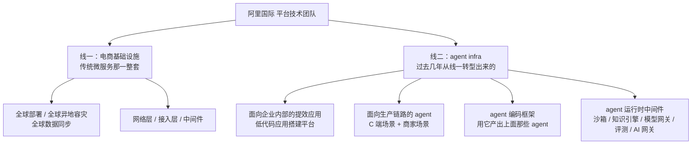
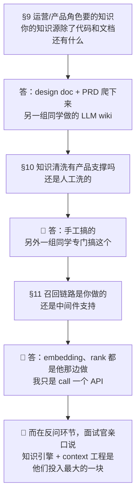
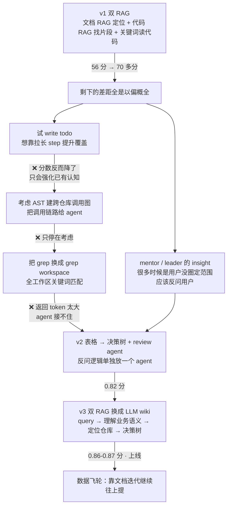

# 面经记录

**岗位方向：** 阿里国际（AIDC）电商集团下的**平台技术团队**——电商基础设施 + agent infra 两块都在这个团队
**时长：** 40 分 08 秒（一面是 61 分钟）
**流程：** 面试官讲部门（3 分钟）→ 自我介绍 → 谷歌 Memory（约 6 分钟）→ 字节答疑 Bot（约 17 分钟）→ 西门子（1 分钟）→ 意愿题 → 反问两问 → 回国 / 毕业 / 团队兴趣 / 工程 vs 算法 → 谷歌 vs 字节研发基建差异
**结果：** 未知（刚面完）

> 我自己的面试，录音转录整理。**这场跟一面完全不是一种面**——一面是技术深挖（连环 7 问逼到断），这场是**匹配度面**：面试官自己讲得多、每题只追一层、后半程全在探意愿和可用性。
> ⚠️ 转录有几处 ASR 误识：「后续的 agent 优化这一层」「做微服务优化的一个方向」里的**「优化」应为「agent 化」**；「四大项也好」应为**「沙箱也好」**（结尾面试官自己复述过一遍）；「Jeskey / Jaskey」是谷歌内部工具名的误识。

---

## 部门信息（这场面试官开场就全摊开了，比一面反问环节挖到的更完整）

**业务面：**
- 阿里国际（AIDC）= 阿里集团的**国际电商板块**，跟国内淘宝天猫、阿里云是并列的三块
- 两种模式：**跨境**（中国的货卖全球）+ **本对本**（在东南亚等地建本地站，本地招商卖给本国用户，形态类似亚马逊在欧洲的区域站）
- 覆盖 **250 多个国家**，体量比国内小很多，但**每个国家的政策和合规要求都不一样，复杂性来自这里**

**技术面（我们这个团队 = 平台技术团队，两条线）：**

> 面试官原话：「**整一套 agent 运行配套的相关基础设施能力都是具备的**。」
> **对照一面挖到的三块（agent 怎么构建 / agent 协同 / 企业记忆中心），这场补上的是最底下那层运行时中间件的完整清单**：沙箱、知识引擎、模型网关、评测、AI 网关。
> ⚠️ 注意「模型网关」和「AI 网关」在他嘴里是**分开列的两个东西**，我没问区别，这是个漏掉的钩子。

---

## 0. 🔴 本场主线：他在探「你能不能干知识引擎」，我连着三次说「不是我做的」

**技术追问只有一层深，不像一面那样连环逼问。但真正的考核埋在中段的知识层三连问：**

**这三问不是在查我的项目边界，是在查我能不能接他们最重点的那条线。** 面试官在 §16 反问里自己说了：「我们最近在搞这个知识引擎这一块……这一块整体对于整个 agent 的上下文输入应该是帮助比较大的」「我们也在这方面投入会比较大」。

[[追问/谷歌Memory]] 里白纸黑字写过这条毛病的正确姿势：**协作项目里讲别人做的部分，要讲「我作为消费方对它提了什么要求」——那部分永远是你做的。** 这场三次机会全部原样错过。

### 这场跟一面的考法对照

| | [[公司/阿里国际/Agent Infra/阿里星一面_2026-08-06]] | 本场 |
|---|---|---|
| 时长 | 61 分钟 | 40 分钟 |
| 追问深度 | 连环 7 问逼到答不出 | 每题追一层就换 |
| 考什么 | **你的东西能不能变成平台**（运行时/扩展/隔离） | **你这个人跟这条线配不配**（意愿/知识层能力/可用性） |
| 面试官讲话占比 | 低 | **高**（开场 3 分钟部门介绍 + 反问两段各 1 分多钟） |
| 算法 | 有（1 题简单） | 无 |

**判断：这是主管面 / 交叉面性质，不是技术深挖面。** 依据是后半程连着问毕业时间、回国意愿、对团队感不感兴趣、纯工程还是算法——**这几问都是在确认可用性和匹配度，不是在考技术。**

---

## 1. 自我介绍（零岗位定制，🔴 第 3 次复发）

**当时：** 「我叫谭远峰，本科毕业于华理工大学，现在在加州大学圣地亚哥分校攻读计算机硕士。我觉得我比较相关的实习主要是有三段」→ 谷歌（memory evaluation + 优化）→ 字节（oncall 机器人，基于 D2F 二次开发，难点是业务逻辑复杂、要列全不能以偏概全，做法是单 agent 改多 agent + 决策树工具）→ 西门子（RAG，ETL 重构 + query 改写 / 多路召回 / 重排，76% → 92%）。

> ⚠️ **内容比一面好**——一面是五段实习流水账，这场收敛到三段，而且每段都给了「难点 + 做法 + 结果」。**这是进步，先记下来。**
> 🔴 **但岗位定制仍然是零。** 面试官刚花 3 分钟讲完他们做沙箱、知识引擎、模型网关、评测、AI 网关，下一句就让我自我介绍——**这是把靶子摆在面前了**。我一句「你们刚说的 X，我做过 Y」都没说。
> 这是**距一面 12 天的第 3 次复发**（一面 §1 已记过，上一场也记过）。

**改进（在现有三段前面加一句，20 秒，其余不动）：**

> 「先接一句您刚才讲的——**您说的运行时中间件那几块，我基本都从消费方的角度碰过**：模型网关我在字节接了三家模型、踩过 prompt cache 断点；评测我在西门子和字节各搭过一套流水线；知识引擎这一块是我现在在谷歌做的 memory 的上游。**所以我下面讲的三段，其实可以按您那个清单来听。**
>
> 我叫谭远峰……」

**题型 A（项目叙述）｜扣分：① 落点（零岗位定制，第 3 次复发）**

---

## 2. 谷歌那段在做什么（背景讲清楚了，但踩了保密线）

**当时：** 6 月 29 号入职，到现在一个半月。背景是**谷歌希望把所有 agent 能力都收紧到内部的类 Claude Code 工具里**（转录里说的是「我们谷歌内部称它为 Jeskey」）。我们 testing agent 原本有自己的 memory，收紧之后要用内部那套 memory，**两个 memory 会打架**，所以要评测新 memory 的效果；而且它是**通用 memory**——不只服务 testing 团队，还服务普通用户的日常问答和 coding，所以我们希望做一些 specific 的开发把它的能力提上来。
现在在做的是：**基于内部基建搭一个 memory 的隔离测试环境**，把 memory 隔离出来做 AB 测试。后续打算做一个 **self-reward memory agent**——「相比传统 memory 插件，我们团队最大的优势就是**我们有数据，我们能够验证这个 memory 写入的好坏**，而不是写完就结束」。

> ✅ **「我们最大的优势是有数据能验证写入好坏」这句是本场谷歌段最好的一句**，它把项目的差异化用一句话说清了，跟 [[追问/谷歌Memory]] 的定稿口径一致。
> 🔴 **但踩了保密线，而且是复发。**「谷歌内部称它为 X」+「谷歌希望把所有 agent 能力收紧到 X」= **内部代号 + 内部战略方向**。[[追问/谷歌Memory]] §保密红线 写得很清楚：**可讲**公开产品名（Antigravity 是公开的、写在简历第一行）；**不讲**内部魔改点、团队排期、内部选型。一面 §13 已经踩过同一条线，这是第 2 次。
> ⚠️ **零数字。** [[追问/谷歌Memory]] 里备好的「200-300 条精标数据做接入前后对照 / 挑 20-30 条 golden 配每日回归」一个都没报。**字节段报了 56 和 87，谷歌段一个数没有**——同一场里两段的密度差一个档次。

**改进（只改开头那两句，后面保留）：**

> 「组里在把 agent 能力收敛到公司统一的 agent 框架上，我这边的具体影响是：**testing agent 原来那套自研 memory 要退场，换成平台侧的通用 memory。**（**到此为止，不报内部代号、不讲公司战略。**）
>
> 这一换带来两个问题。**第一，两套 memory 的写入会互相干扰**，所以我要先做隔离；**第二，平台侧那套是通用的**——它同时服务日常问答和 coding，不认识测试这个场景。
> 所以我现在做的第一件事是搭 memory 的隔离测试环境，把 memory 单独摘出来做 AB。**验收标准是现成的：两三百条已精标的数据做接入前后对照，测两个维度——生成的操作 step 跟标准流程语义一致吗、按这些 step 操作真机能不能达成目标。**」

**题型 A｜扣分：④ 口径（保密线复发）+ ② 诊断（零数字）**

---

## 3. 🔴🔴 本场最重要的一题：作为 memory 组件本身，不管业务逻辑，你怎么评判别人写进来的好坏？

**面试官原话（注意他在问题里已经把垂类做法排除掉了）：**
> 「写入 memory 的 agent 它自己带了自己的场景，他自己可能知道写入的效果好不好，**我觉得从他单垂直去考虑是可以做到的。但你作为一个 memory 组件本身来讲，你不管业务逻辑的情况下，你是如何评判别人写进来的好坏？**」

**当时：** 先讲了写入的两条路径（Inline / Dreaming，见 §4），然后答——「我们希望能够给它做一个门禁校验……**每天改完 memory 之后跑一下我们的评测任务，如果在我们的评测指标上有所优化，就让这个 memory 长久保留下去；如果没有优化就回滚到旧版本。**」

> 🔴🔴 **答的是「我们垂类怎么做」，而面试官在问题里明说了「单垂直是可以做到的」。他要的是下一层：平台方没有业务语境时怎么办。**
> 🔴 **而这题我半个月前在同一家公司答过，还是全场最高光。** [[公司/阿里国际/Agent Infra/阿里星一面_2026-08-06]] §16 原题是「通用 agent（比如 OpenClaw）的 memory 该怎么设计」，答案是**verify 没有消失，是换了代理指标**——被召回几次、被多少个**不同的**查询用上过。口径在 [[Agent记忆四家实现对比]]。
> **这是「知识有但取不出来」在阿里国际连续两场的第一次复发，而且间隔 12 天、同一家公司、几乎同一道题。**
> ⚠️ 更要命的是：**这一题正对着他们最重点的那条线**——他们在做企业记忆中心，那正是一个「不管业务逻辑的 memory 组件」。

**改进稿（三层，最后一层才是平台方真正的答案）：**

> 「**分两种情况，因为能拿到的东西完全不一样。**
>
> **第一种，有可验证的数据集**——我们 testing 团队属于这种，所以我们能做门禁：每天 memory 改写完跑一遍留出验证集，分数没提升就回滚。**这是最硬的一种，但它是个奢侈品，只有垂类有。**
>
> **第二种就是您问的这种：平台组件，拿不到业务语境。** 我的判断是——**verify 这件事没有消失，是换了代理指标。** 你不能再问『这条记忆对不对』，只能问『**这条记忆有没有真的被用上**』。具体三档，重要性从低到高：① 检索相关性分数 ② 被召回的次数 ③ **被多少个不同的查询召回过**。
> **第三档是最关键的**，因为前两档区分不了一件事：**一条被反复召回的记忆，可能只是某个特定问题的附属答案，不是可复用的经验。** 只有『被不同的问题用上过』才能证明它是经验。这套思路我在 OpenClaw 的记忆入库门禁上看到过完整实现，它把三条阈值同时卡死才允许入库——口径我整理在 [[Agent记忆四家实现对比]]。
>
> **但如果让我来设计这个平台组件，我不会止步于代理指标。我会把评判权还给垂类，只把评判协议标准化。**
> 具体是：memory 组件对外暴露一个**回填接口**——『这条记忆参与了这次任务，任务成功 / 失败』。**什么叫成功由垂类自己定义**：我们测试团队定义成真机执行达成目标，coding 场景可能定义成编译通过或 CR 通过。平台不做裁判，平台只做两件事——**把回填的信号变成排序权重和淘汰依据，以及保证每条记忆都能追溯到是哪几次任务把它捧上来的。**
> **代理指标是在垂类还没接进来之前的兜底，回填协议才是终局。** 因为平台自己去猜业务好坏，这件事本身就是不成立的。」

**题型 C（通用知识 · 平台侧）｜扣分：🔴 ① 落点（答了被问题排除掉的那一层）+ 检索失败（同公司 12 天前刚答过）**

---

## 4. memory 写入的两条路径（⚠️ 口径跟追问库对不上，必须自己核实）

**当时：** 「他写 memory 一般会有两个逻辑，一个是 **Inline**，一个是 **Dreaming**。
Inline 就是**用户平时在对话的时候，他就会有意识地写入这个 memory**，这个时候他是能感知到业务逻辑的。
Dreaming 是**每天的定时任务**，把当天所有对话抽取出来做 summary 概括，以及对之前写过的 memory 文件做修改，做查缺补漏的工作。**这个时候它可能就查证不到业务信息逻辑，因为它主要符合的是轨迹和成功与否的东西。**」

> 🔴 **口径跟 [[追问/谷歌Memory]] 定稿对不上，这是必须自己确认的事实：**
>
> | | 本场说法 | 追问库定稿 |
> |---|---|---|
> | 第一条路径 | **Inline**——用户对话时就有意识写入 | **对话主题结束时**，AI 起一个后台 agent 总结对话生成记忆 |
> | 第二条路径 | **Dreaming**——每天定时任务 | **dream 机制**——每天凌晨 4 点定时任务 |
>
> 第二条一致；**第一条差别很大**：「对话中实时写」和「主题结束后后台总结」是两种不同的触发时机，而且**决定了它能不能感知到当轮业务语境**——这正好是本场我用来论证的那句话。
> **两个说法不可能都对。去核实系统实际行为，然后统一口径**——现在这两个版本在不同面试里都出现过，被同一个面试官交叉比对就会露馅。

**题型 B（项目机制）｜扣分：④ 口径（与追问库定稿冲突，待核）**

---

## 5. ✅ 那 agent 怎么设计成通用的？要把不同场景灌进去做用例集生成和执行吗？

**当时：** 「**我们不会让这个 agent 做评测，我们打分是有专门的一个脚本打分。**」两类任务：
1. **CICD 报错归类**——抓 CICD 的 bug 和报错，分析后提工单，先给 bug 分类、再决定派发给谁。「**这个东西它其实是一个硬指标**，我们只要评判分类有没有正确、派发给谁有没有正确就好了。」
2. **自然语言转测试步骤**——用户给需求，agent 把自然语言转成一整套测试 step。两个指标：① 生成的 step 跟 **golden 标准答案的 step 的语义相似度** ② **end to end**——拿这些 step 去手机上真机执行，能否执行到我们需要的结果。

> ✅ **这题答得干净**：先给结论（不用 LLM 打分）→ 拆两类任务 → 每类给具体判据。跟 [[追问/谷歌Memory]] 的验证计划口径一致。
> ⚠️ **但埋了一个会被追的坑**：「不用 LLM as judge」和「语义相似度」这两句放在一起，面试官只要问一句「**那语义相似度是怎么算的？**」——如果是 embedding 余弦相似度，那自洽；如果是让模型判两段 step 是不是一个意思，那就是 LLM as judge，前面那句结论就翻了。**本场没被追，下次要主动说清。**

**补一句把坑填上：**

> 「这里我把『不用 LLM 打分』说得更准确一点：**判定用不用模型，看的是这个维度有没有客观事实可比。**
> 分类和派发有客观答案，直接字符串比对。真机执行有客观结果，看目标状态达成没有。**这两个维度我坚决不让模型判。**
> 语义相似度这一维绕不开模型——但我用的是 **embedding 算余弦相似度，不是让模型下判断**。区别在于前者是确定性的、可复现的，后者会因为 prompt 和温度飘。**顺序上也是先看 end-to-end 有没有跑通，语义相似度只是在没跑通时用来定位是哪一步偏了。**」

**题型 B｜扣分：无（唯一软肋是那个没被追的坑）**

---

## 6. 这套评测系统在谷歌内部是统一的吗？

**当时：** 「**分部门不一样的，没有一个统一的评测系统**，所以是我们现在在做。Jeskey 他们团队有开发一个专门的评测工具，但那个工具**并不适配 memory 的隔离**，所以我要专门做这些适配。」

> ⚠️ 内容对，但**又一次报了内部代号**（同 §2 的保密线问题）。
> ⚠️ 另外这是个**没接住的钩子**——面试官问「统一吗」，本质上问的是**平台化程度**，这正是他们团队每天在解决的问题（一面面试官原话：「要达到规模化复用、共同标准在企业内部落地，肯定是在 infra 团队去建设的」）。**我答完事实就停了，没往「为什么统一不了」上说一句。**

**可以补的一句：**

> 「**统一不了的原因挺典型的**：平台侧的评测工具默认整条链路是黑盒，它只管『输入进去、输出出来、打个分』。**但我要测的是链路里的一个组件，我得能把 memory 单独摘出来做 AB——这个『可摘除』的能力平台没有提供。**
> 所以我做的适配本质是把评测的粒度从『整条链路』下沉到『单个组件』。**这一层如果平台一开始就设计了，每个垂类团队就不用各造一套。**」

**题型 B｜扣分：④ 口径（内部代号）+ ① 落点（没接平台化的钩子）**

---

## 7. 字节 oncall bot：你接手时是什么状态？核心挑战是什么？

**当时：** 「我是**基于一个开源项目做二次开发**，整个项目是我一个人完全负责的……mentor 比较感兴趣，说你可以试一下这个，让他做一个 oncall 机器人出来。」
难点：「我是国际电商部门，做的是**商家跟达人的对接平台**。举个例子——**达人跟商家在某个玩法下达成交易，达人向商家提交视频，商家审核通过之后，能否退款、能否撤销订单？** 在不同玩法下有不同结果、不同商家与达人配对下有不同结果、不同国家地区有不同结果、他们之前的历史交易状态也会影响。**每个状态都有不同的枚举，会有不同的 if else 来判断。** 我们也测过 Claude、Codex，**没有办法完整把所有情况列举出来**。」

> ✅ **这题是本场叙事最稳的一段**：具体业务例子 → 四个叉乘维度 → 用「我们测过 Claude 和 Codex 也列不全」证明这不是我的实现问题而是模型的通病。跟 [[追问/字节答疑Bot]] 口语稿②一致。
> ⚠️ 缺一个数字：[[追问/字节答疑Bot]] 定稿里的「**服务 200+ 用户**」没报。业务复杂度讲了，业务规模没讲。

**题型 A｜扣分：② 诊断（规模数字没报）**

---

## 8. ✅ 从接到任务到落地上线，完整链路是怎么一步步走的？技术选型怎么想的？（本场最长最好的一题）

**这题我讲了 5 分半，是一条完整的「我试过什么、为什么放弃」的演化史。先把链路画出来：**

**逐段原话与点评：**

**① v1 双 RAG（56 → 70 多）**
「先接入内部业务文档，字节内部**有基于文档的 RAG 和基于代码的 RAG**。基于专家经验把重要文档放进文档 RAG；代码 RAG 把代码仓库放进去，**它会按函数、按类切断，给这些代码写注释**。一个问题进来先通过两路 RAG 找到核心代码片段和具体仓库，再深入仓库里**按关键词匹配读具体代码**，最终生成答案。**相比没有文档的 56 分，当时到了 70 多分。**」

> ✅ 基线 56 报了。**这是懂车帝那场「全场零数字」之后的明确修复。**

**② write todo 失败**
「我有一个比较粗暴的结论：**如果模型走的 step 足够长、调研路径足够长，回答结果一般比较正确。** 所以想用 write todo 延长 agent 的工作 step……但实测下来效果比较一般，**他只会强化他已有的认知，没有办法拓展讨论的可能性，只是按照 todo 一步一步走，分数甚至还降低了。**」

> ⚠️ **观察是对的，归因停在现象层。** 「只会强化已有认知」描述的是症状，没说出病因。
> [[追问/字节答疑Bot]] Q1 有定稿：**todo 是线性清单，它只能记录「我打算做什么」，不能表达「一共有几种可能」。** 所以它天然没有完备性判据——跑完 todo 只证明清单做完了，不证明清单本身是全的。
> ⚠️ 另外「step 越长效果越好」这句在一面 §2 已经被标为「经验观察讲成原理」，**这是第 2 次说**。定稿口径是：**不是轮次越多越好，是覆盖的分支越多越好，轮次只是覆盖的副产品。**

**③ 🔴 AST：这场说成「考虑过」，跟一面说的对不上**
「我们当时是**考虑过**使用这种 AST 的语法解析，把多个仓库弄成一个 graph，让它根据这个 graph 来生成问题。」

> 🔴 **这是本场最危险的一处口径。** 一面 §4 我说的是「**另外专门开发了一个 AST 工具**，能把代码文件里的 if-else 骨架全部提取出来做强提醒」——已实现；这场说的是「考虑过」——没实现。
> **仔细看其实是两个不同的东西**，但我没区分，听起来就是自相矛盾：
>
> | | 一面说的 | 本场说的 |
> |---|---|---|
> | 做什么 | **单文件内**提取 if-else 判断条件 | **跨 40 多个仓库**建调用图 |
> | 用途 | 喂给决策树当分支来源 | 给 agent 全局调用链路 |
> | 状态 | 已开发 | 只是考虑 |
>
> [[追问/字节答疑Bot]] Q1c 有明确警告：**「AST 分支提取在字节是真做了还是只是设计」这件事必须自己确认，说成已实现但报不出覆盖率数字就是当场翻车。**
> **而且这场把 AST 讲成「考虑过」，直接导致决策树那段丢了最值钱的一张牌**——分支覆盖率 M/N，把完备性从主观感觉变成可算的比例。**这张牌本场一次都没打。**

**④ grep workspace 失败**
「它之前 grep 是通过关键词检索，**默认只检索某一个仓库，不会检索多个仓库**。我把 grep 删掉，换成 **grep workspace**，对整个工作区所有仓库做关键词匹配……但实测有个大问题：**我们代码仓库比较多，这个工具会返回很大的 token 数量，agent 没有办法接收这么大的工具结果**，所以放弃了。」

> ⚠️ **只讲了止血，没讲根治。** 「工具返回太大」这个问题我在一面 §7 亲口讲过标准解法——**offload：大返回不进上下文，落盘，只回一个路径和一句摘要。** 上一场刚讲过的东西，这场遇到同一个问题时没取出来，**又是一次检索失败。**
> 而且「所以放弃了」是个弱收尾——放弃一个方案要给判据，不是给症状。

**改进（这段重写，把放弃讲成取舍）：**

> 「grep workspace 我最后没有留，但**不是因为它没用，是因为它的成本结构不对**。
> 全工作区匹配的返回量跟仓库数成正比，40 多个仓库一搜就是几万 token，**而 agent 的上下文预算是恒定的**——这意味着这个工具越有用，它越会把别的东西挤出去。
> **能救的路有两条，我都评估过**：一是 offload——返回落盘只回路径和摘要，agent 要细节自己读；二是加一层收敛，先按仓库聚合出命中分布，让 agent 自己选进哪个仓库再细搜。
> **我最后没走这两条，是因为当时找到了更上游的解法**：真正的问题不是『搜不全』，是『**不知道该搜哪里**』。所以我把力气花在了 LLM wiki 那一层——先用业务语义定位到仓库，范围收敛完之后，原来那个只搜单仓库的 grep 就够用了。**上游收敛掉的问题，下游不用再扛。**」

**⑤ mentor / leader 的 insight → 反问用户 → 表格 → 决策树 + review agent（0.82）**
「他们的 insight 是：**很多情况下 agent 回答不好，是用户问的时候没有限定好范围**，所以希望 agent 能反问用户圈定范围——哪个地区、哪个国家、达人商家之前处于什么状态。但既然要反问，肯定还是要先调研代码再反问。**这两个要求一起，让我觉得应该用一个可以枚举所有情况的结构**，让 agent 显式意识到有这么多状态。
一开始是**让他列表格**，因为他本来就喜欢列表格；但**表格是二维的，没办法把很多 if else 情况列全**，所以再优化成了决策树。
反问的逻辑我放到另一个 agent 来生成，所以有了 **review agent**；而且 agent 有时候会出现 **context 太长、attention 不足**，出现**张冠李戴**的幻觉，需要 review agent 审阅、发现幻觉就让它重新回答。**这块弄完跑分大概 0.82 分。**」

> ✅ **「表格是二维的，装不下多层 if-else」是很好的选型判据**——具体、可反驳、能看出真试过。跟 [[追问/字节答疑Bot]] Q1 口径一致。
> ✅ 「张冠李戴」这个失败模式的具体形态又一次讲出来了，这是稳定发挥。
> ⚠️ **数字口径飘了**：这段说「0.82 分、0.8 分，大概这个水平」，最后又说「0.86 ~ 0.87 分」。**[[追问/字节答疑Bot]] 定稿只有两个数：基线 56%、最终 87%。中间态说个区间没关系，但最终态必须咬死 87%，不能说成「0.86 到 0.87」——一个含糊的最终数字会让前面所有数字都掉价。**

**⑥ v3 把双 RAG 换成 LLM wiki（0.86-0.87，上线）**
「后来另一个组的同学在做业务知识库文档，我们就**把文档 RAG 和代码 RAG 都去掉**了。两个原因：
① **资源限制**——不能放太多文档给文档 RAG，额外文档要申请权限和配置资源；
② **代码 RAG 其实是一个很死板的中英翻译**——比如『**charge 在我们场景里是支付，但它翻译成充电**』，所以代码 RAG 跟自然语言没有特别好地匹配。
换成 LLM wiki 之后的链路是：**用户 query 进来 → 先阅读代码理解业务语义 → 找到具体代码仓库 → 走决策树 → 阅读关键代码生成决策树** → 最终 0.86-0.87 分，**能够上线给用户用的水平**。」

> ✅ **`charge` 那个例子是本场最值钱的一个细节**——它用一个词把「中文业务语义 ↔ 英文代码符号」这条鸿沟讲透了，而且是真踩过才有的例子。**这个例子要固定下来，以后讲检索层就用它。**
> ✅ 「文档资源要申请配额」这条也很真实——**成本约束驱动选型**，比讲技术优劣可信。

**题型 B｜扣分：④ 口径（AST 说成考虑过 · 最终分数说成区间）+ 检索失败（offload / 覆盖率 M/N 两张牌都没取出来）+ ② 诊断（write todo 归因停在现象）**

---

## 9. 🔴 运营和产品角色要的知识，代码和文档覆盖不到吧？你的知识源有哪些？怎么清洗成机器人能消费的？

**面试官原话：** 「有部分用户属于平台运营或者产品角色对吧……这部分所包含的知识量，可能并不一定能覆盖到运营这种角色，因为我觉得**还是偏技术**嘛。所以第一个问题是：**它涉及的文档来源，除了代码、除了你们的文档以外，还有什么源头？同步的源头知识怎么逐步清洗到你们能被机器人消费的东西？**」

**当时：** 「主要来源是我们平时的 **design doc、PRD**，爬下来的 design、PRD，还有代码库。主要做的清洗是：它会阅读这些代码、PRD、design doc，**把业务名词跟代码名词对应起来**——达人对应 `influencer`，商家对应 `partner` / `MCN` / `agent`；对应之后给出具体解释，根据 PRD 和 design doc 给这个名词做业务解释，以及它的代码仓库位置。大概通过这样的方式来做 LLM wiki。
**文档数量我们不是很了解**，仓库的话有 **40 多个代码仓库**。
他做了很多版，**每一版会基于用户反馈迭代**：先让大语言模型生成一个比较简单的初版，再根据用户反馈不断人为修改 LLM wiki 的内容，最终生成一个比较完善的东西。」

> ⚠️ **答偏了，而且偏法跟一面 §5 一模一样。** 面试官问的是**「运营和产品这类非技术角色的知识从哪来」**，我答的是**「业务名词到代码符号的映射怎么做」**——那是给研发用的那一半。
> **运营的知识在哪？** 面试官在 §16 反问里自己给了答案：「**大量的知识存储在个人的运营经验里面**」。**他问这一问的时候心里就有这个答案，我没接上。**
> ⚠️ 「**文档数量我们不是很了解**」——「不了解」开局，本场第 1 次。
> ✅ 「40 多个代码仓库」是对的（跟 [[追问/字节答疑Bot]] 一致），**规模数字报了**。
> ✅ 「每一版基于用户反馈迭代，先 LLM 生成初版再人工修」这段是好的——**它描述的正是一条数据飞轮**，只是我没给它起名字。

**改进稿（先正面回答"非技术角色的知识在哪"，再讲清洗）：**

> 「**先直接回答：我们能覆盖到的和覆盖不到的，我分开说。**
>
> **能覆盖的三类，都是有文本载体的**：PRD 和 design doc（讲『为什么这么设计』）、代码（讲『实际怎么跑的』）、以及中间那层业务名词表（把中文业务词接到英文代码符号上，达人是 influencer，商家可能是 partner、agency、MCN——**这三个词的差别只有历史 PRD 说得清，而且往往要好几篇 PRD 拼起来才看得懂**）。
>
> **覆盖不到的那一类，恰恰是运营最值钱的知识：它没有文本载体，在人脑子里。** 比如『这个玩法上线初期有一批脏数据，遇到这种订单要人工核』——**代码里没有、PRD 里也没有，它只存在于处理过这个问题的那个运营的记忆里。**
>
> **所以我们的做法是让这类知识从问答里长出来，而不是指望有人先写下来。** 具体是两条：
> ① **知识库本身是版本迭代的**——先让模型基于代码和文档生成初版，然后每一版根据用户反馈人工订正，**它是活的不是一次性产出的**；
> ② **反馈的入口就是机器人本身**——用户对某个回答点踩、或者追问了三轮，这条 case 就会进人工复核队列，专家改的不是这一次的答案，**是背后那份文档**。
> **这条链路我们跑起来了，但还很粗**——现在是每周人工拉负反馈让专家看。**我认为它真正该做成的样子，是让运营的每一次纠正都能直接落回知识库，而不是经过一次人工搬运。这也是我觉得这套东西从 87% 再往上走唯一的路。**」

**题型 B｜扣分：🔴 ① 落点（没回答"非技术角色"）+ ④ 口径（"不了解"开局）**

---

## 10. 🔴 这个知识整理过程，有产品支撑吗？还是人工洗出来的？

**面试官原话：** 「比如说我有一个**知识管理平台**，可以从不同源头拿到各种原始文件，最终产物是你们整个团队的维基，**产出一个 AI 可理解的东西**。我不知道你这个是有产品能力呢，还是前面整个知识清洗过程是手工搞的？」

**当时：** 「**手工搞的，这个是手工搞**，就是另外一组同学专门是搞这样的内容。**我也听过他讲**，大概就是他会把所有文档爬下来，把所有代码仓库也放进来，**他会根据自己的先验知识，给他大致分好一些类别、一些层级**，让大语言模型根据这个层级来生成信息，**相当于就是一个术语解释的词典**。」

> 🔴 **「手工搞的」+「另外一组同学」+「我也听过他讲」——三句话把自己完全摘出去了。**
> **而这一问是本场信息密度最高的一问**：面试官描述的那个东西（多源头输入 → 统一清洗 → 产出 AI 可消费的企业维基）**就是他们团队正在做的知识引擎**。他不是在考我的项目边界，**他是在问我对这个产品形态有没有想法。**
> [[追问/谷歌Memory]] 明令的正确姿势：**现状 → 我的诊断 → 如果让我改我会怎么改。第三段才是面试官真正想听的。** 这场只给了第一段。
> ✅ 唯一有价值的信息是「**人先定层级，模型再往层级里填内容**」——这是个真实的实现细节，值得保留。

**改进稿（同样的事实，加上诊断和主张）：**

> 「**现在是半自动的：层级靠人定，内容靠模型填。** 具体是把文档和 40 多个仓库全爬进来，**由熟悉业务的人先切出类别和层级骨架**，再让模型按这个骨架生成每一项的解释，产出物形态接近一本带代码位置的术语词典。
>
> **我作为它的消费方，对这个做法有两个判断。**
> **第一，层级由人定这件事，短期是对的。** 因为层级本身就是业务语义，**模型没有业务语境，它切出来的类别是按文本相似度切的，不是按业务边界切的**——这一层交给模型，下游全错。
> **第二，但这也正是它的瓶颈，而且瓶颈会随业务增长暴露。** 业务改一次，层级要人重新看一遍；负责的人一走，这份骨架就没人维护。**它现在能跑，是因为业务复杂度还在一个人脑子装得下的范围内。**
>
> **所以如果做成产品，我认为关键不是把爬取和生成自动化——那部分反而好做。关键是让层级自己能被证伪。**
> 我的想法是：**用下游的检索行为反过来验证上游的层级**。如果某一类知识长期被召回但答案总被点踩，说明这个类别切错了；如果两个类别总是被同一批 query 一起命中，说明它们该合并。**层级不该是一次性定死的产物，它该是一个被使用数据持续修正的东西。**
> **这跟我在谷歌那边做的其实是同一件事**——那边是用任务成败去修正 memory，这边是用检索反馈去修正知识层级。**都是在给一个自动生成的东西补一道验证。**」

**题型 B｜扣分：🔴 ① 落点（只给现状不给主张）+ ④ 口径（"不是我做的"开局，第 2 次）**

---

## 11. 🔴 检索召回这一块是你自己做的链路，还是 RAG 那层有中间件支持？

**当时：** 「这个召回的链路是**他那边做**，就 embedding 啊、rank 啊这些东西都是他那边做，**我只是 call 一个 API**，我只是把这个文档给注入进去。」

> 🔴 **第 3 次「不是我做的」，而且这次最干脆——「我只是 call 一个 API」。**
> **这句话的问题不在于事实错**（事实确实如此），**在于它主动放弃了一整块可以讲的东西**：我在西门子亲手搭过完整的 RAG 链路（embedding 模型选型、向量库迁移、三路混合检索、reranker，见 [[追问/西门子RAG]]）——**我是这条链路上少数「自己搭过、也用过别人搭的」的人，这是一个非常好的对比视角，我一个字都没说。**
> 而且面试官问的是「**有没有中间件支持**」——**他关心的是平台化程度，不是分工。**

**改进稿：**

> 「**字节这套是平台提供的，我是调用方**——embedding、rerank 都在平台侧，我这边只做两件事：把文档灌进去、把 query 打过去。
> **不过这一层我在上一段实习里是自己从零搭过的**，所以我对『用平台的』和『自己搭的』差别有比较具体的感受。
> 在西门子那套是我自己搭的：embedding 模型换过、向量库从 ES 迁到 Milvus 支持 4096 维、检索做到三路混合（稠密 + 稀疏 + BM25）再加 reranker，准确率从 76% 做到 92%。**那次学到的是：这条链路上真正影响效果的旋钮很多，而且都要配着自己的语料调。**
> **所以回到字节那次的选择——用平台的是对的，但代价很具体**：平台的 embedding 是通用语料训的，它不认识我们的业务词，`charge` 在我们这儿是支付它给我翻成充电。**我调不了模型，只能在上游加一层业务语义映射来补**，这就是后来 LLM wiki 那一层的由来之一。
> **换句话说，平台把 90% 的工作省掉了，剩下 10% 的领域适配跑到了调用方这边——我觉得这是这类中间件普遍会有的形态。**」

**题型 B｜扣分：🔴 ① 落点（放弃了西门子那张牌）+ ④ 口径（"不是我做的"第 3 次）**

---

## 12. ✅ 用户反馈怎么闭环到「我们该往哪优化」？

**当时：** 「主要是两个。
① **在 Feishu 上做了点赞和点踩功能**，包括用表情回复，**每个表情回复我们都能记录到数据库里**。我们**每周有定时任务**，把负面反馈拉下来——正面的或没反馈的也会拉，但**八成是负面反馈**——**给几道题给我们专门的专家，让专家来打分评价**。
② **看有没有多轮对话。** 我们主要场景是单轮，用户追问比较少；**如果追问，可能就是我们 agent 解释不清楚**，我们会专门把这种问题拉出来，看他是哪一步没做好。」

> ✅ **这题答得实在，两条都是真跑起来的机制，而且第二条有洞察**——**「用户追问 = 一次失败信号」是个好的产品判断**，因为它是**隐式反馈**：不依赖用户主动点踩，覆盖面比显式反馈大得多。这条要固定下来。
> ⚠️ 缺一句收口：**这两条反馈最终怎么变成改动？** 我讲到「专家打分」就停了，没讲专家打完分之后改的是什么（是改 prompt？改文档？加评测题？）。§9 里其实说了是「基于文档修改」，但两段没连起来。
> ⚠️ 另外 [[追问/字节答疑Bot]] 里的「**评测集 50+ 题、专家给标准答案和得分点、AI 按 rubric 判卷踩点**」这套没提——**面试官问的是飞轮，评测集怎么长大正是飞轮的一环。**

**补一句收口（把两条反馈接到产出上）：**

> 「**这两条反馈最后都汇到同一个地方：评测集和知识文档。**
> 专家复核完一条 bad case，会做两件事——**把它加进评测集**（评测集就是这么从几十题长起来的，而且它天然跟着业务走，不是人凭空想的），**以及判断根因是文档缺失还是推理出错**。文档缺的就补文档，推理错的才动 prompt 和门禁规则。
> **我们的经验是前者占大头**——所以我在 §9 说从 87% 再往上走，功夫要下在文档上，就是从这个分布看出来的。」

**题型 B｜扣分：② 诊断（没讲反馈的产出侧）**

---

## 13. ⚠️ 西门子那段（1 分钟，自己主动把项目降级了）

**当时：** 「基于 RAG 做的一个……也是个 chatbot。它的 RAG 是我自己搭的，**从 embedding 模型、向量数据库到整条 pipeline 都是我自己搭建**。」
面试官：「这两个可能跟上面那个是类似的方向。」
我：「类似的方向，但这个更多是 25 年的时候做的，所以**是一个 workflow，它不是个 agent**。」

> ⚠️ **「是 workflow 不是 agent」这句是主动自贬。** 面试官没有暗示它过时，是我自己贴了这个标签。
> **而且这一贬正好贬掉了上一题（§11）最该打的那张牌**——面试官刚问完「召回链路是不是你做的」，我答「我只是 call API」；隔了 30 秒讲西门子时说「**整条 pipeline 都是我自己搭建**」——**两句话之间隔了一分钟，我自己没把它们连起来。**
> ✅ 76% → 92% 在自我介绍里报了，跟 [[追问/西门子RAG]] 一致。

**改进（不贬，讲成互补）：**

> 「西门子那套是我自己从零搭的，**跟字节那套正好是同一条链路的两端**：字节是用平台的中间件、力气花在上游的语义层；西门子是没有平台，embedding 模型、向量库、三路混合检索、reranker 全是我自己选自己调的，76% 做到 92%。
> **形态上它确实是 workflow 不是 agent——但我不觉得这是它过时**，是那个场景本身不需要 agent：CT 机操作手册的问答，**问题空间是有限且稳定的**，固定流程就能覆盖，上 agent 只会增加不确定性。**判断该不该用 agent，看的是问题空间稳不稳定，不是看年份。**」

**题型 A｜扣分：④ 口径（主动自贬 + 没接住上一题的对比）**

---

## 14. ✅✅ 意愿题：你倾向做 infra，还是做业务 agent 开发？（一面最大失分点，这场答对了方向）

**面试官原话：** 「整体上你自己感觉，**因为我理解应该还是偏向于做业务的场景，包括做 agent 也好，这个居多；前面谷歌那一块可能有点偏向于横向的一些平台性的能力。你自己倾向于说将来做这种 infra 的能力，还是可能偏向于做业务 agent 的一些开发？**」

**当时：** 「**做 infra 能力。** 我可能会希望说有一个更加理解这个 agent 的整体的一个功能吧，也希望说**在某一块能够有一定的深度**，我还希望**做一个比较 general 的 agent，它可能更加有意思**。」

> ✅✅ **一面 §19 的最大失分点，这场纠正了。** 一面那次先反问「层是什么意思」、然后选了「垂类」、被给了改口机会之后还说「我觉得垂类就是 infra 层」——三重错。**这场第一句就是「做 infra 能力」，选边干脆、没有反问、没有自相矛盾。这是本场最重要的进步。**
> ⚠️ **但论证薄，三句话里有两句是弱的：**
> - 「希望更加理解 agent 的整体功能」——**这是想学，不是能做**
> - 「它可能更加有意思」——**「有意思」不是理由，是感受。** 面试官听到的是「他想去玩新东西」，不是「他适合这条线」
> - 唯一有力的是「希望在某一块能够有一定的深度」，但没说是哪一块
> 🔴 **而一面复盘里已经写好了定稿，这场一句都没用**：「横向能力是唯一能跨过 agent 换代活下来的东西」「我在字节真正花时间的那几件事——middleware 门禁、决策树的可校验结构、网关收敛协议差异、评测流水线——换个业务全都能复用，它们本来就是 infra」。**答案备好了，现场没取出来。**

**改进稿（保留第一句，把后面换掉，约 40 秒）：**

> 「**做 infra。理由有两条，一条是经验形状，一条是判断。**
>
> **第一条，我过去真正花时间的东西本来就是横向的。** 我在字节挂在业务部门下面，但我真正花时间的四件事——**middleware 层的门禁、决策树这种可校验的结构、网关上收敛三家模型的协议差异、评测流水线**——**换一个业务，这四件事全都能原样复用。它们本来就是 infra，只是当时长在一个业务项目里。**
>
> **第二条，也是我更认的一条：agent 三个月换一茬，但评测、门禁、隔离、网关这几层每一代都要重做一遍。** 横向能力是唯一能跨过换代活下来的东西。
>
> **具体到深度，我最想扎的是知识和记忆这一层**——谷歌那边我在做 memory 的验证门禁，字节那边我踩的是知识层的检索和语义映射，**这两件事本质是一件事：怎么给一个自动生成的、会过期的知识补一道验证。** 您刚才提到你们在做知识引擎和企业记忆中心，**这一块是我最想接的。**」

**题型 A｜扣分：② 诊断（选对了边，但理由停在"有意思"）· ✅ 一面最大失分点已修复**

---

## 15. 反问 1：你们对一个校招生有什么样的期待或要求？

**面试官的回答（信息量大，投这个方向必读）：**
- **最看重实战经验**：「有比较多的实习经验，**确实在企业内部已经有一些项目落地，并且拿到了实际的效果跟结果**，并且对整个 agent 的 infra 或者 agent 开发**有比较清晰的过程，并且它的复杂性如果说是足够的**」
- **理论人人都会答，实战才分层**：「大家在理论知识方面，比如 agent 去问这些基本的东西，**多多少少大家都能回答出来**，但是很多同学会缺少实战经验」
- **分布**：没有实习经验、只在学校做 demo 或自学的**占六七成**；有局部小场景实习经验的偏少；**有多段实习经验的不多**
- **已实习同学的对比样本**：「有些同学之前在腾讯实习过，**整个工程能力上面相比于没有经验的确实会好很多**」
- **🔑 最具体的一条期待**：「我们给他一个任务，相对来说是**探索性的**……比如说有些开源项目，**能够引进来，快速在企业内部落地，结合一些业务场景去实施**的时候，**他这个上手速度会比较快**。所以我看重的是：作为学生本身来讲，**他能够快速把这些东西落地的学习能力跟经验**」

> 🔑 **这段是本场对我最有利的信息**：他描述的「拿一个开源项目引进来、结合业务场景快速在企业内落地」——**这就是字节答疑 Bot 的完整形态**（拿开源框架二次开发、接内部 RAG 和模型网关、结合国际电商业务上线、56% → 87%）。
> ⚠️ **而我在这里没有接一句。** 听完就「好的好的」，直接问下一个问题。**在他刚说完评判标准的那一刻，直接把自己往标准上贴一句，是成本最低、收益最高的动作。**

**当时应该接的一句：**

> 「您这么说我心里有底了——**字节那段基本就是这个形状**：拿一个开源 agent 框架进来，接内部的 RAG、模型网关，结合国际电商的业务场景改到能上线，**从 56 分做到 87 分交付给 200 多个用户用**。**中间三个方案是试了之后放弃的**，所以我对『探索性任务』这件事的落差有心理准备——它大部分时间不是在实现，是在筛掉不 work 的路。」

---

## 16. 🔑 反问 2：做了这么多 infra（沙箱、memory、知识库），你觉得哪一块对 agent 提升最大？

**面试官的回答（这是部门重点的直接口径，含金量最高）：**

**第一块：知识引擎 + 企业内部的 context 工程**
> 「我们最近在搞这个**知识引擎**这一块，包括**企业内部的整个 context 研发**，我觉得这一块整体对于整个 agent 的**上下文输入**应该是帮助比较大的……**你怎么把你的整个团队的知识库能够整理清楚，这个是一个非常基础且重要的工作，我们在这方面投入会比较大。**」

**难点在哪（三层，一层比一层难）：**
1. **代码**——是一方面
2. **大量文档**——存量业务团队「本身积累的知识可能就积累了十几年了」
3. **🔑 最复杂的：知识在人脑子里**——「更复杂的是在于**一些运营的场景**，比如说**以客服这样的案例为例，其实大量的知识存储在个人的运营经验里面**。**他怎么从人的经验能够做一些输入反馈的链路，然后把这个知识能够沉淀清楚**，我觉得这个是一个非常有意思的事情」

**第二块：agent 自我进化 → skill**
> 「大家其实一直在追求 agent **自我进化**的另外一个方面，就是它的 **skill**。从**整个反馈链路，再到整个 bad case 归因**等等这些东西……**一个是上下文，第二个是 skill 的自我迭代**，去增强整个 agent 这一块的效果。」

> 🔑 **这两块我都有直接对口的东西，而且这一问是我自己问出来的——钩子是我自己挖的，然后我没跳下去。**
>
> | 他说的 | 我手上对口的 |
> |---|---|
> | 知识引擎 / context 工程 | 字节的 LLM wiki + 业务语义映射 + 三层检索漏斗 |
> | **知识存在运营脑子里，怎么做输入反馈链路** | §12 的点踩 / 表情落库 / 每周专家复核 / 追问当失败信号——**这就是一条从人的经验往回沉淀的链路** |
> | skill 自我迭代 + bad case 归因 | 谷歌的 self-reward memory + 门禁回滚；[[Agent记忆四家实现对比]] 里三家的 skill 演化机制 |
>
> **我在 §18 确实说了一句「怎么拿到用户反馈把它沉淀下来，这是很有意思的事」，方向对上了，但没有落到具体做法。**

**当时应该接的一句：**

> 「您说的第三层——**知识在运营脑子里、怎么做输入反馈链路把它沉淀下来**——这个我们踩过一个很小的版本，可以给您一个数据点。
> 我们的做法是**把反馈入口做成机器人本身**：回答下面挂点赞点踩，用户的表情回复也全量落库，每周定时把负反馈拉给专家复核。**跑下来最有用的其实不是点踩，是"用户追问了几轮"**——单轮场景下的多轮对话本身就是失败信号，而且它是**隐式的**，不依赖用户愿意反馈。
> **但我们只做到了"把 case 捞出来给人看"，没做到"人的订正自动回到知识里"**——现在中间还有一次人工搬运。**我认为这一跳才是这件事真正的门槛，也是我最想做的一块。**」

---

## 17. ⚠️ 回国打算 / 毕业时间（「家里出了点事」🔴 第 3 次复发）

**当时：** 「回国发展，因为家人在这边、女朋友在这边，**包括说回国之后家里出了一点点事**，我不能离开中国特别长时间，所以后续是会回国的。」明年 6 月毕业。

> 🔴 **「家里出了点事」是第 3 次说了**（一面 §22 记过，上一场也记过）。
> **问题不在于内容，在于它给出的信号是「被迫回国」而不是「选择回国」。** 前面「家人在这边、女朋友在这边」已经完全够了，后面那句是净损失。
> **定稿：到「家人和女朋友都在国内，我明年 6 月毕业，回国是确定的」为止，一个字都不多说。**

**题型 A｜扣分：④ 口径（第 3 次复发）**

---

## 18. ✅ 整体听下来，你对我们这个团队感兴趣吗？

**当时：** 「我是感兴趣的，**大家做的东西可能还是比较像**——我最近也在做 context 上的一些管理，我觉得这可能也是一件很重要的事，包括我们团队也在做 AI wiki，我自己在做 memory。**怎么拿到用户的反馈、能够把它沉淀下来，我觉得确实是一件很有意思的事。**
**我觉得我们训练不了权重，我不是专门的算法工程师嘛，但是如果能训练 context，我觉得它是一件我能参与进来、然后做 AI 的一件事，也是一件很重要的事。**」

> ✅ **「训练不了权重，但能训练 context」这句是本场最好的一句话。**
> 它一句话完成了三件事：**承认边界（不是算法岗）→ 给出定位（工程侧的 AI 参与方式）→ 而且这个定位正好就是对方部门在做的事（知识引擎 / context 工程）。** 面试官上一段刚说完「context 研发对 agent 帮助最大」，我这句直接接上了。
> ✅ 「大家做的东西比较像」也是对的——**这场唯一一次主动做匹配度论证。**
> ⚠️ 唯一可惜：**这句该出现在 §14 意愿题里，那是它最该出场的位置。** 出现在这里，效果只有一半。

**题型 A｜扣分：无 · ✅ 本场最佳单句**

---

## 19. 你现在是纯工程的，算法这块没有特别做？

**当时：** 「算法其实没有，**我是做纯工程的**。」

> ✅ 答得干脆，没有含糊其辞想两头沾。**在这个岗位上（平台技术团队做 infra），"纯工程"是正确答案不是减分项**——而且我上一句刚说完「训练不了权重但能训练 context」，两句连起来是自洽的。

**题型 A｜扣分：无**

---

## 20. ✅ 谷歌和字节，测试能力的先进性、工作方式有差异吗？

**当时：** 「**差异很大。谷歌最大的好处就是它所有的代码都在一个仓库里面**，是一个大仓库，所有人的代码都在这个大仓库里。所以：
- 我在搭 infra、搭评测 infra 的时候，**出了什么 bug，我能够做到很好的归因**
- **代码改了之后我重新编译，我就跑一个我自己的版本**
- 最近发现他们那个 memory 出现一些 bug，**我也能够给他们提交 bug**
- 他们那边 memory 一直在迭代，**我能够一直 trace 他们整个所有的迭代过程，他们改了什么东西我都知道，我能够做好相应的适配**」
面试官总结：「相对来说它整个研发设施的理念更加完备一些，跟国内我们其实还是每个团队自己管自己的，不太一样。」
我：「对，自己管自己的，**所以我会这个流程会更舒服一点**……**我能把所有东西都看到，那我其实是很舒服的。**」

> ✅ **这题答得具体，四条全是「我实际因此能做什么」，不是「monorepo 有什么优点」的教科书答案。** 尤其「**我能一直 trace 他们的迭代过程，他们改了什么我都知道，能做好相应适配**」这条，直接呼应了我 §2 讲的「上游 memory 一直在变，我要跟着适配」——**这是这场少数几次前后呼应上的。**
> ⚠️ 术语档位：**「monorepo（单一大仓库：全公司代码放在同一个版本库里，跨团队改动能一次提交、一次编译）」这个词我全程没说出来，一直说的是「大仓库」。** 意思对，但这个词是标准术语，说出来更专业。
> ⚠️ 缺一句代价。**只讲了好处，没讲 monorepo 的成本**（构建系统和 CI 的门槛极高、需要专门的构建基础设施），**而对面正好是做基础设施的团队，讲代价比讲好处更能显出判断力。**

**补一句（讲代价，也是给对方递台阶）：**

> 「**不过 monorepo 是有前提的**——它成立的原因是有一整套构建和依赖基础设施在托底：分布式构建、精确的依赖图、大规模 CI。**没有那套东西，一个大仓库只会让所有人的构建一起变慢。**
> **所以我不会说 monorepo 更先进，我会说它是一个用基础设施换协作效率的选择。** 国内多仓的模式在跨团队协作上确实有摩擦——我在字节要读 40 多个仓库的代码，光是代码快照怎么同步就是个问题——**但它的好处是每个团队能独立演进，不用被统一的构建规范绑住。**」

**题型 C（通用知识）｜扣分：④ 口径（monorepo 这个词没说出来）+ ② 诊断（只讲好处不讲代价）**

---

## 21. 总结 / 自评

### ✅ 明显做对的（这些是真进步，别一起推翻）

1. **✅✅ §14 意愿题答对了方向**——一面最大的失分点（选了垂类、被给改口机会还说"垂类就是 infra"），这场第一句就是「做 infra 能力」，干脆、没反问、没自相矛盾。**这是本场最重要的进步，一面的 action item #1 生效了。**
2. **✅ §18「训练不了权重，但能训练 context」——本场最佳单句**，一句话完成承认边界 + 给出定位 + 匹配对方主线。
3. **✅ 数字口径大幅改善**——56 分基线、70 多分、0.82、40 多个仓库、76%→92% 都报了。**懂车帝那场「全场零数字」的毛病修好了。**
4. **✅ §8 完整演化史，含三个失败方案**（write todo / AST 跨仓库图 / grep workspace）——**「我试过什么、为什么放弃」比只讲最终态强得多**，这是本场叙事最强的一段。
5. **✅ `charge` 被翻成「充电」这个例子**——一个词讲透中英语义鸿沟，真踩过才有的细节，**要固定进 [[追问/字节答疑Bot]]。**
6. **✅ §12「用户追问 = 隐式失败信号」**——好的产品直觉，覆盖面比显式点踩大得多。
7. **✅ §20 monorepo 四条全是「我因此能做什么」**，不是教科书优点罗列。
8. **✅ §5 评测答得干净**——先给结论（不用 LLM 打分）再拆两类任务，每类给具体判据。
9. **✅ 自我介绍从五段收敛到三段**，每段都有「难点 + 做法 + 结果」（虽然仍零岗位定制）。

### 🔴 待改（按严重程度排）

| # | 问题 | 位置 | 性质 |
|---|---|---|---|
| 1 | 🔴🔴 **知识层三连问，连着三次把自己摘出去**（"手工搞的" / "另一组同学" / "我只是 call 一个 API"），而这正是对方投入最大的一块 | §9 §10 §11 | **本场最大结构性失分**，且是复发 |
| 2 | 🔴🔴 **「通用 memory 组件怎么评判写入好坏」答成垂类做法**——面试官在问题里已经排除了垂类；而这题一面刚答过还是全场最高光 | §3 | **「知识有但取不出来」，同公司间隔 12 天** |
| 3 | 🔴 **AST 讲成「考虑过」**，跟一面「专门开发了 AST 工具」听起来矛盾；连带丢掉覆盖率 M/N 这张最值钱的牌 | §8③ | **口径必须自己核实并统一** |
| 4 | 🔴 **memory 写入路径口径跟追问库冲突**（Inline vs 主题结束后总结） | §4 | **待核事实** |
| 5 | 🔴 **面试官开场 3 分钟摊开部门，一个钩子没接** | §1 前 | 复发（一面 §23 同样问题） |
| 6 | 🔴 **保密线复发**——两次报内部工具代号 + 讲了公司内部战略方向 | §2 §6 | 复发（一面 §13 已记） |
| 7 | ⚠️ **意愿题选对边但理由停在"有意思"**，一面复盘写好的定稿一句没用 | §14 | 弹药备好没取 |
| 8 | ⚠️ **自我介绍零岗位定制** | §1 | **第 3 次复发**（距一面 12 天） |
| 9 | ⚠️ **§11 放弃了西门子那张对比牌**，30 秒后自己又说"整条 pipeline 都是我自己搭的"，两句没连起来 | §11 §13 | 检索失败 |
| 10 | ⚠️ **grep workspace 只讲 token 爆炸不讲 offload**——一面 §7 亲口讲过 offload | §8④ | 检索失败 |
| 11 | ⚠️ **最终分数说成「0.86 到 0.87」**，定稿是咬死 87% | §8⑥ | 口径 |
| 12 | ⚠️ **谷歌段零数字**（200-300 精标 / 20-30 golden 一个没报），跟字节段密度差一档 | §2 | 弹药没取 |
| 13 | ⚠️ **「家里出了点事」** | §17 | **第 3 次复发** |
| 14 | ⚠️ **主动把西门子降级成「不是 agent」** | §13 | 自贬 |
| 15 | ⚠️ **反问 1 面试官讲完评判标准，没当场把自己贴上去** | §15 | 钩子没接 |

### 📌 结果预判：偏过，60–70%

**正面依据（全部来自面试官行为）：**

| # | 依据 |
|---|---|
| 1 | **主动问「你对我们这个团队感兴趣吗」**——这句话通常出现在倾向要人的时候 |
| 2 | **连着确认可用性**：毕业时间、会不会回国、纯工程还是算法——**在确认可用性，说明已经在考虑能不能来** |
| 3 | **认真回答了两个反问**，第二个答了 1 分半，把部门重点（知识引擎 / skill 自进化）和盘托出 |
| 4 | 全程零打断、零纠正 |
| 5 | **意愿题这次答对了**——这是一面面评上最可能被写下来的疑点（"需要确认求职意愿"），**这轮正面消除了** |

**负面依据：**

| # | 依据 |
|---|---|
| 1 | 🔴 **知识层三连问三次说"不是我做的"，而面试官紧接着自己说这块是他们投入最大的** ——这是本场唯一一处「他在探、我没接住」的地方 |
| 2 | 🔴 §3 那题是他们企业记忆中心的核心问题，我答成了垂类做法 |
| 3 | 40 分钟偏短（一面 61 分钟），技术追问只有一层深 |
| 4 | 这是阿里星 / Bravo Star，标准高于普通校招，后面还有轮次 |

**面评上最可能的写法接近：**
> 有多段实习且都有企业内落地，agent 工程链路完整（含失败方案的取舍过程），意愿明确倾向平台侧，工程沟通清楚；**但知识层这一块偏消费方视角，对知识生产链路缺少自己的主张，需要下一轮再看。**

### 对应动作

1. **🔴 立刻核实两条事实并统一口径**（这两条现在有互相矛盾的版本在不同面试里流通）：
   - **AST 分支提取在字节到底做没做？** 做了 → 覆盖率 M/N 这张牌可以反复打；只是设计 → 讲的时候必须说「我的方案是」并准备好接「那覆盖率是多少」。
   - **谷歌 memory 的第一条写入路径到底是「对话中实时写」还是「主题结束后后台总结」？**
2. **🔴 「协作项目里别人做的部分」必须有固定说法，背下来。** 三段式：**现状 → 我作为消费方对它提了什么要求 / 我的诊断 → 如果让我改我会怎么改。** 本场三次机会全错过，[[追问/谷歌Memory]] 里已经写了两轮了。
3. **🔴 §3 那题（通用 memory 组件怎么评判写入）写成 60 秒口语稿背下来**，三层：有 golden data 用门禁 → 没有就换代理指标（三档，第三档最关键）→ **平台侧终局是回填协议，不做裁判做裁判规则的承载。**
4. **意愿题的理由部分背下来**（一面复盘已定稿），别再停在「有意思」。
5. **自我介绍加一句岗位定制**——第 3 次复发了，这是纯粹的准备问题不是能力问题。

---

## 原答案速查表（按原话回顾用，别看改进版）

| # | 题目 | 题型 | 当时的原话（浓缩，保留原措辞） | 扣分项 |
|---|---|---|---|---|
| 1 | 自我介绍 | A | 「我觉得我比较相关的实习主要是有三段，一个是现在在谷歌做的……另外的话是在字节跳动的实习，我主要是负责做一个 oncall 机器人的一个研发」 | ① 落点（零定制，第 3 次） |
| 2 | 谷歌那段在做什么 | A | 「我们谷歌希望把所有的一个 agent 能力都收紧在我们谷歌内部的克劳扣……**我们谷歌内部称它为 Jeskey**」「我们团队最大的一个优势就是**我们有数据，我们能够验证这个 memory 写入的一个好坏**，而不是说让它写完就结束了」 | ④ 口径（保密线）· ② 诊断（零数字） |
| 3 | 🔴 通用 memory 组件不管业务逻辑，怎么评判写入好坏 | C | 「我们希望能够给它做一个门禁校验……**每天均命完之后，我们都希望说能够跑一下我们的一个评测任务，如果在我们的评测指标上有所优化的话，那这个时候就让这个 memory 长久地保留下去，但如果没有做到一些优化的话，那我们就会回滚**」 | 🔴 ① 落点 · 检索失败 |
| 4 | memory 写入的两条路径 | B | 「一个是 **Inline**，一个是 **Dreaming**。Inline 就是说**你用户平时在对话的时候，他就会有意识地写入这个 memory**，这个时候他是能感知到业务的逻辑的。然后 Dreaming 的话，他会每天的定时任务……」 | ④ 口径（与追问库冲突，待核） |
| 5 | agent 怎么做通用评测 | B | 「**我们不会让这个 agent 做评测，我们打分是有专门的一个脚本打分**……一个是这个 step 跟我们 golden 标准答案的一个 step 它的一个**语义相似度**有多少……另外一个就是他 **end to end**，他拿这个 step 去手机上执行测试」 | — |
| 6 | 评测系统在谷歌统一吗 | B | 「**分部门不一样的，就是没有一个统一的评测系统**……他那个工具**并不适配于这个 memory 的隔离**，所以说我要专门做这样的适配」 | ④ 口径（内部代号）· ① 落点 |
| 7 | oncall bot 接手状态 / 核心挑战 | A | 「我是**基于一个开源项目来做二次开发**，整个项目是我一个人自己完全负责的」「**达人向商家提交了视频，商家审核通过之后，能否退款？能否撤销订单？**……在不同玩法下面会有不同的结果」「我们也测试过像 Codex，**他们也是没有办法说能够完整的把所有情况给列举出来**」 | ② 诊断（没报 200+ 用户） |
| 8 | ✅ 完整实现链路 + 选型思考 | B | 「相比于没有文档的 **56 分**……当时有一个 **70 多分**的水平」「我有一个比较粗暴结论，**如果这个模型它走的 step 足够长……那它回答的结果是比较正确的**」「（write todo）**他只会强化他已有的认知，他没有办法拓展他的一些讨论的可能性**……**分数甚至还降低了**」「我们当时是**考虑过**使用这种 AST 的语法解析，把多个仓库弄成一个 graph」「（grep workspace）**他这个工具会返回一个比较大的一个 token 的数量……agent 其实是没有办法接收到这么大的一个工具结果的，所以说我们当时后来也是放弃了**」「因为**表格是二维的一个数据，他没办法把很多 if else 情况给列全**，所以当时觉得再优化就优化成了一个决策树」「**这个代码 rag 它其实是一个很死板的中英翻译，比如说 charge 在我们场景里面是个支付，但它翻译成一个充电**」「最终是有一个 **0.86 ~ 0.87 分**的一个水平，就是能够上线的一个水平」 | ④ 口径（AST · 分数区间）· 检索失败 · ② 诊断 |
| 9 | 🔴 运营/产品角色的知识源 + 怎么清洗 | B | 「它主要的来源是我们平时的 **design doc，还有 PRD**……**达人就对应 influencer**，商家对应 **partner / MCN / agent**」「**文档数量我们不是很了解**，仓库的话有 **40 多个代码仓库**」「他每一版是会**基于用户的反馈进行一个迭代**」 | 🔴 ① 落点 · ④ 口径 |
| 10 | 🔴 知识整理有产品支撑还是人工 | B | 「**手工搞的，这个是手工搞**，就是另外一组同学专门是搞这样的内容。**我也听过他讲**……他会**根据自己的一些先验知识，给他大致的分好一些类别、一些层级**，让大语言模型根据这个层级来生成信息，**相当于就是一个术语解释的一个词典**」 | 🔴 ① 落点 · ④ 口径（第 2 次） |
| 11 | 🔴 召回链路是你做的还是中间件 | B | 「这个召回的链路是他那边做，就 embedding 啊，然后 rank 啊，这些东西都是他那边做，**我只是 call 一个 API**，我只是把这个文档给注入进去」 | 🔴 ① 落点 · ④ 口径（第 3 次） |
| 12 | ✅ 用户反馈怎么闭环 | B | 「我会专门在这个飞书上推出这种**点赞跟点踩**的功能，包括说他能用这种**表情的回复，每个表情回复我们都能够记录到我们数据库里面**，我们**每周是有定时的任务**……**八成是负面反馈**……给专门的专家来做打分评价」「另外就是看他有没有一个多轮的对话……**如果一般追问的话，可能就是我们 agent 解释不清楚**」 | ② 诊断（没讲产出侧） |
| 13 | 西门子 RAG | A | 「它的 rag 是我自己搭的，相当于从 embedding 模型，包括向量数据库以及这个一条 pipeline **都是我自己搭建**」「但这个更多是 25 年……**是一个 workflow，它不是个 agent**」 | ④ 口径（自贬 + 没接上题） |
| 14 | ✅✅ infra 还是业务 agent | A | 「**做 infra 能力**，就是我可能会希望说有一个更加理解这个 agent 的一个整体的一个功能吧，也希望说**在某一块能够有一定的深度**，我还希望做一个比较 general 的一个 agent，**它可能更加有意思**」 | ② 诊断（理由停在"有意思"）· ✅ 方向已修复 |
| 15 | 反问 1：对校招生的期待 | — | 「我比较好奇，你们对一个校招生有什么样的一个期待或者要求吗？」（听完标准后没接） | 钩子没接 |
| 16 | 反问 2：哪块 infra 提升最大 | — | 「你觉得哪一块是对这个 agent 的一个性能最有提高的？」（**这个问题问得好，钩子是自己挖的，但没跳下去**） | 钩子没接 |
| 17 | 回国 / 毕业 | A | 「回国发展，因为家人在这边，女朋友在这边，**包括说回国之后家里出了一点点事**，我不能离开中国特别的长时间」 | ④ 口径（第 3 次） |
| 18 | ✅ 对我们团队感兴趣吗 | A | 「**我觉得我们训练不了权重，我不是专门的算法工程师嘛，但是如果能训练 context，我觉得它是一件我能参与进来、然后做 AI 的一件事**」 | — ✅ 本场最佳 |
| 19 | 纯工程还是算法 | A | 「算法其实没有，**我是做纯工程的**」 | — |
| 20 | ✅ 谷歌 vs 字节研发基建差异 | C | 「**谷歌最大的好处就是它所有的代码都是在一个仓库里面的**……出了什么 bug 我是能够做到很好的归因……**代码改了之后我重新编译，我就跑一个我自己的版本**……他们那边 Memory 一直在迭代，**我也是能够一直 trace 他们整个所有的迭代过程的，他们改了什么东西我都知道**」 | ④ 口径（没说 monorepo）· ② 诊断（没讲代价） |

---

## 如果只能改三件事

1. **「这块不是我做的」必须从词汇表里删掉，换成固定三段式：现状 → 我作为消费方提了什么要求 / 我的诊断 → 如果让我改我会怎么改。** 本场连着三次错过，而那三次问的正是对方投入最大的知识引擎。**这条毛病已经跨了 5 场面试、3 个追问库都记过，它现在是我最贵的一个习惯。**
2. **面试官介绍完部门 / 说完评判标准 / 说完他们最看重什么，必须当场接一句把自己贴上去。** 判据永远只有一条：**他说的每一块，我简历上哪个项目跟它是同一个问题？** 这场开场 3 分钟部门介绍、§15 评判标准、§16 部门重点——**三次机会全在，一次没接。**
3. **同一道题在同一家公司隔 12 天问第二遍还答偏，说明问题不在知识在检索。** §3 那题一面是全场最高光，二面答成了垂类做法。**对策：把追问库里标了「全场最高光」的那几段单独抽成一张卡，面前必过一遍——高光段最容易以为自己会了，实际上最容易取不出来。**

---

**双链复习：** [[字节答疑Bot]] · [[谷歌Memory]] · [[西门子RAG]] · [[Agent记忆四家实现对比]] · [[Agent记忆系统]] · [[RAG优化全链路]] · [[Agent上下文压缩链路]] · [[幻觉与事实性评测]] · [[LLM多协议网关适配]] · [[公司/阿里国际/Agent Infra/阿里星一面_2026-08-06]] · [[公司/字节/中国商业化/字节商业化AgentInfra二面_2026-08-06]] · [[公司/星河觉醒/Agent方向/星河觉醒Agent二面_2026-08-07]] · [[公司/懂车帝/AIGC创作方向/懂车帝AIGC创作一面_2026-08-10]]
