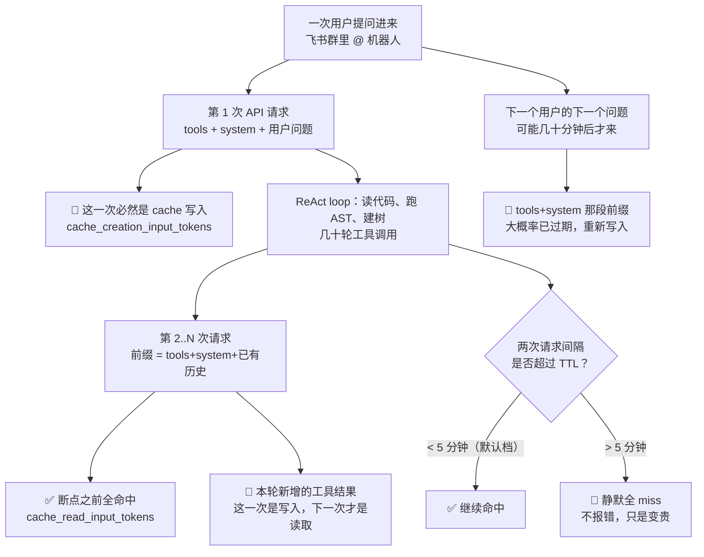

# 面经记录

**岗位方向：** Data Agent · 数据平台部 · 数据产品技术中心 · **人才计划（提前批）**
**时长：** 39 分 29 秒
**流程：** 面试官介绍团队 → 自我介绍 → **背景盘问（gap / 去向 / 谷歌内情，约 5 分钟）** → 字节答疑 Bot 深挖（~20 min）→ prompt cache 连环追问（~5 min）→ 评测与数据飞轮（~8 min）→ 反问 → 收尾
**结果：** **未知**（面试结束时面试官未给反馈）
**面试官背景（开场自我介绍）：** 快手**数据平台部 · 数据产品技术中心**，负责大数据平台产品矩阵——**Data Agent**（大数据智能化产品）、**天工**（数据开发与治理平台）、**快 BI**（BI / 分析平台）、**用户画像平台**（转录里读作「唐文琪」，产品名不确定 ⚠️）。定位是「数据链路中的关键系统和产品」。

> 我自己的面试，录音转录整理。**本场画风：零算法、零八股、零现场设计题，全程项目追问 + 背景盘问。**
> **最显著的特征是面试官会为同一个数字连问三次**——`prompt cache 命中率 100%` 追了三次、`准确率 vs 平均分` 追了三次并当场点破。**他不接受模糊表述，也不接受没有分母的数字。**
> **总评：讲机制的题（决策树怎么建、门禁怎么校验、术语文档为什么要迭代）依然扎实；但本场连续踩中三类问题——① 报了没有分母的指标（cache 命中率 100%）② 把「平均得分率」叫成「准确率」被当场点破 ③ 「我不确定好还是坏所以删掉了」式的无判据决策。**
> **另外：追问库里列的五条复发毛病，这场全部命中，详见文末自评。**

---

## 0. 面试官开场介绍团队（信息量大，值得记）

面试官先介绍团队再让自我介绍：数据平台部 / 数据产品技术中心负责四条产品线——Data Agent、天工（数据开发与治理）、快 BI（分析平台）、用户画像平台。

> 📌 **跟二面（[[资料/面经/快手/DataAgent方向/快手数据平台DataAgent二面_2026-08-10]]）对得上但口径不同**：二面面试官自称「**大数据平台部**」，覆盖采集→生产加工→分析→应用全链路，本人负责生产加工+分析+应用；三面自称「**数据平台部 · 数据产品技术中心**」，按产品线报名字。**同一条线的不同层级，介绍粒度不同——三面是按产品矩阵讲，说明层级更高。**

---

## 1. 自我介绍

**当时的回答：** 华南理工计算机本科，交大（转录含糊，应为 UCSD）计算机硕士在读。五段实习，讲了三段：
- **谷歌**（在职）：为 Pixel testing agent 开发 memory 系统；工作一是复用谷歌内部已有的 memory 插件能力，二是想办法让它落到当前的 agent 平台上
- **字节跳动**：国际化商业广告部门，商家与达人对接平台；开发 oncall 机器人回答业务 / 运营 / 研发问题。难点是**代码仓库大、agent 容易幻觉和以偏概全**；做法是决策树 + AST 语法解析工具 + 单 agent 改多 agent，**准确率 56% → 87%**
- **西门子**：RAG 系统给操作人员做 onboarding 培训；重构 ETL 流水线（XML → markdown → embedding 落库），优化检索链路（query 改写 → 多路召回 → 重排），**70% → 92%**

**评分：**
- ①落点 ✅ 三段实习都是「在哪 / 做什么 / 难点 / 结果」四件套，60 秒内讲完
- ②诊断 ✅ 字节那段直接点出难点（仓库大 → 幻觉 / 以偏概全）
- ③机制 —（自我介绍不要求）
- ④口径 ✅ **56% → 87% 主动报出，符合口径表**（对比懂车帝那场全场零数字，这次开局就报了，是进步）

---

## 2. 背景盘问（非技术，约 5 分钟）

面试官在这段花了整场的八分之一时间，题目密集：

| 问题 | 当时的回答 |
|---|---|
| 字节也是在加州实习的吗？ | 都在国内；今年 1–9 月 gap 回国实习，谷歌也是中国的谷歌 |
| 一年半学制加了半年，什么考虑？ | 觉得自己能力不足，想回国再实习锻炼；12 月毕业和次年 6 月毕业**都是今年秋招**，区别不大，希望秋招有更好结果 |
| 毕业后想在美国还是国内？ | 国内。女朋友在国内；回国后家里有情况需要长期待在国内 |
| 字节实习 3 个月，为什么不继续？ | 2 月面的谷歌，5 月才给 offer，两段时间冲突；当时字节的 bot 已开发得差不多；谷歌中国 headcount 少，机会难得，以后不会再去美国，可能一辈子没机会 |
| 谷歌在国内有什么重要业务？ | **没有重要业务**，做 Pixel testing，对内帮助测试工程师，「其实挺边缘的」 |
| 谷歌国内多少人？在哪办公？ | 上海约 1000 人；软件开发在上海和北京 |
| 研发多少人？ | 两三百人，按楼层估的，大概 1/4 ~ 1/5；其余多是 sales（出海广告业务） |
| 招进去的人要求高吗？ | 高，「我是里面学历最差的那一个」；倾向清北华五或美国好学校；往年约 10 个 headcount，**今年约 20 个，算大放水** |
| 裁过员吗？ | 23 年裁过，之后没动过，比较稳定 |
| 工作生活更平衡？ | 是 |

**评分：**
- ①落点 ✅ 每题都直答，没有绕
- ②诊断 ✅ gap 半年那题讲成了主动选择（「12 月和 6 月都是同一场秋招」），不是被动拖延，逻辑站得住
- ③机制 —
- ④口径 🔴 **边界问题**：面试官用闲聊形式连续套了 9 个关于谷歌中国的问题——人数、研发占比、headcount 数量、招人学历倾向、裁员历史。**这些逐条答完，等于把一家在职公司的组织信息完整交给了竞争对手的面试官。**
  可以答的：自己的选择理由、公开可查的业务定位。**应该收住的：headcount 具体数字、内部招聘偏好、部门人数结构。**
  收口话术：「这块我不太清楚具体数，我能说的是我们组做的方向和我在里面负责的部分。」——**把话头拉回自己的工作，既不显得防备，也不越界。**

---

## 3. 字节答疑 Bot 深挖

面试官问「哪个项目做得比较深，可以一起讨论讨论」，候选人选了字节。

### Q1【A 项目叙述】：展开讲一讲

**当时的回答：**
> "主要是一个回答业务知识的问题，难点就是我们业务内容比较复杂，业务数据很多，业务逻辑也很复杂，有很多枚举，有很多类的实现，它们相互的状态会**叉乘**在一起，导致最终这个回答需要有很多种情况，需要 agent 能够把所有情况都答出来。
> 举个例子：在某个玩法下面，达人跟商家达成了意向，这时候达人向商家提交了视频、商家审核通过，这个情况下能否取消订单？这其实有很多不同可能性——不同玩法有不同可能性，商家跟达人怎么匹配在一起的也会有不同结果，包括商家跟达人的地区、他们的历史成交状态，都会影响最终结果。
> 所以一个用户问题进来，单 agent 没办法把所有情况列全。像主流的 Codex、Claude Code 他们都会读代码，但读完之后很容易偷懒，只会看到一些是最终答案的代码，没把所有代码看全，然后回答一些以偏概全的情况。
> 一个 query 进来的流程：先通过前端组维护的内部知识文档（**LLM wiki** 形式），把用户问题跟具体术语的解释、术语对应的代码仓库关联上；agent 了解之后走 coding agent 那套形式读代码，通过关键词匹配阅读；读完之后**我会让他列出决策树**——有点像 write todo 一样的形式，但更显式，让它列出不同可能性、不同分支，有多少种 if-else，有多少种抽象类的实现，同一行为但不一样的情况。
> 列完决策树之后才会生成最终答案，并且生成的时候做好**门禁校验**，一定要它把决策树生成出来，才让答案输出给用户。
> 另外为了解决 context 过长、agent summary 时出现幻觉和张冠李戴，还有个专门的 **review agent** 拿着决策树对回答做 review，让回答更可信；如果出现幻觉错误，会让回答问题的 agent 重新回答。"

**评分：**
- ①落点 ✅ 开口就是「难点是业务复杂」，不铺垫
- ②诊断 ✅ **举了具体例子（达人提交视频 → 商家审核通过 → 能否取消订单）**，这个例子比抽象说「状态很多」有力得多，保持
- ③机制 ✅ 四段链路完整：LLM wiki 定位 → 读代码 → 显式建决策树 → 门禁 → review agent 兜底，有裁决点（门禁：树没生成不许出答案）
- ④口径 ⚠️ **这里是报 56% 基线的最佳位置，但没报**——「Codex / Claude Code 会偷懒」是定性描述，面试官后面果然专门追了一次（见 Q8）

---

### Q2【非技术 / 项目组织】：做这个事情一共多少人？怎么分工？

**当时的回答：**（先听岔了，答成了用户数）
> "这个事情的用户大概是有 100 多，研发加运营加产品，群里面会有 100 多个人。……哦你说做这个事情，其实主要是**我一个人在做**。我们当时是有一点**赛马**的情况——前端组在做一个 LLM wiki 实现类似功能，我在做 agent 的研发从 agent 角度解决，后端组有些成员从 **skill** 的角度解决。大家一起做类似功能的 bot，最终决定哪个效果更好、哪个上线推给用户用。所以当时主要是我自己独立负责维护这个 bot。"

**评分：**
- ①落点 🔴 **听岔了一次，第一句答的是用户数不是人数**——不是大问题，但连带把最有力的信息（赛马赢下来）压到了最后
- ②诊断 ✅ 赛马三条路线（LLM wiki / agent / skill）交代得清楚
- ③机制 ⚠️ **赛马是怎么裁决的没说**——「决定哪个效果更好」用什么判？如果说是同一套评测集跑分（这正是他自己搭的飞轮），这条线就闭环了，可惜没连上
- ④口径 🔴 **「100 多」和口径表钉死的「200+ 用户」打架**（见 [[项目追问/字节答疑Bot]] 数字口径表）。**这是数字口径第五次翻车，且这次是往小了报——把自己的战果砍了一半。**

**改进后的回答（把赛马前置，把裁决判据补上）：**
> 「**开发就我一个人，但这个方案是从三条并行路线里赛马赢出来的。**同一个需求当时有三个组各做各的：前端组做 LLM wiki（把业务知识整理成文档让模型检索）、后端组做 skill（把答题流程写成一段可复用的指令）、我做多 agent。
> **裁决方式不是拍板，是同一套评测集跑分**——50 多道题、专家给标准答案和得分点，三个方案跑同一份题，我这套是唯一一个能稳定把所有分支列全的。最后上线的是我这套，服务 **200+ 用户**（研发 + 运营 + 产品）。
> 顺带说一句，那份评测集后来沉淀成了组里的公共资产——赛马时它是裁判，赛马之后它变成了迭代的标尺。」

---

### Q3【非技术 / 交接】：你走了之后交给谁？

**当时的回答：**
> "交给我的 mentor。走的时候东西已经做好、已经投入使用了。后续维护首先是 **AI 来维护**——现在大家会用 AI coding，我写了比较全面的文档，踩过的坑、需要研发的东西都写了。
> 最大的维护难点有两个：一是 **LLM wiki**，由前端组负责维护；二是**模型接入**，以后模型升级或换模型是个维护难点，但我已经把现在主流三家（OpenAI、Anthropic、Google）的接入协议全部实现好了，所以后续维护不是特别大的问题。"

**评分：**
- ①落点 ✅ 直答「交给 mentor」
- ②诊断 ✅ 自己点出两个维护难点，不是说「都挺好的」
- ③机制 ✅ 交接物具体（文档 + 三家协议已实现），不是「口头交接」
- ④口径 ⚠️ **「LLM wiki 由前端组维护」这句只当成了责任划分，没意识到它是个更硬的论点**——见下方改进

**改进后的回答（把「别人维护的文档」讲成系统的正确性上限）：**
> 「交给 mentor，交接物是三样：文档（踩过的坑 + 待办）、已实现的三家模型接入协议、评测集。
> 但我在交接时明确标了一条**系统性风险**：这套系统声称『只有代码是真相』，可它定位到哪段代码，靠的是前端组人工维护的 LLM wiki。**术语文档一旦滞后，agent 会带着一份过期的地图去读一份最新的代码——这时候它答错，我的门禁和 review agent 一个都拦不住，因为树本身建在错的位置上。**
> 所以我在交接文档里把它写成了首要监控项：**只要线上出现『答案本身自洽但答的不是用户问的那块业务』，第一嫌疑就是术语文档，不是 agent。** 这是这套系统当前的正确性上限。」
> 📌 完整论证见 [[项目追问/字节答疑Bot]] Q8b。

---

### Q4【A 项目叙述】：100 多个人怎么用？

**当时的回答：**
> "遇到问题会问它。运营那边一般是某个用户数据出了问题、找到他们，他们需要我们查这个用户为什么在某个状态被卡住；产品跟研发一般是需要了解代码背后的逻辑，因为代码逻辑比较复杂，大家各管自己那一块，不同人负责不同东西，这时候他们也不想看代码，就会 **@ 这个机器人**让它解释产品逻辑，方便他们继续研发。"

**评分：** ①✅ ②✅（两类用户的场景分得清楚）③—（不要求）④⚠️（又是「100 多个人」，同上）

---

### Q5【B 项目机制】：之前没有这样的产品吗？

**当时的回答：**
> "之前有，是直接接字节的一个产品，很傻瓜式——把代码仓库、文档都喂给它，它就能根据你的代码和文档回答问题。但是它做得不够好：
> 首先我们不知道它背后接的什么模型，输出比较烂；
> 第二它没有做适配——在我们场景下文档是会过期的，你喂的 PRD、design doc 都会过期，实际上你要看代码来回答问题，但那些 agent 更容易看到文档就觉得文档是答案、直接生成回答，不会再去看代码，最终导致结果有偏差；
> 第三它看代码也可能看不全。所以我们决定自己做一个。"

**评分：**
- ①落点 ✅ 「有，但做得不够好」直给
- ②诊断 ✅ 三条都具体（模型不透明 / 文档过期 / 看代码不全）
- ③机制 ⚠️ **第一条「不知道背后接的什么模型」是弱论证**——「我不知道」不构成「它不好」的理由，面试官只要问一句「那你怎么判断是模型的问题」就接不上。真正硬的是第二、三条，因为那两条是**可观测的行为**
- ④口径 ✅

**改进（把三条按论证强度重排，弱的那条改成可观测口径）：**
> 「有，用的是内部一个通用产品：喂代码仓库和文档，它来回答。做不够好的原因按重要性排：
> **① 它把文档当成答案来源。** 我们这块的 PRD 和 design doc 常年滞后，唯一可信的是代码。那个产品读到文档里有个像答案的句子就停了，不会再进代码验证——**这是可观测的：同一个问题，文档改一改答案就变，代码改了答案不变。**
> **② 它读代码不读全。** 一段三四百行、十几个 if-else 的业务代码，它只会挑出命中关键词的那一支，不会把并列分支全列出来。
> **③ 它是个黑盒。** 底层模型和 prompt 我们都改不了，出了问题连归因都做不了，更谈不上针对我们场景做适配。**这条不是说它一定差，是说它不可迭代——而我们需要的恰恰是一个能持续调的东西。**」

---

### Q6【C 通用知识 / 产品对比】：你们那边的 Aime 挺好用的，Aime 实现不了吗？

**当时的回答：**
> "Aime 我理解它是一个类似办公助手的功能，它不是一个阅读代码的 agent。我们这里需要做的是能阅读代码的 agent，因为它必须以代码为唯一来源。Aime 更多是联网检索飞书 doc，但这些飞书 doc 不一定是最新、最有时效的内容，所以我觉得 Aime 处理不了。它更多是办公辅助工具，而不是看代码的 agent。我们是特别针对看代码这件事做了很多适配的。"

**评分：**
- ①落点 ✅ 直接给边界判断（办公辅助 vs 读代码）
- ②诊断 ✅ 理由跟 Q5 一脉相承（飞书 doc 会过期，我们要以代码为源）
- ③机制 ✅ 「必须以代码为唯一来源」这句是全场复用率最高的一句话，立住了
- ④口径 ✅ 本题无问题（问题出在下一题）

---

### Q7【非技术 / 行业观察】：Aime 用得最多的场景是啥？

**当时的回答：**
> "我自己是用 MIRA，**MIRA 跟 Aime 差不多，最近 MIRA 好像是赛马失败，然后并入 Aime 了**。我一般用它做内部文档检索——遇到不懂的内部术语、内部工具的使用，让它把相关文档找到，然后把这些文档给我自己的 agent 开发工具，agent 就知道这些东西怎么用。
> 另外运营和产品会用它做数据报表和定时任务（cronjob），也会接内部 skill 处理数据——比如连接字节内部的数据平台，直接把数拉下来读数、生成数据报表。"

**评分：**
- ①落点 ✅
- ②诊断 ✅ 两类用法分得清（我用它做文档检索喂给 coding agent；运营产品用它做报表和定时任务）
- ③机制 —
- ④口径 🔴 **踩保密红线，本场最明确的一次**：「MIRA 赛马失败并入 Aime」是**在职公司的内部产品竞争结果和组织变动**，讲给另一家公司的面试官听。前面 Q2 提到的「三个组赛马」还属于自己项目的经历，这句已经越到公司内部战略层面了。
  ⚠️ 更微妙的是：面试官这一整段（Q6、Q7）问的都是**字节内部工具的能力和使用情况**——这跟考察候选人无关，是**同行在打听友商工具链**。
  **收口话术**：「用得多的主要是文档检索和数据报表这类办公场景，具体内部怎么演进的我就不展开了。它跟我做的事没重叠，我这套是专门读代码的。」——**给出场景类别，不给内部动态，然后立刻把话头拉回自己的工作。**

---

### Q8【C 通用知识 / 对比】：读代码，那不用 coding agent 吗？

**当时的回答：**
> "我们当时就是比较过 **Codex 跟 Claude Code**。他们会偷懒——看到一些觉得是正确的回答就生成答案，不会把整个全局信息总括起来。
> 或者说，比如答案就在一个代码文件里面，这个代码里有很多 if-else、有很多种可能性、实现了很多逻辑，但这个代码其实也不长，大概三四百行。一个 Codex 或 Claude Code，它不会显式地把这个代码里面所有 if-else 逻辑都列出来、告诉你某个条件会怎么样，它不会把所有情况都列给你，除非你特别要求它。
> 这就是我们希望解决的东西——我们希望 agent 看了代码之后，能把代码里所有 if 条件都列出来，把整个状态流转的 graph 给到用户，让用户意识到有这么多可能性。"

**评分：**
- ①落点 ✅ 直给「比较过，它们会偷懒」
- ②诊断 ✅ **「三四百行、不长，但它就是不列全」这个细节很有力**——排除了「context 装不下」这个最容易被拿来反驳的解释，说明是模型的行为倾向问题不是容量问题。保持
- ③机制 ✅ 说清楚了要什么（所有 if 条件 + 状态流转图）
- ④口径 🔴 **又一次该报数字没报。** [[项目追问/字节答疑Bot]] 数字口径表里明确记着：懂车帝那场「面试官主动问『Claude Code 做不到，验证过吗』时没报 56% 基线」——**这次面试官问的是同一个问题的变体，还是没报。**

**改进后的回答（补基线数字，并把「测过的」和「观察到的」分开）：**
> 「比较过，Codex 和 Claude Code 都试了。**先说测过的数字：同一套 50 多题的评测集，裸框架纯看代码是 56 分**——这是我们所有方案的公共基线，加决策树门禁到 70 出头，再加审核 agent 到 87。
> **再说观察到的现象**（这部分我没单独做过消融，只讲现象不报数）：它们的失败模式高度一致——**偷懒**。答案就在一个三四百行的文件里，长度完全不是问题，但它读到命中关键词的那一支 if 就停了，不会把并列的分支全列出来，除非你在 prompt 里逐条点名要求。
> **所以这不是能力问题，是默认行为问题**：通用 coding agent 的目标函数是『尽快给出一个可用答案』，我们要的是『穷举所有分支且不许漏』。这两个目标在 prompt 层面是拧着的，靠提示词请求不稳定——所以我们把『列全』从请求变成了门禁：树没建完，答案根本出不来。」

---

### Q9【B 项目机制】：那你们怎么实现这一点？（全场机制最完整的一题）

**当时的回答：**
> "首先是决策树。我们会**显式**让 agent 把决策树生成出来。这棵树的 **root 节点是用户的输入、用户的给定条件**，从 root 延伸的每一个节点都是**枚举类、语义相似的函数、或者抽象类的实现**——同一个行为但实现不一样的情况。
> 另外我们会专门给它一个 **AST 语法树工具**，把代码里 if-else 的条件全部抽取出来，让它能看到所有 if-else 情况，**降低它 context 里 attention 的压力**，让它更好地生成决策树。
> 生成完决策树之后还有一个校验——**一定要生成决策树之后才能生成回答，不生成就没办法拿到回答**。实测下来它有 **10%~20% 的情况不 follow 这个指令**，直接生成答案，这种会被我们打回、让它重新生成。
> 除此之外还有专门做 review 的步骤，拿决策树和 agent 的答案做后续 review，看生成回答的 agent 有什么遗漏，会**显式提醒用户**说这个 agent 有什么遗漏、你是否需要关注这些点。"

**评分：**
- ①落点 ✅
- ②诊断 ✅ 「降低 attention 压力」点出了 AST 工具存在的理由，不是「有个工具很方便」
- ③机制 ✅ **裁决者和判据都齐**：门禁的判据是「树生成了没有」，不过就打回；review 的输入是「树 + 答案」，产出是遗漏点。**并且给了 10%~20% 这个实测不 follow 率——这个数字很值钱，它证明了『为什么必须做门禁而不能只写 prompt』。**
- ④口径 ⚠️ 两点：
  - **`10%~20% 不 follow 指令` 是本场新出现的数字，口径表里没有**，需要补进 [[项目追问/字节答疑Bot]]（见文末待办）
  - **review 的产出说成了「提醒用户」**，而二面和追问库里的定稿是「发现遗漏就打回重答，问题本身有歧义才反问用户」。**两种都做过，但同一场里要选一个说法说到底**——这场前面（Q1）说的是「让 agent 重新回答」，这里说的是「提醒用户」，隔了 10 分钟，容易被连起来问「到底是打回还是提醒」

**口径统一（以后按这个说）：**
> 「review agent 的输出分两种，判据是**遗漏的原因在谁身上**：
> **① 漏的是 agent 自己没查全** → 直接打回重答，用户看不到这一轮。
> **② 漏的是用户问题本身没框定范围**（问得太泛，覆盖了多个分支，但他只关心其中几个）→ **不能替他猜，这时候才把遗漏点显式抛给用户**，让他补充约束。
> 分开的理由很简单：第一种是系统的错，系统自己修；第二种是信息缺失，只有用户能补。**把两种混成一个『提醒用户』，等于把系统的错也推给用户看。**」

---

### Q10【B 项目机制】：这样做能保证准确率 87%？相当于先把一些环节固定住？

**当时的回答：** "是。差不多就是我给他一个 workflow，教他怎么看代码，这个 workflow 会告诉他，然后会有一些强校验的机制，相当于固定环节。"

**评分：** ①✅ ③⚠️ **顺着面试官的话说「相当于固定环节」，等于默认了「你这就是 workflow」**——[[项目追问/字节答疑Bot]] Q1g 有整套定稿论证（探索阶段是 agent、交付阶段是 workflow，确定性只加在退出条件上不加在路径上），**这场一句都没取出来**。又一次「知识有但取不出来」。

**改进（顺着面试官的话，但把边界说清楚）：**
> 「**一半是。固定的是交付流程，没固定的是探索路径。**
> 固定的部分：建树的三条约束、必填字段、门禁、review——这几个环节顺序确定、判据确定，**这块确实就是 workflow**。
> 没固定也不可能固定的部分：**这棵树长什么样，是运行时才知道的**。root 由用户这次问的问题决定，分叉要等 AST 从相关代码里抽出条件才成型。我连节点是什么都不知道，画不成静态图。
> **所以准确说是混合的：探索阶段是 agent，交付阶段是 workflow——确定性加在退出条件上，不加在路径上。**」

---

### Q11【B 项目机制】：这个 flow 是你定义的，后面有诉求要改，谁来调？

> ⚠️ 候选人先反问了一次「什么叫调环节」，面试官解释后才作答。

**当时的回答：**
> "一般有两个方法。一个是 **prompt**——流程是通过 prompt 给它的。强校验其实更像一个插件：我们这个 DeerFlow 的 agent 本质上就是一个 **ReAct loop**，所有校验都是在 agent 调用前后加一些 hook、加一些插件。
> 所以如果要实现新 workflow，要不你在 **skill** 里改 prompt 让它知道要加新 workflow，要不你在 **Middleware / hook 的注册**里改——把不需要的 hook 删掉、加上新的校验 hook，就能实现 workflow 的修改。"

**评分：**
- ①落点 ✅ 直给「两个方法」
- ②诊断 ⚠️ **没说两个方法各自的适用边界**——什么时候该改 prompt、什么时候必须加 middleware？（判据其实很清晰：**能被代码验证的加 middleware，只能靠模型理解的写 prompt**）
- ③机制 ✅ 扩展点位置说对了（ReAct loop 的模型调用/工具调用前后）
- ④口径 ⚠️ **`hook` 和 `Middleware` 两个词混着说。** DeerFlow 是 LangChain / LangGraph 系，扩展点的正式名字是 **`AgentMiddleware`**，`hook` 是 Claude Code 的词。2026-08-14 已经在 [[项目追问/谷歌Memory]] 里把这个口径定过，这次是**半修复**——`Middleware` 说出来了，但仍和 `hook` 混用。**统一说 `AgentMiddleware`，钩子点说 `before_model` / `after_model` / `before_tool` / `after_tool`。**

**改进（补判据 + 统一术语）：**
> 「两条路，判据是**这个约束能不能被代码验证**：
> **能被代码验证的，加 `AgentMiddleware`。** DeerFlow 是 LangChain / LangGraph 系，agent 本质是个 ReAct loop，扩展点挂在 `before_model` / `after_model` / `before_tool` / `after_tool` 四个位置。我们的门禁就挂在 `after_model`：检查这一轮有没有产出决策树，没有就打回。**这是一个 if，零额外模型调用，100% 可靠。**
> **只能靠模型理解的，改 skill 里的 prompt。** 比如『建树时同一层必须是同类枚举』这种要求，没法用一行代码判定，只能写进指令。
> **所以改流程的成本是分层的**：加一条软约束改 prompt，一次提交；加一条硬约束加一个 middleware，也是一次提交，但从此这条约束就不会再被模型绕过。**我们的原则是——能用代码校验的，不要用 prompt 请求。**」

---

## 4. prompt cache 连环追问（🔴 本场分水岭）

### Q12【B 项目机制】：你提到用 prompt cache 降本增效，主要在哪个地方做的优化？

**当时的回答：**
> "主要是接 Anthropic 模型的时候。Anthropic 的 prompt cache 需要你**显式打断点**——你点到哪个地方，它就 cache 哪一段。当时需要做这样的适配：比如在 system prompt 做一个 cache，包括在用户的输入输出、tool 那里，一轮 tool 结束之后我会给它做一些 cache。
> 最主要的东西还是**把这个东西启用起来**——原本正常的接入是不会启用的，你需要专门做协议适配才能启用。"

**评分：**
- ①落点 ✅ 直答「接 Anthropic 时」
- ②诊断 ⚠️ **只说了「不适配就不启用」，没说不启用的代价**（多花多少钱）——「降本增效」被提到了，但没有跟任何数字挂钩
- ③机制 ⚠️ **三个关键约束一个没提**，而这三个恰恰是能显出「真接过」的细节：断点**最多 4 个**、写入**加价 1.25×**（5 分钟 TTL）/ **2×**（1 小时 TTL）、读取 **0.1×**。**打错位置不报错，但写入 1.25× 却一次不命中，比不用缓存还贵 25%。**
- ④口径 ✅（「显式打断点」这个核心事实说对了）

> 📌 事实来源：[[LLM多协议网关适配]]（Anthropic `cache_control:{type:"ephemeral"}`、最多 4 个断点、按模型分档 512~4096 最小可缓存长度、写 1.25×/2× 读 0.1×，**该页 2026-07-30 查证于官方文档**）。**这些全都在 wiki 里，这场一条没取出来。**

---

### Q13【B 项目机制】：这个缓存命中率能达多少？🔴 面试官连问三次

**当时的回答（三轮）：**
> **第一轮：** "命中率其实就是 **100%**。我们中途不会有任何改动，你在 input 和 output 中间，除了新生成的对话数据、新的一轮 turn 的对话数据，别的东西都是能够缓存好的。"
> **第二轮（面试官：能达到 100%？）：** "对对对，就除了那些 input output 的一些数据。"
> **第三轮（面试官：不是，你这个 prompt cache 能达 100%？你是怎么设置的？）：** "我们就是把它设置到一个最新的 case（断点），每一轮对话、每一轮 request，我们都会把新的断点打到最后，在这里做 cache，中间结果不会有任何改变，我们不会对整个 prompt 有任何修改。"

**评分：**
- ①落点 🔴 **给了一个没有分母的 100%**——面试官连问三次，本质是在问「你说的命中率，分子分母各是什么」，三次都没答到这个点上
- ②诊断 🔴 **自己给的补丁反而暴露了问题**：「除了新生成的对话数据」这句说明他清楚有一部分不命中，**但还是把结论报成了 100%**。清楚有例外却报满分，比不知道更伤——面试官会认为你要么在夸大，要么没量过
- ③机制 ⚠️ 「断点每轮往后滚、前缀不改」这个做法**是对的**（[[LLM多协议网关适配]] 里的定稿做法就是这样），机制本身没错，错在拿它推出了「100%」
- ④口径 🔴 100% 属于**当场编出来的数字**，性质和 [[项目追问/字节答疑Bot]] 里已弃用的「0.80~0.86」一样——**没测过就不要给区间，更不要给满分**

**为什么 100% 一定是错的（三条，任一条都够拆）：**

1. **每一轮新增的 token，在它第一次出现的那次请求里必然是写入不是读取。** 用户问题、上一轮的工具返回、assistant 刚生成的内容——这些在本次请求里计入 `cache_creation_input_tokens`（写入，1.25×），下一次请求才变成 `cache_read_input_tokens`（读取，0.1×）。**只要还在往上下文里加东西，命中率就到不了 100%。**
2. **每个新会话的第一次请求是完整 miss。** 而这套 bot **恰恰是单轮场景为主**（他自己在下一题说的），意味着「第一次请求」在整个工作负载里占比很高。
3. **TTL 会静默失效。** 默认 5 分钟，一轮问答要跑几十次工具调用 + 最高强度思考，**很可能在循环中途过期，后半程全部 miss 且不报错**。飞书群里两个用户提问间隔几十分钟是常态，跨请求共享的那段 `tools + system` 前缀基本活不到下一次。

**改进后的回答（给分母、给字段、给该测没测的诚实边界）：**
> 「**先定义我说的是哪个命中率**——我按 token 算：`cache_read_input_tokens ÷ (cache_read + cache_creation + 未缓存 input)`，这三个字段 Anthropic 的 `usage` 里直接给。
> 分请求看，结构是这样的：
> **一次用户提问会触发几十次 API 请求**（ReAct loop 里每次工具调用都是一次请求）。**第一次请求必然是全量写入**，从第二次开始，`tools + system + 已有历史`这段前缀全部命中，只有本轮新增的工具返回是新写入。所以**在一次问答内部，随着轮数变多命中率会快速逼近一个高位，但结构上永远达不到 100%——因为每轮都在往末尾加新 token，新 token 那一次一定是写入**。
> **跨问答就不乐观了。** 我们是单轮场景，两次提问之间可能隔几十分钟，默认 5 分钟 TTL 早过期了，所以 `tools + system` 那段公共前缀**大概率每次都要重新写入**。
> **这块我当时没埋点量化，这是个缺口。** 要补的话很直接：把 `usage` 里那三个字段落到日志里，按『会话内 / 跨会话』两个口径分别统计。**如果跨会话命中率确实低，对策也清楚——把公共前缀那个断点换成 1 小时 TTL 档，写入从 1.25× 涨到 2×，但只要一小时内有第二个人提问就回本了；QPS 越低，长 TTL 越划算。**」

> ⭐ **这题的教训单独拎出来**：**「100%」这种满分数字，等于主动邀请面试官来拆。** 同样的信息换成「会话内高位、跨会话没量过、量的方法和对策是什么」，**信息量更大，而且没有任何可攻击面**。

---

### Q14【B 项目机制】：整体考虑用户问答的实际情况，你的缓存命中率能达到啥？

**当时的回答：**
> "这方面我倒是**没有监控过**。因为我们使用场景一般是一轮对话，不会有多轮的情况，不会有比较长期的 idle 然后用户再问问题。一般就是一个问题进来、一个对话就结束了，我们不会特别考虑时间比较长了这个 cache 失效、以及多轮对话总结压缩的场景。"

**评分：**
- ①落点 🔴 **「没有监控过」开局**——追问库列的第一条复发毛病
- ②诊断 ⚠️ **「一轮就结束所以不用考虑失效」这个推理是反的**：单轮场景恰恰是**最容易失效**的场景（两次提问间隔长 → TTL 过期 → 跨会话前缀命中不了）。他把「不需要多轮压缩」和「不需要关心 cache 失效」当成了一回事，但这是两件事
- ③机制 🔴 无
- ④口径 🔴 **和上一题的 100% 直接打架**：上一题说命中率 100%，这一题说没监控过。**没监控过的东西，上一题那个 100% 是哪来的？** 面试官不用追第四次，这两句摆在一起自己就说明问题了

**改进（「没监控」讲成「知道该怎么监控，也知道结论会是什么」）：**
> 「按整体工作负载算，**我的判断是跨会话那部分命中率不高，而且原因就出在你说的这个场景上**。
> 我们是单轮为主：一个问题进来、答完就结束。**会话内部因为要跑几十轮工具调用，命中率是高的；但会话之间只有 `tools + system` 那段是公共前缀，而两个用户的提问间隔通常远超默认的 5 分钟 TTL，所以这段前缀大概率每次都在重新写入。**
> **这块我当时没埋点，是个实打实的缺口。**要补的话分两步：先把 `usage` 的三个 token 字段落日志、按会话内/跨会话分开统计；如果跨会话确实低，就把公共前缀那个断点换成 1 小时 TTL——写入涨到 2×，但只要一小时内有第二次提问就回本。**我们 100 多人的群，工作时间内一小时里肯定不止一个人问，所以这个换算大概率是划算的。**」

---

### Q15【B 项目机制】：为什么一轮能搞定？你怎么保证用户能起新 session？

**当时的回答：**
> **（为什么一轮）** "首先我们答得足够全面；另外用户后续的问题，他们会起新的 session 来问，不同问题会起不同 session、不同话题来问，不会在同一个话题里纠结同一类问题。"
> **（怎么保证）** "它其实就是一个**话题群**嘛，他起一个新的 session 就是起一个新的话题、就是起一个新的问题，他们一般是这样使用的。"

**评分：**
- ①落点 ✅
- ②诊断 —
- ③机制 🔴 **典型的「给了愿望不给机制」**。面试官问的是「你怎么**保证**」，答的是「他们**一般**是这样用的」。**依赖用户习惯不是保证，没有裁决者。**
- ④口径 ✅

**改进（把「用户习惯」换成产品机制）：**
> 「**保证不了，也不该靠保证——这是产品形态给的，不是我约束的。** 飞书群的话题（thread）本身就是隔离单位：用户在群里 @ 机器人会自动开一个新话题，在话题内回复才算追问。所以 **session 边界跟飞书话题一一对应，是平台替我们划的，不是我们请用户配合的。**
> 我们做的是承接这个边界：**每个话题 ID 对应一个独立的会话状态，不共享历史。**
> 至于『会不会有人在一个话题里连着问三个不相关的问题』——**会，但这是我们能接受的退化**：那种情况下上下文变长、成本上升，答案质量不会崩，因为每一轮我们都会重新走一遍『定位代码 → 建树 → 门禁』的完整流程，**不依赖上一轮的结论。**」

---

### Q16【B 项目机制】：用户问的问题五花八门，他问完不行要追问，那咋办？

**当时的回答：**
> "追问也是可以的，这个没问题。我们也有多轮场景，也有 summary 相关的东西——context window 比较长的时候，我们会对**后 20 轮对话进行保留**，对之前的东西做一个 summary 压缩，并且有专门的压缩 prompt，比如现在做完的工作、用户需要问的问题、接下来要做的工作，这样一个 prompt 的指引概览。但它具体会导致框架失效成什么样子，我没有专门做这方面的监测。"

**评分：**
- ①落点 ✅
- ②诊断 ⚠️ 「没做监测」再次出现，本场第三次
- ③机制 ✅ 压缩策略讲清楚了（保留最近 20 轮 + 结构化压缩 prompt：已完成 / 用户问题 / 待办）
- ④口径 🔴 **没区分「框架自带的」和「我做的」**。DeerFlow 内置 `DeerFlowSummarizationMiddleware`（逼近 token 上限时自动压缩），**这套压缩是框架给的，不是候选人实现的**。而 [[项目追问/字节答疑Bot]] Q2 的定稿口径是「旧树快照 append-only，实际不清理，目前长度还没到需要专门清理的程度」——**两处说法摆在一起会打架。**

**口径统一（以后按这个说）：**
> 「**先分清两件事：框架给的和我做的。**
> **框架给的**：DeerFlow 基于 LangChain，内置 `SummarizationMiddleware`，逼近 token 上限时自动把早期历史压成摘要、保留最近若干轮原文。**这条是兜底，不是我设计的，但我知道它在什么条件下触发。**
> **我做的**：决策树每轮**追加到消息列表末尾**（append-only），不改 system、不改历史——**为的是保住 KV-cache 前缀**。旧的树快照实际上不清理。
> **为什么敢不清理**：树本身有界，节点来自 AST 抽出的**真实**分支，不是笛卡尔积穷举；而且我们是单轮为主，长度还没到需要专门治理的程度。**真要优化，最省的做法是在框架触发压缩的那一刻顺手清掉旧快照——那时候 cache 本来就要重建，是零额外成本。**（这句是我的判断，还没实现。）」

> 💡 **术语补（B 档）**：**KV-cache**（键值缓存）——注意力里每个 token 都要算一组 Key/Value 向量，算过就能存下来复用；因果注意力决定了位置 i 的 KV 只依赖 0~i 这段前缀，**所以前缀改一个 token，从那之后全部作废**。完整机制见 [[项目追问/字节答疑Bot]] Q2。

---

### Q17【B 项目机制】：放在群会话里，A 也问 B 也问，你会监测群消息吗？会做 session 区分吗？

**当时的回答：**
> "不会。它不会阅读别的对话的消息。**我把这个全局的 memory 机制给删掉了，因为我不太确定它的 memory 东西是好还是坏，所以我当时删掉它**，所以它不会有跨 session 的消息记录，也不存在跨 session 和全局上下文的管理问题——只会是一个新的会话、一个新的 session、完全是新的内容。"

**评分：**
- ①落点 ✅ 直答「不会」
- ②诊断 🔴 **「我不太确定好还是坏所以删掉了」是无判据决策**。删是对的，但理由不能是「不确定」——面试官听到的是「你在没想清楚的情况下砍掉了一个功能」
- ③机制 ⚠️ 隔离的结果说清楚了，隔离的**依据**（按什么 key 隔离）没说
- ④口径 🔴 **「没有 / 我删掉了」开局的又一次变体**——追问库列的第一条复发毛病，本场第四次命中

**改进（把「不确定所以删」讲成有判据的取舍）：**
> 「**关掉了跨 session 记忆，这是个明确的取舍，不是没做。**
> **收益侧**：跨会话记忆能让 bot 记住『这个人是运营、常问结算相关』，理论上能省一点澄清成本。
> **风险侧**：我们的部署形态是**一个飞书群、100 多个人共用一个 bot 实例**——这是个多租户场景。全局记忆意味着 A 用户的业务上下文会进入 B 用户的回答链路。而我们这套系统的**全部价值就建立在『答案严格从代码推出来』上**，一旦答案里混进了『上次有人说过 XX』这种来源不可追溯的内容，**门禁和 review agent 都失效了——它们只会核对树和代码，核对不了记忆里的东西。**
> **判据很清楚：任何绕过门禁进入上下文的信息，都是这套系统的漏洞。** 记忆恰好是这样一条旁路，所以关掉。
> **代价我也认**：用户每次都得把背景说全，多打几个字。在这个场景里这个代价是可接受的，因为提问本来就是一次性的。
> **要重新打开的条件也想过**：如果哪天记忆能做到**按用户隔离 + 每条记忆带出处**，让它跟代码证据一样可核对，那就可以放回来。**问题不在记忆本身，在于它当时不可核对。**」

> 📌 关联：[[Agent记忆四家实现对比]] · [[项目追问/谷歌Memory]]（谷歌那段做的正是「让记忆可核对」这件事，**这题本可以顺势把两段实习串起来，是本场最大的一次错过**）

---

## 5. 评测与数据飞轮

### Q18【B 项目机制】：你这个准确率怎么评测的？

**当时的回答：**
> "我们会有一些用户以前常问的问题，有专门的专家做打分——你要达到多少点，每一个点算一分，有点像语文的阅读理解题，一个点算一分，最终有一个总分。这个总分除以 N，算出每道题最终的分数。
> 还有一些**立即 0 分**的决策——比如说他达成了某样东西 / 不是某样东西，那就立刻 0 分。
> 打分是 **LLM 作为判官**，判每一点是否达到，达到打 1 分、没达到 0 分。"

**评分：**
- ①落点 ✅
- ②诊断 ✅
- ③机制 ✅ **rubric 踩点 + LLM 判卷 + 一票否决项**，三层都在。「立即 0 分」这条是好东西——说明评分不是简单加总
- ④口径 ⚠️ **「立即 0 分」提到了但没举例是什么**，正是最能体现「这个评测有设计」的地方，白白浪费

> 💡 **术语补（B 档）**：**rubric**（评分细则表）——把一道开放题拆成若干**得分点**，每个点独立判「答到没答到」，避免让判卷模型直接给一个主观总分。**这是把主观题变成可复现打分的标准做法。**

**补一句（下次主动说）：**
> 「一票否决项举个例：**如果它把某个业务状态的流转方向说反了（A 能到 B 说成 B 能到 A），这道题直接 0 分，不管其他得分点答对多少。** 理由是这类错误比漏答更危险——**漏答用户会追问，说反了用户会直接照着做。** 所以评分上必须区别对待。」

---

### Q19【B 项目机制】：那你分数怎么变成准确率？🔴 面试官连问三次并当场点破

**当时的回答（三轮）：**
> **第一轮：** "分数就是准确率，我们就希望他能够把一道题的所有情况都答出来、答全。"
> **第二轮（面试官：你是几分制？）：** "一道题就一分制。比如一道题有 5 个得分点，每答出一个得分点就有 0.2 分，5 个答出来就 1 分。"
> **第三轮（面试官：那你的准确率跟平均分之间的关系是啥？）：** "比如每道题是 0.5 分，一共 50 道题，那就是 0.5 × 50 再除以 50，这就是准确率，我把它当成一个准确率来算。"
> **面试官直接点破：「就是平均分。」**
> **当时的回答：** "对对，是平均分，对，没问题。"

**评分：**
- ①落点 🔴 第一轮答「分数就是准确率」，等于没回答——面试官问的就是这两者的关系
- ②诊断 🔴 **术语用错，而且是核心指标的名字用错**（见下）
- ③机制 ✅ 算法本身说清楚了（每题得分率取平均）
- ④口径 🔴 **56% → 87% 这组贯穿所有面试的数字，一直被称作「准确率」，但它实际是「平均得分率」。** 这场第一次被追到定义层并被当场点破。

**🔴 这题是本场最该修的口径问题：**

**准确率（accuracy）**在评测里有确切含义：**判对的样本数 ÷ 总样本数**，每个样本是 0 或 1 的二元判定。
他实际算的是：**每题按 rubric 得分率（0~1 连续值）→ 对所有题取平均**。这叫**平均得分率**，不是准确率。

**两者差别有多大**：一份 50 题、每题 5 个得分点的评测集，如果每题都答对 4/5 个点——
- **平均得分率 = 80%**
- **准确率（要求全对才算对）= 0%**

**所以 87% 这个数，说成「准确率」会被理解成「87% 的问题答对了」，实际含义是「平均每题覆盖了 87% 的得分点」。** 面试官追三次就是在确认这件事。

**改进后的回答（主动改名，并把「为什么不用 0/1 准确率」讲成加分项）：**
> 「**严格说它不是准确率，是平均得分率，我平时口头上叫混了，这里说清楚。**
> 算法是：每题按 rubric 拆成若干得分点，答到一个得一份，得分率是 0~1 的连续值；再对全部 50 多道题取平均。**所以 87% 的准确含义是『平均每题覆盖了 87% 的得分点』，不是『87% 的题答对了』。**
> **为什么刻意不用 0/1 准确率**——因为我们要治的病是**漏分支**，是个**覆盖度**问题，不是对错问题。用 0/1 判定的话，『5 个分支答对 4 个』和『完全答错』会被记成同一档，**而这两者对用户的价值差别巨大**，最关键的优化信号就被抹平了。连续的得分率能直接告诉我『还差哪几个点』，这正是迭代要的东西。
> **但 0/1 那个口径我们也留了一个**——就是刚才说的一票否决项：状态流转说反了直接判 0，不看得分点。**覆盖度用连续分衡量，正确性用二元判定兜底，两个口径各管一件事。**」

> 🔴 **待办：把「准确率」改口成「平均得分率」这条，要写进 [[项目追问/字节答疑Bot]] 数字口径表**——56 / 70 / 87 三档数字不变，**改的是名字和第一次报数时的那句定义**。

---

### Q20【B 项目机制】：专家从哪来？多少人？他们为什么愿意给你做？

**当时的回答：**
> "专家就是专门负责这块研发业务的研发工程师。我后来搭了个**数据飞轮**——用户每周问的问题，我们抽取一定数量，每周定时发给几个研发同学打标，说这些问题回答得好在哪、不好在哪，以及这道问题的得分点是什么。有专门的数据集沉淀过程。
> 大概 3 个人。愿意做主要两点：一是花费时间不长，一周不到半小时，可能十几二十分钟，他们还是比较热心的；二是**我的 mentor 在推动这件事**——他相当于组内的小 boss，职级比较高，大家也会帮他做。"

**评分：**
- ①落点 ✅
- ②诊断 ✅ **「为什么别人愿意配合」答得很实在**——时间成本小 + 有人推动，没有说漂亮话。这是全场最诚实也最可信的一段
- ③机制 ✅ 流程闭环（每周抽题 → 发给专家 → 打标注得分点 → 沉淀数据集）
- ④口径 ✅

**这题答得好，可以直接背这版。**

---

### Q21【B 项目机制】：这个数据飞轮后面能够转得起来吗？

**当时的回答：**
> "没有问题。主要两个用途：
> 一是**评测**——我们知道这些问题错在哪，把这些错误问题放进评测集。另外**随着 Claude、Codex 模型的进步，我们是否直接用它们就好？这也是一个评测。**我们有一套完整数据集来评价现在这个业务场景下问答机器人效果怎么样，可以随时换不同的机器人来比。
> 二是**归因优化**——我们知道问题错在哪、为什么会做错，能够继续优化文档、优化最终逻辑，比如决策树的生成逻辑。"

**评分：**
- ①落点 ✅
- ②诊断 ✅
- ③机制 ✅
- ④口径 ✅
- 💡 **亮点：「评测集可以用来判断要不要直接换成 Claude / Codex」这个视角很好**——把评测集从「优化工具」升格成「选型工具」。**但一句带过没展开，可惜。**

**可以再往前一步（下次展开这句）：**
> 「这个飞轮最大的价值其实不是帮我调参，是**给了我们一把不随模型变化的尺子**。
> Agent 这块半年就换一代模型。**没有这把尺子，每次新模型出来只能凭感觉说『好像变好了』；有了它，我可以在半天内回答一个很硬的问题——现在裸用 Claude 是多少分，我们这套是多少分，差距还剩多少。**
> **如果哪天差距收敛到几个点以内，那结论就是『可以下掉我们的框架，直接用通用 agent』——这对团队是好事，不是坏事。** 我们要的是这个业务问题被解决，不是我的代码被保留。」

---

### Q22【B 项目机制】：最终效果如何度量？你怎么让它跑起来？

**当时的回答：**
> "主要就是看**每周能够新增多少条数据**，这是我们希望度量的东西——沉淀成一个我们组的知识库，以后所有东西都可以在它上面做尝试和比较。"

**评分：**
- ①落点 🔴 **答非所问**。面试官问的是「效果如何度量」，答的是「每周新增几条数据」——**这是过程指标（投入），不是效果指标（产出）。数据集变大不等于系统变好。**
- ②诊断 🔴 无
- ③机制 🔴 无
- ④口径 ⚠️
- 🔴 **[[项目追问/字节答疑Bot]] Q10c / Q10d 有一整套「线上指标怎么设计」的定稿论证（银河二面开辟的追问轴），这场一条都没取出来。** 又一次「知识有但取不出来」，且**这已经是本场第三次**（前两次：prompt cache TTL、workflow vs agent 边界）。

**改进后的回答（分三层，过程指标只是最里面那层）：**
> 「分三层，越往外越接近真实效果：
> **① 离线评测（我控制得了的）**：固定评测集上的平均得分率趋势。**它的作用是防退化，不是证明有效**——因为题是我们自己出的。
> **② 线上行为（用户投的票）**：飞书群里每条回答带好评 / 差评按钮，看**差评率**；更硬的一个信号是——**回答之后用户有没有再去 @ 人**。如果一个问题 bot 答完，用户转头还是找了研发，那这次回答就是无效的，哪怕它评测分很高。**这个指标最接近『我们到底有没有替研发省下时间』。**
> **③ 业务价值（我们做这件事的初衷）**：研发被 oncall 打断的次数。这个数我们没有严格的埋点，但可以从群里 @ 具体人的消息量粗略看趋势。
> **至于『每周新增多少条评测数据』——那是投入指标，衡量的是飞轮转没转，不是转出了什么。** 我拿它做健康检查（本周专家有没有交作业），不拿它当效果证明。」

---

### Q23【细节追问】：这个知识库会有几个文档？多少字符 / 字节？

**当时的回答：**
> "文档大概是几十个。**因为不是我主要负责做的，是前端组负责做**，我大概看了一下大概有几十个文档。具体字节数我没有仔细研究，一篇文档大概会有 1000 个字左右吧。主要就是做这样的一个 **map**——从一层一层的术语的解释，做这样的 map。"

**（候选人主动补充，没等追问）**
> "主要为什么要做迭代？因为这个术语文档是基于 PRD、基于 design doc、然后让 AI 自动生成的。但是有一些比较 trivial 的语义——**像我们业务场景里，『商家』在代码里会有 partner、有 agency、有 MCN 这样不同的体现，它们相互的业务有一定的重叠、有一定的切分**。如果单纯让 agent 来解析生成文档，它做不好；但我们人也不能很好地把所有问题都发现出来、整理成一个问题文档。
> 所以这个时候就需要——**在用的时候发现问题**。用着用着发现有些问题答错了，这时候我们就能溯源、究竟是哪里答错的；如果是文档的问题，就把文档的定义改好。这就是迭代逻辑。"

**评分：**
- ①落点 🔴 **「不是我主要负责做的」开局**——本场第五次「没有 / 不是我」式开局
- ②诊断 ✅ **主动补充的那段是全场第二好的内容**：一词多义（商家 = partner / agency / MCN，语义有重叠有切分）→ AI 自动生成的术语文档必然做不好 → 人也无法穷举 → 只能靠线上问题溯源反推
- ③机制 ✅ 迭代闭环完整（用中发现 → 溯源到文档还是到 agent → 改文档定义）
- ④口径 ⚠️ 字数只给了粗略估计，可接受（这题本来就问的是量级）
- ⚠️ **最好的内容是主动补的，不是被问出来的**——说明他知道这块，**但只在没人追问的空隙里才说得出来。前面几题被追问时反而取不出对应的知识。**

**改进（把撇清式开局改成「我知道它的边界在哪」）：**
> 「几十个文档，每篇一千字左右，是一份**术语映射表**——中文业务词 → 代码里的英文符号 → 对应的仓库位置。**维护在前端组，但它对我这套系统是硬约束，所以我一直盯着它。**
> **为什么它必须持续迭代**：这份表最初是拿 PRD 和 design doc 让 AI 生成的，一次性生成的部分永远做不对——比如『商家』这个词，代码里对应 partner、agency、MCN 三个不同实体，**它们的业务范围有重叠也有切分**。这种一词多义的边界，AI 从文档里读不出来，人凭空也列不全。
> **所以唯一可行的路径是从线上问题反推**：出现答错的 case，先溯源是哪一层出的问题——**如果树建得对但建在了错的代码位置上，那就是术语表的问题，不是 agent 的问题。** 这类 case 直接回流去修术语表的定义。
> **换句话说，这份文档的正确性上限就是整套系统的正确性上限，而它只能靠使用来逼近。**」

---

## 6. 反问

**候选人问：** 你们对一个校招生的要求是怎么样的？

**面试官回答（信息量大）：**
1. **先看岗位，不同岗位要求不一样。** 这个岗位是 **agent 研发工程师**
2. **你是比较早的一批（提前批），所以期待肯定会更高一点。** 正常那批现在还没开始或者马上开始
3. **加分项**：真正做过、用过 agent，**了解多方原理**，知道业务的使用情况和业务价值，**能够大规模使用起来**
4. **但这只能算「更好」**——因为对校招同学来讲大部分时间还是在学校
5. **基本盘**：**基础比较扎实**；如果有相关的 AI 实践、**而且确实是规模化的实践**，那肯定是加分

**评分：**
- ⚠️ **反问跟二面问的是同一个问题**（二面反问也是「对校招生有怎样的要求」）。三面通常是更高层级，**这是打听团队方向、业务规划、这个岗位近期要解决什么问题的最好机会，被浪费了。**

**下次三面/终面该问的（按价值排）：**
> ① 「Data Agent 这条产品线现在最难啃的是哪块？是让业务同学愿意用，还是模型侧的准确性？」——**问业务痛点，能听出团队真实处境**
> ② 「你们的 Data Agent 和天工、快 BI 是什么关系？是各自独立的入口，还是 Data Agent 会逐渐吃掉其他产品的交互层？」——**问产品格局，显示你在想产品不只是想代码**
> ③ 「如果我进来，前半年最可能被放在哪个方向上？」——**问具体，比问「要求是什么」有用得多**

---

## 7. 收尾

| 问题 | 当时的回答 |
|---|---|
| 需要写毕业论文吗？ | 不需要，学分制，把学分修够就行 |
| 什么时候要回美国？ | 最早今年 9 月，最晚 12 月；修多一点两个学期修完，轻松一点三个学期 |

---

## 8. 总结 / 自评

**✅ 答得好：**
1. **Q9（怎么保证列全所有分支）**——决策树 + AST + 门禁 + review 四段链路完整，裁决者和判据都在，**还给了「10%~20% 不 follow 指令」这个实测数字来论证「为什么必须做门禁而不是写 prompt」**，全场最扎实
2. **Q20（专家为什么愿意配合）**——时间成本小 + mentor 推动，实话实说，比讲漂亮话可信
3. **Q23 主动补充的术语文档迭代逻辑**——一词多义 → AI 生成必然不准 → 人也列不全 → 只能靠线上溯源，闭环完整
4. **Q8 的「三四百行不长但它就是不列全」**——这个细节排除了「context 装不下」这个最容易被拿来反驳的解释，很有力
5. **自我介绍开局就报了 56% → 87%**——对比懂车帝那场全场零数字，这是明确的进步

**🔴 待改（按严重程度排）：**

1. 🔴 **prompt cache 命中率报了「100%」，且下一题自己说「没监控过」——两句直接打架。** 这是本场最严重的一处。**根因不是不懂 cache，是报数字时没先想清楚分母。**「100%」这种满分数字等于主动邀请面试官来拆，而面试官确实拆了三次。**换成「会话内高位 / 跨会话没量过 / 量的方法和对策是什么」，信息量更大且零攻击面。**
   附带问题：`[[LLM多协议网关适配]]` 里写着的 TTL 5 分钟 / 断点最多 4 个 / 写 1.25× 读 0.1×，**一条都没取出来**。

2. 🔴 **把「平均得分率」叫成「准确率」，被面试官当场点破「就是平均分」。** 56 / 70 / 87 三档数字本身没错，错的是名字。**这个错误的危险性在于它贯穿所有面试**——只要有人追问到定义层就会重演。**必须改口，且第一次报数时带一句定义。**

3. 🔴 **「没有 / 不是我做的 / 我不确定所以删了」式开局，本场出现五次**：Q14「没有监控过」、Q16「没做监测」、Q17「不确定 memory 好还是坏所以删掉」、Q23「不是我主要负责的」、Q2 第一句听岔。**这是追问库列的第一条复发毛病，本场是历次面试里出现频率最高的一场。**
   **Q17 尤其可惜**——关掉跨 session 记忆是完全正确的决策（多租户场景下记忆是绕过门禁的旁路），**有一整套判据可讲，却讲成了「我不确定」。**

4. 🔴 **「知识有但取不出来」本场三次**：① prompt cache 的 TTL 和成本倍率（wiki 有）② workflow vs agent 的边界论证（追问库 Q1g 有整套定稿）③ 线上效果指标怎么设计（追问库 Q10c/Q10d 有整套定稿，Q22 答成了「每周新增多少条数据」这个过程指标）。
   **值得注意的对照**：Q23 那段最好的内容是他**主动补充**的。**说明知识是在的，但被追问时的检索通道是堵的——压力下只能输出正在被问的那一层，调不出相邻的存货。**

5. 🔴 **保密边界失守两处**：① Q7 说出「MIRA 赛马失败并入 Aime」这类在职公司内部产品竞争结果 ② 背景盘问里逐条交代了谷歌中国的人数、研发占比、headcount 数量、招人学历倾向。**Q6/Q7 那两问本质上是同行在打听友商工具链，跟考察候选人无关。** 需要一套收口话术（正文里已给）。

6. ⚠️ **数字口径第五次翻车：用户数说成「100 多」，口径表钉死的是「200+」。** 前四次都是往大了说或说岔了，**这次是往小了说——把自己的战果砍了一半。**

7. ⚠️ **反问跟二面重复**（都是问「对校招生的要求」）。三面层级更高，该问业务方向和团队处境，机会浪费了。

**📌 值得记入公司画像的信息：**
- **这场零算法、零八股、零现场设计题，纯项目追问 + 背景盘问**，和一面（硬追问 + 算法）、二面（项目机制 + AI 辅助设计题）三场画风各不相同
- **三面面试官的独特考法：为同一个数字连问三次，不接受没有分母的指标。** 本场两次触发（cache 命中率、准确率 vs 平均分），**两次都拆到了问题**
- **面试官会用闲聊形式打听友商工具链**（Aime / MIRA / 内部产品能力），要有边界意识
- **反问得到的硬信息**：这个岗位定位是 **agent 研发工程师**；候选人走的是**提前批**，期待比正常批更高；加分项是「**规模化**的 AI 实践」——不是做过 demo，是真的有人在用

---

## 原答案速查表

| # | 题目 | 题型 | 扣分项 |
|---|---|---|---|
| 自我介绍 | 五段实习讲三段 | A 叙述 | 无明显扣分（✅ 开局就报 56/87） |
| 背景盘问 | gap / 去向 / 谷歌内情 9 连问 | 非技术 | 🔴 ④边界：友商组织信息全交代了 |
| Q1 | 项目展开讲讲 | A 叙述 | ④该报 56% 基线没报 |
| Q2 | 多少人做？怎么分工？ | 非技术 | ①听岔一次 ③赛马裁决判据没说 🔴④「100 多」vs 口径表 200+ |
| Q3 | 你走了交给谁？ | 非技术 | ④没把「前端组维护文档」讲成正确性上限 |
| Q4 | 100 多人怎么用？ | A 叙述 | ④同 Q2 数字问题 |
| Q5 | 之前没有这样的产品吗？ | B 机制 | ③「不知道背后什么模型」是弱论证 |
| Q6 | Aime 实现不了吗？ | C 通用/对比 | 无明显扣分 |
| Q7 | Aime 用最多的场景是啥？ | 非技术 | 🔴④保密红线：MIRA 赛马失败并入 Aime |
| Q8 | 读代码不用 coding agent 吗？ | C 通用/对比 | 🔴④又一次该报 56% 基线没报 |
| Q9 | 那你们怎么实现列全？ | B 机制 | ④review 产出说成「提醒用户」，与定稿口径漂移（全场最好） |
| Q10 | 相当于把环节固定住？ | B 机制 | ③默认了「你这就是 workflow」，Q1g 定稿没取出来 |
| Q11 | 谁来调这些环节？ | B 机制 | ②没给两条路的适用判据 ④hook / Middleware 混用 |
| Q12 | prompt cache 在哪优化？ | B 机制 | ②没给不启用的代价 ③断点上限/成本倍率一条没提 |
| Q13 | 缓存命中率能达多少？ | B 机制 | 🔴①没有分母的「100%」 🔴②自己知道有例外仍报满分 🔴④临场编数字（**连问三次**） |
| Q14 | 整体情况下命中率能达到啥？ | B 机制 | 🔴①「没有监控过」开局 ②「单轮所以不用管失效」推理反了 🔴④与上题打架 |
| Q15 | 怎么保证用户起新 session？ | B 机制 | 🔴③给了愿望不给机制（靠用户习惯不是保证） |
| Q16 | 用户要追问咋办？ | B 机制 | ②「没做监测」第三次 🔴④没分清框架自带 vs 自己做的 |
| Q17 | 群里 A 也问 B 也问，怎么区分？ | B 机制 | 🔴②「不确定好坏所以删掉」是无判据决策 🔴④「没有」式开局 |
| Q18 | 准确率怎么评测的？ | B 机制 | ④「立即 0 分」提了没举例 |
| Q19 | 分数怎么变成准确率？ | B 机制 | 🔴②术语用错：平均得分率 ≠ 准确率（**连问三次后被当场点破**） |
| Q20 | 专家从哪来？为什么愿意做？ | B 机制 | 无明显扣分（全场最好之一） |
| Q21 | 数据飞轮能转起来吗？ | B 机制 | 无明显扣分（「评测集是选型工具」的视角好，但没展开） |
| Q22 | 最终效果如何度量？ | B 机制 | 🔴①答非所问：给了过程指标不是效果指标，Q10c/Q10d 定稿没取出来 |
| Q23 | 知识库几个文档多少字？ | 细节 | 🔴①「不是我负责的」开局（但主动补充那段是全场第二好） |

**原话见各题「当时的回答」区块，转录逐句保留，供复习时自己重答一遍再对照改进版。**

---

## 📌 已回写到 wiki（2026-08-19）

1. **[[项目追问/字节答疑Bot]] 数字口径表** —— 新增弃用行「~~100+ 用户~~」（正确口径 **200+**，数字第五次翻车，这次是往小了报）；并记下「Claude Code / Codex 被提到 → 下一句必报 56% 基线」这个固定触发点
2. **[[项目追问/字节答疑Bot]] Q10 口径统一 ②** —— 「准确率」改口成「**平均得分率**」，数字三档不变，附「为什么刻意不用 0/1 准确率」的加分论证 + 一票否决项兜底
3. **[[项目追问/字节答疑Bot]] Q1f** —— 新增门禁**实测不 follow 率 10%~20%**，作为「为什么必须做门禁不能只写 prompt」的最强论据
4. **[[项目追问/字节答疑Bot]] Q2e（新开一题）** —— prompt cache 命中率的定稿答法（先给分母 → 三条说明 100% 不可能 → 会话内/跨会话两个口径 → 1 小时 TTL 换算）
5. **[[公司画像/快手]]** —— 面经登记 + Data Agent 线新增「三面」考察重点七条 + 两条真题摘录（cache 命中率 / 平均得分率）

---

**双链复习：** [[项目追问/字节答疑Bot]] · [[LLM多协议网关适配]] · [[Agent上下文压缩链路]] · [[Agent记忆四家实现对比]] · [[项目追问/谷歌Memory]] · [[幻觉与事实性评测]] · [[资料/面经/快手/DataAgent方向/快手数据平台DataAgent一面_2026-07-29]] · [[资料/面经/快手/DataAgent方向/快手数据平台DataAgent二面_2026-08-10]] · [[公司画像/快手]]
