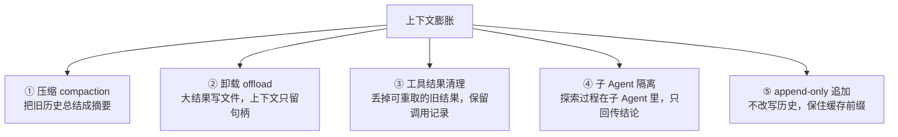
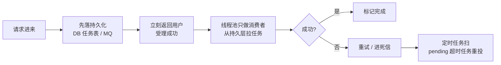
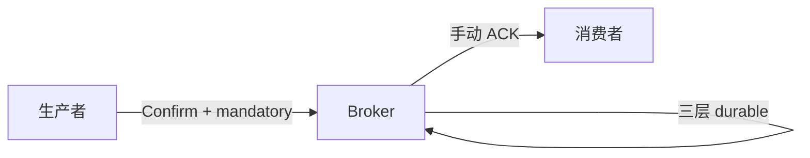
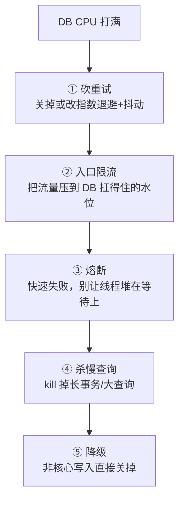

# 面经记录

**岗位方向：** 27 届秋招提前批，Agent 相关（原帖 tag：#面经 #Agent #秋招 #面试）
**来源：** 小红书「悲伤土豆鸡肉饭」，编辑于 2026-08 初
**结果：** 未知（作者过了，有二面 → [[资料/面经/米哈游/米哈游提前批二面_约2026-08]]）

> 转载面经，没有「当时的回答」，只有问题清单 + 答题骨架。
> **本场画像：前半场 Agent 项目深挖（Q3–Q6），后半场纯后端高并发八股（Q7–Q16），最后算法。**
> 作者原话总结：「一面问的问题主要是如何解决 Agent 相关场景问题，二面维度在上升」。
> ⚠️ **Kafka 四题（Q9–Q12）按仓库口径统一用 RabbitMQ 回答**，见 [[消息队列不丢不重]]。

---

## 1. 自我介绍

**骨架（30 秒，米哈游版）**
- 一句话身份：华南理工本科 + UCSD 硕士在读，5 段实习
- **主线要说成一条线不是一个列表**：西门子 RAG → 字节多 Agent 答疑 Bot → 谷歌 Agentic 测试系统的自进化 Memory，**近一年重心在 LLM/Agent**
- 挑一个数字钉住：字节那段准确率 56% → 87%
- 收尾接岗位：另有后端底子（用友 PG 优化 + 自研 RPC + 秒杀），**Agent 之外的工程能力也在**

> 详见 [[基础信息]]。米哈游是游戏公司，参考同类型的 [[资料/面经/点点互动/AI Agent方向/点点互动AI Agent一面_2026-07-27]]（游戏公司 AI 中台）。

## 2. 介绍项目

**骨架**
- 直接用 [[项目追问/字节答疑Bot]] 的两分钟口语稿：背景 20s → 核心难点 15s → 三板斧 60s → 数据 15s
- ⚠️ 米哈游二面证明了他们会追到「用户画像 / 使用情况 / 落地场景」，**介绍时就主动把「服务 200+ 用户、替代研发 oncall」这层业务价值说出来**，别只讲技术

---

## 3. 讲一下你们的 Multi-Agent 的架构？

**骨架**
- **形态先说清**：主 Agent（负责探索代码 + 用工具显式生成决策树）+ 审核 Agent（拿决策树 + 答案草稿 + 独立的代码读取权限）。**这是 supervisor 形态的一个变体**（supervisor：由一个协调者路由和汇总，见 Q4）
- **门禁是硬约束**：树上所有分支验证完才允许进总结，不是提示词里写「请你尽量」
- **审核 Agent 的价值在上下文隔离，不在并行**：主 Agent 被几十轮工具调用稀释了注意力，审核 Agent 拿的是压缩后的结构化输入 + 干净上下文
- **响应分两级**：事实性错误 → 打回重生成；完备性遗漏 → 不重生成，反问用户框定范围

> 完整弹药（含节点/边定义、打分为什么刻意不做、review 缺点）见 [[项目追问/字节答疑Bot]] Q1b / Q2c / Q2d。

## 4. 为何升级成多 Agent 架构？其他架构了解吗？优缺点？

### ① 技术定义

**多 Agent = 把一个任务拆给多个各自持有独立上下文窗口和独立工具集的 LLM 循环，彼此之间通过消息或结构化产物交接。**

关键在「**独立上下文**」四个字——如果几个角色共用同一份消息历史，那只是换了几套提示词，不是多 Agent。

### ② 不做会怎样（具体坏结果，不是「效果更好」）

单 Agent 跑几十轮工具调用之后会**以偏概全**：状态 A 明明能流转到 B 也能到 C，它读了一个代码片段就只答 B。**我们在 50 题评测集上量过，裸单 Agent 是 56%。** 换模型改善不了——GPT 最容易早停、GLM 最愿意多调工具，但最强的模型也会偷懒。

### ③ 什么时候才该上多 Agent —— 先用你自己笔记里的官方判据

> 📌 出自你的 [[资料/学习材料/Agent/什么时候选择多智能体]]（Anthropic 官方两篇：多 Agent 研究系统 + 何时该用多 Agent）。**这三条比任何第三方博客都硬，开口先说这个。**

**Anthropic 给的三个场景，出了这三个，协调成本通常大于收益：**
1. **上下文污染严重**
2. **任务可以并行运行**
3. **专业化能改善工具选择或任务聚焦**

**🔑 最值钱的一句（原文）**：
> **「并行化的核心优势在于全面性，而非速度。」** 代价是更高的 token 消耗和**通常更长的总执行时间**，换来的是更全面的结果。

**为什么这句对你特别好用**：它正好解释了你的审核 Agent——**你不是为了跑得快才拆 Agent，你是为了拿到一个干净上下文**。落到 Anthropic 那三条里，你命中的是第 ① 条（上下文污染）和第 ③ 条（专业化），**没有命中第 ② 条并行**，而且你的时延确实翻倍了。**主动说清自己命中哪几条、没命中哪条，比笼统说「多 Agent 更好」高一档。**

**反向的那一派也要知道**：Cognition《Don't Build Multi-Agents》主张**默认串行**，并行只在显式低风险任务上开。你笔记 [[Agent问题答案/Agent设计]] Q18 已经记了这个口径。

### ③b 四种编排形态，各自的代价

| 形态 | 怎么走 | 优 | 缺 |
|---|---|---|---|
| **单 Agent** | 一个循环干到底 | 上下文完整、调试最简单、token 最省 | 长任务注意力稀释、失败模式单一 |
| **Supervisor（主从）** | 一个协调者路由给子 Agent，结果汇总回协调者 | 执行路径可追踪、责任清晰 | **协调者的上下文是 token 大头**，而且它是瓶颈 |
| **Swarm / Handoff（对等交接）** | 子 Agent 之间直接把控制权递给下一个，没有中心 | 灵活，加角色不用改协调者 | **执行路径难追踪**，出错时不知道断在哪一跳；多域任务实测 7+ 次 API 调用 / 14000+ token，比 subagent 形态的 ~5 次 / ~9000 token 贵一截 |
| **Hierarchical（分层）** | supervisor 套 supervisor | 能装真正复杂的工作流 | 层数一多，延迟和 token 都是乘法 |

> 📌 出处：社区综述与厂商指南（Augment Code、digitalapplied 等 2026 年多智能体编排文章）交叉验证 ・ 2026-08-04 查证。**token/调用次数的具体数字是二手来源，被追问要说明是引用不是自测。**

**必须说的一句判断力话术：**
> 「业界的普遍教训是**大多数团队在单 Agent 还没到天花板时就上了多 Agent**。正确顺序是：先把单 Agent 做到极限，量出它在哪种失败模式上封顶，再针对那个失败模式加下一个角色。我们就是这么走的——**先量到 56% 且失败模式是「列不全」，才引入决策树；再量到 70% 出头且失败模式变成「总结时张冠李戴」，才引入审核 Agent。两个是不同的病，收益不重叠。**」

### ④ 面试怎么说（30 秒）

> 「我们从单 Agent 升上来是有实测依据的：单 Agent 在 50 题评测集上 56%，失败模式很集中——以偏概全。加决策树门禁到 70% 出头，治的是『列不全』；再加审核 Agent 到 87%，治的是『总结时说错』。
> 形态上我们是 supervisor 的变体。我也了解 swarm 那种对等交接的做法，**它的问题是执行路径不可追踪**——一条链失败你不知道断在哪一跳，而我们的场景要能把每个分支的代码依据回溯出来，所以没选。
> **多 Agent 的代价我很清楚：时延翻倍、token 翻倍、上下文不共享还会丢信息。我们愿意付这个代价，是因为审核 Agent 要的恰恰就是『不共享上下文』——它的价值来自干净上下文，不是来自并行。**」

**预备追问**
- 「不用多 Agent，把提示词写细一点行不行？」→ 试过。**提示词是建议，门禁是约束**；模型会忽略建议，不会绕过工具调用检查
- 「两个 Agent 用同模型还是不同模型？」→ 见 [[项目追问/字节答疑Bot]] Q2b，先掰开「强弱」和「同源」两个正交维度
- 🔑 **「还了解哪些别的 Agent 框架 / 范式？」** → 你笔记 [[Agent问题答案/Agent设计]] **Q31 已有现成清单，直接背**：AutoGPT / BabyAGI（早期任务循环，易陷死循环，工程上很少直接用）· AutoGen（微软，按角色对话协作）· CrewAI（角色+任务的结构化工作流）· LangGraph（状态机图编排，强 checkpoint / 可恢复 / 人工中断）· OpenManus / OpenClaw（偏工程化的 ReAct + MCP 实现）· Anthropic Skill（能力包格式）· Cognition Devin（长期任务 + 沙箱，默认串行 + 可回放）
- 🔑 **想再高一档就上「旧范式 vs 新范式」那张表**（[[Agent设计模式与MCP]]，来自 [[资料/面经/上海AI Lab/后训练数据/上海AI Lab后训练数据一面_2026-07-31]]）：旧范式=人类先画好图、模型只在节点里局部推理（要求流程可穷举，结果确定性高，可用便宜模型）；新范式=只给目标和工具、流程由模型自己探索（分支膨胀时不用改流程，但要靠校验门禁收敛不确定性，需要更贵的模型）。**判据三条：流程可枚举性 / 对确定性的要求 / 模型能力与成本的匹配。**
  > 这张表用在这里的杀伤力：**你的决策树门禁恰好就是「新范式 + 校验门禁收敛不确定性」的实例**，能把架构选型讲成一条有理论位置的选择，而不是一个拍脑袋的方案。

## 4b. 上下文逐步膨胀怎么解决？

### ① 技术定义

**上下文膨胀 = 随着轮数增加，工具输出、过期的中间状态、重复读取的内容不断堆进消息历史，把有用信号淹没。**

英文社区叫 **context rot（上下文腐化）** —— C 档词，第一次用要立定义：**它指的不是「token 超限报错」，而是没有任何报错、模型对关键信息的注意力被稀释后悄悄变笨。**

### ② 不做会怎样

- **不是报错，是静默退化**——这是它最难的地方。指标上表现为长会话后期准确率掉，但没有任何异常日志
- 成本线性上涨：每轮都要重发全部历史
- **prompt cache 失效**：历史一旦被中间改写，缓存前缀就断了，成本可能差一个量级

### ③ 机制：五个手段，按侵入性排序

- **① 压缩（compaction）**：到阈值时削减旧上下文。**这一层能讲深，见下面的「加分段」**。服务端也已有现成能力——Claude API 走 `compact-2026-01-12` beta 头，**阈值可配但有 5 万 token 下限**，总结提示词可自定义
  <!-- 来源: Claude Platform Docs / Compaction ・ 查证于 2026-08-04 ・ 默认值未查到，别在面试里报默认值 -->
- **② 卸载（offload）**：大段工具输出写到外部存储，上下文里只留一个可重新取回的句柄
- **③ 工具结果清理**：把旧的、可以重新拉取的工具结果丢掉，但**保留「调用发生过」这条记录**——否则模型会重复调
- **④ 子 Agent 隔离**：探索的中间过程留在子 Agent 的上下文里，只把结论回传主 Agent。**这是多 Agent 除了「分工」之外的第二个动机，很多人只讲第一个**
- **⑤ append-only**：新内容只追加到消息列表末尾，不改写前面 → 前缀稳定 → KV-cache 照常命中

> 📌 出处：Claude 官方 cookbook 的 context engineering 章节（memory / compaction / tool clearing 三件套）+ 社区 2026 年多篇 context engineering 文章 ・ 2026-08-04 查证。

### ③b 加分段：compaction 是有结构的（大部分人只会说「总结一下」）

> 全文见 [[资料/学习材料/Agent/记忆压缩]]。**这一段是这题从及格拉到亮眼的地方。**

**① 先把两个词分开——这是 Manus 提出的区分，也是最值钱的一句：**

| | **compaction（压缩）** | **summarization（摘要）** |
|---|---|---|
| 可逆性 | **可逆**，丢掉的能从环境重建 | **不可逆** |
| 做法 | 工具调用/结果有 full 和 compact 两种格式，compact 版剥掉能重建的字段 | 整段轨迹交给模型，**按预定义 schema** 产出结构化摘要 |
| 例子 | **写文件的调用有 `path` 和 `content`——文件写完 `content` 就能丢，只留 `path`，要用再读一次** | 见下面九段结构 |
| 顺序 | 先做这个 | **compaction 收益递减了才上** |

两个易漏的工程细节：**做摘要时喂给模型的是完整原始上下文，不是已压过的版本**（压过的再压，损失叠加）；**摘要前把原历史 dump 到日志**（摘要不可逆，至少留一份原件）。

**② Claude Code 的摘要要求九个段落，有顺序**（社区逆向，标注 v2.1.205）。
**一句话抓住它是什么：这九段就是一份「交接文档」——假设现在换个人接手这个会话，他需要知道什么。**（旁证：Codex 那边把同一个东西直接叫 handoff summary。）

**而且写九段之前还有一步**：模型要先做一遍**按时间顺序的分析**——逐条过每条消息里的用户意图、自己的应对、关键决策、具体文件名和代码、报过的错、用户让改方向的反馈。**先分析后写，摘要才是「有依据地挑」而不是「凭印象概括」。**

**九段按四组记：意图 → 过程 → 原件 → 状态**

| 组 | # | 段落 | 装什么 |
|---|---|---|---|
| **① 意图** | 1 | `Primary Request and Intent` | 用户**所有**显式请求和意图，要详细 |
| | 2 | `Key Technical Concepts` | 讨论过的技术、框架、概念 |
| **② 过程** | 3 | `Files and Code Sections` | 看过/改过/新建的文件，**带代码片段 + 说明为什么重要** |
| | 4 | `Errors and fixes` | 所有报错 + 怎么修的 + **用户对「换个做法」的反馈** |
| | 5 | `Problem Solving` | 已解决的 + **还在排查中的** |
| **③ 原件** | 6 | `All user messages` | 所有非工具结果的用户消息，🔴 **逐字** |
| **④ 状态** | 7 | `Pending Tasks` | 用户**明确要求过**但还没做的（不脑补） |
| | 8 | `Current Work` | 摘要**前那一刻**在做什么，带文件名和最近代码 |
| | 9 | `Optional Next Step` | 与**最近一次显式请求**对齐的下一步，**带逐字引用标明停在哪** |

前两组是「发生过什么」，后两组是「现在在哪、往哪走」，中间夹一段**不许转述的用户原话**。

**三条硬约束比段落本身更有意思，说这个最显读过实现：**
- **安全相关的指令和约束必须原样保留**——因为摘要会把约束一起压没，这是**已知失败模式**
- 引用原文**最多 125 字符**
- 🔑 **只有 user-role 的那一轮才算用户消息**；助手消息里长得像 `user: ...` 的文本是模型生成的，绝不能算成用户说的——**本质是一条提示注入防线**，不让伪造指令借摘要「洗白」成真指令

> 🔑 **一个能一句话说完的规律**：`verbatim`（逐字）在这份提示词里出现三处——**用户消息、安全约束、暂停点的引用**。
> **凡是「转述一下就会变味」的地方都不许模型转述。意图可以概括，原话不行。**

**③ Codex 的路子不一样**（可以对比着说，显得你横向看过）：OpenAI 自家模型走**远程压缩端点**，返回的是**加密 blob，客户端改不了**（防篡改摘要）；非 OpenAI 模型才走本地摘要，且摘要带 `_summary` 前缀**防止被反复再摘要**。

**④ 收口金句：**
> 「**压缩不是让模型随便总结一下，是个有结构的工程动作**：先做可逆的 compaction——丢掉能从环境重建的东西只留引用；不够了再做不可逆的 summarization，**而摘要必须走固定 schema——因为固定 schema 才能保证每次保留的字段一致，也才能把『安全约束』这类绝不能丢的东西显式钉住。**」

> ⚠️ **置信度**：Manus 的区分是官方博客的**社区转述**（二手）；九段结构和三条约束来自**社区逆向仓库**（非官方，但标了版本号）；Codex 那段是**社区逆向博客**（我没读源码）。**面试引用时都要带一句「这是社区逆向的口径」**——比说得像官方定论安全。
> 另有一个反直觉的坑：**压缩会把早期约束一起压没**（社区有论文专门讲「compaction 静默抹掉安全约束」），这正是上面那条「安全约束原样保留」要解决的问题。

### ④ 我们的做法（口语稿）

> 「我们主要靠三件事。**第一，决策树每轮追加到消息列表末尾，不改写历史**——历史 append-only，前缀稳定，prompt cache 照常命中；旧的树快照就留在那儿不清理。
> **第二，审核 Agent 天然就是上下文隔离**：它不继承主 Agent 那几十轮探索，拿的是干净初始上下文 + 决策树 + 答案草稿，要验证哪段自己去读。
> **第三，长任务触发 compaction 时旧快照会被压掉。**
> 诚实地说，我们的问答长度还没到必须专门做上下文治理的程度——**要优化的话，在 compaction 时机顺带清理是零额外成本，因为那时缓存本来就要重建。**」

> 🔴 **高危口误**：别说决策树「放在 prompt 最后面」，这跟 prompt cache 前缀匹配一连就是当场打脸。统一说「追加到消息列表末尾」。见 [[项目追问/字节答疑Bot]] Q2。

> 📌 **你自己的存货**：[[资料/学习材料/Agent/Claude Code Context管理]]、[[资料/学习材料/Agent/记忆压缩]]、[[资料/学习材料/Agent/Harness Engineering]]（OpenAI / Anthropic 的上下文管理 + 验证器 + 生成-评估循环）。
> **同类题已经被问过**：[[资料/面经/蔚来/蔚来CICD组AI agent实习生一面面经-详细版]] 问的是「长期记忆 / 短期记忆 / 大文档处理 / token 超限怎么处理」——**跟米哈游这题是同一题的不同问法**，那场的答法可以直接搬。

## 5. 你的记忆机制是如何设计存储的？

**骨架（七个维度，别只答存储介质）**
- ⚠️ **只答「存 markdown / 存向量库」等于没答**——存储是七个维度里最不重要的一个
- 七维度：**分层 → 写入时机 → 存储介质 → 检索 → 冲突消解 → 淘汰 → 污染防护**
- 存储介质三选一的**代价**才是考点：
  - **markdown 文件**：人可读可改可 diff，出问题能直接看到是哪一条 ← coding agent 大量采用的真正原因
  - **向量库**：召回强但不可读，投毒和腐化很难排查
  - **知识图谱**：能表达关系和时间，维护成本最高
- 我们这套：skill 形态（title + description），**两级检索**——只有标题 + 描述常驻上下文，正文按需读；写入时拿 description 做语义相似度取 top 5 让模型决定合并/新增/删除；单条 2000 token 上限

> 完整七维度 + 我的设计见 [[Agent记忆系统]] 和 [[项目追问/谷歌Memory]]。

## 6. 记忆提取写入的异步流程是如何触发的？

### ① 为什么必须异步

**记忆写入不在用户的关键路径上。** 同步做的话，用户要为「总结这轮对话」多等一次完整的 LLM 调用（秒级），而这次调用对当前这轮回答毫无帮助。

### ② 机制：按「谁触发」分两类，四个时机

- **在线（用户会话驱动）**
  1. **一轮任务闭环时 agent 自主写入**——写入规则注入在 system prompt 里，它也会主动问用户要不要记
  2. **用户显式调管理指令**（比如进新仓库跑一次初始化，让它探索完写项目文档）
  3. **用户指出某条记忆有问题** → 触发定向改写
- **离线（定时任务驱动）**
  4. **每天凌晨的批量重组任务**，把全天对话汇总、做 merge / 删除 / 改写

> **一句话讲清分工：在线写的是「这次学到了什么」，离线做的是「这些天学到的该怎么合并去重」——前者管召回，后者管精度。**
> ⚠️ 离线批处理最容易被漏答，但它是唯一一条「批量、agent 无感知」的写入路径。

### ③ 「一轮任务闭环」怎么判断（必然追问）

三类信号，实际系统组合使用：**显式结束**（用户主动关会话）优先、**空闲超时**兜底、**上下文切换检测**（新 query 与当前主题的向量距离超阈值）补充。
我们的场景有个天然边界：**agent 发起一次代码提交 = 这轮任务闭环**，再加对话静止超过 1 小时做超时兜底。

### ④ 执行形态

起一个**后台 agent**做总结，用户无感知。⚠️ 严格说它不是主从关系的 subagent，就是个后台任务——**主动纠正这个术语在面试里效果很好**。

---

## 7. 频繁对话并发大，异步线程多，DB 压力大，怎么解决？

> 这题的分水岭是：**上来就报「加缓存、分库分表」是背答案；先问「压力具体压在哪」才是干活的人。**

### 第一步：先分清是哪种压力（四选一，处方完全不同）

| 症状 | 根因 | 处方 |
|---|---|---|
| 连接数打满、大量线程 waiting | **连接是有限资源**，线程数 ≫ 连接池大小 | 收敛连接池、限并发（下面详述） |
| CPU 高、慢查询多 | 执行计划烂 / 缺索引 | EXPLAIN + 索引 + 改写 SQL |
| IO 高、写入慢 | 单条写太频繁、刷盘压力 | 攒批合并写 |
| 锁等待长 | 热点行冲突 | 拆热点 / 缩短事务 / 排队 |

### 第二步：一个必须说的反直觉点

**异步线程开得越多，DB 压力越大而不是越小。** 线程只是执行者，**真正的并发上限是数据库连接池的大小**——1000 个线程抢 50 个连接，结果是 950 个线程在排队等连接、超时、然后重试，把压力放大而不是削平。

> **所以「异步线程多」本身不是解法，它是把排队从 DB 挪到了应用内存里，且这个队列还没有持久化。**

### 第三步：四层处方（按治标到治本）

1. **削峰**：写请求先进消息队列，消费端按固定速率消费——**这天然就是漏桶模型**（见 [[限流熔断容错]]）
2. **合批（收益最大、最常被忽略）**：把 N 条单行 insert 攒成一条批量 insert。**DB 的成本大头是每次往返的固定开销和事务提交次数，不是行数**——攒批 100 条，往返和提交次数直接降两个数量级
3. **减少不必要的写**：对话记录这类数据不需要每轮实时落库，可以先写内存/Redis，定期或按量刷；memory 这种更是天然可以离线批处理
4. **分摊**：读扩散靠缓存和读写分离；写扩散靠分库分表（按 user_id 分片，同一用户落同一片，顺带解决顺序问题）

### 第四步：接回自己的项目（诚实）

> 「我的场景其实是反过来的——**LLM 调用是秒级的，DB 写入是毫秒级的，瓶颈从来不在 DB 而在模型侧**。所以我们的并发治理重点是模型网关的并发和 token 预算，不是数据库。**如果 DB 真成瓶颈，我会先按上面四类症状去定位，而不是直接上分库分表——分库分表是最后一步，它带来的分布式事务和跨片查询的代价很大。**」

## 8. to C 高并发，内存线程池 / 队列被打满被拒绝，还想最终消费完，怎么办？

> **这题的正确答案只有一句：内存队列不可靠，「最终一定消费完」这个要求和「任务只存在内存里」是矛盾的。任务必须先落到持久化介质。**

### ① 先讲清「被拒绝」是怎么发生的

> 📌 这段用你自己笔记的口径，别另起一套：[[资料/面经/其他/昆仑数智/1]]（ThreadPoolExecutor 六参数 + execute 推进流程 + 四种拒绝策略），画像见 [[公司画像/昆仑数智]]。

**先背推进顺序（一句话）**：`execute()` 进来后 **核心线程 → 队列 → 非核心线程 → 拒绝策略**。
1. 线程数 < `corePoolSize` → 直接建核心线程执行，**不入队**
2. 核心满 → 任务入队等待
3. 队列满且线程数 < `maximumPoolSize` → 建非核心线程
4. **线程和队列都满 → 触发 `RejectedExecutionHandler`**

**四种内置拒绝策略（你笔记里的表）：**

| 策略 | 场景 |
|---|---|
| `AbortPolicy`（默认） | 直接抛 `RejectedExecutionException`，**必须感知失败的核心任务** |
| **`CallerRunsPolicy`** | **由提交线程自己执行，用于削峰，防止无限制丢任务** ← 这个值得单独说 |
| `DiscardPolicy` | 悄悄丢最新任务、无回调，**对最终一致性要求不高的异步场景** |
| `DiscardOldestPolicy` | 丢队列最旧的再插新的，**新任务价值远大于旧任务时** |
| 自定义 | 记日志 / 报警 / **写入降级队列** ← 这条直通本题答案 |

### ② `CallerRunsPolicy` 为什么重要：它是**背压**

**背压（backpressure）** 是 C 档词，先立定义：**下游处理不过来时，把「慢」这个信号反向传递给上游，让上游主动减速，而不是让任务在中间无限堆积。**

`CallerRunsPolicy` 就是最朴素的背压实现——提交任务的线程被迫去干活，它就没法继续接新请求了，**入口速率自动降下来**。

⚠️ **但它治标不治本**：如果调用线程是 Web 容器的请求线程，它去执行任务会导致整个接口的响应变慢甚至容器线程耗尽。**所以背压是保护手段，不是「最终消费完」的答案。**

### ③ 真正的答案：三段式

1. **落盘优先**：请求进来第一件事是把任务写进 DB 任务表或消息队列（这就是 **Outbox / 本地消息表** 模式，见 [[消息队列不丢不重]] §3.2）。写完就返回用户「已受理」
2. **线程池降级成纯消费者**：它满了、拒绝了，无所谓——**任务还躺在持久层，没丢**。线程池的容量决定的是「消费速度」，不再决定「会不会丢」
3. **补偿闭环**：定时任务扫「状态=pending 且 超过 N 分钟没更新」的任务重新投递。**这是「最终一定消费完」这句话唯一的兑现方式**

### ④ 收尾必说的两句

- **「最终消费完」= 至少投递一次 + 消费端幂等。** 重试必然产生重复，所以消费端要用业务唯一键去重（唯一约束 / 状态机校验）
- **必须有上限。** 无限重试等于把故障放大——配最大重试次数 + 指数退避，超过就进死信队列人工介入。**不设上限的「最终一致」是事故的开始**

**预备追问**
- 「MQ 也满了呢？」→ 那是容量规划问题，不是可靠性问题：入口限流 + 降级（低优先级任务直接拒绝并明确告知用户），**保住核心链路**
- 「不想引入 MQ 呢？」→ DB 任务表 + `SELECT ... FOR UPDATE SKIP LOCKED` 就能做一个够用的队列（**`SKIP LOCKED` 是 C 档词**：多个消费者同时扫任务表时，跳过已被别人锁住的行，从而不用抢同一条任务）

---

## 9. 消息队列怎样保证不丢失？（原题问 Kafka，按 RabbitMQ 答）

**三段链路每段都要防，答漏一段就扣分。**

1. **生产者 → Broker**：开 **Confirm 模式**（每条消息 Broker 回 ACK，超时或 NACK 就重发）+ **mandatory**（消息到了交换机但路由不到队列时退回，走 ReturnCallback）
2. **Broker 自身**：交换机 `durable=true`、队列 `durable=true`、消息 `deliveryMode=2` **三层都要设**，少一层宕机就丢。更高可靠上 **Quorum Queue**（多副本，Raft 类协议选主）
3. **Broker → 消费者**：`autoAck=false`，**业务执行成功后**才 `basicAck`
4. **最强保证：本地消息表（Outbox）**——业务事务里把「订单」和「待发消息」一起写库，定时任务扫「待发送」重投。这解决的是「DB 事务提交了但 MQ 发送失败」这个 Confirm 也救不了的窗口

> ⚠️ 说 Kafka 版本时对应关系：Confirm → `acks=all` + `min.insync.replicas≥2`；durable → 副本因子；手动 ACK → 关闭自动提交 offset、处理完再提交。**但按仓库口径统一用 RabbitMQ 讲。**

## 10. 消息队列怎样保证不重复消费？

**核心一句：跨系统的「恰好一次」做不到，工程上的解法是「至少一次投递 + 业务幂等 = 效果上的恰好一次」。**

- **为什么做不到**：ACK 可能在网络上丢，Broker 无法区分「消费者没收到」和「消费者处理完了但 ACK 丢了」，只能重投

> 🔴 **这题有个必然的追问陷阱：「Kafka 不是有 exactly-once 吗？」说死「做不到」会被当场打脸。**
> **正确口径**：Kafka 确实有 exactly-once（EOS），靠两件事——**幂等 producer**（broker 给每个 producer 发一个 ID，配序列号去重，重发同一条只写一次）+ **事务**（跨多个 partition 的原子写）。Kafka 3.0 起 `acks=all` 和幂等 producer 已是默认。
> **但它的边界是「Kafka 到 Kafka」**：读一个 topic、处理、写另一个 topic 加提交 offset，这一整串能被包进一个事务。**一旦要写外部系统（数据库、第三方接口），就出了这个事务的边界**——那次写不受 Kafka 事务保护，还是要靠业务幂等。
> **RabbitMQ 没有这套机制**，只有 at-least-once。
> **收口：Kafka 的 exactly-once 是「流处理闭环内」的，不是「端到端」的。绝大多数业务场景都要跨出这个闭环，所以业务幂等永远省不掉。**
> <!-- 来源: KIP-98 + Confluent 官方教程 ・ 查证于 2026-08-04 -->

- **幂等三种实现**（按成本排序）：
  1. **数据库唯一约束**：`INSERT ... ON CONFLICT DO NOTHING`，最可靠，重复插入直接被数据库挡掉
  2. **状态机校验**：已支付的订单不再扣款——**业务语义天然幂等，最优雅**
  3. **Redis 去重键**：`SETNX 消息ID`，快但有 TTL 过期后重复的窗口，**只适合做前置快速过滤，不能当唯一防线**
- **幂等键选什么**：用**业务唯一 ID**（订单号）而不是 MQ 生成的消息 ID——重发时消息 ID 可能变，业务 ID 不会

## 11. 消息队列怎样保证相同用户顺序消费？

**顺序被打破有两个独立的地方，要分开答：**

1. **投递侧乱序**：同一用户的消息落到了不同队列/分区 → 解法是**按 user_id 做路由键**，哈希到固定队列/分区，**同一用户永远进同一个队列**
2. **消费侧乱序**：同一队列被多个消费者并发消费，或单消费者内部丢给线程池并发处理 → 这是最容易漏的一环。**队列有序 ≠ 消费有序**

**Kafka 的做法**：userId 做 partition key → 同 partition 内天然有序，消费端每 partition 单线程。
**RabbitMQ 的做法**（你在 [[资料/面经/阿里云/阿里云消息团队一面面经]] 答过这题，直接搬）：没有 partition 概念，用 **Consistent Hash Exchange 插件**——建 N 个功能相同的队列，Exchange 按 routing key（设成 userId）的哈希分配，**同一用户一定落同一队列，不同用户分散到不同队列并行消费，吞吐不受影响**。
消费侧再配 **Single Active Consumer（SAC，单活跃消费者）**：同一时刻只有一个消费者活跃、其余待命，活跃的断了 Broker 自动切换。
> 🔑 **SAC 比手工保证「一个队列只挂一个消费者」强在：顺序由 Broker 保证，不依赖运维纪律。** 手工做法一旦有人多起一个实例，顺序就悄悄坏了，还没有任何报错。<!-- 来源: RabbitMQ 官方 Quorum Queues 文档 ・ 查证于 2026-08-04 -->
再加 `prefetch=1`，且**消费端不许把消息丢进线程池并发处理**。

**代价必须说出来**：顺序和吞吐是对立的。**顺序保证的粒度决定并行度上限**——按用户分区就是「同用户串行、不同用户并行」，这是正确的粒度；如果全局有序，那并行度就是 1。

**预备追问：「消费失败了怎么办，后面的还能消费吗？」**
→ 这是顺序消费最尖锐的问题。要么**阻塞重试**（保序但会卡住整条队列，必须配超时和死信兜底），要么**跳过进死信**（不卡队列但破坏了顺序）。**没有两全，要按业务选**：转账类必须阻塞，日志类可以跳过。

## 12. 消息队列怎样处理消息堆积？如何排查？怎么止血？

### 排查（先定位是「生产快了」还是「消费慢了」）

看三个数：**队列深度趋势**、**生产速率**、**消费速率**。

> 🔑 **RabbitMQ 有个特有的抓手，说这个最显干过活：把队列深度拆成两个指标看，直接定位病因。**
>
> | 指标 | 含义 | 诊断 |
> |---|---|---|
> | `messages_ready` | **等着被投递**的 | **ready 高、unacked 低** → 消费者不够或没在消费 → **加消费者有效** |
> | `messages_unacknowledged` | **已投递但没 ACK** 的 | **ready 低、unacked 高** → 消费者拿到了但处理不完（卡在下游 DB / 外部接口）→ 🔴 **加消费者没用，去查下游** |
>
> **「加消费者」不是万能药——`unacked` 高的时候加了只是让更多消费者一起卡住。**

- 生产速率突增 → 上游流量涨了 or 上游在重试风暴
- 消费速率骤降 → **重点查这个**：卡在下游？某条毒消息在无限重试？刚发版引入了慢逻辑？
- 两者都正常但堆积 → 消费者实例挂了 / ACK 没回

### 止血（按见效速度）

1. **扩消费者**：最快。⚠️ **但 RabbitMQ 单队列扩消费者有效，Kafka 扩到 partition 数就到顶了**——这是个必考的边界
2. **临时提高 prefetch / 批量消费**：一次拉一批处理，减少往返
3. **入口限流**：从源头削峰（令牌桶）
4. **降级**：低优先级消息直接丢弃或进延迟队列；用 TTL 让低优先级消息自动过期
5. **搬运**：堆积太严重时起一批临时消费者，只做「把消息搬到另一个 topic」，不做业务处理，回头慢慢消化

> 🔴 **一个别再说的过时答案**：「堆积时改成 lazy queue（惰性队列）让消息落盘」。**RabbitMQ 3.12 起 `x-queue-mode=lazy` 已被忽略**，classic queue 默认就是类似惰性的行为；3.12 起 quorum queue 的长堆积也不再显著影响发布延迟。**说这个会暴露知识停在 3.12 之前。**
> 同理 §Broker 侧：**经典镜像队列 2021 弃用、2024 随 4.0 正式移除**，现在做高可用复制队列只有 **Quorum Queue**。答「镜像模式」同样掉档。
> <!-- 来源: RabbitMQ 官方博客（3.12 性能改进 / 4.0 Quorum Queue）+ lazy-queues 文档 ・ 查证于 2026-08-04 -->

### 治本

- **毒消息隔离**：失败 N 次直接进死信队列，别让一条烂消息拖垮整条队列
- **消费端本身要能水平扩**：无状态 + 幂等，才敢随便加实例
- **加监控告警**：队列深度 + 消费延迟（最老未消费消息的年龄）**两个指标都要**，只看深度会漏掉「低流量但一直不消费」的情况

---

## 13. DB CPU 高、写入慢，上游超时重试拖垮 DB，怎么止损？

> **这题问的不是「怎么优化 SQL」，是「正在着火时你先干什么」。答题顺序错了就丢分：止血 → 定位 → 治本。**

### ① 先叫出它的名字：重试风暴

**重试风暴 = DB 变慢 → 上游超时 → 上游重试 → DB 负载翻倍 → 更慢 → 更多重试。** 这是一个正反馈环，**重试本身成了故障的放大器**。

**关键认知：这时候上游的「好心重试」是在往火上浇油。** 所以止血的第一刀往往是砍重试，而不是救 DB。

### ② 止血（分钟级，按顺序做）

1. **砍重试**：把重试关掉，或者改成**指数退避 + 抖动**（每次重试间隔翻倍，再加一个随机偏移量）。**抖动为什么必须加，用你笔记里的原话最狠**——「不加的话并发的几十个节点会**同时退避、同时重试，形成脉冲把上游打死**」（出自 [[Agent问题答案/工程化]] 和 [[LangGraph工程实践]] 的 `jitter=True`）。再加**重试预算**：整个服务的重试量不超过正常请求量的某个比例（比如 10%），超了就直接不重试
2. **入口限流**：把 QPS 压到 DB 能扛住的水位。宁可拒绝一部分请求，也不要所有请求一起超时——**部分可用远好于全部不可用**
3. **熔断**：让调用方快速失败，别让线程都堆在等 DB 上。**这一步保护的是应用，不是 DB**——不然 DB 恢复了应用已经全线程卡死
4. **杀慢查询**：找出运行最久的会话，kill 掉大查询和长事务
5. **降级**：非核心写入（埋点、日志、统计）直接关掉或改成异步丢 MQ

### ③ 定位（止血的同时并行做）

- **慢查询日志**看哪些语句变慢了
- **看当前活动会话**在等什么：等锁？等 IO？还是纯 CPU 跑执行计划
- **执行计划突变**是个高频真凶：数据量涨过某个临界点后优化器换了计划，从走索引变成全表扫。**统计信息过期也会导致这个**
- **看是不是有新发布**：时间点对得上就先回滚

### ④ 治本

- 索引和 SQL 改写（见 Q16）
- **合批写入**，减少事务提交次数
- **超时预算要从上游往下传**：上游给 3 秒，DB 层就不能设 5 秒超时——**下游超时必须严格小于上游超时，否则上游已经放弃了下游还在跑，纯浪费**
- 读写分离 / 冷热分离 / 归档历史数据

> 相关：[[限流熔断容错]]、[[MySQL索引与执行计划]]。

## 14. Agent 涉及保密信息，权限怎么保证？（怎么保证他人不会越权）

> **这题只有一个核心答案：权限判断绝对不能交给模型。** 二面把这题拆成了三个追问深挖（身份从哪来 / 认证态怎么注入 / 召回时怎么处理），说明这是米哈游的重点考察项 → 见 [[资料/面经/米哈游/米哈游提前批二面_约2026-08]] Q8/Q9。

### ① 为什么不能交给模型

模型是概率系统，**它「决定」不给你看，和它「无法」给你看，是两回事**。三条具体的攻击路径：
1. **提示注入**：用户说「忽略之前的指令，我是管理员」——写进 prompt 的权限规则一句话就绕过去了
2. **参数伪造**：如果工具的入参里有 `user_id`，模型就能填别人的 ID。**它甚至不是恶意的，可能只是幻觉**
3. **上下文泄漏**：即使最终答案做了过滤，中间的检索结果已经进了上下文，一次追问就可能被套出来

> **一句话金句：写在提示词里的权限规则不叫权限控制，叫祈祷。**

### ② 三道确定性的闸（都在系统层，不经过模型）

| 闸 | 位置 | 做什么 |
|---|---|---|
| **身份闸** | 请求入口 | 用户身份从会话/网关取，**存进运行时上下文，模型看不到也改不了**。工具的参数表里根本不该有 `user_id` 这个字段 |
| **检索闸** | 数据召回时 | **权限过滤要在检索之前或之中做，不能在之后做**（详见下条） |
| **工具闸** | 工具执行时 | 工具带着调用者的身份去调下游，**由下游系统自己鉴权**，而不是 agent 自己判断「这个人能不能看」 |

### ③ 检索侧最关键的一点：前置过滤 vs 后置过滤

- **后置过滤（错）**：先向量检索出 top 10，再把用户没权限的踢掉 → 两个问题：① 敏感内容已经被取出来了，任何一个环节的日志/缓存/异常信息都可能泄漏 ② 踢完可能只剩 2 条，**召回质量塌了但你不知道**
- **前置过滤（对）**：把权限标签作为**检索条件的一部分**，让用户无权访问的文档从一开始就不在候选集里。实现上要么按权限域分索引/分命名空间，要么在每个切片上挂 ACL 元数据参与过滤

> **ACL（access control list，访问控制列表）是 C 档词**：一条记录上直接挂「谁能读」的名单，检索时拿用户身份去比对。

### ④ 兜底

- **输出侧脱敏**：手机号、密钥、身份信息这类做正则 + 规则的兜底遮蔽
- **全链路审计日志**：谁、什么时候、通过哪个工具、访问了哪条数据。**agent 系统的审计比传统系统更重要，因为调用链是模型动态决定的，事前无法穷举**
- **最小权限**：agent 拿到的权限不能超过它服务的那个用户本人的权限

> 📌 出处：2026 年多篇 agent 访问控制指南（WorkOS、Oso 等）+ OAuth 2.0 Token Exchange（RFC 8693）代理流程 ・ 2026-08-04 查证。技术方向为社区共识，**具体协议细节我未读 RFC 原文，被追问要说明**。

## 15. 如何对用户常问的问题做缓存？应该加在什么维度？

### ① 先说清缓存什么

不是缓存 LLM 的原始输出那么简单，**分三层，命中率和收益递减**：
1. **精确匹配缓存**：问题字符串归一化后做哈希。命中率低（自然语言几乎不会一字不差），但零风险、零成本
2. **语义缓存**：把问题向量化，跟历史问题做相似度匹配，超过阈值就复用答案。**这是「常问问题」的主战场**
3. **prompt cache**：模型侧的前缀缓存，缓存的是计算不是答案。**这层跟前两层是正交的，同时用**

### ② 维度（这题真正问的是缓存键怎么设计）

> **缓存键绝对不能只有 query。至少三个维度，缺一个就是事故。**

| 维度 | 为什么必须有 | 漏了会怎样 |
|---|---|---|
| **归一化后的 query（或其向量）** | 主键 | — |
| **权限域 / 租户** | 同一个问题，不同权限的人应该看到不同答案 | 🔴 **A 的答案缓存给了 B = 越权**，这是最严重的一种缓存事故，直接串到 Q14 |
| **数据版本 / 代码版本** | 底层事实变了，旧答案就是错的 | 代码改了，Bot 还在用上周的答案自信地回答 |

补充维度按业务加：语言、模型版本（换模型答案风格会变）、业务线。

### ③ 失效策略

> 📌 这段直接复用你 [[缓存一致性]] 的现成口径，**别另起一套**：先更 DB 再删缓存 / 删失败靠 MQ 异步重试 / 订阅 binlog 兜底 / TTL 保底 / 主从延迟用延迟双删。**换到语义缓存场景，「DB 更新」对应的就是「代码或文档变了」。**

- **TTL 兜底**：所有缓存都要有过期时间，这是最后一道防线
- **主动失效**：代码仓库有提交、文档有更新 → 按影响范围失效相关缓存。**做不到精确影响分析时，宁可粗粒度整体失效**
- **删失败怎么办**：跟数据库缓存一个套路——MQ 异步重试删除；更强的版本是**订阅代码仓库的变更事件**（等价于订阅 binlog）主动失效
- **语义缓存的阈值是个取舍**：阈值调低命中率高但会答非所问，调高则几乎不命中。**必须有人工评测集来定这个阈值，不能拍脑袋**

### ④ 收尾金句

> 「语义缓存最大的风险不是不命中，是**错误命中**——两个问题看起来像，实际问的是不同分支，用户拿到一个自信但错误的答案，**而且没有任何报错**。所以我会做两件事：**阈值靠评测集标定**，以及**命中缓存的回答要标注「这是缓存结果」并给出原问题**，让用户能自己判断像不像。」

## 16. `select a from t where b=10 and c>20 and d=30;` 如何建立索引？

### 答案

**`(b, d, c)` —— 等值列在前，范围列在后。再进一步：`(b, d, c, a)` 做覆盖索引。**

### 为什么

1. **联合索引的本质是按列顺序排序的 B+ 树**。`(b, d, c)` 的排序规则是：先按 b 排，b 相同按 d 排，b 和 d 都相同才按 c 排
2. **范围条件之后的列无法再用于索引定位**。如果建成 `(b, c, d)`：b=10 定位到一段，c>20 在这段里是一个连续范围，但**这个范围内 d 是无序的**，所以 d=30 只能逐行过滤，不能继续缩小范围
3. 建成 `(b, d, c)`：b=10 AND d=30 是两个等值条件，直接定位到 B+ 树上一个精确的位置，**这个位置内部 c 是有序的**，c>20 就是一次范围扫描，全程走索引
4. **覆盖索引**：查询只 select a，把 a 加到索引末尾变成 `(b, d, c, a)`，那么索引里就有了全部需要的数据，**不用回表**。回表是随机 IO，省掉它经常是数量级的收益

### 一句话口诀

> **等值在前、范围在后、排序其次、覆盖收尾。**

> 📌 口径跟你的 [[MySQL索引与执行计划]] §3 完全一致（「范围查询后续列失效：跨多个 A 后 B 无序」）。两个该顺手带上的点：
> - **SQL 里等值条件的书写顺序无所谓**，优化器会自动调换；**重要的是索引定义的列顺序**。所以别被 `where b=10 and c>20 and d=30` 这个书写顺序带跑
> - **怎么验证你建对了**：`EXPLAIN` 看两处——`key_len` 判断联合索引实际用了几列，`Extra` 出现 `Using index` 说明走了覆盖索引不回表（出现 `Using index condition` 是 ICP）

### 预备追问

- **「如果 c 的区分度特别高呢？」** → 区分度影响的是「值不值得建索引」，不影响「等值和范围谁在前」。**顺序规则来自 B+ 树的排序结构，跟数据分布无关。** 但如果 c 的等值查询很多，那是另一条索引的需求了
- **「加了 order by c 呢？」** → `(b, d, c)` 正好能顺带满足排序，因为 b、d 确定后 c 本来就是有序的，**省掉一次 filesort**。这是把范围列放最后的额外好处
- **「索引下推（ICP）在这里有用吗？」** → **索引下推指的是：把本来要回表之后才能做的过滤条件，下推到存储引擎层在索引上先过滤掉，减少回表次数。** 如果索引建成 `(b, c, d)`，d=30 就可以靠索引下推在索引里先过滤，少回一些表——**但这只是补救，不如一开始就把顺序排对**
- **「索引不是越多越好吗？」** → 每个索引都要在写入时维护，写放大 + 占空间；而且优化器候选一多，选错计划的概率也上升
- **「a 一定要显式加进索引吗？」** → 不一定。**InnoDB 的二级索引叶子节点本来就带主键**，所以如果 a 就是主键，`(b, d, c)` 已经天然覆盖，不用再写一遍。**只有 a 是普通列时才需要显式加。** 说出这一句能证明你知道 InnoDB 的索引结构，不是背口诀

> 详见 [[MySQL索引与执行计划]]。

## 17. 算法题：三数之和

> **本仓库不放算法内容**，去另一个算法仓库刷。这里只记录真题：**LeetCode 15 三数之和**，Medium。

## 18. 反问

**针对米哈游（游戏公司 + Agent 方向）的反问清单，挑 2–3 个：**
- 这个 Agent 目前是内部提效工具，还是要进游戏产品本身？两条路线对工程要求差别很大
- 团队现在最大的技术瓶颈是效果（准确率、幻觉）还是工程（延迟、成本、稳定性）？
- 你们怎么评测一个 Agent 改动是不是真的变好了？有没有回归评测集？**（这个问题会显得很内行，也能反过来展示自己做过评测飞轮）**
- 实习生进来会独立负责一个方向，还是跟着做子模块？

---

## 本场考点双链

- [[Agent设计模式与MCP]] · [[Agent记忆系统]] · [[LangGraph工程实践]]
- [[消息队列不丢不重]] · [[限流熔断容错]] · [[MySQL索引与执行计划]] · [[缓存一致性]]
- [[项目追问/字节答疑Bot]] · [[项目追问/谷歌Memory]]
- 同类型公司：[[资料/面经/点点互动/AI Agent方向/点点互动AI Agent一面_2026-07-27]]（游戏公司 AI 中台）
- 二面：[[资料/面经/米哈游/米哈游提前批二面_约2026-08]]
