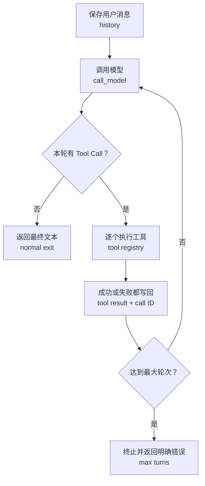

# 面经记录

**岗位方向：** 阿里云 ATH，Agent Infra / AI 应用工程师  
**环节：** 2026-09-09 技术面后的补充笔试 / Coding 加试；不自行记为二面  
**时长：** 55 分 10 秒  
**形式：** 远程共享 Coding 页面，Python 边写边讲；1 位面试官  
**流程：** 阅读题目 → 澄清多工具与异常要求 → 编写同步 Runtime → 解析 Tool Call → 工具分发 → 异常处理 → 讲解设计 → 补多轮历史 → 补退出条件  
**结果：** 未知  

> [!warning] 还原边界
> 原始题面和代码只显示在共享页面，录音没有完整朗读。因此本文只能确认口述出来的要求和设计，不能还原函数签名、模型输出协议、完整代码、隐藏测试，也没有证据表明代码成功运行或通过测试。

> [!note] 与前一场的关系
> 这是 [[资料/面经/阿里云/Agent Infra/阿里云Agent Infra面试_2026-09-09]] 后的补充 Coding 环节。前一场连续追问 Tool Call、全栈 Chatbot 和 Agent Runtime，本场直接要求实现简化 Runtime，主题连续，但两段录音不合并。

## 0. 本场结论

这场只考一道 Agent Runtime 编程题。Agent Runtime 是负责调用模型、执行工具、保存多轮状态并决定何时结束的运行层。

面试官实际检查五件事：

1. **能否先确认输入输出契约。** 一轮可能有多个 Tool Call，一个问题也可能需要多轮工具循环。
2. **能否先搭主循环。** 模型输出工具请求时执行工具；没有工具请求时返回最终答案。
3. **工具失败是否隔离。** 单个工具抛异常不能让整个 Runtime 崩溃，错误要作为结果交回模型。
4. **历史是否完整。** 用户消息、模型的工具请求、每个工具结果和后续模型输出都要按顺序保存。
5. **循环是否有硬边界。** 最终文本是正常退出条件，最大模型轮次是防死循环条件。

**做得较好的地方：**

- 开始前主动确认了一轮多工具、多轮循环、失败处理和模型调用可 Mock。
- 能讲出「模型 → Tool Call → Runtime 执行 → 结果回传 → 再调用模型」主链。
- 意识到第三个工具失败时，前两个成功结果仍然要保留并回传。
- 被指出缺少多轮历史后，马上补了 `history`。
- 最后补出了「软提醒 + 硬阈值」的循环保护。

**本场最贵的四个问题：**

- 约十多分钟花在手写字符串下标解析，主循环和状态结构迟迟没有稳定下来。
- 第一版实际只覆盖单轮；面试官追问后才承认「这个写错了」并补多轮历史。
- 忘记 Python 动态参数展开语法，工具分发的关键一步没有完成证据。
- 全程没有可确认的运行、测试和通过结果，不能写成「完成实现」。

---

## 1. 题目要求是什么？

### 录音中能确认的题目要求

- 任选擅长语言；候选人使用 Python。
- 外部 HTTP（Hypertext Transfer Protocol，超文本传输协议）调用和模型 API（application programming interface，应用程序接口）可以 Mock；Mock 是用可控制的替代实现模拟外部依赖。
- 一次模型输出可能包含多个 Tool Call。
- 一个问题可能经历多轮「模型 → 工具 → 模型」。
- Runtime 要提取工具名和参数，找到对应工具并执行。
- 工具抛出异常时，Runtime 必须捕获，不能整体崩溃。
- Runtime 要把失败信息告诉模型，让模型决定继续调用还是给降级回答。
- 需要说明历史保存、退出条件和死循环保护。

### 录音中无法确认的题目要求

- 题面全文、已有类与函数签名。
- Tool Call 的精确编码格式。
- 是否明确要求装饰器、JSON（JavaScript Object Notation，一种结构化文本格式）、并发或异步。
- 输入输出样例、评分规则和隐藏测试。

因此，下面的改进方案只回答这场暴露出的设计问题，不冒充现场题目的标准答案。

---

## 2. 开始编码前问了什么？

### 当时的回答（忠实压缩）

候选人先确认：

1. 一个问题是否可能连续调用多个工具。
2. 一个模型轮次里是否可能同时返回多个工具请求。
3. 工具失败后的「降级」是返回 Mock 结果，还是把失败告诉 Agent。
4. 模型 API 是否也可以 Mock。

面试官确认：一轮可以有多个工具调用；模型与外部调用均可 Mock；某个工具失败后要做处理，不能直接让 Runtime 崩溃。

### 复盘

这一步是对的。更完整的开场应该只再补两个问题：

- 模型输出是结构化 Tool Call，还是题目自定义的字符串协议。
- 多个工具只要求逐个执行，还是要求并行执行。

这两个答案会直接决定数据结构；没有确认协议就先写字符串解析，后面容易把时间耗在非核心细节上。

**题型 C（Coding / 系统实现）｜扣分：无；需求澄清是本场高光**

> 术语校准：Runtime、Tool Call、Mock 里，哪个术语是你之前没学过的？

---

## 3. 现场是怎么实现工具注册和 Tool Call 解析的？

### 当时的回答（忠实压缩）

- 先写同步版本，Mock 模型调用。
- 初始化时取得 Tool List，用字典保存工具。
- 计划从装饰器或函数注释提取工具描述，再动态拼进 system prompt（系统提示词）。
- 假设模型输出类似「工具名：参数 1，参数 2」，用冒号、逗号和字符串下标手写解析。
- 根据工具名找到函数，再把解析出的参数传入。
- 现场明确说不知道怎么解析装饰器，Tool Call 解析还有 bug，也忘了动态参数调用语法。

### 复盘

**技术定义：** 工具注册表是「工具名 → 可执行函数与参数说明」的映射；Tool Call 应至少包含调用标识符、工具名和结构化参数。

**解决什么问题：** 如果只拼「工具名：参数」字符串，参数含逗号、引号、数组或字典时就会解析错误；多个工具结果也无法稳定对应原调用。

**机制：**

1. 工具注册时保存函数对象，不要在分发处写一长串 `if / else`。
2. 参数用字典表示；Python 用 `**kwargs` 把字典展开成命名参数。`*args` 展开位置参数，`**kwargs` 展开命名参数。
3. 每个调用保留 call ID（call identifier，调用标识符），工具结果带同一个 call ID 回传。
4. 如果题目允许结构化输出，直接校验字段，不手写字符串解析器；如果题面强制字符串格式，再按给定语法实现解析并补边界测试。

**面试怎么说（30 秒）：**

> 「我先定义 Tool Call 数据结构：call ID、工具名和参数字典。工具注册表保存名称到函数的映射，执行时先校验工具名和参数，再用 `**kwargs` 调用。每个结果保留原 call ID，避免一轮多个工具时错配。只有题面明确规定文本协议，我才手写字符串解析。」

**题型 C（Coding / 系统实现）｜扣分：① 落点 + ③ 机制（过早手写解析；工具注册与动态参数调用未完成）**

> 术语校准：工具注册表、call ID、`*args`、`**kwargs` 里，哪个术语是你之前没学过的？

---

## 4. 整体 Agent Loop 是怎么设计的？

### 当时的回答（45:59 后的口述）

1. 初始化时获得工具列表和描述。
2. 拼 system prompt 与用户 Query。
3. 进入循环调用模型。
4. 解析模型输出中的工具名和参数。
5. 有 Tool Call 就执行；没有则返回模型文本。
6. 把工具名和结果拼回输入，再调用模型。

### 复盘

**技术定义：** Agent Loop 是重复执行「模型决定下一步 → Runtime 执行工具 → 把结果交回模型」的控制循环。

**解决什么问题：** 单次模型调用只能提出工具请求，不能自动完成外部动作；如果 Runtime 不把工具结果和历史交回，模型无法根据真实结果继续推理。



**面试怎么说（30 秒）：**

> 「History 先写入用户消息。每轮调用模型后，先保存完整模型输出；没有 Tool Call 就返回最终文本。有 Tool Call 就逐个执行，每个成功或失败结果都带原 call ID 写回 History，再进入下一轮。循环还有最大模型轮次，达到上限就确定性终止。」

**当前机制核验（2026-10-11）：** OpenAI Agents SDK 的公开循环也是「模型输出工具调用 → 执行并追加结果 → 再运行」，并用 `max_turns` 阻止无限循环。来源类型：官方文档与官方 GitHub 仓库，置信度高。[运行循环](https://openai.github.io/openai-agents-python/running_agents/) · [源码仓库](https://github.com/openai/openai-agents-python)

**题型 C（Coding / 系统实现）｜扣分：③ 机制（第一版遗漏多轮 History）**

> 术语校准：Agent Loop、History、最大模型轮次里，哪个术语是你之前没学过的？

---

## 5. 工具抛异常时怎么处理？

### 当时的回答（忠实压缩）

候选人先追问失败是错误码、错误字符串还是异常。面试官明确只要求工具可能 `raise exception`，Runtime 负责 `catch`，暂时不要求处理超时。

候选人的最终思路是：

- 第三个工具失败时，保留前两个已经成功的结果。
- 捕获第三个工具的异常，把成功结果和错误信息一起交给模型。
- 想用工具调用内容的哈希值记录重试次数，并在系统提示词里提醒模型不要反复调用。
- 一度假设失败后的下一轮模型不会再调用工具，而会直接回答。

### 复盘

**技术定义：** 工具错误隔离是把单个工具失败转换成模型可读取的工具结果，同时保持 Runtime 与其他工具继续运行。

**解决什么问题：** 未捕获异常会终止整次请求；只返回普通字符串又可能让模型把错误当成成功数据。

**机制：**

- 每个工具单独 `try / except`，不能用一个异常包住整批调用。
- 成功结果写 `{ok: true, data: ...}`；失败结果写 `{ok: false, error_type: ..., message: ...}`。
- 模型看到的是经过清理的错误信息；完整异常堆栈只写服务端日志，避免泄露内部路径和凭证。
- Runtime 不假设失败后模型一定停止；模型仍可换工具、改参数或给出降级答案。
- 是否重试要看错误类型和重试次数，不只依赖提示词。

**面试怎么说（30 秒）：**

> 「每个 Tool Call 单独捕获异常，成功与失败都形成带 call ID 的结构化结果。第三个工具失败不会丢掉前两个成功结果，也不会让 Runtime 崩溃。错误结果回传后仍由模型决定换工具、改参数或降级回答；Runtime 只负责重试上限和最终终止。」

**当前机制核验（2026-10-11）：** OpenAI Agents SDK 的函数工具支持把错误格式化成模型可见结果；若不提供错误转换函数，则异常向上抛出。工具还可以把超时作为错误结果返回，或选择抛出超时异常。来源类型：官方文档与官方源码，置信度高。[函数工具参考](https://openai.github.io/openai-agents-python/ref/tool/) · [工具源码](https://github.com/openai/openai-agents-python/blob/main/src/agents/tool.py)

**题型 C（Coding / 系统实现）｜扣分：② 诊断 + ③ 机制（错误契约与重试策略不清；错误后的单轮假设不成立）**

> 术语校准：错误隔离、异常堆栈、错误契约、重试上限里，哪个术语是你之前没学过的？

---

## 6. 多轮工具调用怎么保存状态？

### 当时的回答（忠实压缩）

面试官追问「模型可能需要多轮工具调用」后，候选人立即意识到第一版写错了，随后补：

- 增加 `self.history`。
- 用 List 保存用户输入、每轮模型输出和工具结果。
- 下一轮把 system prompt 与 History 一起交给模型。

但录音无法确认消息顺序、角色字段和 call ID 是否正确保存。

### 改进后的回答

History 至少按顺序保存四类内容：

1. 用户消息。
2. 模型输出，其中包括本轮全部 Tool Call。
3. 每个带 call ID 的 Tool Result。
4. 后续模型输出或最终答案。

不能只把内容拼成一段字符串；否则模型角色、并行调用关系和失败位置都会丢失。

**题型 C（Coding / 系统实现）｜扣分：① 落点 + ③ 机制（直到追问才补核心状态）**

> 术语校准：消息角色、Tool Result、调用关系里，哪个术语是你之前没学过的？

---

## 7. 什么时候退出？怎样防止死循环？

### 当时的回答（忠实压缩）

- 模型不再返回 Tool Call、只返回文本时退出。
- 记录 Loop 次数。
- 轮次较多时先提示模型尽快结束。
- 达到硬阈值时强制终止。

### 改进后的回答

**技术定义：** 退出条件是 Runtime 能独立判断、无需依赖模型自觉遵守的终止规则。

**解决什么问题：** 模型可能反复调用同一失败工具；只在系统提示词里说「请尽快结束」不能保证停止，会持续消耗时间和费用。

**机制：**

- 正常退出：本轮没有 Tool Call，并产生最终文本。
- 硬退出：达到 `max_turns` 后直接终止，返回明确的未完成状态。
- 可选保护：同一工具与同一参数连续失败达到上限时，把「禁止继续重试」写成 Runtime 状态，不只写提示词。

**面试怎么说（20 秒）：**

> 「正常条件是模型给出最终文本且没有 Tool Call；兜底条件是达到最大模型轮次。提示模型收口只是优化，硬上限才是 Runtime 的确定性保护。」

**题型 C（Coding / 系统实现）｜扣分：① 落点（直到最后追问才补退出条件）**

> 术语校准：正常退出、硬退出、确定性保护里，哪个术语是你之前没学过的？

---

## 8. 复盘后的最小实现骨架

> [!note]
> 下面是针对本场要求的最小复盘代码，不是现场代码，也不代表题面规定了这种模型返回格式。

```python
import json


def execute_tool(call, tools):
    try:
        tool = tools[call["name"]]
        data = tool(**call["arguments"])
        result = {"ok": True, "data": data}
    except Exception as exc:
        result = {
            "ok": False,
            "error_type": type(exc).__name__,
            "message": str(exc),
        }

    return {
        "role": "tool",
        "tool_call_id": call["id"],
        "content": json.dumps(result, ensure_ascii=False),
    }


def run_agent(query, tools, tool_schemas, max_turns=8):
    history = [{"role": "user", "content": query}]

    for _ in range(max_turns):
        response = call_model(history, tool_schemas)
        history.append(response)

        tool_calls = response.get("tool_calls", [])
        if not tool_calls:
            return response["content"]

        for call in tool_calls:
            history.append(execute_tool(call, tools))

    raise RuntimeError("agent exceeded max_turns")
```

这版只保留题目核心：工具注册、多个 Tool Call、多轮 History、单工具异常隔离和最大轮次。并行、超时、权限和持久化都不是录音明确要求，不应抢在主链正确之前添加。

---

## 9. 总体评价

**表现：中等偏弱，结果未知。** 这是根据录音中可观察到的过程判断，不等同于面试结果。

### 高光

- 需求澄清主动，能抓住多工具、异常和 Mock 边界。
- 最终口述能覆盖工具注册、模型调用、工具分发、结果回传和退出。
- 能保留部分成功工具结果，并把单工具错误隔离。
- 面试官指出多轮缺失后修正较快。

### 主要风险

1. **实现顺序失控。** 先花大量时间写字符串解析，主循环、History 和退出条件放到最后。
2. **核心闭环不是一次写对。** 多轮工具调用由面试官追问后才补。
3. **Python 基础语法卡壳。** 忘记 `*args` / `**kwargs`，影响工具分发。
4. **没有测试闭环。** 录音里没有运行代码、构造样例、观察错误和修复重跑。
5. **数据结构过于松散。** 多处说「拼成字符串」，没有稳定的消息类型与 call ID 关系。

### 如果重做，前 10 分钟应该完成

1. 定义 Tool Call 与 Tool Result 的字典结构。
2. 写 `tools[name](**arguments)` 的工具分发。
3. 写带 `max_turns` 的主循环。
4. 给每个工具单独捕获异常。
5. 用三个测试跑通：无工具直接回答、一轮两个工具、一个工具失败后继续。

---

## 原答案速查表

| 现场节点 | 当时回答核心原话 | 题型 | 扣分项 |
|---|---|---|---|
| 澄清多工具 | 「一个问题可能连续多个工具……一个 loop 多个工具？」 | C | — |
| 开始实现 | 「我先写一个同步的，假设 Mock」 | C | — |
| 解析 Tool Call | 「找到所有 Tool Call 的 index 开头」 | C | ①③ |
| 工具参数 | 「不管有多少个 args……我忘了它的语法」 | C | ③ |
| 工具失败归属 | 「是 Agent Loop 感知，还是工具报出来的？」 | C | ② |
| 异常回传 | 「前两个 Tool 结果还是要给回模型，再加上第三个的 exception」 | C | ③ |
| 第一次讲主链 | 「有 Tool Call 就调用，没有就输出模型 output」 | C | ③ |
| 多轮调用 | 「哦，对，我这个写错了……用 List 存起来」 | C | ①③ |
| History | 「它每一轮输出我都要记起来，这样才能回传」 | C | ③ |
| 退出条件 | 「没有 Tool Call 就退出……到阈值直接终止」 | C | ① |

## 相关复习

- [[资料/面经/阿里云/Agent Infra/阿里云Agent Infra面试_2026-09-09]]
- [[Agent设计模式与MCP]]
- [[Agent状态持久化与数据库选型]]
- [[Agent服务扩容与多租户]]
- [[测试设计方法论]]
- [[AI-Coding工程实践]]
