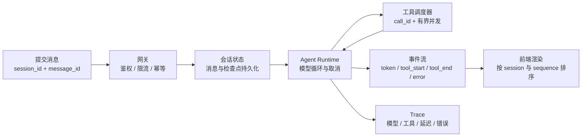
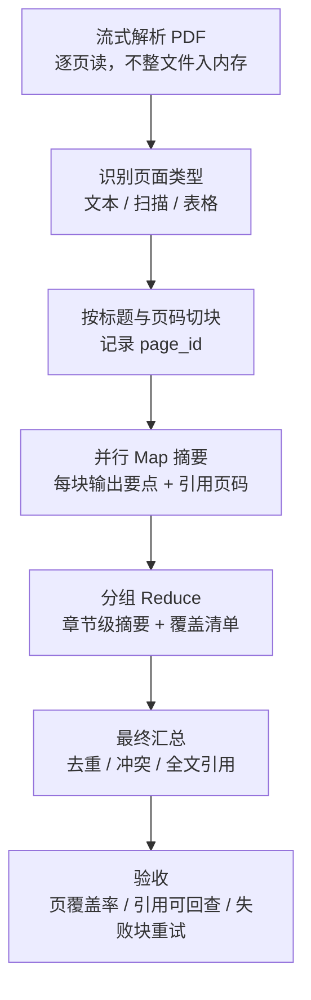

# 面经记录

**岗位方向：** 阿里云 Agent Infra，ATH 团队，AI 应用工程师；招聘页面归在前端研发序列，实际按全栈交付  
**时长：** 47 分 07 秒  
**面试形式：** 1 位技术面试官；项目深挖 + Agent 系统设计 + PostgreSQL / Redis + AI Coding；无算法题和现场编码  
**流程：** 自我介绍 → 谷歌 Memory → 字节评测与线上反馈 → 工具调用 → 全栈 Chatbot → 内存治理 → 1GB PDF → 延迟优化 → PostgreSQL / Redis → AI Coding → 反问  
**结果：** 未知  

> 公司归属以本人确认为准：这是**阿里云 Agent Infra** 的面试；录音中的「ATH」作为团队简称保留，不再单独建立公司画像。面试官开场自称「ATH 这边」，反问环节也介绍了团队对接通义模型、ECS、数据库和存储等阿里云能力。

> 📌 **来源说明：**「当时的回答」来自 2026-09-09 录音转录；姓名、学校和明显语音识别错误已按简历校正；项目数字以 [[谷歌实习]]、[[字节实习]]、[[用友实习]]、[[黑马点评项目]] 为 ground truth。无法还原的内部名词不做猜测。「改进后的回答」是复盘建议，不代表对应方案已经实现。

> [!warning] 谷歌项目进度待本人确认
> [[项目追问/谷歌Memory]] 截至 2026-08-18 仍记录「轨迹数据未就绪，留出集门禁只是设计」；本场 2026-09-09 却说已经完成多组评测、标签回填和自动回滚。这可能是三周内的新进展，也可能是把设计讲成了完成项。本文只按录音记录现场口径，**在本人确认前不回写简历和项目 ground truth**。

> [!warning] 保密边界
> 本场提到了内部环境限制、缺陷分类流程、标签来源和数据量，明显超过 [[谷歌实习]] 约定的公开粒度。复习时只保留通用实验设计与结论；对外是否能讲这些内部细节，需要本人重新确认。

## 0. 本场结论

这场前 22 分钟验证项目真实性，后 19 分钟连续给 Agent 系统场景。面试官真正关注的是：

1. **有没有评测裁决者。** Memory 改写、LLM judge、AI 生成代码都不能靠模型自己说「好了」。
2. **能不能把 Agent 当成生产系统。** 工具调用、并发会话、流式输出、状态持久化、内存、时延和数据库都要接起来。
3. **遇到追问能否先诊断再给方案。** 内存题连续追了四层，正是在检查你会不会区分泄漏、未淘汰状态和单会话工作集过大。
4. **岗位是否匹配全栈 Agent Infra。** 招聘入口虽然是前端研发，但团队明确要求从界面、服务端到模型与存储完整交付。

**本场高光：**

- Memory 不只讲读写，还讲了无标签 / 部分标签 / 完整标签对照、自然监督标签、回归门禁和回滚。
- 字节线上反馈链完整：点赞点踩、私聊追因、每周专家复核、追问轮数监控。
- Chatbot 系统题抓到了流式输出、并行 Tool Call 结果关联、会话隔离和 Subagent 终止，是全场最贴岗位的一段。
- 延迟优化给出小模型、RAG、Workflow 和分步骤模型路由，答案清楚。
- AI Coding 能讲业务 Context、Handoff 和测试验收，不是只说「我会 review」。

**本场最贵的五个问题：**

- Memory 与固定 Prompt / Skill 的区别答偏；面试官纠正「不是训练权重」后仍没有给出选择判据。
- LLM-as-a-Judge 只答重复采样、temperature=0 和自报置信度，漏掉最重要的人工标注校准。
- 内存题先把所有问题都归因于 State 放在内存，并反复答 offload；面试官两次指出单个活跃 Session 仍要全部读回。
- PostgreSQL / Redis 没取出简历里最强的指标和排障链，反而两次说「比较久远」。
- 关键数字没固定：谷歌日处理量靠猜；字节离线 87 分与现场后文「80% 正确率」没有说明是不是两种指标。

### 三处必须在下次面试前统一的口径

1. **谷歌 Memory：** 本场说「无标签 Memory 降准确率、增加 turn 和 token」；[[项目追问/谷歌Memory#🆕 Q8b: 通用 memory 接进来之后到底有没有用？（2026-08-14 字节三面首次报出实测结论）]] 记录的是「整体准确率在波动范围内、turn 和 token 下降」。两组结论只有在实验组不同的前提下才可同时成立。下次必须带组名、样本量和指标表，不能混讲。
2. **字节评测：** 56 → 87 是按专家得分点计算的**平均得分率**；本场后文又说线上「80% 正确率」。如果 80 是另一项线上指标，要明确名称和计算窗口；否则删除。
3. **谷歌项目进度：** 旧记录写的是「留出集门禁尚未实测」，本场说法却像已经落地。先确认实际完成日期、提交物和可公开证据，再决定下次用完成时还是方案时态。

---

## 1. 自我介绍

### 当时的回答（忠实压缩）

按谷歌 → 字节 → ARM → 西门子 → 用友介绍五段经历，最后说擅长 Python Agent 和 Java 后端。谷歌讲 Memory 评测，字节讲内部答疑机器人，ARM 讲 off-CPU 性能量化，西门子讲 RAG 链路，用友讲数据迁移。

> ⚠️ 转录把姓名识别成「谭野峰」、学校识别成「华理工大学」；正确口径是**谭演锋、华南理工大学本科、加州大学圣地亚哥分校硕士**。

### 改进后的回答（60 秒）

> 「我叫谭演锋，本科毕业于华南理工大学，现在在加州大学圣地亚哥分校读计算机硕士。最近两段经历都在做 Agent 工程。
>
> 在谷歌，我负责评测 Antigravity 的通用 Memory 插件在 Pixel Agentic Test System 中是否有效。我隔离实验与个人 Memory，对比无 Memory、无标签、部分标签和完整标签轨迹，并设计留出回归集门禁：改写后分数不升就回滚。
>
> 在字节，我主导复杂业务答疑飞书 Bot，服务 200 多名内部用户。用决策树门禁解决答案列不全，用审核 Agent 检查事实与分支，并建立 50 多条专家评分规则，平均得分从 56 提升到 87；同时适配多模型协议和 Trace。
>
> ARM、西门子和用友分别补了系统性能、RAG 和后端数据工程。我希望继续做 Agent 应用与 Infra，把模型、工具、会话、评测和全栈产品真正接起来。」

**题型 A（项目叙述）｜扣分：① 落点（五段平均展开，岗位相关主线出现得慢）**

---

## 2. 谷歌 Memory 做了什么？策略如何设计？

### 当时的回答（忠实压缩）

- 通用 Memory 插件不是本组研发，自己的任务是评估它在 Pixel Testing 场景的效果并做适配。
- 两条写入路径：
  - Inline：任务结束后从对话沉淀记忆。
  - Dreaming：每日定时汇总会话，统一格式并处理冲突、过时内容。
- 记忆是 Markdown，包含 title 和 description。
- 每轮模型调用取最近约 2000 token，与 Memory description 做相似度匹配，注入 Top-N 的描述和路径。
- 用在 CI/CD 失败分类 Agent：分析错误、分类、路由给对应团队。
- 本地隔离日常 Memory 与实验 Memory，对比无 Memory、无标签、部分标签、完整标签。
- 无标签 Memory 可能降低准确率，又增加读取文件、模型轮次和 token。
- 从工程师是否接受分类、是否重新分配 bug 得到标签；Memory 改写后跑回归集，分数不升就回滚。

> ⚠️ 上述最后三条是本场新增口径，与 2026-08-18 的项目 ground truth 冲突，尚未确认是否已经落地。

### 改进后的回答（90 秒）

> 「我先分现有机制、我的评测和我的改造。
>
> **现有机制**有在线和离线两条写入路径：任务结束时从当前轨迹提取记忆；每天再由 Dreaming 汇总、去重和处理冲突。记忆以 Markdown 保存，常驻索引只有标题、描述和路径，正文按需读取。
>
> **我的评测**是在 CI 失败分类 Agent 上做四组对照：无 Memory、无标签轨迹、部分标签轨迹和完整标签轨迹；同时隔离个人日常 Memory，保证唯一变量是实验 Memory。结果不是『装上就变好』：无标签组会把噪声沉淀成规则，既可能把原本能答对的题带偏，又增加读取和模型调用成本。
>
> **我的改造**是把真实反馈变成门禁。工程师接受分类且没有重新指派，只作为弱正向信号，还要抽样人工复核；每次候选 Memory 改写后跑留出回归集，困难题提升且简单题不退化才接受，否则回滚。我的价值不是写几条 Memory，而是让插件第一次有可隔离、可测量、可回滚的使用说明。」

**题型 B（项目机制）｜扣分：① 落点（先讲插件历史，自己的贡献出现较晚）+ ④ 口径（实验结论与旧笔记未按组名统一）**

> 术语校准：Inline 写入、Dreaming、留出回归集、门禁里，哪个术语是你之前没学过的？

---

## 3. 每天处理多少 bug？单次耗时多少？

### 当时的回答（忠实压缩）

单个 bug 约 5–10 分钟；这是后台 Agent，用户无感知。日处理量没有看过，现场猜「一天大概几十条」。

### 改进后的回答

> 「单条端到端耗时约 5–10 分钟，这个数字我看过。日处理量我没有核过，所以不报猜测值。我能确认的是历史系统累计约 3 万条记录，而本次实验用了最近一个月约 200 条；其中重复拉取会让记录数大于独立 bug 数。面试后我会补日独立 bug 数、重试次数和 p50 / p95 耗时。」

> ⚠️ 3 万条、200 多条、一天约 36 条、每日几十条和 5–10 分钟均为本场录音中的现场口径，尚未与可公开的项目材料逐项确认。

> p50 / p95 分别表示 50% / 95% 请求不超过的耗时，用来区分典型延迟和长尾延迟。

**题型 B（项目机制）｜扣分：④ 口径（没有数据却现场猜量级）**

> 术语校准：p50、p95、长尾延迟里，哪个术语是你之前没学过的？

---

## 4. 每天样本不多，怎么判断 Memory 有效？

### 当时的回答（忠实压缩）

用历史数据单独构建 evaluation benchmark。按多次运行表现分成简单、中等、困难样本；简单题一旦退化就回滚，困难题提高且简单题不变，才保留 Memory。

### 复盘

**技术定义：** Golden set 是答案和评分规则已经由人确认、专门用于稳定回归的评测样本。

**解决什么问题：** 每天线上几十条既少又受流量组成影响，直接比较当天接受率，可能把题目难度变化误判成 Memory 效果。

**机制：**

- 固定模型、代码、工具和运行环境，只切换 Memory。
- 按时间和根因去重后拆成：
  - 生成 Memory 的轨迹集。
  - 调参用的验证集。
  - 最终只验收、不参与修改的留出测试集。
- 简单题退化直接拒绝；困难题提升只是加分，整体指标仍需达到预设阈值。
- 同时记录准确率、工具轮数、token 和耗时，避免只优化一个指标。
- 反复调 Memory 时只看验证集；最终测试集保持冻结，防止只适配固定题库、换新样本就退化。上线后再做小流量试运行，观察真实反馈。

**面试怎么说（30 秒）：**

> 「线上日流量小，不能拿每天接受率直接比。我会用历史数据构建固定 Golden set，并按 bug 根因去重，严格拆开 Memory 生成轨迹和留出测试集。每次只替换 Memory，其余变量固定；简单题一旦退化就回滚，困难题提升且总体得分、成本指标都过门禁才接受。」

**题型 B（项目机制）｜扣分：③ 机制（没有说清训练轨迹与最终测试是否隔离）**

> 术语校准：Golden set、按根因去重、留出测试集里，哪个术语是你之前没学过的？

---

## 5. Golden data 评测集怎么构建？

### 当时的回答（忠实压缩）

系统历史累计约 3 万条记录；实验取最近一个月 200 多条，按一天约 36 条模拟 Dreaming。根据历史反复评测的表现区分难度，再补必须答对、容易混淆和需要专业工程师判断的分类。

### 改进后的回答

> 「我先去重，因为同一个 CI 错误会被重复拉取，3 万条记录不等于 3 万个独立样本。然后按时间和根因切分，避免同一错误的近似副本同时进入 Memory 生成集和测试集。样本分三类：高频基础类保证不退化、容易混淆类验证区分能力、长尾专家类验证新增价值。标签来自最终工单分类和工程师复核；每条还记录来源、难度和是否允许进入 Memory 生成。」

**题型 B（项目机制）｜扣分：③ 机制（原回答没有主动排除重复记录与数据泄漏）**

---

## 6. 为什么不直接用历史数据优化 Prompt / Skill，而要用 Memory？

### 当时的回答（忠实压缩）

一开始把「训练」理解成训练 Gemini 权重，回答无法控制模型。面试官纠正也可以是迭代 Prompt。随后说固定 Prompt 可以看成 Skill，方法可行；但主要解释自己的实习任务就是接入、评估 Memory 插件，团队其他 Agent 也不一定有足够历史数据。

> ⚠️ 这里被面试官纠正后仍没有正面给出两种方案的选择条件，是全场最明显的答偏。

### 复盘

**技术定义：**

- 固定 Skill 是离线从一批历史数据中提炼出的稳定规则或流程，发布后按版本更新。
- Memory 是系统运行时持续写入、检索和淘汰的外部状态，可能按用户、团队或任务作用域变化。

**解决什么问题：** 如果业务规则长期稳定，动态 Memory 只会引入噪声、成本和污染风险；如果知识持续变化或必须个性化，固定 Skill 又会很快过时。

**机制与判据：**

| 维度 | 固定 Prompt / Skill | Memory |
|---|---|---|
| 更新 | 离线批量、人工审核、版本发布 | 在线或定时增量写入 |
| 作用域 | 全局或版本级 | 用户 / 团队 / 任务级 |
| 稳定性 | 高，容易回归和回滚 | 易漂移，必须有写入门禁 |
| 适合 | 稳定流程、已有大批高质量历史数据 | 新模式持续出现、近期状态、个性化经验 |

**本项目更稳的结论：** 先用 3 万条历史数据提炼一个固定 Skill 作为强基线；只有新增错误模式、团队特定经验和短期环境状态进入 Memory。两者不是二选一。

**面试怎么说（30 秒）：**

> 「如果历史数据足够且规则稳定，我会先离线提炼固定 Skill，因为它版本可控、回归容易。Memory 只承接持续变化和有作用域的状态，比如新出现的错误模式、某个团队近期环境坑。固定 Skill 是稳定先验，Memory 是增量补丁；两者用同一留出集比较，Memory 没带来净收益就不接。」

**题型 C（通用知识）｜扣分：① 落点 + ② 诊断 + ④ 口径（把 Prompt 优化误听成训练模型权重）**

> 术语校准：Skill 版本、作用域、稳定先验、增量补丁里，哪个术语是你之前没学过的？

---

## 7. 字节的 56 → 87 是怎么测的？

### 当时的回答（忠实压缩）

把每道问题拆成多个得分点，命中一个得分点就获得相应比例；所有题求平均。存在 fatal error：出现严重错误时整题直接 0 分。由 LLM-as-a-Judge 判分。

### 改进后的回答

> 「严格说这是平均得分率，不是分类准确率。专家先为每题写必须覆盖的得分点和致命错误；Judge 只判断每个得分点是否命中，命中数除以总得分点数，致命错误则整题归零，再对全部题求平均。最终口径固定成：50 多条专家评分规则上的平均得分从 56 提升到 87。」

**题型 B（项目机制）｜扣分：④ 口径（沿用面试官的“准确率”，没有主动纠正为平均得分率）**

---

## 8. 怎么提高 LLM-as-a-Judge 的可信度？

### 当时的回答（忠实压缩）

多次测试取平均；把 temperature 设为 0 降低波动；让 Judge 输出置信度并过滤低置信度评分。中间有明显停顿。

### 复盘

**技术定义：** LLM-as-a-Judge 是让大语言模型按固定评分规则评价另一个模型的输出。

**解决什么问题：** temperature=0 只减少采样波动，不能证明评分正确；同一个 Judge 重复多次可能稳定地重复同一种偏差。模型自报的置信度如果没校准，也不能当可靠概率。

**机制：**

1. 专家把题目拆成明确得分点和致命错误，先减少主观空间。
2. 抽一批答案由专家盲评，再让 Judge 判同一批。
3. 用 F1 或一致率衡量 Judge 与人工是否一致；本项目已有口径约为 F1 0.8。
4. 专门测顺序、长度和自我偏好：交换答案顺序、控制篇幅、避免让生成模型给自己判卷。
5. 低一致或高风险样本交人工复核，并定期重抽样校准。

**面试怎么说（30 秒）：**

> 「temperature=0 只能降随机性，不能证明 Judge 判得对；重复同一模型也可能重复同一偏差。我的主方案是专家 rubric 加人工校准：抽样双盲标注，与 Judge 结果算 F1，一致性约 0.8；再测顺序和长度偏差。低一致或致命错误样本回人工，Judge 负责扩大规模，不替代人工验收。」

**当前来源核验：**

- [G-Eval 原始论文](https://arxiv.org/abs/2303.16634)显示结构化评测步骤能提高与人工的相关性，同时明确观察到对模型生成文本的偏好。来源：论文，置信度高。
- [2025–2026 LLM-as-a-Judge 综述](https://www.sciencedirect.com/science/article/pii/S2666675825004564)把人工一致性、位置 / 长度偏差和对抗稳定性列为核心可靠性维度。来源：综述，置信度中高。

**题型 C（通用知识）｜扣分：② 诊断 + ③ 机制（漏掉人工校准；自报置信度未经校准）**

> 术语校准：rubric、盲评、F1、位置偏差、校准里，哪个术语是你之前没学过的？

---

## 9. 字节 Agent 的耗时、成功率和线上反馈怎么收集？

### 当时的回答（忠实压缩）

- 生成 Agent 和 Review Agent 都要读代码，一次回答约 5–10 分钟。
- 单个模型轮次可能十几秒，也可能因资源排队达到一两分钟；通过适配多模型协议切换资源。
- 观察到模型轮次越多，答案越全面，因此不想直接减少轮次。
- 把生成与审核解耦：生成完成先返回，审核通过静默，审核发现问题再通知用户。
- 飞书 reaction、点赞点踩、私聊追因、每周专家审核约 5–10 题并补评分点。
- 监控用户追问轮数，把多次追问当作可能没答好的代理信号。

### 改进后的回答

> 「我把离线质量、线上效果和延迟分开。
>
> 离线是 50 多条专家 rubric，平均得分 56 → 87。线上我们有点赞点踩、点踩后的私聊原因、每周 5–10 条专家复核；追问率只能作为弱负向信号，因为用户也可能是在扩展新问题，不能直接等同失败。
>
> 延迟端到端约 5–10 分钟，主要变量包括模型排队、模型轮次和工具执行。审核是否异步要按风险分层：事实错误和权限问题必须在交付前拦截，只有完备性补充和表达优化可以后台审核后再通知。至于『轮次越多分越高』目前只是相关性，要按题目难度分层做对照，不能据此无限延长。」

**题型 B（项目机制）｜扣分：② 诊断（相关性说成优化依据）+ ④ 口径（没有回答明确线上成功率；80 与 87 未区分）**

> 术语校准：代理信号、端到端延迟、感知延迟、相关性里，哪个术语是你之前没学过的？

---

## 10. 怎么把工具告诉模型？代码怎么执行 Tool Call？

### 当时的回答（忠实压缩）

向模型提供工具描述、参数和参数含义；模型输出结构化 Tool Call。不同厂商 API 返回结构不同，框架解析出工具名和参数，再调用对应工具。

### 复盘

**技术定义：** Tool Calling 是模型输出「调用哪个工具、参数是什么」的结构化请求；真正执行工具的是 Agent Runtime，不是模型。

**解决什么问题：** 只靠自然语言让模型说「请查天气」，服务端无法可靠区分普通文本和可执行动作，也无法校验参数和权限。

**机制：**

1. 请求通过 API 的 tools 字段提供工具名、描述和 JSON Schema；它不一定是手工拼进 system prompt。
2. 模型返回调用 ID、工具名和结构化参数。
3. Runtime 校验 Schema、权限和用户确认，再执行工具。
4. 每个并行调用的结果按调用 ID 对回原请求，失败、超时和取消也必须有确定状态。
5. 工具结果作为下一轮输入交给模型，模型决定继续调用还是给最终答案。

**面试怎么说（30 秒）：**

> 「工具定义通过 API 的 tools 字段给模型，包含名称、描述和参数 Schema。模型只返回结构化调用请求；Runtime 负责校验参数、权限和审批，再执行。并行调用必须用 call ID 把结果一一对应，超时或失败也要形成明确结果，再进入下一轮模型调用。」

**来源类型与置信度：**

- [OpenAI Function Calling 官方说明](https://developers.openai.com/api/docs/guides/function-calling)：官方文档，高置信度；支持的配置下 strict 模式可让参数遵守受支持的 JSON Schema。
- [OpenAI Agents SDK 工具执行文档](https://github.com/openai/openai-agents-python/blob/main/docs/running_agents.md)：官方源码仓库，高置信度；模型是否产生并行调用与本地执行并发上限是两个不同控制项。

**题型 C（通用知识）｜扣分：③ 机制（漏参数校验、权限、调用 ID、失败与取消语义）**

> 术语校准：JSON Schema、Runtime、调用 ID、strict 模式里，哪个术语是你之前没学过的？

---

## 11. 有 1000 个工具，怎么保证有效调用？

### 当时的回答（忠实压缩）

两个方案：按依赖层级逐层暴露；或用 Skill 描述五个工具的使用条件和顺序，把 1000 个工具压成较少的 Skill，降低上下文压力。

### 复盘

**技术定义：** Tool Search 是先检索工具目录，只把当前问题最相关的少量完整工具定义加载给模型。

**解决什么问题：** 一次塞入 1000 份工具定义会占用大量上下文，工具名称相似时还会降低选择准确率。依赖层级只适合有固定阶段的流程，无法覆盖用户任意提问。

**机制：**

- 先按身份和租户过滤，模型不能看到无权调用的工具。
- 常用的 3–5 个工具常驻。
- 其余工具只在目录中保留名称、描述、参数摘要和权限标签。
- 根据用户问题做关键词或语义检索，取 Top-K 完整 Schema。
- 如果任务有固定阶段，再叠加「当前阶段只开放这一类」的状态约束。
- Skill 只有在能**延迟加载完整工具定义**时才真正省上下文；把 1000 个工具全塞进去再写 200 个 Skill，不会自动变少。

**面试怎么说（30 秒）：**

> 「我不会一次暴露 1000 个工具。先做权限过滤，再让 3–5 个高频工具常驻，其余放工具目录；根据当前问题检索 Top-K 完整 Schema。固定 Workflow 再加阶段约束。Skill 可以描述组合流程，但只有配合延迟加载才减少上下文，否则只是多了一层说明。」

**当前来源核验：**

- [Anthropic Tool Search 官方文档](https://platform.claude.com/docs/en/agents-and-tools/tool-use/tool-search-tool)明确支持从数百到数千工具中按需搜索，只加载命中的完整定义；来源：官方文档，高置信度。
- [Claude Code 架构社区逆向报告](https://zhiqiangshen.com/projects/Claude_Code_Report/Claude_Code_Report.pdf)观察到延迟工具定义与按需加载；来源：社区逆向，机制方向中等置信度，具体内部类名不当官方事实。
- 社区对 4000 余工具的基准显示 Tool Search 仍会漏选，因此工具召回率必须单独评测；这是社区实验，不代表官方保证。

**题型 C（通用知识）｜扣分：② 诊断（只覆盖有依赖层级的工具）+ ③ 机制（Skill 未说明延迟加载）**

> 术语校准：Tool Search、权限标签、Top-K、延迟加载里，哪个术语是你之前没学过的？

---

## 12. 设计一个 ChatGPT 式全栈 Chatbot，关键点是什么？

### 当时的回答（忠实压缩）

前端发 Query 给后端；模型异步生成，后端按 token 流式渲染。多用户、多 Session 要防串流。一次响应可能有多个 Tool Call，完成时间不同，必须把结果与调用正确关联。Subagent 也像流式工具，需要判断何时结束并触发下一轮推理。收口在并发下保证前后端和结果一致。

### 复盘

**技术定义：** SSE（server-sent events，服务端事件流）是服务器通过一个持续 HTTP 连接，按事件把增量结果推给浏览器。

**解决什么问题：** 没有稳定的请求标识、会话隔离和事件顺序时，多用户并发会串流；工具结果乱序会被接到错误调用；浏览器断开后后台任务还可能继续耗资源。

**机制：**

- 请求入口：鉴权、限流、幂等键，避免用户重试生成两份任务。
- 会话：按 session_id 隔离状态，message_id 标识一次用户输入。
- 模型输出：统一成带 sequence 的事件，SSE 推给前端。
- 并行工具：call_id 关联结果，有界并发，处理超时、取消和部分失败。
- 断线恢复：前端带最后收到的 sequence 重连，服务端从已持久化事件续传。
- 可观测：一次请求下的模型、工具和 Subagent 共用 trace_id。

**面试怎么说（40 秒）：**

> 「链路是前端提交带 session_id 和 message_id 的请求，网关做鉴权、限流和幂等；Runtime 读取会话检查点，进入模型—工具循环。输出统一成带 sequence 的事件，用 SSE 推给前端。多个 Tool Call 用 call_id 对结果，有界并发执行；超时、取消、断线重连都要有确定状态。最后用同一个 trace_id 串起模型、工具和 Subagent，才能排查串流与长尾。」

**来源类型与置信度：**

- [OpenAI Agents SDK 工具执行生命周期](https://github.com/openai/openai-agents-python/blob/main/.agents/references/tool-execution-lifecycle.md)：官方源码仓库，高置信度；明确要求并发结果保持确定顺序，并区分单工具取消与父任务取消。

**题型 C（系统设计）｜扣分：② 诊断（漏鉴权、幂等、断线恢复）+ ③ 机制（已经抓到并发关联，但缺完整状态流）**

> 术语校准：SSE、幂等键、sequence、trace_id、有界并发里，哪个术语是你之前没学过的？

---

## 13. 服务器内存持续升高，甚至单个 Session 超内存，怎么处理？

### 当时的回答（忠实压缩）

先说自己在谷歌遇到过，最简单是加内存；猜测 Harness / LangChain 把每步 State 保留在内存，建议把 State、长输入和会话历史 offload 到磁盘。面试官指出每次调用仍要读回完整历史后，改成只有活跃 Session 读入内存。面试官继续限定为单个 Session 后，才补充压缩历史、把 Tool Call 结果外置，以及使用 OpenAI 远程压缩。

> ⚠️ 同一问题被连续追问四层，说明「写盘」没有回答到单活跃 Session 的核心。

### 复盘

**技术定义：**

- 内存泄漏是已经不用的对象仍被引用，垃圾回收无法释放。
- 有效工作集增长是对象仍然需要，但会话、工具结果或缓存没有上限。
- 上下文压缩是减少下一轮发给模型的历史，不等同于修复进程内存泄漏。

**解决什么问题：** 三类问题的处理完全不同。泄漏要找到持有引用的对象；闲置会话过多要持久化和淘汰；单个活跃会话过大要减少每轮实际加载和发送的内容。

**机制：**

1. **先测再改：** 看进程内存曲线、活跃 Session 数和单 Session 大小；对比两次堆快照，找增长最快的对象类型与引用链。
2. **泄漏：** 检查未关闭的异步任务、流、回调、缓存、连接和 Subagent；任务结束必须进入确定终态并释放资源。
3. **多 Session：** 非活跃状态落数据库或对象存储，内存只保留索引和热会话；设置 TTL 与容量上限。
4. **单 Session：**
   - 大 Tool Result 原文落盘，消息只留路径、摘要和校验信息。
   - 清理可重新获取的旧工具输出。
   - 对早期对话做结构化压缩，保留目标、约束、已做决定、文件和未完成项。
   - 构建下一轮请求时流式读取必要块，不把整个 1GB 对象复制多份。
5. **远程压缩边界：** OpenAI 的 /compact 能减少后续模型上下文，但不会自动修复你服务里的对象引用；本地仍要持久化和释放原 State。

**面试怎么说（45 秒）：**

> 「我先区分三类：泄漏、闲置 Session 太多、单个活跃 Session 太大。先用堆快照找增长对象和引用链，不先假设是 LangChain。泄漏就修未关闭任务、流或缓存；多 Session 用持久化、TTL 和热会话上限；单 Session 则把大工具结果落外部只留句柄，清理可再取的输出，并对早期历史做结构化压缩。远程 compaction 只能减模型上下文，不能替我释放本地对象。」

**当前来源核验：**

- [OpenAI 原生 Compaction 官方说明](https://openai.com/index/equip-responses-api-computer-environment/)：可在服务端自动触发，或调用独立 /compact 接口生成压缩项。来源：官方文档，高置信度。
- [OpenAI Compaction 指南](https://developers.openai.com/api/docs/guides/compaction)：支持服务端自动压缩，也支持独立 compact 接口；来源：官方文档，高置信度。
- [Claude Code 架构社区逆向报告](https://zhiqiangshen.com/projects/Claude_Code_Report/Claude_Code_Report.pdf)：观察到工具结果预算、按需工具定义和压缩分层；来源：社区逆向，中等置信度。

**题型 C（系统设计）｜扣分：① 落点（从“加内存”开局）+ ② 诊断（未区分泄漏与工作集增长）+ ③ 机制（offload 不能解决仍需全量读回的活跃会话）**

> 术语校准：内存泄漏、有效工作集、堆快照、引用链、TTL、compaction 里，哪个术语是你之前没学过的？

---

## 14. 怎么让 Agent 总结一个 1GB PDF？

### 当时的回答（忠实压缩）

让 Main Agent 先读取 PDF 大纲，按大纲拆分，派多个 Subagent 分段总结，最后由 Main Agent 汇总。

### 复盘

**技术定义：** 分层摘要是先对小块分别总结，再把多个小结逐层合并，直到得到最终摘要。Map 是并行总结小块，Reduce 是合并同层小结。

**解决什么问题：** 1GB 是文件大小，不等于纯文本 token 数；文件可能包含扫描页、图片和表格。让 Main Agent 先完整读取大纲，仍可能在解析阶段耗尽内存，而且多段摘要容易漏页、重复或丢失引用。

**机制：**

- 逐页流式解析；扫描页先做 OCR（optical character recognition，光学字符识别）。
- 原始块和中间摘要落对象存储，内存只保留当前批次。
- Chunk 以章节和页码为边界，表格、脚注和跨页段落单独处理。
- Subagent 输出固定结构与引用页码；失败块可单独重试。
- Reduce 用树形多层合并，避免 Main Agent 一次读完几千段摘要。
- 最后检查页覆盖率和引用可回查，不只看文风。

**面试怎么说（40 秒）：**

> 「我不会让 Main Agent 先读完整 1GB 文件。先逐页流式解析，区分文本、扫描页和表格；按章节与页码切块，原文落存储。多个 Worker 并行输出固定格式的小结和页码引用，再树形合并成章节级和全局摘要。验收看页覆盖率、引用能否回查和失败块是否重试，峰值内存只跟单批大小有关。」

**题型 C（系统设计）｜扣分：② 诊断（默认有可靠大纲）+ ③ 机制（漏流式解析、引用、失败重试与多层归并）**

> 术语校准：分层摘要、Map、Reduce、OCR、页覆盖率里，哪个术语是你之前没学过的？

---

## 15. 怎么把 5–8 分钟的 Agent 缩短到 1–3 分钟？

### 当时的回答（忠实压缩）

换更小更快的模型；从开放式 Agent 探索改成 RAG；固定流程改成 Workflow；简单步骤用小模型、复杂步骤用大模型。

### 复盘

**技术定义：** 模型路由是根据任务难度和阶段，把请求分配给不同成本、速度和能力的模型。

**解决什么问题：** 直接减模型轮次可能降低答案覆盖率；直接换小模型可能降质量。必须先知道时间花在排队、首 token、生成、工具还是串行轮次。

**机制：**

1. Trace 每一轮的排队、模型、工具和框架耗时。
2. 简单问题走 RAG + 固定 Workflow；复杂问题才进 Agent。
3. 简单分类、格式化和检索路由用小模型，关键规划与最终核验用强模型。
4. 独立工具并行；把模型连续调用的细粒度工具合并成信息更完整的工具。
5. 稳定前缀使用 prompt cache；工具结果和业务数据使用结果缓存。
6. 流式返回首段答案；事实错误和权限风险同步拦截，完备性补充与表达优化才放到异步审核。
7. 只删无效轮次，不删带来质量提升的探索；所有改动用同一回归集做质量—延迟对照。

**面试怎么说（35 秒）：**

> 「先用 Trace 把 8 分钟拆成排队、模型生成、工具执行和串行轮次，不靠猜。然后四层：简单题改成 RAG / Workflow，复杂题才进 Agent；简单步骤用小模型，关键规划用强模型；独立工具并行并提高单次工具的信息密度；最后用流式首答降低感知延迟，只有非关键的完备性和表达审核走异步。只减无效轮次，质量用同一回归集守门。」

**题型 C（系统设计）｜扣分：② 诊断（方案正确，但没先拆延迟组成）**

> 复习：[[Agent延迟优化]]

> 术语校准：模型路由、首 token、prompt cache、结果缓存、质量—延迟对照里，哪个术语是你之前没学过的？

---

## 16. PostgreSQL 和 Redis 解决过什么难点？

### 当时的回答（忠实压缩）

PostgreSQL：用友数据清洗与比对需要多表 Join，查询和回写慢；给 Join / 条件字段加索引，尽量覆盖索引避免回表；逐行、逐事务插入改成 Batch。  
Redis：转去讲较早的秒杀项目，用 Redis 分布式锁和 Set 保证一人一单；两次强调「比较久远」。

> 口径校正：覆盖索引只是让查询更可能使用 Index Only Scan（只从索引取得所需列的扫描计划），不保证完全不读数据表页；PostgreSQL 仍可能为了判断某行对当前事务是否可见而访问数据表。分布式锁若被追问，要补齐 SET NX PX（仅键不存在时写入，并设置毫秒过期时间）、每个持锁者唯一标识和原子校验后释放；黑马点评的一人一单主链路则是 Lua 原子执行用户检查、库存检查与扣减，不是只靠 Set。

### 复盘

这题不缺知识，缺的是从简历里取出最强证据。

**更稳的项目事实：**

- 用友：8K+ 员工数据迁移；慢查询、pg_stat_statements 和 EXPLAIN ANALYZE 定位；重构索引、改写 SQL、消除 N+1；批量写入 PostgreSQL。
- Redis：缓存组织架构、岗位字典、流程配置和权限等高频字段；命中率约 90%，为 PostgreSQL 减少约 1K QPS，p95 下降约 40%。
- 黑马点评：一人一单不是只用 Set，必须用 Lua 把查库存、查用户、扣库存、写标记作为原子操作；数据库唯一键做最终兜底。

### 改进后的回答（45 秒）

> 「PostgreSQL 我在用友做 8K+ 员工数据迁移时实际优化过。先用慢查询、pg_stat_statements 和 EXPLAIN ANALYZE 找到多表 Join 与 N+1，再按过滤和 Join 条件重构索引，把逐行写改成批处理。
>
> Redis 同一个项目里缓存组织架构、岗位字典、流程配置和权限等高频读字段，命中率约 90%，让 PostgreSQL 峰值负载下降约 1K QPS，p95 延迟下降约 40%。如果追问秒杀，一人一单用 Lua 原子执行库存检查、用户检查和扣减，不会只答一个 Set。」

**题型 A（项目叙述）｜扣分：① 落点（没选简历最强项目）+ ③ 机制（Redis 一人一单说得不完整）+ ④ 口径（“必须覆盖索引”过于绝对）**

> 复习：[[PostgreSQL要点]] · [[Redis分布式锁]] · [[项目追问/用友数据迁移]] · [[项目追问/黑马点评秒杀]]

> 术语校准：pg_stat_statements、EXPLAIN ANALYZE、N+1、QPS、p95 里，哪个术语是你之前没学过的？

---

## 17. 怎么确保 AI 写的代码没有 bug、符合预期？

### 当时的回答（忠实压缩）

维护业务 Context 文档；每个任务结束记录做了什么和为什么这样决策；AGENTS.md 要求工作前先读；跨 Session 用 Handoff Skill。开发时先讨论需求与 Unit / Smoke / Integration Test，测试输入输出由自己理解；不希望只跑 Mock，最终以真实测试能否通过验收。

### 复盘

**技术定义：** Mock 是用可控制的替代实现模拟数据库、外部 API 等依赖。它适合隔离边界，但不能证明真实系统能联通。

**解决什么问题：** AI 可以同时写错实现和测试；如果测试也是它按错误理解写的，全部通过仍可能不符合需求。完全禁用 Mock 又会让单元测试慢、不稳定、难覆盖异常。

**机制：**

- 人先写清输入、输出、边界和不做什么。
- 测试先跑一次确认会失败，再让 Agent 写实现；否则不知道测试是否真的覆盖需求。
- 测试所有权在人：关键断言和留出用例不能让同一个 Agent随实现一起改。
- 单元测试可 Mock 外部边界；至少一条集成或端到端测试走真实组件。
- CI 运行类型检查、lint、测试和安全扫描，失败自动阻断。
- 最后用独立 reviewer 对照需求检查漏项与越界，不让实现 Agent 自己给自己判卷。

**面试怎么说（40 秒）：**

> 「不能保证 AI 写出无 bug，只能把验收变成机器可执行的门禁。人先定需求、关键断言和留出用例，先看到测试失败，再让 Agent 实现；CI 自动跑类型检查、lint、单元和集成测试。Mock 只用于不可控外部边界，至少一条真实链路验收。跨 Session 的 Context 和 Handoff 保持业务决策，但最终裁决者是测试与 CI，不是文档，也不是 Agent 自评。」

**题型 C（通用知识）｜扣分：② 诊断（“不要有 Mock”过于绝对）+ ③ 机制（漏测试先红、CI 闸门和独立验收）**

> 复习：[[AI-Coding工程实践]] · [[AI-Coding面试题]] · [[测试设计方法论]]

> 术语校准：Mock、留出用例、CI、端到端测试里，哪个术语是你之前没学过的？

---

## 18. 希望新岗位做什么？

### 当时的回答（忠实压缩）

希望继续做 Agent，完整接触 Agent Harness 的构建，理解各组件，并持续尝试新的 Agent、Workflow 和前沿方案。后面列举的几个具体名称被严重误转，无法可靠还原。

### 改进后的回答

> 「我希望继续做生产级 Agent 应用与 Infra。短期想完整负责一个功能，从前端交互、服务端 Runtime、模型与工具调用，到状态持久化、Trace 和评测都能接触；中期希望能根据搜索、金融等具体行业的工作流，判断哪些步骤应该由 Agent 决策，哪些必须固化成 Workflow。我的目标不是追每个新名词，而是持续把新能力用同一套质量、时延和成本指标验收。」

**题型 A（方向叙述）｜扣分：① 落点（方向正确，但用前沿名词枚举替代了岗位价值）**

---

## 反问与团队信息

### 团队在做什么

- 把 Agent 与不同行业数据和传统 Workflow 打通。
- 整合阿里云的千问模型、ECS、数据库和存储等基础设施。
- 面向搜索、金融等垂直行业提供 Agent 产品。
- 可自行构建 Agent Runtime。

### 岗位为什么挂在前端研发

面试官确认实际是 AI 应用工程师 / Agent Infra，全栈工作：

- 前端交互。
- 服务端功能。
- 模型与工具调用。
- 数据库与存储设计。
- 生产级 ToB / ToC 产品交付。

### 团队对人的要求

- 能理解真实业务场景，不只会搭通模型接口。
- 能判断 Agent 如何改变已有 Workflow。
- 有全栈意识，可以独立设计一块完整功能。
- 持续关注 Agent 前沿，但要能落到具体行业和生产指标。

---

## 总体评价

**匹配度：中高。** 项目经历与团队 Agent Runtime、Memory、工具、评测和全栈产品方向高度重合；Chatbot 并发链路、线上反馈和 AI Coding 段能证明有真实工程经验。

**风险集中在三处：**

1. 基础概念的选择判据没有固定：Memory vs Skill、上下文压缩 vs 进程内存。
2. 已经学过的机制现场取不出来：LLM judge 的人工校准、用友的指标和排障链。
3. 结论大于证据：日处理量靠猜、模型轮次与质量只看相关性、80 与 87 未区分。

**下次面试前只做五件事：**

1. 给谷歌四个实验组做一张固定表：样本、准确率、turn、token、结论。
2. 背熟一句：固定 Skill 是稳定先验，Memory 是带作用域的增量补丁。
3. 内存题开口先分：泄漏 / 多 Session / 单活跃 Session。
4. LLM judge 开口先说：temperature=0 不等于可信，人工校准才是裁决。
5. PostgreSQL / Redis 固定报四个数字：8K+、90%、1K QPS、p95 -40%。

---

## 原答案速查表

| 现场问题 | 当时回答核心原话 | 题型 | 扣分项 |
|---|---|---|---|
| 自我介绍 | 「五段实习……比较擅长 Python agent 和 Java 后端」 | A | ① |
| Memory 机制 | 「两个渠道沉淀记忆……inline、每天 dreaming」 | B | ①④ |
| 每日量与耗时 | 「一道题 5–10 分钟……没看过，应该一天几十条」 | B | ④ |
| 少量样本怎么评 | 「专门的 benchmark……简单题错了就回滚」 | B | ③ |
| Golden data | 「历史 3 万条……这个月 200 多条」 | B | ③ |
| Memory vs Prompt | 「不能训练 Gemini……叠 prompt 就变成 skill」 | C | ①②④ |
| 56 → 87 | 「一道阅读理解题，有很多得分点」 | B | ④ |
| Judge 可信度 | 「多次测试取平均、temperature 设 0、输出置信度」 | C | ②③ |
| 字节线上效果 | 「5–10 分钟……生成先给用户，review 出错再提示」 | B | ②④ |
| Tool Call | 「给描述和参数……解析 structure 后 call 对应工具」 | C | ③ |
| 1000 个工具 | 「有层级结构……或者写 skill」 | C | ②③ |
| 全栈 Chatbot | 「流式渲染……token 不要串流……tool 结果要对应」 | C | ②③ |
| 内存上涨 | 「比较简单粗暴，直接提高内存……offload 到 disk」 | C | ①②③ |
| 单 Session 超内存 | 「历史压缩……tool result 挪到磁盘……远程压缩」 | C | ②③ |
| 1GB PDF | 「按大纲拆分，派发 subagent，总结再合并」 | C | ②③ |
| 5–8 分钟降延迟 | 「小模型、RAG、workflow、不同 step 用不同模型」 | C | ② |
| PostgreSQL / Redis | 「加索引、batch……Set 一人一单，比较久远」 | A | ①③④ |
| AI 代码质量 | 「维护 context……测试 input output 是我掌握的，不要 mock」 | C | ②③ |
| 职业方向 | 「希望完整接触一个 harness 怎么构建」 | A | ① |

## 相关复习

- [[Agent记忆系统]]
- [[Agent记忆四家实现对比]]
- [[Agent上下文压缩链路]]
- [[Agent状态持久化与数据库选型]]
- [[Agent服务扩容与多租户]]
- [[Agent延迟优化]]
- [[Agent设计模式与MCP]]
- [[幻觉与事实性评测]]
- [[AI-Coding工程实践]]
- [[PostgreSQL要点]]
- [[Redis分布式锁]]
- [[项目追问/谷歌Memory]]
- [[项目追问/字节答疑Bot]]
- [[项目追问/用友数据迁移]]
- [[项目追问/黑马点评秒杀]]
