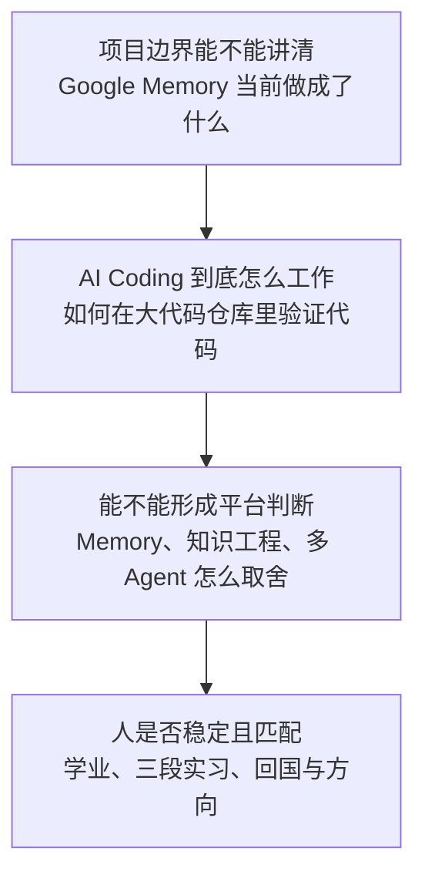

# 面经记录

**岗位方向：** AIDC（Alibaba International Digital Commerce，阿里国际数字商业集团）Agent infra（Agent infrastructure，Agent 基础设施）平台部门，阿里星 / Bravo Star 顶尖人才计划  
**时长：** 55 分 08 秒  
**面试官：** 1 位技术负责人 + 2 位 HR（human resources，人力资源）  
**流程：** 自我介绍与学业时间线 → Google Agentic Test System / Memory 深挖（约 21 分钟）→ Memory 与知识工程 → 字节答疑 Bot / 多 Agent / LLM Wiki 深挖（约 11 分钟）→ 职业方向 → HR 经历与意愿题 → 同类论文 → 反问  
**结果：** 未知；面试官明确说「能进到现在这轮，说明前面的面试表现还不错」，后续由招聘助理和 HR 跟进。**这是积极信号，不等于通过。**

> 我自己的面试录音转录整理。转录里 `Duo Ful` 应为 DeerFlow，`Skill OWL / Skill Offline` 应为 **SkillOpt / SkillOpt-Sleep**；`immediate token` 的具体数字无法从录音确认，因此不写成事实。Google 内部工具代号属于保密边界，正文只保留通用架构口径。LLM（large language model，大语言模型）Wiki 指由大语言模型生成并维护、供 Agent 分层导航的知识页面。

> 📌 **来源说明：**「当时的回答」来自 2026-08-20 录音转录；项目数字以 [[谷歌实习]]、[[字节实习]] 为 ground truth；「改进后的回答」是基于录音与追问库给出的建议，**不代表对应方案已经实现**。公共项目 SkillOpt 的事实在 §19 单独标来源、日期与置信度。

---

## 0. 本场主线：对方在看三件事，而不是只听项目介绍

**技术负责人反复追的不是「用了什么 Agent 名词」，而是：**

1. **当前产出与未来规划有没有分开。** 自进化是已经落地，还是隔离、测量落地后才要做？
2. **AI（artificial intelligence，人工智能）Coding 有没有硬证据。** 「我让模型读源码、帮我 debug」不够，要能说清任务怎么拆、上下文怎么交接、什么测试判定改动正确。
3. **设计是否真的解决原问题。** 审核 Agent 如果只审草稿、主 Agent 又保留原长上下文，那「长上下文导致错误」并没有被消掉。

**本场答得好的地方：**

- 把 Google Memory 的核心差异说出来了：**团队有历史任务和验证数据，能判断一次 Memory 改写究竟变好还是变坏。**
- 把本地隔离的污染路径讲清了：测试 Memory 与个人日常 Memory 如果共用召回空间，会污染实验。
- 字节答疑 Bot 坚持「文档只做地图，代码是事实来源」，方向正确。
- 职业方向明确选择 Agent 工程与 Agent infra，没有再把「想看全景」说成垂类。

**本场最贵的四个问题：**

- 又出现「这不是我做的 / 没仔细研究」，但没有立刻接上**自己的接口边界、验收标准和判断**。
- 把 Memory 与知识工程的差别说成「一个由 Agent 写、一个由人写」，定义过窄。
- 审核 Agent 保留原上下文重答，却声称长上下文问题不存在，论证被面试官连续追穿。
- HR 段直接评价 Google 业务「偏远、发展空间不大」，评价字节同事「只问我的、不分享他的」，没有必要地制造了负面信号。

---

## 1. 自我介绍（五段流水账，数字口径又漂了）

**当时的回答（粗糙）：** 按时间倒序讲 Google → 字节 → ARM → 西门子 → 用友五段实习。Google 讲 Pixel Testing Agent 的 Memory 和 AI infra；字节讲 Oncall Bot、决策树和 AST（abstract syntax tree，抽象语法树）；ARM 讲系统性能量化；西门子讲 RAG（retrieval-augmented generation，检索增强生成）；用友讲数据迁移。字节准确率说成了「56 分到 86 分」。

> ⚠️ 这场岗位已经连续两轮讲得很清楚：Agent 构建、知识、Memory、评测、沙箱。自我介绍仍然没有按岗位排序。  
> ⚠️ [[字节实习]] 的 ground truth 是 **56% → 87%**，不是 86%。数字漂移又复发。

**改进后的回答（60 秒）：**

> 「我叫谭远峰，现在在加州大学圣地亚哥分校读计算机硕士。我过去两段经历正好对应你们 Agent infra 里最关注的 Memory、评测和 Agent 工程。
>
> 现在在 Google，我负责 Pixel Agentic Test System 的 Memory 隔离与评测：把测试生成的 Memory、个人日常 Memory 和无 Memory 基线隔离开，在相同任务集上做对照，先回答『这套 Memory 到底有没有让执行变好』，再做后续的自进化。
>
> 在字节，我主导基于 DeerFlow 二次开发复杂业务答疑 Bot，服务 200+ 内部用户。针对长链路问答列不全和总结时张冠李戴，我加了决策树门禁与审核 Agent，并建立 50+ 条回归评测集，准确率从 56% 提升到 87%。
>
> 再往前的 ARM、西门子和用友分别补了系统性能、RAG 和后端数据工程。我希望继续做 Agent 工程和 Agent infra，尤其是 Memory、评测与运行时这一层。」

**题型 A（项目叙述）｜扣分：① 落点（无岗位定制）+ ④ 口径（86 与 87 冲突）**

---

## 2. 为什么 gap？什么时候回学校？（事实答清了，理由有风险）

**当时的回答（粗糙）：** 学制一年半，原计划 2026 年 12 月毕业；为了实习 gap 半年，改成 2027 年 6 月毕业。2026 年 9 月或 12 月都可以回去上课，目的是通过实习提高能力。

**改进后的回答：**

> 「我的硕士学制是一年半，第一学期已经正常完成。之后我做了一个九个月的 gap 计划，把毕业时间从 2026 年 12 月调整到 2027 年 6 月。这个选择不会改变我参加同一届秋招，但给了我一段连续的工程实践时间。我的目标不是多堆几段公司名，而是把 Agent 工程从模型调用一路做到评测、运行时和 Memory；ARM、字节、Google 三段分别补了这条链路里不同的一层。之后我会按学校安排回去完成剩余课程。」

> ⚠️ 后面的 HR 追问里说「计算机领域实习比课堂更重要」太绝对。更稳的口径是：**课程与工程实践解决不同问题，这次 gap 是在不影响毕业和秋招节奏的前提下补工程实践。**

**题型 A｜扣分：④ 口径（后文把实习与课堂说成高低关系）**

---

## 3. Agentic Test System 解决什么问题？核心挑战是什么？

**当时的回答（粗糙）：** 系统集成多个 Agent。一个把用户自然语言转成操作 Pixel 手机的测试步骤；另一个拉取线上 CI/CD（continuous integration / continuous delivery，持续集成 / 持续交付）错误并分类 bug、分配给对应人员。挑战是分类准确性，以及把描述转换成可以正确执行的步骤。

面试官追问后才澄清：测试用例由上游提供，系统不生成 test case 设计文档，只把已有测试意图转换成手机操作步骤。

**改进后的回答：**

> 「系统有两条任务链路。第一条不是生成测试用例，而是把已经存在的测试意图转换成可执行的手机操作步骤；第二条是把线上失败自动分类并路由给对应负责人。
>
> 两条链路各有一个核心指标：操作步骤最终能不能在真机上完成目标，以及失败能不能被分到正确类别。对我负责的 Memory 来说，问题再收窄一层：**历史轨迹沉淀成 Memory 后，能不能让下一次步骤生成或分类更准，而且不会被个人 Memory 污染。**」

**题型 B（项目机制）｜扣分：① 落点（先说成 test case 生成，后被纠正）**

---

## 4. 远程手机、异常状态怎么解决？（「不是我做的」开局复发）

**当时的回答（粗糙）：** 先把网络波动、远程连接、手机状态列为挑战；被问怎么解决时回答「这个不是我来做的，没有仔细研究过，我主要利用他们的 infra 做测试」。

**改进后的回答：**

> 「远程设备接入和异常恢复不是我实现的，我不把它算成我的产出。**我消费的是它提供的测试执行接口，我负责的是接口上层的 Memory 隔离与测量。**
>
> 这条边界对评测有一个直接影响：真机执行失败既可能来自操作步骤，也可能来自网络或设备环境，所以我不能只看一次端到端结果就判断 Memory 好坏。当前我的工作是先把有 Memory、无 Memory、个人 Memory 三种状态隔离出来；设备层的噪声怎么单独归因，是我会和执行 infra 负责人一起确认的验收口径，而不是我现场编一个没做过的方案。」

**题型 B｜扣分：① 落点（先把非本人工作说成核心挑战）+ ④ 口径（「没有仔细研究」后没接自己的边界）**

---

## 5. 自进化 Memory 用在哪、解决什么、怎么整合？（背景太长，当前与未来混在一起）

**当时的回答（粗糙）：** 公司内 Agent 要迁移到统一框架，平台自带通用 Memory，能用于问答、Coding 和业务 Agent。自己的团队有历史数据，可以判断 Memory 改写后性能提升还是下降，因此希望做成类似强化学习的反馈循环：生成 Memory → 数据集评测 → 不好就重写或回滚。

后续又说明：**现在落地的是本地隔离和批量测量，修改召回 query、召回内容、Memory prompt 与格式仍是后续工作。**

**改进后的回答：**

> 「我先把当前和未来分开。
>
> **当前已经做的是隔离与测量。** 平台提供一套通用 Memory，但测试场景同时存在个人日常 Memory、测试任务生成的 Memory 和无 Memory 基线。如果不隔离，实验结果无法归因。我搭的是本地批量测试环境，让同一套任务只改变 Memory 状态，比较执行效果。
>
> **下一步才是自进化。** 让 Memory 生成 Agent 基于历史轨迹提出修改，再用留出验证集做门禁：分数严格提升才保留，否则回滚。后续可优化的是 Memory 生成 prompt、召回 query 和文档结构。
>
> 所以我的核心价值不是『我写了一批 Memory 内容』，而是先补上**可隔离、可测量、可回滚**这三件事，使后续优化有裁决标准。」

**题型 B｜扣分：① 落点（核心价值到 12 分钟后才说清）+ ④ 口径（当前与规划混讲）**

---

## 6. 怎么衡量？Memory 有分类吗？你的核心价值是什么？

**当时的回答（粗糙）：** 拉取历史垂类数据模拟每日运行，让 Agent 生成 Memory，再经过门禁测试；不好就回滚，最后用 reward 数据集评估多天效果，并与无 Memory baseline 对比。Memory 文档本身按 project、用户偏好、踩坑等目录做简单分类；每份文档像 skill，有名称和 description，通过历史记录与 description 相似度召回。

**改进后的回答：**

> 「衡量要先固定对照：同一个模型、同一批任务、同一套执行环境，只切换 Memory 状态。**无 Memory 是基线，测试 Memory 是实验组，个人日常 Memory 必须排除。**
>
> 指标按任务链路分：步骤生成看与标准步骤的语义一致性和真机执行成功；缺陷分类看分类准确率。最终门禁看任务指标是否严格提升，不只看 Memory 文本写得像不像。
>
> 分类方面，平台当前不是按认知理论做复杂分层，而是按作用域和用途分组，例如项目、用户偏好和踩坑记录。召回时常驻的是名称与描述，正文按相关性读取。**我当前新增的不是分类体系，而是测试作用域的隔离与可重复评测。**」

**题型 B｜扣分：② 诊断（指标、实验变量、分类现状分散在多轮回答里）**

---

## 7. 为什么必须在一台机器上隔离？两台机器不行吗？

**当时的回答（粗糙）：** 美国方案用两个服务器或容器分别跑有 Memory / 无 Memory；中国本地没有这个条件，需要在一个容器内同时支持两种测试。个人日常 Memory 也会被召回，必须与测试生成的 Memory 隔离，否则造成污染。

**改进后的回答：**

> 「**技术上不要求必须是一台物理机器，两台也能做。我们真正要求的是控制变量。**
>
> 线上两台隔离环境最直观；本地资源受限时，我在同一个运行环境里切换 Memory 根目录和召回开关。这样模型版本、代码版本和执行环境不变，只让 Memory 这一项变化。
>
> 还要排除个人 Memory：如果测试 query 同时召回了我平时积累的文档，实验组就不是『测试 Memory』，而是『测试 Memory + 个人 Memory』，结果无法归因。所以一台还是两台只是实现方式，**真正的验收线是不同实验组之间没有 Memory 泄漏。**」

**题型 B｜扣分：① 落点（把资源条件说成技术必要性）**

---

## 8. 隔离里最有成就感的点、具体挑战、代码量级

**当时的回答（粗糙）：** 隔离涉及召回、文档存储、Memory 存储、总结 Memory 的 Agent 等多个服务，每个服务要做不同隔离并修 bug。Google 使用 monorepo，自己写的代码约四五千行，但需要阅读统一框架与 Memory 服务的大量源代码，在合适位置加 hook。还做了前端日志展示、单元测试、集成测试和 smoke test。

> `monorepo`（monolithic repository，单体代码仓库）指多个项目和共享组件放在同一个版本控制仓库里；它的难点不等于「代码行数多」，而是一次改动可能跨多个模块、所有权边界和测试链路。

**改进后的回答：**

> 「我自己的 diff 大约四五千行，但我不把行数当难度。难点是**隔离变量要穿过四个独立服务**：召回、文档存储、Memory 存储、Memory 生成。只改其中三个，剩下一个仍可能读到默认目录，实验就会泄漏。
>
> 我的做法是先把一次实验的隔离标识和存储根路径写成明确契约，再逐个检查四个服务的读写入口；验证分三层：单元测试检查每个入口是否读写指定空间，集成测试覆盖『召回 → 生成 → 再召回』，smoke test（冒烟测试，用最小链路确认系统能跑通）验证真实环境。
>
> AI Coding 的价值是在大代码仓库里帮我定位调用链和候选 hook 点；**最终是否正确由这些测试和日志裁决，不由模型自己总结的 log 裁决。**」

**题型 B｜扣分：① 落点（先报四五千行，被面试官判断为小项目）+ ③ 机制（隔离标识如何贯穿服务没讲出来）**

---

## 9. AI Coding 的具体挑战和你学到什么（有方法，但没形成可验收闭环）

**当时的回答（粗糙）：** 内部只能用 Gemini，模型会对日志产生幻觉。自己的做法是维护仓库 context、拆小目标、设计 unit / integration / smoke test、维护 handoff skill，在不同 session 间交接，尽量减少 human in the loop，让 Agent 持续开发。

**改进后的回答：**

> 「挑战不是让模型一次读完整个代码仓库，而是让它在有限上下文里找到正确的改动点，并且我能验证它没有漏掉隔离路径。
>
> 我把工作拆成三类文件：目标与边界、当前进度与已验证事实、下一会话的交接说明。每个子任务只允许改一个隔离入口，完成条件不是『模型说改好了』，而是对应测试通过并能从日志看到读写落在指定空间。跨会话时只交接事实、未完成项和验证命令，不把几十轮失败对话全部带过去。
>
> 所以我学到的不是『怎么少介入』，而是**怎么把人的判断编码成 Agent 能自己运行的检查**。轮次少只是可能的结果，代码质量和验证证据才是目标。」

> 复习：[[AI-Coding工程实践]] · [[AI-Coding面试题]]

**题型 B｜扣分：② 诊断（把「减少人介入」说成目标）+ ③ 机制（handoff 交接什么没讲清）**

---

## 10. 你在这个过程中学到了什么？

**当时的回答（粗糙）：** 一是如何用大语言模型开发并减少人的介入；二是自进化 Memory 中最重要的是轨迹、验证数据集和门禁，怎么分类成功 / 失败轨迹、做多少步可能没那么重要；三是后续要做好 Memory 探索。

**改进后的回答：**

> 「我有两个收获。
>
> 第一个是工程上的：Agent 写代码时，真正可复用的是**任务边界、可运行验证和跨会话交接**，不是某一条 prompt。只要验收标准仍在人的脑子里，就做不到稳定自动化。
>
> 第二个是 Memory 上的：自进化不是『让模型不断改』，而是『执行轨迹产生候选修改，留出验证集决定是否接受，失败修改留下负反馈』。但我不会再说只有门禁重要——**单次改动幅度、被拒修改的记录和回归检查同样决定稳定性。**」

**题型 A｜扣分：④ 口径（把未验证的「其他都不重要」说得太满）**

---

## 11. Memory 与知识工程是什么关系？（本场技术概念题失分最大）

**当时的回答（粗糙）：** 两者本质都是 prompt；知识工程需要人工写和管理，类似 skill；Memory 是后台进程，主要由 Agent 自动写，不需要人参与。最大区别是有没有 human in the loop。

> 🔴 **这个区分站不住。** 知识工程可以自动抽取，Memory 也可以由用户显式写入；「谁来写」不是稳定边界。

**改进后的回答：**

> 「我先定义两个词。
>
> **知识工程**是把领域知识变成可检索、可维护、可追溯资产的过程，重点是来源、结构、版本、责任人和验证规则。**Agent Memory** 是 Agent 在运行中保存的外部状态，用来影响后续任务，重点是写入、召回、作用域、冲突和淘汰。
>
> 两者不是按『人写还是 Agent 写』区分，而是按生命周期区分：知识工程维护的是**组织级事实和规则**，Memory 保存的是**某个用户、项目或 Agent 从交互中得到的状态与经验**。
>
> 它们的关系是上下游：Memory 里反复被证明有效的经验，可以经过来源校验、去重、定责后升格为组织知识；组织知识也可以作为 Memory 召回时的事实约束。**未经验证的 Memory 不能直接当知识库，知识库也不该替代每个 Agent 的运行状态。**」

> 置信度：**高（概念模型）**；来源类型：知识管理的一般定义 + Agent Memory 工程实践，最后一段是我的归纳。

**题型 C（通用知识）｜扣分：🔴 ① 落点（定义错误）+ ② 诊断（忽略两者生命周期与治理差别）**

---

## 12. 什么场景需要 Memory？为什么字节答疑 Bot 反而关掉了 Memory？

**当时的回答（粗糙）：** Memory 适合长时间运转、希望不断吸取教训的 Agent，不适合单轮回答或固定 workflow。字节知识库会腐化，旧事实写进 Memory 后 Agent 会偷懒直接回答，所以关闭 Memory，强制以代码为事实来源。Memory 更适合优化「怎么做」的 action，不适合回答必须准确的事实。

**改进后的回答：**

> 「我会看两个条件，不只看任务运行时间。
>
> 第一，任务之间有没有可复用的过程经验，例如『遇到这种手机状态先做哪一步』；第二，这些经验有没有验证和回滚信号。两个条件同时满足，Memory 才会随着使用变好。
>
> 字节答疑 Bot 的核心目标是事实正确，业务规则又持续变更，所以**事实本身不能从 Memory 直接回答，必须回到代码取证**。我关闭的是『拿旧答案当事实』这条路，不是否定所有 Memory。可保留的是程序性经验——例如先定位业务名词、再查哪些仓库、如何逐分支验证；这类 Memory 优化的是检索和验证过程，不替代最终证据。
>
> 一句话：**变化快的事实留在事实源，可复用的做法才进 Memory。**」

**题型 C｜扣分：无（方向正确；原回答只需把「长时间」换成可验证判据）**

---

## 13. 简单问答为什么从单 Agent 拆成多 Agent？（被追问到核心漏洞）

**当时的回答（粗糙）：** 40 多个代码仓库导致上下文很长，主 Agent 容易把 A→B 总结成 A→C。拆成生成 Agent 和审核 Agent：审核发现错误就提示主 Agent 重答；问题范围太大时也反问用户。重答时保留主 Agent 原上下文，在末尾追加审核提示，认为新模型更关注开头和结尾，因此能改正。实测认为有效。

面试官连续追问：**如果原上下文不清掉，长上下文问题不还在吗？这仍然只是概率有效。**

**改进后的回答：**

> 「先纠正『简单问答』这个前提：用户输入是一句话，但回答要跨 40 多个仓库梳理业务分支，它是长链路取证任务，不是简单问答。
>
> 拆审核 Agent 只有在两条都成立时才有价值：第一，它拿的是**干净上下文 + 决策树 + 答案草稿**，不继承主 Agent 几十轮工具调用；第二，它保留独立代码读取权限，能拿证据复核，而不是只评价文风。
>
> 本场我描述的实际实现里，审核后仍让原主 Agent 带着旧长上下文重答。**所以我不能说长上下文问题已经被解决，只能说审核提示提高了部分 bad case 的改正率。** 真正要解决，打回后应该开干净的生成会话，或者只保留决策树、错误证据和必要代码片段再生成。
>
> 多 Agent 的价值不是多一个模型投票，而是**把探索、审核、重写三步的上下文和裁决责任分开。**」

> 复习：[[项目追问/字节答疑Bot]] · [[Agent设计模式与MCP]] · [[Agent上下文压缩链路]]

**题型 B｜扣分：🔴 ② 诊断（原实现没有消掉根因）+ ③ 机制（审核 Agent 的独立证据链没讲）**

---

## 14. LLM Wiki 做了吗？代码更新后为什么不更新 Wiki？

**当时的回答（粗糙）：** query 先经过 LLM Wiki，把自然语言映射到代码仓库，再查代码生成答案。Wiki 来自 PRD（product requirements document，产品需求文档）、design doc 和代码，但代码可能绕过文档直接变化，所以 Wiki 会过期，只能做地图，代码才是事实来源。

面试官追问为什么不根据代码更新 Wiki。回答逐渐变成：另一个组负责、组间有竞争；如果原 Wiki 错了，基于 commit 更新也可能继续错；复杂业务语义仍需 human in the loop。面试官直接反问：「代码都不能信了，还有什么可信？」

**改进后的回答：**

> 「您说得对，**代码合并后应该触发 Wiki 更新；我们当时缺的是这条变更链路。**
>
> 我会把它拆成两层。第一层是自动更新：代码合并后找出受影响的业务符号和 Wiki 页面，生成候选修改并跑旧问题回归。第二层是人工裁决：如果代码只能说明执行逻辑、不能说明业务名词为什么这样定义，就让对应领域负责人审核后发布。
>
> 运行时仍然要回代码取证，因为 Wiki 更新存在延迟，也可能漏掉跨仓库影响。**所以『根据代码更新 Wiki』和『回答时回代码验证』不是二选一：前者降低过期率，后者给最终答案兜底。**
>
> 我当时做的是消费这份 Wiki 并要求它提供业务词到代码符号的映射；更新流水线由另一组负责。但如果让我重新设计，我会优先补上代码合并事件到受影响页面的自动更新和回归门禁。」

**题型 B｜扣分：🔴 ① 落点（没有先承认缺口）+ ④ 口径（把组间竞争带进技术回答）**

---

## 15. 做过大模型推理链路的性能、成本、体验优化吗？

**当时的回答（粗糙）：** 先误解成微调或监督学习；面试官澄清是大模型推理链路的性能、成本和体验后，回答「没有做过」。

**改进后的回答：**

> 「如果您指模型服务和推理引擎这一层，我没有直接做过，不会把 Agent 优化冒充成模型推理优化。
>
> 我做过的是上一层：字节的多模型网关适配、prompt cache、上下文 offload 和评测，它们会影响调用成本与体验，但没有涉及模型权重、推理内核或服务调度。我的优势在 Agent runtime（Agent 运行时，负责循环、工具、上下文与状态的那一层），更底层的模型服务是我明确的能力边界。」

**题型 C｜扣分：① 落点（先把问题听成训练）+ ④ 口径（只答「没有」没给相邻能力边界）**

---

## 16. 毕业后方向、为什么回国、Google 没有 offer 吗？

**当时的回答（粗糙）：** 希望回国，因为家人、女朋友都在国内，且「家里出了点事，不能离开中国太长时间」。被问 Google 转正时，回答 Pixel 是偏远手机、Testing 用户不多、不是主力方向、发展空间没那么大，所以会看外部机会。职业方向倾向 Agent 开发或 Agent infra，想做 Memory、可观测和 evaluation，不做算法。

> 🔴 「家里出了点事」已是多场复发，既暴露隐私又会引来稳定性追问。  
> 🔴 面试中贬低当前业务，听者不会只理解成「岗位不匹配」，还会判断你以后也会这样评价他所在的团队。

**改进后的回答：**

> 「我毕业后计划回国长期发展，家庭和长期职业网络都在国内，这个决定比较明确。
>
> Google 实习还在进行，我目前没有正式的转正结果。我看下一份工作的标准不是公司名，而是岗位能不能让我对 Agent 核心链路承担完整责任。现在这段让我把 Memory 隔离和评测做深了；下一步我希望继续做 Agent 工程或 Agent infra，重点是 Memory、评测、可观测和运行时。
>
> 我没有做模型算法训练，所以不会把自己包装成算法工程师；我的优势是把 Agent 能力做成可运行、可验证、可维护的工程系统。」

**题型 A｜扣分：④ 口径（隐私信息 + 贬低当前业务）**

---

## 17. 为什么九个月做三段实习？（HR 在验证稳定性）

**当时的回答（粗糙）：** 九个月实习是计划好的，具体几段取决于机会。原本想在字节做到 9 月，但 2 月面的 Google 到 5 月才发 offer；Google 中国实习名额少、体验新奇，字节以后还能回，所以转去 Google。

**改进后的回答：**

> 「九个月 gap 是一开始就确定的，三段公司的组合不是预先设计的。ARM 项目到期后我进入字节，原计划持续做到 9 月；Google 的流程从 2 月持续到 5 月，offer 到得比预期晚。
>
> 我最后选择切换，判断标准有两个：字节那一阶段的核心开发已经完成并进入稳定迭代；Google 给的是一个相邻但更底层的问题——Memory 的隔离、评测和自进化。这个选择确实牺牲了在单一团队沉淀更久的机会，所以我不会把『三段』本身包装成优势；它的价值只在于三段产出能连成一条 Agent 工程链路。
>
> 对全职工作我的标准不同：我希望在一个方向上持续承担更完整的结果，而不是继续按实习机会切换。」

**题型 A｜扣分：② 诊断（原回答强调稀缺与新奇，没回应稳定性代价）**

---

## 18. 字节的成长、组织氛围、喜欢与不喜欢；给 offer 会回吗？

**当时的回答（粗糙）：** 喜欢的是两三个月只 focus 一件事、内网前沿文章多、mentor 很好。不喜欢的是内部多个组做相似 Agent，有赛马和竞争；有的同事只来问自己的思路、不分享对方思路。若字节秋招给 offer，「一般般」，因为所在组本质是后端业务组，不是专门做 Agent，自己更想做 Agent。

**改进后的回答：**

> 「字节这段我最喜欢的是目标聚焦和反馈快：两三个月持续围绕一个 Bot，把框架二次开发、评测和上线闭环做完，mentor 也给了我很大空间。组织上多个团队同时探索相似方向，优点是迭代快，挑战是需要更早对齐边界和复用方式，避免重复建设。
>
> 如果秋招有 offer，我会看具体团队和岗位。字节这段经历很好，但当时所在团队的主业务是商家与达人平台，Agent 是提效工具；我长期更想做 Agent 核心模块或 Agent infra。如果岗位方向匹配，我会认真考虑，而不是仅凭公司或旧团队直接判断。」

**题型 A｜扣分：④ 口径（评价具体同事 + 「一般般」过于随意）**

---

## 19. 行业内有什么同类 Memory 工作？哪些值得借鉴，哪些不同？

**当时的回答（粗糙）：** 把微软项目说成「Skill OWL」，把 7 月的新工作说成「Skill Offline」。核心理解是批量轨迹交给 Skill 优化 Agent，加门禁防止 Skill 腐化；认为分层、短长期记忆、提取和图谱等操作不一定有用，门禁肯定最重要。

**事实订正：**

- 正确名称是 **SkillOpt**，Microsoft Research 2026 年 5 月发布；它把 Skill 文档视为冻结模型之外的可训练文本状态。
- 循环不是只靠门禁：轨迹执行 → 反思 → 候选编辑 → 有界 add / delete / replace → 留出验证集门禁；被拒修改会进入缓冲区，跨轮还有慢更新。
- **SkillOpt-Sleep** 是 2026 年 6 月开始 preview、7 月随 v0.2.0 发布的离线自进化工具：收集历史会话、挖重复任务、重放、合并候选修改，通过留出门禁后再供用户采用。
- 2026-07 的扩展消融明确提醒：小差异没有完整置信区间，不能把探索性结果讲成「只有门禁有效」。
- 2026-08-18 的一篇新论文进一步指出：**准确率提升不代表安全性不退化**，自进化门禁还要检查旧能力回归、接触恶意输入后的行为和越权状态变化。该论文很新，结论应视为初步证据。

**改进后的回答（45 秒）：**

> 「最接近的是 Microsoft Research 的 SkillOpt。它把一份 Skill 文档当成冻结模型之外的可训练状态：拿成功和失败轨迹提出有限数量的增删改，只有留出验证集严格提分才接受，被拒的修改还会留下来避免重复犯错。SkillOpt-Sleep 又把这套循环放到日常 Coding Agent 的离线时段。
>
> 对我最有借鉴的不是单独一个门禁，而是三件事组合：**轨迹作为训练样本、单步修改有界、修改必须经过独立验证。**
>
> 和我们不同的是，SkillOpt 主要优化一份紧凑的 Skill 文档；我们的场景是多份可召回 Memory，并且最终要在真实手机上执行。我们当前先解决隔离和测量，还没有做成完整文本优化器。
>
> 另外我现在会给门禁再补一维：除了任务成功率，还要做旧能力和安全回归。只在平均准确率上提分，仍可能把危险行为写进长期 Memory。」

> 📌 出处：Microsoft `microsoft/SkillOpt` [GitHub 源码与 README](https://github.com/microsoft/SkillOpt) · [SkillOpt 论文](https://arxiv.org/abs/2605.23904) · [2026-07 扩展消融](https://microsoft.github.io/SkillOpt/blog/gating-reflection-safe-updates/) · [2026-08 自进化安全审计论文](https://arxiv.org/abs/2608.17684)；查证于 2026-08-20。  
> 置信度：项目名、机制与官方消融 **高（源码 / 官方技术博客 / 论文）**；安全审计的普适性 **中（新论文、特定金融实验）**。

**题型 C｜扣分：🔴 ④ 口径（项目名说错两次）+ ② 诊断（把消融结论压成「只有门禁重要」）**

---

## 20. 反问：你们期待什么样的校招生？团队与阿里云 Agent infra 的边界是什么？

**当时的反问：**

1. 对优秀校招生的硬能力和软能力有什么期待？
2. 阿里云与阿里国际都做 Agent infra，区别在哪里？

**面试官给出的答案：**

**硬能力：**

- AI Coding 的使用深度：能否通过有效引导，让 Agent 用更少轮次达到目标代码质量。
- Agent infra 的熟悉程度：什么时候拆主 Agent / 子 Agent，分别承担什么；什么时候做 Agent、什么时候沉淀 Skill；评测标准是什么。

**软能力：** 聪明、开放、务实；愿意承担 dirty work（琐碎但必须完成的工程工作），并从真实问题里长出更抽象的能力。

**团队边界：**

- 阿里云提供更底层的沙箱、云电脑等基础设施。
- AIDC 负责更靠业务场景的 Agent 生成、vibe coding、workflow、评测和线上运行监控。

> ✅ 两个反问都有效。第二问直接问出了组织边界，说明这个岗位不是从零自建底层沙箱，而是在云基础设施之上做 Agent 生产与运行平台。
> ⚠️ 听完「AI Coding + Agent/Skill 取舍 + 评测」后，应该当场接一句自己的匹配证据：Google 的隔离评测、字节的门禁和审核 Agent、这场 SkillOpt 调研，正好分别对应三点。

**反问环节｜扣分：钩子没接（面试官把评价标准说完后，没有把自己贴回去）**

---

## 21. 总结 / 自评

### 本场判断

这是**技术负责人终面性质 + HR 稳定性核验**的混合面。技术负责人用 35 分钟验证项目深度和判断力，HR 用 6 分钟追学业、实习切换和组织评价，最后由另一位面试官补一题行业调研。没有算法，也没有传统八股。

**积极信号：**

- 面试官明确说前面表现不错，愿意保持联系。
- 反问阶段完整解释了团队招人标准、职责边界和与阿里云的分工，投入信息较多。
- 你的目标方向与岗位相符：Agent 工程 / Agent infra，尤其 Memory、评测、可观测。

**风险信号：**

- Google 项目多次被追问「你的核心价值是什么」，说明当前叙述仍像「搭测试环境」，没有在前 20 秒说出隔离与测量为何是自进化前提。
- AI Coding 方法很多，但面试官一直追「具体挑战在哪里」，说明缺少一个硬核案例：哪个调用链最难找、模型错在哪里、哪条测试抓住了它。
- HR 段的负面措辞会放大稳定性疑虑：三段实习本来就在被核验，再评价 Google 业务边缘、字节同事不分享，会形成「遇到更好机会就离开」的叙事。

### 如果只能改三件事

1. **Google 项目固定用三句开头：当前做隔离与测量 → 它是自进化的前置条件 → 自进化仍是下一步。** 不再把现在与未来混在一起。
2. **多 Agent 题主动承认现状没有根治长上下文。** 审核 Agent 必须拿干净上下文和独立证据，打回重写也要清理旧上下文；否则只能说「实测改善」，不能说「问题不存在」。
3. **HR 答案停止评价别人和业务。** 所有离开理由都改成「我下一步选择什么、判断标准是什么」，不说当前团队哪里不行。

---

## 原答案速查表（按原话回顾用，别看改进版）

| # | 题目 | 题型 | 当时的原话（浓缩，保留原措辞） | 扣分项 |
|---|---|---|---|---|
| 1 | 自我介绍 | A | 「现在在谷歌实习……字节做 Oncall 机器人……准确性的评分从 56 分达到 86 分……ARM……西门子 RAG……应用网络数据迁移」 | ① 落点 · ④ 数字 |
| 2 | 为什么 gap / 什么时候回去 | A | 「因为我的 gap 我变成明年 6 月毕业」「今年 9 月份或者 12 月份都可以」「希望说实习提高自己能力」 | ④ 口径 |
| 3 | 测试系统解决什么 / 挑战 | B | 「一个是自然语言到 testing 的转换……另外一个是 bug 分类」「分类准确性」「描述怎么转换执行语句」 | ① 落点 |
| 4 | 远程手机和异常怎么解决 | B | 「这个不是我来做的……没有仔细研究过这一块……主要利用他们的 infra 来做一些测试」 | ① 落点 · ④ 口径 |
| 5 | Memory 用在哪 / 怎么整合 | B | 「通用 Memory 写了以后无法知道性能提高还是下降」「我们能够给它提供一套数据集验证……反馈给 Agent 重新修改或者回滚」 | ① 落点 · ④ 当前/未来 |
| 6 | 怎么度量 / 有分类吗 | B | 「历史垂直头的数据拉下来……有一个门禁」「没有 Memory 的 baseline」「project、用户偏好、踩过的坑是文件夹」 | ② 诊断 |
| 7 | 为什么一台机器隔离 | B | 「分开两台首先我们没有这个条件」「测试 Memory 也会把自己平时的 Memory 召回……造成污染」 | ① 落点 |
| 8 | 隔离挑战 / 代码量 | B | 「召回、文档存储、记忆存储、总结记忆 Agent 都是服务」「四五千行是有的」「要研究 JASKI 和 Memory 代码，在合适地方加 hook」 | ① 落点 · ③ 机制 |
| 9 | AI Coding 具体怎么做 | B | 「维护好仓库 context」「拆成一个个小目标」「unit test、integration test、smoke test」「handoff 到不同 session」 | ② 诊断 · ③ 机制 |
| 10 | 学到了什么 | A | 「怎么减少我的介入」「最重要的是轨迹和验证数据集」「怎么分类成功失败 trajectory 可能没那么重要」 | ④ 口径 |
| 11 | Memory 和知识工程 | C | 「本质上都是 prompt」「知识工程需要人工介入」「Memory 不需要人参与」「最大区别是有没有 human」 | 🔴 定义错误 |
| 12 | 什么时候引入 Memory / 字节为什么关掉 | C | 「能长时间运转的 Agent」「知识库容易腐化」「一定要阅读代码，以代码为 source」「Memory 优化怎么做，不让它基于 Memory 回答事实」 | — |
| 13 | 简单问答为什么多 Agent | B | 「40 多个仓库，context 比较长」「生成和审查两个」「保留原来上下文重新生成」「结尾给提示，它会有意识改正」 | 🔴 根因未解 |
| 14 | 代码更新后更新 LLM Wiki | B | 「这是另外一个同事在做」「前端组和后端组存在竞争」「原本 Wiki 错了，拿 commit 记录生成还是错」 | ① 落点 · ④ 口径 |
| 15 | 推理链路优化 | C | 「您的意思是微调或者监督学习吗」「没有，我没有做过」 | ① 落点 |
| 16 | 回国 / Google offer / 方向 | A | 「家里出了点事」「Pixel 很偏远，Testing 用户不算多，不是主力方向」「倾向 Agent 开发或者 Agent infra」 | ④ 口径 |
| 17 | 九个月为什么三段实习 | A | 「原本想在字节一直实习到 9 月」「Google 5 月才下正式 offer」「字节还能再去，Google 中国名额少、更加新奇」 | ② 诊断 |
| 18 | 字节氛围 / 会回吗 | A | 「有的同事只询问我的思路，不分享他的思路」「我一般般……它本质上是后端组，不是做 Agent」 | ④ 口径 |
| 19 | 行业内同类工作 | C | 「微软的 Skill OWL」「今年 7 月新的 Skill Offline」「真正有效两点：batch 轨迹和门禁」「别的分层、提取、图谱不一定有效」 | 🔴 名称 · 消融结论 |
| 20 | 反问校招生标准 / 团队边界 | — | 「优秀校招同学有什么期待」「阿里云和阿里国际都做 Agent infra，区别点在哪里」 | 钩子没接 |

---

**双链复习：** [[项目追问/谷歌Memory]] · [[项目追问/字节答疑Bot]] · [[Agent记忆系统]] · [[Agent记忆四家实现对比]] · [[AI-Coding工程实践]] · [[AI-Coding面试题]] · [[Agent设计模式与MCP]] · [[Agent上下文压缩链路]] · [[幻觉与事实性评测]] · [[资料/面经/阿里国际/Agent Infra/阿里星一面_2026-08-06]] · [[资料/面经/阿里国际/Agent Infra/阿里星二面_2026-08-18]]
